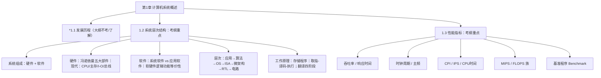

# 第1章 计算机系统概述知识点整理

> [!important] 近 18 年 408 计组真题雷达（2009—2026）
> - **考频画像**：18 年共考 17 道单选（`2009` 为 `T11`，`2010–2023` 及 `2026` 主考 `T12`，`2022` 另含 `T20` 翻译流程），0 道独立大题，另有 `2022-T18 / 2025-T18` 跨章联动，年均稳定 2 分。
> - **近 5 年考法演变**：从早期单纯公式代算 `CPU时间` 与 `Amdahl` 提速，转向“翻译四阶段（`2022-T20`）+ `PFLOPS/GIPS` 数量级与单位换算（`2021/2023-T12`）+ ISA 与微架构逻辑实现边界（`2022-T18` / `2026-T12`）”。
> - **高频丢分盲区**：把“逻辑实现（微架构）”误当物理器件层；将 `10^16` 误读为千万亿而非亿亿；算平均 `CPI` 时忘记加权；混淆 `ms/μs` 量级或只加速 CPU 却连带压缩 I/O 时间。
> - **总控入口**：[[00_408计组｜考前急救与真题落点总控|返回计组总控]]

> [!TIP]
> 本章是组成原理的**总览章**，选择题真正考的不是背名词，而是四类判断能力：  
> 1）**部件职责边界**（谁算 ALU、谁管取指、系统到底含不含软件）；  
> 2）**语言/翻译程序指纹**（机器/汇编/高级 + 编译/解释/汇编 + 预处理→编译→汇编→链接）；  
> 3）**冯·诺依曼 vs 现代机**（存储程序、控制流驱动、指令与数据形式相同但意义不同）；  
> 4）**性能指标口径**（主频≠性能、CPI 与主频无关、CPU 时间 = IC×CPI/f、Amdahl 式提速）。  
> 一轮先抓住判断入口，公式后面自然记住。

## 本章先建立一张总图



### 考纲锚点（先对齐再记细节）

| 考纲块 | 教材落点 | 选择题高频点 |
|---|---|---|
| 系统层次结构 / 基本组成 | 1.2.1 | 完整系统 = 硬件 + 软件 |
| 硬件基本组成 | 1.2.2 | 冯诺依曼五大部件；现代 CPU 集成 |
| 软硬件关系 | 1.2.3 | 逻辑功能等价性；边界划分 |
| 工作原理：存储程序 | 1.2.2 / 1.2.6 | 程序与数据先入主存；控制流驱动 |
| 高级语言 ↔ 机器语言 | 1.2.4 / 1.2.6 | 三种语言；编译/解释/汇编；四阶段 |
| 程序与指令执行过程 | 1.2.6 | PC 取指；顺序/跳转更新 PC |
| 性能指标 | 1.3 | 主频、CPI、CPU 时间、MIPS、FLOPS |

本章做题前先问：

1. 问的是**完整系统**、**主机**，还是**CPU**？（别把“运算器+存储器+控制器”当成完整系统）
2. 题干是**语言**还是**翻译程序**？能不能被**硬件直接执行**？
3. 冯·诺依曼题：是在考**存储程序**、**形式相同**，还是在挖**数据不都在指令里直接给出**？
4. 性能题：给的是 **IC / CPI / f** 里哪几个？单位是 **Hz / MHz / GHz / ns / μs / ms**？
5. “提速 X%” 是 **速度变为 1.X 倍**（时间变 1/1.X），绝不是时间减半式乱套。
6. 同 ISA 程序在两台机器上：CPI 相同 ≠ 执行时间相同（还看 IC、f）。

---

## *1.1 计算机发展历程（大纲不考，了解即可） 【💤 可跳过｜冲刺期直接跳过不看】

### 核心一句话
> 四代机按**逻辑元件**划分；字长 = CPU 通用寄存器宽度，决定一次整数运算位数与可直接寻址空间。

### 知识点（可判断化）

| 代 | 年代 | 逻辑元件 | 选择题用法 |
|---|---|---|---|
| 一 | 1946–1957 | 电子管 | 机器语言；延迟线/磁鼓；体积大、慢 |
| 二 | 1958–1964 | 晶体管 | 磁芯；高级语言与编译器；OS 雏形 |
| 三 | 1965–1971 | 中小规模 IC | 半导体存储器；分时 OS |
| 四 | 1972–今 | 大/超大规模 IC | 微处理器；流水线、Cache、虚存 |

| 概念 | 结论 | 选择题用法 |
|---|---|---|
| 摩尔定律 | 价格不变时，IC 上晶体管约每 18 个月翻倍 | 考“趋势表述”即可，不必深挖 |
| 机器字长 | <mark>CPU 通用寄存器宽度</mark>（如 32/64 位） `[真题·2020-T12]` | 与**运算精度**、可直接寻址空间相关；≠存取速度 |

`【⚡ 真题补丁｜2020-T12】` ALU 宽度与通用寄存器宽度必然等于机器字长；指令寄存器 IR（取决于指令字长）与浮点寄存器（常 64/80 位）长度未必等于机器字长。

> [!NOTE]
> 教材用 `*` 标：非统考大纲要求或已删内容，一轮选择题可不作为主干。

---

## 1.2 计算机系统层次结构 【🔥⚡ 必背+避坑｜停下来默背 1 遍 + 精读 1 分钟】

### 1.2.1 计算机系统的组成 【📌 扫一眼｜确认“我还会”就过】

#### 核心一句话
> **完整计算机系统 = 硬件 + 软件**；实际性能取决于软件对硬件的利用效率，功能边界要合理划分。

| 项目 | 结论 | 选择题用法 |
|---|---|---|
| 硬件 | 有形物理装置 | 运算器/控制器/存储器/I/O 等 |
| 软件 | 程序 + 相关数据与文档 | 系统软件 / 应用软件 |
| 完整系统 | 配套硬件 + 软件系统 | 只列主机三大件 → **不完整** |
| 软硬划分原则 | 使用频繁且硬件实现成本低的功能 → 宜用硬件 | 提速场景常考“为何用硬件” |

#### 题型融合

**题型：系统组成边界**

- 识别信号：完整计算机系统包括…… / 主机 vs 系统
- 标准做法：系统 = 硬件 + 软件；主机通常指 CPU + 主存（不含外设与软件）
- 易错：把“运算器、存储器、控制器”当成完整系统（那是主机核心，缺外设与软件）
- 锚点：§1.2.1；课后 1.2.7 题 01 选 D

---

### 1.2.2 计算机硬件 【🔥⚡ 必背+避坑｜停下来默背 1 遍 + 精读 1 分钟】

#### 核心一句话
> 冯·诺依曼机 = **存储程序** + 五大部件 + 指令/数据**同形式**二进制 + **控制流**驱动；现代机把运算器/控制器/寄存器收成 **CPU**，用总线互连。

#### 1. 冯·诺依曼机的基本思想（2019 考点） 【🔥⚡ 必背+避坑｜停下来默背 1 遍 + 精读 1 分钟】

| 要点 | 内容 | 选择题用法 |
|---|---|---|
| 存储程序 | 程序与初始数据**预先**存入主存；<mark>启动后自动连续取指执行</mark>，无须人工干预 `[真题·2019-T12]` | “边输入边执行”“从磁盘直接到 CPU”均为错 |
| 五大部件 | 运算器、控制器、存储器、输入设备、输出设备 | 功能都通过 CPU（运算器+控制器）执行指令实现 |
| 同形式存放 | 指令和数据在存储器中形式相同，<mark>仅凭内容无法区分</mark>，但计算机应能识别 `[真题·2009-T11 / 2019-T12]` | “形式上无差别”对；“数据都在指令中直接给出”**错**（除立即数外靠地址码） |
| 二进制 | <mark>指令与数据均用二进制编码</mark> `[真题·2018-T12]` | 常与“形式相同”一起考 |
| 指令格式 | 操作码 + 地址码 | 操作类型 + 操作数地址 |

> [!WARNING]
> **控制流驱动** vs **数据流驱动**：冯氏机按指令序列依次取指，控制流是驱动因素，数据流是被调用处理的对象。题干若写“数据流驱动”→ 非冯·诺依曼基本工作方式。
>
> - `【⚡ 真题补丁｜2009-T11】` 存储器中指令与数据同为二进制，CPU 靠**指令周期的不同阶段**区分（取指周期取指令，执行周期取数据），不靠寻址方式或存储单元区分。
> - `【⚡ 真题补丁｜2018-T12】` 内部采用二进制三大依据：双稳态物理器件易制、算术运算规则简单、便于用逻辑门电路实现算术与逻辑运算。

#### 2. 计算机的功能部件（现代视角） 【🔥 必背｜停下来默背 1 遍】

| 部件 | 做什么 | 不做什么 / 易混 |
|---|---|---|
| **CPU** | 指令执行核心；传统 = 运算器 + 控制器；现代 = 数据通路 + 控制单元 | 不等于完整主机（还缺主存） |
| **数据通路** | ALU + 通用寄存器组 + 多路选择器等；完成实际运算与数据传送 | ALU **不只**做算术，还有逻辑、移位 |
| **控制单元** | 取指、译码、发控制信号，协调数据通路时序 | 不是“只存程序” |
| **存储器** | 主存：程序+数据；现代内存 = 主存 + Cache；外存：磁盘/SSD 与备份介质 | 传统“内存”常仅指主存 |
| **外设 + 设备控制器** | 物理功能部件 + 控制器（I/O 接口）；控制器负责与主机通信并控制设备 | 键盘接口、显卡、网卡都是设备控制器 |
| **总线** | 部件间公共传输通路；CPU / 主存 / I/O 接口经总线互连 | 本身不做运算 |

**现代多总线结构指纹（图 1.1）**

```text
CPU（控制器 + ALU + 寄存器堆 + 总线接口）
  │ 处理器总线
  ▼
北桥/I/O 桥接器 ── 存储器总线 ── 主存
  │
  └── I/O 总线 ── USB 控制器 / 显卡 / 磁盘控制器 ── 外设
```

按功能粗分：

- **数据处理**：ALU  
- **存储**：主存（临时）+ 磁盘等（长期）  
- **互连**：总线、桥、接口、控制器  

#### 题型融合

**题型 A：冯·诺依曼特征正误判断**

- 识别信号：基本思想 / 工作方式 / “错误的是”
- 标准做法：逐条对表；重点抓“数据都在指令中直接给出”“边输入边执行”“微程序控制 = 基本工作方式”等陷阱
- 易错：把微程序控制、MIMD 等后续机制当成冯氏“基本工作方式”
- 锚点：§1.2.2；2019 真题；课后 02、03、13

**题型 B：部件功能找错**

- 识别信号：ALU / 存储器 / 控制器 / I/O 叙述
- 标准做法：ALU = 算术 **+ 逻辑**；存储器放指令和数据；控制器指挥协调；I/O 做人机信息交换
- 易错：ALU“仅”算术运算
- 锚点：课后 04 选 A

---

### 1.2.3 计算机软件 【📌 扫一眼｜确认“我还会”就过】

#### 核心一句话
> 软件分**系统软件**与**应用软件**；同一功能可硬可软实现，在相同规范下**逻辑功能等价**，硬件通常更快。

| 分类   | 例子                            | 作用               |
| ---- | ----------------------------- | ---------------- |
| 系统软件 | OS、DBMS、语言处理程序、网络软件、标准库、服务性程序 | 管理调度资源，为应用提供基础服务 |
| 应用软件 | 科学计算、工程设计、统计与信息处理等专用程序        | 解决特定领域问题         |

| 概念         | 结论                       | 选择题用法                          |
| ---------- | ------------------------ | ------------------------------ |
| 软/硬逻辑功能等价性 | 同一功能既可硬件也可软件实现，规范相同则结果一致 | 浮点：专用 FPU vs 软件子程序模拟（IEEE 754） |
| 边界划分       | 目标、成本、技术可行性综合决定          | 体系结构核心问题之一                     |

---

### 1.2.4 计算机系统的层次结构 【🔥⚡ 必背+避坑｜停下来默背 1 遍 + 精读 1 分钟】

#### 核心一句话
> 自顶向下逐层抽象：上层给简洁接口，下层依赖更底层实现；**ISA 是软硬件交界**。

```text
最终用户          应用（问题）
程序员            算法与编程
                  操作系统 / 虚拟机
架构师            指令集体系结构（ISA）  ← 软硬交界
                  微体系结构
                  功能部件 / RTL
电子工程师        电路与器件
```

#### 1. 三种编程语言（2015、2024） 【🔥 必背｜停下来默背 1 遍】

| 语言 | 本质 | 硬件能否直接执行 | 选择题指纹 |
|---|---|---|---|
| **机器语言** | 0/1 指令序列 | <mark>唯一能直接执行</mark> `[真题·2015-T12]` | 二进制代码语言 |
| **汇编语言** | 助记符（mov、add） | 否，须**汇编程序**翻译 | 与机器结构紧密相关；与机器指令基本一一对应 |
| **高级语言** | 接近自然语言（C/Java…） | 否，须编译或解释 | **独立**于底层硬件；语句与 ISA 指令**非**一一对应 |

#### 2. 翻译程序（2016） 【⚡ 避坑｜最值钱，必须精读 1 分钟】

| 程序 | 输入 → 输出 | 特征指纹 |
|---|---|---|
| **汇编程序（汇编器）** | 汇编源 → 机器语言目标 | 一对一翻译；属翻译程序 |
| **编译程序（编译器）** | 高级源 → 汇编或机器目标 | 一次全部翻译；<mark>生成独立目标/可执行相关产物</mark>；编译慢、运行快 `[真题·2016-T12]` |
| **解释程序（解释器）** | 高级源语句 → 边译边执行 | <mark>不生成独立目标程序</mark>；译一条执行一条；方法简单、运行较慢 `[真题易错·2016-T12]` |

> [!TIP]
> **翻译程序**是总称（编译 + 解释 + 汇编）。  
> 说“编译和解释作用都是把高级语言转为机器语言”在广义上常被教材认可，但细节差在**是否生成目标文件、是否一次译完**。

> [!WARNING] 2016 真题陷阱：先看输入语言，不要被“机器级”诱导
> 题目问“将**高级语言源程序**转换为**机器级目标代码文件**的程序”，答案是**编译程序**，不是汇编程序。判断翻译程序时，先看输入：  
> - 高级语言源程序 → 汇编语言或机器语言目标程序：**编译程序**；  
> - 汇编语言源程序 → 机器语言目标程序：**汇编程序**。  
> “机器级目标代码”描述的是输出，不能仅因看到“机器”二字就选汇编；**只有输入是汇编语言时，才选汇编程序**。

#### 3. 操作系统 / ISA / 微体系结构 【🔥⚡ 必背+避坑｜停下来默背 1 遍 + 精读 1 分钟】

| 层次 | 一句话 | 选择题用法 |
|---|---|---|
| OS | <mark>抽象硬件，为程序员提供虚拟机</mark> `[真题·2026-T12]` | 语言处理程序都在 OS 环境中跑 |
| **ISA** | 软硬件关键接口：指令格式、操作类型、寻址方式、可编程寄存器等 | 定义“做什么”；软件可见；<mark>不描述具体硬件电路实现细节</mark> `[真题·2022-T18 / 2026-T12]` |
| 微体系结构 | <mark>处理器内部如何实现 ISA</mark>（数据通路、控制、流水线、Cache、分支预测…） `[真题·2026-T12]` | 定义“怎么做”；**同一 ISA 可有多种微架构**，软件无修改即可兼容 |

`【⚡ 真题补丁｜2026-T12】` 微架构是 ISA 的**逻辑实现**，而非底层物理电路实现（器件/电路层）；判断归属先问汇编程序员是否可见，时钟周期、加法器进位、流水线均属微架构。

#### 题型融合

**题型 A：层次顺序**

- 识别信号：自上而下层次 / 虚拟机层次
- 标准做法（教材课后口径）：高级语言虚拟机 → 汇编语言虚拟机 → **操作系统虚拟机** → 机器语言机器  
  （OS 负责加载调度，最终由机器语言机器执行）
- 易错：把 OS 插到错误位置，或漏掉 OS 层
- 锚点：课后 05 选 C

**题型 B：ISA 与微架构**

- 识别信号：ISA 是否涉及硬件实现细节；同一 ISA 不同微架构
- 标准做法：ISA = 软件可见行为；同一 ISA 多种微架构 → 二进制兼容
- 易错：认为高级语言语句与机器指令一一对应；认为汇编可直接执行
- 锚点：课后 06 选 C；2015 真题“硬件直接执行”

**题型 C：编译 vs 解释 vs 汇编**

- 识别信号：先看**输入语言**，再看是否边翻译边执行、是否生成目标文件
- 标准做法：  
  - 高级语言源 → 机器级目标代码文件 → **编译**（不要被“机器级”诱导选汇编）  
  - 边译边执行、一次一行 → **解释**  
  - 一次全部译完、生成目标 → **编译**  
  - 汇编→机器 → **汇编**
- 易错：说解释“运行较快”；说汇编指令能被硬件直接执行
- 锚点：课后 07–12；2016、2022 真题

---

### 1.2.5 计算机系统的不同用户 【📌 扫一眼｜确认“我还会”就过】

#### 核心一句话
> 不同用户工作在不同抽象层；**下层对上层通常透明**（看不见细节 ≠ 不存在）。

| 角色 | 工作层面 |
|---|---|
| 最终用户 | 应用程序 |
| 系统管理员 | OS 配置维护 |
| 应用程序员 | 高级语言 |
| 系统程序员 | 机器语言 / 直接面向 ISA（编译器、OS 等） |

```text
        应用程序          ← 最终用户
     编译  汇编   操作系统  ← 应用/系统程序员、管理员
    ──────── ISA ────────
      CPU   主存   I/O
      数字逻辑及电路设计
```

**透明性**：从某类用户视角**无法感知**某细节的存在（与日常“透明=看得见”相反）。  
例：ISA 之下的硬件实现对高级语言程序员透明；IR/MAR/MDR 对所有程序员均透明。

---

### 1.2.6 计算机系统的工作原理 【🔥 必背｜停下来默背 1 遍】

#### 核心一句话
> **存储程序**：程序与数据先入主存 → 按 PC 自动取指 → 译码执行 → 更新 PC（顺序 + 指令长 / 跳转取目标）。源程序到可执行文件：**预处理 → 编译 → 汇编 → 链接**。

#### 1. 程序执行循环 【📌 扫一眼｜确认“我还会”就过】

```text
根据 PC 取指令
    → 指令译码，PC ← (PC)+1（或 + 指令长度）
    → 取操作数并执行
    → 送结果
    → 循环
```

| PC 更新 | 条件 |
|---|---|
| 顺序 | 下址 = 当前 PC + 指令长度 |
| 跳转 | 下址 = 指令指定的目标地址 |

#### 2. 翻译四阶段（2022） 【🔥 必背｜停下来默背 1 遍】

| 阶段 | 工具 | 输入 → 输出 | 形态 |
|---|---|---|---|
| 1 预处理 | cpp | hello.c → hello.i | 文本；展开 `#include` 等 |
| 2 编译 | ccl | hello.i → hello.s | 文本汇编 |
| 3 汇编 | as | hello.s → hello.o | 二进制可重定位目标 |
| 4 链接 | ld | hello.o + 库（如 printf.o）→ hello | 二进制可执行文件 |

**口诀**：预编汇链（预→编→汇→链）

#### 3. 指令执行抽象模型 【📌 扫一眼｜确认“我还会”就过】

可建模为 **取指 — 译码 — 执行** 三阶段循环。硬件细节（控制器、数据通路、时序）放到第 5 章，一轮本章只抓抽象循环与 PC 行为。

#### 题型融合

**题型：翻译流程排序**

- 识别信号：源程序→可执行文件的主要过程
- 标准做法：<mark>预处理 → 编译 → 汇编 → 链接</mark> `[真题·2022-T20]`
- 易错：编译与汇编对调；链接插到汇编前
- 锚点：2022 真题；课后 14 选 A

---

### 1.2 指纹速查（30 秒决策） 【📌 扫一眼｜确认“我还会”就过】

```text
看到“完整系统”        → 硬件 + 软件
看到“主机”            → 通常 CPU + 主存（勿与系统混）
看到“直接执行”        → 只有机器语言
看到“边译边执行”      → 解释程序
看到“一次全部翻译”    → 编译程序
看到“汇编→机器”      → 汇编程序
看到“软硬件交界”      → ISA（做什么）
看到“同一 ISA 不同实现”→ 微架构（怎么做）
看到“存储程序”        → 先入主存 + 自动按序执行
看到“数据都在指令里给出”→ 错（立即数除外，靠地址码）
看到“ALU 只做算术”    → 错（还有逻辑/移位）
看到四阶段顺序        → 预 → 编 → 汇 → 链
```

---

## 1.3 计算机的性能指标 【🔥⚡ 必背+避坑｜停下来默背 1 遍 + 精读 1 分钟】

### 核心一句话
> **CPU 执行时间 = IC × CPI / 主频**；主频高 ≠ 一定更快；MIPS 有跨机缺陷；科学计算看 **FLOPS**；提速要分清 CPU 时间与 I/O 时间。

### 1.3.1 主要性能指标 【🔥⚡ 必背+避坑｜停下来默背 1 遍 + 精读 1 分钟】

#### 1. 吞吐率与响应时间 【📌 扫一眼｜确认“我还会”就过】

| 指标 | 含义 | 选择题用法 |
|---|---|---|
| 吞吐量 | 单位时间处理请求数 | 受输入、取指、访存、输出等多环节影响；主存常成瓶颈 |
| 响应时间 | 用户发出请求到返回结果的总等待时间 | = CPU 时间 + 等待时间（磁盘/内存/I/O 等） |

#### 2. 时钟周期与主频（2013、2019） 【🔥 必背｜停下来默背 1 遍】

| 概念 | 定义 | 关系 |
|---|---|---|
| **CPU 时钟周期** | 主时钟脉冲宽度；CPU 工作的最小时间单位 | 常由关键路径最大延迟决定；流水线中按最慢流水段 |
| **主频** | 主时钟频率 = 1 / 时钟周期 | 同型号机器：主频↑ → 每步时间↓ |

$$
T_{\text{clk}} = \frac{1}{f},\quad f = \frac{1}{T_{\text{clk}}}
$$

> [!WARNING]
> 主频单位 Hz（如 1GHz = $10^9$ 周期/秒）。<mark>主频高不一定整体性能更高</mark> `[真题·2017-T12]`（还看 CPI、IC、微架构、Cache、并行等）。
>
> - `【⚡ 真题补丁｜2017-T12】` 同 ISA 比较执行时间看 `CPI/f`：若 M1 为 `1.5GHz, CPI=2`，M2 为 `1.2GHz, CPI=1`，则 `T1/T2 = (2/1.5)/(1/1.2) = 1.6`，M2 更快。

#### 3. CPI / IPS / CPU 执行时间（核心公式族） 【🔥⚡ 必背+避坑｜停下来默背 1 遍 + 精读 1 分钟】

| 符号 | 含义 |
|---|---|
| IC（或指令条数） | 程序执行的指令数 |
| CPI | 每条指令平均时钟周期数（程序/机器级平均） |
| $f$ / 主频 | 时钟频率 |
| $T_{\text{clk}}$ | 时钟周期 |

$$
\begin{aligned}
\text{CPU 执行时间} &= \frac{\text{时钟周期数}}{f} = \text{IC} \times \text{CPI} \times T_{\text{clk}} = \frac{\text{IC} \times \text{CPI}}{f} \\
\text{IPS} &= \frac{f}{\text{CPI}} \\
\text{MIPS} &= \frac{\text{IC}}{\text{CPU 时间} \times 10^6} = \frac{f}{\text{CPI} \times 10^6}
\end{aligned}
$$

| 关系 | 结论 | 选择题用法 |
|---|---|---|
| 性能三要素 | <mark>IC、CPI、主频相互制约</mark> `[真题·2010-T12 / 2014-T12]` | CISC 可能减 IC 但增控制复杂度、限主频；RISC 可能增 IC 但易提主频 |
| CPI 与主频 | **CPI 与时钟频率无关** | <mark>影响 CPI 的是系统结构、指令集、计算机组织</mark> `[真题·2025-T18]` |
| 平均 CPI | $\sum (\text{CPI}_i \times \text{比例}_i)$ | <mark>混合指令加权</mark> `[真题·2013-T12 / 2022-T12]` |

`【⚡ 真题补丁｜2014-T12】` 若编译优化使指令数 `IC` 变为 `0.7` 倍、`CPI` 变为 `1.2` 倍、主频不变，则执行时间 `T' = T × 0.7 × 1.2`（`20s → 16.8s`），勿将倍率乘除颠倒。
`【⚡ 真题补丁｜2022-T12】` 浮点占 20%（CPI=10）、其余占 80%（CPI=1），加权 `CPI=2.8`；`10000` 条指令在 `1ns` 周期下 `CPU时间 = 28μs`，注意区分 `μs` 与 `ms`。
`【⚡ 真题补丁｜2023-T12】` `GIPS = f(GHz)/CPI = 1.5/1.2 = 1.25 GIPS`；用户 CPU 时间 `= 5×10^5×1.2/(1.5×10^9) = 0.4ms`（`400μs`）。
`【⚡ 真题补丁｜2025-T18】` 实际运行程序的 `CPI` 包含 Cache 缺失带来的访存停顿周期，因此实际 `CPI` 与 Cache 缺失率密切相关。

**例 1.1 指纹（教材）**

- 同 ISA；M1：2GHz，程序 10s  
- M2：CPI 变为 1.5 倍，希望 6s → 先算时钟周期数，再反推主频  
- 结论：主频需到 5GHz（2.5 倍），实际性能仅约 10/6 ≈ 1.67 倍 → **主频倍增 ≠ 性能同倍**

#### 4. MIPS 的缺陷 【⚡ 避坑｜最值钱，必须精读 1 分钟】

- 不同机器指令功能强度不同（一条 CISC 指令 ≈ 多条 RISC）
- 各机 CPI、时钟周期不同  
→ 跨机用 MIPS 比性能**不可靠**

#### 5. FLOPS 族（2011、2021） 【🔥⚡ 必背+避坑｜停下来默背 1 遍 + 精读 1 分钟】

<mark>每秒浮点运算次数</mark> `[真题·2011-T12]`；科学计算/超算常用。

| 名称 | 数量级 | 记忆 |
|---|---|---|
| MFLOPS | $10^6$ | 百万 |
| GFLOPS | $10^9$ | 十亿 |
| TFLOPS | $10^{12}$ | 万亿 |
| PFLOPS | $10^{15}$ | <mark>千万亿</mark> `[真题·2021-T12]` |
| EFLOPS | $10^{18}$ | 百亿亿 |
| ZFLOPS | $10^{21}$ | 十万亿亿 |

例：93.0146 PFLOPS ≈ $9.3 \times 10^{16}$ 次/秒 ≈ <mark>9.3 亿亿次/秒</mark> `[真题·2021-T12]`（1 亿 = $10^8$，故 $10^{16}$ = 1 亿亿，非千万亿）

#### 6. 单位前缀易混 【⚡ 避坑｜最值钱，必须精读 1 分钟】

| 场景 | 习惯 |
|---|---|
| 存储容量、文件大小 | K/M/G/T 常按 $2^{10}$ 幂（1KB = $2^{10}$B） |
| 速率、频率 | k/M/G/T 常按 $10^3$ 幂（1kb/s = $10^3$b/s） |
| 写法 | 容量常大写 K；速率常小写 k；其余结合上下文 |

#### 7. 基准程序（Benchmark） 【📌 扫一眼｜确认“我还会”就过】

- 用途：模拟真实负载，横向比较系统性能  
- 局限：可能被针对热点片段优化而失真 → 应结合领域选基准 + 多种手段

#### 8. 字长相关 【🔥 必背｜停下来默背 1 遍】

机器字长与**运算精度**最密切；与运算速度关系不大；与存取速度、内存容量基本无直接“最密切”关系（课后口径）。

---

### 性能指标：过程指纹与决策树 【📌 扫一眼｜确认“我还会”就过】

```text
给 IC、CPI、f          → CPU时间 = IC×CPI/f
给 时钟周期数、f        → 时间 = 周期数/f
给 各类指令比例与 CPI_i → 先算平均 CPI，再代入
只给 CPI 相同、同高级语言程序 → 不能比速度（IC 可能不同、f 未知）
速度提高 50%           → 时间变为原时间/1.5，不是 ×0.5
只加速 CPU 部分        → 总时间 = CPU_new + I/O（Amdahl 思想）
科学计算选指标         → MFLOPS/FLOPS，不是 MIPS
问 CPI 与谁无关        → 时钟频率（主频）
```

---

### 1.3 题型融合 【⚡ 避坑｜最值钱，必须精读 1 分钟】

**题型 A：定义辨析（主频 / CPI / MIPS / FLOPS）**

- 识别信号：说法正确的是
- 标准做法：主频 = 时钟频率；CPI = 每条指令平均时钟周期数；MIPS = 每秒百万条指令；MFLOPS = 每秒百万次浮点运算
- 易错：把 CPI 说成“频率”；把 MIPS 说成单条指令时钟数
- 锚点：课后 01、02、13

**题型 B：CPU 时间 / 主频反推**

- 识别信号：运行时间缩短到…，主频至少…；编译优化后 IC、CPI 变化
- 标准做法：  
  1）先算原时钟周期数 $N = t \times f$ 或 $N = \text{IC} \times \text{CPI}$  
  2）按比例改 CPI 或 IC  
  3）$f' = N' / t'$ 或 $t' = N' / f$
- 易错：单位不统一（MHz 与 GHz、μs 与 ms）；把“CPI 变 1.5 倍”漏乘
- 锚点：例 1.1；课后 06、09、10、16、19、20；2012–2023 真题

**题型 C：平均 CPI 与 MIPS**

- 识别信号：指令类型表 + 比例 + CPI
- 标准做法：$\overline{\text{CPI}} = \sum p_i \cdot \text{CPI}_i$，再 $\text{MIPS} = f(\text{MHz}) / \overline{\text{CPI}}$（注意 f 单位与 $10^6$）
- 易错：<mark>直接对各类指令 CPI 算术平均</mark>或主频单位代错 `[真题易错·2013-T12]`
- 锚点：课后 10、15；2013 真题 MIPS = 400

**题型 D：部分加速（Amdahl 思想）**

- 识别信号：CPU 时间 + I/O 时间；CPU 提速 x%，I/O 不变
- 标准做法：$T' = T_{\text{CPU}} / (1+x\%) + T_{\text{I/O}}$  
  例：100s 中 90s CPU，CPU 提速 50% → $90/1.5 + 10 = 70$s
- 易错：<mark>把“提速 50%”当成时间减半</mark>或连带压缩 I/O 时间 → 错选 55s `[真题易错·2012-T12]`
- 锚点：2012 真题；教材误区框

**题型 E：相对速度**

- 识别信号：基准程序 A 上 20s、B 上 16s
- 标准做法：速度比 = 时间反比 = 20/16 = 1.25 → B 是 A 的 1.25 倍
- 易错：说成“所有程序都更快”；说成 A 比 B 慢 1.25 倍（表述易混）
- 锚点：课后 05

**题型 F：综合改善措施**

- 识别信号：哪些能缩短执行时间
- 标准做法：提高主频、优化数据通路/减少访存、<mark>编译优化减 IC 或冲突</mark>、多处理器并行 —— 通常都能对“某程序执行时间”有帮助（以题干为准） `[真题·2010-T12]`
- 锚点：2010 真题；课后 11、12

---

# 本章高频题型总表

| 题干特征 | 优先方法/起手式 | 真题印证与避坑 |
|---|---|---|
| 系统/主机边界与字长匹配 | 系统 = 硬+软，主机 = CPU+主存；问必等于字长的部件选 ALU 与通用寄存器 | `[真题·2020-T12]`：IR 与浮点寄存器未必等于机器字长 |
| 冯·诺依曼特征正误判断 | 核查存储程序、二进制同形、控制流驱动、按指令周期阶段区分指令与数据 | `[真题·2009-T11]`、`2018-T12`、`2019-T12`：防“数据都在指令中给出” |
| 部件职责与 ALU | ALU = 算术 + 逻辑 + 移位；控制器发控制信号；存储器存程序与数据 | 排除“ALU 仅做算术”与“数据流驱动” |
| 语言能否直接执行 / 翻译程序 | 先看输入语言：只有机器语言可直接执行；高级→目标选编译，边译边执行选解释 | `[真题·2015-T12]`、`2016-T12`：不被“机器级目标代码”诱导选汇编 |
| C 语言翻译四阶段顺序 | 口诀“预编汇链”：`hello.c → .i → .s → .o → 可执行` | `[真题·2022-T20]`：勿将编译与汇编对调 |
| ISA vs 微架构边界与层次 | 汇编程序员可见（格式/字长/可见寄存器）归 ISA；逻辑实现（时钟/进位/流水）归微架构 | `[真题·2022-T18]`、`2026-T12`：逻辑实现不是物理电路器件层 |
| IC×CPI/f 计算 | 统一单位，先算周期数再代时间或主频 | `[真题·2010-T12 / 2013-T12 / 2014-T12 / 2017-T12 / 2022-T12 / 2023-T12]` |
| 平均 CPI / MIPS | 加权 CPI，再 f/CPI | `[真题·2013-T12 / 2022-T12]` |
| 部分加速 | 只除以加速比作用在可加速部分 | `[真题·2011-T12 / 2012-T12 / 2021-T12]` |
| 系统层次顺序 | 自上而下：高级语言 VM → 汇编语言 VM → 操作系统 VM → 机器语言机器 | 教材课后口径，防漏掉 OS 层 |

---

## 本章最后抓这些易错点

1. **完整系统不是三大件**：运算器+存储器+控制器只是主机核心，缺外设与软件。  
2. **冯氏基本方式是控制流驱动**，不是数据流驱动，也不是“微程序控制方式”。  
3. **“数据都在指令中直接给出”是错的**：<mark>除立即寻址外，数据在存储器</mark>，由地址码指出 `[真题易错·2019-T12]`。  
4. **ALU 不只做算术**：还有逻辑运算与移位。  
5. **硬件唯一直接执行的是机器语言**：汇编必须先汇编。  
6. **高级语言语句 ≠ 与机器指令一一对应**；汇编与机器指令基本一一对应。  
7. **汇编语言与机器结构相关**，不能说“与机器结构无关”。  
8. **解释程序一般比编译后的目标程序运行更慢**（边译边执行）。  
9. **编译程序会生成目标文件**；解释程序通常不生成可独立保存的目标程序。  
10. **先看输入语言，不要被输出中的“机器级”诱导**：高级语言源程序 → 机器级目标代码文件，选**编译程序**；只有汇编语言源程序 → 机器语言时，才选**汇编程序**。  
11. **翻译四阶段顺序固定**：预处理 → 编译 → 汇编 → 链接，不要调换。  
12. **ISA 定义软件可见功能，不规定具体电路实现**；同一 ISA 可有多种微架构。  
13. **透明 = 用户看不见细节**，不是“什么都能看见”。  
14. **主频高 ≠ 性能一定高**；还看 CPI、IC、Cache、流水线等。  
15. **CPI 与时钟频率无关**；主频变高不改变“每条指令几个周期”，只缩短每周期时间。  
16. **同 CPI + 同高级语言程序**，仍可能因编译出的 IC、机器主频不同而无法比速度。  
17. **CPU 时间公式分母是主频**：$\text{IC}\times\text{CPI}/f$，单位必须统一。  
18. **速度提高 50% ⇒ 时间变为 1/1.5**，不是减半。  
19. **只加速 CPU 时**，<mark>I/O 时间原样加上</mark>（`2012`：70s 不是 55s） `[真题·2012-T12]`。  
20. **MIPS 跨机比较有缺陷**；科学计算优先看 FLOPS。  
21. **PFLOPS = $10^{15}$ 次/秒**；93 PFLOPS ≈ 9.3 亿亿次，不是 $10^{15}$ 量级直接当选项字面。  
22. **字长最密切的是运算精度**，不是存取速度/内存容量。  
23. **存储容量 K 与速率 k 的幂次习惯不同**（$2^{10}$ vs $10^3$），结合语境判断。

---

## 附：一句话最终记忆

| 概念 | 一句话 |
|---|---|
| 完整系统 | 硬件 + 软件 |
| 冯·诺依曼 | 存储程序 + 控制流 + 五大件 + 指令数据同形二进制 |
| 现代硬件 | CPU + 主存 + I/O（控制器）+ 总线 |
| ALU | 算术 + 逻辑（+移位） |
| 机器语言 | 唯一硬件直接执行 |
| 汇编语言 | 助记符，须汇编后才能执行 |
| 高级语言 | 硬件无关抽象，须编译或解释 |
| 编译 vs 解释 | 一次译完可再运行 vs 边译边执行 |
| 汇编程序 | 汇编源 → 机器码 |
| ISA | 软硬接口：做什么（软件可见） |
| 微架构 | 怎么做（可多样，兼容同一 ISA） |
| 透明性 | 上层看不见下层细节 |
| 存储程序执行 | PC 取指 → 译码 → 执行 → 更新 PC |
| 四阶段 | 预编汇链 |
| 时钟周期 | CPU 最小时间单位；$T=1/f$ |
| CPI | 每条指令平均时钟周期数 |
| CPU 时间 | $\mathrm{IC}\times\mathrm{CPI}/f$ |
| MIPS | $f/(\mathrm{CPI}\times10^6)$；跨机慎用 |
| FLOPS | 每秒浮点运算次数；超算/科学计算 |
| 性能三要素 | IC、CPI、主频相互制约 |
| 部分加速 | 只缩可加速部分，其余照加 |

### 30 秒自测决策树

```text
题在问什么？
├─ 组成/层次/语言
│   ├─ 系统有啥？ → 硬+软
│   ├─ 谁直接执行？ → 仅机器语言
│   ├─ 边译边执行？ → 解释
│   ├─ 源→可执行顺序？ → 预编汇链
│   └─ 冯氏错项？ → 盯“数据直接在指令里/边输入边执行/数据流驱动”
└─ 性能数字
    ├─ 有 IC、CPI、f？ → 套 CPU时间 = IC×CPI/f
    ├─ 有指令比例表？ → 先加权 CPI
    ├─ 只加速一部分？ → 可加速/加速比 + 剩余
    ├─ 科学计算指标？ → FLOPS
    └─ 主频高就更快？ → 不一定（看三要素）
```

---

## 覆盖说明

| 项目 | 说明 |
|---|---|
| 素材来源 | 逐页阅读王道《计算机组成原理》第 1 章 PDF（OCR），**未使用** `md/` 下 MinerU 解析稿 |
| 考纲覆盖 | （一）层次结构与工作原理；（二）性能指标全族；`*1.1` 仅作了解 |
| 题型融合 | 1.2 / 1.3 节后选择题 + 2010–2023 相关真题口径已吸入题型与易错点 |
| 未包含 | 综合应用题完整答卷模板；算法代码；二轮刷题册 |
| 定稿状态 | `round1_final: false`，可按你的订正意见再改 |

---

# 冲刺主动回忆卡（遮挡自测）

> [!question] 1. 同是存储器中的二进制串，冯·诺依曼计算机凭什么区分它是指令还是数据？为什么“系统内部数据都在指令中直接给出”这句话必然错？
> [!success]- 正确解释
> 1. 凭**指令周期的不同阶段**区分（`2009-T11`）：在取指阶段从主存读出送入 IR 的二进制串被解释为指令；在执行阶段读写的二进制串被解释为数据（不靠寻址方式或存储单元划分）。
> 2. 只有立即数放在指令地址码字段，绝大多数数据存放在主存或寄存器中，指令只给出**地址码**（`2019-T12`）。

> [!question] 2. 微体系结构到底是 ISA 的“逻辑实现”还是“物理实现”？ALU、IR、通用寄存器、浮点寄存器里，哪几个位宽一定等于机器字长？
> [!success]- 正确解释
> 1. 微体系结构是 ISA 的**逻辑实现**（`2026-T12`），涵盖数据通路、加法器进位方式、时钟周期与流水深度（`2022-T18`）；底层晶体管与门电路才是物理实现层；OS 则是通过 ISA 接口对硬件进行抽象。
> 2. **ALU 宽度与通用寄存器宽度**必然等于机器字长（`2020-T12`）；IR 长度取决于指令字长，浮点寄存器常按 IEEE 754（32/64/80 位）设计，未必等于整数机器字长。

> [!question] 3. 某程序共需 100s，其中 CPU 计算占 90s、I/O 占 10s。若 CPU 速度提高 50%，现需多久？算题遇到 `93 PFLOPS` 或 `0.4ms` 怎么防单位翻车？
> [!success]- 正确解释
> 1. **速度提高 50% 意味着加速比为 1.5**，且仅作用于 CPU：`T' = 90 / 1.5 + 10 = 70s`（`2012-T12`），绝不是整体减半或 `90 × 0.5`。
> 2. 先换算科学计数再转单位：`1 PFLOPS = 10^15`，`93 PFLOPS = 9.3 × 10^16`，而 1 亿为 `10^8`、1 亿亿为 `10^16`，故对应 **9.3 亿亿次/秒**（`2021-T12`）；算时间先保留 `10^-3 s (ms)` / `10^-6 s (μs)` 指数后再选选项（`2022/2023-T12`）。

> [!question] 4. 看到“将高级语言源程序转为机器级目标代码文件”和“C 源程序生成可执行文件的 4 步”，分别对应什么工具与顺序？
> [!success]- 正确解释
> 1. 先盯**输入语言**：只要输入是高级语言且生成目标文件，就是**编译程序**，不被输出里的“机器级”诱导选汇编（`2016-T12`）；能被硬件直接执行的唯一语言是**机器语言**（`2015-T12`）。
> 2. C 语言四步固定为 **预处理（.i）→ 编译（.s）→ 汇编（.o）→ 链接（可执行）**（`2022-T20`）。
