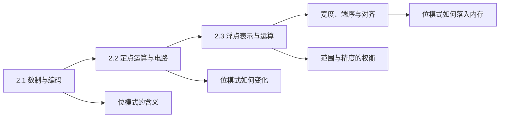
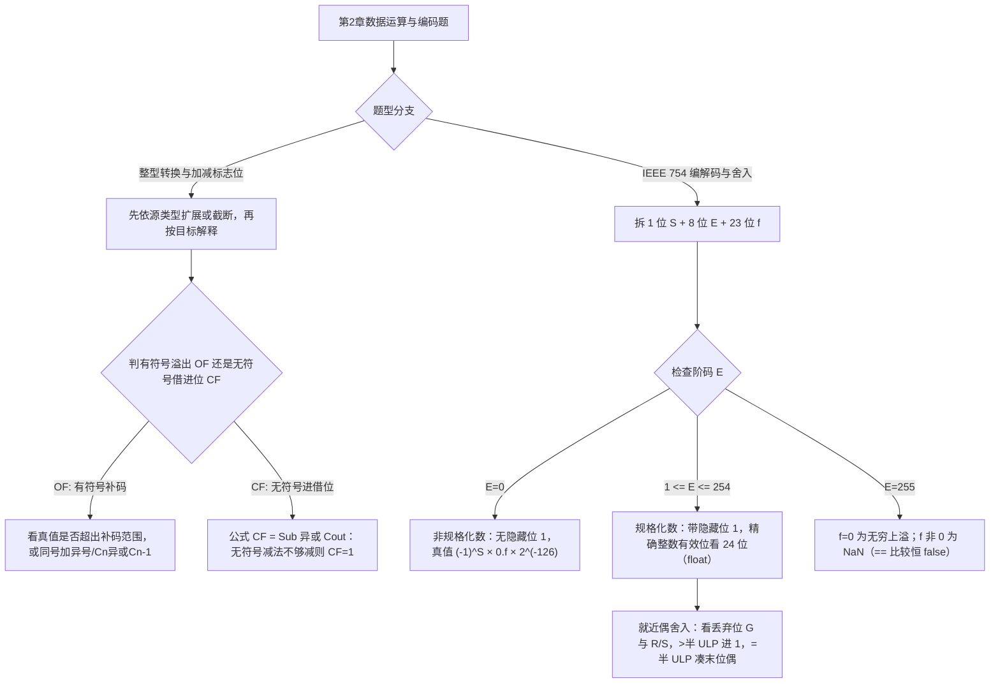

# 第2章 数据的表示和运算

> [!important] 近 18 年 408 计组真题雷达（2009—2026）
> - **考频画像**：18 年共考 46 道主考真题（`42` 道单选 `T12–T16` 附近 + `4` 道大题 `2011-T43`、`2017-T43`、`2020-T43`、`2025-T44`），另有 `9` 道第 4/5 章汇编与数据通路大题直接借壳考查 `OF/CF` 与符号扩展。
> - **近 5 年考法演变**：单选高频锁定 `IEEE 754` 非规格化与就近偶舍入（`2023-T14`、`2026-T14`）、混合整型转换与 `OF/CF` 分离（`2023-T16`、`2024-T12`、`2025-T12/T14`）、结构体数组对齐与端序（`2025-T15`）；大题 `2025-T44` 回归补码除法器硬件初值与 `-2^31÷(-1)` 商溢出。
> - **高频丢分盲区**：看到 `unsigned` 目标抢先用零扩展；误认 `int` 变量相减没有 `CF`；把 `float` 指数覆盖 `2^40` 当成能精确表示范围内全部整数；遗漏结构体 `char[N]` 成员后部填充。
> - **总控入口**：[[00_408计组｜考前急救与真题落点总控|返回计组总控]]

> [!abstract] 本章复盘目标
> 本章要解决三个问题：**数据如何编码、机器如何运算、结果如何解释**。
> 阅读时始终区分三层：
> 1. **位模式**：寄存器里实际存了哪些 0 和 1；
> 2. **解释规则**：把这些位看作无符号数、补码还是浮点数；
> 3. **硬件结果**：机器只按固定位数运算，是否有意义取决于解释方式和标志位。

## 考纲定位

- **数制与编码**：进位计数制及转换，定点数的编码表示。
- **整数的表示与运算**：无符号整数、补码整数、C 语言整数类型与转换。
- **运算方法和运算电路**：加法器、ALU、移位、补码加减、标志位、乘除法基本结构。
- **浮点数的表示与运算**：IEEE 754、浮点加减、类型转换。
- **数据存储**：位、字节、字、字长，大端/小端，边界对齐。

### 定点溢出错标（OF/CF）与 IEEE 754 冲刺决策树 【🔥⚡ 必背+避坑｜停下来默背 1 遍 + 精读 1 分钟】

---

# 2.1 数制与编码 【🔥⚡ 必背+避坑｜停下来默背 1 遍 + 精读 1 分钟】

## 2.1.1 进位计数制及其相互转换 【📌 扫一眼｜确认“我还会”就过】

### 这一节要解决什么问题

1. 为什么计算机采用二进制？
2. 一个 $r$ 进制数的数值如何确定？
3. 二、八、十、十六进制之间如何快速转换？
4. 为什么某些十进制小数无法用有限位二进制精确表示？

### 一、计算机采用二进制的原因

- 二进制只有两种状态，容易用高、低电平等稳定物理状态表示，硬件成本低。
- 0、1 与逻辑“假、真”自然对应，便于实现逻辑判断。
- 二进制运算规则简单，容易用基本逻辑门实现算术和逻辑运算。

> [!tip] 选择题识别
> 问“为什么采用二进制”时，通常从 **物理实现容易、逻辑对应自然、运算规则简单** 三方面判断。

### 二、进位计数制

对 $r$ 进制数

$$
(K_nK_{n-1}\cdots K_0.K_{-1}\cdots K_{-m})_r
$$

其真值为

$$
\sum_{i=-m}^{n} K_i r^i
$$

其中：

- $r$ 是基数；
- $K_i$ 是第 $i$ 位数码，满足 $0\le K_i\le r-1$；
- $r^i$ 是第 $i$ 位的位权。

常用进制：

| 进制 | 基数 | 数码 | 与二进制关系 | 常用后缀/前缀 |
|---|---:|---|---|---|
| 二进制 | 2 | 0、1 | 基础 | B |
| 八进制 | 8 | 0～7 | 1 位对应 3 位二进制 | O |
| 十进制 | 10 | 0～9 | 日常使用 | D，常省略 |
| 十六进制 | 16 | 0～9、A～F | 1 位对应 4 位二进制 | H 或 `0x` |

### 三、不同进制之间的转换

#### 1. 二进制与八/十六进制

- 以小数点为界分别处理。
- 整数部分从右向左分组，小数部分从左向右分组。
- 八进制每 3 位一组，十六进制每 4 位一组。
- 分组不足时：整数高位补 0，小数低位补 0。

> [!warning] 高频陷阱
> 补 0 只能补在不改变位权的一侧：整数补高位，小数补低位。不要跨越小数点连续分组。

#### 2. 任意进制转十进制

使用按权展开求和：数码乘对应位权后相加。

#### 3. 十进制转任意进制

- 整数部分：**除基取余**，余数从后往前写。
- 小数部分：**乘基取整**，整数从前往后写。

### 四、有限精度问题

十进制小数能否被有限位二进制精确表示，取决于它化成最简分数后，分母能否写成 $2^k$。

- 可以：$0.5=1/2$、$0.625=5/8$。
- 不可以：$0.3=3/10$，分母含因子 5，因此二进制表示无限循环。

反过来，任何有限位二进制小数都能精确转换为十进制，因为其分母一定是 $2^k$。

### 常考题型与解题方法

#### 题型 1：混合整数、小数的进制转换

1. 先画出小数点；
2. 整数和小数分别转换；
3. 最后拼接；
4. 检查数值量级和位权。

#### 题型 2：判断能否精确表示

将小数化为最简分数：

- 分母只有因子 2 → 可有限表示；
- 分母还含其他质因子 → 只能近似表示。

#### 题型 3：比较不同编码可表示的数据个数

$n$ 位最多只有 $2^n$ 种位模式；但某种编码可能把多个位模式用于同一个值或特殊值，因此“位模式个数”和“互异有效数值个数”不一定相等。

### 一分钟回顾

- 位权决定数值，数码本身不决定数值。
- 二转八：3 位一组；二转十六：4 位一组。
- 整数除基取余，小数乘基取整。
- 十进制有限小数不一定是二进制有限小数。

---

## 2.1.2 定点数的编码表示 【🔥⚡ 必背+避坑｜停下来默背 1 遍 + 精读 1 分钟】

> [!note] 概念前提与范围界定
> 本节涉及的编码公式与范围讨论，默认针对 **$n+1$ 位定点整数**（1 位符号位，$n$ 位数值位）；若题目涉及定点小数，需根据约定重新确定小数点位置（如 $n+1$ 位定点小数补码范围为 $[-1, 1 - 2^{-n}]$）。

### 一、真值、机器数与定点表示

- **真值**：日常数学意义上的数，如 $+15$、$-8$。
- **机器数**：符号也被数字化后的位模式，通常 0 表示正，1 表示负。
- **定点数**：小数点位置由规则预先约定，机器内部并不真正存储小数点。

定点表示分为：

- 定点小数：小数点约定在符号位之后；
- 定点整数：小数点约定在数值位之后。

编码与运算时，本质上只需关心 **符号位、数值位和字长**。

### 二、原码

原码使用最高位表示符号，其余位表示绝对值。

若机器字长为 $n+1$ 位：

- 正数：$[x]_{原}=0,x$；
- 负数：$[x]_{原}=2^n+|x|$，即符号位置 1，数值位写绝对值。

表示范围：

$$
-(2^n-1)\le x\le 2^n-1
$$

特点：

- 与真值对应直观，比较绝对值方便；
- $+0$ 和 $-0$ 两种表示；
- 加减法需单独处理符号和绝对值，硬件复杂；
- 乘除法中符号位与数值位分开处理较方便。

### 三、补码

补码的核心意义是把减法转化为加法。在模 $2^{n+1}$ 意义下：

$$
[x]_{补}=2^{n+1}+x\pmod {2^{n+1}}
$$

对负数的常用求法：

> 符号位不变，数值位按位取反，末位加 1。

也可理解为：写出对应正数的补码，所有位（包括符号位）取反后加 1。

对于 $n+1$ 位补码整数：

$$
-2^n\le x\le 2^n-1
$$

特殊值：

| 真值 | 补码 |
|---|---|
| $0$ | 全 0，唯一 |
| $-1$ | 全 1 |
| 最大正数 $2^n-1$ | 符号位 0，数值位全 1 |
| 最小负数 $-2^n$ | 符号位 1，数值位全 0 |

补码的优势：

- 0 的表示唯一；
- 符号位可与数值位一起参与运算；
- 加减统一为加法；
- 比原码多表示一个最小负数。

### 四、模运算视角

在模 $M$ 的系统中，若 $A-B$ 不便直接实现，可计算：

$$
A-B\equiv A+(M-B)\pmod M
$$

负数的补码就是它在模空间中的非负等价数。这解释了为什么补码能用加法器完成减法。

### 五、变形补码（双符号位）

使用两个符号位：

- `00`：正数；
- `11`：负数；
- `01`：正溢出；
- `10`：负溢出。

左边符号位是真正符号位，右边符号位用于判断溢出。存储时不一定真的保留两位，它主要用于运算和溢出分析。

### 六、反码

- 正数反码与原码相同；
- 负数反码为原码数值位逐位取反，末位不加 1。

缺点：0 有两种表示，范围也比补码少一个最小负数，因此现代计算机很少用它表示整数。

### 七、移码

移码给真值加固定偏置：

$$
[x]_{移}=2^n+x
$$

主要用于浮点数阶码。特点：

- 0 的表示唯一；
- 在同字长、采用标准偏置值 $2^n$ 的前提下，移码和补码仅最高符号位相反（IEEE 754 阶码采用非标准偏置，不能直接套用此同字长对应规则）；
- 位模式从小到大与真值从小到大的顺序一致，便于比较阶码；
- 全 0 对应最小真值，全 1 对应最大真值。

> [!warning] IEEE 754 的偏置不是普通移码的 $2^{k-1}$
> $k$ 位阶码的偏置为 $2^{k-1}-1$：单精度 127，双精度 1023。

### 八、四种编码对比

| 项目 | 原码 | 反码 | 补码 | 移码 |
|---|---|---|---|---|
| 正数 | 相同 | 相同 | 相同 | 与前三者不同 |
| 负数构造 | 符号 1，绝对值 | 原码数值位取反 | 反码末位加 1 | 真值加偏置 |
| 0 的表示 | 两种 | 两种 | 唯一 | 唯一 |
| 是否便于加减 | 否 | 较差 | 是 | 不用于一般整数运算 |
| 典型用途 | 乘除符号分析 | 很少使用 | 有符号整数 | 浮点阶码 |

> [!tip] 快捷解题技巧：机器数快速转换（从右向左扫描法）
> 在选择题中，对负数按常规“按位取反、末位加 1”推导容易在多次进位时出错。使用**从右向左扫描法**可快速解题：
> 
> **适用条件与边界**：此扫描法主要用于**负数**的原码与补码互换（正数的原码、反码、补码完全相同）。此外，对最小负数（如 8 位 `-128`）求相反数时仍会发生补码溢出，无法转换为同位宽的补码正数。
> 
> 1. **原码 $\leftrightarrow$ 补码（双向完全对称）**：
>    - 从右往左找到**第一个 `1`**；
>    - 该 `1` 及其右侧的所有 `0` **保持不变**；
>    - 该 `1` 左侧的所有**数值位按位取反**；
>    - **符号位保持不变**。
> 
> 2. **求相反数的补码（$[X]_{\text{补}} \to [-X]_{\text{补}}$，第 6 题考点）**：
>    - **定义法则**：连同符号位在内**全位取反，末位加 1**。
>    - **快捷扫描法（二者完全数学等价）**：从右往左找到**第一个 `1`**，该 `1` 及其右侧的 `0` **保持不变**，该 `1` 左侧的**所有位（包含符号位）按位取反**。
> 
> 3. **原码 $\leftrightarrow$ 反码**：
>    - 符号位不变，数值位全部按位取反。
> 
> 4. **补码 $\leftrightarrow$ 移码**：
>    - 在同字长且采用标准偏置的前提下，**仅最高符号位取反**，其余各位完全不变。

### 常考题型与解题方法

#### 题型 1：机器数与真值互转

先问自己：**编码是什么、字长是多少、小数点约定在哪？**

- 原码：符号位定正负，数值位直接读绝对值。
- 补码负数：按位取反加 1 得绝对值，或用“权值法”直接计算。
- 移码：无符号值减偏置。

> [!tip] 核心黑科技：补码“负权位法”（权值展开法）
> 补码最本质的数学定义是**最高符号位赋予负位权**，而其余所有数值位赋予正位权。
> 
> 对于 $n$ 位整数补码 $b_{n-1}b_{n-2}\cdots b_1b_0$：
> $$
> X = -b_{n-1} \cdot 2^{n-1} + \sum_{i=0}^{n-2} b_i \cdot 2^i
> $$
> 
> **极值与范围秒杀指南**：
> 1. **绝对值最大负数（最小负数）**：
>    - 策略：负贡献最大，正贡献为 0 $\to$ 最高位取 `1`，其余全取 `0` (`1000...0`)。
>    - 真值：$-2^{n-1}$（例如 64 位补码绝对值最大的负数为 $-2^{63}$，即第 9 题）。
> 2. **最大负数（绝对值最小负数）**：
>    - 策略：负贡献存在，正贡献拉满 $\to$ 最高位取 `1`，其余全取 `1` (`1111...1`)。
>    - 真值：$-2^{n-1} + (2^{n-1}-1) = -1$。
> 3. **固定 1 和 0 的个数求极值**：
>    - **求最大值**：符号位取 `0`，将剩余的 `1` 尽可能紧凑放在**最高数值位**（正权最大）。
>    - **求最小值（负得最多）**：符号位取 `1`，将剩余的 `1` 尽可能紧凑放在**最低数值位**（正贡献最小）。

`【⚡ 真题补丁｜2015-T13】` 含 3 个 `1` 的最小 8 位补码整数为 `1000 0011B = -125`（符号 `1` + 低 2 位置 `1`）；勿把其余 `1` 放高位写成 `1110 0000B`。

> [!tip] 核心黑科技：移码无符号位权法
> 移码的本质公式为：
> $$
> \text{真值 } X = [X]_{\text{移}} - K = \text{无符号数 } U - \text{偏置值 } K
> $$
> 
> - **$U$ 的含义**：将移码的二进制位模式原封不动地**按无符号数读出**的十进制数值（全为正位权 $+2^i$）；
> - **$K$ 的含义**：题目给出的固定偏置值（如 $128$ 或 $127$）；
> - **$X$ 的含义**：移码实际所代表的带符号真值。
> 
> 由于偏置值 $K$ 为常数，**真值 $X$ 的大小与无符号数 $U$ 的大小完全严格正相关**：
> - **求移码最大值** $\iff$ 无符号数 $U$ 最大 $\to$ 将 `1` 尽可能贴紧**高位**。
> - **求移码最小值** $\iff$ 无符号数 $U$ 最小 $\to$ 将 `0` 尽可能贴紧**高位**（即 `1` 靠低位）。

#### 题型 2：根据位模式判断编码类型

使用极端值快速排除：

- 全 0 若表示 $-2^n$，只能是移码；
- `1000...0` 若表示 $-2^n$，是补码；
- 全 1 若表示 $-1$，是补码；
- 存在 $+0/-0$，可能是原码或反码。

#### 题型 3：固定 1/0 个数求最大值或最小值（例第 22、23、28 题）

面对“固定 0 和 1 的个数”求极值时，利用位权原则直接凑位：

| 编码类型 | 求最大值（Max）凑位策略 | 求最小值（Min）凑位策略 |
| :--- | :--- | :--- |
| **移码** ($X = U - K$) | **全盘按无符号数凑最大** （`1` 尽可能放高位） | **全盘按无符号数凑最小** （`0` 尽可能放高位，`1` 靠低位） |
| **补码** ($X = -2^{n-1}b_{n-1} + \dots$) | 符号位填 `0`； 剩余 `1` 放**高数值位** | 符号位填 `1`（负权值）； 剩余 `1` 放<mark>最低数值位</mark>（减小正贡献） `[真题·2015-T13]` |

#### 题型 4：求 $[-x]_{补}$

对 $[x]_{补}$ **连同符号位一起逐位取反，末位加 1**。最小负数取负会超出表示范围，这是经典溢出点。

### 一分钟回顾

- 原码直观，补码适合运算，移码适合比较阶码。
- $n$ 位补码范围为 $[-2^{n-1},2^{n-1}-1]$。

`【⚡ 真题补丁｜2022-T13】` 32 位补码整数表示范围为 `[-2^31, 2^31 - 1]`（勿误背成 `2^32`）。
`【⚡ 真题补丁｜2023-T13】` 快速写大负数补码可凑 `-2^k + 余数`：`-8190 = -8192 + 2 = -2^13 + 2`，16 位补码得 `E000H + 2 = E002H`（原卷选 A）。
- 补码 0 唯一；全 1 是 $-1$；`100...0` 是最小负数。
- 同字长移码和补码只差最高位。

---

## 2.1.3 整数的表示 【🔥 必背｜停下来默背 1 遍】

### 一、无符号整数

$n$ 位全部作为数值位：

$$
0\le x\le 2^n-1
$$

适合只涉及非负数且结果不会为负的场景，如地址、指针、容量、计数值。

> [!tip] 高频考题辨析：为什么主存地址通常按【无符号数】解释？（第 25 题）
> - **物理本质**：主存单元是从 `0` 开始连续编号到 $2^n-1$ 的非负房间号，**地址是非负编号**。
> - **为什么不用移码？** 移码带有负真值范围（如 $-128 \sim +127$），若用于主存地址会导致负真值对应的前一半编码全被浪费（损失 50% 寻址空间），且每次寻址硬件电路都需要减去偏置值 $K$，增加了电路开销。
> - **无符号数的优势**：编码 `00...0` 直连物理第 0 号地址，256 个编码百分之百全利用，地址译码器电路零额外开销。

### 二、有符号整数

现代计算机统一使用补码。$n$ 位补码范围：

$$
-2^{n-1}\le x\le 2^{n-1}-1
$$

与同字长无符号数相比：

- 位模式总数相同，都是 $2^n$；
- 解释范围不同；
- 无符号最大值更大；
- 补码正数范围比负数少 1 个。

> [!important] 关键观念
> 有符号数与无符号数的转换通常<mark>不改变位模式，只改变解释方式</mark> `[真题·2016-T13 / 2019-T13 / 2021-T13]`。

### 常考题型

- 写出 $n$ 位无符号数和补码数的范围。
- 同一个十六进制机器数分别按 signed/unsigned 解释。
- 比较同位数无符号数和补码数的大小。

`【⚡ 真题补丁｜2021-T13】` 16 位机器数 `FFFDH(-3)`、`FFDFH(-33)`、`7FFCH(+32764)` 分别比较：按无符号为 `z < y < x`，按补码有符号为 `y < x < z`。
- 判断主存地址为什么通常用无符号数表示。

---

## 2.1.4 C 语言中的整数类型及类型转换 【🔥⚡ 必背+避坑｜停下来默背 1 遍 + 精读 1 分钟】

### 一、常见整数类型

典型平台中：

| 类型 | 常见宽度 | 备注 |
|---|---:|---|
| `char` | 8 位 | 是否有符号依实现；题目通常会明确 |
| `short` | 16 位 | 默认有符号 |
| `int` | 32 位 | 默认有符号 |
| `long` | 32 或 64 位 | 依平台而定 |
| `unsigned T` | 与 T 同宽 | 全部位作为数值位 |

### 二、位截断

长类型转短类型时，<mark>直接保留低位、丢弃高位</mark> `[真题·2024-T12]`。目标类型再按自己的规则解释保留下来的位。

`【⚡ 真题补丁｜2024-T12】` `int x = 32777 (0000 8009H)` 截断赋给 `short y` 得 `8009H (-32759)`；随后 `z = y` 按源 `short` 符号扩展为 `FFFF 8009H (-32759)`，无法恢复 `32777`。

> [!danger] 位截断不等于运算溢出
> 截断是类型转换造成的位模式变化；它通常不触发异常，却可能悄悄改变真值。

### 三、位扩展

短类型转长类型时：

- 无符号源：高位补 0，称零扩展；
- 补码有符号源：高位重复符号位，称符号扩展。

扩展方式由<mark>源类型的符号属性决定</mark> `[真题·2009-T12 / 2012-T13 / 2025-T12]`，而不是由目标类型决定。

`【⚡ 真题补丁｜2012-T13】` `unsigned short 65530 (FFFAH)` 转 `unsigned int` 依源无符号零扩展高位补 `0` 得 `0000 FFFAH`（防首位 `F` 诱导补 `F`）。
`【⚡ 真题补丁｜2025-T12】` `short -32767 (8001H)` 转 `unsigned int` 先按源 `short` 符号扩展为 `FFFF 8001H`，再按无符号解释得 `2^32 - 2^15 + 1`。

> [!important] 核心机制：C 语言二元运算中的“算术隐式扩展”（真题必考，如 25 题）
> 当不同字长/不同符号的整数参与二元运算（如 `z = x + y`，`x` 为 `int`，`y` 为 `short`）时：
> 1. **隐式提升/扩展（Implicit Extension）**：运算前，短字长变量 `y` 必须先隐式扩展为与长字长变量 `x` 相同的位数（32 位）。
>    - 扩展规则：严格根据 **`y` 源类型** 的符号属性进行（如 `short` 为有符号数 $\to$ 符号扩展，高位全补符号位）。
> 2. **变量本身 vs 运算中间值**：
>    - **运算中间值**：`y` 扩展后的 32 位临时值送入 ALU 参与 32 位加法（例如 16 位 `-9` 的 `FFF7H` 隐式扩展为 32 位 `FFFF FFF7H`）。
>    - **变量本身存储**：`y` 变量本身在内存中的机器数<mark>依然维持其原字节宽度</mark> `[真题·2009-T12]`（仍为 16 位 `FFF7H`），不会因为参与运算而改变自身的存储结构。

### 四、相同字长的 signed/unsigned 转换

位模式不变，只改变解释：

- 若最高位为 0，真值通常不变；
- 若最高位为 1，负的 signed 值会变成很大的 unsigned 值。

> [!caution] 绝高频易错避坑：内存中存储的永远是【补码】。
> 1. **有符号数 (`signed`)**：在现代计算机和 C 语言中，所有有符号整数在内存中存储的代码，**百分之百全都是【补码】**（原码/反码只存在于纸面上和概念定义中，切勿按原码去推导代码。）。
> 2. **无符号数 (`unsigned`)**：无符号数按【自然二进制】解释，全为正权位；它的位模式可能与正数的原码、补码相同，但不能把它当作有符号编码去解释。
> 
> **$n$ 位同字长负数变无符号数 1 秒秒杀公式**：
> $$
> u = 2^n + x
> $$
> 例如：16 位 `short si = -32767` 转换为 `unsigned short usi`，其无符号真值直接套公式：
> $$
> u = 65536 + (-32767) = \mathbf{32769}
> $$
> （`2016-T13` 同理；`2019-T13` 中 `unsigned short 65535 (FFFFH)` 转 `short` 位模式不变，按补码解释为 `-1`）。 `[真题·2016-T13 / 2019-T13]`

对 $n$ 位数，可用模关系理解：

$$
u=x\pmod{2^n}
$$

### 五、组合转换的固定步骤

遇到 `short → unsigned int` 等复合转换，不要凭感觉，按两步做：

1. 先依据源类型完成长度扩展或截断；
2. 再按目标类型重新解释位模式。

例如 16 位负 `short` 转 32 位 `unsigned int`：先符号扩展成 32 位补码，再按无符号数解释。

### 常考题型与解题方法

#### 题型 1：C 代码执行后变量值

固定流程：

1. 写出源变量机器数；
2. 标注源/目标的字长与 signed/unsigned；
3. 先截断或扩展；
4. 再按目标类型解释；
5. 最后处理打印格式或比较规则。

#### 题型 2：混合类型比较

当有符号数与同等级无符号数比较时，常会把有符号数转换成无符号数。负数于是成为大正数，这是 C 语言题的高频陷阱。

#### 题型 3：十六进制扩展

按十六进制逐组补最稳：

- 零扩展补 `0`；
- 符号扩展：负数补 `F`，正数补 `0`。

### 小节自测

1. 16 位 `0x8FA0` 作为有符号数扩展到 32 位，应补 `0` 还是 `F`？
2. 同一 16 位位模式转为 `unsigned short` 时，位模式会改变吗？
3. 32 位 `int` 转 16 位 `short` 后，为什么真值可能变化但不一定报告错误？

### 2.1 节刷题沉淀与复盘档案

- **覆盖题号**：2.1 节全部 34 道单项选择题（01 ～ 34）
- **题型与方法归纳**：
  1. **原码/补码/反码转换**：采用“从右向左扫描法”（首 1 及右不变，首 1 左侧数值位翻转）。
  2. **求相反数的补码 $[-X]_{\text{补}}$**：全位取反末位加 1，或扫描法最高符号位连同取反（注意 `-128` 取相反数会发生补码溢出）。
  3. **极值与范围判断**：补码采用“负权位法”（$X = -2^{n-1}b_{n-1} + \sum b_i 2^i$）；移码采用“无符号位权法”（$X = U - K$）。
  4. **C 语言位扩展/截断**：位扩展由源类型符号属性决定（无符号零扩展补 `0`，有符号符号扩展补符号位/`F`）。
  5. **同字长 signed $\leftrightarrow$ unsigned**：位模式原封不动，仅改变解释方式；负数变无符号数快捷公式 $u = 2^n + x$。
- **典型错因分析与纠偏**：
  - **第 06 题**：手算举例时误把负数当作原码推导 $\implies$ *纠偏：C 语言与主流机器模型中存储的均是补码*。
  - **第 07 题**：误将 $+0$ 与 $-0$ 算作两个不同数值 $\implies$ *纠偏：$+0$ 与 $-0$ 代表相同真值 0，原码/反码表示 $2^n-1$ 个不同数据*。
  - **第 25 题**：误认为移码全非负即可表示地址 $\implies$ *纠偏：主存地址是从 0 开始的非负编号，通常用无符号数解释以避免寻址空间浪费与额外译码开销*。
  - **第 27 题**：进制转换计算疏忽 $\implies$ *纠偏：$65530 = 65535 - 5 = \text{0xFFFF} - 5 = \text{0xFFFA}$*。
  - **第 29 题**：误按原码推导 C 语言负数机器码 $\implies$ *纠偏：内存中存储的是补码，直套 $65536 + (-32767) = 32769$ 秒杀*。
- **下次检查动作**：
  - 遇到 C 语言变量题，第一步先确认字长与 signed/unsigned，写机器码统一用补码。
  - 遇到极值凑位题，看清是补码还是移码，直接套用位权策略。

---

# 2.2 运算方法和运算电路 【🔥⚡ 必背+避坑｜停下来默背 1 遍 + 精读 1 分钟】

## 2.2.1 基本运算部件 【📌 扫一眼｜确认“我还会”就过】

### 一、一位全加器

一位全加器 FA 有三个输入：$A_i$、$B_i$、低位进位 $C_{i-1}$；两个输出：本位和 $S_i$、向高位进位 $C_i$。

$$
S_i=A_i\oplus B_i\oplus C_{i-1}
$$

$$
C_i=A_iB_i+(A_i\oplus B_i)C_{i-1}
$$

记忆：

- 和位是“三输入奇校验”；
- 进位表示三个输入中至少有两个为 1。

### 二、串行进位加法器

将 $n$ 个全加器级联，低位进位输出连接高位进位输入。

- 结构简单；
- 进位逐级传播；
- 位数越多，最长延迟越大；
- 固定位数下运算结果对 $2^n$ 取模，最高位以外的进位被丢弃。

### 三、并行进位加法器

先行进位加法器使用生成/传递逻辑近乎同时求出各位进位，速度高于串行进位，但电路复杂度更高。

### 四、带标志加法器

| 标志 | 含义 | 典型表达式 | 对谁有意义 |
|---|---|---|---|
| OF | 有符号溢出 | $C_n\oplus C_{n-1}$ | 有符号数 |
| SF | 结果符号 | 结果最高位 | 有符号数 |
| ZF | 结果是否为 0 | 所有结果位全 0 | 二者均可 |
| CF | 无符号进位/借位 | 加法看 $C_{out}$；减法结合 Sub | 无符号数 |

### 五、算术逻辑单元 ALU

ALU 可执行算术运算和与、或、非、异或等逻辑运算。核心部件是加法器：

- 减法由补码加法实现；
- 乘除可由加法与移位迭代实现；
- `ALUop` 选择具体功能；
- 若需支持 $m$ 种操作，控制码至少需要 $\lceil\log_2m\rceil$ 位。

### 常考题型

- 根据门电路写出全加器表达式。
- 比较串行进位和并行进位的速度、成本。
- 根据 ALUop 位数判断最多支持多少操作。
- 区分 ALU 的功能、核心部件和标志位含义。

---

## 2.2.2 定点数的移位运算 【🔥⚡ 必背+避坑｜停下来默背 1 遍 + 精读 1 分钟】

### 一、逻辑移位

把操作数视为无符号数：

- 逻辑左移：高位移出，低位补 0；
- 逻辑右移：低位移出，高位补 0。

若不溢出且不丢失有效位：左移一位相当于乘 2，右移一位相当于除 2 并舍弃小数部分。

### 二、算术移位

把操作数视为有符号数。补码算术移位：

- 算术左移：高位移出，低位补 0；
- 算术右移：低位移出，<mark>高位补符号位</mark> `[真题·2013-T14 / 2018-T16 / 2026-T13]`。

`【⚡ 真题补丁｜2013-T14】` 8 位补码 `x=-12`、`y=-80`：`2x` 左移得 `-24 (1110 1000B)`，`y/2` 算术右移补 `1` 得 `-40 (1101 1000B)`，相加得 `-64 (1100 0000B)`。
`【⚡ 真题补丁｜2018-T16】` `1101 1000B` 逻辑右移高位补 `0` 得 `0110 1100B`，算术右移高位补 `1` 得 `1110 1100B`。
`【⚡ 真题补丁｜2026-T13】` `1010 0110B` 算术右移 3 位补 `1` 得 `1111 0100B`，再算术左移 2 位低位补 `0` 得 `1101 0000B`。

补码左移与逻辑左移的位结果相同，但对溢出的解释不同；补码右移与逻辑右移对负数不同。

### 三、移位中的溢出与精度

> [!important] 补码算术左移溢出（2.2 第 15 题，必背）
> **判溢核心：根据左移位数精准判定。**
>
> - **左移一位**：旧符号位 $X_0$ 与原最高数值位 $X_1$ 不同则溢出（即移位前后符号发生改变）。
> - **左移多位（$k > 1$）**：须检查被移出的 $k$ 个高位是否全为原符号位且移动后的最终符号未变；若被移出的高位中存在异于原符号位的数位，或最终符号改变，则发生溢出。
>
> 设 $[X]_{\text{补}} = X_0 X_1 X_2 \cdots X_n$，算术左移一位时 $X_0$ 移出、$X_1$ 成为新符号位，故溢出条件为 $X_0 \neq X_1$。

| 移位类型 | 溢出怎么判 | 说明 |
|---|---|---|
| **补码算术左移** | 左移一位看 $X_0 \neq X_1$；左移多位看移出的高位是否全为原符号位且符号不变 | 有符号意义下的范围溢出 |
| **逻辑左移** | 移出的最高位是 1 | 无符号溢出，不看“符号” |
| **算术/逻辑右移** | 一般不谈范围溢出 | 可能丢低位精度；算术右移高位补符号位 |

- 补码左移与逻辑左移的**位操作结果相同**（都是高位移出、低位补 0），但**溢出解释不同**：前者比新旧符号，后者看移出位是否为 1。
- 右移通常不产生“范围溢出”，但移出的低位可能造成精度损失。

### 常考题型与解题方法

1. 先判断逻辑还是算术移位；
2. 画出固定位宽；
3. 明确空位补 0 还是补符号位；
4. 最后判断移出的是无用位、有效位还是符号信息；
5. **问算术左移是否溢出时**：直接比 $X_0$ 与 $X_1$（新旧符号），不必先算真值。

> [!warning] 不要先换算十进制再移位
> 位运算题优先直接操作位模式，再解释真值，更不容易漏掉固定位宽和溢出。

---

## 2.2.3 定点数的加减运算 【🔥⚡ 必背+避坑｜停下来默背 1 遍 + 精读 1 分钟】

### 一、补码加减法

设字长为 $n+1$ 位：

$$
[A+B]_{补}=[A]_{补}+[B]_{补}\pmod{2^{n+1}}
$$

$$
[A-B]_{补}=[A]_{补}+[-B]_{补}\pmod{2^{n+1}}
$$

规则：

- 符号位与数值位一起参与运算；
- 按二进制加法，逢二进一；
- 超出字长的最高进位直接丢弃；
- 丢弃最高进位不等于一定发生有符号溢出。

### 二、有符号溢出的三种判断方法

#### 1. 一位符号位法

- **加法 $A+B$**：操作数 $A$ 与 $B$ **同号**，且<mark>结果符号与加数符号异号时溢出</mark> `[真题·2014-T13 / 2025-T14]`（正+正变负，或负+负变正）；

`【⚡ 真题补丁｜2014-T13】` 8 位补码 `103-(-25)=128` 超出 `[-128,127]` 正溢出，而 `-103+(-25)=-128` 仍在合法范围不溢出。
`【⚡ 真题补丁｜2025-T14】` 8 位补码减法 `A3H(-93) - 75H(117) = -210` 负溢出（`OF=1`），低 8 位截断结果 `2EH = 46`。
- **减法 $A-B$**：被减数 $A$ 与减数 $B$ **异号**，且结果符号与被减数 $A$ 的符号异号时溢出（亦可转化为加法 $A+[-B]_{\text{补}}$ 后按加法规则判定）。

逻辑式（以加法为例）：

$$
V=A_sB_s\overline{S_s}+\overline{A_s}\,\overline{B_s}S_s
$$

#### 2. 进位判断法

若符号位的进位 $C_n$ 与最高数值位进位 $C_{n-1}$ 不同，则溢出：

$$
OF=C_n\oplus C_{n-1}
$$

#### 3. 双符号位法（模 4 补码）

使用两位符号位：
- `00`：正数，无溢出
- `11`：负数，无溢出
- `01`：正溢出（结果太大）
- `10`：负溢出（结果太小）

> [!important] 考研极高频考点：双符号位的存储与溢出机制
> - **运算时**：双符号位仅在 **ALU 内部计算与溢出检测** 时使用 2 位符号位，通过异或门（$S_{s1} \oplus S_{s2}$）检测是否溢出。
> - **存储时**：无溢出时（`00` 或 `11`）两位符号相同，可舍弃其中一位后存入寄存器或主存；**若发生溢出（`01` 或 `10`），此时已不存在同字长的正确结果**，硬件保留截断后的位模式并置位 OF 标志，不能将某一位单独当作正确真值的符号。

### 三、加减运算电路

<mark>同一加法器可共用完成无符号和补码加减</mark> `[真题·2011-T43 / 2018-T13]`（$X+Y$ 与 $X-Y$）：

`【⚡ 真题补丁｜2011-T43】` 无符号与补码加减复用同一带 `Sub` 加法器；8 位下 `R1=86H, R5=90H, R6=7CH`，有符号 `m=-122, k1=-112`，`k2=-132` 溢出。
`【⚡ 真题补丁｜2018-T13】` 32 位补码 `x=FFFF FFDFH(-33)`、`y=0000 0041H(65)`，减法结果 `x-y = -98 = FFFF FF9EH`。

$$
F=X+(Y\oplus Sub)+Sub
$$

- `Sub=0`：$Y$ 不变，最低进位为 0，执行加法；
- `Sub=1`：$Y$ 各位取反，最低进位为 1，执行 $X+\overline{Y}+1=X-Y$。

### 四、标志位的正确解释

#### ZF：零标志

结果全 0 时 ZF=1。对有符号和无符号运算都有意义。

#### SF：符号标志

等于结果最高位，只对有符号解释有意义。发生溢出时，SF 不能单独代表真实大小关系。

#### OF：有符号溢出

只用于补码有符号运算。不能用它判断无符号运算是否溢出。

#### CF：无符号进位/借位

教材电路中可统一写为：

$$
CF=Sub\oplus C_{out}
$$

- 加法 `Sub=0`：CF=1 表示产生进位；
- 减法 `Sub=1`：CF=1 表示发生借位，即被减数小于减数。

### 五、无符号数大小比较

执行 $A-B$：

| 条件 | 关系 |
|---|---|
| ZF=1 | $A=B$ |
| <mark>ZF=0 且 CF=0</mark> `[真题·2011-T17]` | $A>B$（即 `CF+ZF=0`，无借位且非零，勿用 `OF/SF`） |
| CF=1 | $A<B$ |

### 六、有符号数大小比较

执行 $A-B$：

| 条件 | 关系 |
|---|---|
| ZF=1 | $A=B$ |
| ZF=0 且 $OF\oplus SF=0$ | $A>B$ |
| ZF=0 且 $OF\oplus SF=1$ | $A<B$ |

原因：未溢出时 SF 可直接表示差的符号；溢出时真实符号与 SF 相反，因此用 OF 修正。

### 七、原码加减（了解）

原码要先判断符号和绝对值：同号求和、异号求差，硬件控制复杂，因此现代计算机一般不用原码完成一般加减运算。

### 常考题型与解题方法

#### 题型 1：给机器数求结果与 OF

1. 固定位宽写出两个补码；
2. 减法先求减数负数的补码；
3. 按位相加，最高进位丢弃；
4. 用“同号加、结果异号”或进位异或判 OF；
5. 再解释结果真值。

#### 题型 2：同一运算同时问 CF 和 OF `[真题·2018-T19 / 2023-T16]`

> [!tip] 同一加减指令中 OF 与 CF 的“概念快速判定法”
> 在固定字长及遵循本教材 $CF = Sub \oplus C_{out}$ 约定的前提下，面对题目给定 $x, y$ 请求执行 $x - y$ 或 $x + y$ 后的 $OF$ 与 $CF$ 时，不必手动推算二进制位，可直接根据数学概念判定：
> 1. **求 $OF$ (有符号溢出标志)**：全盘当作 **有符号整数 (`int`)** 看。
>    - 直接计算算式的带符号真值 $R = x \pm y$；
>    - 若 $R$ **完全落在** 机器字长有符号数范围（如 32 位 $[-2^{31}, 2^{31}-1]$），则 **$OF = 0$**；
>    - 若 $R$ **超出** 范围（如正+正变负，负+负变正），则 **$OF = 1$**。
> 2. **求 $CF$ (无符号进/借位标志)**：全盘当作 **无符号整数 (`unsigned`)** 看。
>    - **对于减法 $x - y$**：只需比较无符号真值 $x'$ 与 $y'$。若 $x' < y'$（即小数减大数，如正数减去负数补码在无符号下解释出的超大正数），减法不够减 $\implies$ **$CF = 1$**；若 $x' \ge y'$，不够减不成立 $\implies$ **$CF = 0$**。
>    - **对于加法 $x + y$**：若无符号数加法超过 $2^n-1$（发生溢出进位），则 **$CF = 1$**，否则 **$CF = 0$**。

- CF 按无符号数解释；
- OF 按有符号数解释，硬件仍会正常产生该标志，但在无符号语义比较时 OF 没有判定意义；
- 两者可以同时为 0、同时为 1，也可以一真一假。

`【⚡ 真题补丁｜2018-T19】` `(-1)-(-16)=+15` 有符号无溢出故 `OF=0`；无符号 `FFFF FFFFH > FFFF FFF0H` 够减无借位故 `CF=0`。
`【⚡ 真题补丁｜2023-T16】` `int` 减法 `10-(-20)=30` 不溢出故 `OF=0`；无符号视角 `10 < 2^n-20` 不够减需借位故 `CF=1`（`2024-T43` 与 `2022-T43` 同样考查 `OF/CF` 分离）。

#### 题型 3：代码比较由哪个标志决定

- unsigned 比较重点看 CF/ZF；
- signed 比较重点看 OF、SF、ZF；
- ALU 只产生标志，不知道数据“本来是什么类型”。

> [!danger] 本节最大陷阱
> “产生最高位进位”与“有符号溢出”不是一回事；“结果符号位为 1”也不保证真实结果为负，因为可能已经溢出。

---

## 2.2.4 定点数的乘除运算 【⚡ 避坑｜最值钱，必须精读 1 分钟】

### 一、乘法的基本思想

二进制乘法可拆为若干“部分积相加”：乘数当前位为 1 就加被乘数，为 0 就不加，再配合移位。

因此乘法器的基本部件是：

- ALU/加法器；
- 被乘数、乘数、部分积寄存器；
- 移位器；
- 计数器和控制逻辑。

### 二、无符号乘法器

典型 $n$ 位迭代乘法：

1. 被乘数寄存器 $X$ 保持不变；
2. 乘数寄存器 $Y$ 存乘数；
3. 部分积 $P$ 初值为 0；
4. 循环 $n$ 次：检查 $Y$ 最低位，必要时 $P=P+X$，随后把进位、$P$、$Y$ 整体逻辑右移；
5. 最终 $2n$ 位积位于 $[P:Y]$。

<mark>若高 n 位 P 非 0 则截短触发无符号溢出</mark> `[真题·2020-T43]`。

`【⚡ 真题补丁｜2010-T13】` 8 位补码 `r2=F2H(-14)` 乘 `r3=90H(-112)` 得真值 `+1568 > 127`，超出 8 位补码表示范围发生溢出。
`【⚡ 真题补丁｜2020-T43】` `(2^31-1)×2` 完整 64 位积高 32 位全 `0`（无符号 `umul` 不溢出），低 32 位最高位变 `1`（有符号 `imul` 溢出）；软件乘最慢、阵列 1 拍最快。

### 三、有符号乘法器与 Booth 算法

补码一位乘法使用 $Y$ 的最低位 $y_0$ 与辅助位 $y_{-1}$：

| $y_0y_{-1}$ | 操作 |
|---|---|
| 00 | 不操作 |
| 01 | $P=P+X$ |
| 10 | $P=P-X$ |
| 11 | 不操作 |

随后将 $P、Y、y_{-1}$ 整体算术右移，循环 $n$ 次。最终 $2n$ 位补码积在 $[P:Y]$。

有符号乘积若要缩短成低 $n$ 位且保持真值，高 $n$ 位必须是低 $n$ 位符号位的符号扩展。

### 四、乘法的实现方式

| 方式 | 特点 |
|---|---|
| 迭代乘法器 | 每轮加/减和移位，硬件省，约需 $n$ 轮 |
| 阵列乘法器 | 部分积并行产生，速度快，硬件成本高 |
| <mark>移位-加减软件实现</mark> `[真题·2024-T15]` | 无乘法指令时两变量乘也可编译为移位+加循环，阵列乘法器 1 拍完成 |

常数乘法可被编译器优化为若干移位与加减，例如 $13X=(X<<3)+(X<<2)+X$。

### 五、除法预检

正式除法前先判断：

- **预检测快捷退出**：
  - 有符号补码除法：若 $| \text{被除数} | < | \text{除数} |$，商为 0，余数为被除数；
  - 无符号除法：若 $\text{被除数} < \text{除数}$，商为 0，余数为被除数；
- **除零异常**：若除数为 0（或被除数与除数均为 0），立即停止并触发除零异常；
- 只有被除数与除数满足要求且需计算时才进入迭代。

### 六、无符号除法器

典型 $n$ 位除法：

1. 除数存于 $Y$；余数寄存器 $R=0$；被除数在 $Q$；
2. 把 $R、Q$ 整体逻辑左移；
3. 试商：计算 $R-Y$；若非负，当前商位置 1 并保留差；若为负，商位置 0 并恢复 $R$；
4. 循环 $n$ 次；
5. 最终商在 $Q$，余数在 $R$。

$n$ 位无符号数相除不会出现商溢出。

### 七、补码除法

- 被除数需要先符号扩展到 $2n$ 位；
- 除数保持 $n$ 位；
- $R、Q$ 整体算术左移；
- 商的符号在运算中自然形成；
- 余数符号与被除数相同。

补码除法的特殊商溢出：<mark>最小负数除以 -1 数学结果越界</mark> `[真题·2025-T44]`（$-2^{n-1} \div (-1) = 2^{n-1}$ 超出 $n$ 位补码最大值）。

> [!example]- ⚡ 真题母题 2025-T44｜32 位补码除法器寄存器初值、控制逻辑与异常响应（已核验）
> - **题干要点**：32 位 `int` 补码除法实现循环计算 `d[i] / x`（已知某次输入 `d[i] = 0x87654321`, `x = 0x000000FF`），给出迭代除法器数据通路图（含余数/高半被除数寄存器 `R`、低半商/被除数寄存器 `Q`、除数寄存器 `Y`、ALU、移位及控制逻辑），要求确定初值、控制部件功能与除法异常条件。
> - **为什么这么想**：补码除法先把 32 位被除数 `d[i]` 符号扩展成 64 位放入 `[R:Q]`（负数高 32 位全 `F`），除数 `x` 原样送 `Y`；控制逻辑每轮依符号试商发 `ALUop` 加/减命令并用计数器 `Cn` 控制 32 次循环；除法仅两类合法异常——除数为 `0` 或 `-2^31 ÷ (-1)`。
> - **已核验标准解答**（基于 `2025_sol/p14` 真卷手绘核验，左缘微裁切部分仅保留核验确认项，纠偏网传误贴乘法器图的错解）：
>   1. **寄存器初值**：`d[i] = 8765 4321H` 最高位为 `1`（负数），符号扩展后 **`R = FFFF FFFFH`**、**`Q = 8765 4321H`**，除数 **`Y = 0000 00FFH`**。
>   2. **控制信号与计数器**：控制逻辑含**循环计数器 $C_n$** 计数 32 步；`ALUop` 控制 ALU 执行**加法与减法**（不恢复余数/加减交替试商）。
>   3. **除法异常条件**：① **除零异常** `x = 0000 0000H`；② **商溢出异常** `d[i] = 8000 0000H` 且 `x = FFFF FFFFH`（即 `-2^31 / (-1)`）。
> - **个人复盘提醒**：补码除法必先对 `d[i]` 做 64 位符号扩展，负数高半 `R` 不是 `0` 而是 `FFFF FFFFH`；异常条件绝不能漏写 `-2^31 ÷ (-1)` 商溢出。

### 常考题型与解题方法

#### 题型 1：读乘除法器结构图

先识别寄存器角色，再看箭头：

- 哪个寄存器整个过程不变？
- 部分积/余数位于高半还是低半？
- 整体右移还是左移？逻辑还是算术？
- 控制逻辑检查最低位还是符号关系？

#### 题型 2：估算时钟周期

迭代乘法通常循环 $n$ 次。若每轮一次 ALU 和一次移位分别占 1 周期，则约 $2n$ 周期；不要只数加法次数而忘记空操作和移位。

#### 题型 3：判断截断后的乘积是否溢出

- 无符号：高 $n$ 位应全 0；
- 有符号：高 $n$ 位应全等于低 $n$ 位符号位。

---

# 2.3 浮点数的表示与运算 【🔥⚡ 必背+避坑｜停下来默背 1 遍 + 精读 1 分钟】

浮点数一般写成：

$$
N=(-1)^S\times M\times R^E
$$

- $S$：符号；
- $M$：尾数，决定有效数字和精度；
- $E$：阶码，决定小数点位置和表示范围；
- $R$：基数，IEEE 754 中通常为 2。

> [!important] 范围与精度的分工
> <mark>阶码位数决定范围，尾数位数决定精度</mark> `[真题·2024-T14]`。

`【⚡ 真题补丁｜2024-T14】` 范围 `[-2^20, 2^20]` 整数选 32 位 `int` 最快且精确；`[-2^40, 2^40]` 须选 `double`（53 位精度，非 `float` 24 位）。同样总位数下，阶码越长则范围越大，但留给尾数的位越少，精度越低。

## 2.3.1 IEEE 754 标准的浮点数 【🔥⚡ 必背+避坑｜停下来默背 1 遍 + 精读 1 分钟】

### 一、基本格式

| 格式 | 符号 S | 阶码 E | 尾数 f | 偏置 | 规格化有效位 |
|---|---:|---:|---:|---:|---:|
| 单精度 float | 1 | 8 | 23 | 127 | 24 位 |
| 双精度 double | 1 | 11 | 52 | 1023 | 53 位 |

规格化数的真值：

$$
(-1)^S\times 1.f\times 2^{E-Bias}
$$

尾数最高位的 1 被隐藏，不存入机器数。因此 <mark>23 位尾数字段能提供 24 位有效数字</mark> `[真题·2011-T13 / 2013-T13 / 2022-T14 / 2025-T13]`。

`【⚡ 真题补丁｜2011-T13】` `-8.25 = -1.00001×2^3`：`S=1`，`E=3+127=130`，去掉隐藏位 `1` 得 `C104 0000H`（防偏置错用 128）。
`【⚡ 真题补丁｜2022-T14】` `-0.4375 = -0.0111B = -1.11×2^-2`：`S=1, E=125` 得 `BEE0 0000H`。
`【⚡ 真题补丁｜2025-T13】` `4730 0000H` 拆得 `S=0, E=142(e=15), M=1.011B=1.375`，真值 `1.375×2^15`（与 `2013-T13` `C640 0000H=-1.5×2^13` 同理）。

### 二、规格化数的范围

单精度规格化阶码字段为 1～254，真实指数为 $-126$～$127$：

$$
\text{最小正规格化数}=1.0\times2^{-126}
$$

$$
\text{最大正规格化数}=(2-2^{-23})\times2^{127}
$$

`【⚡ 真题补丁｜2012-T14】` IEEE 754 单精度 `float` 能表示的**最大正整数**就是 `(2-2^-23)×2^127 = 2^128 - 2^104`（非 `2^24` 连续精确上限）。

双精度：

$$
\text{最小正规格化数}=1.0\times2^{-1022}
$$

$$
\text{最大正规格化数}=(2-2^{-52})\times2^{1023}
$$

> [!important] 核心图解：王道浮点数数轴全景图（上溢 vs 下溢与四大边界点）
> 
> ![[浮点数表示范围与上溢下溢数轴示意图.png]]
> 
> **四区口诀与判溢法则：**
> 1. **下溢区（靠近中间零）**：当 $0<|x|<2^{-126}$ 时，先区分两种情况：$2^{-149}\le |x|<2^{-126}$ 时表示为非规格化数；$|x|<2^{-149}$ 时结果过小，舍入后可能变为带符号的 0。
> 2. **上溢区（位于两极最外侧）**：大于 $+(2-2^{-23}) \times 2^{127}$ 为**正上溢**；小于 $-(2-2^{-23}) \times 2^{127}$ 为**负上溢**。默认就近舍入时，通常得到对应符号的无穷并设置异常标志。
> 3. **4 个极值机器码记忆**：
>    - **最大正数**：`0, 11111110, 11...11` $\to +(2-2^{-23}) \times 2^{127}$
>    - <mark>最小正规格化数</mark>：`0, 00000001, 00...00` $\to +1.0 \times 2^{-126}$ `[真题·2018-T14]`（区分最小正非规格化数 `2^{-149}`）
>    - **最大负规格化数**（绝对值最小）：`1, 00000001, 00...00` $\to -1.0 \times 2^{-126}$
>    - **最小负数**（绝对值最大）：`1, 11111110, 11...11` $\to -(2-2^{-23}) \times 2^{127}$

### 三、特殊值

| 阶码 | 尾数 | 含义 |
|---|---|---|
| 全 0 | 全 0 | $+0/-0$ |
| 全 0 | 非 0 | 非规格化数 |
| 全 1 | 全 0 | $+\infty/-\infty$ |
| 全 1 | 非 0 | NaN |
| 非全 0/非全 1 | 任意 | 规格化数 |

<mark>非规格化数没有隐藏位 1</mark> `[真题·2023-T14]`，其真值为：

$$
(-1)^S\times 0.f\times 2^{-126}\quad\text{（单精度）}
$$

它用于渐进下溢，填补 0 与最小规格化数之间的空隙。单精度最小正非规格化数为 $2^{-149}$。

`【⚡ 真题补丁｜2023-T14】` `8020 0000H` 解码：`S=1, E=0(非规格化), f=0.01B`，真值 `-0.01B × 2^-126 = -2^-128`（勿补隐藏 `1.` 且指数为 `-126` 非 `-127`）。

### 四、溢出与下溢

- 正/负上溢：绝对值超过最大规格化数，默认就近舍入时通常得到对应符号的无穷并设置异常标志。
- 正/负下溢：结果绝对值小于最小正规格化数；若仍在非规格化范围则保留部分精度，若小于最小正非规格化数则舍入后可能变为带符号 0。

### 五、十进制数转 IEEE 754

固定流程：

1. 求符号位；
2. 将绝对值转二进制；
3. 规格化为 $1.f\times2^e$；
4. 阶码字段写为 $E=e+Bias$；
5. 去掉隐藏位 1，截取/舍入尾数；
6. 拼接 S、E、f，再转十六进制。

### 六、IEEE 754 转真值

1. 将十六进制展开成固定位二进制；
2. 拆出 S、E、f；
3. 先判断是否特殊值；
4. 规格化数用 $(-1)^S(1.f)2^{E-Bias}$；
5. 非规格化数用 $(-1)^S(0.f)2^{1-Bias}$。

### 常考题型与解题方法

#### 题型 1：给机器数求真值

不要直接把阶码当补码。IEEE 阶码字段是偏置编码：<mark>先按无符号数读，再减偏置</mark> `[真题·2013-T13 / 2014-T14]`。

`【⚡ 真题补丁｜2014-T14】` IEEE 754 负数比较看绝对值：`CC90 0000H(E=153)` 绝对值大于 `B0C0 0000H(E=97)`，同负时绝对值大者小故 `x < y`（勿比十六进制首位 `CC > B0`）。

#### 题型 2：求最大/最小值

- 最大规格化数：阶码取最大非全 1，尾数全 1；
- 最小正规格化数：阶码取 1，尾数全 0；
- 最小非规格化数：阶码全 0，尾数最低位为 1。

#### 题型 3：判断能否精确表示

可化为有限二进制小数且有效位不超过格式精度，才可精确表示。像 <mark>1.2 这类分母含 5 的十进制小数</mark>通常不能精确表示 `[真题·2021-T14]`（`1.25 / 2.0 / 2.5` 分母为 2 的幂可精确表示）。

#### 题型 4：同位模式按 int 或 float 解释

位模式不变，<mark>分别套用补码规则和 IEEE 754 规则</mark>，可能得到完全不同的值 `[真题·2020-T13]`。

`【⚡ 真题补丁｜2020-T13】` `C800 0000H` 按 `float` 为 `-1.0×2^17`（若选项无此浮点），按 `int` 补码则是 `-3800 0000H = -7×2^27`。

---

## 2.3.2 浮点数的加减运算 【🔥⚡ 必背+避坑｜停下来默背 1 遍 + 精读 1 分钟】

### 总流程

> **对阶 → 尾数加减 → 规格化 → 舍入 → 判断溢出**

### 一、对阶

目的：使两个数的阶码相同，尾数才能直接加减。

原则：**小阶向大阶看齐**。

- 小阶数的尾数右移；
- 右移位数等于阶码差；
- 阶码每加 1，尾数右移 1 位；
- 右移产生的低位用附加位保留，供最后舍入。

> [!danger] 为什么不能大阶向小阶看齐
> 大阶数尾数左移会把最高有效位移出，造成不可逆的精度损失，甚至改变数量级。

若单精度两数阶差 $\Delta E\ge25$，小阶操作数的隐藏位 1 已移到舍入位或更低，采用就近舍入时通常可直接取大阶操作数。

### 二、尾数加减

恢复规格化数的隐藏位 1，并让保护位、舍入位和粘滞位共同参与中间运算。尾数运算本质上是定点原码小数的加减。

### 三、规格化

目标是把非零结果调整为 $1.xxx\times2^e$。

- **右规**：结果形如 `10.xxx`，尾数右移 1 位，阶码加 1。右规最多一次。
- **左规**：结果形如 `0.00...1xxx`，尾数左移，阶码减 1，直到最高有效位为 1。可能左规多次。

### 四、舍入

附加位：

- 保护位 G：尾数最低保留位的下一位；
- 舍入位 R：保护位的下一位；
- 粘滞位 S：更低位中只要有一个 1 就为 1。

默认“就近舍入，遇中间值向偶数舍入”：

- G=0：直接舍去；
- G=1 且 R/S 至少一个为 1：<mark>尾数加 1</mark> `[真题·2026-T14]`；

`【⚡ 真题补丁｜2026-T14】` `12.1 = 1.10000011001100110011001|10011... × 2^3`，舍掉部分大于半 ULP（`G=1, S=1`），就近舍入尾数末位进 `1` 得 `4141 999AH`（防直截误选 `4141 9999H`）。
- G=1、R=0、S=0：正好在中间，若当前尾数末位为 1 则加 1，使结果末位为偶数；末位为 0 则不加。

其他模式：向 $+\infty$、向 $-\infty$、向 0 截断。

### 五、浮点溢出判断

真正的浮点溢出由 **阶码** 决定：

- <mark>右规或舍入可能使阶码增加导致上溢</mark> `[真题·2009-T13 / 2015-T14]`；

`【⚡ 真题补丁｜2009-T13】` 双符号位补码浮点加减中，尾数 `01.00010` 右规 1 位恢复后，阶码由 `00,111` 变为 `01,000` 触发阶码正上溢。
- 左规可能使阶码减小，进入非规格化范围或阶码下溢；
- 尾数溢出通常可以通过右规修正，不一定是最终溢出。

### 常考题型与解题方法

#### 题型 1：完整浮点加减

写五行草稿：

1. 阶码及阶差；
2. 小数尾数右移后的完整附加位；
3. 尾数运算结果；
4. 左规/右规及阶码变化；
5. 舍入后的最终阶码、尾数与溢出。

#### 题型 2：判断哪个步骤可能导致什么问题

| 步骤 | 主要风险 |
|---|---|
| 对阶 | 小阶数低位丢失，精度下降 |
| 尾数运算 | 产生进位，需要右规 |
| 右规 | 阶码增加，可能上溢 |
| 左规 | 阶码减少，可能下溢 |
| 舍入 | 尾数加 1，可能再次右规并令阶码上溢 |

#### 题型 3：判断运算律

有限精度浮点运算<mark>一般不满足严格结合律和分配律</mark> `[真题·2010-T14]`，因为对阶和舍入会丢失信息。

`【⚡ 真题补丁｜2010-T14】` `int(785)<2^24` 转 `float` 再转回 `int` 精确相等；`float -> double -> float` 无损；但 `(d+f)-d==f` 因大数吃小数为假。

---

## 2.3.3 C 语言中的浮点数类型 【⚡ 避坑｜最值钱，必须精读 1 分钟】

### 一、类型对应

- `float`：通常为 IEEE 754 单精度；
- `double`：通常为 IEEE 754 双精度；
- `long double`：依编译器和平台而定。

### 二、隐式类型提升

常见提升链：

$$
char\rightarrow int\rightarrow long\rightarrow double
$$

$$
float\rightarrow double
$$

混合运算通常先转到范围或精度更高的类型，再运算。

### 三、不同类型转换的风险

| 转换 | 范围风险 | 精度风险 | 关键原因 |
|---|---|---|---|
| `int → float` | 通常不溢出 | 可能 | <mark>float 只有 24 位有效数字</mark> `[真题·2017-T43]` |
| `int → double` | 通常无 | 32 位 int 通常可精确表示 | double 有 53 位有效数字 |
| `float → double` | 无 | 通常无新增损失 | 精度提升 |
| `double → float` | 可能溢出 | 可能 | 范围、有效位都减少 |
| `float/double → int` | 可能整数溢出 | 小数必被截断 | 向 0 截断，无小数位 |

### 四、浮点相等与运算顺序

- 转为更高精度后可以保留原值，不代表之前已经丢失的信息能恢复。
- `(double)(x+y)` 与 `(double)x+(double)y` 可能不同：前者先以整数/低精度运算，后者先提升再运算。
- 浮点加法的结合顺序可能改变结果。

### 常考题型与解题方法

1. 比较前先确定两边最终转换成什么类型；
2. 判断转换是否可能丢范围、丢整数低位、丢小数或舍入；
3. 对“转过去再转回来是否相等”问题，检查中间类型能否精确容纳原值；
4. `float → int` 不是四舍五入，而是向 0 截断。

`【⚡ 真题补丁｜2017-T43】` `unsigned n=0` 令 `n-1=FFFF FFFFH` 死循环；`float` 精确整数上限为 `2^24-1`（`n<=23` 精确，`n=24` 时因半 ULP 偶舍变 `33554432`），不溢出上限 `n<=126`。

---

## 2.3.4 数据的宽度和存储 【🔥⚡ 必背+避坑｜停下来默背 1 遍 + 精读 1 分钟】

### 一、位、字节、字、字长

- 位 bit（b）：最小信息单位，一个 0 或 1。
- 字节 byte（B）：基本存储和寻址单位，$1B=8b$。
- 字 word：体系结构规定的数据组织单位，长度依架构而异。
- 机器字长：CPU 内部定点整数数据通路宽度，通常与通用寄存器宽度一致。

“32 位机/64 位机”通常说的是机器字长，不等于所有数据类型都正好占 32/64 位。

### 二、大端与小端

假设 32 位数据为 `0x01234567`，从低地址到高地址：

| 方式 | 低地址 → 高地址 |
|---|---|
| 大端 | `01 23 45 67` `[真题·2019-T15]` |
| 小端 | `67 45 23 01` `[真题·2016-T14 / 2018-T15]` |

`【⚡ 真题补丁｜2016-T14】` `double 1122334455667788H` 从 `8040H` 起小端存放，`8046H` 对应倒数第 2 高字节 `22H`。
`【⚡ 真题补丁｜2018-T15】` x86 指令中立即数 `-64 (FFFF FFC0H)` 以小端 `C0 FF FF FF` 紧接操作码存储，操作码本身不字节反转。
`【⚡ 真题补丁｜2019-T15】` 基址加补码偏移 `FF12H` 先符号扩展 `FFFF FF12H` 得 `EA=EFFF FF12H`；大端 LSB 在最高地址 `EA+3=EFFF FF15H`（与 `2024-T44` 负偏移互通）。

- MSB：最高有效字节；
- LSB：最低有效字节；
- 大端：MSB 放低地址；
- 小端：LSB 放低地址。

> [!tip] 一句话记忆
> 小端就是“小的那一端”——最低有效字节——放在小地址。

分析机器代码或内存转储时，必须区分“字节在内存中的地址顺序”和“每个字节内部位的书写顺序”。端序只改变多字节对象的字节排列。

### 三、边界对齐

常见对齐规则：

- `char` 按 1 字节对齐；
- `short` 按 2 字节对齐；
- `int` 按 4 字节对齐；
- <mark>成员起始地址是其对齐值的整数倍</mark> `[真题·2012-T15 / 2020-T14 / 2025-T15]`；
- 结构体总大小是最大成员对齐值的整数倍。

编译器可能插入填充字节，以空间换取更少的存储访问次数和更高的流水线效率。

### 四、结构体布局的标准做法

对每个成员依次做：

1. 当前偏移向上取整到该成员的对齐倍数；
2. 放置成员并增加其大小；
3. 所有成员完成后，把总大小补到最大对齐值的整数倍。

数组中每个结构体元素的起始地址相隔 `sizeof(struct)`，因此必须先算完整结构体大小，再定位第 $i$ 个元素。

### 常考题型与解题方法

#### 题型 1：给机器数和首地址，求某地址的字节

1. 把机器数按 2 个十六进制字符切成字节；
2. 按大端/小端排到连续地址；
3. 用目标地址减首地址得到偏移。

#### 题型 2：二维数组地址

C 语言二维数组按行优先连续存放：

$$
addr(a[i][j])=base+(i\times 列数+j)\times 元素字节数
$$

再结合端序取目标字节。

#### 题型 3：结构体成员地址

逐成员画地址格，不要只把成员大小机械相加。重点检查成员前填充、尾部填充和数组元素步长。

---

# 本章高频题型总表

| 题干特征 | 优先方法/起手式 | 真题印证与避坑 |
|---|---|---|
| 进制转换与精确表示 | 分整数/小数处理；小数化最简分数看分母是否仅含因子 2 | `[真题·2021-T14]`：`1.2=6/5` 含因子 5 不能二进制精确表示 |
| 机器数求真值与极值凑位 | 先定字长与编码；补码用负权位与从右扫首 1；固定 `1` 个数放最低/最高数值位 | `[真题·2015-T13 / 2022-T13 / 2023-T13]`：防遗漏 `2^31` 边界 |
| C 语言截断/扩展与类型转换 | 先依**源类型**做零/符号扩展或低位截断，再按**目标类型**重新解释位模式 | `[真题·2009-T12 / 2012-T13 / 2016-T13 / 2019-T13 / 2024-T12 / 2025-T12]`：防抢先零扩展 |
| 补码加减与运算真值 | 统一位宽做补码加减，舍弃高位进位；先算有符号范围判正负溢出 | `[真题·2014-T13 / 2018-T13 / 2025-T14]`：`-128` 不溢出，`103-(-25)=128` 溢出 |
| `OF/CF` 标志与比较跳转 | 补码看 `OF` 与 `OF^SF`；无符号看 `CF=Sub^Cout` 与 `CF+ZF=0` | `[真题·2011-T17 / 2018-T19 / 2023-T16 / 2011-T43]`：`int` 变量减法也照常置 `CF` |
| signed/unsigned 大小比较 | 混合比较统一隐式转无符号，先写 16 进制位模式再分别求值对比 | `[真题·2021-T13]`：负数转无符号变成超大整数 |
| 逻辑/算术移位与溢出 | 算术右移高位补符号位，左移低位补 0；左移一位看新旧符号异同 `X0≠X1` | `[真题·2013-T14 / 2018-T16 / 2026-T13]`：算术右移负数必补 `1` |
| 乘除法电路与异常响应 | 核对初值寄存器 `R/Q/Y`、`Cn` 计数器、移位方向、64 位积高 32 位与两类除法异常 | `[真题·2010-T13 / 2020-T43 / 2024-T15 / 2025-T44]`：防漏 `-2^31÷(-1)` 商溢出 |
| IEEE 754 编解码与特殊值 | 拆 `S/E/f` 先查 `E=0`（无隐藏 `1`、`2^-126`）与 `E=255`；负数比较看绝对值 | `[真题·2011-T13 / 2012-T14 / 2013-T13 / 2014-T14 / 2018-T14 / 2020-T13 / 2022-T14 / 2023-T14 / 2025-T13]` |
| 浮点加减、精度与舍入 | 小阶向右对齐不溢出；右规/舍入上溢、左规下溢；`GRS` 半 ULP 向偶舍入；比有效位数 `24` vs `53` | `[真题·2009-T13 / 2010-T14 / 2015-T14 / 2017-T43 / 2024-T14 / 2026-T14]` |
| 大小端与基址负偏移 | 小端 LSB 在低地址，大端 MSB 在低地址；补码偏移必须先 `Ext=1` 符号扩展再相加 | `[真题·2016-T14 / 2018-T15 / 2019-T15]`：x86 操作码本身不反转 |
| 结构体数组对齐与跨界 | 算成员对齐与尾部补齐得 `sizeof(struct)`，再按 `base+k×sizeof` 定元素及成员字节地址 | `[真题·2012-T15 / 2020-T14 / 2025-T15]`：`char[10]` 严格 10B、莫漏尾部 2B 填充 |

# 高频易混概念对比

| 易混项 | 正确区别 |
|---|---|
| 真值 vs 机器数 | 真值是数学数值，机器数是编码后的位模式 |
| 字 vs 字长 | 字是架构定义的数据单位；字长是 CPU 整数数据通路宽度 |
| 数值溢出 vs 位截断 | 溢出是运算结果超范围；截断是类型转换丢高位 |
| CF vs OF | CF 服务无符号；OF 服务有符号 |
| SF vs 真实正负 | 未溢出时一致；溢出后可能相反 |
| 补码右移 vs 逻辑右移 | 负补码算术右移补 1；逻辑右移总补 0 |
| 尾数溢出 vs 浮点溢出 | 尾数可右规修正；阶码超范围才是真正上溢 |
| 规格化最小数 vs 最小非规格化数 | 单精度分别是 $2^{-126}$ 与 $2^{-149}$ |
| 大端 vs 小端 | 大端 MSB 低地址；小端 LSB 低地址 |
| 位模式个数 vs 有效值个数 | 特殊值、重复 0 等会使二者不同 |

# 选择题快速判断结论

- 所有数据在物理存储中都是二进制位串，区别在于解释规则。
- 任意有限位二进制小数都能精确转成十进制；反之不一定。
- 现代有符号整数通常用补码，浮点尾数虽然按原码思想保存，但尾数绝对值参与运算时本质上按无符号数处理。
- 同字长 signed 与 unsigned 相互转换通常不改位模式。
- 短转长的扩展方式由源类型决定；长转短只保留低位。
- 补码加减最高进位丢弃是模运算规则，不等于发生 OF。
- OF 对无符号数无意义；CF 对有符号溢出无意义。
- 逻辑左移和补码算术左移的位结果相同，但溢出解释不同。
- 两个 $n$ 位整数的完整 $2n$ 位乘积不会溢出；只保留低 $n$ 位才可能溢出。
- IEEE 754 规格化数有隐藏位 1，非规格化数没有。
- 浮点加减永远是小阶向大阶对齐。
- 浮点真正的上溢/下溢看阶码，尾数异常常可通过规格化修正。
- 浮点运算不保证结合律。
- 小端按低地址读取到的是最低有效字节，不是“最低有效位”。
- 边界对齐要求地址是对齐值的整数倍，而不是数据长度必须为整数。

# 本章刷题顺序建议

1. 先做进制转换、原反补移码互转，确保位模式基本功稳定。
2. 再做 C 整数类型转换，把“截断—扩展—解释”练成固定流程。
3. 集中练补码加减、OF/CF/ZF/SF，不要把标志位分开背。
4. 读乘除电路结构图，重点追踪寄存器、移位方向和循环次数。
5. 练 IEEE 754 编解码，再练浮点加减五步法。
6. 最后做端序、数组和结构体对齐综合题。

# 小节自测清单

- [ ] 能解释为什么 $0.3$ 不能用有限位二进制精确表示。
- [ ] 能不查表写出 $n$ 位原码、补码、无符号数的范围。
- [ ] 能从位模式判断原码、补码、移码的极端值。
- [ ] 能解释负 `short` 转 `unsigned int` 的完整过程。
- [ ] 能分别用符号、进位和双符号位判断补码溢出。
- [ ] 能解释一次减法中 CF 与 OF 为什么可能不同。
- [ ] 能画出无符号乘法器和除法器每轮的核心动作。
- [ ] 能独立完成十进制数与 IEEE 754 单精度的互转。
- [ ] 能按“对阶—尾数—规格化—舍入—溢出”完成浮点加减。
- [ ] 能根据首地址、端序和对齐规则求结构体成员地址。

# 刷题后补充区

> [!todo] 错题回填
> 每做完一个小节的题，把错题按下面格式追加，不抄完整题干，只记录可迁移的方法。

## 2.2 节第 22 题：混合类型比较与标志位判定

- **错因/痛点**：类型转换顺序错误 / 标志位物理含义混淆
- **关键条件**：
  - `int si = 65536` ($2^{16}$) 截断赋给 `short i` 时保留低 16 位，截断后 `i` 变为 `0`；
  - `i` (short, 16位有符号) 与 `j` (unsigned int, 32位无符号) 比较时，`i` 自动符号扩展为 32 位并隐式转换为 `unsigned` 解释；
  - `j - 1` ($0u - 1$) 在无符号运算下被解释为 32 位最大无符号数 `0xFFFFFFFF`。
- **正确切入点**：
  - **有符号与无符号混合比较，一律转为无符号数比较**。
- **可复用结论**：
  - **无符号数 (unsigned) 比较看 CF / ZF**：运算为减法，大小判定依赖借位标志（`CF`），此时 `OF`（有符号溢出）在硬件上毫无物理意义。
  - **有符号数 (signed) 比较看 OF / SF / ZF**：运算为减法，因为可能会有溢出导致符号位相反，必须使用联合逻辑判定：
    - 若 $ZF = 1 \implies A = B$
    - 若 $ZF = 0$ 且 **$OF \oplus SF = 0$**（即二者相同） $\implies A > B$
    - 若 $ZF = 0$ 且 **$OF \oplus SF = 1$**（即二者不同） $\implies A < B$
- **下次检查动作**：
  - 审题时先标明变量是有符号还是无符号，确认是在有符号还是无符号平台上比较，再对应选择 CF 或 OF/SF 标志。

## 2.3 节第 30 题：结构体边界对齐奇偶地址陷阱 `[真题易错·2012-T15]`

- **错因/痛点**：机械地将上一个成员的占用字节相加（`8 + 4 + 1 = 13`），忘记了 `short` 成员的起始地址必须是对齐值（2 字节）的整数倍（即偶数地址），误选 C (`0xC00D`)。
- **关键条件**：
  - `int a` 占 4B (地址 `0xC008 ~ 0xC00B`)；`char b` 占 1B (地址 `0xC00C`)；下一个可用地址为 `0xC00D`（13）。
  - 成员 `short c` 占 2B，其起始地址必须满足 `地址 % 2 == 0`（必须为偶数地址）。
- **正确切入点**：
  - 检查下一个空闲地址 `0xC00D`：末尾 `D`（13）是奇数，无法整除 2；
  - 必须向上跳过 1 字节 Padding（空出 `0xC00D`），对齐到下一个偶数地址 **`0xC00E`（14）**。
- **可复用结论**：
  - 算结构体成员地址时，**绝不能只做简单字节相加**。每拿到一个新成员，第一件事必须检查下一个空闲地址能否被该成员类型大小整除（`地址 % size == 0`）。
- **下次检查动作**：
  - 审题看到 `short` 成员时，在草稿纸上醒目标注：`【警惕】首地址必须是对齐到 2 的倍数（偶数地址/结尾 0,2,4,6,8,A,C,E）。`

---

## 2.3 节第 33 题：对阶不会引起阶码上溢/下溢 `[真题·2015-T14]`

- **错因/痛点**：误以为“小阶向大阶看齐”时，小阶码要加上阶差而增大，因而可能会加爆发生阶码上溢，导致漏选说法 I。
- **关键条件**：
  - 对阶原则为“小阶向大阶看齐”，大阶码保持不变，小阶码增大至与大阶码相等。
  - 大阶码本身是一个合法的规格化阶码（位于允许的最大阶码范围之内）。
- **正确切入点**：
  - 小阶码增大的**上限就是大阶码**。它最多增加到与大阶码完全相等，不可能超越大阶码，更不可能超越整个阶码允许的上限。
- **可复用结论**：
  - **对阶不会引起阶码上溢或下溢**。真正能引起阶码上溢的动作是**右规**和**舍入进位**；能引起阶码下溢的动作是**左规**。
- **下次检查动作**：
  - 看到“对阶”二字，脑海中立即反应：`对阶 = 锚定大阶，小阶最多涨到大阶，上限天花板已被大阶封死，绝不可能上溢。`

---

## 2.3 节第 37 题：首地址 00H 对齐起点与小端字节定位 `[真题·2020-T14]`

- **错因/痛点**：误以为首地址末尾 `00H` 不是 2 或 4 的倍数，或者错将 `int x2`（4B）直接接在 `FE02H` 上而忽略了 4 字节对齐。
- **关键条件**：
  - 首地址 `2020 FE00H` 中，末尾 **`00H` (0) 在数学上可被任何非零整数整除，是 2、4、8、16 的全能对齐起点**。
  - `short x1`（2B）占用 `FE00H ~ FE01H`；下一个空闲地址为 `FE02H`。
  - `int x2` 为 4B 类型，求对齐 `地址 % 4 == 0`。`FE02H`（2）无法被 4 整除，必须跳过 2B 填充，对齐到 **`2020 FE04H`**。
- **正确切入点**：
  - `x2` 机器数 `12 34 00 00 H` 按小端存储在 `FE04H ~ FE07H`：
    - `FE04H`: `00H` (LSB1), `FE05H`: `00H` (LSB2), **`FE06H`: `34H` (MSB2)**, `FE07H`: `12H` (MSB1)。
- **可复用结论**：
  - **`00H` 是完美的全能对齐起点**，不需要在开头做任何填充；
  - **`int` (4B) 遇 `FE02H` 必对齐到 `FE04H`**；小端存放找目标字节地址，从低字节往高地址挨个排。
- **下次检查动作**：
  - 看到首地址 `00H` 直接放心作为 2/4/8 对齐起点；看到 `short` 占完到 `02H` 后接 `int`，秒记跳到 `04H`。

---

## 2.3 节第 45 题：结构体数组首地址与 char 数组声明字节数 `[真题·2025-T15]`

- **错因/痛点**：误以为 `char name[10]` 占用 11 字节（误将数组声明的总个数当成下标 `0~10` 算成了 11 个）；
- **关键条件**：
  - **【核心澄清】声明 `char name[10]` 里的 `10` 代表元素总个数（Size）**。它的有效下标是 **`0 ~ 9`**（数一数：0, 1, 2, 3, 4, 5, 6, 7, 8, 9 刚好 10 个元素），内存大小**严格为 10 字节**（没有 10 号下标，绝不是 11 字节）。
  - 单个结构体大小：$sizeof(\text{record}) = 4 (\text{id}) + 10 (\text{name}) + 2 (\text{padding}) + 4 (\text{salary}) = \mathbf{20\text{字节}} \quad (\text{十六进制 } \mathbf{14H})$。
  - `employee[1]` 的首地址 $= \text{首地址 } 0000\text{A0B0H} + 1 \times 14\text{H} = \mathbf{0000\text{A0C4H}}$。
- **正确切入点**：
  - `employee[1].id` 机器数为 `12 34 56 78 H`；
  - **小端模式（低在低）**下：
    - `0000 A0C4H`: `78H` (最低字节 LSB1)
    - **`0000 A0C5H`: `56H` (次低字节 LSB2)**  $\implies$ **选 C。**
- **可复用结论**：
  - **声明 `type arr[N]` 的字节数严格等于 $N \times sizeof(\text{type})$ 字节**，有效下标为 `0 ~ N-1`（共 N 个）；
  - **结构体数组第 $k$ 个元素的首地址 $= base + k \times sizeof(\text{struct})$**。
- **下次检查动作**：
  - 审题看到 `char name[10]`，直接提醒自己：`下标是 0~9，一共 10 个元素，严格占 10B`。算数组第 1 个元素首地址，先用首地址加上 `1 * sizeof(struct)`。

---

## 2.3 节解题黑科技与高频避坑总结（刷题总结）

> [!important] 2.3 节核心解题黑科技与考点避坑法则
> 
> 1. **C 语言浮点科学计数法字面量解题黑科技**：
>    - 字母 `E` / `e` 代表乘以 10 的多少次方（Exponent）。
>    - *例*：`1.5678E3` $= 1.5678 \times 10^3 = 1567.8$；`1.5E100` $= 1.5 \times 10^{100}$（天文大数）。
> 
> 2. **极端的“大数吃小数”算式黑科技反例（第 27 题 `(d + f) - d == f`）**：
>    - 当 $d = 1.5 \times 10^{100}$（指数 $2^{332}$），$f = 1567.8$（指数 $2^{10}$）时，阶差 $\Delta e \approx 322 \gg 54$。
>    - `d + f` 在对阶时，`f` 的所有有效数字在 53 位 `double` 尾数外被**完全截断舍弃变成 0**，即 `d + f == d`。
>    - 导致 `(d + f) - d = d - d = 0.0`，而 `0.0 != 1567.8`，故表达式为假。
> 
> 3. **从强转 `float` 尾数逆推 `int` 补码的解题黑科技 (2023 统考)**：
>    - `f = (float)i`。`float` 具有隐藏前导 `1.`。
>    - **正数**（补码最高位 `0`）：原码等于补码。从左向右找到第一个数值 **`1`**（隐藏位），其紧接着的 7 个比特必须与 `f` 的尾数高 7 位完全精准匹配。
>    - **负数**（补码最高位 `1`）：必须先将补码还原为原码（数值位取反加 1），找到最左边第一个 **`1`**，其紧接着的 7 个比特同样必须精准匹配。
> 
> 4. **双符号位 $S_{s1}S_{s2}$ 第一/第二符号位分工黑科技（传统补码浮点模型）**：
>    - *注意*：双符号位用于教材中传统补码浮点模型（如 2009 统考 26 题）。
>    - **$S_{s1}$（第一符号位/左边）**：代表理论上正确的真实逻辑符号。
>    - **$S_{s2}$（第二符号位/右边）**：代表 ALU 硬件实际计算出来的符号。
>    - `01` $\implies$ 理论上为正(`0`)，实际算出来为负(`1`) $\implies$ **【正溢出】**；
>    - `10` $\implies$ 理论上为负(`1`)，实际算出来为正(`0`) $\implies$ **【负溢出】**。

> 
> 5. **三大数据类型的纯二进制（bit）位宽与范围精确对比**：
>    - **二进制数值范围（看阶码指数 $2^e$）**：
>      - `int` (32位)：$[-2^{31},\ 2^{31}-1]$
>      - `float` (32位)：$[-(2 - 2^{-23}) \times 2^{127},\ +(2 - 2^{-23}) \times 2^{127}]$ （指数到 $2^{127}$）
>      - `double` (64位)：$[-(2 - 2^{-52}) \times 2^{1023},\ +(2 - 2^{-52}) \times 2^{1023}]$ （指数到 $2^{1023}$）
>      - *范围关系*：$2^{1023}\text{ (double)} \gg 2^{127}\text{ (float)} \gg 2^{31}\text{ (int)}$
>    - **二进制精确有效位数（看尾数位宽）**：
>      - `int`：**31 bit** 有效数值位
>      - `float`：**24 bit** 有效位数（1隐藏位 + 23尾数）
>      - `double`：**53 bit** 有效位数（1隐藏位 + 52尾数）
>      - *精度关系*：$\mathbf{53\ bit\ (double)} \gg \mathbf{31\ bit\ (int)} > \mathbf{24\ bit\ (float)}$
>      - *结论*：在本节默认的 32 位 `int` 和 IEEE 754 单精度模型下，`int → float` **可能丢精度**；绝对值不超过 $2^{24}$ 的整数可以精确表示，绝对值更大的整数也可能精确，需看规格化后的有效位数是否超过 24 位。`int → double` 在 32 位 `int` 和 IEEE 754 双精度前提下可精确表示。
> 
> 6. **同一机器码（如 `0xF0000000`）在不同编码下的真值大小比较**：
>    - 机器码最高位为 `1`：
>      - **移码**：符号位 `1` 代表正数 $\implies$ **数值最大**；
>      - **补码**：负数，真值为 $-2^{28}$；
>      - **原码**：负数，真值为 $-7 \times 2^{28}$；
>      - **IEEE 754 浮点数**：阶码真值 $97$，真值约为 $-1.0 \times 2^{97}$ $\implies$ **负得最多，数值最小**；
>    - *真值排序*：**移码 > 补码 > 原码 > 浮点数**。
> 
> 7. **十六进制多字节机器码切分与小端存储**：
>    - `short` 占 2 字节（16 bit），每个内存地址只能装 1 字节（2 个十六进制字符）。如机器码 `FFFA H`：
>      - 低位字节 (LSB)：`FA H`
>      - 高位字节 (MSB)：`FF H`
>    - 小端模式（小低低）：较小地址存 `FA H`，较大地址存 `FF H`。
> 
> 8. **分数变二进制纯小数的“分子直接看二进制法”**：
>    - 当分母为 $2^k$（如 $32 = 2^5$ 或 $8 = 2^3$）时，直接将分子写成 $k$ 位二进制整数，把小数点点在最前面即得纯小数。
>    - *例*：$\frac{29}{32} \implies 29 = 11101_{\text{B}} \implies (0.11101)_{\text{B}}$。加上 2 位符号位 `00` 即得 7 位双符号位补码尾数 `00,11101`（符号位与数值位之间用逗号 `,` 隔离）。
> 
> 9. **“传统补码浮点数”与“IEEE 754 标准”的无隐藏位区别**：
>    - **IEEE 754 标准（原码尾数）**：尾数有隐藏最高有效位 `1.`（如 $1.f$）。
>    - **传统补码浮点数（非 IEEE 754）**：**没有隐藏位。** 尾数的所有位数（含数值位）全部显式存放在机器数中。
> 
> 10. **机器码标准书写规范**：
>     - 机器码书写时，符号位与数值位之间统一使用**逗号 `,`** 隔离（如 `00,11101`），避免与数学小数点混淆。
> 
> 11. **大数吃小数的临界阶差 $\Delta E$ 计算**：
>     - 对于含 $N$ 位有效数字的浮点数（单精度 $N = 24$），当对阶阶差 $\Delta E \ge N + 1 = 25$ 时：小阶数的隐藏位 `1.` 被推至第 26 位（舍入位 Round bit），第 25 位（保护位 Guard bit）为 `0`。根据就近舍入规则（保护位为 0 必舍），小数尾数全部被丢弃且不触发 `+1` 进位，结果直接取大阶操作数。
> 
> 12. **C 语言浮点/整型混合表达中的“括号提前在 int 内部加爆”陷阱（第 20 题）**：
>     - `(double)(x + y)` 错在 `(x + y)` 括号优先，在强转之前已经在 32 位 `int` 内部发生了**整型加法溢出**（正+正变负，或负+负变正）。
> 
> 13. **NaN 与浮点比较运算符 `==` 的特性**：
>     - `0.0 / 0.0` 会产生 NaN，根据 IEEE 754 标准，**NaN 与任何值（甚至自身）用 `==` 比较均返回 `false`**。
> 
> 14. **十六进制地址能否被 4 整除的“后两位速算口诀”**：
>     - 十六进制从右数第二位起的高位权值都是 $16, 256, 4096 \dots$（全都是 4 的倍数）。判断长地址 `0x80498XX` 能否被 4 整除，**只需看最后两位 `XX` 能否被 4 整除**（即 `00, 04, 08, 0C, 10, 14, 18, 1C, 20, 24, 28, 2C...`）。
> 
> 15. **C 语言浮点转整型的“向零截断（Truncation Towards Zero）”**：
>     - 浮点数强转 `int` 会直接砍掉小数部分（向 0 的方向靠拢），正数（如 $6.5 \to 6$）像向下取整，负数（如 $-6.5 \to -6$）向 0 方向截断。
> 
> 16. **浮点数最终溢出判定法则【区分传统模型与 IEEE 754】**：
>     - 在**传统补码浮点加减流程**中：尾数相加溢出（双符号位 `01` 或 `10`）只代表尾数溢出，可通过右规修正；只有右规/左规后阶码的双符号位变成 `01`（正溢出）或 `10`（负溢出），才是决定整个传统浮点数发生爆表溢出的唯一铁证。
>     - 在 **IEEE 754 标准** 中：阶码全 1 且尾数全 0 表示 $\pm\infty$（上溢）；阶码全 1 且尾数不全 0 表示 NaN。
> 
> 17. **十进制小数能否被二进制/IEEE 754 精确表示的“最简分数分母秒杀法则” (第 39 题)**：
>     - 对给定的 IEEE 754 格式，精确表示需要同时满足：将十进制小数化为最简分数 $\frac{A}{B}$ 后，分母 $B$ 的质因数只包含 2（即 $B=2^k$）；规格化后的有效位数不超过该格式的精度；数值没有超出该格式的表示范围。
>     - 若分母含有 2 以外的任何质因数（如 3、5、7 等），在二进制下必为无限循环小数，因此有限位的 IEEE 754 无法精确表示。
>     - *1秒秒杀例*：`1.2` $= \frac{12}{10} = \frac{6}{\mathbf{5}}$（分母为 5）$\implies$ 二进制为无限循环小数，**必然无法精确表示**。而 `1.25` $= \frac{5}{\mathbf{4}}$（分母为 $2^2$），**可精确表示**。

---

# 冲刺主动回忆卡（遮挡自测）

> [!question] 1. C 语言中 `short x = -32767` 转成 `unsigned int` 结果怎么求？做 `int` 减法 `10 - (-20)` 时，`OF` 和 `CF` 分别是多少？
> [!success]- 正确解释
> 1. 位扩展严格看**源类型**（`2025-T12`）：`short` 是有符号，`-32767 (8001H)` 先符号扩展为 32 位 `FFFF 8001H`，再按 `unsigned int` 读取为 `2^32 - 2^15 + 1`（绝不是一看到 `unsigned` 目标就零扩展成 `0000 8001H`）。
> 2. 标志位硬件只按位运算并行产生（`2023-T16`）：有符号 `10 - (-20) = 30` 未超出范围故 **`OF = 0`**；无符号视角下被减数 `10` 小于减数 `2^32 - 20`，不够减产生借位故 **`CF = 1`**（`CF = Sub ^ Cout`）。

> [!question] 2. IEEE 754 `float` 为什么既能表示极大值 `2^127` 量级，却不能用于精确覆盖 `[-2^40, 2^40]` 的整数参数？非规格化数 `8020 0000H` 和 `12.1` 舍入后的机器码怎么防翻车？
> [!success]- 正确解释
> 1. 阶码决定**范围**、尾数决定**精度**（`2024-T14`）：`float` 虽可达 `(2-2^-23)×2^127`，但只有 **24 位有效精度**（`1+23`），一旦超过 `2^24` 就会间隔丢整数（如 `2^40 - 1` 无法精确表达），必须改选 **53 位精度**的 `double`（或范围仅 `[-2^20, 2^20]` 时直接用 32 位 `int`）。
> 2. `8020 0000H` 的 `E = 0` 为**非规格化数**，无隐藏位 `1.` 且真实指数固定为 **`-126`**（`2023-T14`），即 `-0.01B × 2^-126 = -2^-128`。
> 3. `12.1 = 1.10000011001100110011001|10011... × 2^3` 舍弃部分大于半 ULP，就近舍入尾数末位加 `1` 得 `4141 999AH`（`2026-T14`）。

> [!question] 3. 32 位补码除法器在计算 `d[i] = 0x87654321` 除以 `x = 0x000000FF` 前，`R/Q/Y` 初值分别填什么？什么情况下会触发除法异常？
> [!success]- 正确解释
> 1. 先对 32 位被除数做 **64 位符号扩展**（`2025-T44`）：`0x87654321` 为负数，高 32 位全补 `1`，故 `R = FFFF FFFFH`、`Q = 8765 4321H`、`Y = 0000 00FFH`（控制逻辑含计数器 `Cn` 与加/减 `ALUop`）。
> 2. 两类异常条件缺一不可：**除零 `x = 0000 0000H`**，以及 **最小负数除以 `-1` 商溢出（`d[i] = 8000 0000H, x = FFFF FFFFH`）**。

> [!question] 4. `struct { int id; char name[10]; int salary; }` 按 4 字节对齐占多少字节？大端机中带补码负偏移 `FF12H` 的访存指令最低有效字节在哪？
> [!success]- 正确解释
> 1. `char name[10]` 有效下标 `0~9`，严格占 `10B`，其后 `salary` 需 4B 对齐故在中间补 `2B`，`sizeof = 4 + 10 + 2 + 4 = 20B (14H)`（`2025-T15`），定位 `employee[k]` 务必用 `base + k × 20`。
> 2. 偏移 `FF12H` 必须按补码先符号扩展为 `FFFF FF12H` 再加基址得 `EA`；大端存储下高字节在低地址、最低有效字节在最高地址 `EA + 3`（`2019-T15`），小端则最低有效字节直接在 `EA`（`2016-T14`）。
