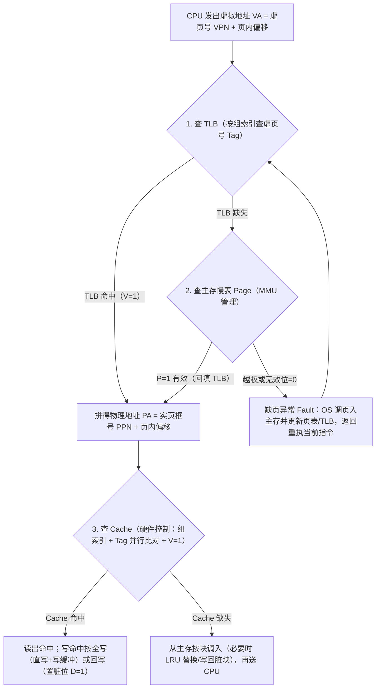

# 第3章 存储系统

> [!important] 近 18 年 408 计组真题雷达（2009—2026）
> - **考频画像**：全书分值占比最大的一章——18 年共考 54 道主考真题（`41` 道单选 + `13` 道综合大题：`2010/2011/2012/2013/2014/2016/2018/2019/2020/2021/2022/2023/2025` 年），另有 `7` 道跨章大题/单选高频联动。
> - **近 5 年考法演变**：从传统芯片拼片与单一 Cache 映射，全面转向“二维数组非对齐占块/跨页 + `AMAT` 与局部性（`2023-T43`、`2025-T43`）+ TLB/页表联动一致性校验（`2021-T44`、`2022-T15`、`2024-T17/18`、`2026-T19`）+ 磁盘 CHS/DMA 请求次数（`2022-T44`）”。
> - **高频丢分盲区**：`MAR` 按实装容量不算地址空间；组相联比较器错写组数；非对齐数组直接总长除以块长漏算首偏移 `20H`；`MMU` 边界误包入 `Cache` 缺失；页表索引直接拿十六进制查十进制行；按列访存惯性写 `0%` 命中率。
> - **总控入口**：[[00_408计组｜考前急救与真题落点总控|返回计组总控]]

> [!abstract] 本章结构
> - 3.1～3.4：存储器分类与层次、性能指标；主存（SRAM/DRAM/ROM/Flash、多模块存储器）；主存与 CPU 的连接和容量扩展；外存（磁盘、RAID、SSD）。
> - 3.5：Cache——局部性、访问过程、映射、替换、写策略、容量计算、分离与多级 Cache。
> - 3.6：虚拟存储器——页式（页表、地址转换、TLB、TLB+Cache 联合访存）、段式、段页式，与 Cache 的比较。
> - 两个层次贯穿全章：Cache—主存层解决**速度**，主存—辅存层解决**容量**。

### 虚实转换与 Cache 访存全链路决策树 【🔥⚡ 必背+避坑｜停下来默背 1 遍 + 精读 1 分钟】



---

# 3.1 存储器概述 【🔥 必背｜停下来默背 1 遍】

## 3.1.1 存储器的分类 【📌 扫一眼｜确认“我还会”就过】

存储元件必须有两个可区分的稳定物理状态，分别表示 0 和 1。

### 按存储元件分类

| 类型 | 表示 0/1 的物理机制 | 典型器件 |
|---|---|---|
| 半导体存储器 | 电荷或电压状态 | SRAM、DRAM、Flash |
| 磁表面存储器 | 磁化方向 | 磁盘、磁带 |
| 光存储器 | 反射率或相变特性 | 光盘 |

### 按存取方式分类

| 类型 | 存取方式 | 存取时间与位置 | 典型器件 |
|---|---|---|---|
| 随机存取 | 按地址访问任意单元，不必先读过前面的单元 | 无关 | 半导体 RAM、ROM |
| 顺序存取存储器 | 按顺序存放、顺序读出，常以记录块编址 | 有关 | 磁带（容量大、速度慢） |
| 直接存取存储器 | 先直接定位到目标区域，再在区域内顺序读取 | 有关 | 机械磁盘 |
| 相联存储器 | **按内容**而非地址存取，并行匹配 | 与位置无关，查找快 | TLB、路由表、全相联 Cache 的标记比较；成本高、容量小 |

### 按信息的可更改性分类

- **可读可写存储器**：RAM 属于此类。
- **只读存储器（ROM）**：正常工作时只能读；部分类型（$E^2PROM$、Flash）可在特定条件下重写。
- 这里的 RAM、ROM 指**半导体存储器**，<mark>两者都可随机访问</mark> `[真题·2010-T16]`；“随机存取”不等于“可随意改写”。

### 按信息的可保存性分类

- **易失性**：断电后信息丢失，如 RAM（SRAM、DRAM）。
- **非易失性**：断电后信息保持，如 ROM、Flash、磁盘、光盘。
- **破坏性读出**：读出会破坏原信息，读后须立即**再生**，如 DRAM。
- **非破坏性读出**：读取不改变原内容、无须再生，如 SRAM、ROM、磁盘。

**注意：**
- 几个分类维度相互独立。“随机存取”说的是访问方式，与能否改写、是否易失无关；断电能否保存与读后是否需要再生也是两件事。
- **EPROM 是可擦除可编程的半导体 ROM**，读地址经电子译码即可选中单元，属于随机存取；**<mark>CD-ROM 是只读光盘</mark>** `[真题·2011-T14]`，ROM 只说明它只读，读数据仍须光头定位、盘片旋转，时间与物理位置有关，不属于这里的随机存取。

`【⚡ 真题补丁｜2010-T16】` RAM 易失、ROM 非易失，均支持随机存取；ROM 不能作 Cache，且均不需按电容漏电逻辑去混淆刷新。磁带按顺序读过前面的记录；磁盘直接定位目标区域后再等待目标扇区，也不能与半导体随机存取混同。
- 传统存储器是“按地址找内容”，相联存储器是“按内容找数据”。

## 3.1.2 主存储器的组成和基本操作 【🔥⚡ 必背+避坑｜停下来默背 1 遍 + 精读 1 分钟】


*图：MAR 经地址线选择存储单元，MDR 经数据线交换数据，控制线决定读或写。*

- **存储体（存储矩阵、存储阵列）**：由大量**记忆单元（存储元）**组成，每个存储元有两种稳定状态表示 0/1，是存储器的主体。
- **存储单元**：具有相同地址的一组存储元，即一个**编址单位**。现代计算机普遍**按字节编址**，每个地址对应 1B。
- **地址译码器**：根据地址选中对应存储单元。
- **MAR / MDR**：存储器地址寄存器 / 存储器数据寄存器。

一次读写过程：

1. CPU 把目标地址送入 MAR，经地址线送到主存；
2. 主存的地址译码器选中对应存储单元；
3. CPU 经控制线向主存发出读/写信号；
4. **写**：CPU 把数据送入 MDR，在控制电路作用下经数据线写入选中单元；**读**：主存把选中单元的内容经数据线送入 MDR。

| 部件 | 位数等于 | 决定什么 | 例 |
|---|---|---|---|
| MAR | 地址线位数 | 最大可寻址范围：$n$ 位地址 → $2^n$ 个编址单位 | 36 位地址、字节编址：$0\sim2^{36}-1$，共 64GB |
| MDR | 数据线宽度 | 一次并行存取的数据量 | 64 位数据线、字节编址：每次 8B |

存储容量 = 地址数 × 编址单位。

**注意：**
- MAR 位数<mark>按主存地址空间确定，不按实际安装容量</mark> `[真题·2011-T15]`：按字节编址，地址空间 64MB、只装 32MB 时，MAR 仍需 26 位。只装一部分存储芯片，表示部分地址没有对应的已安装存储单元，并不把完整地址缩短为 25 位；单片芯片的地址位数又是另一层问题。
- MDR 位数等于数据线宽度，不一定等于机器字长。
- 按字编址时一个地址代表一个字；结果要注明单位是“地址个数、B、bit 还是字”。

## 3.1.3 存储器的层次化结构 【🔥 必背｜停下来默背 1 遍】

为缓解容量、速度、成本之间的矛盾，采用多级存储结构：从上到下单位价格降低、速度变慢、容量增大、CPU 访问频率降低。


*图：Cache—主存层解决速度问题，主存—辅存层解决容量问题。*

- **CPU 可直接与 Cache、主存交换信息**；辅存只能通过主存与 CPU 交换信息。主存是枢纽，能与 CPU、Cache、辅存双向交换。
- 上一层作为下一层的高速缓存：CPU 按 Cache → 主存 → 辅存逐级查找；不在上层时逐级调入（先磁盘 → 主存，再主存 → Cache）。
- 高速层缓存低速层中当前活跃的信息，以较小容量服务多数访问。这里的“副本”描述缓存关系，**不表示各层内容始终同步**：修改后的数据可能尚未写回下一层。

| 层次 | 解决的问题 | 调度方式 | 透明性 | 交换单位 | 从 CPU 看到的效果 |
|---|---|---|---|---|---|
| Cache—主存 | CPU 与主存速度不匹配 | 硬件自动完成 | 对所有程序员透明 | 块（Cache 行） | 速度接近 Cache，容量和单位成本接近主存 |
| 主存—辅存 | 主存容量不足 | 硬件 + 操作系统 | 对应用程序员透明 | 页或段 | 速度接近主存，容量和单位成本接近辅存 |

主存—辅存层发展形成**虚拟存储系统**：程序员使用的虚拟地址空间远大于实际主存容量。

这种层次结构依靠程序访问的局部性（定义与展开见 [[#3.5.1 程序访问的局部性原理 【🔥⚡ 必背+避坑｜停下来默背 1 遍 + 精读 1 分钟】|3.5.1 程序访问的局部性原理]]）。判断时先限定题目问的是哪个对象，再列出它的访问序列：例如数组依次访问 `a[0]；a[0],a[1]；a[0],a[1],a[2]；…`，同一元素跨轮次再次访问体现**时间局部性**，每轮访问相邻元素体现**空间局部性**。不能只因“有循环”就断定数组有时间局部性，也不能用循环变量的重复使用代替数组本身的判断。

**注意：**
- Cache 不增加地址空间，存储系统容量不能把 Cache 和主存容量相加。
- 主存—辅存层只对应用程序员透明，对操作系统开发者不透明。

## 3.1.4 存储器的主要性能指标 【🔥 必背｜停下来默背 1 遍】

| 指标 | 定义 |
|---|---|
| 存取时间 $T_a$ | 完成一次读/写所需时间。读出时间：从主存接收到有效地址到数据有效输出；写入时间：从接收到有效地址到数据成功写入 |
| 存储周期 $T_m$ | 连续两次独立读/写操作之间所需的**最小时间间隔** |
| 存储器带宽 | 存储器每秒能传输的最大数据量 |


*图：存储周期 = 存取时间 + 复原时间。*

- 通常 $T_m>T_a$：每次读写后存储器要花时间恢复内部状态。破坏性读出的 DRAM 读后还须再生，$T_m$ 往往显著大于 $T_a$，甚至可达 $T_m=2T_a$（不能脱离题设一律按 2 倍算）。
- 带宽 = 每个存储周期传输的数据量 ÷ 存储周期。例：存储周期 50ns、每周期 64 位，带宽 $64\text{b}/50\text{ns}=1.28\text{Gb/s}$。先统一 bit/B、ns/s。
- 多模块并行工作可把总带宽提高到单模块的若干倍（见 3.2.3）。

`【⚡ 真题补丁｜2013-T15】` 主存校验常考海明码纠 1 位错校验位数 $k$：满足 $2^k \ge n+k+1$；`8` 位数据至少需 `k=4` 位校验位（`16 >= 13`），勿漏加 `k` 自身。

---

# 3.2 主存储器 【🔥⚡ 必背+避坑｜停下来默背 1 遍 + 精读 1 分钟】

## 3.2.1 半导体随机存取存储器 【🔥⚡ 必背+避坑｜停下来默背 1 遍 + 精读 1 分钟】

半导体 RAM 分为**静态 RAM（SRAM）**和**动态 RAM（DRAM）**，两者都易失；<mark>同步动态 RAM 属于 DRAM</mark> `[真题·2015-T17]`（SDRAM），“同步”描述接口工作时序，并没有改变内部的电容存储方式。主存主要用 DRAM；Cache 要频繁、快速地更新数据，采用 SRAM，不能用只读或擦写缓慢的 ROM 代替。

### SRAM

- 存储元为**双稳态触发器**（六晶体管 MOS），用电路的两个稳定状态表示 0/1。
- 读出**非破坏性**，无须再生；只要不断电就保持状态，**无须刷新**（“静态”的含义）。
- 速度快；集成度低、功耗大、成本高；用于 Cache。

### DRAM

- 利用**栅极电容上的电荷**存信息：有电荷为 1，无电荷为 0。存储元只有 1 个晶体管 + 1 个电容，结构简单，集成度远高于 SRAM。
- 优点：位价低、功耗小、容量大。
- 缺点：速度较慢；电荷会漏电丢失，**必须定时刷新**；读出是**破坏性**的，读后须立即再生。
- 用于大容量主存。

### 存储芯片的组成


| 组成部分 | 作用 |
|---|---|
| 存储体（存储矩阵） | 存储单元的集合；行选择线 X 和列选择线 Y 共同选中目标单元；同一行列交叉点上的多个位（位平面数）同时读写 |
| 地址译码器 | 把地址转换为译码输出线上的选通信号，驱动读写电路 |
| I/O 电路 | 控制被选中单元的读写，并放大信号 |
| 片选控制线 | 多个芯片组成主存时，选中所访问存储字所在的芯片，其他芯片不被选中 |
| 读/写控制线 | 根据 CPU 的读/写命令，控制选中单元执行相应操作 |

地址译码方式：
- **单译码（一维）**：只有一个行译码器，同一行所有单元的字线相连构成一个字，同时读写；缺点是译码输出线太多。
- **双译码（二维）**：分 X（行）、Y（列）两个译码器，行列交叉唯一确定一个单元，输出线少；DRAM 普遍采用。

### DRAM 芯片的关键技术


*图：4M×4 位 DRAM。11 根地址引脚在 RAS、CAS 控制下分时传送行地址和列地址；刷新计数器与行地址缓冲器经 MUX 共享通往行译码器的通路。*

#### 1. 地址引脚复用

- DRAM 容量大、地址位数多。<mark>行地址和列地址经同一组引脚分两次送入</mark> `[真题·2014-T15 / 2022-T17]`，由 RAS（行地址选通）、CAS（列地址选通）分别控制锁存；完整地址位数 = 行地址位数 + 列地址位数，实际地址引脚数 = max(行地址位数, 列地址位数)。**只有行、列地址位数相等时，引脚数才恰好减半**。
- 复用节省的是封装引脚，不是地址信息：两次送入的地址仍共同选中原来的全部单元，芯片容量和主存地址空间均不因此改变。问“单片引脚数”时按单片规格计算，不能用整条内存的总容量代替。
- 图中 4M×4 位芯片：阵列 $2048\times2048\times4$（4 个位平面），行、列地址各 11 位 → 11 根地址引脚 $A_0\sim A_{10}$，4 根数据引脚 $D_1\sim D_4$。$\overline{WE}$ 低电平为写；$\overline{OE}$ 为输出使能，低电平有效。

#### 2. 刷新

- 刷新时只需向芯片提供**行地址和 RAS**，选中一整行执行读操作，并立即再生：读出 0 则电容充分放电，读出 1 则重新充电。
- **按行刷新，不需要列地址**：全芯片刷新次数 = 行数。$2048\times2048\times4$ 阵列只需 2048 次刷新。
- 芯片内的**刷新计数器**自动产生刷新行地址，位数 = 行地址位数。
- **刷新周期**：某一行完成一次刷新到下一次再刷新该行的时间间隔。

#### 3. 阵列行列设计

容量 $2^n\times b$ 位的芯片，阵列 $r$ 行、$c$ 列：

$$
r\times c=2^n,\qquad n=\log_2r+\log_2c
$$

- 地址引脚数由行、列地址位数中的较大者决定 → $r$ 与 $c$ 应尽量接近；
- 按行刷新，行数越少刷新开销越低 → $r\le c$；
- 综合：近似正方形，<mark>行数略小于或等于列数</mark> `[真题·2018-T17]`。

`【⚡ 真题补丁｜2014-T15】` `4M×8` 位 DRAM：地址 `2^22` 行列复用取 `11` 根，数据引脚直接写 `8`（不取对数），共 `11+8=19` 根。
`【⚡ 真题补丁｜2018-T17】` `2K` 单元 DRAM 选 `32行×64列`：仅需 `6` 根地址引脚且按行刷新次数 `32` 比 `64×32` 少一半。
`【⚡ 真题补丁｜2022-T17】` `8` 片 `8192×8192×8` 位（每片 `64MB`）组成 `512MB` 内存条；单芯片行列复用仅 **13 根地址引脚**（纠偏网传 `29` 脚错解）。

#### 4. 行缓冲与突发传输


*图：16×8 位 DRAM，4 行×4 列，2 根地址线分时传送 2 位行地址和 2 位列地址，8 根数据线。*

- 芯片内的**行缓冲器**由感应放大器及锁存电路保持被选中行所有列的数据；它能暂存一整行，不等于 DRAM 存储阵列改用了 SRAM。
- 行缓冲容量 = 列数 × 每个存储单元的位数（图中 $4\times8=32$ 位）。
- 一行被选中后整行装入行缓冲器；在支持**突发传输**的接口中，给出起始列地址后，芯片按规定次序连续输出多个单元，减少重复发送地址和命令的开销。每拍输出多少位由芯片位宽和接口规定，不能把整行缓冲容量当成一次总线传输量。

**注意：**
- **刷新 vs 再生**：刷新是因电荷泄漏而定期进行，按行在芯片内部读出再写回，不向芯片外输出；再生是破坏性读出后立即恢复。不能等电荷漏完才刷新。
- 刷新要占用存储器时间，刷新期间不能正常访存，会影响 CPU 访存。
- 地址位数不是行列数：5 位行地址对应 $2^5=32$ 行。
- 引脚计算：地址引脚先对单元数取对数，再按复用取行、列中的较大者；数据引脚 = 位宽 $b$，不取对数。如 $1024\times8$ 位 DRAM：地址引脚 5 + 数据引脚 8 = 13（不含控制、电源引脚）。
- 行列对称、位宽不变时，复用地址引脚每增加 1 根，行、列地址各加 1 位，容量变为 4 倍。
- 阵列容量（行 × 列 × 位平面数 × 芯片数）单位是 bit，换算 MB 前先除以 8。

### 同步 DRAM（SDRAM）

- **异步 DRAM**：用地址、RAS/CAS 等信号之间的时间关系控制读写，不按统一时钟边沿接收命令；“异步”不等于必须由 CPU 不断查询。
- **SDRAM**：按**存储器总线时钟**接收、锁存命令和地址，在规定的时钟周期后提供数据，便于安排连续传送。CPU 等待期间能否执行其他指令还取决于处理器和控制器，不能只由“同步/异步”断定。
- 连续访问同一行（页）内的数据时可突发传输，减少甚至避免插入等待状态。
- SDRAM 仍是 DRAM，**仍需刷新**。

### SRAM 与 DRAM 的比较

| 项目 | SRAM | DRAM |
|---|---|---|
| 存储信息 | 触发器 | 电容 |
| 破坏性读出 | 否 | 是 |
| 需要刷新 | 不需要 | 需要 |
| 送行列地址 | 同时送 | 分两次送（复用） |
| 运行速度 | 快 | 慢 |
| 集成度 | 低 | 高 |
| 存储成本 | 高 | 低 |
| 主要用途 | Cache | 主存 |

## 3.2.2 非易失性存储器 【📌 扫一眼｜确认“我还会”就过】

### 只读存储器（ROM）

- 与 RAM 一样支持随机访问，但 ROM 是非易失性的。两个优点：① 结构简单，位密度高于 SRAM 等可读写存储器；② 断电不丢失，可靠性高。
- **MROM**：厂商固化，用户不能改；**PROM**：用户可一次性编程；**EPROM**：可多次编程，但每次擦除要用紫外线照射整片芯片，擦写次数有限、写入慢，满足不了主存高速随机读写的需求，不能替代 RAM。

### Flash 存储器

- Flash 是采用 **MOS 存储元**的半导体存储器。以浮栅型为例，电荷保存在绝缘层包围的浮栅中，断电后仍能保持，并通过影响晶体管的导通状态表示信息；读取只需检测状态，编程和擦除却要改变存储电荷，因而明显更慢。它在 EPROM 等技术基础上发展而来，兼有 ROM 和 RAM 的部分优点：
  - 断电后信息可长期保存；
  - 支持**电擦除**和**在线重写**，无须紫外线照射；
  - 读取速度接近 RAM，<mark>写入明显较慢，读写性能不对称</mark> `[真题·2012-T16]`。
- 早期 BIOS 使用 MROM 或 EPROM：前者不可改写，后者需紫外线整片擦除后重新编程；采用 Flash 后可电擦除、在线更新。Flash 也用于 U 盘、SSD。

**注意：** 按本章与真题的分类口径，Flash 属于可电擦写的 ROM 类存储器；“能写入”不等于易失性 RAM。真题所说的随机访问侧重无磁盘式机械定位，也**不表示任意字节都能像 SRAM 一样等速、直接覆盖写入**；SSD 的页读写、块擦除见 3.4.2。

### 固态硬盘（SSD）

- 基于 Flash 构建，由控制单元和存储单元（Flash 芯片阵列）组成；继承了非易失、无机械部件、读取快等特性。
- 相比传统硬盘：读写快、功耗低、抗震性强；缺点是价格较高、写入寿命受 Flash 擦写次数限制。
- SSD 属于外存，内部组织见 3.4.2。

## 3.2.3 多模块存储器 【🔥⚡ 必背+避坑｜停下来默背 1 遍 + 精读 1 分钟】

多模块存储器是一种**空间并行**技术：多个结构完全相同的存储模块并行工作，提高存储器吞吐率。原因是 CPU 速度远高于存储器，若一个存取周期内能连续取得多条指令或多个字，就能更充分地利用 CPU。

按模块间的地址分配方式，分为连续编址和交叉编址。另有**单体多字存储器**：一个存储体的每个存储单元存放多个字，一次读出多个字。它提高访存速度，但不增加容量；指令和数据连续存放时效率最高，转移指令多时预读的字会作废，效率下降。

### 连续编址（高位交叉）


- **高位地址为模块号（体号）**，低位为模块内地址；低位体内地址送到高位体号所确定的模块内译码。
- 顺序访问一段连续地址时，请求集中在同一模块，要到模块地址范围的边界才转向下一模块，**不能像低位交叉那样把相邻地址的访问分散到多个模块**。
- 这里的“顺序”描述模块的地址分配和访问过程，不是磁带那种顺序存取。若独立请求本来就在不同模块且通路支持，仍可并行，不能将高位交叉概括为任何情况下都不能并行。

### 交叉编址（低位交叉）


*图：低位作为体号，连续地址轮流落入不同模块。*

- <mark>低位地址为模块号</mark> `[真题·2026-T15]`，高位为模块内地址。

`【⚡ 真题补丁｜2026-T15】` 8 体低位交叉看地址最低 3 位：`0018 001DH` 末位 `D(1101)` 模 8 余 `5`，故与 `0000 01D5H`（末位 `5`）同在 5 号芯片（防高字节误导）。$m$ 个模块、每个含 $k$ 个单元时：

$$
\text{模块号}=\text{单元地址}\bmod m
$$

  单元 $0,m,\dots,(k-1)m$ 在 $M_0$；单元 $1,m+1,\dots,(k-1)m+1$ 在 $M_1$；依此类推。$m=2^k$ 时，地址最低 $k$ 位就是模块号。
- 连续地址的数据依次分布在不同模块中（交叉存放），称为**交叉存储器**；访问连续地址时可并行，吞吐率显著提高。
- 交叉存储器可采用**轮流启动**或**同时启动**两种方式。

#### 轮流启动

条件：每个模块一次读写的位数正好等于数据总线位数。设模块存取周期为 $T$，总线周期为 $r$：

$$
m_{\min}=\left\lceil\frac{T}{r}\right\rceil
$$

- 无冲突且连续流水时，每隔 $r$ 启动一个模块，流水稳定后每隔 $r$ 传送一个数据。只有 $T=mr$ 时，才可把这个间隔写成 $T/m$，并说相对单模块的理想吞吐率提高 $m$ 倍。
- 模块数应**大于或等于** $T/r$，保证某模块启动后经过 $mr$ 再次被启动时，上次存取已经完成（流水线不间断）。
- 连续存取 $m$ 个字的时间：

$$
t_1=T+(m-1)r
$$

  顺序方式（不交叉）连续读取 $m$ 个字需 $t_2=mT$。
- 流水线充分流动后，每个总线周期 $r$ 完成一个字的传送，带宽为每字数据量除以 $r$；当 $T=mr$ 时，等价于每个存储周期 $T$ 传送 $m$ 个字。


*图：各模块相隔 $r$ 启动，第一个字需等待 $T$，之后每隔 $r$ 得到一个字。*

**访存冲突**的本质是：同一模块尚未完成上次存储周期，又收到新的访问请求。按程序次序判断时，先对地址取模求模块号，再记录各模块上次实际启动时刻；**对同一模块的两次启动必须至少相隔 $T$**。若下一请求原定在 $t$ 启动，而目标模块上次在 $t_i$ 启动，则至少等到 $\max(t,t_i+T)$；停顿后的后续请求也要沿时间线顺延。

在 $T=mr$、此前无停顿的理想流水下，相距不足 $m$ 个启动间隔的两次访问，只要落在同一模块就可能冲突，并非要连续 $m$ 次都访问它。例：4 体时序列 `8005,8006,8007,8008,8001,8002,8003,8004,8000` 的体号是 `1,2,3,0,1,2,3,0,0`；8008 与 8004 已隔 $4r$，而 <mark>8004 与 8000 只隔 r 且同模 0</mark>，后者才需等待 `[真题·2015-T18]`。

#### 同时启动

本节讨论各模块输出合起来恰好占满数据总线的情形。**芯片数不天然等于可独立轮流启动的模块数**：先看地址怎样分配，再看数据线怎样连接和模块怎样启动。

- 例：8 片 $16\text{M}\times8$ 位 DRAM 组成 128MB 内存条。每片内部为 $4096\times4096\times8$ 位阵列（行、列地址各 12 位，8 个位平面）。CPU 发出的主存地址拆成行地址和列地址，分时送入各芯片，选中行列交叉处的 8 位；8 片同步工作，一次提供 64 位，匹配 64 位总线。
- 并行访问以连续 8 字节为单位，每次只能读取**地址对齐的块**（第 0～7、8～15、…、$8k\sim8k+7$ 单元）。4B 的 int 若起始于地址 6（占 6～9），横跨两块，需两次访问；按 4 字节对齐则一次完成。这就是内存访问要求数据对齐的原因。
- 从容量组织看，多片共用片内地址、输出接总线不同位属于**位扩展**；从按字节编址的分布看，连续字节分别落在不同芯片，可描述为**低位交叉、同时启动**（2022 年内存条题采用此口径）。前者回答“怎样拼宽”，后者回答“字节分布在哪里、何时启动”，并不矛盾。突发则回答“给定首地址后怎样连续传送”，不能仅凭支持突发就断定为轮流启动。
- 非对齐数据跨越多少次传输，见 [[#3.3.1 连接原理 【🔥 必背｜停下来默背 1 遍】|3.3.1 连接原理]] 的首末地址方法。

#### 主存与 Cache 之间的三种传送结构


以一个主存块 4 个字为例，送地址 1 周期、存储器准备一个字 10 周期、总线传送 1 周期：

| 结构 | 传送方式 | 缺失损失 |
|---|---|---|
| 窄形结构 | 每次传 1 个字，“送地址—读出—传送”重复 4 次 | $4\times(1+10+1)=48$ |
| 宽形结构 | 加宽通路，每次传 2 个字，重复 2 次 | $2\times(1+10+1)=24$ |
| 多模块交叉存取 | 首地址送出后，每隔 1 周期轮流启动一个模块，无须重发地址和读命令；各模块准备好后依次连续传送 | $1+10+4\times1=15$ |

多模块交叉的时间可写成 $T+(N-1)R$：$T$ 为第一个字的总耗时（送地址 + 准备 + 传送），$N$ 为传送字数，$R$ 为一次总线传送时间 `[真题·2013-T43]`。

`【⚡ 真题补丁｜2013-T43】` 8 体交叉突发：总线带宽 `800MB/s`，`1` 次突发传块耗 `85ns`（准备并行算 1 次）；`100` 条指令含 `6` 次缺失耗 `500 + 6×85 = 1010ns`（对比无突发见 `2023-T20`）。


**注意：**

| 概念 | 针对对象 | 含义 |
|---|---|---|
| 存取时间 | 单个模块 | 一次读写本身的时间 |
| 存储周期 | 单个模块 | 连续两次独立存取的最小间隔 |
| 总线周期 | 总线/交叉系统 | 相邻两次传送（相邻模块启动）的间隔 |

交叉存储器提高的是系统吞吐率，单个模块的存储周期并没有变短。

---

# 3.3 主存储器与 CPU 的连接 【🔥⚡ 必背+避坑｜停下来默背 1 遍 + 精读 1 分钟】

## 3.3.1 连接原理 【🔥 必背｜停下来默背 1 遍】


主存通过**数据总线、地址总线、控制总线**与 CPU 相连：

- **数据总线**：传送数据；位数与工作频率的乘积正比于理论带宽。
- **地址总线**：位数决定 CPU 可寻址的最大内存空间。
- **控制总线**：随芯片接口而异。SRAM 常用片选、读/写或输出使能信号；ROM 的正常读取不需写控制，但可能有片选和输出使能。传统异步 DRAM 可利用 RAS/CAS 参与选片，SDRAM 也可有独立片选，**连接题以给定引脚和有效电平为准**。

单个芯片容量有限，要通过存储器扩展技术把多个芯片集成到内存条上，再结合主板上的 ROM 构成主存空间，经系统总线与 CPU 相连。RAM 和 ROM 统一编址，各自的地址范围由系统设计决定。求 MAR 位数先按完整地址空间与编址单位计算；求芯片数量才看实际要安装的容量，见 [[#3.1.2 主存储器的组成和基本操作 【🔥⚡ 必背+避坑｜停下来默背 1 遍 + 精读 1 分钟】|3.1.2 主存储器的组成和基本操作]]。

> [!tip] 未对齐数据：先画首末地址，再数对齐块
> 按字节编址，数据首地址为 $A$、长度为 $L$ B；题设每次只能访问一个按 $W$ B 对齐的传输块，则末地址为 $A+L-1$，最少访问次数为
> $$N=\left\lfloor\frac{A+L-1}{W}\right\rfloor-\left\lfloor\frac{A}{W}\right\rfloor+1=\left\lceil\frac{(A\bmod W)+L}{W}\right\rceil.$$
> 32 位总线每次传 4B，8B 的 double 从 804001AH 到 8040021H，<mark>跨过三个 4B 对齐块，所以需 3 次</mark> `[真题·2017-T13]`（18H~1BH、1CH~1FH、20H~23H）。**只算 $8/4$ 会漏掉首块前面的偏移**。这里统计的是传输块数；只有题设每块占一个存储周期时，才直接等于存储周期数，不能无条件当作 CPU 时钟周期数。

## 3.3.2 主存容量的扩展 【🔥⚡ 必背+避坑｜停下来默背 1 遍 + 精读 1 分钟】

芯片的字数（单元数）或字长（每单元位数）不够时，在位、字两个方向扩展。

| 方式 | 目的 | 地址线 | 数据线 | 片选、读写线 | 工作方式 |
|---|---|---|---|---|---|
| 位扩展 | 增加字长（CPU 数据总线宽于芯片位宽） | 并联 | 分别接数据总线的不同位 | 并联 | 所有芯片**同时工作**，共同提供一个字 |
| 字扩展 | 增加单元数，扩大地址空间（位宽已满足） | 低位接各芯片地址端 | 并联 | 读写线并联；高位地址经译码器产生各芯片片选 | 各芯片**分时工作**，同一时刻只选中一片 |
| 字位同时扩展 | 字长、单元数都不够 | 低位接组内各芯片 | 组内分接不同位 | 高位译码产生各组片选 | 先位扩展成组，再对组做字扩展 |

### 位扩展法


例：8 片 $8\text{K}\times1$ 位 → $8\text{K}\times8$ 位。各片地址线 $A_{12}\sim A_0$、片选线、读写线连在一起，每片的数据线依次接 CPU 数据总线的一位。

### 字扩展法


例：4 片 $16\text{K}\times8$ 位 → $64\text{K}\times8$ 位。数据线 $D_0\sim D_7$ 并联；$A_{15}A_{14}$ 输入 2-4 译码器产生 4 个片选信号，$A_{15}A_{14}=00$ 选 1 号芯片，$01$ 选 2 号……地址分配：

| 芯片 | $A_{15}A_{14}$ | 地址范围 |
|---|---|---|
| 1 | 00 | 0000H～3FFFH |
| 2 | 01 | 4000H～7FFFH |
| 3 | 10 | 8000H～BFFFH |
| 4 | 11 | C000H～FFFFH |

### 字位同时扩展法


例：8 片 $16\text{K}\times4$ 位 → $64\text{K}\times8$ 位。每 2 片位扩展为一组（$16\text{K}\times8$ 位），共 4 组；$A_{15}A_{14}$ 经译码选组：00 选芯片①②，01 选③④……

### 芯片数量

$$
\text{总片数}=\frac{\text{目标字数}}{\text{芯片字数}}\times\frac{\text{目标字长}}{\text{芯片字长}}
$$

- <mark>两个倍数都必须是合理的整数</mark> `[真题·2009-T15 / 2016-T16 / 2021-T15]`。只用总 bit 数相除，可能得到容量对但无法组织的答案（例如不能用 8 位芯片拼出 4 位字长）。

`【⚡ 真题补丁｜2009-T15】` 64KB 空间中 4KB ROM 用 2K×8 需 `2` 片，余下 `60KB` RAM 用 `4K×4` 需 `(60/4)×(8/4) = 30` 片（防漏乘位扩展 `×2` 或漏扣 ROM）。
`【⚡ 真题补丁｜2016-T16】` ROM `4000H~5FFFH` 共 `8KB`，余 `56KB` RAM 用 `8K×4` 需 `7×2=14` 片。
`【⚡ 真题补丁｜2021-T15】` `000000H~3FFFFFH` 为 `4MB` 字节编址空间，配 `512K×8` 只需 `4MB/512KB = 8` 片（按字节选址不另乘总线宽 `32/8`）。
- 由地址范围求容量：地址数 $N$ = 末地址 − 首地址 + 1；按字节编址容量为 $N$ B，按字编址容量为 $N\times$ 字长。
- 例：地址 000000H～3FFFFFH 共 4M 个地址，按 32 位字编址，用 $512\text{K}\times8$ 位芯片：位扩展 $32/8=4$，字扩展 $4\text{M}/512\text{K}=8$，共 32 片。

### 地址分配

1. 先确定编址单位，求每片（或每组）含多少编址单元；
2. 片内地址位数 = $\log_2(\text{每片或每组的编址单元数})$，接 CPU 地址线的低位；
3. 剩余高位地址用于片选。片选码固定高位，低位从全 0 到全 1 即得首末地址。

若每片（或每个位扩展组）对应 $2^n$ 个 **CPU 编址单位**，各组按此跨度对齐、从地址 0 连续分配，片选码值为 $s$：

$$
\text{首地址}=s\times2^n,\qquad \text{末地址}=(s+1)\times2^n-1
$$

例：$32\text{K}\times16$ 位芯片，**按 16 位字编址**，片选码 111：片内 15 位，首地址 `111` + 15 个 0 = 38000H，末地址 3FFFFH，共 8000H = 32K 个字地址。若改为按字节编址，每片覆盖 64KB，需再区分字内字节，不能照搬上述地址跨度。

- 区间单元数 = 末地址 − 首地址 + 1；已知末地址和容量时，首地址 = 末地址 − 容量 + 1。
- 片选译码器的输入线是各组地址中<mark>能区分各组的那几位高位地址</mark> `[真题·2010-T15 / 2023-T15]`（写出各组首地址，看哪几位依次变化）。

`【⚡ 真题补丁｜2010-T15】` 字位同时扩展每组 `2KB = 0800H`，`0B1FH` 落在第 1 组地址范围 `0800H~0FFFH`。
`【⚡ 真题补丁｜2023-T15】` `30` 位地址总空间 `1GB (00000000~3FFF FFFFH)`，按 `3:1` 划高 `1/4` 作 RAM 范围为 `3000 0000H ~ 3FFF FFFFH`（终点勿多写 `1` 成 `4000 0000H`）。

**注意：**
- 片选码有 $k$ 位，只说明最多可接 $2^k$ 片（组），而不是把一片芯片再分成 $2^k$ 份；每片的地址跨度由芯片容量决定。
- 按字编址时一个地址就是一个完整的字，不需要低位地址再选字节。

---

# 3.4 外部存储器 【🔥⚡ 必背+避坑｜停下来默背 1 遍 + 精读 1 分钟】

## 3.4.1 磁盘存储器 【🔥⚡ 必背+避坑｜停下来默背 1 遍 + 精读 1 分钟】

- 优点：① 容量大、成本低；② 可重复写入和删除；③ 能长期保存，可脱机存档；④ 读出非破坏性，无须再生。
- 缺点：存取速度慢，机械结构复杂，对环境要求高。

### 磁盘设备的组成


磁盘存储器由**磁盘驱动器、磁盘控制器和盘片**组成：

- **磁盘驱动器**：驱动磁盘旋转，并通过磁头在盘面上读写。
- **磁盘控制器**：磁盘驱动器与主机之间的接口。接收并解析 CPU 发来的命令，向驱动器发送控制信号，同时监控驱动器的运行状态。

### 存储区域


磁盘由多个记录面组成，每面有若干同心磁道，每条磁道分为若干扇区。

- **记录面数** = 磁头数，每个磁头负责一个记录面的读写。
- **柱面数** = 一个记录面上的磁道数；所有记录面上编号相同的磁道构成一个柱面。
- **扇区数** = 每条磁道的扇区数。<mark>扇区是磁盘读写的最小单位</mark> `[真题·2019-T20]`，即使只改 1 字节也要读写整个扇区。
- 扇区中除用户数据外，还有地址（标头）和校验等信息。
- 相邻磁道、扇区之间有间隙，防止读写出错。
- 扇区按固定圆心角划分，从外圈到内圈位密度逐渐增加，磁盘的存储能力受限于最内圈的最大记录密度。

### 磁盘高速缓存

在**内存**中开辟一部分空间，暂存待写入磁盘的数据：
- 磁盘仍以**扇区**为基本读写单位；“簇”是文件系统分配空间的单位，可包含若干扇区。缓存可合并小块请求，减少实际磁盘访问；
- 中间结果在写回前若再次被用到，可直接从缓存读取。

它和 CPU 与主存之间的 Cache 不是一回事。

### 磁记录原理

- 磁头与磁性记录介质相对运动时，通过电磁转换实现读写。
- 编码方法：按一定规则把二进制序列转换成磁层中的磁化翻转状态序列。

### 磁盘的性能指标

| 指标 | 含义 / 公式 |
|---|---|
| 道密度 | 沿半径方向单位长度上的磁道数 |
| 位密度 | 单条磁道单位长度上记录的位数 |
| 面密度 | 位密度 × 道密度 |
| 非格式化容量 | 记录面数 × 柱面数 × 每磁道磁化单元数 |
| 格式化容量 | 记录面数 × 柱面数 × 每道扇区数 × 每扇区字节数 |

比较时先统一 bit/B：上式每个磁化单元若计 1bit，非格式化容量算出的是 bit；格式化容量中的“每扇区字节数”指**用户数据**，不含地址和校验信息。非格式化容量 > 格式化容量，因为划分扇区还须预留间隙、同步、地址和校验等开销；这里讨论物理格式化后的数据容量，不等同于文件系统剩余可用空间。

**响应时间与存取时间**：

$$
\text{响应时间}=\text{排队延迟}+\text{控制器时间}+\text{寻道时间}+\text{旋转等待时间}+\text{传输时间}
$$

后三项之和称为**存取时间**（从磁头定位开始到数据传输完成）。

- **寻道时间**：磁头移到目标磁道的时间；平均值用题给数据，不能自行取最大寻道时间的一半。题目中的“半圈”是旋转等待的平均值，不是寻道规则。
- **旋转等待时间**：目标扇区转到磁头下方的时间；<mark>平均值等于转半圈的时间</mark> $=\dfrac{1}{2r}$ `[真题·2013-T21 / 2015-T20]`。

`【⚡ 真题补丁｜2013-T21】` 平均读写 `4KB` 扇区时间 = 寻道 `6` + 半圈 `3` + 控制器 `0.2` + 传输 `(4KB/20MB/s=0.2)` = `9.4ms`。
`【⚡ 真题补丁｜2015-T20】` 寻道 `8ms` + 半圈 `4.17ms` + 传输 `0.008ms` ≈ `12.2ms`（7200rpm 整圈 `8.33ms` 务必除以 `2`）。
- **传输时间**：数据量除以传输速率；若未给速率，每道均匀分布 $S$ 个扇区，则读写一个扇区约为 $\dfrac{1}{rS}$。例如 7200 转/分即 120 转/秒，平均旋转等待约 4.17ms；每道 500 个扇区时，一扇区传输约 0.0167ms。

**最大数据传输速率**（$r$ 为转/秒，$N$ 为每磁道字节数）：

$$
D_r=rN
$$

**注意：**
- 转/分先换算为转/秒。
- 扇区很小时传输时间也要算进去；题目给出控制器延迟时要加上。
- 有扇区间隙时，只有磁头经过扇区才传有效数据，求有效传输率要扣除经过间隙的时间。
- 提高转速能缩短旋转等待和传输时间，但不缩短寻道时间。

### 磁盘地址

主机向磁盘控制器发送的磁盘地址：

| 柱面（磁道）号 | 盘面（磁头）号 | 扇区号 |
|---|---|---|

寻址时先用柱面号决定磁头臂的位置，再用磁头号选中该柱面上的某个盘面，最后由扇区号定位该磁道内的扇区。因此三个字段**分别在各自范围内编号**：

| 字段 | 需要区分的对象数 | 至少所需位数 |
|---|---|---|
| 柱面号 C | 单个盘面的磁道数 $C$ | $\lceil\log_2 C\rceil$ |
| 磁头号 H | 有效记录面数 $H$ | $\lceil\log_2 H\rceil$ |
| 扇区号 S | 每条磁道的扇区数 $S$ | $\lceil\log_2 S\rceil$ |

先数对象，再分别取对数并向上取整，最后才相加。例：16 个盘面、每面 256 道、每道 16 个扇区 → $8+4+4=16$ 位；若为 4 个双面盘片、每面 20000 道、每道 500 个扇区，则分别为 15、3、9 位。

> [!warning] 全盘总数不能代替字段范围
> $C\times H$ 是全盘磁道总数，$C\times H\times S$ 是全盘扇区总数；它们用于算总容量，不能分别拿来计算柱面号、扇区号位数。CHS 要分别编码，字段之和也不一定等于对全盘扇区总数取一次对数所得的最小位数。

### 磁盘的工作过程

- 主要操作是寻址、读盘、写盘，每种操作对应一个控制字；磁盘工作时先取控制字，再执行。
- 磁盘是机械部件，读写操作**串行**进行。
- 磁盘数据通常经控制器以 DMA 方式成批传入主存，不需 CPU 逐字搬运。

**与 DMA 题的联系**：磁盘按扇区读写，不等于一个扇区只申请一次总线。周期挪用时，若题设每次请求获准后传完一个数据缓冲区，则请求次数 = 扇区数据量 ÷ 每次传输量（不整除时向上取整）。先统一单位：64 位缓冲区是 8B，传一个 512B 扇区需 $512/8=64$ 次请求，不能把 64 位当作 64B，也不能把“一次扇区任务”当成“一次总线传送”。

当 CPU 与 DMA 同时请求主存总线，按 2022 年综合题采用的周期挪用模型，<mark>DMA 优先获得总线使用权</mark> `[真题·2022-T44]`：磁盘数据随旋转持续到来，缓冲区来不及腾空可能丢失后续数据，而 CPU 可以暂缓访存。总线须在允许交接的时刻让出，并非截断一个正在进行的总线事务。请求与响应时机、总线仲裁的完整机制留到总线和 I/O 专题复习。

> [!example]- ⚡ 真题母题 2022-T44｜磁盘 CHS 独立编码、平均存取时间与周期挪用 DMA 64 次请求（已核验）
> - **题干要点**：磁盘含 4 个双面盘片（8 个有效记录面），每面 `20000` 磁道、每道 `500` 扇区（每扇区 `512B`），转速 `7200` 转/分，平均寻道时间 `5ms`，DMA 接口配 `64` 位（`8B`）数据缓冲器，采用周期挪用方式向主存传数据。
> - **为什么这么想**：磁盘地址 `CHS` 先沿柱面臂定位，再选磁头面，最后选扇区，三字段**独立编号**而非全盘乘积统一编码；存取时间 = 寻道 + 平均半圈旋转 + 1 扇区传输；DMA 每攒满 `8B` 缓冲区才向总线发起一次周期挪用请求。
> - **已核验标准解答**：
>   1. **磁盘地址各字段位数**：柱面号 `C = ⌈log2(20000)⌉ = 15` 位，盘面号 `H = ⌈log2(8)⌉ = 3` 位，扇区号 `S = ⌈log2(500)⌉ = 9` 位（共 `27` 位）。
>   2. **平均访问 1 扇区时间**：转速 `120 r/s`，半圈 `1/(2×120) ≈ 4.17ms`，传 1 扇区 `1/(120×500) ≈ 0.017ms`；总计 `5 + 4.17 + 0.017 ≈ 9.18ms`（按四舍五入口径保留两位小数）。
>   3. **DMA 总线请求次数与仲裁**：每满 `64` 位（`8B`）请求一次，传完 `512B` 扇区共发起 `512 / 8 = 64` 次 DMA 请求；**DMA 优先级高于 CPU**（防止磁盘持续流入导致缓冲器溢出丢失数据）。
> - **个人复盘提醒**：切忌把 `20000×8×500` 全部乘起来再取对数算成 `27` 位就以为能混用或算成不同字段；写 `64` 位缓冲务必先换算成 `8B`。

### 磁盘阵列（RAID）

RAID（独立冗余磁盘阵列）把多个独立的物理磁盘组合成一个逻辑磁盘，数据在多个物理盘上交叉分割存储、并行访问，以获得更高的性能、可靠性和安全性。

| 级别 | 特点 |
|---|---|
| RAID0 | 无冗余、无校验 |
| RAID1 | 镜像 |
| RAID2 | 海明码纠错 |
| RAID3 | 位交叉奇偶校验 |
| RAID4 | 块交叉奇偶校验 |
| RAID5 | 无独立校验盘的分布式奇偶校验 |

- **RAID0**：连续的多个数据块交替存放在不同物理盘的扇区中，多盘交叉并行读写（**条带化**），扩展容量、提高速度，但没有容错能力。
- **RAID1**：两个磁盘同步读写，互为镜像；一个盘坏了可从另一盘完整读出。代价是有效容量减半。
- RAID1～RAID5 中任一磁盘故障时，可拔出坏盘换上新盘，系统仍能恢复或维持数据完整。
- 归纳：多盘并行提高传输率；并行存取提高吞吐量；镜像实现高可用；校验提高容错能力。

**注意：** <mark>提高可靠性的是镜像和奇偶校验</mark> `[真题·2013-T20]`；条带化（RAID 0）、增加 Cache 只提高速度。RAID 不提高盘片的物理记录密度。

## 3.4.2 固态硬盘 【📌 扫一眼｜确认“我还会”就过】

### SSD 的结构与读写特性


- SSD 基于闪存，介质与 U 盘类似，但容量更大、性能更好。
- 组成：一个或多个**闪存芯片** + **闪存翻译层**。闪存芯片替代传统磁盘的机械驱动器；闪存翻译层把 CPU 发来的**逻辑块**读写请求转换为对底层物理闪存的读写控制信号，相当于代替了磁盘控制器。
- 组织：一个闪存芯片由 $B$ 个块组成，每块 $P$ 页。页通常 512B～4KB，每块 32～128 页，块 16KB～512KB。
- **以页为单位读写，以块为单位擦除**。只有整块擦除后，才能向其中的页写入新数据；块擦除后，其中每页可重新写一次。
- 每块的擦写次数有限，反复写入后会因磨损而失效。
- 随机写较慢的两个原因：
  1. 擦除耗时长，通常比页访问慢一个数量级；
  2. 要修改一个已含有效数据的页 $P_i$，必须先把该块中所有有效页复制到一个新的（已擦除的）块，再写 $P_i$。
- 优点：由半导体器件构成、无机械运动部件，随机访问延迟极低；无噪声、无振动、功耗低、抗震、安全性高。

### 磨损均衡

闪存擦写寿命有限（通常几百至几千次）。若读写集中在少数物理块，这些块会很快磨损，局部损坏就会导致整个 SSD 失效（如 256GB 的 SSD 因几 MB 闪存损坏而报废）。

- **动态磨损均衡**：写入时优先选择擦写次数少的空闲块，把写负载分散到更多块上。
- **静态磨损均衡**：更高级的策略。即使没有新数据写入，控制器也定期扫描并自动迁移数据，把高磨损块中的有效数据迁到低磨损块，使高磨损块转为以读为主，低磨损块承担更多写入。

效果：256GB、擦写寿命 500 次的 SSD，理论总写入量 125TB，每天写 10GB 也要三十多年才到寿命极限。

---

# 3.5 高速缓冲存储器 【🔥⚡ 必背+避坑｜停下来默背 1 遍 + 精读 1 分钟】

程序转移概率较高、数据分布较离散，单靠并行主存提高效率有限。在 CPU 与主存之间设置访问速度更快的 Cache，可显著提高存储系统效率。**Cache 由 SRAM 组成，通常集成在 CPU 内部**。

## 3.5.1 程序访问的局部性原理 【🔥⚡ 必背+避坑｜停下来默背 1 遍 + 精读 1 分钟】

| 局部性 | 含义 | 来源 |
|---|---|---|
| 时间局部性 | 当前访问的指令或数据，不久后很可能再次被访问 | 循环、重复调用的子程序、对同一数据的多次操作 |
| 空间局部性 | 当前访问的单元，其邻近单元不久后很可能被访问 | 指令顺序存放、顺序执行；数组等数据连续存放 |

Cache 利用局部性，把程序当前活跃的部分放在容量小但速度很快的 Cache 中，使 CPU 的多数访存在 Cache 中完成。

**例：数组访问顺序与局部性**（数组按行优先存储，$M=N=2048$，int 占 4B）

```c
// 程序 A：按行访问                 // 程序 B：按列访问
for (i = 0; i < M; i++)             for (j = 0; j < N; j++)
    for (j = 0; j < N; j++)             for (i = 0; i < M; i++)
        sum += a[i][j];                     sum += a[i][j];
```

- 数组 a 的空间局部性：A 的访问顺序与存放顺序一致，相邻访问地址相邻，空间局部性好；B 每次跨越 2048 个元素（8192B），若主存与 Cache 的交换单位小于 8KB，几乎每次都落在不同 Cache 行，空间局部性极差。
- 数组 a 的时间局部性：两者都差，每个元素只访问一次。
- 循环体指令：两者相同。指令连续存放、顺序执行，空间局部性好；循环执行 $2048\times2048$ 次，时间局部性好。
- 两个程序功能相同，<mark>只因内外循环顺序不同，执行效率可以相差很大</mark> `[真题·2010-T44 / 2017-T14]`。

`【⚡ 真题补丁｜2010-T44】` 8 行直接映射容量总位须乘 8 行得 `532B`（非 `532bit`）；行访仅每块首元缺 `1/16`，命中率 `93.75%`；列访步长 `16` 块模 `8` 全冲突，命中率 `0%`。
`【⚡ 真题补丁｜2017-T14】` 嵌套循环遍历小数组时，内层顺序访问元素体现**空间局部性**，外层重复再访同一数组元素体现**时间局部性**。

**注意：**
- C 语言多维数组按行优先存储，**最右下标**变化时地址连续；最内层循环遍历最右下标时空间局部性最好（如 `a[k][j][i]` 应让 `i` 在最内层）。
- `sum`、`i` 等变量被反复访问体现的是时间局部性；顺序扫描数组时每个元素只用一次，只有空间局部性。
- 统计访存次数时，`a[k] = a[k] + 32` 每次循环含 1 次读、1 次写。若块大小 16B、int 4B，顺序读写时每块 4 个元素共 8 次访存，<mark>只有第一次读缺失，缺失率 1/8</mark> `[真题·2016-T15]`（写操作已在第一轮读调块后命中，勿只算读漏算写）。
- 数组覆盖的块数（页数）用首末地址求：末地址 = 首地址 + 总字节数 − 1，覆盖数 = 末块号 − 首块号 + 1。首地址不对齐时可能多占一块。

## 3.5.2 Cache 的基本工作原理 【🔥 必背｜停下来默背 1 遍】

- Cache 和主存都划分为大小相等的**块**；Cache 块也称 **Cache 行**，块长也称行长。
- Cache 容量远小于主存，Cache 中只保存主存中最活跃的若干块的副本。

### Cache 的访问过程


CPU 取指令或读写数据时，**先访问 Cache**：

- **命中**：直接从 Cache 读取，不访问主存。
- **缺失（未命中）**：从主存把该地址所在的**整个块**调入 Cache，写入一个 Cache 行（Cache 已满时按替换算法选择被替换块），然后 CPU 再从 Cache 取得所需数据。
- 命中判断、块调入、替换等必须在一条指令的执行时间内完成，因此**全部由硬件实现**，对程序员透明。
- 统考采用“先查 Cache，未命中再访问主存”。“并行访问”（同时查 Cache 和主存，命中则终止主存访问）考试中一般不涉及。

**注意：** 缺失时，主存送给 CPU 的是所需的**字**，写入 Cache 的是整个**块**。单位大小：字节 < 字 < 块 < 页。

**取指令时 Cache 缺失的处理**：

1. 保持 PC 不变，保证处理完后能重新取同一条指令；
2. 按 PC 指向的地址从主存读取该指令；
3. 把该指令所在的主存块调入 Cache，更新对应 Cache 行的有效位和标记；
4. 重新从 Cache 取指，继续执行。

### Cache 的命中率与平均访问时间

设 Cache 命中次数为 $N_c$，访问主存次数（未命中次数）为 $N_m$：

$$
H=\frac{N_c}{N_c+N_m}
$$

命中时耗时 $T_c$（访问 Cache 的时间）；未命中时先从主存读一个块送入 Cache，再把数据送 CPU，耗时 $T_m+T_c$，$T_m$ 为**缺失损失**（从主存调入一个块的时间）。

$$
T_a=HT_c+(1-H)(T_m+T_c)=T_c+(1-H)T_m
$$

例：Cache 速度是主存的 5 倍，<mark>命中率等于命中次数除以总访存次数</mark>（如 1000 次仅 50 次不中则 `95%`） `[真题·2009-T21]`。设 Cache 存取时间为 $t$，主存为 $5t$：$T=0.95t+0.05\times(t+5t)=1.25t$，性能提升到原来的 $5t/1.25t=4$ 倍。

**注意：** 若题目说明 Cache 与主存并行访问，未命中时间不再是 $T_m+T_c$，按题设计算。

### 实现 Cache 要解决的问题

1. **数据查找**：怎样快速判断数据是否在 Cache 中；
2. **地址映射**：主存块怎样放入 Cache，主存地址怎样转换为 Cache 地址；
3. **替换策略**：Cache 满时替换哪一行；
4. **写入策略**：怎样在保证主存与 Cache 一致的前提下提高写效率。

## 3.5.3 Cache 和主存的映射方式 【🔥⚡ 必背+避坑｜停下来默背 1 遍 + 精读 1 分钟】

- Cache 行数远少于主存块数。为识别每个 Cache 行装的是哪个主存块，每行设**标记**（记录主存块号）；另设一位**有效位**，指示该行数据是否有效。系统启动或复位时所有行无效，主存块装入某行后该行有效位置 1。
- **命中条件：标记相等且有效位为 1**。
- 按字节编址、块大小为 $2^b$ B 时：主存块号 $=\lfloor\text{地址}/\text{块大小}\rfloor$，地址低 $b$ 位为块内地址。

### 直接映射


主存的每一块只能装入 Cache 中**唯一指定**的行：

$$
\text{Cache 行号}=\text{主存块号}\bmod\text{Cache 总行数}
$$

- 设 Cache 有 $2^c$ 行、主存有 $2^m$ 块：主存第 $0,2^c,2^{c+1},\dots$ 块都映射到第 0 行，第 $1,2^c+1,\dots$ 块映射到第 1 行……即**主存块号的低 $c$ 位就是 Cache 行号**，高 $t=m-c$ 位存入该行的标记字段。
- 地址结构：

| 标记（$t$ 位） | Cache 行号（$c$ 位） | 块内地址 |
|---|---|---|


访存过程：用地址中间的 $c$ 位选中 Cache 行 → 该行标记与地址高 $t$ 位比较并检查有效位 → 相等且有效则命中，按块内地址从该行读数；否则未命中，从主存读出该地址所在块装入这一行，置有效位为 1，标记更新为地址高 $t$ 位，并把所需数据送 CPU。

- 目标位置已有内容时发生块冲突，原块被无条件替换，**不需要替换算法**。
- 实现简单，但即使其他行空闲也不能用，**块冲突概率最高、空间利用率最低**。

### 全相联映射


主存的每一块可以装入 Cache 的**任何行**。地址结构：

| 标记（位数 = $\log_2$ 主存块数，即完整主存块号） | 块内地址 |
|---|---|

访存过程：地址的标记与 Cache **所有行**的标记比较 → 有一个相等且有效位为 1 则命中，按块内地址取数；都不相等则未命中，从主存读出该块装入任一空闲行，置有效位为 1、设置标记，并把数据送 CPU。

- 通常每个 Cache 行设一个比较器，比较器位数 = 标记位数。查找按内容进行，属于相联存储器。
- 优点：冲突概率低（只要有空闲行就不会冲突）、空间利用率高、命中率高。
- 缺点：标记比较慢，实现成本高；时间和硬件开销大，不适合大容量 Cache。

### 组相联映射


把 Cache 分为 $Q$ 个大小相等的组，每组 $r$ 行（**$r$ 路组相联**）。每个主存块只能映射到**固定组中的任意一行**：组间直接映射，组内全相联。

$$
\text{Cache 组号}=\text{主存块号}\bmod Q
$$

| 标记 | 组号 | 块内地址 |
|---|---|---|

访存过程：用组号确定目标组 → 组内所有行的标记与地址标记**并行比较** → 某行匹配且有效则命中，按块内地址读数；否则未命中，从主存读出该块装入该组任一空闲行（无空闲行则按替换算法选一行），置有效位为 1、写入标记，并把数据送 CPU。

- $Q=1$（整个 Cache 一组）退化为全相联；$Q=$ Cache 总行数（每组 1 行）退化为直接映射。
- 路数 $r$ 越大，组内可选位置越多，冲突概率越低，但比较器和控制逻辑越复杂。合理选择 $r$，可以用接近直接映射的硬件成本获得接近全相联的性能。
- <mark>r 路组相联需要 r 个比较器，每个比较器位数等于标记位数</mark> `[真题·2022-T16]`（`8` 路组相联比对只需 `8` 个 `20` 位比较器，绝不是按组数 `64` 个）。

> [!example]- ⚡ 真题母题 2023-T43｜二维数组分页、时间局部性与 4 路组相联 Cache 行列同为 87.5%（已核验）
> - **题干要点**：按字节编址，`int` 占 4B，页大小 `4KB`，某二维数组 `a[24][64]` 起始虚拟地址为 `0040 0000H`；数据 Cache 容量 `16KB`、块长 `32B`、`4` 路组相联。对比程序段按行遍历与按列遍历的分页情况、局部性与 Cache 命中率。
> - **为什么这么想**：不要靠直觉“按列访问 Cache 命中率必掉到 0%”，要算清楚同一组内有多少路（4 路）、单行大小跨越多少组。`4` 路组相联共 `16KB/(32B×4) = 128` 组，单组 4 行，组内能同时容纳最多 4 个不同行映射到同一组的块。
> - **已核验标准解答**：
>   1. **占页数与局部性**：数组总长 `24×64×4 = 6144B`，跨 `2` 个 `4KB` 页、缺页 `2` 次；每个元素只读一次，按行与按列对 `a` 均**无时间局部性**。
>   2. **映射组号计算**：组索引为 `A10~A5`（7 位，共 128 组）；`a[1][0]` 字节地址偏移 `64×4 = 256B = 0100H`，`0100H >> 5 = 8`，映射到**第 8 组**。
>   3. **行列命中率对比**：每行 `64×4 = 256B = 8` 块（相邻行同列间隔 8 组），`24` 行同列块分布于 `16` 个周期组中，每组最多仅驻留 `2` 块（小于 `4` 路容量），不会发生替换抖动，故首列载入后后续 `7` 列全部命中。行、列访问均载入 `192` 块，命中率同为 **`7/8 = 87.5%`**。
> - **个人复盘提醒**：遇到组相联按列遍历，先用“数组列跨度涉及同组块数 vs 路数 $r$”验证是否发生替换抖动，不可凭直接映射模板瞎填 0%。

> [!example]- ⚡ 真题母题 2025-T43｜8 路 Cache 非对齐 129 块、AMAT 8.30 与跨 3 页（已核验）
> - **题干要点**：按字节编址，`32` 位虚拟地址，页大小 `4KB`；L1 D-Cache 容量 `32KB`，块大小 `64B`，`8` 路组相联。整型数组 `int d[2048]` 起始虚地址 `0180 0020H`，循环执行 `d[i] = d[i] + 1`。求映射字段、`d[100]` 组号、数组缺失率、`AMAT` 与跨页缺页次数。
> - **为什么这么想**：第 1 步看块索引 `VA11~VA6` 恰在 12 位页内偏移之内，物理/虚拟组号一致；第 2 步盯死首地址低位 **`0x20`（32B 非对齐偏移）**，它会把数组向后顺移多挤进第 `129` 块与第 `3` 个页面；第 3 步 `d[i] = d[i] + 1` 每元素 **1 读 1 写共 2 次访存**。
> - **已核验标准解答**：
>   1. **字段与 `d[100]` 组号**：`32KB/(64B×8) = 64` 组，组索引 6 位（`VA11~VA6`）、块内偏移 6 位（`VA5~VA0`）；`d[100]` 址 `0180 0020H + 400(190H) = 0180 01B0H`，取 `B0H` 对应的第 6～11 位即 `0110B` = **第 6 组**。
>   2. **占块数、缺失率与 AMAT**：总长 `8192B`，但起始偏移 `20H(32B)` 使首末块分别为第 0 块与第 128 块，共跨 **129 块**（每次循环读缺调入、写即命中，总访存 `2048×2 = 4096` 次），故缺失率 `129 / 4096 ≈ 3.15%`，平均访存时间 `AMAT ≈ 8.30` 周期（真卷依命中与缺失损失按 `1 + 缺失率 × 缺失损失` 计得，缺失率以 `129 / 4096 ≈ 3.15%` 为基准）。
>   3. **跨页数与缺页次数**：首址 `0180 0020H`、末址 `0180 201FH`，跨越虚页 `01800H`、`01801H`、`01802H` 共 **3 页**，故缺页 **3 次**。
> - **个人复盘提醒**：拿到任何数组题第一动作写 `首偏移 = VA & (B-1)` 并算末地址，永远不要跳过非对齐边界直接拿 `8192 / 64 = 128`。

**注意：**
- **路数**是每组行数 $r$，**组数**是 $Q=$ 总行数 $/r$。Cache 共 $M$ 块、每 $K$ 块一组，是 $K$ 路组相联、共 $M/K$ 组，不能说成“$M/K$ 路”。
- <mark>先由地址求主存块号，再对行数/组数取模</mark> `[真题·2009-T14 / 2026-T18]`，不能直接拿字节地址取模。

`【⚡ 真题补丁｜2009-T14】` 16 块 2 路 Cache 共 8 组，32B 块，字节地址 `129` 对应块号 `129//32=4`，映射第 `4 mod 8 = 4` 组（勿直模 `129` 得 `1`）。
`【⚡ 真题补丁｜2026-T18】` 1024 行 4 路组相联共 `256` 组、块长 `32B`：主存地址 `1028` 块号 `1028//32 = 32`，映射第 `32 mod 256 = 32` 组。教材有时把 Cache 行号也叫“块号”，要分清主存块号与 Cache 行（组）号。
- 映射到同一组不等于马上替换：组内还有空行就能共存，同期映射到该组的活跃块数超过路数才发生替换。
- 2012 年统考有一题采用另一套组相联映射口径（蒋本珊教材）；题目给出映射关系时按题设做，常规仍用“块号 mod 组数”。 `[真题易错·2012-T17]`

### 三种映射方式的比较

在 Cache 容量和主存块大小固定的条件下：

| 项目 | 直接映射 | 组相联映射 | 全相联映射 |
|---|---|---|---|
| 主存块可放位置 | 唯一一行 | 固定组内任一行 | 任一行 |
| 地址中间字段 | 行号 | 组号 | 无 |
| 比较器个数 | 1 | $r$ | Cache 总行数 |
| 命中率 | 最低 | 居中 | 最高 |
| 判断开销与时间 | 最小、最快 | 居中 | 最大、最慢 |
| 标记存储开销 | 最少 | 居中 | 最多 |
| 替换算法 | 不需要 | 组满时需要 | Cache 满时需要 |

### 地址字段计算


设物理地址 $p$ 位，Cache 数据区容量 $C$，块大小 $B=2^b$，$r$ 路组相联：

$$
\text{总行数}=\frac{C}{B},\qquad \text{组数}=\frac{C}{Br}
$$

$$
\text{块内地址}=b\text{ 位},\qquad \text{组号}=\log_2\frac{C}{Br}\text{ 位},\qquad \text{标记}=p-b-\log_2\frac{C}{Br}\text{ 位}
$$

直接映射时组号即行号（$r=1$）；全相联没有组号，标记 $=p-b$。

- 直接映射的标记位数 $=\log_2(\text{主存容量}/\text{Cache 容量})$。例：主存是 Cache 的 4096 倍，标记 12 位。
- 主存容量、Cache 数据区容量、路数不变时，块大小加倍：块内地址多 1 位、组数减半使组号少 1 位，**标记位数不变**。
- 块内地址只由数据块大小决定。有效位、标记、脏位等是 Cache 的附加信息，不占地址位。

**例**（主存地址空间 256MB、按字节编址，Cache 8 行，行长 64B）：
- 地址 28 位，块内地址 6 位，行号 3 位，标记 $28-6-3=19$ 位。
- 地址 3200 的块号 $=3200/64=50$。直接映射：行号 $50\bmod8=2$。2 路组相联（4 组）：组号 $50\bmod4=2$，可放第 2 组任一行，即第 4 或第 5 行。
- 访问 0123456H（直接映射）：标记 0000 0001 0010 0011 010，行号 001，块内地址 010110。用行号访问 Cache 第 1 行，比较标记与有效位，命中则按块内地址读数；否则从主存调入该块写入第 1 行，更新标记、置有效位。

## 3.5.4 Cache 中主存块的替换算法 【🔥 必背｜停下来默背 1 遍】

全相联或组相联映射时，新主存块调入而 Cache（或该组）已满，才需要替换算法；直接映射直接覆盖，不需要。

| 算法          | 替换对象            | 局部性 | 特点                                |
| ----------- | --------------- | --- | --------------------------------- |
| 随机（RAND）    | 随机选一行           | 未利用 | 实现简单，命中率通常较低                      |
| 先进先出（FIFO）  | 最早装入的行          | 未利用 | 实现较容易；最早进入的块可能仍是热点，命中率不高          |
| 最近最少使用（LRU） | 最近最久未被访问的行      | 利用  | 平均命中率通常高于 FIFO；考查重点               |
| 最不经常使用（LFU） | 一段时间内累计访问次数最少的行 | —   | 每行一个计数器，装入时置 0，每访问一次加 1，替换计数值最小的行 |

### LRU 的计数器实现

- 每组 Cache 维护一组计数器（**LRU 替换位**），记录各行的相对访问顺序。每行位数取决于路数：2 路 1 位，4 路 2 位，即 $\log_2(\text{组内行数})$。
- 计数器更新规则：
  1. **命中**：命中行计数器清零，比它低的计数器加 1，其余不变；
  2. **未命中且有空闲行**：新装入行置 0，其他非空闲行全加 1；
  3. **未命中且无空闲行**：替换计数值最大的行，新装入行置 0，其余全加 1。


*图：4 路组相联，主存块 {1,2,3,4,5} 映射到同一组，访问序列 1,2,3,4,1,2,5,1,2,3,4,5。左侧阴影数字为 LRU 计数值，右侧为主存块号。*

- 组相联时各组分别维护，不能跨组比较新旧。
- **抖动**：频繁访问的主存块数超过每组行数时，可能持续缺失。如每组 4 行、访问序列 1,2,3,4,5,1,2,3,4,5,…，每次访问第 5 个块都会换出下一个要访问的块，命中率为 0。

**注意：** LRU 看“最近是否用过”，LFU 看“总共用了多少次”，FIFO 只看装入先后。

## 3.5.5 Cache 的一致性问题 【🔥⚡ 必背+避坑｜停下来默背 1 遍 + 精读 1 分钟】

Cache 中是主存块的副本，写 Cache 时要用写策略维持与主存一致。**写命中**：CPU 要写的主存地址所在块已在 Cache 中；否则为**写不命中**。

| 情况 | 策略 |
|---|---|
| 写命中 | 全写法（直写法）/ 回写法 |
| 写不命中 | 写分配法 / 非写分配法 |

### 写命中的处理

**全写法（直写法，Write Through）**
- 写命中时数据<mark>同时写入 Cache 和主存</mark> `[真题·2015-T16]`。

`【⚡ 真题补丁｜2015-T16】` 直写法下读指令与读命中均 0 次访主存，但写回变量 `x` 时必同步写主存，整个片段至少访主存 `1` 次（勿把读 `x` 也算入写主存次数）。主存始终与 Cache 同步，替换时可直接覆盖，无须写回。
- 实现简单，主存数据实时正确；但每次写都要访问主存，降低性能。
- **写缓冲**：在 Cache 与主存之间增设写缓冲。CPU 把数据同时写入 Cache 和写缓冲，再由写缓冲**异步**写入主存，缓解 CPU 与主存的速度差异。写操作频繁时，写缓冲可能饱和甚至溢出。


**回写法（Write Back）**
- 写命中时**只写 Cache**，不立即写主存；该块被替换出 Cache 时才写回主存。
- 减少主存访问次数，提高效率，但主存与 Cache 存在暂时不一致。
- 每个 Cache 行设**修改位（脏位）**：为 1 表示已被修改，替换时必须写回主存；为 0 表示与主存一致，替换时直接覆盖。
- 直写法无须脏位，回写法必须设脏位。（多数教材译作“写回法”，统考真题用“回写法”。）

### 写不命中的处理

**写分配法（Write Allocate）**
- 教材表述：先把数据写入主存对应单元，再把该主存块调入 Cache 的一个空闲行。《深入理解计算机系统》的表述：先把该主存块调入 Cache，再在 Cache 中更新。
- 利用了空间局部性，但每次写不命中都要把主存块装入 Cache。

**非写分配法（Not-Write-Allocate）**
- 直接把数据写入主存，不把该块调入 Cache。

通常写分配法与回写法搭配，非写分配法与全写法搭配。

**注意：**
- 全写/回写只针对写命中，写分配/非写分配只针对写不命中；读操作不涉及这些策略。
- 回写法写主存的次数远少于全写法。

## 3.5.6 Cache 容量的计算 【🔥⚡ 必背+避坑｜停下来默背 1 遍 + 精读 1 分钟】

$$
\text{Cache 总容量}=(\text{每行标记信息位数}+\text{每行数据位数})\times\text{Cache 总行数}
$$

| 每行标记信息 | 何时存在 | 位数 |
|---|---|---|
| 有效位 | 所有 Cache | 1 |
| 标记位 | 所有 Cache | $t$ |
| 脏位 | 采用回写法 | 1 `[真题·2015-T15 / 2021-T16]` |
| LRU 替换位 | 采用 LRU 算法 | $\log_2(\text{组内行数})$ |

例（续 3.5.3 的例，直接映射，不考虑脏位和替换控制位）：每行 1 位有效位 + 19 位标记 + 512 位数据，总容量 $8\times(1+19+512)=4256$ 位。

**注意：**
- “Cache 容量为 32KB”通常指**数据区**容量；问“总容量至少多少位”才加标记信息。题目说不考虑脏位、替换位时去掉。直接映射没有替换位（即使题干给了替换算法），随机替换也没有替换位。

`【⚡ 真题补丁｜2015-T15】` 4K 字直映回写 Cache（4 字块、1024 行）：每行 `128+18(Tag)+1(V)+1(Dirty) = 148` 位，总容量 `148K` 位。
`【⚡ 真题补丁｜2021-T16】` 直接映射回写 Cache（32B=256b 数据）：单行 `256+17+1+1 = 275` 位；问单行勿乘行数，问回写勿漏脏位。
`【⚡ 真题补丁｜2020-T44】` 8 路直写 LRU Cache：**直写无脏位**、8 路需 `3` 位 LRU、Tag `20` 位；对齐 `4096B` 占 `64` 块缺 `64` 次；缺失流程含查组→调块→填标记置 `V=1` 更新 `LRU`。
- 主存块大小 = Cache 行数据区大小；Cache 行加上标记信息后位数大于主存块。Cache 数据区容量 = 块大小 × 行数，块变大而容量不变时只是行数减少。

## 3.5.7 Cache 的应用 【🔥 必背｜停下来默背 1 遍】

### 分离 Cache

- 统一 Cache 设计实现简单，但流水线中取指部件和执行部件同时访问同一 Cache 时会冲突。
- 把<mark>指令 Cache 和数据 Cache 分开</mark> `[真题·2014-T16]`，可消除流水线 IF 与 MEM 同拍结构冲突，还能针对指令和数据不同的局部性分别优化。
- 指令大多顺序执行，指令 Cache 的空间局部性通常比数据 Cache 好。

### 多级 Cache


- 以两级为例：L1 离 CPU 最近，速度最快、容量较小；L2 较远，速度较慢、容量较大。
- L1 通常分为指令 Cache 和数据 Cache；L1 数据 Cache 采用**写分配法 + 回写法**。
- L1、L2 通常都用回写法：L1 写命中只更新 L1；L1 的脏块被替换时写回 L2；L2 的脏块被替换时写回主存。L2 比主存快得多，L1 写命中不必访问主存，脏块写回由 L2 承接，避免频繁写操作使写缓冲饱和或溢出。
- 若 L1 命中率为 $H_1$，L2 的局部命中率（在 L1 缺失的访问中命中的比例）为 $H_2$，则两级全局命中率 $H=H_1+(1-H_1)H_2$。

### 影响 Cache 性能的因素

Cache 的访存效率主要由命中率决定：

- **映射方式**：全相联命中率最高，直接映射最低，组相联居中。
- **Cache 容量**：容量越大，可缓存的数据越多，命中率通常越高。
- **块大小**：块较大时能更好利用空间局部性，命中率提高；但块过大会 ① 增加缺失损失（每次从主存读更多数据），② 在总容量固定时减少行数、降低映射灵活性，反而可能降低命中率。块过小则难以利用空间局部性。块大小应取适中值。
- 此外还有替换算法、写策略、Cache 级数、指令/数据 Cache 是否分离、主存—总线—Cache—CPU 的结构等。

---

# 3.6 虚拟存储器 【🔥⚡ 必背+避坑｜停下来默背 1 遍 + 精读 1 分钟】

虚拟存储器由硬件和系统软件协同实现，利用主存和辅存构建一个逻辑上连续、容量巨大的地址空间。对应用程序员透明：程序按虚拟地址空间编写，不必关心实际主存容量和数据的物理位置。

## 3.6.1 虚拟存储器的基本概念 【🔥⚡ 必背+避坑｜停下来默背 1 遍 + 精读 1 分钟】


- 程序的地址空间（**虚拟地址空间、逻辑地址空间**）与主存的物理地址空间分离。用户程序用**虚地址（逻辑地址）**，主存单元用**实地址（物理地址）**。虚地址空间通常远大于实地址空间。
- CPU 用虚地址访存时，先判断该地址的数据是否已驻留主存：
  - 已驻留：经地址变换得到实地址，CPU 直接访问主存单元；
  - 未驻留：触发**缺页（缺段）异常**，由操作系统把包含该地址的整页（段）从辅存调入主存，之后 CPU 再访问（<mark>重新执行引发缺页的指令</mark> `[真题·2014-T45 / 2019-T14]`）；
  - 主存已满时，按替换算法置换一个页面。
- <mark>只能采用回写策略</mark> `[真题·2016-T45]`：辅存访问延迟极高，每次写都同步更新辅存不可行。页面被修改时标为脏页，置换出主存时只有脏页才写回辅存。
- **类似全相联映射**：<mark>任一虚页可装入主存中任意可用页框</mark> `[真题·2024-T16]`，提高主存利用率，并支持地址重定位（非直接映射）。

## 3.6.2 页式虚拟存储器 【🔥⚡ 必背+避坑｜停下来默背 1 遍 + 精读 1 分钟】

主存空间和虚拟地址空间都划分为**大小相同的页**。主存中的页称**物理页（实页、页框）**，虚拟空间中的页称**虚拟页（虚页）**。**页表**记录每个虚页在主存中的位置，通常常驻主存。

### 页表


| 页表项字段 | 作用 |
|---|---|
| 有效位（装入位） | 1：该页已在主存，表项中存物理页号；0：未调入，表项通常存该页在外存中的地址 |
| 脏位（修改位） | 页面是否被修改过；回写策略下置换时据此决定是否写回磁盘 |
| 引用位（使用位） | 页面是否被访问过，用于 Clock、LRU 等替换算法 |
| 保护信息 | 读、写、执行等访问权限 |

例：访问第 1 页，有效位为 1，页已驻留，转换为物理地址后访问。访问第 5 页，有效位为 0，发生缺页异常，调用缺页处理程序：按页表项中的外存地址把该页从磁盘调入一个空闲页框；主存已满则选择一页置换，按脏位决定是否写回磁盘；完成后更新页表项。

- 优点：页面大小固定，页表结构简单，调入方便。
- 缺点：程序大小通常不是页长的整数倍，最后一页产生**内部碎片**；页是物理划分单位，没有逻辑意义，模块化、保护和共享不如段式灵活。

### 地址转换

| 地址 | 高位 | 低位 |
|---|---|---|
| 虚拟地址 | 虚页号 | 页内偏移 |
| 物理地址 | 物理页号 | 页内偏移（与虚拟地址相同） |

页面大小相同，所以虚拟地址和物理地址的页内偏移完全一致。页内偏移位数 = $\log_2$ 页大小（4KB 页 → 12 位）；虚页号 = 虚拟地址 ÷ 页大小的商，页内偏移 = 余数。


1. **页表基址寄存器**指向当前进程页表的起始地址；
2. 从虚拟地址取出虚页号，作为索引查页表项（表项地址 = 页表基址 + 虚页号 × 页表项长度）； `[真题·2022-T15]`

`【⚡ 真题补丁｜2022-T15】` 十六进制虚地址 `0008 2840H`（4KB 页）拆出虚页号 `82H = 十进制 130`，再查十进制索引第 `130` 项得页框 `018H`，拼得 `01 8840H`（防拿 `82` 误判缺页）。
3. 有效位为 1，取出物理页号；
4. 物理页号与页内偏移**拼接**成物理地址（物理页号 × 页大小 + 页内偏移）。

有效位为 0 时发生缺页异常，由操作系统处理。

**注意：** 页表在主存中，查页表本身就是一次访存；没有有效映射时结果是缺页，不能凑出物理地址。

### 页面大小的选择

| 页面过小 | 页面过大 |
|---|---|
| 页表项数量剧增，页表庞大 | 页表规模小 |
| 难以利用空间局部性，命中率降低 | 页内碎片增加，浪费主存 |
| — | 调入/调出传输量大，缺页处理时间长 |

页面应大小适中，实际系统通常取 4KB～几 MB，在页表开销、局部性利用与 I/O 效率之间平衡。

### 快表（TLB）

- 有了页表，每次访存要先访问主存中的页表取得物理页号，再访问主存取数据，访存次数增加。
- 依据局部性，一段时间内 CPU 集中访问少数页面。把这些页面的页表项缓存在由<mark>高速 SRAM 构成的快表 TLB</mark>中 `[真题·2020-T15]`，地址转换时就不必访问主存页表。主存中的页表相应称为**慢表（Page）**。
- TLB 工作原理类似 Cache，通常采用**全相联或组相联**映射。表项包含虚页号（作标记）、物理页号和控制位（有效位、脏位等）。
  - 全相联：标记 = 完整虚页号；
  - 组相联：虚页号的**高位作标记，低位作组索引**。
- 字段计算：页内偏移 = $\log_2$ 页大小；<mark>虚页号位数 = 虚拟地址位数 − 页内偏移位数</mark>；TLB 组数 = 项数 ÷ 路数；标记位数 = 虚页号位数 − 组号位数。 `[真题·2013-T16 / 2024-T17 / 2026-T19]`

`【⚡ 真题补丁｜2013-T16】` 全相联 TLB：`03FF F180H` 取虚页号 `03FFFH` 查得物理页框 `0153H`，与 12 位页内偏移 `180H` 拼得 `015 3180H`。
`【⚡ 真题补丁｜2024-T17】` 32 位 VA、`1KB` 页得 `22` 位虚页号（勿用 `30` 位物理地址算）；32 项 4 路 TLB 共 `8` 组（3 位索引），标记 `22-3 = 19` 位。
`【⚡ 真题补丁｜2026-T19】` VA 16 位/页 256B 得 VPN 8 位；4 路 16 项 TLB 分 `4` 组（2 位索引）；虚页 `22` 拆为组 `2`、Tag `05H`，若页表 `P=0` 则 TLB 同步后 `V` 必不能为 `1`。
  例：32 位虚拟地址、4KB 页、32 项 4 路组相联 TLB：页内偏移 12 位，虚页号 20 位；8 组，组号 3 位，标记 17 位。

### 具有 TLB 和 Cache 的多级存储系统


*图：TLB 全相联、每项一个比较器；Cache 为 2 路组相联。*

访存流程：

1. CPU 给出虚拟地址，分为虚页号和页内偏移；
2. **查 TLB**：虚页号与所有 TLB 项的标记并行比较，某项匹配且有效位为 1 则 TLB 命中，直接取得实页号；
3. **TLB 缺失**：访问主存中的页表，页表项有效则取得实页号并装入 TLB（TLB 满则执行替换）；页表项无效则发生缺页异常，由操作系统调页并更新页表；

`【⚡ 真题补丁｜2024-T18】` MMU 负责地址变换及越权、TLB 缺失、缺页检测；**Cache 缺失在物理地址 PA 生成后由 Cache 控制逻辑检测**，不归 MMU 管。
4. 实页号与页内偏移拼接成物理地址；
5. **查 Cache**：把物理地址分为标记、组号、块内地址，用组号定位 Cache 组，组内各行标记与地址标记比较，匹配且有效则 Cache 命中，按块内地址取数据送 CPU；
6. Cache 缺失则从主存调入该块。


TLB 缓存了常用页表项，避免每次地址转换都访问主存页表，所以引入虚拟存储器后访存性能几乎不下降。

**注意：**
- 必须先完成地址转换，再用物理地址访问 Cache。
- 虚拟地址与物理地址只有页内偏移部分相同。Cache 的组号和块内地址若完全落在页内偏移内，它们在 VA、PA 中相同；但 Cache 标记仍取自物理地址。

### TLB、Page、Cache 三种缺失的组合

- **TLB 缺失**：要访问的虚页号不在 TLB 中；
- **Cache 缺失**：要访问的主存块不在 Cache 中；
- **Page 缺失**：要访问的页面不在主存中。

TLB 是页表项的缓存，Page 缺失时 TLB 必然缺失；Cache 是主存的副本，Page 缺失时 Cache 中也不可能有对应数据。

| 序号 | TLB | Page | Cache | 说明 | 访存情况 |
|---|---|---|---|---|---|
| 1 | 命中 | 命中 | 命中 | TLB 命中则 Page 一定命中；信息在主存，可能在 Cache 中 | 无须访问主存 |
| 2 | 命中 | 命中 | 缺失 | 信息在主存，也可能不在 Cache 中 | 访问主存 1 次 |
| 3 | 缺失 | 命中 | 命中 | TLB 缺失但 Page 可能命中 | 访问主存 1 次（查页表） |
| 4 | 缺失 | 命中 | 缺失 | — | 访问主存 2 次 |
| 5 | 缺失 | 缺失 | 缺失 | 信息不在主存，一定不在 Cache | 缺页异常，访问磁盘，至少访问主存 2 次 |

不可能出现：<mark>TLB 命中而 Page 缺失；Page 缺失而 Cache 命中</mark> `[真题·2010-T17]`。

`【⚡ 真题补丁｜2011-T44】` VA 24 位/PA 20 位；虚页查 TLB 组号取**虚页号低位**（组 `0 Tag 012H` 命中在主存），勿拿全 VA 低位。
`【⚡ 真题补丁｜2012-T43】` 缺页率按缺页数除总指令/访存数（`20MIPS` 下 30 万缺失得 `4.8MB/s`）；周期挪用 DMA 优先防 DBR 溢出。
`【⚡ 真题补丁｜2014-T45】` `I-Cache 512B` 命中率 `5999/6000`；`add` 溢出、`lw` 缺页重执多访 **1 次** TLB（共至少 `1001` 次）。
`【⚡ 真题补丁｜2016-T45】` 全相联 TLB+2 路 Cache 虚实位宽切勿混用；因磁盘极慢，虚存写盘只能采用**回写法**。
`【⚡ 真题补丁｜2018-T44】` 查 Cache 必先验有效位 `V=1` 再比 Tag（`0008C040H` `V=0` 未中）；组号落页内低 12 位不受缺虚页影响。
`【⚡ 真题补丁｜2019-T46】` `00401000H` 与 `0040104AH` 高 20 位同为 `00401H` 同页；`64` 行 4 路分 `16` 组索引仅 `4` 位（非 `5` 位）。
`【⚡ 真题补丁｜2021-T44】` 2 路 8 组 TLB 索引直接取 `3` 位（非 `8/2`）；`VA` 由 `30→32` 位时 TLB 每项 Tag 同步加宽 `2` 位。

| 事件 | 处理者 |
|---|---|
| Cache 缺失 | 硬件自动完成 |
| TLB 缺失 | 硬件或软件 |
| 缺页 | 操作系统的缺页异常处理程序（调入页面、更新页表等） |

## 3.6.3 段式虚拟存储器 【📌 扫一眼｜确认“我还会”就过】


- 段按程序的**逻辑结构**划分，长度因程序而异。
- 虚拟地址 = **段号 + 段内地址**；地址变换由**段表**实现。段表是程序的逻辑段与其在主存中位置的对照表，每行记录段号、有效位、段起点、段长等。段长可变，所以段表必须给出起始地址和段长。
- 变换过程：从虚拟地址取出段号，根据段表基地址找到对应段表项 → 检查有效位（1 表示已调入主存，0 表示不在主存）→ 已调入时读出该段在主存中的起始地址，与段内地址**相加**得到物理地址。
- 分段由程序逻辑结构决定，**对程序员不透明**；分页对程序员透明。
- 优点：段的边界与程序的自然逻辑边界一致，逻辑独立性好，便于编译、管理、修改和保护，也便于多道程序共享段。
- 缺点：段长可变，主存分配困难，段间容易产生**外部碎片**，浪费存储空间。

## 3.6.4 段页式虚拟存储器 【📌 扫一眼｜确认“我还会”就过】

- 程序先按逻辑结构分段，每段再划分为固定大小的页；主存也划分为大小相等的页。调入调出仍以**页**为基本单位。
- 每个程序对应一个段表，每段对应一个页表。
- 虚拟地址 = **段号 + 段内页号 + 页内地址**。
- 变换过程：用段号查段表，得到该段页表的起始地址 → 以段内页号为索引查页表，取出实页号 → 实页号与页内地址拼接成物理地址。
- 优点：兼有页式和段式的优点，既能按段共享和保护，又避免了外部碎片。缺点：地址变换要两次查表，系统开销较大。

| 项目 | 页式 | 段式 | 段页式 |
|---|---|---|---|
| 划分依据 | 固定大小的物理划分 | 程序逻辑结构 | 先按逻辑分段，段内分页 |
| 单位长度 | 固定 | 可变 | 页固定，段可变 |
| 虚拟地址 | 虚页号 + 页内偏移 | 段号 + 段内地址 | 段号 + 段内页号 + 页内地址 |
| 物理地址形成 | 实页号与偏移拼接 | 段起点 + 段内地址（相加） | 实页号与页内地址拼接 |
| 对程序员 | 透明 | 不透明 | 分段不透明 |
| 碎片 | 内部碎片 | 外部碎片 | 无外部碎片 |
| 共享与保护 | 不便 | 方便 | 方便 |
| 查表 | 页表 | 段表 | 段表 + 页表（两次） |

## 3.6.5 虚拟存储器与 Cache 的比较 【🔥 必背｜停下来默背 1 遍】

**相同之处：**
1. 最终目标都是提高系统性能，都体现了容量、速度、价格的梯度；
2. 都把数据划分为信息块作为基本交换单位，虚拟存储器的页通常比 Cache 块大得多；
3. 都涉及地址映射、替换算法和更新策略；
4. 都基于局部性原理，把活跃数据放在高速部件中。

**不同之处：**

| 项目 | Cache | 虚拟存储器 |
|---|---|---|
| 解决的问题 | CPU 与主存的速度差异 | 主存容量不足 |
| 实现 | 完全由硬件实现 | 操作系统 + 硬件 |
| 透明性 | 对所有程序员透明 | 对应用程序员透明，对操作系统开发者不透明 |
| 不命中的代价 | 访问主存，延迟增加数十倍 | 访问磁盘，延迟增加可达十万倍 |
| 不命中后的访问 | CPU 与主存有直接通路，硬件自动从主存取数并装入 Cache | 辅存与 CPU 无直接通路，须先把数据从辅存调入主存，CPU 才能访问 |
| 映射 | 直接 / 组相联 / 全相联 | 任一虚页可装入任一页框（类似全相联） |
| 写策略 | 全写或回写 | 只能回写 |

---

## 本章易混点速查

- 半导体 RAM 和 ROM 都随机存取，CD-ROM 是只读光盘；磁带顺序存取，磁盘直接存取，TLB 用相联存储器。
- SRAM 也是易失的，“静态”只是不需要刷新。
- 刷新因漏电定期按行进行，再生因破坏性读出立即进行；SDRAM 仍需刷新。
- MAR 位数按地址空间算，不按实际安装容量；MDR 位数 = 数据线宽度。
- 存储周期 > 存取时间；交叉存储器提高吞吐率，不缩短单模块存储周期。
- DRAM 地址引脚取行、列地址位数较大者，刷新次数 = 行数，行缓冲 = 列数 × 单元位数。
- 高位交叉不利于连续地址的并行访问；低位交叉可轮流或同时启动。轮流启动时，同一模块两次实际启动间隔小于其存储周期才会冲突。
- 位扩展所有芯片同时工作，字扩展分时工作；芯片数 = 字扩展倍数 × 位扩展倍数。
- 磁盘最小读写单位是扇区；SSD 按页读写、按块擦除。
- RAID 中提高可靠性的是镜像和校验，条带化只提速。
- 磁盘高速缓存在内存中，不是 CPU 的 Cache。
- Cache 命中 = 标记相等且有效位为 1。
- 主存块号由地址除以块大小得到，Cache 行（组）号由主存块号取模得到。
- $K$ 路组相联：每组 $K$ 行；比较器 $K$ 个，每个比较标记位数。
- 直接映射不用替换算法；LRU 看最近使用，LFU 看累计次数，FIFO 不利用局部性。
- 全写/回写管写命中，写分配/非写分配管写不命中；回写法需要脏位。
- Cache 容量通常指数据区，总容量要加有效位、标记、脏位、替换位。
- Cache 块大小、页面大小都不是越大越好。
- Cache 行大小 = 主存块大小；虚页大小 = 页框大小；页通常远大于块。
- TLB 是页表项的高速缓存，页表在主存；TLB 缺失不等于缺页。
- TLB 命中 ⇒ Page 命中；Page 缺失 ⇒ TLB 和 Cache 都缺失。
- 先 VA → PA，再用 PA 查 Cache；VA 和 PA 只有页内偏移相同。
- 页式物理地址是拼接，段式物理地址是段起点 + 段内地址相加。
- 分页对程序员透明，分段不透明；页式有内部碎片，段式有外部碎片。
- 缺页处理完后重新执行引发缺页的指令；Cache 缺失由硬件处理，缺页由操作系统处理。

---

# 本章高频题型总表

| 题干特征 | 优先方法/起手式 | 真题印证与避坑 |
|---|---|---|
| 存储器分类、MAR/MDR 与海明码 | `MAR` 看地址空间不看实装；EPROM 随机读、CD-ROM 光盘非随机；`2^k>=n+k+1` | `[真题·2010-T16 / 2011-T14 / 2011-T15 / 2013-T15]` |
| DRAM 引脚复用、刷新与多体交叉 | 地址引脚取行列较大者，数据引脚直写位宽；`8` 体低位交叉看末 `3` 位；紧邻模同冲突 | `[真题·2014-T15 / 2015-T17 / 2015-T18 / 2018-T17 / 2022-T17 / 2026-T15]` |
| 存储器扩充与非对齐跨界 | 字扩×位扩均为整倍数；高 1/4 RAM 地址莫多 1；非对齐用 `⌈(o+L)/W⌉` | `[真题·2009-T15 / 2010-T15 / 2016-T16 / 2017-T13 / 2021-T15 / 2023-T15]` |
| 磁盘 CHS、访问时间、RAID 与 Flash | CHS 三字段各自向上取整；旋转必取半圈；镜像校验提容错，条带仅提速；Flash 写慢 | `[真题·2012-T16 / 2013-T20 / 2013-T21 / 2015-T20 / 2019-T20 / 2022-T44]` |
| Cache 映射、比较器、总容量与写策略 | 组索引=块号 mod 组数；比较器=路数；总容量必×行数且直写无脏位；读写分离计次数 | `[真题·2009-T14 / 2009-T21 / 2012-T17 / 2014-T16 / 2015-T15 / 2015-T16 / 2016-T15 / 2021-T16 / 2022-T16 / 2026-T18]` |
| 二维数组局部性、跨块跨页与 AMAT | 先验首偏移 `VA&(B-1)` 与末地址算跨块跨页；按列看同组块数<=路数否；读+写算总次数 | `[真题·2010-T44 / 2013-T43 / 2017-T14 / 2020-T44 / 2023-T43 / 2025-T43]` |
| TLB/页表、MMU 边界与三缺失组合 | 十六进制虚页号先转十进制查行；TLB 用 VA 算 Tag；`MMU` 不检 `Cache`；缺页重执当前指令再访 TLB | `[真题·2010-T17 / 2011-T44 / 2012-T43 / 2013-T16 / 2014-T45 / 2016-T45 / 2018-T44 / 2019-T14 / 2019-T46 / 2020-T15 / 2021-T44 / 2022-T15 / 2024-T16 / 2024-T17 / 2024-T18 / 2026-T19]` |

---

# 冲刺主动回忆卡（遮挡自测）

> [!question] 1. 主存地址空间 `64MB` 却只装 `32MB`，`MAR` 到底几位？`8` 路组相联 `32KB` Cache 到底有几个比较器、直写要不要脏位？
> [!success]- 正确解释
> 1. `MAR` 位宽严格看**主存最大地址空间**（`64MB` 字节编址 → `26` 位），只装 `32MB` 只是部分地址无物理芯片（`2011-T15`）。
> 2. `8` 路组相联只需 **`8` 个比较器**（每路并行比对 1 个，位数等于 `Tag`），并非 `64` 个组数（`2022-T16`）；直写法始终同步写主存，**不需要脏位**（`2020-T44`），只有回写法才多加 1 位脏位（`2015-T15`、`2021-T16`）。

> [!question] 2. 面对“二维/一维数组 + Cache + 分页”综合题（如 `2023-T43`、`2025-T43`），为什么按列访问未必 0% 命中，首地址 `0180 0020H` 为何多占 1 块 1 页？
> [!success]- 正确解释
> 1. 按列遍历时是否抖动取决于**组相联路数**：`2023-T43` 中 4 路共 128 组，各组并发活跃块未超过 4 路故不被替换，行列命中率竟同为 `87.5%`（先比较组内同时驻留块数与路数 $r$）。
> 2. `0180 0020H` 对 `64B` 块存在 `32B`（`0x20`）非对齐偏移，对 `4KB` 页也是非整页对齐：因此 `8192B` 数组实际跨 **`129` 个 Cache 块**与 **`3` 个虚页**（`2025-T43`），且每次 `d[i]=d[i]+1` 包含 1 读 1 写共 2 次访存。

> [!question] 3. `0008 2840H` 去查 0~255 十进制索引的页表时为何经常错判缺页？`MMU` 到底检测哪几类事件，缺页重启后还查几次 TLB？
> [!success]- 正确解释
> 1. 十六进制虚页号 `82H` 必须先转成十进制 **`130`** 再去查第 130 项（`2022-T15`），千万不能拿 `82` 查十进制第 `82` 行。
> 2. `MMU` 检测越权、TLB 缺失与缺页，而 **`Cache` 缺失是在物理地址 `PA` 生成后由 `Cache` 控制逻辑检测**，不在 `MMU` 内部（`2024-T18`）；缺页由 OS 调页并更新页表/TLB 后**重执同一条指令**（`2019-T14`），因此会多触发 **`+1` 次 TLB 访问**（`2014-T45`）。

> [!question] 4. `4` 路 16 项 TLB（VA `16` 位、页 `256B`）中虚页号 `22` 对应第几组？若页表中该页 `P=0`，TLB 中对应表项可能 `V=1` 吗？
> [!success]- 正确解释
> 1. 页大小 `256B` → 偏移 8 位、VPN 8 位；4 路 16 项共 `4` 组（低 2 位索引 `1:0`）；十进制虚页号 `22 = 0001 0110B`，低 2 位 `10B = 2`（**第 2 组**），高 6 位 `Tag = 05H`（`2026-T19`）。
> 2. **不可能**：`TLB` 命中则 `Page` 必须有效在主存，同步/一致性要求若页表 `P=0`，`TLB` 中不可存在该页 `V=1` 的有效缓存（`2010-T17`、`2026-T19`）。
