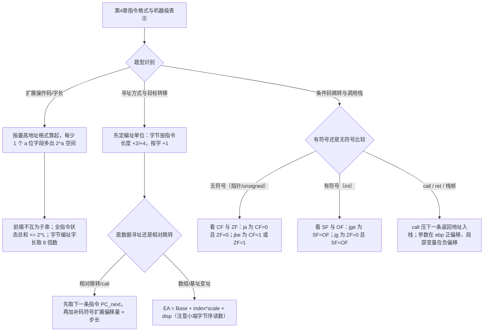

# 第4章 指令系统

> [!important] 近 18 年 408 计组真题雷达（2009—2026）
> - **考频画像**：18 年共考 28 道主考真题（`19` 道单选 + `9` 道硬核综合大题：`2010/2013/2014/2017/2019/2021/2023/2024/2026` 年），另有 `11` 道与数据标志 `OF/CF`、数据通路及流水线强联动。
> - **近 5 年考法演变**：单选高度聚焦 **ISA 与微架构边界**（`2022-T18`、`2025-T16`、`2026-T16`）、三级扩展操作码与直接执行语言/指令分类（`2022-T19`、`2024-T13`、`2026-T17/T21`）；大题从 x86 汇编追踪（`2023-T44`）转向 **RISC-V 汇编+机器码（`2024-T44`）** 与 **自定义 16 位指令编码逆向（`2026-T43`）**。
> - **高频丢分盲区**：把“超级流水线/微程序/单总线”算进 ISA；把用户态主动陷入的 `syscall` 当成特权指令；算转移目标漏用取指后下一条 PC 或弄混按字/按字节步长；二维数组偏移忘乘元素字节；混淆 x86 目的在前 vs RISC-V/AT&T 方向。
> - **总控入口**：[[00_408计组｜考前急救与真题落点总控|返回计组总控]]

> [!abstract] 本章复盘目标
> 本章围绕“软件如何用机器可执行的指令表达计算、访存和控制流”展开。主线是：先理解 ISA 与指令格式，再掌握有效地址的计算，随后把 x86 汇编与 C 语言的选择、循环、过程调用对应起来，最后比较 CISC 与 RISC。做题时始终先辨认编址单位、指令长度、操作数解释和有符号/无符号条件，再计算地址或标志位。

## 考纲定位

- 指令格式的基本概念、操作码与地址码；
- 零地址、一地址、二地址、三地址，定长操作码与扩展操作码；
- 指令寻址、数据寻址及各种有效地址计算；
- 数据对齐、大端与小端存放；
- CISC 与 RISC 的基本概念和比较；
- 编译器、汇编器、链接器，以及选择、循环、过程调用的机器级表示。

> [!important] 重点排序
> **第一重点：寻址方式和有效地址计算。第二重点：扩展操作码容量分析。第三重点：x86 汇编中的条件码、循环、数组寻址和栈帧。第四重点：ISA 与微架构边界、CISC/RISC 比较。**

## 章节知识脉络

1. **接口层（4.1）**：ISA 规定程序员可见的指令、寄存器、数据类型、寻址方式和编码。
2. **地址层（4.2）**：形式地址 A 经过寻址方式得到有效地址 EA；PC、BR、IX、SP 承担不同地址角色。
3. **代码层（4.3）**：汇编指令改变寄存器、内存、标志位和 EIP，编译器用这些原语表示选择、循环和函数调用。
4. **设计取舍（4.4）**：CISC 用复杂指令换表达能力，RISC 用规整简单的指令换执行和编译优化效率。

### 指令寻址、偏移跳转与调用栈决策树 【🔥⚡ 必背+避坑｜停下来默背 1 遍 + 精读 1 分钟】

---

# 4.1 指令系统 【🔥⚡ 必背+避坑｜停下来默背 1 遍 + 精读 1 分钟】

## 4.1.1 指令集体系结构 【🔥⚡ 必背+避坑｜停下来默背 1 遍 + 精读 1 分钟】

### 这一节要解决什么问题

- 什么是指令、指令系统和 ISA？
- ISA 规定哪些内容？哪些内容属于 CPU 的微架构实现？
- 为什么理解 ISA 能帮助读懂机器级代码并进行底层优化？

### 一、指令与指令系统

- **机器指令（指令）**：<mark>指示计算机完成某种基本操作的命令</mark>，是机器语言的一个语句 `[真题·2024-T13]`。

`【⚡ 真题补丁｜2024-T13】` CPU 硬件能**直接执行**的包括机器指令与微指令；汇编指令和伪指令均须先经汇编器处理（对比 `2015-T12`）。
`【⚡ 真题补丁｜2026-T16】` 是否采用超级流水线技术属于微架构实现细节，不由 ISA 规定（纠偏错选虚拟存储管理方式）。
- **指令系统/指令集**：一台计算机全部机器指令的集合。
- **指令集体系结构（ISA）**：完整定义软件与硬件之间的接口，是机器语言和汇编语言程序员必须掌握的抽象层。

高级语言程序经过编译器、汇编器和链接器后，最终产生符合目标 ISA 的机器代码。ISA 是软件看到的机器模型，也是硬件实现必须遵守的行为契约。

### 二、ISA 规定的主要内容

1. **指令格式、寻址方式和操作类型**，以及每种操作需要的操作数个数、类型和寻址约束。
2. **操作数数据类型**，以及多字节数据采用大端还是小端存放。
3. **程序可访问的寄存器**：编号、数量、位数；存储空间大小及编址方式。
4. **程序员可见的控制状态**：程序计数器（PC/EIP）、条件码/标志位及其行为。

> [!warning] ISA 与微架构不要混淆
> **属于 ISA**：***<u>指令字格式（是否定长）</u>***、指令类型、操作数类型、寻址方式、***<u>通用寄存器个数和位数</u>***、编址方式、大小端规则。 `[真题·2022-T18 / 2025-T16]`  
> **不属于 ISA**：***<u>CPU 时钟周期、阵列乘法器、加法器进位电路、是否采用微程序控制器、单总线或多总线数据通路</u>***与超级流水线等具体控制实现。后者是实现同一 ISA 的微架构选择。 `[真题·2022-T18 / 2025-T16 / 2026-T16]`

### 常考题型与解题方法

#### 题型：判断某项是否由 ISA 规定

- **识别特征**：选项混合了指令格式/寄存器/寻址和电路、时钟、控制器。
- **解题步骤**：问“机器语言程序员能否直接观察到它？”能观察到的是 ISA；只影响内部实现的是微架构。
- **常见干扰项**：把控制信号偷换成指令功能；把 CPU 时钟周期当成指令格式的一部分。
- **一句话方法**：**ISA 定义行为和编码，微架构决定怎样实现行为。**

> [!warning] 易错点：控制信号不属于 ISA 规范
> “控制信号”（如 ALUBsrc, RegWrite, MemRead）由 CPU 内部控制单元（CU）在硬件电路层面产生，属于**微架构实现细节**。程序员和编译器在机器码层面根本看不到也无需关心，因此绝不属于 ISA 规定的范畴。

### 一分钟回顾

- ISA 位于软硬件交界面，指令系统是 ISA 的核心。
- ISA 规定“做什么、操作谁、怎样编码和寻址”；不规定内部电路“怎么做”。
- 大端/小端、寄存器可见性和编址方式也属于 ISA 范畴。

## 4.1.2 指令的基本格式 【🔥⚡ 必背+避坑｜停下来默背 1 遍 + 精读 1 分钟】

### 一、操作码和地址码

> [!tip] 硬件视角：指令在哪里？（存储程序原理）
> 1. **指令存放在哪里？** 遵循**冯·诺依曼“存储程序”**原理，程序在运行前，所有机器指令和原始数据都被装载在**主存（内存）**中。
> 2. **CPU 如何读取指令？** CPU 中的程序计数器（PC）存放当前待执行指令的主存地址。取指阶段，CPU 根据 PC 的地址从主存中将整条指令通过总线抓取到 CPU 内部的**指令寄存器（IR）**中，然后由控制单元（CU）进行译码执行。

一条机器指令在物理上是一串二进制代码，在逻辑结构上通常由以下字段构成：

| 字段 | 作用 |
|---|---|
| **操作码（OP）** | **“干什么”**：指明指令执行何种操作，如加法（ADD）、从内存取数（LOAD）、写内存（STORE）、无条件转移（JMP）等。也是译码的依据。 |
| **寻址特征位（I/X）** | **“怎么找操作数”**：（可选/有时融合在地址码中）指明形式地址 $A$ 采用什么寻址方式（是立即数、直接寻址、寄存器寻址还是相对寻址）。 |
| **地址码（A）** | **“对谁干/放哪里”**：给出源操作数、目的操作数、转移目标或子程序入口的寻址信息。可包含 0~3 个地址字段。 |

**指令字长**是整条指令包含的二进制位数，由操作码长度、寻址特征长度、地址码长度和地址码个数共同决定。

- **定长指令字**：所有指令字长相等，取指和译码简单，便于流水线。
- **变长指令字**：不同功能使用不同长度，代码密度高但译码和取指更复杂。
- 主存通常按字节编址，所以指令字长一般为字节的整数倍。

### 二、按地址码个数分类

| 格式 | 典型语义 | 特点 | 若地址码均为主存地址，完成一条指令的访存次数（含取指） |
|---|---|---|---|
| 零地址 | 仅 OP；堆栈机中操作数隐含为栈顶和次栈顶 | 无显式操作数地址 | 取指 1 次；堆栈操作还要访问栈 |
| 一地址 | 单操作数：OP(A1) → A1；累加器型：(ACC) OP (A1) → ACC | 地址字段少，另一操作数可能隐含在 ACC | 累加器型通常 3 次：取指、取数、存结果 |
| 二地址 | $(A_1) \operatorname{OP} (A_2) \rightarrow A_1$（例：`MOV R1, [R2]`） | $A_1$ 既是目的地址又是结果地址 | 若 $A_1, A_2$ 均为主存地址，需 4 次访存；若涉及寄存器则扣减对应访存 |
| 三地址 | (A1) OP (A2) → A3 | 两个源地址和独立结果地址，表达自然 | 4 次：取指、取两个操作数、存结果 |

> [!warning] 一地址不等于“只有一个操作数”
> 一地址指令既可能是真正的单操作数指令（如 INC、取反、移位），也可能是累加器型双操作数指令。判断时看操作码和隐含寄存器，而不要只看地址字段数量。

> [!warning] 易错点：指令字长与地址码个数无关
> 1. **指令字长是否固定与地址码个数无关**：不能认为“单地址指令就是定长指令”。指令是定长还是变长取决于 ISA 设计，变长指令集中单地址指令完全可以有不同的字长。
> 2. **单字长指令的速度优势**：单字长指令（指令长度＝存储字长）只需**一次访存（一个存储周期）**即可完成取指，无需拼接多次访存，因此能加快取指令速度。

### 常考题型与解题方法

#### 题型 1：根据指令格式判断操作数和访存次数

- **识别特征**：题干给出零/一/二/三地址格式，问结果位置或访存次数。
- **解题步骤**：先写出通用语义，再数“取指 + 取源操作数 + 写结果”；寄存器或立即数不增加主存访存。
- **检查动作**：确认 A1 在二地址指令中既是源又是目的；确认三地址指令的结果在 A3。

#### 题型 2：指令字长、操作码和地址字段反推

- 设指令字长为 L，若有 k 个 a 位地址字段，则操作码长度为 L-ka。
- 若操作码固定且需要 N 条指令，至少需要 ceil(log₂N) 位。
- 若有 $N$ 个通用寄存器，寄存器编号需 $\lceil \log_2 N \rceil$ 位。
- 若题目按字节编址并问“至少多少位”，算出的位数还要向上取到 8 的整数倍。

> [!warning] 避坑天花板：直接寻址（无符号）vs 相对/基址寻址（补码）的范围正负差异
> 算得剩余地址字段为 $k$ 位后，究竟选“无符号范围”还是“补码负数范围”看寻址本质：
> 1. **直接寻址 ($EA = A$)**：形式地址 $A$ 直接就是主存物理内存编号。***<u>主存地址全是无符号数（从 0 开始，绝不可能为负）</u>***。$k$ 位直接寻址范围必为 ***<u>$0 \sim 2^k - 1$</u>***（如 8 位为 $0 \sim 255$）。 `[真题·2020-T16]`
> 2. **相对/基址寻址 ($EA = \text{Reg} + D$)**：形式地址 $D$ 是相对于基址/PC 的偏移量（可前偏可后偏）。***<u>偏移量必须用补码表示（有正有负）</u>***。$k$ 位偏移量范围为 ***<u>$-2^{k-1} \sim +2^{k-1}-1$</u>***。 `[真题·2014-T17]`

`【⚡ 真题补丁｜2014-T17】` `Store` `32` 位指令扣去 `8` 位 OP、`4` 位源、`4` 位基址后，余 `16` 位补码偏移范围 `-32768 ~ +32767`。
`【⚡ 真题补丁｜2020-T16】` 48 指令需 6 位 OP、4 种方式需 2 位，余 `8` 位按无符号直接寻址为 `0 ~ 255`（勿算 `-128 ~ 127`）。

### 一分钟回顾

- 地址码个数决定“显式给出几个地址”，不直接决定指令是否定长。
- 地址码可以是操作数地址、结果地址、转移目标地址或子程序入口地址。
- 定长便于取指/译码/流水，变长提高代码密度但增加硬件复杂度。

## 4.1.3 定长操作码指令格式 【📌 扫一眼｜确认“我还会”就过】

若操作码字段固定为 n 位，最多可以表示 2ⁿ 条不同指令。定长操作码的优点是译码规则简单、速度快、硬件容易设计，32 位或更长的定长指令系统中很常见。

### 题型：操作码位数或指令条数

- 已知指令数 N：操作码至少 ceil(log₂N) 位。
- 已知操作码位数 n：最多 2ⁿ 条。
- **陷阱**：地址字段的位数不能直接当成操作码容量；如果还要编码寻址特征，必须从总指令字长中扣除。

## 4.1.4 扩展操作码指令格式 【🔥⚡ 必背+避坑｜停下来默背 1 遍 + 精读 1 分钟】

### 一、基本思想

扩展操作码让操作码长度随地址码个数减少而增加：三地址指令使用较短操作码，二地址、一地址、零地址指令逐级“借用”原地址字段作为扩展操作码。这样在 ***<u>指令字长不变</u>*** 的情况下 ***<u>增加指令种类</u>***。 `[真题·2017-T16 / 2022-T19]`

`【⚡ 真题补丁｜2017-T16】` 3 地址 29 条至少占 `29/32` 或放 `24` 位字长下 `6` 位 OP（余 `35` 前缀）×`64=2240>=107`，最短 **24 位**。
`【⚡ 真题补丁｜2022-T19】` 16 位三级扩展（6 位地址字段）：2 地址 12 余 4 → 1 地址 `4×64=256` 用 254 余 2 → 0 地址剩 `2×64 = 128` 条。
`【⚡ 真题补丁｜2021-T43】` 16 位 R/I/J 指令：`ALU 16/MAR 20/MDR 8`；`01B2H` 不溢得 `B04AH`，`01B3H` 乘得 `8290H` 溢出（两小题独立执行）。

> [!example]- ⚡ 真题母题 2026-T43｜16 位 R/I/M 指令编码、按字节/按字编址主存与 y=16x-5 机器码（已核验）
> - **题干要点**：某 `16` 位定长指令机器包含 R/I/M 三种指令格式（涉及 `4` 位操作码/字段、`op1`/`op2`/`op3` 约束、通用寄存器编号），结合 `T44` 单周期数据通路中 `AluBSrc` 常数 `2` 实现 `PC+2`，求解主存/GPR 位宽、编码互斥条件、`R[2]/R[9]` 执行结果及 `y = 16x - 5` 的机器码序列填空。
> - **为什么这么想**：首先由 `T44` 数据通路取指 `PC + 2` 相互印证该 `16` 位系统采用**按字节编址**（主存单元 `8` 位，每条 `16` 位指令占 `2` 字节；若个别仅看单卷按字编址口径则主存单元 `16` 位、步长 `1`）；操作码字段互斥看是否落入同一前缀位段且非 `0000`。
> - **已核验标准解答**（按 `2026_pph/p14` 权威按字节编址口径主写，并注按字对照）：
>   1. **主存单元与 GPR 位宽**：按字节编址下主存基本存储单元 **8 位**（若按字编址则为 16 位），通用寄存器 GPR **16 位**。
>   2. **`op1/op2/op3` 同码判定**：`op1` 与 `op2` **可以相同**（二者处于不同编码字段且 `op2 != 0000`）；`op2` 与 `op3` **不可以相同**（处于同一变长/扩展译码位段防止二义性）。
>   3. **寄存器运算结果**：`R[2] = 9BCEH`，`R[9] = F001H`。
>   4. **`y = 16x - 5` 机器码填空**：① `1110`、② `0000 0100`（左移 4 位等价乘 16）、③ `1111 1011`（`-5` 的 8 位补码 `FBH`）、④ `0000 0000 0010`（若按字编址对照口径则 `④` 为 `0000 0000 0001`）。
> - **个人复盘提醒**：做这种前后双大题联考的 16 位机题目，务必扫一眼 `T44` 数据通路里 `PC` 增量是 `+2` 还是 `+1`，交叉锁定是按字节还是按字编址。

### 二、设计规则

1. **短操作码不能成为长操作码的前缀**，否则译码时无法唯一确定指令。
2. 各指令的完整操作码不能重复。
3. 常用指令尽量分配短操作码，减少平均译码时间。

### 三、容量计算的固定步骤（***<u>树状前缀推演法</u>***）

设每个地址字段为 a 位：

1. 先计算最长地址格式可用的基本操作码空间。
2. 已用的短操作码编码中，留出若干编码作为“扩展前缀”。
3. 每保留 1 个前缀，少一个地址字段就多出 2ᵃ 倍的编码空间。
4. 继续从长一级的编码中保留前缀，直到零地址指令。

> [!tip] 二进制本质：为什么 1 个未用前缀恰好衍生出 2ᵃ 条新指令？
> 少一个 $a$ 位的地址码，本质是把空出来的这 $a$ 个二进制位“改行”充当操作码的一部分。这 $a$ 位二进制共有 $2^a$ 种变化排列（从 `00...0` 到 `11...1`）。因此，上一级每留出 1 个固定的前缀，下一级在该前缀后追加这 $a$ 位，就能精确裂变成 $2^a$ 种互不重复的长操作码。

**典型例**：16 位指令、3 个 4 位地址字段时，三地址、二地址、一地址各使用 15 条并逐级保留一个扩展前缀，零地址可使用剩余 16 个编码。若各级实际数量不同，必须按已占用编码空间重新计算。

> [!warning] 扩展操作码的常见误区
> 1. 目标是 ***<u>保持指令字长不变并增加指令数量</u>***，不是 ***<u>增加寻址空间</u>***。  
> 2. 一条二地址指令会占用 2ᵃ 个更短的一地址编码空间；一条一地址指令会占用 2ᵃ 个零地址编码空间。  
> 3. ***<u>求各级指令取最大可能条数时的临界条件</u>***：规则总结为 **“***<u>前级预留 1 个前缀，末级用尽全部空间</u>***”**。若后面还需要定义更短地址的格式，前级必须至少预留 1 个编码作为扩展前缀（故取 $2^a - 1$）；到了最后一级（零地址），无需再向下扩展，即可将剩余编码全部用尽（取 $1 \times 2^a$）。
> 4. 保留的扩展前缀不是普通指令，不能重复计数。
> 5. ***<u>按字节编址时的字长对齐陷阱</u>***：若算出的理论二进制位数非 8 的倍数（如 23 位），在“按字节编址”的条件下，指令字长**必须向上取整到 8 的整数倍**（如 24 位），切勿误选算出的理论裸位数。

### 常考题型：给定各类指令数，求剩余格式容量

- **识别特征**：指令字长、地址字段位数、已有三/二/一地址条数，问零地址或单地址最多条数。
- **解题步骤**：
  1. **方法一（***<u>树状前缀推演法</u>***）**：***<u>从地址最多的格式开始</u>***，记录每一级剩余前缀；每降一级，***<u>空出的地址字段贡献 2ᵃ 倍编码</u>***。
  2. **方法二（***<u>二进制状态总数扣减法</u>***）**：将整条指令视为总容量 $2^L$ 的编码空间，扣除各级指令占用的状态点数，即可秒杀零地址指令数。
- **检查动作**：所有完整操作码必须互不为前缀；总编码空间不能超过 2ᴸ。

> [!note] 两种解题方法的标准推演示例
> **已知条件**：指令字长 16 位，地址码长 4 位（3 个地址字段），已有三地址 15 条、二地址 8 条、一地址 127 条，求零地址指令最大条数。
> 
> **解法一：树状前缀推演法（逐级扣减前缀）**
> 1. **三地址（4 位 OP）**：总空间 $2^4 = 16$，已用 15 条 $\rightarrow$ 留 **1 个前缀** 扩展。
> 2. **二地址（8 位 OP）**：可用容量 $1 \times 2^4 = 16$，已用 8 条 $\rightarrow$ 留 $16 - 8 =$ **8 个前缀** 扩展。
> 3. **一地址（12 位 OP）**：可用容量 $8 \times 2^4 = 128$，已用 127 条 $\rightarrow$ 留 $128 - 127 =$ **1 个前缀** 扩展。
> 4. **零地址（16 位 OP）**：最大容量 $= 1 \times 2^4 =$ **16 条**。
> 
> **解法二：二进制状态总数扣减法（全局空间秒杀）**
> 1. **总编码空间**：$2^{16} = 65536$。
> 2. **扣除各级已占状态**：
>    - 三地址（12 位地址）：$15 \times 2^{12} = 61440$
>    - 二地址（8 位地址）：$8 \times 2^8 = 2048$
>    - 一地址（4 位地址）：$127 \times 2^4 = 2032$
> 3. **求剩余零地址数**：$65536 - (61440 + 2048 + 2032) = 65536 - 65520 =$ **16 条**。

> [!tip] 技巧：扩展操作码容量计算的“状态空间扣减法”
> 当求**零地址指令**的最大数量时，可以直接计算编码状态消耗：
> 1. 指令字长为 $L$，则总状态空间为 $2^L$。
> 2. 一条带有 $k$ 个 $a$ 位地址码的指令，其地址位共有 $k \times a$ 位自由度，因此一条该指令相当于占用了 $2^{k \times a}$ 个零地址状态空间。
> 3. **零地址指令数** = $2^L - \sum (\text{某格式指令数} \times 2^{\text{该格式地址总位数}})$。

## 4.1.5 指令的类型 【🔥⚡ 必背+避坑｜停下来默背 1 遍 + 精读 1 分钟】

1. **数据传送指令**：寄存器传送 MOV、内存到寄存器 LOAD、寄存器到内存 STORE、PUSH、POP。
2. **算术和逻辑运算指令**：ADD、SUB、MUL、DIV、INC、DEC、AND、OR、NOT、XOR 等（可为单操作数或双操作数）。
3. **移位操作指令**：算术移位、逻辑移位、循环移位（作用于单个操作数）。
4. **程序控制类指令（顺序控制指令）**：用于改变***<u>程序的执行顺序/控制流</u>***（非数据调用），如无条件转移 JMP、条件转移 BRANCH、调用 CALL、返回 RET、循环指令 LOOP、陷阱 TRAP。 `[真题·2026-T17]`

`【⚡ 真题补丁｜2026-T17】` 按三份本地 2026 原卷（选 `B.仅 I、IV`）：条件跳转未满足时必顺序执；`CALL` 必转子程序，`Trap` 必陷入内核入口（注网传个别回忆版有 `仅I、III` 表述差异）。
5. **输入输出指令**：CPU 与外部设备交换数据、控制命令和状态信息。
6. **CPU 控制指令 / 特权指令**：停机、开/关中断、系统模式切换、进入特殊处理程序等，***<u>特权指令通常仅用于实现系统软件（操作系统内核），一般不提供给用户程序使用</u>***。 `[真题·2026-T21]`

`【⚡ 真题补丁｜2026-T21】` 用户态主动请求内核服务的**系统调用指令（陷阱指令）不是特权指令**；I/O 指令、关中断、中断返回均属特权指令。

> [!important] 转移、调用、返回的区别
> 无条件转移只修改控制流；条件转移先检查条件码再决定是否修改 PC；CALL 除了转移，还保存下一条指令地址；RET 取出返回地址并回到调用点。

> [!warning] 深度解析：有符号数 vs 无符号数比较转移条件（bgt / bge 避坑天花板）
> 对两数做减法比较 $A - B$ 时：
> 1. **无符号数严格大于 (bgt)**：必须无借位 ($CF=0$) 且不相等 ($ZF=0$) $\rightarrow$ 条件为 ***<u>$\text{ZF} + \text{CF} = 0$（逻辑非形式写作 $\overline{\text{CF} + \text{ZF}} = 1$）</u>***。（绝不出现 SF 或 OF。）。
> 2. **有符号数大于等于 (bge)**：条件为 ***<u>$\text{SF} \oplus \text{OF} = 0$</u>***。
>    - 💡 **电路本质（异或 $\oplus$ 运算规则：“相同为 0，不同为 1”）**：
>      - **异或结果为 0 ($\text{SF} \oplus \text{OF} = 0$) 意味着两标志位取值完全相同（同为 0 或 同为 1）**：
>        - `SF=0, OF=0`：未溢出且结果最高位为 0（正数/0） $\rightarrow A \ge B$；
>        - `SF=1, OF=1`：正溢出爆界导致结果最高位被扭曲为 1（`SF=1`），但 `OF=1` 就像一个“负负得正”的修正开关，使异或仍为 0 $\rightarrow$ ***<u>实际逻辑仍为 $A \ge B$</u>***。
> 3. **有符号数严格大于 (bgt)**：必须在“大于等于”的基础上***<u>额外排除相等关卡 ($ZF=0$)</u>*** $\rightarrow$ 完整条件为 ***<u>$\text{ZF} + (\text{SF} \oplus \text{OF}) = 0$</u>***（单纯 $\text{SF} \oplus \text{OF} = 0$ 包含了相等 $A=B$，属于大于等于，绝不能单独作为严格大于 `bgt` 的条件）。

> [!note] 标志位物理本质澄清：SF 不是“符号改变”，而是直接等于结果最高位
> - **SF (Sign Flag)**：***<u>直接等于减法运算结果最高位（符号位）的值</u>***。若结果最高位为 0（正数或0），则 $SF=0$；若结果最高位为 1（负数），则 $SF=1$。（它并不记录“符号是否改变”）。

> [!note] 标志位服务对象的灵魂区分（SF, OF vs CF vs 通用 ZF）
> - **SF, OF**：专门服务于***<u>有符号数（Signed 补码）</u>***。SF 管结果符号，OF 管补码溢出。
>   - *💡 **为什么无符号数比较时切勿依赖 SF 和 OF（它们不可靠/无意义）**：无符号数的最高位是纯数值位（如 200 的 `1100 1000B`）。当用无符号数做 $200 - 5 = 195$ (`1100 0011B`) 时，明明 $200 > 5$，但硬件会盲目把最高位 `1` 写入 $SF=1$。如果拿 $SF=1$ 看无符号数，就会颠倒黑白得出“200 小于 5”的荒谬结论。因此 SF/OF 在无符号数比较中属于**完全无法反映真实大小的不可靠干扰数据**。*
> - **CF**：专门服务于***<u>无符号数（Unsigned）</u>***。管无符号数加法进位或减法借位（无符号数溢出）。
> - **ZF (Zero Flag)**：***<u>有符号数和无符号数公用，表示运算结果是否为 0</u>***。比较两数时，$ZF=1$ 表示相等。它在 je/jz 中用于选择“相等/为零”，在 jle/jbe 中使“等于”包含在条件内，只有 jg/ja 等严格大于条件才用 $ZF=0$ 排除相等。

### 4.1 小节自测

1. ISA 规定“控制信号”还是“指令执行效果”？为什么？
2. 一地址指令为什么可能有两个操作数？
3. 每个地址字段 4 位时，一条二地址指令会占用多少个一地址编码空间？
4. 为什么短操作码不能是长操作码的前缀？

# 4.2 寻址方式 【🔥⚡ 必背+避坑｜停下来默背 1 遍 + 精读 1 分钟】

## 4.2.1 指令寻址和数据寻址 【🔥 必背｜停下来默背 1 遍】

### 一、两个“地址”问题

- **指令寻址**：确定下一条待执行指令的地址。
- **数据寻址**：确定本条指令操作数的地址。

> [!tip] 易错点：指令类型与寻址目的的映射关系
> - **运算型指令的寻址** 属于 **数据寻址**：目的在于寻找源操作数或存放结果的位置（取操作数）。
> - **转移型指令的寻址** 属于 **指令寻址**：目的在于寻找程序跳跃后的目标指令地址（决定转移目标）。

> [!note] 硬件直觉：主存容量表达 $N \times b$ 位
> - **物理含义**：主存由 $N$ 个存储单元组成，每个单元宽度为 $b$ 位。
>   - $N$ 为***<u>存储单元总个数</u>***（如 $4\text{M} = 2^{22}$ 个单元，对应 MAR 需要 22 位）。
>   - $b$ 为***<u>每个单元的存储字长</u>***（如 16 位，对应 MDR 为 16 位）。
> - 当题目注明“存储字长等于指令字长”时，$b$ 即为***<u>指令字长</u>***（如 16 位）。

> [!tip] 符号约定：括号 `()` 的真正含义
> - **无括号**（如 $R_1$、$A$）：表示寄存器编号或地址本身。
> - **单层括号**（如 $(PC)$、$(X_1)$、$(A)$）：表示取出该寄存器或存储单元中的内容，因此 $M[A]=(A)$。
> - **双层括号**（如 $((A))$）：表示连续取两次内容。在一次间接寻址中，先由 $(A)$ 得到 $EA$，再由 $((A))=M[M[A]]$ 得到最终操作数。

### 二、指令寻址

#### 1. 顺序寻址

取指完成后，PC 自动加上当前指令的**字节长度**（字节编址时）或当前指令占用的**编址单元数**，得到下一条指令地址。

- 16 位指令、按字节编址：$PC\leftarrow PC+2$。
- 32 位指令、按字节编址：$PC\leftarrow PC+4$。
- 按字编址时，PC 的增量是指令占用的“字”数，而不是字节数。

#### 2. 跳跃寻址

由转移类指令修改 PC。***<u>跳跃寻址用于实现程序的无条件转移和条件转移</u>***。转移方式可以分为：

- **绝对地址转移**：地址码直接给出目标地址；
- **相对转移**：地址码给出相对于取指完成后 PC 的偏移量。

条件转移是否发生，通常由状态寄存器中的一个或多个条件码决定；无条件转移不需要判断条件。

> [!warning] 易错点：转移指令的三对分类维度
> 转移指令有三个相互独立的分类维度，不要混为一谈：① **条件/无条件**转移：是否先判断条件码；② **直接/间接**转移：直接转移的目标地址信息就在指令地址字段中，间接转移还要从寄存器或内存中取得目标地址；③ **相对/绝对地址转移**：相对转移按 $(PC)+偏移量$ 形成目标地址，绝对地址转移不以当前 PC 为基准。直接转移与相对转移可以同时成立，此时指令中直接给出的是偏移量而非最终目标地址；“无条件转移”也不等于“直接转移”。

### 三、数据寻址格式

典型格式为：

| 操作码 | 寻址特征 | 形式地址 A |
|---|---|---|

<mark>寻址特征字段的位数决定最多支持的寻址方式数</mark> `[真题·2023-T17]`；形式地址字段的位数在不同寻址方式下有不同含义：

`【⚡ 真题补丁｜2023-T17】` 指令给出通用寄存器时，寄存器里究竟装操作数本身还是操作数地址，由指令中的**寻址方式（寻址特征）**决定，而非寄存器编号或内容自身。

- 立即寻址：决定立即数的取值范围；
- 直接寻址：决定可直接表示的存储空间范围；
- 寄存器寻址：决定可编号的通用寄存器数；
- 寄存器间接寻址：寄存器内容的位数决定可寻址空间，和形式地址字段位数无关。

## 4.2.2 常见的数据寻址方式 【🔥⚡ 必背+避坑｜停下来默背 1 遍 + 精读 1 分钟】

> [!tip] 技巧：采用多种寻址方式的目的与代价
> 采用多种寻址方式的目的是***<u>缩短指令字长、扩大寻址空间、提高编程灵活性</u>***；代价是译码和控制复杂度上升。程序控制（转移）由转移类指令实现，不是寻址方式的功能；扩展操作码（4.1.4）也与寻址方式无关。

### 1. 隐含寻址

指令不显式给出某个操作数的地址，而把地址隐含在特定寄存器中（如 ACC、SP）。

$$
(ACC)\operatorname{OP}(A_1)\rightarrow ACC
$$

- 优点：无需在指令中给出该操作数地址，能***<u>最大程度地简化地址结构</u>***、缩短指令字长；
- 缺点：依赖 ACC 等固定硬件，灵活性较低。

### 2. 立即（数）寻址

形式地址字段直接存放操作数本身，通常用补码表示，记作 #A。**A 不是地址，是数值。**

- 有效操作数：$A$；
- 执行阶段额外访存：0 次；
- 优点：在取指阶段操作数已随指令入 CPU，执行阶段无需访问物理存储，***<u>获取操作数速度最快</u>***；
- 缺点：立即数位数受指令格式限制。

> [!warning] 立即数与直接地址不要混淆
> 立即数寻址把数值直接放入指令；直接寻址则把 A 当作内存地址，执行阶段再去该地址取操作数，具体以 ISA 语法为准。

### 3. 直接寻址

形式地址就是有效地址：

$$
EA=A
$$

- 执行阶段访存：1 次；
- 优点：实现简单、地址计算快；
- 缺点：寻址范围受 A 的位数限制，地址不易动态修改。

若形式地址为 $k$ 位、按字节编址，直接寻址最多覆盖 $2^k$ 个字节地址（不考虑保护和保留区）。

### 4. 间接寻址

形式地址 A 指向一个存储单元，该单元中存放操作数的有效地址：

$$
EA=M[A]=(A)
$$

- 一次间接寻址执行阶段通常访存 2 次：***<u>先取 EA，再按 EA 取操作数</u>***（M[A] 存的是操作数地址，M[EA] 存的就是操作数本身，不是地址）；
- 优点：有效地址位数由存储字长决定，可动态生成指针、转移表；
- 缺点：访存次数多，速度慢。

### 5. 寄存器寻址

指令地址字段给出寄存器编号，操作数就在该寄存器中。若有 $N$ 个通用寄存器，寄存器编号只需 $\lceil\log_2N\rceil$ 位。

- 执行阶段主存访存：0 次，只访问寄存器；
- 优点：因通用寄存器数量少，所需编码位数极短，能***<u>最有效地缩短指令中地址段的位数</u>***；同时仅访问寄存器，速度快；
- 缺点：寄存器数量有限且成本高。

### 6. 寄存器间接寻址

寄存器中存放的是操作数的有效地址，而不是操作数本身：

$$
EA = (R_i), \quad \text{操作数} = M[EA] = M[(R_i)]
$$

> [!warning] 易错警示：分清“有效地址 EA”与“最终操作数”
> - ***<u>寄存器间接寻址的有效地址 EA 直接就是寄存器中的值 $(R_i)$</u>***（只需读取寄存器，无需防范题干中给出的多次内存跳转“烟雾弹”）。
> - 去主存 $EA$ 单元读出来的二进制数才是**最终的操作数**。不要把“有效地址 EA”与“操作数”混淆，更不要误做多次间接寻址。

- 执行阶段主存访存：1 次；
- 形式地址只需编码寄存器编号，寻址范围由寄存器位数决定；
- 比存储器间接寻址少一次访存，比寄存器寻址多一次主存访存。

`【⚡ 真题补丁｜2010-T43】` 16 位按字编址 `128KB` 主存 `MAR=16` 位；`add (R4),(R5)+` 机器码 `2315H`，`(R5)+` 自增后不改变写回结果地址。
`【⚡ 真题补丁｜2016-T17】` **先变址后间址** `((I)+D)` 先将变址寄存器与 D 相加再取内存为地址；区分先间址后变址 `((I))+D`。

### 7. 相对寻址

将**取指完成后**的 PC 与补码偏移量 A 相加：

$$
EA=(PC)+A
$$

<mark>相对寻址主要用于转移指令</mark> `[真题·2009-T16 / 2013-T44 / 2014-T44]`。偏移量可正可负，程序移动到内存其他位置后，目标仍相对于当前 PC 计算，便于重定位和共享代码。

**例**：按字节编址，2B 指令位于 1000H，取指后 PC=1002H，A=0005H，则目标地址为 $1002H+5H=1007H$。

`【⚡ 真题补丁｜2009-T16】` `2B` 指令取指后 `PC=2002H`，加 `06H` 得 `EA=2008H`（忘加指令长 `2` 会错算 `2006H`）。
`【⚡ 真题补丁｜2013-T44】` 16 位条件转移字节编址反向最多 `127` 条（非 `128`）；无符号 `<=` 看 `C=1,Z=1,N=0`；通路用 `IR/左移1位/加法器`。
`【⚡ 真题补丁｜2014-T44】` 32 位定长循环字节编址，`OFFSET=-6`，转移公式 `EA=PC+4+4×OFFSET`；`I2/3/4/6` 数据阻塞且 `I6(bne)` 控制阻塞。

> [!warning] 相对寻址的固定检查动作（踩坑绝杀）
> 1. **确认编址单位更新 PC**：
>    - ***<u>按字节编址</u>***：2 字节指令取指后 $\text{PC} \leftarrow \text{PC} + 2$；3 字节指令取指后 $\text{PC} \leftarrow \text{PC} + 3$；
>    - ***<u>按字编址</u>***：机器字长 16 位（2 字节），2 字节指令在内存中恰占 1 个字物理单元，取指后 ***<u>PC 只能加 1 个字地址</u>***（即 $\text{PC} \leftarrow \text{PC} + 1$）。
> 2. **执行加法求 EA**：将补码偏移量 $A$ 与***<u>更新后的新 PC</u>*** 直接相加（$EA = \text{PC}_{\text{new}} + A$）。
> 3. **补码符号扩充与小端排列**：
>    - 正数偏移量扩展到多字节时***<u>高位全补 0 (00H)</u>***；负数偏移量扩展时***<u>高位全补 1 (FFH)</u>***。
>    - 采用“低字节为字地址”（小端序）存放时，***<u>第 2 字节放低 8 位，第 3 字节放高 8 位</u>***。

### 8. 基址寻址

基址寄存器 BR 的内容与形式地址 A 相加：

$$
EA=(BR)+A
$$

BR 可以是专用寄存器，也可以是指定的通用寄存器：

- BR 由操作系统/管理程序设定，程序执行期间通常保持不变；
- A 是由用户程序给出的偏移量，可随指令变化；
- 适合多道程序、程序浮动和地址重定位；
- 有效地址范围受 A 的位数限制，但基址寄存器可以提供较大的地址空间。

> [!warning] 易错警示：基址寻址中负数形式地址的 32 位符号扩充与大/小端结合
> 1. **32 位符号扩展与电路等价性**：若形式地址 $A$ 为 16 位补码（如 `FF00H`），最高位为 1 表示负数。在与 32 位基址寄存器相加前，***<u>必须高位全补 1 扩充为 32 位补码 `FFFF FF00H`</u>***。  
>    *💡 **电路本质**：ALU 硬件加法器不区分有无符号，无符号地址加补码（模 $2^{32}$ 下）在电路层面上**可以直接按二进制逐位相加**，最高位进位自然舍去，结果天然等于物理真实地址。*
>    *💡 **手算秒杀技巧（负的 2 的幂）**：仅当补码位型严格为“高位全 1、低位恰有 $k$ 个 0”，即形如 `11...1100...00` 时，其真值才是 $-2^k$。例如 16 位 `FF00H` 为 $-2^8=-256=-100\text{H}$，故 $\text{C000 0000H}+\text{FFFF FF00H}=\text{C000 0000H}-100\text{H}=\text{BFFF FF00H}$。一般负数仅仅尾部有 0，不能直接套此结论。*
> 2. **大端与 LSB 定位（最容易忘记加 3 偏移）**：大端方式下，***<u>首地址 $EA$ 存放最高有效字节 (MSB)</u>***；对 4 字节数据而言，四个字节按物理地址递增从 $EA$ 排到 $EA+3$，***<u>最低有效字节 (LSB) 必定位于最高地址 $EA + 3$ 处（算出首地址后，千万别忘了加 3。）</u>***。

### 9. 变址寻址

变址寄存器 IX 的内容与形式地址 A 相加：

$$
EA=(IX)+A
$$

- IX 面向用户，程序执行中可以由程序员代码动态修改；
- A 通常保存数组首地址等固定基址；
- ***<u>变址寻址特别适合处理数组遍历、表格访问和循环程序</u>***。 `[真题·2017-T15]`

`【⚡ 真题补丁｜2013-T17】` 变址寻址 `EA=(R)+A = 1000H+2000H = 3000H`，操作数须再访存得 `M[3000H] = 4000H`。
`【⚡ 真题补丁｜2018-T18】` 访问 `double` 数组 `2100H-2000H = 100H = 256B`，故变址 `IX = 256/8 = 32`（勿按十进制 `100` 除）。

**数组例**：数组首地址 $A=1000H$，每个元素 4B，访问 B[3] 时设 $IX=3\times4=0CH$，则 $EA=1000H+0CH=100CH$。

> [!warning] 易错警示：变址寻址数组下标反推（十六进制与数据类型大坑）
> 1. **计算十六进制偏移量**：$\Delta = EA - \text{Base}$（如 $2100H - 2000H = 100H$）。
> 2. **常见 C 语言数据类型字节大小（必背常识）**：
>    - `char` $= 1\text{B}$，`short` $= 2\text{B}$，`int / float` $= 4\text{B}$，***<u>`double / long long` $= 8\text{B} = 2^3\text{B}$</u>***。
> 3. **数组下标反推**：先由 $(IX)=\Delta$ 得到变址寄存器中的字节偏移量，再计算数组下标 $i=\Delta/\text{sizeof(type)}$。不要把寄存器内容 $(IX)$ 与数组下标 $i$ 混为一谈。
>    - 💡 ***<u>考场 2 的幂次极速秒杀技巧</u>***：十六进制 $100\text{H}=2^8$，`double` 占 $8\text{B}=2^3\text{B}$，因此 $(IX)=100\text{H}=256$，数组下标 $i=2^{8-3}=2^5=32$。

### 10. 堆栈寻址

堆栈按后进先出（LIFO）管理，栈顶地址由堆栈指针 SP 隐含给出。访问堆栈时 SP 自动更新。

- **硬堆栈**：高速寄存器组成，速度快、容量小、成本高；
- **软堆栈**：主存中划出区域实现，容量大、成本低；
- 采用堆栈结构的计算机中，很多运算指令表面上是零地址指令，操作数实际隐含在栈顶和次栈顶。

### 三、寻址方式总表（访存次数不含取指）

| 寻址方式 | 有效地址/操作数 | 访存次数 | 最典型用途 |
|---|---|---:|---|
| 隐含 | 由 ACC、SP 等约定寄存器隐含 | 视操作而定 | 累加器、堆栈操作 |
| 立即 | A 即操作数 | 0 | 常量、初始化 |
| 直接 | $EA=A$ | 1 | 固定地址变量 |
| 一次间接 | $EA=M[A]$ | 2 | 指针、转移表 |
| 寄存器 | 操作数在 $R_i$ | 0 | 高频运算 |
| 寄存器间接 | $EA=M[R_i]$ | 1 | 指针、动态数据 |
| 相对 | $EA=(PC)+A$ | 1 | 转移、位置无关代码 |
| 基址 | $EA=(BR)+A$ | 1 | 程序重定位、多道程序 |
| 变址 | $EA=(IX)+A$ | 1 | 数组、循环 |
| 堆栈 | 地址由 SP 隐含 | 视操作而定 | 表达式求值、过程调用 |

### 四、基址、变址、相对：三种偏移寻址辨析 `[真题·2011-T16]`

| 项目 | 相对寻址 | 基址寻址 | 变址寻址 |
|---|---|---|---|
| 公式 | $EA=(PC)+A$ | $EA=(BR)+A$ | $EA=(IX)+A$ |
| 寄存器角色 | 下一条指令位置 | 程序/数据区基地址 | 数组下标或动态偏移 |
| 谁控制寄存器 | 硬件自动更新 | 操作系统/管理程序 | 用户程序 |
| 运行中是否通常改变 | 随取指改变 | 通常保持不变 | 经常动态改变 |
| 典型应用 | 分支、重定位代码 | 多道程序、程序浮动 | 数组和循环 |

### 五、数据对齐与大/小端存放

#### 1. 多字节数据的地址

现代计算机多按字节编址。一个 $n$ 字节操作数在指令中通常给出**首字节地址**，CPU 根据数据类型连续访问 $n$ 个字节。若数据按自然边界存放（例如 4B 数据地址是 4 的倍数），称为对齐存放。

- 对齐通常能减少访存次数并简化硬件；
- 未对齐不一定非法，但可能需要多次访存、影响性能，某些机器还会触发异常；
- 对齐单位由数据类型、ISA 和实现约定决定，不能把“字节编址”误认为“所有数据必须按字节对齐”。

#### 2. 大端和小端

以 16 位数 7856H 为例，若首地址为 1000H：

| 地址 | 大端（高位字节放低地址） | 小端（低位字节放低地址） |
|---|---|---|
| 1000H | 78H | 56H |
| 1001H | 56H | 78H |

- **大端（Big-endian）**：***<u>最高有效字节 (MSB) 放在低地址，最低有效字节 (LSB) 放在高地址</u>***；
- **小端（Little-endian）**：***<u>最低有效字节 (LSB) 放在低地址，最高有效字节 (MSB) 放在高地址</u>***。

端序改变的是**内存字节排列**，不改变寄存器中数值本身，也不改变有效地址的计算公式。

> [!tip] 技巧：端序读取合成“三步绝杀法”
> 从内存往寄存器读数据时：
> 1. 先用寻址方式求出首地址 $EA$（如 $EA = (R_2)$）；
> 2. 根据目的寄存器位数确定读取字节数（如 16 位读 2 字节：地址 $EA$ 和 $EA+1$）；
> 3. **小端合成**：低地址 $EA$ 填入低 8 位，高地址 $EA+1$ 填入高 8 位 $\rightarrow$ 拼接出最终数值。

> [!warning] 端序题三步法
> 1. 先由寻址方式算出操作数首地址；  
> 2. 按操作数宽度列出连续字节；  
> 3. 最后按大端/小端恢复数值。不要把端序直接套到地址计算上。

### 常考题型与解题方法

#### 题型 1：从指令字段解出 EA

- **识别特征**：给出寻址特征位、形式地址 D、PC、BR 或 IX 的内容。
- **步骤**：拆出字段 → 判断寻址方式 → 先更新 PC（若为相对寻址）→ 代入公式 → 检查地址是否按补码解释。
- **一句话方法**：**先判模式，再算 EA；相对寻址的 PC 用取指后的值。**

#### 题型 2：直接/间接/寄存器间接/寄存器的“地址还是内容”

- **直接寻址 $A$**：去主存地址 $A$ 单元取操作数 $\rightarrow$ 操作数 $= M[A]$；
- **间接寻址 $(A)$**：先去地址 $A$ 取出 $EA$，再去 $EA$ 单元取操作数 $\rightarrow$ 操作数 $= M[M[A]]$；
- **寄存器间接寻址 $(R_i)$**：先读 $R_i$ 获得 $EA$，再去主存 $EA$ 单元取操作数 $\rightarrow$ 操作数 $= M[(R_i)]$；
- **寄存器寻址 $R_i$**：***<u>操作数直接就在寄存器 $R_i$ 内部，无需访问主存</u>*** $\rightarrow$ 操作数 $= (R_i)$。

#### 题型 3：数组地址

$$
\operatorname{addr}(a[i])=\operatorname{addr}(a[0])+i\times\operatorname{sizeof(element)}
$$

二维数组还需乘以每行元素数；指令里常见 [base + index*scale + displacement]，其中 scale 通常为 1、2、4 或 8。

### 4.2 小节自测

1. 16 位指令按字节编址时，取指后 PC 增加多少？按字编址时呢？
2. 形式地址 A 是立即数时，EA 是否存在？
3. 为什么基址寻址和变址寻址公式相同但用途不同？
4. 小端机器中，32 位数 12345678H 的最低地址字节是什么？
5. 给出“寄存器 R 的内容为 200，M[200]=300，M[300]=400”时，直接、间接、寄存器间接、寄存器寻址各取到什么。

# 4.3 程序的机器级代码表示 【🔥⚡ 必背+避坑｜停下来默背 1 遍 + 精读 1 分钟】

本节重点不是背某一套完整 ISA，而是掌握“读汇编”的稳定方法。历年题常给出 x86 或题目自定义的 MIPS/RISC 指令，并附功能说明；看到陌生助记符时，先按操作数方向、地址计算和标志位解释。

## 4.3.1 常用汇编指令介绍 【🔥⚡ 必背+避坑｜停下来默背 1 遍 + 精读 1 分钟】

### 一、x86 相关寄存器

x86 32 位环境有 8 个主要通用寄存器。E 表示 Extended，说明是 32 位版本；EAX、EBX、ECX、EDX 的低 16 位又可独立使用，低 16 位还可拆为高/低 8 位。

| 32 位 | 低 16 位 | 高/低 8 位 | 常见约定 |
|---|---|---|---|
| EAX | AX | AH / AL | 累加器、返回值 |
| EBX | BX | BH / BL | 基址相关 |
| ECX | CX | CH / CL | 计数、移位次数 |
| EDX | DX | DH / DL | 数据、高位乘除结果 |
| ESI | SI | - | 源变址 |
| EDI | DI | - | 目的变址 |
| EBP | BP | - | 栈帧基址指针 |
| ESP | SP | - | 栈指针 |

除 EBP、ESP 外，通用寄存器用途通常较灵活。EIP 是指令指针，相当于 PC，不能像普通通用寄存器那样直接读写。

### 二、汇编操作数表示与 Intel 格式

> [!tip] 核心切入点：中括号 `[...]` 的寻址本质（地址 vs 内存数据）
> 1. **不加中括号**（如 `ecx*8 + 80498c0H`）：仅表示计算得出的 **有效地址数值本身**（纯算术计算，不上地址总线访存）。
> 2. **加上中括号**（如 `[ecx*8 + 80498c0H]`）：表示 **主存解引用/访存**。CPU 将算出的地址送往地址总线，在主存对应单元中检索并提取出物理保存的 **真实数据**。
> 3. **寄存器的双重角色**：$R[\text{ax}]$ 或 $(\text{ax})$ 是通用容器，既可装数值数据（如下标 $i$），也可装内存地址（如指针）。指针解引用必须加中括号。

- <reg>：寄存器；<reg32>、<reg16>、<reg8> 指定位数；
- <mem>：内存操作数，如 [eax]、[var+4]、dword ptr [eax+ebx]；
- <con>：常数或立即数。

本章统考主要使用 **Intel 格式**，操作数顺序是“目的, 源”。AT&T 格式是“源,目的”，寄存器前有百分号、立即数前有美元符号，内存用圆括号；操作数长度用 b/w/l 后缀。转换时最重要的是方向相反。

| 含义 | AT&T | Intel |
|---|---|---|
| 常数 100 -> EAX | mov \$100, %eax | mov eax, 100 |
| EAX -> EBX | mov %eax, %ebx | mov ebx, eax |
| EAX -> M[EBX] | mov %eax, (%ebx) | mov [ebx], eax |
| 地址计算 | lea 8(%edx,%eax,2), %eax | lea eax, [edx+eax*2+8] |

lea 加载的是有效地址的数值，不是该地址处的内存内容；它常被编译器用来完成加法、乘常数和数组地址计算。

### 三、数据传送指令

#### 1. mov

将源操作数复制到目的操作数：

~~~asm
mov eax, ebx       ; EAX <- EBX
mov eax, [var]     ; EAX <- M[var]
mov [var], eax     ; M[var] <- EAX
mov byte ptr [var], 5
~~~

**两个操作数不能同时是内存**。内存到内存传送必须经寄存器中转。byte ptr、word ptr、dword ptr 用于消除内存操作数宽度歧义；x86 中 word 始终是 16 位。

#### 2. push 与 pop

32 位 x86 栈向低地址增长，栈元素固定为 4B：<mark>push 先减栈指针再写入，pop 先读再加</mark>。

### 四、算术与逻辑指令

| 指令 | 语义/结果位置 | 重点 |
|---|---|---|
| add d,s | d ← d+s | 更新条件码 |
| sub d,s | d ← d-s | Intel 方向不可反 |
| inc/dec d | d ← d±1 | 自增/自减 |
| imul | 有符号乘法：***<u>三操作数 `imul d, s, imm` 表示 $d \leftarrow s \times imm$（结果入目的寄存器 $d$，源操作数内存不改变）</u>*** | 以 OF 判断有符号溢出 |
| mul | 无符号乘法，被乘数隐含 EAX，结果在 EDX:EAX | 高半部非零表示超出 32 位 |
| idiv s | 有符号除法，被除数 EDX:EAX；商 EAX，余数 EDX | 先形成 64 位被除数 |
| div s | 无符号除法，格式同 idiv | 操作数解释不同 |
| and/or/xor | 按位运算，结果回目的操作数 | xor eax,eax 常用于清零 |
| not d | 按位取反 | 不等同于取负 |
| neg d | 补码取负，d ← -d | 最小负数取负会溢出 |
| shl/shr | 逻辑左移/右移 | <mark>左移相当于整数乘 2，不可用于 float</mark> `[真题·2017-T44]` |

`【⚡ 真题补丁｜2017-T44】` x86 变长且可访存属 CISC；反汇编代码总长 `末址-首址+末条长`（含 `ret 1B` 共 `96B`）；无符号 `0-FFFFFFFFH` 置 `CF=1`。

> [!warning] mul/imul 与 div/idiv
> 乘除法的关键是有符号还是无符号以及隐含寄存器。idiv 的被除数是 EDX:EAX 组成的 64 位有符号数；除数为 0，或最小负数除以 -1 超出商的表示范围，会产生除法异常。

### 五、控制流指令和条件码

EIP 指向当前指令地址，每条普通指令执行后自动更新；jmp、条件转移、call、ret 等改变 EIP。

- jmp：无条件转移到标签地址；相对编码时，目标地址通常是取指后 EIP 加符号扩展偏移。
- 条件转移 jcc：根据最近一次算术/逻辑操作设置的标志位决定是否跳转；je=jz，jne=jnz。
- cmp a,b：执行 a-b，不保存结果，只更新条件码。
- test a,b：执行 a AND b，不保存结果，只更新条件码，常用 test eax,eax 判断 EAX 是否为 0。

| 标志 | 含义 | 主要用于 |
|---|---|---|
| CF | 无符号加法进位或减法借位 | ***<u>看 CF 时视作无符号数溢出/比较</u>*** |
| ZF | 运算结果为 0 | 相等、零判断 |
| SF | 结果最高位（符号位） | 有符号结果符号 |
| OF | 有符号运算溢出 | ***<u>看 OF 时视作有符号数溢出/比较</u>*** |

> [!warning] 易错点：有符号加法溢出 (OF) 与进位 (CF) 的区分
> 1. **有符号溢出 (OF)**：仅发生在**同号相加**（正+正=负，负+负=正）。***<u>符号不同的两个数相加，不可能发生有符号溢出（OF 必为 0）</u>***。
> 2. **无符号进位 (CF)**：表示最高位向更高位是否产生了进位/借位。即使两数符号不同，只要二进制加法最高位产生进位，***<u>CF 就会置 1</u>***（如最高位产生进位时 CF=1）。
> 3. **核心混淆点**：“最高位产生进位 (CF=1)” 不等于 “有符号溢出 (OF=1)”，判定 OF 必须看操作数符号或根据公式 $OF = C_{out} \oplus C_{in\_msb}$。

对 cmp a,b（计算 a-b）：

> [!tip] 技巧：条件转移指令（jcc）的目标地址计算
> 1. **判断是否转移**：看比较指令 `cmp a, b`（即计算 $a-b$）与条件助记符（如 `jle` 表示小于等于 $a \leqslant b$ 时转移）。若条件成立则转移。
> 2. **计算目标地址**：$\text{目标地址} = \text{转移指令首地址} + \text{指令字节长} + \text{偏移量}$（即取指更新后的 $\text{PC} + \text{偏移量}$）。

| 比较语义 | 跳转条件 |
|---|---|
| 无符号相等/不等 | je：ZF=1；jne：ZF=0 |
| 无符号大于 | ja：CF=0 且 ZF=0 |
| 无符号小于等于 | jbe：CF=1 或 ZF=1 |
| 有符号大于 | jg：ZF=0 且 SF=OF |
| 有符号大于等于 | jge：SF=OF |
| 有符号小于 | jl：SF≠OF |
| 有符号小于等于 | jle：ZF=1 或 SF≠OF |

> [!important] 先判断数据类型，再选跳转指令
> C 语言中的 int 比较通常是有符号比较，指针和无符号整数比较通常使用无符号条件。把 jle 和 jbe 混用，是汇编综合题最常见的错误之一。

- call label：把下一条指令地址压入栈，再跳到 label；
- ret：从栈顶弹出返回地址，跳回调用点。

> [!warning] 易错点：子程序调用 (call) vs 无条件跳转 (jmp)
> 1. **`jmp` 无条件跳转**：仅将目标地址送入 PC，不保存返回地址（跳过去就回不来了）。
> 2. **`call` 子程序调用**：必须做两件大事 —— ① **将返回地址（`call` 下一条指令地址）压入主存中的栈**；② **将子程序入口地址送入 PC**（跳过去）。
> 3. **为何保存在主存栈而非通用寄存器**：若函数发生**嵌套调用/递归调用**，寄存器会被后续 `call` 覆盖；而主存栈后进先出（LIFO）能完美维持调用链。

### 六、机器码题的固定读法

> [!tip] 反汇编指令行的三列结构解析
> 典型格式：`804846a  39 c2  cmp edx, eax`
> 1. **第一列（地址）**：`804846a` $\rightarrow$ 该指令首字节在主存中的虚拟地址。
> 2. **第二列（机器代码）**：`39 c2` $\rightarrow$ ***<u>唯一真正存在主存中的二进制代码（用十六进制显示）</u>***。CPU 执行的就是这 2 字节（`39` 为操作码，`c2` 编码操作数）。
> 3. **第三列（汇编助记符）**：`cmp edx, eax` $\rightarrow$ 反汇编工具为方便人类阅读对机器码的**英文翻译**，绝非写在内存里的文字或注释。注意：`dword ptr` 用于说明内存操作数宽度，不能修饰寄存器 `edx`。

x86 采用变长编码，同一个助记符可能因寄存器、内存、立即数宽度不同而对应不同机器码。稳定步骤是：确认格式和操作数宽度；解析操作码、寄存器编号、寻址字段和立即数/位移；小端机器按字节反向组合；最后检查符号扩展、位移范围和地址。

### 4.3.1 小节自测

1. mov [eax],[ebx] 为什么通常非法？
2. lea eax,[edx+eax*2+8] 访问了内存吗？
3. cmp eax,ebx; jbe L 判断的是有符号还是无符号“小于等于”？
4. idiv ebx 的被除数、商和余数分别位于哪里？

## 4.3.2 选择语句的机器级表示 【📌 扫一眼｜确认“我还会”就过】

C 语言中整数表达式结果为 0 表示假，非 0 表示真。编译器通常把 if-then-else 转成：***<u>编译器可自由调整真/假分支代码的机器码存放顺序，因此真分支代码不一定排在假分支之前</u>***。

~~~text
t = test_expr
if (!t) goto false
then_statement
goto done
false:
else_statement
done:
~~~

读题固定步骤：找到 cmp 或 test；按有符号/无符号解释 jcc；沿跳转路径恢复 then/else；检查真分支后是否有 jmp done；指针值和指针所指内容要分两次取。

> [!warning] “比较指针”和“取指针指向的值”是两步
> 先取出指针值并比较；真正的 *p 要再通过寄存器间接寻址访问一次内存。

## 4.3.3 循环语句的机器级表示 【🔥⚡ 必背+避坑｜停下来默背 1 遍 + 精读 1 分钟】

x86 没有直接对应 while、for、do-while 的单条指令，编译器用比较/测试和条件转移组合实现。***<u>循环体内完全可以包含条件转移指令（如内部 if 语句、break/continue 或条件转移判断）</u>***。

### 1. do-while：后测试

~~~text
loop:
    body_statement
    t = test_expr
    if (t) goto loop
~~~

循环体在条件判断之前，所以至少执行一次。

### 2. while：前测试

~~~text
t = test_expr
if (!t) goto done
loop:
    body_statement
    t = test_expr
    if (t) goto loop
done:
~~~

初始条件为假时，循环体执行 0 次。

### 3. for

~~~text
init_expr
t = test_expr
if (!t) goto done
loop:
    body_statement
    update_expr
    t = test_expr
    if (t) goto loop
done:
~~~

for (init; test; update) 的顺序是：初始化一次 → 判断 → 循环体 → 更新 → 再判断。int 数组下标通常乘 4B，short 数组下标乘 2B，double 数组下标乘 8B。

### 常考题型：从汇编反推 C 循环

- **识别特征**：回跳标签、条件转移、循环体末尾的 inc/add。
- **解题步骤**：标出入口、条件测试、循环体、更新和退出点；判断前测试/后测试；还原边界和数据类型。
- **一句话方法**：**先画控制流，再写 C 语句。**

> [!example]- ⚡ 真题母题 2023-T44｜x86 变长指令、相对跳转、二维偏移与小端读数（已核验）
> - **题干要点**：给出带行号和虚拟地址的 x86 循环反汇编代码（计算二维整型数组之和），考查变长指令编号与末地址、相对跳转目标 `jmp/jge`、二维行缩放指令 `ecx` 偏移及是否缺页。
> - **为什么这么想**：x86 属变长指令集，算某条指令地址必须依前面累加指令字节长度定位；所有 `jmp`/`jcc` 均采用以**下一条指令首地址**为基址的相对寻址；二维 `int` 数组每行 `64` 元素占 `256B`，左移 `8` 位等价 `×256` 已含 `*4B`。
> - **已核验标准解答**：
>   1. **指令位置与相对跳转**：按指令字节长度顺序推得第 20 条指令地址为 **`004010B9H`**；`jmp/jge` 为相对寻址，`0040107BH + 09H = 00401084H`（注意用取指更新后的 `PC`）。
>   2. **寻址与二维偏移**：常量采用立即寻址，`ecx = 256*i` 算出二维行字节偏移（`int` 占 `4B`），主存读取按小端字节序合成。
>   3. **分页边界**：涉事指令/数据均落在同一个 `4KB` 虚页内，执行过程不发生跨越缺页。
> - **个人复盘提醒**：切忌把十进制偏移 `11` 当成十六进制 `11H` 去加，也不要给已经计算好字节跨度的 `ecx = 256*i` 重复加首地址或漏乘 `4B`。

> [!example]- ⚡ 真题母题 2024-T44｜RISC-V 数组循环汇编、小端读数、跨页与机器码编码（已核验）
> - **题干要点**：给出 32 位 RISC-V 循环求和汇编段与内存字节转储表，要求还原 C 变量与寄存器映射、求解 `a[5]` 地址与元素值、判断数组最少跨页数、写指定指令机器码及 `int` 改 `short` 后的指令调整。
> - **为什么这么想**：RISC-V 按字节编址、指令定长 32 位（4B）且寄存器号嵌入固定位段（`I` 型/`R` 型）；`int` 下标索引需左移 2 位（`slli ×4`），改 `short` 则左移 1 位（`×2`）；小端内存读 32 位整数须从高地址拼回低地址。
> - **已核验标准解答**（并纠偏部分网传误读内存表的错解）：
>   1. **寄存器映射**：数组首址 **`a -> r3`**、循环变量 **`i -> r2`**、累加器 **`sum -> r1`**。
>   2. **地址、小端读数与页边界**：`a[5]` 字节地址为 `0013 E004H`，小端读得元素机器数 `FFFF ECDCH`，最终累计 `sum = 0000 000EH`；虚页号跨过 `0013EH` 等页界，数组至少跨越 **2 页**。
>   3. **机器码与类型修改**：移位指令 `slli r4, r2, 2` 的 32 位机器码为 **`0021 2213H`**；若将 `int` 数组改为 `short`（2B），左移步长由 2 位改为 1 位，指令改写为 **`slli r4, r2, 1`**。
> - **个人复盘提醒**：查转储表定 `a[5]` 地址时先确认 1 字节 1 格还是 4 字节 1 格，小端低地址放低字节不要正序错读；跨页一定核查数组首末虚页号是否跨越 `xxx000H`。

## 4.3.4 过程调用的机器级表示 【🔥⚡ 必背+避坑｜停下来默背 1 遍 + 精读 1 分钟】

### 一、调用-返回的六个动作

设过程 P 调用过程 Q：

1. ***<u>P 把入口参数放到 Q 约定的位置</u>***；
2. ***<u>P 执行 call，压入下一条指令地址，并按 call 指令给出的目标地址信息转移到 Q</u>***；
3. ***<u>Q 建立栈帧、分配局部变量空间，必要时保存寄存器</u>***；
4. ***<u>Q 执行过程体</u>***；
5. ***<u>Q 将返回值放到约定位置（x86 常用 EAX），释放局部变量并恢复保存的寄存器</u>***；
6. ***<u>Q 执行 ret，弹出返回地址并回到 P</u>***。

### 二、调用者保存与被调用者保存

- **调用者保存寄存器**：EAX、ECX、EDX。P 若希望调用后仍保留它们的值，必须在 call 前自行保存；
- **被调用者保存寄存器**：EBX、ESI、EDI。Q 若要使用，必须先保存，返回前恢复。

### 三、栈帧和 EBP/ESP

- 栈向低地址方向增长；
- ESP 始终指向当前栈顶，会随压栈/出栈变化；
- EBP 指向当前栈帧基址，在过程执行期间通常保持不变；
- 入口参数常在 [ebp+8]、[ebp+12] 等正偏移处；局部变量常在 [ebp-4]、[ebp-8] 等负偏移处。

典型准备阶段：

~~~asm
push ebp
mov  ebp, esp
sub  esp, local_size
~~~

典型结束阶段：

~~~asm
leave                 ; 等价于 mov esp, ebp + pop ebp
ret
~~~

call 压入返回地址后，返回地址位于被调用过程栈帧中；ret 从栈顶取回它。编译器还可能按 16B 等边界对栈帧做填充，因此实际变量空间和分配的栈帧大小可能不同。

### 四、过程调用题的固定读法

1. 找 call 的下一条指令，确定返回地址；
2. 找 push ebp、mov ebp,esp，确定新栈帧起点；
3. 用正偏移识别参数，用负偏移识别局部变量；
4. 检查寄存器保存约定；
5. 找返回值寄存器和 leave/ret，核对栈是否恢复；
6. 机器码相对位移按小端组合，再用“下一条指令地址 + 偏移量”求目标。 `[真题·2019-T45]`

`【⚡ 真题补丁｜2019-T45】` 阶乘递归 `10` 次、`jle` 条件转、`call` 下一条 `0040102AH` 加小端 `FFFF FFD6H`；`f(13)` 乘溢出且可用 `into` 触发溢出自陷。

> [!warning] call 的目标地址和返回地址不是同一个地址
> 返回地址是 call 的下一条指令地址；目标地址是被调用过程第一条指令地址。

## 4.3.5 数据通路图题的读法 【📌 扫一眼｜确认“我还会”就过】

2024 年题目给出的数据通路中，常见控制信号含义如下：

- Ext=0/1：立即数零扩展/符号扩展；
- ALUBsrc=0/1：ALU 的第二输入选择寄存器 B/扩展后的立即数；
- ALUctr=000/001/010：加/减/逻辑左移（以题目给定编码为准）。

典型判断：

- add：两个源操作数都来自寄存器，ALUBsrc=0；
- lw：有效地址为 R[rs1]+imm，imm 是有符号偏移，Ext=1、ALU 做加法；
- slli：移位量只取扩展结果的低 5 位，所以 Ext 可能为 0 或 1；
- 32 位字长、5 位 shamt：最多表示 32 个移位量，故 log₂32=5 位。

### 4.3 小节自测

1. cmp a,b; jg L 的跳转条件用哪几个标志位？
2. 为什么 do-while 循环体至少执行一次而 while 不一定？
3. call、ret、leave 分别对栈和控制流做什么？
4. lw 的立即数偏移为什么要符号扩展？
5. 数组元素改成 short 后，索引左移量应如何变化？

---

# 4.4 CISC 和 RISC 的基本概念 【🔥 必背｜停下来默背 1 遍】

## 4.4.1 复杂指令系统计算机（CISC） 【📌 扫一眼｜确认“我还会”就过】

CISC 通过增加指令数量、指令功能和寻址方式，把更多功能固化到硬件中。典型代表是 x86。

主要特点：指令系统庞大复杂（通常超过 200 条）；指令长度不固定；格式和寻址方式多；多数指令可直接访问内存；指令执行时间差异大；控制器多采用微程序控制；难以由编译器生成高度优化的目标代码。

## 4.4.2 精简指令系统计算机（RISC） 【📌 扫一眼｜确认“我还会”就过】

RISC 只保留高频、简单的指令，用多条简单指令组合实现复杂功能；核心风格是寄存器—寄存器运算。

主要特点：指令数量少；定长、规整格式；寻址方式少；只有 LOAD/STORE 指令访问内存；通用寄存器数量多；普遍使用流水线；以硬布线控制为主；高度依赖编译器优化；通常难以向后兼容旧 CISC 软件。

## 4.4.3 CISC 和 RISC 的比较 【🔥 必背｜停下来默背 1 遍】

| 对比项目 | CISC | RISC |
|---|---|---|
| 指令系统 | 复杂、庞大 | 简单、精简 |
| 指令数量 | 通常大于 200 条 | 通常小于 100 条 |
| 指令字长 | 不固定 | 定长 |
| 可访存指令 | 限制少，多数指令可访存 | 主要只有 LOAD/STORE |
| 执行时间 | 差异大 | 绝大多数接近单周期 |
| 通用寄存器 | 较少 | 较多（***<u>多采用寄存器传递过程调用时的参数</u>***） |
| 控制方式 | 多为微程序控制 | <mark>多为硬布线控制（硬连线）</mark> `[真题·2009-T17]` |
| 流水线 | 可采用但实现较复杂 | ***<u>指令规整，非常适合并普遍采用流水线数据通路</u>*** `[真题·2025-T17]` |
| 编译优化 | 较难 | 更容易生成高效代码 |
| 兼容性 | 通常重视向后兼容 | 旧指令集兼容性通常较弱 |

> [!warning] 两个“反向命题”
> 1. “采用流水线的机器一定是 RISC”是错的，现代 CISC 也可以采用流水线。  
> 2. RISC 指令少不等于每条指令功能更强；增强单条指令功能以减少指令数是 CISC 思路。

### 常考题型与解题方法

- **识别特征**：定长、LOAD/STORE、大量寄存器、硬布线、流水线，优先判断 RISC；变长、寻址多、微程序、可直接访存，优先判断 CISC。
- **检查动作**：区分 RISC 的体系结构特征和 CISC 也可能采用的现代实现技术（如流水线）。
- **一句话方法**：**RISC 以规整和寄存器运算换速度与编译优化，CISC 以复杂指令换表达能力和兼容性。**

### 4.4 小节自测

1. “RISC 采用微程序控制器”为什么错误？
2. “采用流水线的机器一定是 RISC”为什么错误？
3. 为什么 RISC 通常需要更多通用寄存器？
4. CISC 的指令格式多为什么反而不利于编译优化？

# 4.5 本章小结 【📌 扫一眼｜确认“我还会”就过】

### 1）什么是指令、指令系统？为什么要引入指令系统？

指令是控制计算机完成某种基本操作的命令；一台计算机能够执行的全部机器指令集合称为指令系统。引入指令系统有双重作用：对软件，它提供统一的硬件抽象接口，使程序员不必直接操作物理电路；对硬件，它规定指令格式、功能、操作数和寻址能力，约束处理器的实现方式。

### 2）一条指令由哪些部分组成？

典型指令由**操作码**和**地址码**组成。操作码说明做什么，地址码说明操作谁以及数据/转移目标在哪里。地址码不一定只表示操作数地址，也可能表示结果地址、转移目标地址或子程序入口地址。

### 3）寻址方式多或少有什么影响？

寻址方式丰富，能缩短指令、扩大寻址能力、简化数组/指针/重定位等程序表达，但会增加译码和控制复杂度，不利于规整流水线；寻址方式过少可简化硬件和提高译码速度，却可能迫使程序用更多指令完成复杂地址计算。设计上要在灵活性、代码密度、硬件复杂度和执行效率之间折中。

> [!important] 本章总原则
> 看到任何地址题，先区分“形式地址 A、有效地址 EA、内存内容 M[A]、寄存器内容 R[i]”；看到任何比较题，先判断有符号/无符号；看到任何 PC 题，先确认编址单位和取指后的 PC。

# 4.6 常见问题和易混淆知识点 【⚡ 避坑｜最值钱，必须精读 1 分钟】

### 1. 各种常见寻址方式怎样选？

- 立即寻址：常量直接写在指令中，适合赋初值；
- 直接寻址：固定地址变量；
- 间接寻址：指针、转移表，但访存多；
- 寄存器寻址：高频运算，速度快；
- 寄存器间接寻址：寄存器保存地址，适合动态数据；
- 相对寻址：分支和位置无关代码；
- 基址寻址：系统管理基址，适合多道程序和重定位；
- 变址寻址：程序管理变址，适合数组和循环；
- 堆栈寻址：过程调用、表达式求值和后进先出数据结构。

### 2. 多字节操作数在指令中怎样给出地址？

现代计算机普遍按字节编址，指令通常给出多字节操作数的首字节地址；CPU 根据数据类型连续访问多个字节。端序只决定这些字节在内存中的排列，不改变首地址和 EA 计算。

### 3. 基址寻址和变址寻址为什么公式相同却不能混为一谈？

二者都写成 $EA=(寄存器)+A$，<mark>间接寻址不属于这三种偏移寻址</mark> `[真题·2011-T16]`，且基址/变址寄存器角色不同：BR 的内容由操作系统或管理程序设定，通常在程序运行期间保持不变，A 是用户提供的偏移；IX 的内容由用户程序动态修改，A 常是数组首地址或固定基址。前者服务于程序重定位，后者服务于数组和循环。

### 4. 选择题中的“全称/排他”极端表述如何检查？

看到“一定、所有、仅、只能、完全”等词，先寻找反例：流水线不是 RISC 独有；ROM 也可以随机访问；一地址指令不一定只有一个操作数；指令字长是否固定与地址码个数没有必然联系；能访问内存的指令数量取决于 ISA 风格而不是助记符名称。

# 本章高频题型总表

| 题干特征 | 优先方法/起手式 | 真题印证与避坑 |
|---|---|---|
| ISA 范畴 vs 微架构边界 | 问汇编程序员是否可见；格式/字长/GPR数归 ISA，时钟/流水/微程序/控制信号归微架构 | `[真题·2022-T18 / 2025-T16 / 2026-T16]` |
| 可直接执行指令与控制流类别 | 机器指令与微指令可直接硬件执行；系统调用 `syscall` 非特权指令；CALL/Trap 不直接顺序续行 | `[真题·2024-T13 / 2026-T17 / 2026-T21]` |
| 定长/扩展操作码与格式逆向 | 从最多地址格式逐级留前缀、每降一级×`2^a`，或全状态 `2^L` 扣减；字段互斥防二义 | `[真题·2017-T16 / 2020-T16 / 2021-T43 / 2022-T19 / 2026-T43]` |
| PC 自增、相对跳转与指令访存 | 字节编址加指令字节长、字编址加 `1`；相对寻址必用更新后 PC；直接寻址无符号、相对偏移补码 | `[真题·2009-T16 / 2010-T43 / 2013-T44 / 2014-T17 / 2014-T44]` |
| 有效地址、变址与二维偏移 | 区分 `A/EA/M[A]/M[Ri]`；数组遍历首选变址，算元素序号必先除 `sizeof(type)` | `[真题·2011-T16 / 2013-T17 / 2016-T17 / 2017-T15 / 2018-T18 / 2023-T17]` |
| 大小端读数与 x86/RISC-V 反汇编 | Intel 目的在前、变长累加定位指令；`call` 偏移以 `next PC` 为基，小端逆序拼回多字节 | `[真题·2017-T44 / 2019-T45 / 2023-T44 / 2024-T44]` |
| 条件转移与 CISC/RISC | `int` 看 `SF/OF`（`jg: ZF=0 且 SF=OF`），无符号看 `CF/ZF`；RISC 规整定长、硬连线、极利流水线 | `[真题·2009-T17 / 2025-T17]` |

# 高频易混概念对比

| 易混项 | 正确区别 |
|---|---|
| ISA / 微架构 | ISA 定义指令可见行为和编码；微架构决定控制器、数据通路、时钟和电路实现 |
| 指令字长 / 机器字长 | 指令字长是单条指令位数；机器字长通常指 ALU/寄存器一次处理的数据位数，二者不必相等 |
| 形式地址 A / 有效地址 EA | A 在指令中；EA 是寻址计算后的真实地址；立即寻址中 A 直接是操作数 |
| 直接 / 间接寻址 | 直接 EA=A；间接 EA=M[A] |
| 寄存器 / 寄存器间接 | 寄存器内容就是操作数；寄存器间接内容是操作数地址 |
| 基址 / 变址 | 公式相同；BR 由系统设定且通常不变，IX 由用户修改，适合数组 |
| 相对寻址 / 基址寻址 | 相对寻址基准是取指后的 PC，主要用于分支；基址寻址基准是 BR，主要用于程序重定位 |
| cmp / sub | 都计算减法并更新标志；cmp 不保存结果，sub 保存结果 |
| test / and | 都计算按位与并更新标志；test 不保存结果，and 保存结果 |
| mul / imul | 前者无符号，后者有符号；隐含操作数和溢出判断不同 |
| call / jmp | call 要保存返回地址；jmp 只转移 |
| leave / ret | leave 回收栈帧、恢复 EBP；ret 弹出返回地址并转移 |
| CF / OF | CF 面向无符号进位/借位；OF 面向有符号溢出 |
| 大端 / 小端 | 大端高位字节低地址；小端低位字节低地址 |
| CISC / RISC | CISC 复杂、变长、可直接访存；RISC 精简、定长、LOAD/STORE 风格 |

# 选择题快速判断结论

- 如果操作码有 n 位，最多表示 2ⁿ 条指令；需要 N 条时至少用 ceil(log₂N) 位。
- 如果题目说“取指后 PC”，相对寻址一定以更新后的 PC 为基准。
- 立即寻址的 A 是数值，不是地址；直接寻址的 A 才是有效地址。
- 间接寻址至少多一次取地址访存；寄存器间接寻址把有效地址放在寄存器中。
- 只有在题目明确按字编址时，PC 增量才按“字”计；按字节编址必须按指令字节长度增加。
- 有符号比较不能只看 SF；要结合 OF，jg 的条件是 ZF=0 且 SF=OF。
- 无符号比较不使用 SF/OF，jbe 的条件是 CF=1 或 ZF=1。
- lea 计算地址表达式并把数值送入寄存器，不读取该地址处的内容。
- do-while 循环体至少执行一次，while 初始条件为假时执行零次。
- RISC 常采用流水线，但流水线并非 RISC 独占；CISC 也可以流水线化。
- 存储器按字节编址不代表多字节数据必须自然对齐；对齐是性能/硬件访问约束。

# 本章刷题顺序建议

1. 先做 ISA、指令格式、定长/扩展操作码的概念和容量题；
2. 再做所有寻址方式的 EA、PC 增量、大小端和访存次数题；
3. 练习 x86 单条指令、条件码和数组地址题，形成“Intel 目的在前”的习惯；
4. 再做选择、循环和过程调用综合题，先画控制流/栈帧再算地址；
5. 最后做带数据通路、分页或存储器背景的跨章节真题；
6. 每道错题只回填“漏掉的条件、正确切入点、下次检查动作”，不要抄整段解析。

# 小节自测清单

- [ ] 能说清 ISA 规定什么，以及微架构不规定什么；
- [ ] 能写出零/一/二/三地址指令的操作数和结果位置；
- [ ] 能独立完成扩展操作码的逐级容量计算；
- [ ] 能区分 A、EA、M[A]、M[Ri] 和寄存器内容；
- [ ] 能按编址单位和指令长度求 PC 增量；
- [ ] 能写出立即、直接、间接、寄存器、寄存器间接、相对、基址、变址的公式；
- [ ] 能解释大端/小端并恢复多字节操作数；
- [ ] 能读懂 Intel 格式 mov/add/cmp/jcc/call/ret；
- [ ] 能根据有符号/无符号类型选择条件转移；
- [ ] 能从汇编控制流还原 if、while、for、do-while；
- [ ] 能画出 EBP/ESP 栈帧并找出参数、局部变量和返回地址；
- [ ] 能用表格比较 CISC 与 RISC。

# 刷题后补充区

> [!todo] 错题回填
> 不抄完整题干，只保留可迁移的信息。

## 错题：一句话概括题型

- 错因：
- 漏掉的关键条件：
- 正确切入点：
- 可复用结论：
- 下次检查动作：

---

# 冲刺主动回忆卡（遮挡自测）

> [!question] 1. “采用超级流水线技术”和“虚存管理方式”哪个属 ISA 边界？“系统调用指令（Trap/syscall）”是特权指令吗？`CALL` 和条件跳转在执行完后一定不顺序执行吗？
> [!success]- 正确解释
> 1. **超级流水线技术**属于处理器微架构实现细节，不由 ISA 规定（`2026-T16`；类似时钟周期、单总线、微程序均归微架构，`2022-T18`、`2025-T16`）；而指令格式、GPR 位数及地址管理规范面向软件可见。
> 2. **系统调用（陷阱）指令不是特权指令**（`2026-T21`），它专门开放给用户态程序主动陷入内核态请求 OS 服务；只有 I/O、关中断、中断返回等才是特权指令。
> 3. **条件跳转**条件不满足时顺序执行下一条；**`CALL` 与 `Trap`** 本身必定把 PC 改为子程序入口或内核异常入口，不在当前指令处直接顺序续行（`2026-T17`）。

> [!question] 2. 给出 16 位按字节编址的机器，什么时候 `PC` 加 `2`，什么时候加 `1`？如何判断 `y = 16x - 5` 里乘法与减法的机器码立即数？
> [!success]- 正确解释
> 1. **按字节编址**下 `16` 位指令占 `2` 字节单元，取指更新 **`PC = PC + 2`**（如 `2026-T43 / T44` 数据通路 `AluBSrc` 常数 `2`）；只有题目明确**按字编址且存储字长等于指令字长**时才加 `1`（`2010-T43`）。
> 2. 乘 `16` 用**算术/逻辑左移 `4` 位**（`0000 0100`）；减 `5` 转为加 `-5` 的 `8` 位补码 **`1111 1011` (`FBH`)**；字节编址取指增量编码为 `2`（`2026-T43`）。

> [!question] 3. x86 下 `00401020H` 到 `0040107FH`（含末尾 `1B` 的 `ret`）代码长多少？算 `call` 或 `jmp` 目标时相对偏移怎么加？二维 `int` 数组（每行 64 个元素）按 `ecx = 256*i` 算偏移时还要再乘 4 吗？
> [!success]- 正确解释
> 1. 代码总长必算 **末指令首地址 - 首地址 + 末指令长度** = `0040107FH - 00401020H + 1 = 60H = 96B`（`2017-T44`，防忘加末尾 `ret 1B`）。
> 2. 相对跳转必以**跳转/调用指令的下一条指令地址 `PC_next`** 加**符号扩展且小端恢复的补码偏移量**（`2019-T45`、`2023-T44`），注意十进制字节数先转十六进制再相加。
> 3. **不用再乘 4**：每行 `64` 个 `int`（`4B`）恰占 `256B`，所以 `ecx = 256*i` 已经是精确字节行偏移（`2023-T44`）；只有元素下标 `j`（`slli r4, r2, 2`）在 `int` 改 `short` 时才改为左移 `1` 位（`2024-T44`）。

> [!question] 4. 16 位指令三级扩展操作码（每个地址字段 6 位）：2 地址用 12 条，1 地址用 254 条，最多还能剩多少条 0 地址指令？直接寻址剩 8 位地址码时寻址范围是多少？
> [!success]- 正确解释
> 1. 每减少 1 个 **6 位**地址字段，可用扩展前缀衍生出 `2^6 = 64` 种新编码（`2022-T19`）：2 地址留 `16 - 12 = 4` 个前缀 → 1 地址共 `4 × 64 = 256` 种，用掉 `254` 条余 `2` 个前缀 → 0 地址共得 **`2 × 64 = 128` 条**。
> 2. **直接寻址是无符号主存单元编号**：剩 `8` 位就是 `0 ~ 255`（`2020-T16`）；只有**相对/基址偏移**才按补码 `-2^(k-1) ~ 2^(k-1)-1`（`2014-T17`）。
