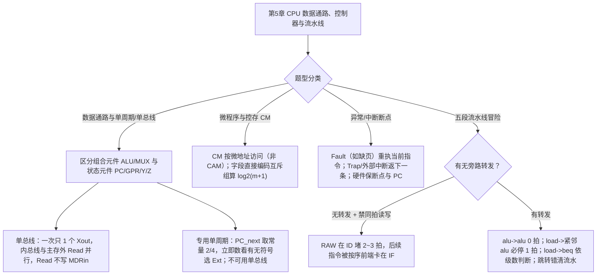

# 第5章 中央处理器

> [!important] 近 18 年 408 计组真题雷达（2009—2026）
> - **考频画像**：18 年共考 41 道主考真题（`34` 道单选 + `7` 道核心大题：`2009-T44`、`2012-T44`、`2015-T43/44`、`2022-T43`、`2024-T43`、`2026-T44`），另有 `28` 道跨章高频联动。
> - **近 5 年考法演变**：大题高度锁定 **数据通路微架构设计**（`2022-T43` 单总线补全与 7 拍取指、`2024-T43` RISC-V 多通路+OF/CF+lw、`2026-T44` 16 位专用数据通路 MUX/Extop/控制信号）；单选则稳守 **元件分类、PC/GPR 边界、Load-Use vs 转发阻塞、理想 CPI 与 Cache 缺失率联动**。
> - **高频丢分盲区**：主存 `Read` 进 MDR 误加 `MDRin`；`4GB` 字节按字边界对齐仍把 `PC` 算成 32 位；`rs/rd` 所接 MUX 与译码器及 `CU` 输入混淆；隔行 `I1->I3` 或 `load->beq` 漏算阻塞；有转发时还把普通运算 RAW 误算停顿。
> - **总控入口**：[[00_408计组｜考前急救与真题落点总控|返回计组总控]]

### 数据通路控制、微程序与五段流水线决策树 【🔥⚡ 必背+避坑｜停下来默背 1 遍 + 精读 1 分钟】



## 5.1 CPU 的功能和基本结构 【🔥⚡ 必背+避坑｜停下来默背 1 遍 + 精读 1 分钟】

### 5.1.1 CPU 的功能 【📌 扫一眼｜确认“我还会”就过】

中央处理器（CPU）是计算机的核心部件，其基本功能是执行计算机程序，并在程序运行过程中及时检测并响应各类内部异常与外部中断事件。具体划分为以下 6 项基本功能：

1. **取指令并译码**：CPU 依据程序计数器（PC）给出的地址从主存储器（或指令 Cache）中读取指令送入指令寄存器（IR），并由指令译码器（ID）解析操作码，生成后续微操作所需的控制信号。
2. **更新程序计数器（PC）**：顺序执行时按当前指令所占字节数自动递增 PC；遇到转移类指令时，按转移目标地址修改 PC，以支持程序的分支与跳转。
3. **执行算术与逻辑运算**：通过算术逻辑单元（ALU）对寄存器或存储器中的操作数进行算术加减乘除或按位逻辑运算，并产生相应状态标志。
4. **取操作数或写结果**：访问主存或 I/O 接口，读取执行阶段所需的操作数，或将运算结果写回指定存储单元或通用寄存器。
5. **处理异常和中断**：检测指令执行过程中发生的内部异常（如缺页、除零、溢出、非法操作码）或外部设备发出的中断请求（如 I/O 完成、时钟脉冲），在满足响应条件时转入相应的异常或中断服务程序。
6. **时序控制**：通过时钟发生器产生的时钟脉冲信号，协调各功能部件的操作先后顺序和信号持续时间，确保全机操作同步有序推进。

---

### 5.1.2 CPU 的基本结构 【🔥 必背｜停下来默背 1 遍】

CPU 主要由**控制器**和**运算器**两大核心部件组成，配合**中断机构**和**总线控制逻辑**实现协同工作。

![[01-CPU基本组成.jpg]]

![[11-CPU控制器与运算器部件归属全景图.png]]

#### CPU 主要部件职责与信息流向对照

| 部件名称 | 符号 | 归属分类 | 暂存或处理的信息 | 核心功能与工作机制 | 位数 / 宽度决定因素 |
| :--- | :--- | :--- | :--- | :--- | :--- |
| **程序计数器** | PC | 控制器 | 即将执行的指令地址 | 指向下一条待取指令的主存地址；取指时自动递增当前指令长度，转移时置为目标地址 | 由主存寻址空间决定（与地址总线同宽） |
| **指令寄存器** | IR | 控制器 | 当前正在执行的指令字 | 暂存从主存中取出的指令字，向指令译码器提供操作码，向控制逻辑提供操作数字段 | 等于指令字长（定长指令） |
| **指令译码器** | ID | 控制器 | IR 中的操作码（OP） | 对操作码译码，识别指令操作类型，输出对应的译码信号（属于组合逻辑电路） | 输入位数等于操作码字段位数 |
| **存储器地址寄存器** | MAR | 控制器 | 当前访存的主存单元地址 | 连接主存地址总线，向存储器提供读/写操作的物理地址 | 等于主存寻址空间 / 地址总线宽度 |
| **存储器数据寄存器** | MDR | 控制器 | 读出或待写入主存的数据 | 连接主存数据总线，作为 CPU 与主存双向数据传输的电气缓冲与同步寄存器 | 等于数据总线宽度 / 存储字长 |
| **控制单元** | CU | 控制器 | 操作码、时序节拍、状态标志 | 综合各输入信号，按节拍生成驱动数据通路的微操作控制信号序列 | 硬布线由逻辑门构成；微程序由控制存储器构成 |
| **时序产生器** | - | 控制器 | 机器主频时钟脉冲 | 以晶振为基准产生周期、节拍和工作脉冲，为整机提供时序基准 | - |
| **算术逻辑单元** | ALU | 运算器 | 源操作数与运算结果 | 负责执行定点/浮点算术运算、逻辑运算以及地址累加计算（纯组合逻辑电路） | 通常等于机器字长（整数通路宽度） |
| **通用寄存器组** | GPRs | 运算器 | 操作数、中间结果、地址指针 | 供程序员在汇编指令中显式使用，暂存高频操作数，减少访存次数 | 通常等于机器字长 |
| **暂存寄存器** | Y、Z | 运算器 | 操作数与 ALU 运算结果 | 在单总线结构中暂存第一操作数（Y）和运算结果（Z），防止总线冲突与环路反馈 | 等于数据通路宽度 / 机器字长 |
| **标志寄存器** | FR / PSWR | 状态/控制 | 条件码与系统运行状态 | 锁存 ALU 产生的标志（ZF、SF、OF、CF）及机器状态（中断允许位 IF、特权级） | 由体系结构定义的状态位总数决定 |
| **中断机构** | - | 控制器 | 异常/中断请求信号 | 采样中断请求、判优仲裁、执行硬件响应周期（关中断、存断点、送向量） | - |

**注意：**
- **PC 的更新时机与机制**：PC 存放的是“即将执行的下一条指令地址”，取指阶段结束后 PC 通常已经自增；指令顺序执行时，PC 增加的是当前指令所占的**字节数**（只有按字编址且定长一字，或指令长为 1 字节时才“加 1”）；执行条件转移指令时，仅当条件满足时 PC 才更新为转移目标地址，条件不满足时维持自增后的顺序地址。
- **MAR 与 MDR 的服务对象**：MAR 和 MDR 既服务于取指阶段（传送指令地址与指令代码），又服务于执行阶段（传送操作数有效地址与数据）。
- **指令译码器（ID）与地址译码器的归属区分**：指令译码器 ID 属于 CPU 控制器内部的组合逻辑部件，负责解析操作码；地址译码器属于主存芯片内部部件，负责将 MAR 送来的地址转换为行列选通信号，不属于 CPU。

---

### 5.1.3 CPU 中的寄存器 【🔥⚡ 必背+避坑｜停下来默背 1 遍 + 精读 1 分钟】

#### 1. 按用户程序访问权限分类

| 类别 | 核心定义 | 典型寄存器 | 用户程序使用方式 | 权限与限制 |
| :--- | :--- | :--- | :--- | :--- |
| **用户可见寄存器** | <mark>汇编语言程序员可直接读取或写入</mark> `[真题·2010-T18 / 2021-T17]` | 通用寄存器组（GPRs）、基址寄存器、变址寄存器、堆栈指针（SP）、程序计数器（PC） | 汇编指令中显式指定寄存器名（如 `R0`、`R1`），或通过转移/调用指令间接修改 PC | 用户态程序即可自由访问；PC 通常通过转移/调用指令改变，不能像通用寄存器那样任意读写 |
| **只读型用户可见寄存器** | 用户程序可通过条件转移等指令测试其状态，但不能任意直接赋值 | 标志寄存器（FR）/ 程序状态字寄存器（PSWR）中的条件标志位 | 通过条件分支指令（如 `BEQ`、`BNE`）隐式测试，或在特权态下整字恢复 | 标志位由 ALU 运算硬件自动置位/复位，用户程序不能随意直接执行算术写入 |
| **用户不可见寄存器** | <mark>对程序员完全透明的底层寄存器</mark> `[真题·2010-T18 / 2021-T17]` | 指令寄存器（IR）、存储器地址寄存器（MAR）、存储器数据寄存器（MDR）、暂存寄存器（Y、Z）、微指令计数器（$\mu PC$）、微指令寄存器（$\mu IR$）、页表基址寄存器 | 用户程序指令无法通过地址码或名称直接访问 | 硬件自动装载与更新，避免用户程序破坏底层硬件微架构状态 |

`【⚡ 真题补丁｜2025-T19】` 标准 CPU 架构下 **PC 是专用控制寄存器**，不包含在通用寄存器组 GPRs 内部（勿拿个别特例推翻常规题干）。

#### 2. 部件位数与宽度的决定因素

| 部件 / 寄存器 | 位数 / 宽度决定依据 | 典型计算关系 / 结论 |
| :--- | :--- | :--- |
| **指令寄存器（IR）** | 指令字长 | 定长指令系统中，$\text{IR 位数} = \text{指令字长}$ |
| **程序计数器（PC）** | 主存寻址空间大小与编址方式 | <mark>按字边界对齐时 PC 位数按字数计</mark> `[真题·2016-T18]`（`4GB` 字节空间配 32 位定长指令对齐后 `PC` 至少 `30` 位，`IR` 仍 `32` 位） |
| **存储器地址寄存器（MAR）** | 主存物理寻址空间 | 等于地址总线宽度；当 PC 与 MAR 面向同一物理存储空间时，$\text{MAR 位数} = \text{PC 位数}$ |
| **存储器数据寄存器（MDR）** | 数据总线宽度 / 存储字长 | 等于 CPU 与存储器单次并行交换二进制信息的位数 |
| **通用寄存器（GPRs）** | 机器字长（整数数据通路宽度） | 通常等于 CPU 整数 ALU 的处理字长（如 32 位、64 位） |
| **算术逻辑单元（ALU）** | 机器字长 | 一次能直接处理的二进制整数运算位数 |

---

## 5.2 指令执行过程 【🔥⚡ 必背+避坑｜停下来默背 1 遍 + 精读 1 分钟】

### 5.2.1 指令执行的一般流程 【📌 扫一眼｜确认“我还会”就过】

计算机程序执行过程是控制器协调各部件循环往复推进的过程。CPU 启动后，持续循环执行“取指—译码分析—执行—中断/异常检测”的主线流程。

![[02-指令执行一般流程.jpg]]

#### 指令执行循环步骤

1. **取指令（IF）**：CPU 根据 PC 中的当前值，从主存储器（或指令 Cache）中读取指令送入 IR，同时 PC 自动更新为下一条顺序指令的地址（$PC \leftarrow PC + \text{当前指令字节数}$）。
2. **指令译码与操作数获取（ID）**：指令译码器 ID 解析 IR 中的操作码，确定指令操作类型与寻址方式；控制器根据地址码从通用寄存器读取操作数，或进行立即数符号扩展。
3. **执行指令（EX）**：
   - **非分支指令**：ALU 完成算术逻辑运算，或计算访存有效地址，随后根据指令类型进行访存（MEM）或写回结果（WB）。
   - **分支指令**：ALU 比较分支条件（如减法判零），若条件成立，将目标地址写入 PC；若条件不满足，保持自增后的顺序 PC。
4. **中断与异常检测**：
   - **外部中断检测**：在当前指令完整执行结束、取下一条指令之前，CPU 采样外部中断请求引脚。若有有效请求且处于开中断状态，转入中断响应周期。
   - **内部异常检测**：在指令执行过程中的各阶段实时检测（如译码阶段检测非法操作码、执行阶段检测除零/溢出、访存阶段检测缺页），一旦检出即时响应。

#### 时间与空间上区分指令和数据

指令和数据在主存储器中均以无差别的二进制代码存放，内存本身不具有判别能力。计算机依靠 CPU 的时序与硬件路径进行区分：
- **时间维度**：在取指阶段从主存读出的信息被 CPU 解释为指令；在执行阶段为了取操作数而从主存读出的信息被解释为数据。
- **空间维度**：取指阶段从数据总线流入的信息被送入指令寄存器（IR）用于译码；执行阶段从数据总线流入的信息被送入通用寄存器（GPRs）或 ALU 暂存器参与运算。

---

### 5.2.2 CPU 的时序控制 【🔥 必背｜停下来默背 1 遍】

时序控制用于统一步调，确保全机操作在严格的时钟信号基准下按正确的先后顺序和持续时间执行。

#### 时序系统的层次划分

1. **时钟周期（Clock Cycle，节拍脉冲 $T_{clk}$）**：CPU 同步操作的最基本时间单位，主频 $f = 1 / T_{clk}$。时钟周期的下限取决于数据通路中相邻状态元件之间组合逻辑的最大传播延迟与触发器建立时间：
   $$T_{clk} \ge T_{clk \to q} + T_{comb\_max} + T_{setup}$$
2. **机器周期（Machine Cycle，CPU 周期）**：传统计算机模型中，完成一个相对独立的基本操作阶段（如取指周期、间址周期、执行周期、中断周期）所需的时间，包含若干时钟周期。
3. **指令周期（Instruction Cycle）**：CPU 从主存取出并完整执行完一条指令所需的全部时间。

**注意：**
现代高性能处理器高度流水化，普遍淡化了“机器周期”概念，内部统一由高频系统时钟直接驱动，一个时钟周期即对应一个基本节拍。

---

### 5.2.3 指令周期的基本概念与阶段划分 【🔥 必背｜停下来默背 1 遍】

典型五阶段指令周期模型：

| 阶段缩写 | 阶段全称 | 核心工作内容 | 涉及主要部件 | 指令使用情况 |
| :--- | :--- | :--- | :--- | :--- |
| **IF** | 取指（Instruction Fetch） | 按 PC 地址从主存/Cache 读指令送 IR，计算顺序 $PC + \text{指令长度}$ | PC、MAR、主存/Cache、MDR、IR | **所有指令必经阶段** |
| **ID** | 译码 / 读寄存器（Instruction Decode） | 解析 IR 操作码，读取源寄存器操作数，提取并扩展立即数 | ID、通用寄存器堆（GPRs）、扩展器 | **所有指令必经阶段** |
| **EX** | 执行 / 计算地址（Execute） | 算术逻辑运算、计算访存有效地址（EA）、分支条件判断与目标计算 | ALU、加法器、标志寄存器（FR） | <mark>取数及执行阶段不含译码器 ID</mark> `[真题·2019-T17]` |
| **MEM** | 访存（Memory Access） | 根据 EX 阶段计算的有效地址，对数据存储器进行读（LOAD）或写（STORE） | MAR、数据 Cache/主存、MDR | **仅访存类指令真正使用**，其他指令为空操作 |
| **WB** | 写回（Write Back） | 将 ALU 运算结果或从存储器读出的数据写回通用寄存器堆的目的寄存器 | 通用寄存器堆（GPRs） | 运算指令和 LOAD 指令使用，STORE/分支指令不写回 |

**注意：**
- **空操作指令（NOP）**：不执行有意义的算术逻辑运算，但<mark>在取指阶段仍消耗时钟周期并推进 PC</mark> `[真题·2011-T19]`，指令仍被读入 IR。
- **阶段划分的实现相关性**：五段式是经典 RISC 模型，不同架构可将指令周期划分为不同段数（如 4 段、8 段甚至几十段深流水线）。
- **指令周期类型**：定长指令周期指所有指令包含相同数量的时钟周期；变长指令周期指不同指令包含不同数量的时钟周期。现代处理器普遍采用变长时钟周期。

---

### 5.2.4 处理器指令执行模型 【🔥⚡ 必背+避坑｜停下来默背 1 遍 + 精读 1 分钟】

根据指令执行步骤在时间轴上的编排方式，处理器分为三种基本模型：

| 模型类型 | CPI（每指令时钟周期数） | 时钟周期长度确定依据 | 指令执行时空关系 | 硬件资源利用率与优缺点 |
| :--- | :---: | :--- | :--- | :--- |
| **单周期处理器** | 恒为 1 | 由**耗时最长指令**（通常为 `lw`）的完整关键路径决定 | 指令间严格**串行**推进，无任何重叠 | 周期长、主频低；功能部件在一个周期内无法复用，硬件开销大，资源空闲率高 |
| **多周期处理器** | 因指令而异，平均 $\text{CPI} > 1$ | 由**耗时最长功能段**的组合逻辑延迟决定 | 指令间严格**串行**推进，无重叠 | 周期短、主频高；不同阶段可复用同一功能部件（如 ALU 兼算地址），控制较复杂 |
| **流水线处理器** | 理想稳态趋近 1 | 由**最慢流水段**延迟加上流水段寄存器开销决定 | 多条指令在不同阶段**重叠并发**执行 | 吞吐率大幅提升；单条指令执行延迟不降低甚至略增；需处理各类流水线冒险 |

#### CPU 程序执行时间公式

$$\text{CPU 时间} = IC \times CPI \times T_{clk} = \frac{IC \times CPI}{f}$$
- $IC$（Instruction Count）：程序所包含的机器指令总条数。
- $CPI$（Cycles Per Instruction）：执行该程序每条指令所需的平均时钟周期数。
- $T_{clk}$ / $f$：处理器时钟周期 / 主频。

**注意：**
单周期处理器的 CPI 虽为 1，但其时钟周期 $T_{clk}$ 被最慢指令严重拖长，因此其综合执行速度往往明显慢于流水线处理器，甚至可能慢于高主频的多周期处理器。性能评价必须综合考察 $IC$、$CPI$ 与时钟频率 $f$。

`【⚡ 真题补丁｜2025-T18】` 实际程序的 `CPI` 包含 Cache 缺失引发的访存停顿周期，因此与 **Cache 缺失率**密切相关。

---

## 5.3 数据通路的功能和基本结构 【🔥⚡ 必背+避坑｜停下来默背 1 遍 + 精读 1 分钟】

### 5.3.1 数据通路的功能与组成元件 【🔥⚡ 必背+避坑｜停下来默背 1 遍 + 精读 1 分钟】

<mark>数据通路不含产生控制信号的控制部件 CU</mark> `[真题·2017-T19 / 2021-T18]`：它包含 ALU、寄存器堆与异常检测响应路径，负责数据的流动、暂存与加工。数据通路负责实现数据的流动、暂存与加工；控制器则在各节拍向数据通路提供选通与操作控制信号。

数据通路的基本硬件元件分为两类：

| 元件类型 | 内部记忆能力 | 依赖时钟边沿 | 典型元件 | 核心功能与工作特性 |
| :--- | :---: | :---: | :--- | :--- |
| **组合逻辑元件**<br>（操作元件） | **无** | **否** | <mark>ALU 与 MUX 属组合逻辑操作元件</mark> `[真题·2023-T18]`（译码器、三态门同属此类） | 输出仅取决于当前输入信号，信号在门电路中连续传播。MUX 用于点对点多路选一，三态门用于控制共享总线驱动隔离 |
| **时序逻辑元件**<br>（状态元件） | **有** | **是** | <mark>PC 与通用寄存器属时序状态元件</mark> `[真题·2023-T18]`（依赖时钟边沿锁存更新） | 内部含触发器或锁存器，在时钟有效边沿采样输入数据并更新内部状态，输出在整个时钟周期保持稳定 |

**时序约束：**
数据通路由“状态元件 $\rightarrow$ 组合逻辑 $\rightarrow$ 状态元件”交替级联而成。为保证数据在下一个时钟边沿能够被稳定写入目标状态元件，时钟周期的最小长度满足：
$$T_{clk} \ge T_{clk \to q} + T_{max} + T_{setup}$$
其中 $T_{clk \to q}$ 为触发器时钟到输出延时，$T_{max}$ 为组合逻辑最长路径延迟，$T_{setup}$ 为目标触发器的建立时间。

`【⚡ 真题补丁｜2019-T16】` <mark>时钟周期看相邻状态元件最大组合延迟</mark> `[真题·2019-T16]`；单个时钟脉冲到来时在多周期或阻塞下未必立即发射新指令。

---

### 5.3.2 数据通路的组织形式 【🔥 必背｜停下来默背 1 遍】

1. **按连接方式分类**：
   - **总线式数据通路**：所有功能部件挂接在公共内部总线上（单总线、双总线、三总线）。连线少、结构紧凑、成本低；但存在总线争用冲突，多个操作数传送必须分时串行完成。
   - **专用数据通路**：部件之间采用专用的点对点连线，通过多路选择器切换数据源。并行能力强、传输延迟小；但布线复杂度高、芯片面积开销大。
2. **按时序组织分类**：单周期数据通路、多周期数据通路、流水线数据通路。

**注意：**
<mark>单周期处理器不能采用单总线数据通路</mark> `[真题·2016-T20]`。单总线任一时刻只能支持一组数据传送，而单周期处理器要求在单个时钟周期内完成取指、读寄存器、ALU 运算、写回等多组数据传送，单总线无法在同一时钟内并发满足这些传输需求。

---

### 5.3.3 单总线结构的数据通路 【🔥⚡ 必背+避坑｜停下来默背 1 遍 + 精读 1 分钟】

单总线数据通路中，所有寄存器和部件输入输出端均挂接在同一条 CPU 内部总线上。

![[03-单总线数据通路.jpg]]

#### 控制信号约定与暂存器机制

- **信号定义**：`Xin` 表示将总线上的数据打入部件 X；`Xout` 表示允许部件 X 的三态门导通，将数据输出到内部总线。
- **总线驱动互斥**：任一时刻内部总线上**仅允许一个部件的 `out` 信号有效**，但可以同时有多个部件的 `in` 信号有效（广播写入）。
- **暂存寄存器 Y 与 Z 的作用**：
  - ALU 是无存储能力的纯组合逻辑电路，执行双操作数运算时，两个输入端必须同时保持稳定信号。单总线一次只能传输一个操作数，因此必须先将源操作数 1 经总线送入暂存器 Y 锁存，下一拍将源操作数 2 送入总线并直通 ALU 第二输入端，由 Y 稳定提供第一输入端。
  - ALU 运算结果不能直接挂回总线，否则输出信号通过总线反馈到输入端会引发逻辑自激振荡，因此运算结果必须先锁存入暂存寄存器 Z，待下一拍再通过 `Zout` 送往目的寄存器。

#### 典型指令的微操作节拍流程

##### 1. 公共取指阶段（所有指令通用）

| 时钟节拍 | 完成微操作 | 有效控制信号 | 功能说明 |
| :---: | :--- | :--- | :--- |
| **C1** | $(PC) \rightarrow MAR$ | `PCout`, `MARin` | 将待取指令地址打入主存地址寄存器 |
| **C2～C6** | $M(MAR) \rightarrow MDR$ | `Read`, `MDRin` | 启动主存读命令，等待数据读出并锁存入 MDR（假定读主存需 5 拍） |
| **C7** | $(MDR) \rightarrow IR$ | `MDRout`, `IRin` | 将指令代码打入指令寄存器，供 ID 译码 |

##### 2. 加法指令执行阶段（$R[rd] \leftarrow R[rs] + R[rd]$，设 $rs=0001, rd=0010$）

| 时钟节拍 | 完成微操作 | 有效控制信号 | 功能说明 |
| :---: | :--- | :--- | :--- |
| **C8** | $(R[rs]) \rightarrow Y$ | $rs=0001$, `GPRout`, `Yin` | 将源寄存器操作数送入暂存寄存器 Y 锁存 |
| **C9** | $(Y) + (R[rd]) \rightarrow Z$ | $rd=0010$, `GPRout`, `ALUop=000`, `Zin` | 第二操作数上总线，ALU 完成加法，结果锁存入 Z |
| **C10** | $(Z) \rightarrow R[rd]$ | `Zout`, $rd=0010$, `GPRin` | 将暂存器 Z 中的加法结果写回目的寄存器 |

##### 3. 取数指令执行阶段（$R[rd] \leftarrow M[R[rs]]$）

| 时钟节拍 | 完成微操作 | 有效控制信号 | 功能说明 |
| :---: | :--- | :--- | :--- |
| **C8** | $(R[rs]) \rightarrow MAR$ | $rs=0001$, `GPRout`, `MARin` | 将源寄存器中存放的有效地址送 MAR |
| **C9～C13** | $M(MAR) \rightarrow MDR$ | `Read`, `MDRin` | 启动主存读，操作数读入 MDR |
| **C14** | $(MDR) \rightarrow R[rd]$ | `MDRout`, $rd=0010$, `GPRin` | 将操作数从 MDR 送入目的通用寄存器 |

`【⚡ 真题补丁｜2009-T44】` 单总线加并行优化：`R1out/MARin` 后 `MemR, MDRinE` 与内部总线 `R0out, Ain` 并行，`sub` 共仅 `5` 拍。
`【⚡ 真题补丁｜2015-T43】` 单总线中 `R0~R3,PC` 可见，`ALUop` `3` 位、`SRop` `2` 位；三态门控制端仅指向控制口，连线端点勿归 CU；常量 `2` 算 `PC+2`。
`【⚡ 真题补丁｜2015-T44】` 第 2 拍内总线 `R3->T` 与主存读并行故 `sub R1,R3,(R2)` 共 `4` 拍；`inc` 经移位/暂存跨越需 `2` 拍。

> [!example]- ⚡ 真题母题 2022-T43｜单总线数据通路 SF/OF 表达式、GPRs 端口与 7 拍取指微操作（已核验）
> - **题干要点**：给出 16 位单总线 CPU 数据通路图（含通用寄存器堆 `16` 个、Y/Z 暂存器、MAR/MDR、IR、FR 与控制单元 CU），要求写 `SF` 与加减法 `OF` 表达式、辨析 `rs/rd` 接口源、`Read` 与 `MDRin` 控制序列、取指节拍数及 CU 输入来源。
> - **为什么这么想**：单总线中外部主存读直接经数据总线锁入 MDR（不由内部总线经 `MDRin` 写入）；`16` 位结果最高位为 `F15`，加减法的溢出必须看操作数最高位 `A15/B15` 还是先取反；`rs` 读端口连 MUX、`rd` 写目的连译码器，编号均来自 `IR`。
> - **已核验标准解答**：
>   1. **标志位表达式**：`SF = F_15`；加法 `OF = A_15 B_15 ~F_15 + ~A_15 ~B_15 F_15`；减法 `OF = A_15 ~B_15 ~F_15 + ~A_15 B_15 F_15`（或由符号与进位异或 `C15 ^ C14` 表达，加减必须区分）。
>   2. **暂存与 GPRs 接口**：`Y` 暂存一源操作数、`Z` 防 ALU 输出反馈自激；`16` 个通用寄存器编号来自 **`IR`**，读选通接多路选择器 **`MUX`**、`rd` 写选通接**地址译码器**。
>   3. **取指节拍与 CU 输入**：`Read` 从主存外部口入 `MDR`，**不发内部总线 `MDRin`**；公共取指完整周期共 **7 拍**；控制单元 CU 的核心指令/状态输入来自 **`IR` 与 `FR`**（加上时序节拍）。
> - **个人复盘提醒**：做单总线填空第一件事先划清 `MDRin`（内总线写入 MDR）vs `Read`（主存外总线入 MDR），千万别在读主存那一拍多写一个 `MDRin`。

---

### 5.3.4 专用结构的数据通路（MIPS 风格单周期模型） 【🔥⚡ 必背+避坑｜停下来默背 1 遍 + 精读 1 分钟】

专用数据通路采用点对点连线与多路选择器结合，构成单周期处理器的经典实现。

![[04-完整单周期数据通路.jpg]]

#### 单周期专用数据通路关键控制信号表

| 控制信号名称 | 信号来源 | 控制对象与物理含义 | 取值为 0 的含义 | 取值为 1 的含义 |
| :--- | :--- | :--- | :--- | :--- |
| **RegDst** | 控制器 CU | 寄存器堆写地址（Rw）多路选择器 | 选择指令的 $rt$ 字段作为写目的地址（I 型） | 选择指令的 $rd$ 字段作为写目的地址（R 型） |
| **RegWr** | 控制器 CU | 寄存器堆写使能端 | 禁止写入寄存器堆 | 允许将 busW 数据写入目的寄存器 |
| **ALUSrc** | 控制器 CU | ALU 第二输入端多路选择器 | 第二操作数来自寄存器堆读端口 B（$rt$） | 第二操作数来自扩展后的立即数（imm） |
| **MemtoReg** | 控制器 CU | 寄存器堆写数据（busW）多路选择器 | 选择 ALU 运算结果写回寄存器堆 | 选择数据存储器读出数据写回寄存器堆 |
| **MemWr** | 控制器 CU | 数据存储器写使能端 | 禁止写入数据存储器（读操作或无访存） | 允许将 busB 数据写入数据存储器（STORE） |
| **Branch** | 控制器 CU | 分支目标更新控制逻辑 | 不进行条件分支判定 | 允许根据 ALU 的 Zero 标志决定是否分支 |
| **Jump** | 控制器 CU | PC 目标更新控制逻辑 | PC 来自顺序或分支地址 | PC 直接置为无条件跳转目标地址 |
| **ExtOp** | 控制器 CU | 立即数扩展器模式选择 | 零扩展（用于按位逻辑运算） | 符号扩展（用于算术运算及地址偏移） |

#### 各典型指令的数据流向与控制信号配置

| 指令类型 | 典型指令格式 | 关键数据流动路径 | 关键控制信号取值 |
| :--- | :--- | :--- | :--- |
| **R 型运算** | `add rd, rs, rt` | $Rs, Rt \rightarrow \text{ALU} \rightarrow Rd$ | `RegDst=1`, `ALUSrc=0`, `MemtoReg=0`, `RegWr=1`, `MemWr=0`, `Branch=0` |
| **I 型运算** | `addi rt, rs, imm` | $Rs, \operatorname{SignExt}(imm) \rightarrow \text{ALU} \rightarrow Rt$ | `RegDst=0`, `ALUSrc=1`, `MemtoReg=0`, `RegWr=1`, `MemWr=0`, `Branch=0` |
| **LOAD** | `lw rt, imm(rs)` | $Rs + \operatorname{SignExt}(imm) \rightarrow Adr$; $M[Adr] \rightarrow Rt$ | `RegDst=0`, `ALUSrc=1`, `MemtoReg=1`, `RegWr=1`, `MemWr=0`, `Branch=0` |
| **STORE** | `sw rt, imm(rs)` | $Rs + \operatorname{SignExt}(imm) \rightarrow Adr$; $Rt \rightarrow M[Adr]$ | `ALUSrc=1`, `RegWr=0`, `MemWr=1`, `Branch=0`（`RegDst` 与 `MemtoReg` 无关） |
| **条件分支** | `beq rs, rt, label` | $\text{ALU 比较}(Rs - Rt) \rightarrow Zero$; 若成立 $PC \leftarrow PC+4+\operatorname{SignExt}(imm)\times 4$ | `ALUSrc=0`, `RegWr=0`, `MemWr=0`, `Branch=1`（当且仅当 $Zero=1$ 时跳转） |

#### 单周期专用数据通路的 5 大架构特征

1. **指令存储器与数据存储器分离（Harvard 结构）**：取指和数据读写在同一时钟周期内并发执行，独立的存储器接口避免了单端口冲突。
2. **不设置独立的指令寄存器（IR）**：指令直接从指令存储器读出后，其字段直通译码逻辑与寄存器堆输入端，本周期内完成译码与执行。
3. **时钟周期受制于最慢指令**：时钟周期由关键路径最长的指令（通常为同时涉及加法算地址和读主存的 `lw` 指令）决定。
4. **功能部件专用且不可复用**：单个周期内每个部件只能使用一次，因此必须设置多个独立硬件实例（如专门计算 $PC+4$ 的加法器、专门计算分支地址的加法器以及通用 ALU）。
5. **控制信号全程有效**：所有控制信号在整个时钟周期期间持续保持稳定电平。

> [!example]- ⚡ 真题母题 2024-T43｜RISC-V 部分数据通路、32 位加法 F/OF/CF 与 lw 负偏移 EA（已核验）
> - **题干要点**：给出 32 位 RISC-V 部分单周期数据通路图（含 `ALUBsrc`、`ALUctr`、`Ext` 信号及 32 个通用寄存器堆），考查通用寄存器数与移位位数、`add` 指令运算结果 `F/OF/CF`、无符号大小判断标志、`slli` 时 `Ext` 取值、`lw` 控制信号及偏移 `A04H` 计算。
> - **为什么这么想**：`slli` 指令只使用立即数低 5 位作为 `shamt`（32 位字长 `log2(32)=5`），在 `RV32I` 格式下 12 位立即数高 `7` 位固定为 `0000000`，因此零扩展或符号扩展结果完全相同；而 `lw` 偏移量 `A04H` 最高位为 `1`，必须先经 `Ext=1` 符号扩展为 `FFFF FA04H` 再加基址。
> - **已核验标准解答**：
>   1. **寄存器与 `shamt`**：`32` 个通用寄存器，移位量 `shamt` 占 **5 位**。
>   2. **`add` 运算与标志位**：`ALUBsrc = 0`，输出 `F = 1FDB 9753H`，有符号溢出 `OF = 1`，无符号进位 `CF = 1`；判断无符号数大小应看 **`CF`**（及 `ZF`）。
>   3. **`slli` 与 `lw` 控制及 EA**：执行 `slli` 时 12 位字段高 7 位恒为 `0`，故 `Ext = 0` 或 `1` 均可；执行 `lw` 时设 `Ext = 1`、`ALUctr = 000`（加法），偏移 `A04H` 符号扩展相加得有效地址 `EA = FFFF 9CD4H`。
> - **个人复盘提醒**：答题被问“为什么 `Ext` 可 0 可 1”必须点透“高 7 位（功能码辅助段）恒为 `0`，扩展全补 `0`”这句话；`lw` 负偏移千万先 `Ext=1`。

> [!example]- ⚡ 真题母题 2026-T44｜16 位数据通路 MUX 识别、Extop 位宽与取指/左移控制信号（已核验）
> - **题干要点**：结合 `2026-T43` 的 16 位按字节编址指令系统给出单/多周期数据通路图（标注待填部件 `①、②`，扩展器控制信号 `Extop`，`AluBSrc` 输入端连常数 `2`），要求辨析部件类型、`Extop` 最少位数、取指拍控制信号与左移指令控制信号及 `Extop` 兼容性。
> - **为什么这么想**：原图 `①、②` 位于多路汇入 PC 与 ALU/GPR 的汇总交叉口，实为**多路选择器 MUX**（纠偏网传 `2026_sol` 错认成 `IR` 和 `PC+4` 的失误）；`Extop` 需区分 `8` 位无符号零扩展、`8` 位有符号扩展与 `12` 位 offset 符号扩展共 3 种模式，至少 `2` 位。
> - **已核验标准解答**（按 `scratch/t44_2026_zoom.png` 清晰版图核验）：
>   1. **部件识别**：`①、②` 均为 **多路选择器（MUX）**。
>   2. **`Extop` 位数**：需支持 `3` 种扩展模式，至少需要 **2 位**。
>   3. **取指操作控制信号**：`MARSrc = 0`、`AluASrc = 0`、`AluBSrc = 1`（选常数 `2` 实现 `PC+2`）、`RegWr = 0`。
>   4. **左移指令（S 型）控制与 `Extop` 对比**：`AluBSrc = 2`、`RegWSrc = 1`、`RegDst = 1`、`RegWr = 1`；左移指令的 `Extop` **不能**与 M 型指令相同（左移取 `4` 位 `num` 无符号零扩展，而 M 型取 `12` 位 `offset` 有符号符号扩展）。
> - **个人复盘提醒**：读多输入箭头汇合小梯形/矩形必看箭头数量与选通信号名——带选通端的多入单出器件永远是 MUX，不会是 IR。

---

## 5.4 控制器的功能和工作原理 【🔥⚡ 必背+避坑｜停下来默背 1 遍 + 精读 1 分钟】

### 5.4.1 控制器的结构和功能 【📌 扫一眼｜确认“我还会”就过】

控制器负责统筹计算机各部件，按指令要求生成所需的微操作控制信号序列。

```
                    ┌──────────────┐
  IR 操作码 ───────>│              │
  时钟节拍脉冲 ────>│  控制单元    │─────> 数据通路内部控制信号（RegWr, ALUSrc 等）
  状态标志(FR) ────>│    (CU)      │─────> 外部总线控制信号（MemRead, MemWrite 等）
  外部中断/请求 ───>│              │
                    └──────────────┘
```

#### 控制器的主要输入信号

1. **指令寄存器（IR）的操作码字段**：经指令译码器 ID 解码，指明当前执行指令的类型。
2. **时序产生器的时钟脉冲与节拍信号**：指明当前微操作所处的机器周期与时间节拍。
3. **标志寄存器（FR）的状态标志**：如溢出 OF、进位 CF、零标志 ZF、符号 SF，作为条件转移或异常判断的依据。
4. **外部输入信号**：如中断请求信号（INTR、NMI）、总线请求信号（HOLD）或主存就绪信号（READY）。

---

### 5.4.2 硬布线控制器 【📌 扫一眼｜确认“我还会”就过】

硬布线控制器（又称组合逻辑控制器）由门电路和触发器等纯硬件逻辑构成。

#### 工作机制

每个微操作控制信号 $C_i$ 被表示为指令译码信号 $I$、节拍脉冲信号 $T$ 和状态条件信号 $S$ 的逻辑布尔函数：
$$C_i = \sum (I_j \cdot T_k \cdot S_m)$$
控制单元在每个节拍直接通过与或非门阵列即时输出一组控制信号。

#### 特点与适用场景

- **优点**：执行速度极快，控制信号仅受逻辑门电路的传输延迟限制。
- **缺点**：电路结构繁杂、规整性差；一旦指令系统设计定型，增加新指令或修改控制流程必须重新设计电路并改版硬件，扩充极其困难。
- **适用场景**：适用于指令系统简单、格式规整、寻址方式少且追求高执行速度的 **RISC 处理器**。

---

### 5.4.3 微程序控制器 【🔥⚡ 必背+避坑｜停下来默背 1 遍 + 精读 1 分钟】

微程序控制器采用“存储程序”的思想来实现微操作控制。控制信号被预先编制为二进制微指令，存放在专用的控制存储器（CM）中，指令执行时通过逐条读出微指令来生成控制信号。

![[06-微程序控制器结构.jpg]]

![[12-微程序控制器基本结构与四级术语体系.png]]

#### 1. 微程序体系的核心层级概念

| 层级名称 | 核心定义 | 对应关系与特点 |
| :--- | :--- | :--- |
| **微命令** | 控制器向执行部件发出的最基本的不可分割的控制信号 | 微命令是控制信号，微操作是执行动作（微命令是因，微操作是果） |
| **微操作** | 执行部件在微命令指挥下完成的最小硬件原子动作 | 例如：$(PC)\rightarrow MAR$、寄存器打入、ALU 加法等 |
| **微指令** | 在一个微周期内并行产生的一组微命令以及下条微指令的地址控制信息 | 存放在控制存储器中的一个单元；由操作控制字段和顺序控制字段组成 |
| **微程序** | 一组按特定顺序排列的微指令序列，用于解释执行一条机器指令 | 通常一条机器指令对应一个微程序 |
| **机器指令** | 程序员可见的二进制指令字，由 CPU 的硬件/微程序解释执行 | 由若干机器周期组成，在微架构下对应一段微程序 |

**注意：**
- **微程序总数与指令种类的对应关系**：通常一条机器指令对应一个专用微程序。但 CPU 还有公共微程序（如公共取指微程序、间址微程序、中断响应微程序），由所有机器指令共享。因此，控制存储器中的微程序总数 = 机器指令种数 + 公共微程序数。

#### 2. 控制存储器（CM）与主存储器（MM）对比

| 比较维度 | 控制存储器（CM / CS） | 主存储器（MM） |
| :--- | :--- | :--- |
| **物理位置** | 位于 **CPU 控制器内部** | 位于 **CPU 外部**（主板总线上） |
| **存放内容** | **微程序 / 微指令**（硬件控制逻辑） | **机器指令与程序数据** |
| **制造材料** | 通常采用高速只读存储器（**ROM**）或可写控存（WCS） | 通常采用动态随机存取存储器（**DRAM**） |
| **寻址寄存器** | <mark>微程序计数器 CMAR 按微地址访问</mark> `[真题·2017-T18]` | 存储器地址寄存器（**MAR**）和程序计数器（**PC**） |
| **访问速度** | 极高，与 CPU 内部逻辑速度相当 | 较慢，受系统总线与 DRAM 芯片物理延迟限制 |

**注意：**
- **PC、MAR 与 $\mu PC$ 严格区分**：PC 存放下一条**机器指令**的主存地址；MAR 存放当前访问**主存**的物理地址；$\mu PC$ 存放下一条**微指令**在控制存储器中的微地址。三者面向不同的存储空间，不可混淆。

#### 3. 微程序控制器的基本组成与工作过程

- **控制存储器（CM）**：存放所有微程序，微架构的核心存储部件。
- **微指令寄存器（$\mu IR$ / CMDR）**：暂存当前从 CM 读出的微指令。分为**操作控制字段**（发出微命令）和**顺序控制字段**（决定下地址）。
- **微程序计数器（$\mu PC$ / CMAR）**：存放下一条待读微指令在 CM 中的地址。
- **微地址形成部件**：将机器指令的操作码转换为对应微程序的起始地址。

##### 执行主线流程

1. **取指微程序阶段**：硬件从 CM 固定地址启动公共取指微程序，从主存取出机器指令送入 IR。
2. **形成入口微地址**：IR 中的操作码送入微地址形成部件，译码生成该机器指令对应微程序的入口地址，并装入 $\mu PC$。
3. **读取微指令**：根据 $\mu PC$ 地址从 CM 读取第一条微指令送入 $\mu IR$。
4. **发出微命令**：$\mu IR$ 的操作控制字段输出控制信号，驱动数据通路执行对应的微操作。
5. **更新下地址**：根据顺序控制字段和状态标志更新 $\mu PC$，进入下一微指令。
6. **循环执行**：重复 3～5 步直到该指令的微程序执行完毕，最后一条微指令的下地址通常强制指向公共取指微程序的首地址。

---

### 5.4.4 微指令的编码与格式设计 【🔥⚡ 必背+避坑｜停下来默背 1 遍 + 精读 1 分钟】

![[10-微指令格式设计分类思维导图.png]]

#### 1. 操作控制字段的三种编码方式

##### （1）直接编码方式（不译码法）

操作控制字段的**每一位直接代表一个微命令**。某位为 1 表示该微命令有效，为 0 表示无效。
- **优点**：简单直观，无译码延迟，并行控制能力最强，执行速度最快。
- **缺点**：微指令字长过长，导致控制存储器位容量剧增。

##### （2）字段直接编码方式（段内译码法）

将操作控制字段划分成若干小组（字段），**互斥性微命令分配在同一字段中，相容性微命令分配在不同字段中**。每个字段经译码器译码后输出微命令。
- **分组原则**：
  1. 互斥同段，相容异段。
  2. 每个字段的位数不宜过长，避免译码电路延迟过大。
  3. <mark>每个字段必须预留一个状态表示无操作</mark> `[真题·2012-T18]`（通常为全 0 编码；5 互斥类各留 1 空后共 `3+2+4+3+3=15` 位）。
- **字段位数计算公式**：若某互斥组包含 $m$ 个微命令，则该字段所需的二进制位数为：
  $$b = \lceil\log_2(m + 1)\rceil$$
- **优点**：大幅缩短微指令字长，节约控存容量。
- **缺点**：需要通过译码电路产生微命令，执行速度略低于直接编码方式。

##### （3）字段间接编码方式（隐式编码法）

某个字段的微命令含义需由另一个字段的输出代码联合解释（二级译码）。
- **特点**：微指令字长可进一步压缩，但硬件连线与译码延迟显著增加，仅在极端受限场景使用。

#### 2. 微指令的地址形成方式（下地址逻辑）

![[13-微程序控制器下地址与CM容量计算模型.png]]

1. **增量计数器方式**：顺序执行时，下条微地址直接由 $\mu PC + 1 \rightarrow \mu PC$ 产生。
2. **断定方式（下地址字段法）**：微指令中显式包含下地址字段，下一条微地址由该字段直接指定，或结合测试条件标志位拼接修改形成分支微地址。
3. **操作码映射**：机器指令译码产生微程序起始入口地址。

#### 控制存储器容量计算

若微程序控制器包含 $N$ 条微指令，微指令字长为 $w$ 位：
- 最小下地址位数（CMAR 位数）为：$k = \lceil\log_2 N\rceil$。
- CM 容量为 $2^k \times w$ 位（按地址线全译码时）或 $N \times w$ 位。

`【⚡ 真题补丁｜2014-T18】` 算控存总条数莫漏**公共取指微程序**：`2` 条取指 + `32×4` 条指令 = `130` 条微指令，下地址至少 `⌈log2(130)⌉ = 8` 位。

#### 3. 水平型微指令 vs 垂直型微指令对比

| 对比维度 | 水平型微指令 | 垂直型微指令 |
| :--- | :--- | :--- |
| **基本格式** | 包含很长的操作控制字段与顺序控制字段 | 类似机器指令，包含微操作码（$\mu OP$）、源/目的字段 |
| **并行控制能力** | **强**，一条微指令可同时发出多个相容微命令 | **较弱**，一条微指令通常只指定一个基本微操作 |
| **微指令字长** | **长** | **短**，格式规整 |
| **微程序长度** | **短**（执行一条机器指令所需微指令条数少） | **长**（需多条微指令串行完成同一指令） |
| **执行速度** | **快** | **慢** |
| **微程序编写** | 难度大，需精细协调相容微命令 | 难度低，类似于编写汇编程序 |

#### 4. 硬布线控制器 vs 微程序控制器深度对比

| 对比项 | 硬布线控制器 | 微程序控制器 |
| :--- | :--- | :--- |
| **控制信号产生机制** | 由组合逻辑电路根据当前指令、状态和时序**即时生成** | 从控制存储器（CM）中**按微地址读取**微指令并输出 |
| **微指令读取延迟** | **无**（纯门延迟） | **有**（每次执行微指令均产生访 CM 延迟） |
| **执行速度** | **快** | **较慢** |
| **结构规整性** | 繁琐、分散、不规整 | 规整、模块化（类似存储器结构） |
| **修改与扩展难度** | <mark>修改与扩展极其困难</mark> `[真题·2009-T19]`（需改电路掩模；但执行速度最快） | **容易**（只需修改或补充控存中的微程序代码） |
| **典型应用** | **RISC 架构**、高性能专用处理器 | **CISC 架构** |

---

## 5.5 异常和中断机制 【🔥⚡ 必背+避坑｜停下来默背 1 遍 + 精读 1 分钟】

### 5.5.1 异常和中断的基本概念 【🔥 必背｜停下来默背 1 遍】

异常（Exception）和中断（Interrupt）是 CPU 打断原有程序正常执行序列、转去执行特定处理程序的机制。两类事件引发的意外控制流统称为**异常控制流（Exceptional Control Flow，ECF）**。

| 比较维度 | 异常（Exception，内中断） | 中断（Interrupt，外中断） |
| :--- | :--- | :--- |
| **信号来源** | **CPU 内部**：由指令执行过程中的特定事件直接引发 | **CPU 外部**：由外部 I/O 接口、定时器、电源监测等硬件发起 |
| **同步 / 异步** | **同步（Synchronous）**：与当前指令严格相关，具有可重现性 | **异步（Asynchronous）**：与当前指令执行无关，发生时刻具有随机性 |
| **检测与响应时机** | **指令执行过程中随时检测**，一旦检出即时响应 | **在一条指令执行结束、取下一条指令之前的边界采样检测** |
| **信号交互方式** | CPU 内部异常检测逻辑直接产生信号，无须外部总线握手 | 外设通过中断请求线（INTR / NMI）请求，CPU 通过中断响应信号（INTA）交互 |
| **典型实例** | 缺页故障、非法操作码、除零、地址越界、系统调用指令（`syscall`） | 键盘击键、网卡数据包到达、磁盘 DMA 传输完成、时钟中断 |

---

### 5.5.2 异常和中断的分类 【🔥⚡ 必背+避坑｜停下来默背 1 遍 + 精读 1 分钟】

#### 1. 内部异常的分类

按事件成因及处理完成后的恢复行为，内部异常分为以下三类：

| 异常类型 | 触发时机与本质 | 软件/硬件归属 | 处理完成后的返回位置（断点） | 典型实例 |
| :--- | :--- | :--- | :--- | :--- |
| **故障**<br>（Fault） | 指令启动后、提交完成前检出；属于执行错误或资源缺失 | 程序性异常<br>（软件中断） | 可恢复：<mark>返回引发故障的当前指令重新执行</mark> `[真题·2015-T22 / 2021-T21]`；<br>不可恢复：终止当前进程 | 可恢复：缺页异常（Page Fault） `[真题·2016-T22]`；<br>不可恢复：除数为零、非法操作码、地址越界 |
| **自陷**<br>（Trap） | <mark>指令触发的主动内部异常</mark> `[真题·2020-T18]` | 程序性异常<br>（软件中断） | 返回自陷指令的**下一条指令**继续执行 | 系统调用指令（`syscall`、`trap`、`int`）、断点调试指令、单步跟踪 |
| **终止**<br>（Abort） | 严重硬件故障，系统无法继续维持正常状态；非特定指令引发 | 硬件中断 | **不返回原程序**，直接终止程序或由 OS 蓝屏/重启 | 控制器出错、主存校验错、总线奇偶校验错 |

**注意：**
- **不可恢复故障的处理**：并非所有故障都能重新执行。非法操作码和除以零在分类学上属于 Fault，但由于无法被软件修复，操作系统通常直接向进程发送错误信号并终止进程。
- **Cache 缺失 vs 缺页故障辨析**：
  - **Cache 缺失（Cache Miss）**：纯硬件自动完成块调入和替换，对 CPU 软件和 OS 完全透明，**不属于异常**，不调用操作系统异常处理程序。
  - **缺页故障（Page Fault）**：属于内部异常中的**可恢复故障（Fault）**，必须由操作系统内核缺页服务程序调入页面，处理完成后重新执行该访存指令。

#### 2. 外部中断的分类

1. **按能否被软件屏蔽分类**：
   - **可屏蔽中断（Maskable Interrupt）**：通过 CPU 的 `INTR` 引脚输入。CPU 可通过标志寄存器中的中断允许位（`IF`）或中断屏蔽寄存器动态选择屏蔽或允许。
   - **不可屏蔽中断（Non-maskable Interrupt，NMI）**：通过专用的 `NMI` 引脚输入。不受 `IF` 标志影响，用于掉电检测、硬件灾难性错误等紧急事件。
2. **按中断服务程序入口获取方式分类**：
   - **向量中断**：硬件（中断控制器）向 CPU 提供中断类型号，CPU 直接通过查中断向量表（IVT）获取服务程序入口地址，硬件响应速度快。
   - **非向量中断**：硬件将 CPU 引向统一切换入口，由软件通过轮询查询各设备状态标志以确定中断源，速度较慢。
3. **按是否允许嵌套分类**：
   - **单重中断**：在执行中断服务程序期间全程关中断，不允许新中断打断。
   - **多重中断（嵌套中断）**：保护现场后开中断，允许优先级更高的中断源打断当前中断服务程序的执行。

---

### 5.5.3 异常和中断响应过程 【🔥⚡ 必背+避坑｜停下来默背 1 遍 + 精读 1 分钟】

异常和中断的完整处理过程由**硬件响应阶段**与**软件服务阶段**协同完成。

#### 1. 硬件响应阶段（CPU 硬件自动完成的 3 步原子操作）

当 CPU 检出异常或在指令边界采样到中断请求时，硬件自动完成以下三步（此时尚未执行服务程序指令）：

1. **关中断**：清零标志寄存器中的中断允许位（$IF \leftarrow 0$），屏蔽后续可屏蔽中断，确保断点和状态保存过程不被扰乱。
2. **保存断点和程序状态**：
   - **保存断点（PC）**：将恢复执行所需的返回地址存入内核栈（或专用寄存器）。
   - **保存程序状态字（PSW）**：将当前标志位（ZF、OF、SF、CF）和特权级存入内核栈。
3. **识别事件类型并转移**：
   - 硬件获取中断/异常类型号，据此索引中断向量表（IVT），取出对应服务程序的入口地址并装入 PC，开始执行服务程序。

#### 2. 软件服务阶段（操作系统内核执行）

1. **保护现场**：<mark>软件保存服务程序所用通用寄存器</mark> `[真题·2012-T22]`（关中断、存断点与向量入口由硬件隐指令自动完成）。
2. **执行服务主体**：执行具体的 I/O 驱动、缺页调入或系统调用分发。
3. **恢复现场**：从内核栈弹出恢复通用寄存器的原值。
4. **中断返回**：执行异常/中断返回指令（如 `IRET`、`ERET`），由硬件自动恢复 PSW 和断点 PC，回到原程序继续执行。

#### 各事件类型的断点保存位置汇总

| 事件类别 | 典型代表 | 硬件保存的断点（PC） | 处理完成后的继续执行点 |
| :--- | :--- | :--- | :--- |
| **可恢复故障** | 缺页异常 | **当前发生异常的指令地址** | 返回重新执行**当前指令**（重试访存） |
| **自陷** | 系统调用、断点调试 | **自陷指令的下一条指令地址** | 从自陷指令的**下一条指令**继续执行 |
| **外部中断** | I/O 完成、时钟中断 | **刚执行完毕指令的下一条指令地址** | 从打断点的**下一条指令**继续执行 |
| **不可恢复故障 / 终止** | 非法指令、严重硬件故障 | 记录当前/下一条地址用于排错 | 通常**不恢复**原程序，终止进程或重启 |

---

## 5.6 指令流水线 【🔥⚡ 必背+避坑｜停下来默背 1 遍 + 精读 1 分钟】

### 5.6.1 指令流水线的基本概念 【🔥 必背｜停下来默背 1 遍】

指令流水线技术将一条指令的执行过程分解为若干个独立的子过程（功能段），使多条指令在不同功能段上**在时间上重叠执行**。

- **核心目的**：利用时间并行性，分时复用处理部件，成倍提升处理器的**指令吞吐率（TP）**。
- **关键权衡**：流水线**不缩短单条指令的执行延迟**（甚至由于增加了流水段寄存器的建立与传输时间，单条指令的总耗时略有增加）。

#### 适合流水化的指令集（ISA）特征

1. <mark>指令字长统一与格式规整</mark> `[真题·2011-T18]`：同边界对齐与 `LOAD/STORE` 架构一道极利于流水线化。
2. **LOAD / STORE 架构**：只有访存指令能读写主存，运算类指令均操作寄存器，保证各功能段划分边界清晰规整。
3. **操作数按边界对齐存放**：避免一次访存跨越两个存储字引发额外的总线访问和流水线停顿。

#### 流水段寄存器的职责

相邻流水段之间设置有**流水段寄存器**（如 IF/ID、ID/EX、EX/MEM、MEM/WB）：
- 在时钟边沿锁存并向下一阶段传递**数据**（中间计算结果、寄存器值）。
- 向后逐级传递后续流水段所需的**控制信号**。
- 流水段寄存器对汇编语言程序员完全透明。

---

### 5.6.2 流水线的基本实现与性能指标 【🔥⚡ 必背+避坑｜停下来默背 1 遍 + 精读 1 分钟】

![[08-五段流水线时空图.jpg]]

![[07-五段流水线逻辑结构.jpg]]

#### 1. 核心性能指标公式

设流水线包含 $k$ 个功能段，各段组合逻辑延迟为 $t_i$，流水段寄存器延迟为 $t_{reg}$：

1. **流水线时钟周期**：<mark>取最长功能段延迟加段间锁存延迟</mark> `[真题·2009-T18 / 2018-T20]`
   $$T_{clk} = \max(t_i) + t_{reg}$$
   - `【⚡ 真题补丁｜2009-T18 / 2018-T20】` 4 段最慢取 `max(90,80,70,60)=90ns`；含段寄存器须再加 `t_reg`（`80+20 = 100ps`）。
2. **执行 $n$ 条指令的理想总时间**：
   $$T = (k + n - 1) T_{clk}$$
   其中 $(k - 1) T_{clk}$ 为首条指令充满流水线的启动装载时间，之后每个时钟周期流出一条指令。
3. **吞吐率（Throughput，TP）**：单位时间内流水线完成的指令条数：
   $$TP = \frac{n}{(k + n - 1) T_{clk}} \xrightarrow{n \to \infty} \frac{1}{T_{clk}}$$ `[真题·2013-T18]`
   - `【⚡ 真题补丁｜2013-T18】` 4 段 `100` 条耗 `103` 拍（`100ns`），实际吞吐率 `100/100ns = 1.0×10^9`（非时钟频率 `1.03GHz`）。
4. **加速比（Speedup，S）**：非流水线执行时间与流水线执行时间的比值：
   $$S = \frac{n \cdot k \cdot T_{clk}}{(k + n - 1) T_{clk}} = \frac{n k}{k + n - 1} \xrightarrow{n \to \infty} k$$
5. **效率（Efficiency，E）**：流水线功能部件的平均时间利用率（时空区面积比）：
   $$E = \frac{S}{k} = \frac{n}{k + n - 1} \xrightarrow{n \to \infty} 1$$
6. **度为 $m$ 的超标量流水线执行时间**（每个周期最多并发发射 $m$ 条指令）：
   $$T = \left(k + \left\lceil\frac{n}{m}\right\rceil - 1\right) T_{clk}$$

#### 2. 各处理器的 CPI 对比

| 处理器类型 | 理想 CPI | 实际 CPI 变化原因 |
| :--- | :---: | :--- |
| **单周期 CPU** | **1** | 固定为 1，但时钟周期长 |
| **多周期 CPU** | **$> 1$** | 各指令根据实际步数消耗多个短时钟周期 |
| **基本标量流水线** | **1** `[真题·2020-T17 / 2026-T20]` | 理想稳态下每拍流出 1 条指令；各类冒险（Stall）和 Cache 缺失会增大实际 CPI |
| **超标量流水线（度 $m$）** | **$< 1$** `[真题·2020-T17]` | 理想稳态下每拍流出 $m$ 条指令，理想 $\text{CPI} = 1 / m$ |

---

### 5.6.3 MIPS 指令集的流水段分析 【📌 扫一眼｜确认“我还会”就过】

经典五段流水线（IF、ID、EX、MEM、WB）下，各类指令在各阶段的有效操作与空段对齐如下：

| 指令类型 | IF（取指） | ID（译码/读寄存器） | EX（执行/算地址） | MEM（访存） | WB（写回） | 阶段占用说明 |
| :--- | :--- | :--- | :--- | :--- | :--- | :--- |
| **R 型运算** | 读指令，$PC+4$ | 读 $Rs$、$Rt$ | ALU 运算 | 空段 | 结果写回 $Rd$ | MEM 段为空操作 |
| **I 型运算** | 读指令，$PC+4$ | 读 $Rs$，扩展立即数 | ALU 立即数运算 | 空段 | 结果写回 $Rt$ | MEM 段为空操作 |
| **`lw`（加载）** | 读指令，$PC+4$ | 读 $Rs$，扩展立即数 | 计算有效地址 | 读主存/Cache | 数据写回 $Rt$ | **五段全满，最复杂指令** |
| **`sw`（存储）** | 读指令，$PC+4$ | 读 $Rs$、$Rt$，扩展立即数 | 计算有效地址 | 数据写入主存 | 空段 | WB 段为空操作 |
| **`beq`（分支）** | 读指令，$PC+4$ | 读 $Rs$、$Rt$，扩展立即数 | 比较并算目标 | 条件成立写 PC | 空段 | MEM 段更新 PC，WB 为空 |
| **`j`（无条件跳转）** | 读指令，$PC+4$ | 提取 26 位目标偏移 | 拼接目标并写 PC | 空段 | 空段 | EX 段更新 PC，MEM/WB 为空 |

---

### 5.6.4 流水线的冒险与处理 【🔥⚡ 必背+避坑｜停下来默背 1 遍 + 精读 1 分钟】

流水线冒险（Hazard）指在下一个时钟周期中，后续指令无法如期执行其对应流水段的现象。

#### 1. 结构冒险（资源冲突）

多条指令在同一时钟周期争用同一个物理硬件部件。
- **典型场景**：单一存储器既承担指令 IF 取指，又承担 LOAD/STORE 指令的 MEM 访存。
- **解决办法**：
  1. **分立 Cache 结构**：采用分离的指令 Cache 和数据 Cache（Harvard 架构）。
  2. **多端口寄存器堆**：寄存器堆设置独立的读端口与写端口。
  3. **硬件阻塞（Stall）**：后进入的指令暂停一拍（插入气泡 Bubble）。

#### 2. 数据冒险（数据相关）

后一条指令的操作数依赖于前一条指令的执行结果，但前一条指令尚未将结果写回。

##### 三种数据相关类型

| 相关类型 | 英文名称 | 冲突产生机制 | 发生环境 |
| :--- | :--- | :--- | :--- |
| **写后读**（RAW） | Read After Write | **真相关**：后指令先读取，前指令后写入，导致后指令读到旧数据 | <mark>按序流水线中最核心的冒险</mark> `[真题·2016-T19 / 2019-T18]` |
| **读后写**（WAR） | Write After Read | **反相关**：后指令先写入，前指令后读取，导致前指令读到新数据 | 仅在**乱序执行**流水线中可能出现 |
| **写后写**（WAW） | Write After Write | **输出相关**：后指令先写入，前指令后写入，覆盖了最终正确结果 | 仅在**乱序执行**流水线中可能出现 |

##### RAW 数据冒险的解决办法

1. **硬件阻塞（Stall）与软件插入 `nop`**：暂停后续指令推进，直到前序指令完成写回。
2. **转发（旁路，Forwarding）技术**：不等待结果写回寄存器堆，直接将 EX/MEM 或 MEM/WB 流水段寄存器中刚生成的中间数据引回后续指令 ALU 输入端。<mark>转发是解决冲突的优化手段，不引起阻塞</mark> `[真题·2010-T19]`，相邻运算指令间的 RAW 冒险可被完全消除。

`【⚡ 真题补丁｜2012-T44】` 无转发禁同拍读写：`I3` 卡 ID 等写回，`I4` 被按序前端卡在 IF；`x=x*2+a` 提前 `LOAD` 至少 **17 拍**。
`【⚡ 真题补丁｜2016-T19 / 2019-T18】` 隔行 `I1->I3` 若尚在 EX/MEM 未写回同样发生 RAW 冲突（按序流水无 WAW/WAR 阻塞）。
3. **编译器指令调度**：在编译阶段重排指令序列，将无关指令填入依赖指令之间。

##### 特例：load-use 数据冒险

当 `lw` 指令紧邻其结果使用者时（例如 `lw r1, 0(r2)` 后紧跟 `add r3, r1, r4`）：
- `lw` 的数据在 **MEM 阶段结束**时才被读出。
- 紧随其后的 `add` 指令在进入 **EX 阶段**时就必须得到该操作数。
- 由于两者处于同一时钟周期，即使配备转发通路，数据也无法逆时间流动。因此，<mark>硬件必须强制暂停至少 1 个时钟周期</mark> `[真题·2023-T19 / 2024-T19]`，待下一周期再通过转发技术送入 ALU。

`【⚡ 真题补丁｜2023-T19】` 配转发时 `add->load` 不阻塞；`load->beq`（未等 WB/MEM 取完即比）导致 `beq` 阻塞；跳转造成控制冒险阻塞。

#### 3. 控制冒险（分支冲突）

分支、跳转、异常和中断改变了指令执行流，导致预取的后续指令无效，破坏流水线连续性。

##### 解决办法

1. **延迟分支**：定义分支延迟槽（Branch Delay Slot），将分支指令之后的 1～2 条槽内指令始终执行，由编译器填入有效无关指令。
2. **分支预测**：
   - **静态预测**：采用固定规则（如总是预测分支不发生，或按方向预测向后跳转发生、向前跳转不发生）。
   - **动态预测**：依据运行时分支历史记录（如 1 位/2 位饱和计数器分支预测缓冲器 BHT），自适应调整预测方向，准确率更高。
3. **预测错误清空（Flush）**：一旦发现预测失败，硬件清空流水线中已误取的后续指令（变为气泡），并将 PC 重定向至正确分支目标。
   - **注意**：**流水线级数越多（流水线越深），分支预测错误造成的清空代价（Branch Penalty）越大**。

---

### 5.6.5 高级流水线技术 【🔥 必背｜停下来默背 1 遍】

| 技术名称 | 并行机制 | 核心硬件要求 | 软件 / 编译器要求 | 理想 CPI | 关键性能特性 |
| :--- | :--- | :--- | :--- | :---: | :--- |
| **超标量**<br>（动态多发射） | **空间并行**：单个时钟周期并发发射多条独立指令 | 配置多个独立执行部件（多个 ALU、多端口寄存器）、硬件动态依赖检查逻辑 | 需高级编译器重排指令以发挥最大效能 | $< 1$ | 现代超标量处理器通常结合动态调度和乱序执行技术；<mark>不能缩短单个功能段的物理处理时间</mark> `[真题·2017-T17]` |
| **超长指令字**<br>（VLIW，静态多发射） | **编译器挖掘并行性**：将多条并行操作打包为一条超长指令字 | 配置多个并行执行部件，硬件控制逻辑相对简洁规整 | **对优化编译器极度依赖**（编译器静态调度与打包） | $< 1$ | 硬件调度开销低，但程序代码膨胀较大，二进制兼容性较弱 |
| **超流水线** | **时间并行**：将原有流水段进一步细分 | 增加大量流水段寄存器，提高时钟分配网络精度 | 无特殊要求 | $= 1$ | **大幅提高主频**；但流水级数增加使寄存器开销、控制复杂度及分支预测失败惩罚剧增 |

---

## 5.7 多处理器的基本概念 【📌 扫一眼｜确认“我还会”就过】

### 5.7.1 Flynn 分类法 【📌 扫一眼｜确认“我还会”就过】

Flynn 分类法根据体系结构中**指令流（Instruction Stream）**和**数据流（Data Stream）**的并发数量将计算机系统分为四类：

| 体系结构类别 | 指令流数 | 数据流数 | 核心架构特征 | 典型代表系统 |
| :--- | :---: | :---: | :--- | :--- |
| **SISD**<br>（单指令流单数据流） | 1 | 1 | 单个控制部件驱动单个处理单元，指令与数据串行推进 | 传统单核单处理器、**标量流水线处理机** |
| **SIMD**<br>（单指令流多数据流） | 1 | 多 | **一个控制部件（CU）统一控制多个处理单元（PE）**，各 PE 同步执行同一指令但操作不同数据 | **阵列处理机、向量处理机**、GPU 流处理器 |
| **MISD**<br>（多指令流单数据流） | 多 | 1 | 多个指令流处理同一个数据流 | 理论探讨模型，实际工程中几乎不存在 |
| **MIMD**<br>（多指令流多数据流） | 多 | 多 | 包含多个独立的处理器，各自独立取指令、译码并处理各自的数据流 | **多核处理器、共享内存多处理器（SMP）、多计算机系统** |

#### 1. SIMD 的特性与局限

- **并行适用性**：极适合规则、规整的数据级并行计算（如矩阵运算、图像像素处理）。
- **条件分支局限**：当程序遇到 `if-else` 或分支循环时，各处理单元无法同时走不同分支，必须通过条件掩码（Mask）屏蔽部分单元，导致硬件利用率和并行效率显著下降。
- **向量处理机**：配备专用的向量寄存器与向量流水线，通过一条向量指令批量处理数组元素，属于典型的 SIMD 架构。

#### 2. MIMD 的两大组织形式

- **多计算机系统（Multicomputer）**：每个处理节点拥有私有的存储器和**独立的物理地址空间**，节点间无法通过指针直接访存，必须通过**网络消息传递（Message Passing）**进行通信。
- **多处理器系统（Multiprocessor / SMP）**：所有处理器共享单一的**统一物理地址空间**，处理器之间通过普通的访存指令（LOAD / STORE）读写**共享变量**来实现通信与数据交换。

---

### 5.7.2 硬件多线程 【📌 扫一眼｜确认“我还会”就过】

硬件多线程技术在处理器核心内部为多个线程提供独立的架构状态（如独立的 PC、独立的架构通用寄存器堆、独立的控制寄存器），从而消除线程切换时的软件内存开销。

| 多线程技术类别 | 周期内发射模式 | 线程切换触发机制 | 核心性能特点与机制 |
| :--- | :--- | :--- | :--- |
| **细粒度多线程** | **单周期内仅从一个线程发射指令** | 每个时钟周期**轮流交替切换**线程 | 能够有效掩盖流水线短停顿（如运算相关）；但单个线程的执行延迟可能增加 |
| **粗粒度多线程** | **单周期内仅从一个线程发射指令** | 仅在检测到**长延迟事件**（如 L2/L3 Cache 缺失）时才切换 | 能够掩盖长延迟；但切换通常需要排空流水线并重新充填，存在切换开销 |
| **同时多线程（SMT）** | **单周期内可同时发射来自多个线程的多条指令** | 动态并发调度 | **兼具线程级并行与指令级并行**；<mark>单核超标量即可支持硬件多线程</mark> `[真题·2022-T22]`（超线程 HT） |

#### 超线程（HT）技术的工作机制与特性

1. **逻辑核 vs 物理核**：超线程技术在单个物理核心内部复制架构状态，**向操作系统呈现出两个逻辑处理器（逻辑核）**，但底层的执行部件（ALU、浮点单元、Cache）仍由同一个物理核心共享。
2. **资源争用与性能边界**：当两个逻辑线程同时争用同一物理部件时，其中一个线程必须挂起等待；因此超线程的性能提升通常在 20%～30% 左右，**并不等同于两个物理核心**。
3. **软硬件协同**：超线程技术的发挥需要芯片组、支持对称多处理的操作系统以及多线程应用程序的共同支持。

---

### 5.7.3 多核处理器 【📌 扫一眼｜确认“我还会”就过】

多核处理器（Multi-core Processor）是指在**单个芯片（单硅片）或单个封装内集成了多个独立物理执行核心（内核）**的处理器。

![[09-双核CPU结构.jpg]]

#### 核心特征与架构考点

1. **空间并行性**：多核是在芯片内部复制多个完整的硬件执行内核，属于纯粹的空间并行。
2. **多核 vs 超线程区别**：双核处理器拥有两套完全独立的物理执行单元；超线程处理器仅有一套物理执行单元，通过复用共享资源模拟双核。
3. **主频与能耗优势**：标称 2.4GHz 的双核 CPU，其**每个核心的主频均为 2.4GHz**。在同等计算性能目标下，采用多核架构比极限提高单核主频显著降低功耗与发热量。
4. **Cache 架构组织**：多核处理器中的各核心通常拥有私有的 L1 指令/数据 Cache 和 L2 Cache，而在芯片内部共同共享大容量末级 Cache（如 L3 Cache），并统一通过总线/交叉开关访问外部共享主存。
5. **程序并行度限制**：对于不支持多线程的单线程串行程序，多核处理器**无法直接缩短其执行时间**。

---

### 5.7.4 共享内存多处理器（SMP） 【📌 扫一眼｜确认“我还会”就过】

共享内存多处理器（Symmetric Multiprocessor，SMP）属于典型的 MIMD 架构。

#### 1. 内存架构分类

- **UMA（均匀内存访问，Uniform Memory Access）**：所有物理处理器访问物理内存中任意存储单元的时间延迟完全相同，各处理器地位严格对称。
- **NUMA（非均匀内存访问，Non-Uniform Memory Access）**：物理内存被划分并物理绑定到各个处理器节点上。处理器访问本地内存速度极快，通过互连网络访问远程节点内存速度较慢。

#### 2. Cache 一致性与并发同步

- **Cache 一致性协议**：由于各处理器拥有独立的私有 Cache，同一主存地址的数据副本可能同时存在于多个 Cache 中。硬件必须通过一致性协议（如基于总线监听的 **MESI 协议**）保证各核读出的数据始终为最新值。
- **并发同步机制**：多个处理器并发访问共享内存变量时，必须依赖硬件提供的原子操作指令（如测试并置位 `Test-and-Set`、加载链接/条件存储 `LL/SC`）构建互斥锁与临界区保护，防止数据竞争。

---

## 5.8 本章易混点速查

1. **PC 存放内容与更新**：PC 存放的是**即将执行的下一条指令地址**，取指后通常已经自增；条件转移指令仅在条件满足时才修改 PC，不满足时维持自增后的顺序 PC。
2. **寄存器位数决定法则**：IR 位数等于指令字长；MDR 位数等于数据总线宽度；MAR 位数等于主存寻址空间（地址总线宽度）；GPRs 宽度通常等于机器字长；PC 位数由寻址空间与编址单位决定，与机器字长无必然联系。
3. **译码器归属**：指令译码器 ID 属于 CPU 控制器；主存地址译码器属于存储器芯片，不属于 CPU。
4. **单周期 CPU 约束**：单周期 CPU **不能采用单总线数据通路**；单周期 CPU 虽满足 $\text{CPI} = 1$，但时钟周期受最慢指令（`lw`）限制而较长，整体性能不一定优于多周期或流水线。
5. **单总线暂存器 Y 与 Z**：单总线数据通路中，ALU 运算必须使用 Y 暂存第一操作数（保证两操作数同时稳定），必须使用 Z 暂存运算结果（防止输出连总线造成反馈自激）。
6. **微程序术语层级**：微命令驱动微操作；微指令发出一个或多个微命令；微程序包含多条微指令；一条机器指令对应一个微程序。
7. **控制存储器 CM 位置**：CM 位于 CPU 控制器内部，存放微程序，采用 ROM 或可写控存，由 $\mu PC$ 寻址；主存 MM 位于 CPU 外部，由 PC/MAR 寻址。
8. **字段直接编码位数计算**：含 $m$ 个互斥微命令的字段位数至少为 $\lceil\log_2(m+1)\rceil$，其中 1 个编码预留给全 0“无操作”。
9. **异常与中断本质区分**：异常来自 CPU 内部，与当前指令同步，在指令执行期间检测并响应；中断来自 CPU 外部，与当前指令异步，在指令执行结束后的指令边界采样检测。
10. **断点保存位置**：可恢复故障（如缺页）返回引发故障的当前指令重试；自陷（如系统调用）和外部中断返回下一条指令。
11. **Cache 缺失不是异常**：Cache 缺失由硬件自动处理，对软件透明，不属于异常；缺页故障是可恢复的内部软件异常（Fault），需进入内核处理程序。
12. **按序流水线的数据冲突**：按序发射、按序执行的基本流水线中只可能发生 RAW（写后读）数据冒险；即使有旁路转发，紧邻 `lw` 的操作数使用者仍必须硬件停顿 1 拍（load-use 冒险）。
13. **Flynn 分类记忆**：标量流水线属于 SISD；向量处理机、阵列处理机属于 SIMD；多核处理器、SMP 属于 MIMD。
14. **硬件多线程单周期发射能力**：细粒度与粗粒度多线程在单个时钟周期内仅能从一个线程发射指令；只有同时多线程（SMT / 超线程）可以在同一个时钟周期内同时发射来自多个线程的多条指令。
15. **双核 vs 超线程**：双核 CPU 具有两套独立的物理执行核心；超线程 CPU 是单个物理核心内部复制架构状态，模拟出两个逻辑核，共享物理执行单元。

---

# 本章高频题型总表

| 题干特征 | 优先方法/起手式 | 真题印证与避坑 |
|---|---|---|
| 元件分类与程序员可见寄存器 | 组合元件（ALU/MUX）无记忆，时序元件（PC/GPR）看时钟；IR/MAR/MDR 透明；PC 为专用控制寄存器 | `[真题·2010-T18 / 2017-T19 / 2021-T17 / 2021-T18 / 2023-T18 / 2025-T19]` |
| PC/IR 位宽、NOP 与阶段限定 | 4GB 字边界对齐 PC=30 位，IR=32 位；NOP 仍自增 PC；圈准题干“取数及执行”阶段排除 ID | `[真题·2011-T19 / 2016-T18 / 2019-T16 / 2019-T17 / 2025-T18]` |
| 单周期/多周期/单总线与控存 | 单周期禁单总线、理想 CPI=1；单总线 `Read` 不写 `MDRin`；控存 CS 按微地址访问、字段加 1 空 | `[真题·2009-T19 / 2009-T44 / 2012-T18 / 2014-T18 / 2015-T43 / 2015-T44 / 2016-T20 / 2017-T18 / 2022-T43 / 2024-T43 / 2026-T44]` |
| 异常与中断断点及硬件分工 | 缺页 Fault 回当前指令，Trap 与外中断返下一条；硬件关中断存断点，软件保存通用寄存器 | `[真题·2012-T22 / 2015-T22 / 2016-T22 / 2020-T18 / 2021-T21]` |
| 五段流水线周期、吞吐与冒险定位 | `max(段)+锁存`；`TP=n/(k+n-1)T`；无转发隔行/紧邻皆算 RAW；有转发盯 `Load-Use` 与 `load->beq` | `[真题·2009-T18 / 2010-T19 / 2011-T18 / 2012-T44 / 2013-T18 / 2016-T19 / 2018-T20 / 2019-T18 / 2020-T17 / 2023-T19 / 2024-T19 / 2026-T20]` |
| 超标量与硬件多线程（SMT） | 超标量理想 CPI<1 但不缩减单段延迟；SMT 单核超标量即可支持，不必绑定多核 | `[真题·2017-T17 / 2022-T22]` |

---

# 冲刺主动回忆卡（遮挡自测）

> [!question] 1. 在单总线 CPU 数据通路中，为什么主存 `Read` 读指令入 MDR 时不发 `MDRin`？`rs/rd` 分别接在什么组合器件上、来自谁？控制单元 `CU` 的核心输入是什么？
> [!success]- 正确解释
> 1. **`MDRin` 仅代表从 CPU 内部总线向 MDR 写入**（例如 `Write` 写主存前先锁入数据），而主存 `Read` 走的是外部数据总线直通口直接打入 MDR，因此取指读阶段不可附加内部控制信号 `MDRin`（`2022-T43`）。
> 2. 通用寄存器 `16` 个寄存器编号来自 **`IR`**（非 `PC`），其中读端口 `rs/rt` 接多路选择器 **`MUX`**、写目的 `rd` 接**地址译码器**。
> 3. 控制单元 `CU` 的核心输入来源是 **`IR` 操作码字段与标志寄存器 `FR`**（加时序节拍，`2022-T43`）。

> [!question] 2. 在 16 位按字节编址的专用数据通路（如 `2026-T44`）与 32 位 RISC-V 数据通路（如 `2024-T43`）中，怎么一眼判定 `Extop` 最少需要几位、什么时候可选 `0` 或 `1`、图里的 `①/②` 怎么辨认？
> [!success]- 正确解释
> 1. `Extop` 位数取决于指令中所有需要扩展的字段模式总数：若要区分 8 位无符号零扩展、8 位符号扩展、12 位地址偏移符号扩展共 `3` 类，则至少 **`2` 位**（`2026-T44`）。
> 2. RISC-V 移位指令 `slli` 仅读取低 5 位移位量 `shamt`，且其 `12` 位立即数高 `7` 位固定为 `0000000`，因此 **`Ext = 0` 或 `1` 结果完全等价**；但面对偏移 `A04H` 的 `lw` 指令则必须 **`Ext = 1`** 做符号扩展（`2024-T43`）。
> 3. 凡多条输入数据线汇入单一出口并受控制选择信号控制的器件，一律是**多路选择器（MUX）**，切勿误答为 `IR` 或 `PC+4`（`2026-T44`）。

> [!question] 3. 主存容量 4GB、按字节编址、指令长 32 位且按**字边界对齐**，此时 `PC` 和 `IR` 至少分别多少位？如果把一条 `NOP` 放进流水线，哪个用户可见寄存器会被改？
> [!success]- 正确解释
> 1. `4GB = 2^32` 字节，按 **4 字节字边界对齐**后所有合法指令地址最低 `2` 位固定为 `00`，只需 `32 - 2 = 30` 位即可索引全部指令字起点，故 **`PC` 至少 `30` 位**；但 `IR` 必须容纳整条指令机器码，故 **`IR` 必须 `32` 位**（`2016-T18`）。
> 2. `NOP` 虽不改变通用寄存器和标志位，但仍在取指阶段自增 **`PC`（`PC <- PC + L`）**（`2011-T19`）。

> [!question] 4. 在含旁路转发的五段流水线里，`I1: add` -> `I2: load` -> `I3: beq` -> `I4` 这段代码究竟哪条指令发生阻塞、为什么？无转发且禁止同拍先写后读时，`I4` 究竟堵在 `IF` 还是 `ID`？
> [!success]- 正确解释
> 1. **有转发时**：`I1(add)` 在 EX 末产出可转发给 `I2(load)` 计算地址，**`I2` 不阻塞**；`I2(load)` 在 MEM 末才读出数据而紧邻的 `I3(beq)` 若在 ID/EX 需对比操作数（来不及或遇 `load-use`），故 **`I3` 阻塞**；若跳转成立或存在分支冲突，取错指令使后续 **`I4` 受控制冒险阻塞**（`2023-T19`、`2024-T19`）。
> 2. **无转发按序流水线**：当 `I3` 卡在 **`ID` 段**等待 `I1/I2` 写回释放数据时，按序前端锁死使后面的 **`I4` 被反向压制阻塞在 `IF` 段**，切勿写成 `I4` 在译码段读错（`2012-T44`）。
