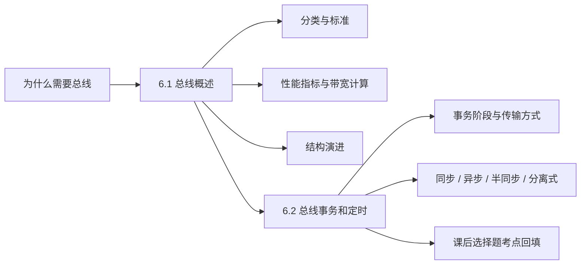
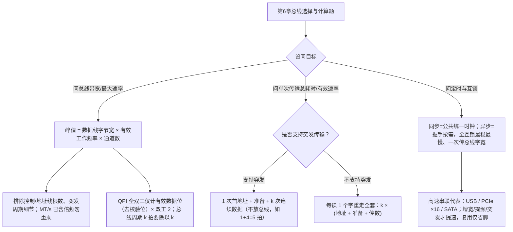

# 第6章 总线

> [!important] 近 18 年 408 计组真题雷达（2009—2026）
> - **考频画像**：18 年共考 18 道单选（`2009–2025` 年连续考查，主要落于 `T19–T21`，`2026` 年未单独出单选），0 道独立大题，另有 `2010-T22` / `2012-T21` / `2013-T43` 跨章高频联动。
> - **近 5 年考法演变**：聚焦 **总线物理峰值带宽 vs 单次突发平均有效速率区分**（`2024-T20` 专设 `3.84 GB/s` 坑）、**`MT/s` 已含倍频去重**（`2025-T20`）、**无突发严格分段累加计算**（`2023-T20`）、以及异步一次握手传一个总线字宽而非 `1` 位（`2021-T19`）。
> - **高频丢分盲区**：把突发事务的 `64B / 7 拍 = 3.84 GB/s` 误当成总线理论峰值带宽 `6.72 GB/s`；看见 `MT/s` 且题写“每周期 4 次”又重复乘 `4`；看到 `PCIe ×16` 或 `USB D+/D-` 误当并行传输；忽略同步复用分时传址不能提速反增拍。
> - **总控入口**：[[00_408计组｜考前急救与真题落点总控|返回计组总控]]

> [!abstract] 本章复盘目标
> 本章围绕“多个部件如何共享通信通路”展开：先认识总线的分类、标准、性能指标和结构演进，再学习一次总线事务怎样传输，以及设备之间怎样约定时序。考试以选择题为主，重点是概念辨析、带宽与有效传输率计算、突发传输、串并行判断及四种定时方式。

## 复习定位

- **基本概念**：总线的分时性、共享性；数据、地址、控制总线的职责；信号传输方向与归属。
- **性能计算**：时钟频率、工作频率、总线宽度、理论带宽、有效数据传输率、QPI 全双工带宽。
- **传输方式**：突发与非突发、串行与并行、异步串行字符帧。
- **定时协议**：同步、异步、半同步、分离式；异步方式的三种互锁关系；为什么同步快与打印机异步最适用原理。
- **结构理解**：单总线、传统南北桥、现代集成化点对点互连、多总线结构规律。

## 章节知识脉络

### 总线带宽、突发事务与定时判定决策树 【🔥⚡ 必背+避坑｜停下来默背 1 遍 + 精读 1 分钟】

---

# 6.1 总线概述 【🔥⚡ 必背+避坑｜停下来默背 1 遍 + 精读 1 分钟】

## 这一节要解决什么问题

1. 总线是什么，为什么能减少系统连线？
2. 不同种类的总线各传什么、连接谁？
3. 怎样衡量总线的理论传输能力和实际事务效率？
4. 总线结构如何从共享通路演进为分层、点对点互连？

## 总线的基本概念

**总线**是一组可供多个部件**分时共享**的公共信息传输线路。

| 特征 | 正确含义 | 高频误区 |
|---|---|---|
| 分时性 | 任一时刻只允许一个部件向总线发送信息 | 多个部件不能同时驱动同一共享总线 |
| 共享性 | 多个部件可挂接在同一总线上，并可同时接收总线信息 | “共享”不等于多对设备可同时发送和通信 |

> [!important] 一句话判断
> 挂接在共享总线上的多个部件：***<u>只能分时发送，但可以同时接收</u>***。

采用总线代替部件间的专用连线，能够减少连线数量、统一接口并方便扩展；代价是多个设备需要竞争有限的总线资源。

> [!abstract] 💡 解题核心思考模型：总线的权衡与代价（Tradeoff）
> - **主要优势**：***<u>减少信息传输线的条数</u>***、简化物理结构、降低硬件成本、统一接口标准并便于扩展。
> - **主要代价**：多个设备分时争用物理通道，相比专线结构**降低了信息的传输速度与并行性**。

## 6.1.1 总线的分类 【🔥 必背｜停下来默背 1 遍】

### 一、按连接位置分类

| 类型 | 连接范围 | 典型对象 | 判断关键词 |
|---|---|---|---|
| 内部总线（片内总线） | ***<u>芯片内部</u>*** | CPU 内寄存器、ALU 等 | “芯片内部” |
| 系统总线 | ***<u>计算机各功能部件之间</u>*** | CPU、主存、I/O 接口 | “CPU—主存—I/O 接口” |
| 局部总线 | ***<u>主机与高速扩展部件/控制器之间</u>*** | 显卡、网卡等扩展控制器 | PCI、AGP、PCIe、VESA |
| 设备总线 / 通信总线 | ***<u>设备与设备控制器之间，或主机与外设之间</u>*** | 外部设备、远距离通信对象 | RS-232C、USB、SATA |

> [!important] 两套分类口径要分开
> 教材同时使用两种口径，选择题先判断题目问哪一种：
>
> - **按连接位置/层次**：内部总线（片内）→系统总线→局部总线→设备/通信总线。
> - **按系统总线传输的信息**：数据总线、地址总线、控制总线。
> - 教材正文还把 **I/O 总线** 用于主机与内部 I/O 控制器，把 **通信总线** 用于主机与外部设备或不同计算机系统之间；这是连接范围的细分，不是第四种“数据内容总线”。
> - 看到“CPU、主存、I/O 接口”优先判断为系统总线；看到“设备—设备控制器”优先判断为设备总线/USB；看到“PCI、AGP、PCIe”优先判断为局部总线。

> [!warning] 易错边界
> **系统总线连接的是功能部件**（CPU、主存、I/O 接口/控制器），外部设备通常先连接到 I/O 接口或设备控制器，不要把“系统总线直接连接 CPU、主存和裸外设”机械理解为所有外设都直接挂在线路上。

### 二、系统总线按信息内容分类

| 总线 | 传输内容 | 方向 | 位数反映什么 |
|---|---|---|---|
| 数据总线 | 指令、操作数、状态字、中断类型号、***<u>间址寻址第一遍读取的有效地址 EA</u>*** | ***<u>双向</u>*** | CPU 一次可并行传送的数据位数 |
| 地址总线 | ***<u>指定主存单元和 I/O 端口地址</u>*** | ***<u>由 CPU 向外单向</u>*** | 最大可寻址空间 |
| 控制总线 | ***<u>时序信号、操作命令（如读/写）、状态信号、响应/回答信号</u>*** | 各根线方向不一，控制命令发向外，状态信号回CPU | 取决于具体控制功能 |

> [!important] 数据线能传什么
> “数据”是广义信息：<mark>指令、操作数、状态字、中断类型号都走数据总线</mark> `[真题·2011-T20 / 2012-T21]`。握手/应答信号用于协调传输，属于控制信息，不走数据总线。

地址线与数据线可以采用**分时复用**：同一组物理线路先传地址、后传数据，以减少引脚和成本。复用改变的是线路用途安排，不会凭空提高传输率。

> [!warning] 易错考点：总线信号传输方向与归属判定【信息分类/方向】
> 1. **物理线路方向与属性**：
>    - **地址总线**：由 CPU 向外***<u>单向传输</u>***。用于指定主存单元和 I/O 端口地址。**无法将主存/外设中的数据回传给 CPU**。
>    - **数据总线**：***<u>双向传输</u>***。任何由主存或外设读取并传送给 CPU 的数值/编码（无论是指令、操作数、状态字、中断类型号、还是间址寻址第一遍从主存读出的有效地址 EA），**一律走数据总线**。
>    - **控制总线与方向**：由多条单向/双向控制线汇聚而成。**控制命令**由 CPU 单向发往主存/外设；**状态信号与响应/回答信号**由主存/外设单向发给 CPU。**控制信息与状态信息传输方向相反**，切勿笼统概括为“整体双向”。
> 2. **教材术语特别说明（状态总线 vs 控制总线）**：
>    - 教材解析中若出现“状态总线”说法，需注意：在系统总线的三类标准划分（数据/地址/控制）中，**状态/响应信号均归属于控制信息的范畴**。
> 3. **主存如何识别地址与数据**：
>    - 主存不靠信息内部的二进制编码辨别，而是靠接收信息的***<u>总线物理类型</u>***（走地址线即识别为地址，走数据线即识别为数据）。
> 4. **干扰选项剔除**：
>    - “系统信息”不属于总线传输内容的物理分类术语；“握手/应答信号”属于控制信息，**绝不能走数据总线**。

> [!warning] “控制总线”与“状态总线”的语境
> 本章系统总线按信息内容只分数据、地址、控制三类；状态/响应信号在这个三分法中归入控制信息。教材个别解析把“状态总线”单独称作状态信号通路，是为了强调方向：**控制命令通常由 CPU 发出，状态/响应通常由主存或外设回传**。做题时既要认内容归属，也要认传输方向，不能把“状态总线”误当成第四类系统总线。

### 三、寻址能力

若地址线有 $n$ 位，则可区分 $2^n$ 个地址：

$$
\text{最大寻址范围}=2^n\times\text{每个编址单位的容量}
$$

- 按字节编址时，$n$ 位地址线对应 $2^n\text{B}$。
- 只有明确编址单位后，才能把地址数换算成容量。

### 常考题型：判断信息应走哪类总线

- **识别特征**：题干给出指令、地址、读写命令、响应信号或中断类型号。
- **解题步骤**：先问“它是在指明对象、承载内容，还是协调动作？”→ 地址 / 数据 / 控制。
- **常见干扰项**：把“中断类型号”误判成控制信号；把“设备响应”误判成数据。
- **检查动作**：若信息本身要被 CPU 当作数值或编码读取，通常走数据总线；若只是控制传输过程，走控制总线。
- **一句话方法**：**地址选对象，数据运内容，控制管节奏。**

## 6.1.2 常见的总线标准 【🔥⚡ 必背+避坑｜停下来默背 1 遍 + 精读 1 分钟】

> [!note] 学习策略
> 本节重点不是死背每个标准的全部历史参数，而是抓住三类标签：**连接层次、串/并行、关键特性**。

| 标准 | 全称或含义 | 层次 | 传输方式 | 关键特性 |
|---|---|---|---|---|
| ISA | Industry Standard Architecture | 系统总线 | 并行 | 早期、低速、CPU 占用率较高 |
| EISA | Extended ISA | 系统总线 | 并行 | 兼容 ISA，支持多主控器和突发传送 |
| VESA | Video Electronics Standards Association | 局部总线 | 并行 | 面向高速图形数据 |
| PCI | Peripheral Component Interconnect | 局部总线 | 并行 | 32/64 位、与处理器时钟频率无关、即插即用 |
| AGP | Accelerated Graphics Port | 局部总线 | 并行 | 专为图形卡设计，可高效访问主存 |
| PCIe | PCI Express | 局部总线 | **串行** | 点对点、多通道（×1、×16）、全双工 |
| RS-232C | 串行通信接口标准 | 设备/通信接口 | 串行 | DTE 与 DCE 间通信 |
| USB | Universal Serial Bus | 设备/通信总线 | **串行** | 即插即用、热插拔、多设备级联 |
| PCMCIA | 笔记本扩展卡标准 | 设备总线 | 并行 | 支持即插即用 |
| IDE/ATA | 传统磁盘接口 | 设备总线 | 并行 | 连接主板与硬盘/光驱 |
| SCSI | Small Computer System Interface | 设备接口 | 传统标准按并行记忆 | 高性能，常用于服务器存储 |
| SATA | Serial ATA | 设备总线 | **串行** | IDE/ATA 的串行替代标准 |

> [!warning] 易错点：总线标准与英文缩写干扰项辨析【总线标准】
> 1. **连接层次辨析（USB vs PCI/AGP/PCIe）**：
>    - **设备总线 / 接口（USB）**：用于***<u>设备与设备控制器之间</u>***互连的接口标准（如 USB）。 `[真题·2013-T19]`
>    - **局部总线（PCI / AGP / PCIe）**：主要用于***<u>主机高速部件或扩展控制器</u>***（如显卡、网卡）与系统主存/CPU 区域的互连，不可把 USB 误当作局部总线。
> 2. **非总线标准干扰项（选择题常考混淆词）**：
>    - `CRT`（阴极射线管显示器）、`CPI`（每条指令的时钟周期数）、`RAM`（随机存取存储器）、`MIPS`（每秒百万条指令数）。 `[真题·2010-T20]`
> 3. **USB 核心特性陷阱**：
>    - USB 的全称是 Universal **Serial** Bus，属于 ***<u>串行总线</u>***。其核心特性为：① 即插即用；② 热插拔；③ 菊花链级联扩展（最高可连接 127 个设备）；④ 高速串行传输（***<u>不能同时传输 2 位数据</u>***。）。 `[真题·2012-T20]`
> 4. **PCIe 核心特性**：
>    - 虽然名称带 PCI，但它采用<mark>高速串行点对点全双工连接</mark> `[真题·2017-T20]`（如 ×16 代表 16 条串行通道聚合，非 16 位并行总线）。

### 常考题型：识别总线标准与特性

- **识别特征**：英文缩写混有 CRT、RAM、MIPS、CPI 等非总线概念，或要求判断 PCIe、USB 的串并行性质。
- **解题步骤**：先剔除明显不是互连标准的术语，再按“旧式并行 / 现代高速串行”分类。
- **常见干扰项**：看到 ×16 就误以为 PCIe 同时并行传输 16 位；实际上它是 16 条串行通道的聚合。
- **检查动作**：回忆 PCIe、USB、SATA 三个现代常见接口都属于串行化方向。

## 6.1.3 总线的性能指标 【🔥⚡ 必背+避坑｜停下来默背 1 遍 + 精读 1 分钟】

### 一、基本指标

| 指标 | 含义 | 关系或单位 |
|---|---|---|
| 总线时钟周期 | 基础时钟一次循环的时间 | $T=1/f_{clk}$ |
| 总线时钟频率 | 基础时钟每秒振荡次数 | Hz |
| 总线传输周期（总线周期） | 完成一次总线操作所需时间，通常含若干时钟周期 | 题目常给“每次传输占 $k$ 个时钟周期” |
| 总线工作频率 | 每秒有效数据传输次数 | $f_{work}=f_{clk}\times m$，$m$ 为每周期传输次数 |
| 总线宽度 | 数据线条数，即每次传输的数据位数 | bit，计算前通常换为 B |
| 总线带宽 | 单位时间理论上能传输的最大数据量 | B/s、MB/s、GB/s |
| 总线复用 | 同一组线分时传不同类型信息 | 减少引脚，可能增加时序开销 |
| 寻址能力 | 能形成的不同地址数量 | 由地址线数和编址单位共同决定 |

> [!important] 时钟频率不一定等于工作频率
> 若每个时钟周期传输 2 次、4 次数据，则工作频率分别是时钟频率的 2 倍、4 倍。<mark>若一次传输需多个时钟周期则工作频率须除以该周期数</mark> `[真题·2009-T20]`。

`【⚡ 真题补丁｜2009-T20】` 总线周期占 `2` 个 `10MHz` 时钟周期、宽 `4B`，则带宽 `= (10MHz/2) × 4B = 20MB/s`（勿直乘 `10MHz` 得 `40`）。

### 二、理论总线带宽

$$
\text{总线带宽}=\frac{\text{总线宽度(bit)}}{8}\times \text{每周期传输次数}\times \text{时钟频率}
$$

也可写为：

$$
\text{总线带宽}=\text{每次传输字节数}\times\text{总线工作频率}
$$

多通道系统若各通道可真正并行工作：

$$
\text{总带宽}=\text{单通道带宽}\times\text{通道数}
$$

> [!abstract] 💡 解题核心思考模型：理论总线带宽四大避坑法则【带宽计算】
> 1. **数据线根数法则**：计算总线带宽时，***<u>只看数据总线的宽度（数据线根数）</u>***。题目给出的“信号线总数（如 104 根信号线）”包含地址线和控制线，属于极强干扰项，计算前必须剔除。
> 2. **理论带宽 vs 事务细节屏蔽法则**：当题干明确要求求解“**总线带宽 / 最大数据传输率**”时，计算的是系统理论物理峰值。题目中关于“突发传输具体第1周期送地址、第4~7周期连续传8次数据”等描述属于**事务过程干扰项**，计算理论带宽时直接忽略。 `[真题·2024-T20]`
>
> - `【⚡ 真题补丁｜2024-T20】` 8B 宽、420MHz 双沿总线峰值带宽 `= 8B × 2 × 420MHz = 6.72GB/s`；网传误选 `3.84GB/s` 系错用单次 `64B/7 拍` 有效速率。
> 3. **MT/s 与频率倍数去重法则**：若题干明确说明“工作频率为 1333 MHz（实际单位是 MT/s，表示每秒传输 1333M 次）”，此数值已包含了 DDR/quad-pumped 等倍频效果，***<u>切勿再二次乘以 2 或 4</u>***。 `[真题·2019-T19 / 2025-T20]`
>
> - `【⚡ 真题补丁｜2025-T20】` `1333MT/s` 已包含四倍频效用，64 位宽峰值带宽 `= 1333M × 8B ≈ 10.66GB/s`（`2019-T19` 三通道 DDR3 再乘 3 得 `32GB/s`）。
> - `【⚡ 真题补丁｜2014-T19】` 基础时钟 `66MHz`（非 `MT/s`）双边沿复用 32 位总线：`4B × 66MHz × 2 = 528MB/s`。
> 4. **双边沿 / 多通道法则**：
>    - 若给出“基础时钟频率 $f_{clk}$ + 双边沿触发（每个周期传 2 次）”，则工作频率 $f_{work} = 2 \times f_{clk}$。
>    - 若采用 $k$ 通道独立并行存储器总线，总带宽 $= \text{单通道带宽} \times k$。

> [!abstract] 💡 解题核心思考模型：QPI 点对点全双工总线带宽计算模板【带宽计算/QPI】
> - **物理特性**：点对点全双工同步串行总线，单向传输 20 位（16 位有效数据 + 4 位校验位）。
> - **极速解题步骤模板**：
>   1. **过滤校验位**：4 位校验位不计入有效用户数据，单向有效数据宽度 $= 16\text{bit} = 2\text{B}$。
>   2. **求单向每秒传送次数**：若时钟频率为 $f_{clk}$，每个时钟周期传送 2 次（每个数据包 80 位分 2 个周期传，每周期传 2 次），则每秒传送次数 $= f_{clk} \times 2$（如 $2.4\text{GHz} \times 2 = 4.8\text{G次/s}$）。
>   3. **求单向带宽** $= \text{单向数据字节数(2B)} \times \text{每秒传送次数(4.8G)} = 9.6\text{GB/s}$。
>   4. **求全双工双向总带宽**：根据题目给出的“总线带宽为：每秒传送次数 $\times 2\text{B} \times 2$”，<mark>全双工双向并发传输乘 2 得 19.2 GB/s</mark> `[真题·2020-T19]`（在 4.8、9.6、19.2、38.4 GB/s 干扰项中准确锁定 19.2 GB/s，不计 4 位校验位）。
>
> **边界检查**：QPI 题若没有明确“有效数据”或给出专用带宽表达式，先确认题目是否把校验位、两个方向和每周期传输次数计入；不要把本题的“16 位有效数据、全双工乘 2”机械套到所有串行链路。

### 三、带宽与平均数据传输率必须分开

| 所求量 | 是否计入地址、命令、等待等开销 | 典型公式 |
|---|---|---|
| 理论总线带宽 / 最大数据传输率 | **不计入**具体事务开销，假定每次有效传输机会都在传数据 | 宽度 × 工作频率 |
| 某次事务的有效传输率 / 平均传输率 | **计入**地址、准备、等待、数据阶段及读写比例 | 有效数据量 ÷ 总耗时 |

若一次操作传输 $D$ 字节，地址阶段、等待阶段和数据阶段合计占 $N$ 个时钟周期，则：

$$
R_{effective}=\frac{D}{N/f_{clk}}=\frac{D\times f_{clk}}{N}
$$

若读、写速率分别为 $R_r$、$R_w$，比例分别为 $p_r$、$p_w$：

$$
R_{avg}=p_rR_r+p_wR_w
$$

### 四、总线带宽题型

#### 题型 1：直接求理论带宽

- **识别特征**：给总线宽度、时钟/工作频率、每周期传输次数。
- **解题步骤**：bit→B；辨认频率含义；乘每周期次数和通道数。
- **常见干扰项**：重复乘 DDR/QDR 倍数；把校验位一律算作有效数据；把地址阶段计入理论带宽；把信号线总根数（如 104 根）当作数据线。
- **检查动作**：64 位总线每次传 8B；结果应等于“每秒传输次数 × 8B”。

#### 题型 2：求一次事务的有效传输率

- **识别特征**：出现地址周期、数据准备、等待周期、传若干字、读写比例。
- **解题步骤**：数总周期 → 用 $N/f$ 求时间 → 数有效字节 → 数据量除以时间。
- **常见干扰项**：只数数据周期；把一个“字”错误地按 1B；读写周期不同却直接平均。
- **检查动作**：有效速率一般不应超过对应理论带宽。

#### 题型 3：图像或字符的数据量换算

> [!tip] 技巧：图像传输与通信速率单位进制坑【计算换算】
> 1. **像素颜色深度**：颜色数为 $N = 2^b$ 色时，每个像素需要 $b$ 位（bit）存储。例如 $65536 = 2^{16}$ 色 $\rightarrow$ 每像素 16 bit。
> 2. **进制区分敏感点**：
>    - 存储容量 / 文件大小：$1\text{KB} = 2^{10}\text{B} = 1024\text{B}$。
>    - 网络与通信传输速率：$1\text{kb/s} = 10^3\text{bit/s} = 1000\text{bit/s}$，$1\text{Mb/s} = 10^6\text{bit/s}$。传输时间 $= \text{总位数(bit)} \div \text{速率(bit/s)}$。

## 6.1.4 总线的结构

总线结构的演进主线是：**减少共享竞争、缩短高速部件间路径、提高并发性**。

### 1. 早期共享总线结构

![[图6.1-单总线结构.jpg]]

*图 6.1 单总线结构：CPU、主存和各类 I/O 部件共享系统总线。*

#### 单总线

- **优点**：结构简单、成本低、扩展方便。
- **缺点**：所有设备分时竞争同一通路；高速和低速设备相互牵制，总线成为瓶颈。

#### 双总线

- 增加 CPU—主存专用的存储总线，主存访问不再与普通 I/O 完全共用通路。
- I/O 与主存交换仍可能需要 CPU 中转，CPU 成为新瓶颈。

#### 三总线

- 增加 DMA 总线，高速 I/O 可经 DMA 控制器直接访问主存。
- 减少 CPU 对数据搬运的干预，提高 I/O 吞吐能力。
- 仍未完全摆脱传统共享、广播式总线的并发限制。

### 2. 传统分层总线：南北桥结构

![[图6.2-南北桥结构.jpg]]

*图 6.2 南北桥结构：高速部件接北桥，低速 I/O 接南桥。*

| 部件 | 主要连接对象 | 职责 |
|---|---|---|
| 北桥 MCH | CPU、主存、显卡 | 承担高速、高带宽数据传输 |
| 南桥 ICH | USB、SATA、网卡、扩展接口等 | 管理相对低速的 I/O |
| FSB 前端总线 | CPU ↔ 北桥 | CPU 对外的共享高速通路 |
| 桥间总线 | 北桥 ↔ 南桥 | 连接高速区和 I/O 区 |

分层让不同速度设备使用不同总线，但 CPU 访问主存、显卡和 I/O 的数据最终仍要经 FSB 汇聚，因此 FSB 又会成为瓶颈。

### 3. 现代集成化总线结构

自 Core i7 一类架构开始，传统北桥的关键功能逐步集成到 CPU：

1. **内存控制器片上化**：CPU 直接访问主存，缩短路径；多内存通道并行提高带宽。
2. **处理器间点对点互连**：CPU 内核间或多处理器间使用 QPI 等高速串行链路。
3. **高速 I/O 直连 CPU**：显卡、SSD 等可经 PCIe 通道接入 CPU；低速设备由 PCH 管理。

| 阶段    | 核心通路              | 主要瓶颈       | 改进方向        |
| ----- | ----------------- | ---------- | ----------- |
| 单总线   | 所有设备共享一条总线        | 竞争严重       | 增加专用总线      |
| 双/三总线 | 存储、I/O、DMA 分流     | 仍存在共享与桥接限制 | 分层连接        |
| 南北桥   | 高速与低速设备分层         | FSB 汇聚     | 控制器集成、点对点互连 |
| 现代结构  | 内存控制器片上、高速 I/O 直连 | 互连与协议开销    | 更多通道和更高效解法  |

---

# 6.2 总线事务和定时 【🔥⚡ 必背+避坑｜停下来默背 1 遍 + 精读 1 分钟】

## 这一节要解决什么问题

1. 一次完整的总线通信包括哪些阶段？
2. 突发传输为什么比非突发传输更适合连续数据？
3. 串行传输为什么可能比并行传输更快？
4. 不同速度设备如何通过同步、握手或事务分离来协调？

## 6.2.1 总线事务 【🔥⚡ 必背+避坑｜停下来默背 1 遍 + 精读 1 分钟】

### 一、总线事务的含义与阶段

主设备与从设备通过总线完成一次完整的信息交换，称为一个**总线事务**。典型事务有存储器读/写、I/O 读/写、中断响应等。

一次事务通常包含：

1. **地址与命令阶段**：主设备给出目标地址和读/写类型。
2. **从设备响应/数据准备阶段**：从设备译码地址并准备数据。
3. **数据传送阶段**：在主从设备之间传送有效数据。

> [!important] 做时间题时
> 只计算题干明确存在的阶段。若题目说明准备时间可忽略，就不要自行添加；若明确给出主存准备一个数据需 6 ns，就必须对每次独立访问计入。

### 二、非突发传输与突发传输

| 对比项 | 非突发传输 | 突发传输 |
|---|---|---|
| 地址给出方式 | 每传一个数据都重新给地址 | ***<u>只给首地址，后续地址自动递增</u>*** |
| 一次事务的数据量 | 通常一个总线宽度的数据 | ***<u>在一次总线事务中连续传送多个数据单元</u>*** |
| 是否持续占用总线 | 每个数据各自完成事务 | 突发期间通常不释放总线 |
| 地址/命令开销 | 大 | ***<u>被多个数据分摊，摊薄地址开销</u>*** |
| 典型用途 | 零散访问 | Cache 行填充、连续主存块传输 |

一句话记忆：**非突发“一次地址、一次数据”；<mark>突发只给一次首址连续传多数据</mark> `[真题·2014-T20]`。**

> [!abstract] 💡 解题核心思考模型：突发 vs 非突发传输耗时计算模板【总线事务】
> 1. **突发传输（Burst Transaction）耗时推导**：
>    - 特点：在**一个总线事务**中，主设备***<u>只在开头发送 1 次首地址与命令</u>***，后续从设备按递增逻辑***<u>连续传送 $k$ 个数据单元</u>***（$k = \text{数据块大小} / \text{总线宽度}$），突发期间不释放总线。
>    - **总耗时公式** $= 1 \text{次地址/命令开销} + \text{准备时间} + k \times \text{数据传输周期}$。
>    - *实例*：32位复用总线传128位数据 $\rightarrow k = 128/32 = 4$ 个数据周期。地址占1周期，数据占4周期，共 $1+4=5$ 周期（如100MHz下为 $50\text{ns}$）。 `[真题·2012-T19]`
> 2. **非突发传输（Non-burst Transaction）耗时推导**：
>    - 特点：不支持连续数据传送。传送 $k$ 个数据单元时，**必须独立重复执行 $k$ 次完整事务**。
>    - **总耗时公式** $= k \times (1 \text{次地址发送} + \text{主存准备时间} + 1 \text{次数据传输时间})$。
>    - *实例*：64位总线（1ns时钟）非突发读取32B主存块（需4个8B单元，主存准备6ns）$\rightarrow$ 每次读取为 $1\text{ns(地址)}+6\text{ns(准备)}+1\text{ns(数据)}=8\text{ns}$，读取整个块耗时 $= 4 \times 8\text{ns} = 32\text{ns}$。 `[真题·2023-T20]`

> [!warning] “提高传输率”的准确理解
> 突发传输通常提高的是***<u>有效数据传输率/总线利用率</u>***，因为它减少重复地址开销；它不改变总线宽度和物理工作频率，因此不改变由这些参数定义的理论最大峰值带宽。

### 三、串行传输与并行传输

| 对比项 | 串行传输 | 并行传输 |
|---|---|---|
| 线路组织 | 少量线路逐位传输，可多通道聚合 | 多条数据线同时传多位 |
| 优点 | 引脚少、布线简单、抗干扰强、适合长距离和高频 | 低频短距离下单周期数据量大、延迟低 |
| 局限 | 单条线路每次传输位数少 | 高频下串扰、时序偏移和同步困难 |
| 典型标准 | USB、PCIe、SATA | 早期 PCI、传统内存总线 |

> [!warning] “全称/排他”极端表述必错
> <mark>并行总线不一定比串行总线快</mark> `[真题·2016-T21]`。总带宽由**单线速率、有效数据位数、通道数和编码开销**等共同决定。现代高速接口常通过高速差分串行链路和多通道聚合获得更高带宽。

> [!abstract] 💡 解题核心思考模型：现代高速总线串行化演进与其物理瓶颈【串并行演进】
> 1. **现代高速总线典型代表【硬件范围】**：
>    - 现代高速总线普遍放弃了传统的并行同步架构，全面转向***<u>高速串行点对点传输</u>***。
>    - 典型代表：***<u>PCI Express (PCIe)、USB 3.x/4、SATA、SAS、QPI/UPI 互连总线</u>*** 等。
> 2. **为什么并行同步方式无法持续提高带宽【物理瓶颈分析】**：
>    - **线间串扰（Crosstalk）**：并行总线多条物理线路紧密并行布线，在极高频率（GHz 级）下高频电磁辐射引发严重信号干扰。
>    - **时序偏移 / 信号时延差（Clock Skew / Phase Shift）**：由于 PCB 板布线长度微小差异及物理介质不均，高频下不同数据位的信号到达接收端的时间无法做到严格同步，导致数据锁存错位。
>    - **引脚与芯片面积瓶颈**：并行总线需要数十甚至上百根物理引脚，极大增加了芯片封装与主板布线的物理开销。
> 3. **现代解法**：采用***<u>低压差分串行传输 + 高速包交换 + 多通道聚合（如 PCIe ×16）</u>***，既避开了并行同步的物理瓶颈，又极大提升了总带宽。

### 四、同步串行与异步串行

#### 同步串行通信

- 收发双方使用严格协调的时钟，通常按数据块连续传送。
- 只需在数据块首尾设置标志，帧开销相对小、效率高。

#### 异步串行通信

- 收发双方使用各自时钟，以**字符**为独立传输单位。
- 线路空闲为逻辑 1；起始位为逻辑 0；数据位通常从最低位开始；随后可有校验位；最后是停止位。

$$
\text{每字符总位数}=1_{\text{起始}}+n_{\text{数据}}+p_{\text{校验}}+s_{\text{停止}}
$$

若每秒传 $C$ 个字符，则 $\text{线路比特率}=C\times\text{每字符总位数}$。

> [!tip] 技巧：异步串行字符帧规范与速率计算【字符帧/速率】
> 1. **字符帧标准结构**：
>    $$\text{每字符总位数} = 1_{\text{起始位(0)}} + n_{\text{数据位}} + p_{\text{校验位(可选)}} + 1_{\text{停止位(1)}}$$
> 2. **关键避坑**：哪怕题干中未显式提及起始位与停止位，**异步串行通信规程也默认强制包含 1 位起始位（逻辑0）和 1 位停止位（逻辑1）**。例如：7位ASCII码+1位奇校验 $\rightarrow$ 字符帧包含 $1+7+1+1=10$ 位。
> 3. **线路传输比特率** $= \text{每秒传输字符数} \times \text{每字符总位数}$。

> [!warning] 不要混淆两种“异步”
> **异步串行通信**讨论字符帧和收发时钟；**异步总线定时**讨论主从设备用请求/回答握手完成一次总线交换。二者都含“异步”，考查角度不同。

## 6.2.2 总线定时 【🔥⚡ 必背+避坑｜停下来默背 1 遍 + 精读 1 分钟】

总线定时的本质是：主设备和从设备用什么规则判断“地址有效、数据准备好、传输完成”。

### 1. 同步定时方式

- **使用范围与约束**：某条同步总线内部使用***<u>系统全局统一的时钟信号</u>***（绝不能由各设备独立提供） `[真题·2015-T19]`，但系统中的***<u>不同总线（如 CPU 总线、内存总线、PCIe）各自采用独立的时钟与协议，非全系共享同一时钟</u>***。
- **时钟信号来源【硬件提供方】**：同步总线的全局统一时钟信号，由***<u>系统主板上的晶体振荡器（晶振）与时钟发生器电路（Clock Generator）或总线控制器产生并统一提供</u>***，通过专门的时钟信号线（CLK）广播分发给挂接在该总线上的所有设备。
- **为什么绝不能由各设备独立提供**：若由各挂接设备独立产生局部时钟，由于硬件晶振漂移与相位偏差，各设备间无法做到精确边沿对齐，会导致同步数据采样错位与传输错误。
- **为什么速度快**：公共统一时钟***<u>消除了逐次握手信号等待开销</u>***，总线较短且部件存取时间接近时适合固定周期划分。
- **优点**：控制逻辑简单、传输速度快。
- **缺点**：缺少根据设备实际响应动态调整的机制；慢设备会限制时钟或必须插入固定等待设计，导致快速设备性能无法充分发挥。
- **适用**：***<u>总线较短、设备速度比较接近的系统</u>***。（注意：“使用统一时钟”是同步的本质定义；而“总线较短”和“各部件存取时间接近”是其最适用的物理约束条件，非硬性定义限制）。

> [!important] 不同速度设备能否采用同步定时？
> **可以选用同步控制方式，也可以选用异步控制方式**。速度不同的设备使用统一时钟时，靠插入 Wait 等待周期即可完成同步传输，只是无法发挥快速部件的高速性能。

> [!important] 判断关键词
> 统一时钟、固定周期、无需握手、设备速度接近 → 同步定时。

### 2. 异步定时方式

不依赖统一时钟，主设备发出“请求”，从设备准备好后发出“回答”，双方***<u>完全依靠“请求/回答”握手信号协调</u>***，传送操作***<u>按需分配时间</u>***。

- **为什么慢设备（如打印机）最适用异步定时**：
  - 外设（如打印机）与 CPU/主存的速度差异悬殊，且打印机打印头机械准备时间不固定。
  - 采用异步握手可以在数据未准备好时完全不占用总线时钟周期，***<u>按需分配传输时间</u>***；而 CPU—主存、CPU—PCI 等高速接近的部件则更适合同步或半同步定时。
- **优点**：总线周期可变，适应速度差异大的设备，自适应性与可靠性较高。
- **缺点**：握手交互增加延迟，控制较复杂。
- **适用**：设备速度差异悬殊、可靠性要求较高而不追求极高速率的系统。

> [!warning] 易错概念：一次握手交换多少数据【异步握手】
> 异步总线一次握手过程完成的是一次***<u>总线宽度的数据交换</u>***（如 32 位或 64 位），***<u>并非仅仅交换 1 位数据</u>***。 `[真题·2021-T19]`

根据 “请求” 与 “回答” 信号的撤销是否互锁，异步定时可分为三类：

#### （1）不互锁方式

![[图6.3a-不互锁.jpg]]

- 主设备发出请求后，经过固定 $t_1$ 自行撤销，不等待回答。
- 从设备发出回答后，经过固定 $t_2$ 自行撤销，不等待请求撤销。
- **速度最快，可靠性最低**。

#### （2）半互锁方式

![[图6.3b-半互锁.jpg]]

- 主设备必须看到回答，才撤销请求。
- 从设备发出回答后，经过 $t_2$ 自行撤销，不等待请求撤销。
- 只在“请求撤销”这一步形成单向制约。

#### （3）全互锁方式

![[图6.3c-全互锁.jpg]]

- 主设备看到回答后才撤销请求。
- 从设备看到请求已撤销后才撤销回答。
- **双方完全制约，可靠性最高，速度最慢**。

| 类型 | 请求何时撤销 | 回答何时撤销 | 速度排序 | 可靠性排序 |
|---|---|---|---|---|
| 不互锁 | 固定延时后自行撤销 | 固定延时后自行撤销 | ***<u>最快</u>*** | ***<u>最低</u>*** |
| 半互锁 | 收到回答后撤销 | 固定延时后自行撤销 | 居中 | 居中 |
| 全互锁 | 收到回答后撤销 | 确认请求撤销后再撤销 | ***<u>最慢</u>*** | ***<u>最高</u>*** |

> [!tip] 看波形图的方法
> 先看**请求下降沿是否由回答上升沿触发**，再看**回答下降沿是否等待请求下降沿**。两个都等待就是全互锁；只等待前一个就是半互锁；都按固定延时就是不互锁。

### 3. 半同步定时方式

半同步方式以系统统一时钟为基础，同时增加 `Wait` 信号照顾慢速设备：

1. 地址、命令、数据的发送严格参照系统时钟前沿（如上升沿）；接收方通常在时钟后沿（如下降沿）进行识别。
2. 主设备在时钟上升沿检测 `Wait` 信号状态。**握手/等待信号的采样由同步时钟控制**。
3. 数据未准备好时插入等待周期；准备好后才完成传输。

- **优点**：兼有同步控制较简单和一定自适应能力。
- **缺点**：仍受系统统一时钟约束，整体速度不高。
- **适用**：设备速度有差异，但系统仍希望保留同步框架的场景。

### 4. 分离式定时方式

同步、异步和半同步在传统事务中都可能从请求到完成一直占用总线；从设备准备数据时，总线被占却没有传有效数据。

分离式定时把一次事务拆成两个独立阶段：

1. **请求阶段**：主设备 A 获得总线，发送地址和命令后***<u>立即释放总线</u>***。
2. **准备间隔**：从设备 B 在内部准备数据；***<u>总线可被其他事务使用，有效避免空闲等待，提高利用率</u>***。
3. **应答阶段**：B 准备好数据后主动申请总线，并以***<u>新的主设备身份</u>***把数据送回 A。

- **优点**：***<u>大幅减少总线空闲等待，显著提升总线利用率与并发能力</u>***。
- **缺点**：需要事务标识、重新仲裁和响应匹配，控制复杂、协议开销大。
- **适用**：多主设备竞争激烈、从设备响应延迟较大的高性能系统。

### 四种定时方式总对比

| 定时方式 | 协调依据 | 周期是否固定 | 是否能适应慢设备 | 主要优势 | 主要代价 |
|---|---|---|---|---|---|
| 同步 | 统一时钟 | 固定 | 较弱（靠插等待周期） | 快、控制简单 | 强制同步，设备速度受约束 |
| 异步 | 请求/回答握手 | 可变 | 强 | 自适应、可靠 | 握手慢、逻辑复杂 |
| 半同步 | 时钟 + `Wait` | 可插等待周期 | 中等 | 保留同步框架，时钟采样 Wait | 仍受统一时钟制约 |
| 分离式 | 请求与应答拆开、两次仲裁 | 不按一个独占周期完成 | 强 | ***<u>准备期间释放总线，利用率最高</u>*** | 事务管理最复杂 |

> [!abstract] 💡 解题核心思考模型：提升同步总线传输速率的有效手段【速率提升】
> 1. **有效措施**：
>    - ***<u>增加总线宽度</u>***（单次传输更多字节）；
>    - ***<u>提高总线工作频率</u>***（单位时间内传送更多次）；
>    - ***<u>支持突发传输方式</u>***（摊薄地址开销，提高有效传输速率）。
> 2. **无效措施**：
>    - ***<u>采用地址/数据线复用</u>***（复用仅用于减少芯片引脚与成本，分时传输反而增加了地址阶段的节拍开销，**无法提高数据传输速率**）。 `[真题·2018-T21]`

> [!abstract] 💡 解题核心思考模型：多总线结构四大一般规律【多总线结构】
> 1. **速度梯度**：***<u>越靠近 CPU 的总线速度通常越高</u>***。
> 2. **突发支持**：存储器总线通常***<u>支持突发传送方式</u>***以提高 Cache 行填充效率。
> 3. **桥接连接**：在教材所说的多总线结构中，不同速率或协议的总线通常通过桥接器（Bridge）或控制器相连，完成缓冲、流量交换和协议/速率衔接；这是该结构的判断条件，不应泛化为所有点对点链路都必须经过传统桥。
> 4. **PCIe 串行性**：PCI Express ×16 采用的是 16 条***<u>高速串行通道聚合</u>***，并非 16 位并行传输。

---

---

# 本章高频题型总表

| 题干特征 | 优先方法/起手式 | 真题印证与避坑 |
|---|---|---|
| 系统总线信息归属、标准与架构 | 指令/操作数/中断类型号走数据总线；主机扩展 PCIe×16 属串行，外设用 USB | `[真题·2010-T20 / 2011-T20 / 2012-T20 / 2013-T19 / 2016-T21 / 2017-T20]` |
| 总线理论峰值带宽 vs 有效速率 | 物理带宽 `= 宽(B) × 工作频率 × 通道数`；屏蔽突发拍细节；`MT/s` 已含倍频勿重乘；QPI 去校验乘双工 | `[真题·2009-T20 / 2014-T19 / 2019-T19 / 2020-T19 / 2024-T20 / 2025-T20]` |
| 突发 vs 非突发传输耗时及提速 | 突发仅 `1 次首址 + k 次数据`；非突发每次重走全套；信号复用省脚不提速 | `[真题·2012-T19 / 2014-T20 / 2018-T21 / 2023-T20]` |
| 同步、异步握手与分离式定时 | 同步靠统一公共时钟，不可由设备自供；异步一次握手传整个总线字宽；全互锁最稳最慢 | `[真题·2015-T19 / 2021-T19]` |

---

# 冲刺主动回忆卡（遮挡自测）

> [!question] 1. 面对 `2024-T20` 和 `2025-T20` 这类现代高速总线题，如何区分“总线峰值带宽”与“单次突发平均有效传输率”？看到 `1333MT/s` 且“每周期传 4 次”能再乘 4 吗？
> [!success]- 正确解释
> 1. 问“**总线带宽 / 最大数据传输率**”求的是物理上限：只需 `数据线字节宽度 × 有效工作频率`（如 `8B × 2 × 420MHz = 6.72GB/s`），直接屏蔽题干中第 1 拍发地址、第 4~7 拍突发传输的事务细节，切忌误算为 `64B / 7 拍 ≈ 3.84GB/s`（`2024-T20`）。
> 2. **不能再乘 4**：`MT/s`（Mega Transfers per second）已经是倍频/四倍频之后的等效每秒传输次数，直接 `1333M × 8B ≈ 10.66GB/s`（`2025-T20`）；只有题干明确给基础时钟频率 `66MHz` 加双沿采样时才乘 2（`2014-T19`）。

> [!question] 2. 下列两道高频细节：异步总线完成一次请求/回答握手时到底传多少位数据？64 位总线**不支持突发**从主存读 `32B` 块（地址 1ns、准备 6ns、传数 1ns）耗时多少？
> [!success]- 正确解释
> 1. 异步并行总线一次握手完成**整个总线宽度**的数据字交换（如 `32` 或 `64` 位，非仅 1 位，`2021-T19`）。
> 2. **不支持突发**时每次传送 `8B` 都必须重新送地址并等待主存准备：`32B / 8B = 4` 次独立事务，总耗时 `4 × (1 + 6 + 1) = 32ns`（`2023-T20`，勿误套突发算出 `11ns`）。

> [!question] 3. 中断类型号、USB、`PCIe ×16`、地址/数据线复用四个高频概念各有什么经典坑点？
> [!success]- 正确解释
> 1. **中断类型号**作为编码数字传送给 CPU 查表，走**数据总线**，而握手应答走控制总线（`2011-T20`）。
> 2. **USB** 是串行设备接口，逐位传输，不并发传 2 位（`2012-T20`、`2013-T19`）；**`PCIe ×16`** 是 `16` 条高速差分**串行**通道聚合，非 16 位并行总线（`2017-T20`）。
> 3. **地址/数据线复用**只为减少封装引脚数，分时占拍反增延迟，**不能提高总线传输速率**（`2018-T21`）。
