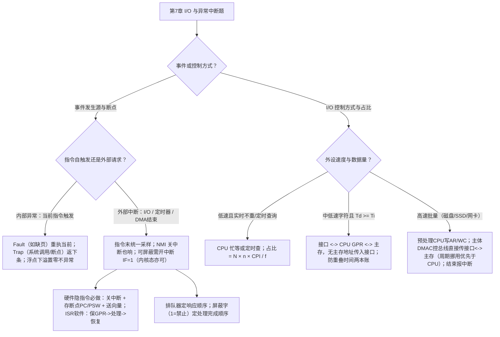

# 第7章 输入输出系统

> [!important] 近 18 年 408 计组真题雷达（2009—2026）
> - **考频画像**：18 年共考 31 道主考真题（`28` 道单选 + `3` 道大题 `2009-T43`、`2016-T44`、`2018-T43`），另有 `10` 道与第 3/5/6 章（`Fault/Trap`、中断向量/类型号走数据线、磁盘 DMA 周期挪用）联动考查。
> - **近 5 年考法演变**：`2021–2026` 几乎每年稳定出 `1–2` 道概念边界题，高频锁定中断响应与处理优先级对比（`2024-T21`）、**硬件必做保存断点 vs 软件可做项**（`2026-T22`）、**内核态仍可响应嵌套中断**（`2021-T22`）、外部中断 vs 内部异常归类（`2025-T22`）及 DMA 通路与适用高速设备（`2023/2024/2025`）。
> - **高频丢分盲区**：把缺页或断点指令归成外部中断；把“保存现场”混淆成硬件隐指令动作；把硬件排队器（响应序）与中断屏蔽字（处理序）说反；把 `50ns` 允许最大响应延迟错加进中断 CPU 时间分子；`0.04` 小数转百分比手滑写成 `0.4%`。
> - **总控入口**：[[00_408计组｜考前急救与真题落点总控|返回计组总控]]

### 异常/中断响应全链路与 I/O 控制方式判定树 【🔥⚡ 必背+避坑｜停下来默背 1 遍 + 精读 1 分钟】

输入输出（I/O）系统负责实现主机与外部设备之间可靠、高效的信息交换。本章的核心逻辑围绕：**外设物理特性的异构性 $\rightarrow$ 借助 I/O 接口完成信号与时序适配 $\rightarrow$ CPU 通过端口与接口交互 $\rightarrow$ 程序查询、程序中断、DMA 三种控制方式逐步降低 CPU 参与度并提升传输效率**。

---

## 7.1 I/O 系统基本概念 【📌 扫一眼｜确认“我还会”就过】

### 7.1.1 输入/输出系统的组成 【🔥 必背｜停下来默背 1 遍】

信息流向始终以**主机**为参照基准：
- **输入**：信息从外部设备传送到主机。
- **输出**：信息从主机传送到外部设备。

I/O 系统由软件和硬件两大部分协同构成：
1. **I/O 软件**：包括设备驱动程序、I/O 管理程序（操作系统内核模块）以及用户应用程序。驱动程序向上层提供统一的标准接口，向下直接操作具体设备的控制寄存器。
2. **I/O 硬件**：包括外部设备、设备控制器、I/O 接口以及 I/O 总线。
   - **设备控制器**：控制外设的具体机械与电气动作（如驱动磁头移动、电机旋转、打印针击打）。
   - **I/O 接口**：负责外设与主机系统总线之间的电气连接、逻辑适配与缓冲。

外部设备通常不直接挂接在主机系统总线上，标准物理连接通路为：
$$\text{CPU / 主存} \longleftrightarrow \text{I/O 总线} \longleftrightarrow \text{I/O 接口（设备控制器）} \longleftrightarrow \text{通信电缆} \longleftrightarrow \text{外部设备本体}$$

**注意：**
- 区分**外部设备本体**与**接口/控制器**：<mark>磁盘驱动器属于外设本体不属于接口</mark> `[真题·2021-T20]`，而打印机适配器、网卡与可编程中断控制器（8259A）属于 I/O 接口/控制逻辑部件。
- I/O 端口是接口内部可由 CPU 直接寻址访问的寄存器，属于寄存器级概念，不是外设与总线连接的物理接口部件。

---

### 7.1.2 外部设备 【🔥 必背｜停下来默背 1 遍】

#### 1. 输入设备
- **键盘**：最常用的字符输入设备，用于向主机输入字符编码及控制命令。
- **鼠标**：常用的定位输入设备，将用户的机械或光学位移映射为屏幕光标的二维坐标。

#### 2. 输出设备

##### (1) 显示器
按显示器件分为阴极射线管（CRT）、液晶显示器（LCD）和发光二极管（LED）。主要技术指标包括：
- **屏幕尺寸**：显示屏对角线的物理长度，单位为英寸（$1\text{ 英寸} = 2.54\text{ cm}$）。
- **分辨率**：屏幕所能呈现的像素总数，通常表示为“宽 $\times$ 高”（如 $1920 \times 1080$）。
- **色彩深度**：每个像素所占用的二进制位数。若色彩深度为 $n$ 位，则每个像素可呈现 $2^n$ 种颜色或灰度级（如 8 位对应 256 级，24 位对应真彩色）。
- **刷新机制**：荧光粉发光或液晶状态保持时间有限，为避免闪烁，必须周期性重绘整屏图像。
- **刷新频率（帧频）**：每秒重绘屏幕的次数，单位为 Hz。人眼通常在刷新频率高于 30 Hz 时才不会感知闪烁，现代显示器通常为 60～120 Hz。
- **显示存储器（VRAM / 显存）**：用于暂存一帧完整的屏幕像素点阵数据。

**显存相关计算公式：**

$$\text{VRAM 容量 (bit)} = \text{分辨率像素数} \times \text{色彩深度 (bit)}$$

$$\text{刷新带宽 (bit/s)} = \text{分辨率像素数} \times \text{色彩深度 (bit)} \times \text{帧频 (Hz)}$$

若显存总带宽中用于屏幕刷新的比例为 $\alpha$（其余带宽供 CPU/GPU 写入新图像），则<mark>所需显存总带宽等于刷新带宽除以比例</mark> `[真题·2010-T22]`：
$$\text{所需显存总带宽} = \frac{\text{刷新带宽}}{\alpha}$$

`【⚡ 真题补丁｜2010-T22】` 刷新率 `1600×1200×24×85 ≈ 3917Mbps`，占总带宽 `50%` 时须**除以 0.5** 得 `≈ 7834Mbps`（勿误乘 `0.5`）。

**注意：**
- 显存容量是一帧图像的静态数据量，**切勿乘以帧频**；刷新带宽衡量每秒传输的数据量，**必须乘以帧频**。
- 色彩深度单位是 bit（位），换算为存储容量时需除以 8 转化为 Byte。
- **点阵字库容量**：$m \times n$ 点阵的一个汉字占用 $(m \times n) / 8\text{ B}$（黑白点阵无需乘色彩深度）；$N$ 个汉字的字库总容量为 $N \times (m \times n) / 8\text{ B}$。

##### (2) 打印机
按工作原理分为：
- **针式打印机**：点阵式击打打印机，通过打印针撞击色带在纸张上成像。优点是结构简单、耗材便宜、支持多层穿梭复写（广泛用于发票和票据打印）；缺点是噪声大、分辨率低、打印速度慢。
- **喷墨式打印机**：通过精确喷射微小墨滴在纸张上形成图像，利用青、品红、黄（及黑）三基色混合实现高品质彩色打印。
- **激光打印机**：结合激光扫描与静电成像技术。计算机输出的数字信号调制激光束，在感光鼓上形成静电潜像，再经显影、转印和定影输出到纸张。特点是打印速度快、分辨率高、噪声小、综合性能强。

#### 3. 外部存储器（辅存）
- **磁表面存储器**：将磁性材料涂覆在金属或塑料基片上，利用磁化方向记录二进制信息（如机械硬盘 HDD、软盘、磁带）。磁盘驱动器向盘片磁道记录数据时采用**串行方式**写入。
- **固态硬盘（SSD）**：采用非易失性 Flash 芯片作为存储介质，无机械运动部件，具备读写速度快、抗震、低功耗、随机寻道时间极短的特点。
- **光盘存储器**：利用聚焦激光束以非接触方式在盘片表面凹坑上读写信息。系统由光盘片、光盘驱动器和光盘控制器组成。

---

## 7.2 I/O 接口 【🔥⚡ 必背+避坑｜停下来默背 1 遍 + 精读 1 分钟】

I/O 接口（又称 I/O 控制器）是主机与外设之间的信息交接部件，旨在弥合主机与外设在速度、电平、数据格式和工作方式上的显著差异。

### 7.2.1 I/O 接口的功能 【📌 扫一眼｜确认“我还会”就过】

1. **地址译码与设备选择**：译码 CPU 发送的地址码，产生片选信号，确保主机只与目标端口通信。
2. **通信联络与时序协调**：主机与外设速度差异极大，接口通过硬件握手信号或状态标志协调双方时序，确保传输可靠。
3. **数据缓冲**：接口内置数据缓冲寄存器（DBR），在高速总线与慢速外设之间暂存数据，避免数据丢失。
4. **信号格式转换**：完成主机与外设之间的电平匹配、串/并转换（如磁盘串行比特流与主机并行字数据的相互转换）、模/数（A/D）或数/模（D/A）转换。
5. **传送控制命令与状态信息**：CPU 向控制寄存器写命令字控制外设操作，外设通过状态寄存器向 CPU 反馈“就绪”、“忙”、“错误”等工作状态；当外设准备就绪时，接口可向 CPU 发出中断请求。
6. **错误与状态检测**：检测传输中的奇偶校验错、溢出等硬件异常，并实时反映在状态寄存器中。

---

### 7.2.2 I/O 接口的基本结构 【🔥⚡ 必背+避坑｜停下来默背 1 遍 + 精读 1 分钟】

I/O 接口的主机侧通过系统总线（I/O 总线）连接 CPU 与主存，设备侧通过通信电缆连接外设本体。

![[01.jpg]]

#### 1. 接口内部的三类核心寄存器（端口）
- **数据缓冲寄存器（DBR）**：暂存主机与外设交换的数据，CPU 对其可读可写。
- **状态寄存器**：记录接口及外设当前的运行状态（如就绪、忙、故障），CPU 对其只读。
- **控制寄存器**：存放 CPU 下发的控制命令（如启动、停止、模式设置），CPU 对其只写。

**地址复用机制：** 由于状态寄存器只被 CPU 读出，控制寄存器只被 CPU 写入，二者读写方向相反且时序互斥，在许多体系结构中它们**合用同一个端口地址**——CPU 执行读该地址的指令时读出状态字，执行写该地址的指令时写入控制字。

**注意：**
- 数据缓冲寄存器、状态寄存器、控制寄存器属于 I/O 接口内部寄存器。
- 指令寄存器（IR）严格位于 CPU 内部，存储器地址寄存器（MAR）位于 CPU 或主存接口端，**不属于 I/O 接口**。

#### 2. 系统总线各信号线传输的内容
- **数据线**：传输双向数据，包括数据字、<mark>状态字、控制命令字与中断类型号</mark> `[真题·2012-T21]`。
- **地址线**：传输单向地址（CPU 输出），用于寻址 I/O 接口内部的具体端口寄存器。
- **控制线**：传输读/写控制信号（区分对端口的读或写操作）、中断请求信号（接口送往 CPU）、中断响应信号（CPU 发往接口）、总线仲裁信号以及握手联络信号。

#### 3. 内部控制逻辑
- **I/O 控制逻辑**：对控制寄存器中的命令字进行译码并产生操作时序，控制数据的输入/输出走向，并实时采集外设状态写入状态寄存器。
- **外设界面控制逻辑**：根据具体外设的电气协议，与外设电缆直接进行时序握手与信号收发。
- **宽度异构性**：主机侧总线数据宽度（如 32 位或 64 位）与外设侧通信电缆数据宽度（如 8 位并行或 1 位串行）往往不一致，由接口内部逻辑负责串/并重组与宽度对齐。

**注意：** 中断请求信号（INTR）是由 I/O 接口（或中断控制器）向 CPU 发送的，外设本体仅向 I/O 接口发送“操作完成/就绪”信号，外设本体绝不会直接给 CPU 发送中断请求，中断返回时 CPU 也无需向外设发送中断结束信号。

---

### 7.2.3 I/O 接口的类型 【📌 扫一眼｜确认“我还会”就过】

- **按数据传送方式（设备侧）**：
  - **并行接口**：一个字节或字的所有数据位在多条并行信号线上同时传送。
  - **串行接口**：数据按位在一条信号线上依次逐位有序传送（接口内部必须具备串/并转换移位寄存器）。
- **按主机控制方式**：程序查询接口、中断接口、DMA 接口。
- **按功能灵活性**：可编程接口（工作模式可由软件下发控制字动态改变）、不可编程接口（功能由硬件电路固化）。

---

### 7.2.4 I/O 端口及其编址 【🔥⚡ 必背+避坑｜停下来默背 1 遍 + 精读 1 分钟】

I/O 端口是 I/O 接口中可被 CPU 机器指令直接寻址访问的寄存器。CPU 对外设的所有读写控制最终都落实为对某个端口地址的读写。

**I/O 指令的核心特征：**
- I/O 指令是 CPU 机器指令集的一部分，属于**系统特权指令**（仅在操作系统内核态下允许执行）。
- I/O 指令实现的数据传送<mark>发生在 CPU 通用寄存器与 I/O 端口之间</mark> `[真题·2017-T21]`，CPU 绝不能通过一条 I/O 指令直接从外设介质传输数据到主存（亦非外设本体直传）。
- I/O 指令的格式与普通通用算术/逻辑指令不同。

常见的编址方式有两种：**独立编址**与**统一编址**。

| 比较维度 | 独立编址（I/O 映射方式） | 统一编址（存储器映射方式） |
| :--- | :--- | :--- |
| **地址空间关系** | I/O 地址空间与主存地址空间**完全独立** | I/O 端口与主存单元**共享同一地址空间** |
| **地址数值重叠** | I/O 地址与主存地址**数值可以相同**，互不冲突 | 严格唯一，分配给 I/O 的地址主存不能使用 |
| **访问指令** | 使用专用 I/O 指令（如 x86 的 `IN`、`OUT`） | <mark>使用普通访存指令</mark> `[真题·2014-T21]`（如 `MOV`、`LOAD`、`STORE`） |
| **空间区分方式** | 依靠专用指令及**不同控制信号线**（如 $\overline{\text{IOR}}/\overline{\text{IOW}}$ 与 $\overline{\text{MEMR}}/\overline{\text{MEMW}}$） | 依靠**不同的地址码范围**（通常固定划分在地址高端） |
| **地址总线** | **共用同一套物理地址总线** | **共用同一套物理地址总线** |
| **主存容量影响** | 不占用主存地址空间，不减少可用内存 | 占用部分主存地址空间，可用主存容量减少 |
| **指令系统与灵活性** | 专用 I/O 指令功能单一（通常仅限数据传输），编程灵活性较低 | 可使用全部访存指令及丰富的寻址方式，编程高度灵活 |
| **硬件译码代价** | I/O 端口数量少，地址线较少，译码电路简单、速度快 | 需要对完整的高位地址进行译码，译码电路较复杂 |
| **内存保护机制** | 需额外的硬件 I/O 保护机制 | I/O 访问保护可由虚拟存储管理系统统一实现（页表保护位） |

**注意：**
- 独立编址与统一编址在物理实现上**均使用同一套系统地址总线**，区分并非依靠“不同的地址线”。
- 专用 I/O 指令与独立编址是双向绑定的：**只有具有专门 I/O 指令的计算机，I/O 设备才可以独立编址**；若机器没有专门的 I/O 指令，则只能采用统一编址。
- 统一编址下，I/O 端口地址必须相对集中固定在某一地址段（如高端），切勿随意分散在内存的任意位置，否则会导致系统地址译码与软件内存规划混乱。

---

## 7.3 I/O 方式 【🔥⚡ 必背+避坑｜停下来默背 1 遍 + 精读 1 分钟】

常用的 I/O 控制方式包括：**程序查询方式**、**程序中断方式**和 **DMA 方式**。

### 7.3.1 程序查询方式 【🔥 必背｜停下来默背 1 遍】

#### 1. 工作原理与流程
数据传送的全部过程由 CPU 执行查询程序全程控制。数据在主存与外设之间传输时，必须经过 CPU 通用寄存器中转。

![[02.jpg]]

工作步骤如下：
1. **预置参数**：CPU 执行初始化程序，在通用寄存器或内存中设置主存起始地址和传送计数器。
2. **启动外设**：CPU 向接口控制端口写入启动命令字。
3. **读取状态**：CPU 通过输入指令循环读取接口的状态端口。
4. **状态判断**：检查设备是否就绪。若未就绪，CPU 继续循环查询（忙等待）；若就绪，继续下一步。
5. **数据传送**：CPU 执行数据输入/输出指令，将数据读入 CPU 通用寄存器，再写入主存（或反之）。
6. **参数修改**：CPU 执行指令修改主存地址指针并递减计数器。
7. **结束判断**：若计数器未归零，返回步骤 3 继续查询；若全部传送完毕，则退出查询程序。

#### 2. 查询策略分类
- **独占查询**：外设一旦启动，CPU 便连续不断地读取状态寄存器，直到整批数据传送完毕。此期间 CPU 完全处于忙等待，不能执行其他任务，**CPU 与外设完全串行工作**。
- **定时查询**：CPU 按固定的时间间隔周期性地查询外设状态。查询时若外设就绪，则传送一个数据单元，随后立即返回执行用户主程序。此方式允许 CPU 在外设准备数据的间隙执行其他计算任务。

#### 3. 效率计算模型
为防止数据丢失，在定时查询方式下，CPU 查询外设的最长时间间隔必须小于等于外设填满接口缓冲区所需的时间。

- **已知量**：外设数据传输速率 $R$（B/s），I/O 接口数据缓冲寄存器宽度 $B$（B），每次查询程序开销指令数 $n$，平均指令周期数 $\text{CPI}$，CPU 主频 $f_{\text{CPU}}$。
- **最迟查询间隔**：
  $$T_{\max} = \frac{B}{R}$$
- **每秒最少查询次数**：
  $$N_{\min} = \frac{1}{T_{\max}} = \frac{R}{B}$$
- **CPU 用于该外设 I/O 的时间占比**： `[真题·2011-T22 / 2018-T43]`
  $$\eta = \frac{N_{\min} \times n \times \text{CPI}}{f_{\text{CPU}}} \times 100\%$$

`【⚡ 真题补丁｜2011-T22】` 定时查询占比 `200×500 / (50×10^6) = 0.002 = 0.20%`（小数转百分数务必乘 `100%`，防小数点错移）。
`【⚡ 真题补丁｜2018-T43】` 设备 A 查询间隔 `2μs` 占比 `0.04 = 4%`（勿错写 `0.4%`）；B 到达 `0.1μs < 0.8μs`（需 `800%`）不可用中断，改 DMA 占 `4%`。

**特点评价：** 硬件设计简单、开销极低；但 CPU 必须耗费大量时钟周期执行查询，CPU 与外设处于高度串行状态，系统吞吐量低。

---

### 7.3.2 程序中断方式 【🔥⚡ 必背+避坑｜停下来默背 1 遍 + 精读 1 分钟】

#### 1. 基本概念与特点
当外部设备完成数据准备或出现系统异常时，外设接口向 CPU 发出中断请求信号，CPU 在满足响应条件时暂停当前程序的执行，转去执行预先编制的中断服务程序（ISR）完成数据交换或事件处理，处理结束后自动返回原程序断点处继续执行。

![[03.jpg]]

**主要应用场景：**
1. 实现 CPU 与外设并行工作（外设准备数据时 CPU 执行其他进程）。
2. 处理硬件故障（如掉电、校验错）和软件异常（如除零、缺页）。
3. 支持人机交互（键盘击键、鼠标移动）。
4. 支撑多道程序与分时操作系统的进程调度与时钟管理。
5. 实现用户态到内核态的上下文切换（软中断指令、系统调用）。

**适用性限制：**
程序中断方式下，每传送一个数据字均需经历中断响应、现场保存、数据中转与现场恢复。若外设准备一个数据字的时间 $T_d$ 小于 CPU 完成一次中断响应和处理的时间 $T_i$（即 $T_d < T_i$），新到达的数据将在旧数据被取走前覆盖缓冲区，导致数据丢失。因此，<mark>中断方式仅适用于中低速与突发设备</mark> `[真题·2015-T21 / 2022-T21]`（外设准备时间须大于等于中断处理时间），高速成批数据传输必须采用 DMA 方式。

`【⚡ 真题补丁｜2015-T21】` 程序中断方式中，CPU 与接口间仅传送字符数据、状态信息与控制命令，**不向接口传送主存地址**（DMA 控制器才传）。

#### 2. 中断工作流程

##### (1) 中断请求
- **中断源与暂存**：每个中断源在接口内设置一个**中断请求标记触发器**（置 1 表示有请求），多个触发器组成中断请求寄存器，其作用是在 CPU 尚未响应时先暂存中断请求信号。
- **外部中断分类**：
  - **可屏蔽中断（INTR）**：通过 CPU 的 INTR 引脚输入，受 CPU 标志寄存器中的中断允许标志（IF）控制。关中断（$\text{IF}=0$）时不予响应，通常用于常规外部设备（键盘、打印机等）。
  - **不可屏蔽中断（NMI）**：通过 CPU 的 NMI 引脚输入，用于处理系统级紧急灾难事件（如电源掉电、主存校验错、总线严重故障）。其优先级极高，<mark>即使在关中断状态下也必须强制响应</mark> `[真题·2020-T21]`。
- **内部异常（内中断）分类**：
  - **故障（Fault）**：在指令执行过程中被检测到，当前指令未执行完毕。处理后 CPU 重新执行当前指令，断点为**当前指令地址**（如访存缺页、除数为 0、非法操作码）。
  - **陷阱（Trap）**：在指令成功执行后被检测到，属于预先安排的事件。处理后 CPU 执行下一条指令，断点为**下一条指令地址**（如断点调试指令、系统调用指令）。
  - **中止（Abort）**：严重的硬件故障，无法精确记录断点，程序无法恢复，直接终止运行。

**注意：** <mark>浮点运算下溢按机器零处理不产生异常</mark> `[真题·2009-T22]`；只有浮点上溢才会作为异常处理。

##### (2) 中断响应判优
当多个中断源同时提出请求时，必须通过排队逻辑确定优先响应次序。
- **响应优先级**：CPU 响应多个同时发生的请求的先后顺序，由硬件排队器（或软件查询程序）固定决定，**不能通过中断屏蔽字改变**。
- **处理优先级**：各中断服务程序在执行期间能够打断谁的嵌套次序，由**中断屏蔽字动态调整**。
- **通常的优先级倾向**：
  $$\text{不可屏蔽中断} > \text{可屏蔽中断}$$
  $$\text{硬件故障} > \text{软件异常} > \text{I/O 中断}$$
  $$\text{高速设备} > \text{低速设备}；\quad \text{输入设备} > \text{输出设备}；\quad \text{实时设备} > \text{普通设备}$$
  在总线争用语境下，为防止高速外设丢失数据：$\text{DMA 请求} > \text{中断请求}$。

##### (3) CPU 响应中断的条件
CPU 响应外部可屏蔽中断必须同时满足以下三个条件：
1. **有中断请求**：中断源发出的中断请求信号有效，且未被屏蔽。
2. **开中断**：CPU 处于允许中断状态（中断允许触发器 $\text{IF} = 1$）。
3. **指令结束**：<mark>当前指令执行完毕时统一采样检测</mark> `[真题·2018-T22 / 2023-T21]`（CPU 仅在指令末期统一采样外部中断，并非请求信号一有效就立刻打断），且系统无更高级任务。

**注意：** “一条指令执行完毕”仅仅是 CPU 响应外部中断的**采样时机**，它本身**绝不会产生中断请求**；会产生中断请求的是<mark>外设就绪或 DMA 传送结束</mark>等外部事件 `[真题·2009-T22 / 2020-T20 / 2025-T22]`。<mark>内核态开中断时同样可以响应外部中断</mark> `[真题·2021-T22]`。

`【⚡ 真题补丁｜2020-T20 / 2025-T22】` 定时器到时、网卡收包、DMA 传送结束属外部中断；缺页、除零、断点陷阱指令属内部异常，不触发外部中断。

##### (4) 中断响应阶段（中断隐指令，硬件自动完成）
中断隐指令并非指令系统中的程序指令（不属于程序控制指令，程序员无法编写），而是硬件电路在检测到中断并确认响应后，自动执行的一组原子硬件操作：
1. **关中断**：硬件将中断允许触发器置 0，禁止响应后续可屏蔽中断，防止在保存断点和关键现场时被新中断破坏。
2. **保存断点**：<mark>硬件自动保存断点 PC 与 PSW</mark> `[真题·2018-T22 / 2026-T22]`，压入系统堆栈或专用寄存器（通用寄存器现场由 ISR 软件压栈，硬件不保 GPR）。

`【⚡ 真题补丁｜2026-T22】` 中断响应与处理中，**保存断点必须由硬件中断隐指令完成**；开中断、软件查询判优与保存通用寄存器均可由软件完成。
3. **引出中断服务程序**：识别中断源，将对应中断服务程序的入口地址装入 PC，使 CPU 转向服务程序执行。

**注意：** 采用硬件自动保存断点（PC 和 PSW），是为了避免由软件保存所引入的额外时间开销以及断点被中途篡改的错误风险。

##### (5) 中断向量与向量中断
- **中断类型号（中断号）**：标识中断源的唯一编号，在中断响应阶段由外设接口或中断控制器**经数据总线**传送给 CPU。
- **中断向量**：对应中断服务程序的**入口地址本身**。
- **中断向量地址（向量表项地址）**：内存中断向量表中存放该入口地址的**内存单元地址**（即中断服务程序入口地址的地址）。
- **向量中断**：CPU 依据接收到的中断类型号，通过硬件乘法或移位生成向量地址，从内存向量表中取出中断服务程序入口地址并送入 PC 的寻址机制。

##### (6) 中断处理过程（软件完成）
进入中断服务程序后的处理次序（以支持多重中断的典型结构为例）：

![[04.jpg]]

完整的处理阶段划分为 9 个步骤：
- **硬件完成（中断隐指令）**：
  1. 关中断
  2. 保存断点（PC 和 PSW）
  3. 引出中断服务程序（根据中断类型号寻址并送 PC）
- **软件完成（中断服务程序）**：
  4. **保存现场和中断屏蔽字**：通过软件指令将 CPU 通用寄存器内容以及旧的中断屏蔽字压栈保存。
  5. **开中断**：执行开中断指令，<mark>允许更高处理优先级未屏蔽中断嵌套</mark> `[真题·2017-T22]`（多重中断保护现场与设置屏蔽字后须开中断，非全程关中断）。
  6. **执行中断服务程序主体**：执行具体的 I/O 数据传输、设备管理或异常处理。
  7. **关中断**：执行关中断指令，确保恢复现场过程的原子性与完整性。
  8. **恢复现场和中断屏蔽字**：出栈恢复通用寄存器内容及旧屏蔽字。
  9. **开中断并中断返回**：执行中断返回指令（如 x86 的 `IRET`），硬件自动从堆栈恢复断点（PC 和 PSW），返回原程序继续执行。

**单重中断的处理流程：** 单重中断在服务程序执行期间不允许任何中断嵌套，因此**省略步骤 5（开中断）和步骤 7（关中断）**，服务程序全程在关中断状态下运行；<mark>单级 ISR 内部从保存现场开始</mark> `[真题·2010-T21]`（勿把硬件隐指令的关中断和存断点混进软件 ISR）。执行顺序为：
$$\text{关中断 (硬件)} \rightarrow \text{保存断点 (硬件)} \rightarrow \text{引出服务程序 (硬件)} \rightarrow \text{保存现场 (软件)} \rightarrow \text{中断事件处理 (软件)} \rightarrow \text{恢复现场 (软件)} \rightarrow \text{开中断 (软件)} \rightarrow \text{中断返回 (软件)}$$

---

### 7.3.3 多重中断与中断屏蔽技术 【🔥⚡ 必背+避坑｜停下来默背 1 遍 + 精读 1 分钟】

#### 1. 单重中断与多重中断的区别
- **单重中断**：CPU 在执行某中断服务程序的全程中，禁止响应任何新的中断请求。
- **多重中断（中断嵌套）**：CPU 在执行低处理优先级的中断服务程序时，若出现未被屏蔽的更高处理优先级的中断请求，CPU 暂停当前中断服务程序，将其断点保存至堆栈，转去处理新的高级中断；处理完毕后再逐级从栈顶恢复断点返回。

![[05.jpg]]
![[06.jpg]]

#### 2. 中断屏蔽技术原理
中断屏蔽字寄存器的每一位唯一对应一个中断源：
$$\text{屏蔽位 } 1 = \text{屏蔽该中断源（禁止该源打断当前程序）}；\quad \text{屏蔽位 } 0 = \text{允许该中断源（允许该源打断当前程序）}$$

![[07.jpg]]

在可编程中断控制器中，来自 I/O 总线的中断请求信号（IR）首先锁存在中断请求寄存器中。在送往硬件判优排队电路前，中断请求信号与屏蔽位的反相值进行逻辑“与”操作——**只有屏蔽位为 0 的请求才能通过并参与排队仲裁**；屏蔽位为 1 的请求被阻断，保留在请求寄存器中，直到后续屏蔽解除时再被响应。

**响应优先级与处理优先级的辨析：**
- **硬件响应优先级**：决定中断服务程序<mark>开始执行的先后顺序</mark>（由硬件排队器决定，非到达先后亦不受屏蔽字改） `[真题·2018-T22 / 2024-T21]`。
- **软件处理优先级**：决定中断服务程序<mark>最终执行完成的先后顺序</mark> `[真题·2011-T21 / 2024-T21]`（由屏蔽字动态决定）。

`【⚡ 真题补丁｜2011-T21】` 若响应及处理优先级 `L4>L0>L2>L1>L3`，按 `M4 M3 M2 M1 M0` 排位且 `1` 为屏蔽，`L1` 屏蔽自身与更低的 `L3`，得 `01010`。

#### 3. 屏蔽字设置规则与逆向推导
- **正向构造规则**：中断源的处理优先级越高，其服务程序中允许打断它的源越少，其屏蔽字中“1”的个数越多。
  - 处理优先级最高者：屏蔽全部中断源（包括自身），屏蔽字全为 1。
  - 处理优先级次高者：仅允许最高级打断，屏蔽自身及其他所有源。
  - 处理优先级最低者：允许所有更高级源打断，仅屏蔽自身。
- **逆向反推规则**：给出屏蔽字表格时，**屏蔽字中“1”的个数越多的中断源，其处理优先级越高**。若某中断源的屏蔽字中对应位置为 0，则该列对应的中断源的处理优先级必定高于本中断源。

![[08.jpg]]

#### 4. 中断时间占比计算公式
设外设数据传输速率为 $R$（B/s），I/O 接口数据缓冲寄存器宽度为 $w$（bit，即每次中断传送 $w/8$ 字节），每次中断开销（包括中断响应与处理）所需时钟周期为 $C$，CPU 主频为 $f_{\text{CPU}}$：
- **每秒发生的中断次数**：
  $$N = \frac{R}{w / 8}$$
- **CPU 用于该外设 I/O 的时间占比**：
  $$\eta = \frac{N \times C}{f_{\text{CPU}}} \times 100\%$$

**注意：** <mark>最长允许响应延迟通常为干扰信息</mark> `[真题·2014-T22]`。

`【⚡ 真题补丁｜2014-T22】` 定时采样间隔 `400ns`、单次服务 `100ns`、占比 `100/400 = 25%`（切忌把 `50ns` 允许最大延迟算入分子得 `37.5%`）。
`【⚡ 真题补丁｜2019-T21】` 传送 `50kB`（按 `4B` 每次）共 `12500` 次 × `1000` 拍 / `1GHz` = `1.25%`（勿将 `4B` 当 `4bit` 或用 `1024` 算成 `1.28%`）。
`【⚡ 真题补丁｜2016-T44】` 异步串行每字符 `10` 位，`2000` 字符/s；ISR 重启重叠总经过按启动间隔 `25070×1000`，CPU 开销全算 `90×1000`。

只要平均中断发生周期与单次处理周期恒定，无论允许响应延迟多长，CPU 在该设备上消耗的总时间比例均不变。

---

### 7.3.4 DMA 方式 【🔥⚡ 必背+避坑｜停下来默背 1 遍 + 精读 1 分钟】

#### 1. 基本概念与特点
直接存储器存取（DMA）方式是一种完全由硬件控制在外设与主存之间直接传输数据的控制机制。

**主要特征：**
1. **数据传输通路直通**：数据在<mark>外设接口与主存之间直接传输</mark> `[真题·2024-T22]`（经 DMA 控制器的缓冲并占用总线，不流经 CPU，亦非只到控制器）。
2. **不破坏 CPU 现场**：数据传输全程不占用 CPU 通用寄存器，不改变 PC 值，CPU 可继续执行非访存指令或命中 Cache 的指令。
3. **硬件自动更新**：成批数据的存储地址递增与字数递减全部由 DMA 控制器硬件计数器自动完成。
4. **中断频率极低**：**仅在整块数据传送完成或出现传输异常时才向 CPU 发出中断请求**，通知 CPU 进行收尾处理，而非每传送一个字就中断一次。
5. **适用场景**：<mark>磁盘、SSD 与网卡等高速大批量设备</mark> `[真题·2013-T22 / 2025-T21]`（键盘与针式打印机低速用中断/查询；DMA 亦可服务多路设备）。**只有配备 DMA 接口逻辑的设备才能发起 DMA 请求**（多路型 DMA 控制器亦可同时服务多个慢速外设）。

---

#### 2. DMA 控制器的内部组成

![[09.jpg]]

- **主存地址计数器（AR）**：存放待交换数据的主存地址。预处理时装入数据块在主存的首地址；每传送一个字，AR 自动加 1。
- **传送长度计数器（WC）**：记录待传送的数据总量（字数）。预处理时装入总字数；每传送一个字，WC 自动减 1；当减至 0 时发出计数溢出信号。
- **数据缓冲寄存器（DBR）**：暂存外设与主存之间正在传输的数据。主存侧通常按字传送，外设侧可按字节或字传送。
- **DMA 请求触发器**：外设准备好数据后发出信号使该触发器置位，向 DMA 控制逻辑提出传送申请。
- **控制/状态逻辑**：控制数据传送方向，向 CPU 申请总线占用信号（HOLD / HRQ），并接收 CPU 返回的总线应答信号（HLDA）。
- **中断机构**：当传送长度计数器减至 0 溢出时，触发中断逻辑向 CPU 发出“DMA 传送结束”中断请求。

---

#### 3. DMA 与 CPU 共享主存的三种方式

主存与外设之间通过系统总线直接传送数据。当 CPU 与 DMA 同时需要访存时，必须采取仲裁策略共享主存与总线。

##### (1) 停止 CPU 访存
当外设发出 DMA 请求时，DMA 控制器向 CPU 发出总线占用请求，CPU 放弃总线控制权并暂停访存，DMA 连续占用总线完成整块数据的成组传送后，再将总线控制权交还 CPU。

![[10.jpg]]

- **优点**：控制逻辑极其简单，传输速率极高。
- **缺点**：DMA 访存期间 CPU 基本处于停顿状态，CPU 资源利用率极低。

##### (2) 周期挪用（周期窃取）
当外设准备好一个数据字并发起 DMA 请求时，DMA 控制器向 CPU 申请<mark>挪用一个主存存储周期并立即归还</mark> `[真题·2020-T22]`，完成单字传送即释放总线，其余时间 CPU 可正常访存。

![[11.jpg]]

**周期挪用中的三种冲突情形：**
1. **CPU 当前未访存**：I/O 请求无总线冲突，DMA 控制器直接占用该存储周期。
2. **CPU 正在访存**：CPU 正在执行的存储周期**不可中途被打断**；DMA 控制器必须等待 CPU 当前存储周期执行完毕，紧随其后挪用**下一个存储周期**。
3. **CPU 与 DMA 同时请求访存**：**DMA 控制器的访存优先级高于 CPU**（因为高速外设的数据缓冲区空间有限，若不及时转存会导致后续数据覆盖丢失），CPU 暂停访存让出总线。

总线请求次数计算：
$$N_{\text{DMA 请求}} = \frac{\text{数据块总字节数}}{\text{DMA 数据缓冲寄存器宽度 (B)}}$$

##### (3) DMA 与 CPU 交替访存
若 CPU 工作周期大于主存存储周期的两倍（如 CPU 工作周期 $1.2\ \mu\text{s}$，主存存储周期 $0.5\ \mu\text{s}$），可将每个 CPU 工作周期固定等分为两个子周期：$C_1$ 专供 DMA 访存，$C_2$ 专供 CPU 访存。

![[12.jpg]]

- **优点**：总线控制权固定分时划分，双方互不干扰，**不需要总线申请与释放的仲裁过程**，数据传输速率高。
- **缺点**：硬件分频与定时控制逻辑较为复杂。

---

#### 4. DMA 传送过程

DMA 完整数据传输流程严格划分为三个阶段：<mark>预处理、数据传送与后处理</mark> `[真题·2019-T22]`（CPU 驱动设参→DMAC 申总线搬运→结束触发中断由 ISR 收尾）。

![[13.jpg]]

1. **预处理（CPU 软件完成）**：
   - 由 CPU 执行设备驱动程序中的初始化指令。
   - 向 DMA 控制器写入：主存起始地址（送 AR）、设备地址、传送字数（送 WC）以及传送方向控制字。
   - CPU 向 I/O 接口发出启动命令，随后 CPU 退出驱动程序，继续执行主程序。
   - **注意**：初始化参数**不包含 CPU 通用寄存器编号**（DMA 数据传送不经过 CPU 通用寄存器）。
2. **数据传送（DMA 硬件完成）**：
   - 外设准备好数据后，向 DMA 控制器发出 DMA 请求。
   - DMA 控制器向 CPU 申请总线使用权。CPU 在当前总线周期结束后让出总线，DMA 控制器接管总线。
   - DMA 控制器以数据块为单位，通过硬件自动控制主存地址递增（AR）、字计数递减（WC）并搬运数据。此阶段完全不需要 CPU 干预。
3. **后处理（CPU 软件完成 / 中断机制）**：
   - 当传送长度计数器 WC 减至 0 时，DMA 控制器内部的中断机构向 CPU 发出**外部中断请求**。
   - CPU 响应中断后，暂停当前主程序，转去执行 DMA 结束中断服务程序，进行数据完整性校验、测试传送状态及释放缓冲区等收尾工作。

**磁盘读写全过程的机制分工示例：**
- **寻道阶段**：磁头移动到目标磁道 $\rightarrow$ 寻道结束通过**中断**通知 CPU。
- **旋转定位阶段**：盘片旋转使目标扇区划过磁头 $\rightarrow$ 定位到位通过**中断**通知 CPU。
- **扇区数据读写阶段**：数据流高速吞吐 $\rightarrow$ 完全采用 **DMA** 控制器接管总线直接搬运，与 CPU 计算并行。
- **结束校验阶段**：整块传送完毕 $\rightarrow$ 由 DMA 触发**中断**通知 CPU 执行中断服务程序收尾校验。

---

### 7.3.5 三种 I/O 方式的综合比较与效率计算 【🔥⚡ 必背+避坑｜停下来默背 1 遍 + 精读 1 分钟】

#### 1. 程序中断方式与 DMA 方式全维度对比

| 比较维度 | 程序中断方式 | DMA 方式 |
| :--- | :--- | :--- |
| **请求的本质** | 请求 **CPU 处理时间**（暂停主程序，由 CPU 执行服务程序） | 请求 **系统总线使用权**（硬件逻辑接管总线直接搬运） |
| **响应时机** | **一条指令执行结束之末**（指令边界） | **当前总线周期 / 总线事务完成后**（无需等整条指令结束） |
| **数据传送通路** | 外设 $\leftrightarrow$ 接口 DBR $\leftrightarrow$ **CPU 通用寄存器** $\leftrightarrow$ 主存 | 设备接口 $\leftrightarrow$ **DMA 控制器 DBR** $\leftrightarrow$ 主存（**不流经 CPU**） |
| **数据传送控制主体** | **CPU 软件指令**（执行中断服务程序中的读写指令） | <mark>DMA 控制器硬件直接控制搬运</mark> `[真题·2013-T22 / 2023-T22]`（非由 CPU 执行传送程序） |
| **CPU 现场保存** | 必须保存与恢复 CPU 现场（PC、PSW、通用寄存器） | 传送过程中**无需保存 / 恢复 CPU 现场** |
| **中断请求的频次与目的** | 每传送一个字/字符均产生一次中断，用于传送数据 | 仅在**整块数据传送结束时**产生一次中断，用于收尾校验 |
| **适用设备** | 中低速、字符型、突发性设备（键盘、鼠标等） | 高速、大批量块传输设备（磁盘、SSD、网卡等） |
| **异常处理能力** | 具备全面的异常、故障与事件处理能力 | 仅能处理大批量规则数据的高速搬运 |

#### 2. 三种 I/O 方式的串/并行工作关系

| I/O 控制方式 | CPU 与外设的工作关系 | 数据传送与主程序的工作关系 |
| :--- | :--- | :--- |
| **程序查询方式** | **串行**（CPU 忙等待） | **串行** |
| **程序中断方式** | **并行**（外设准备数据时 CPU 可执行其他进程） | **串行**（每次传送均打断当前主程序） |
| **DMA 方式** | **并行** | **并行**（硬件自主传送，不打断主程序） |

#### 3. CPU 时间占比统一计算模型
三种方式下，CPU 用于外设 I/O 的时间占比均可统一归纳为：
$$\eta = \frac{N \times C}{f_{\text{CPU}}} \times 100\%$$

- **程序查询方式**：
  $$N = \frac{R}{B}；\quad C = n_{\text{查询指令数}} \times \text{CPI}$$
- **程序中断方式**：
  $$N = \frac{R}{w / 8}；\quad C = \text{单次中断响应与服务开销时钟周期数}$$
- **DMA 方式**：
  $$N_{\text{块}} = \frac{R}{L_{\text{块大小}}}；\quad C = \text{单次预处理时钟周期} + \text{单次后处理时钟周期}$$
  （数据传送由 DMA 硬件完成，其传输时间不计入 CPU I/O 开销；若题设明确要求评估周期挪用对 CPU 访存造成的延误，再单独折算被挪用的存储周期数）。

`【⚡ 真题补丁｜2009-T43】` 中断按字计算，服务额外 `2` 条指令须同乘 `CPI` 得 `(18+2)×5=100` 拍占 `2.5%`；DMA 按 `5000B` 块算 `500` 拍占 `0.1%`（预处理不另乘 `CPI`）。

#### 4. 高频综合计算公式

##### (1) 异步串行通信线路传输率
每传送一个字符在物理串行线上占用的总位数：
$$\text{单字符位数} = \text{起始位 (通常 1)} + \text{数据位 (通常 7 或 8)} + \text{校验位 (0 或 1)} + \text{停止位 (1 或 2)}$$
$$\text{每秒最大字符传送数} = \frac{\text{线路波特率 (bps)}}{\text{单字符位数}}$$

##### (2) 磁盘存储器结构与访问时间
- **物理地址格式**：柱面号（磁道号）字段位数 $\lceil\log_2(\text{磁道数/面})\rceil$、磁头号（盘面号）字段位数 $\lceil\log_2(\text{有效盘面数})\rceil$、扇区号字段位数 $\lceil\log_2(\text{扇区数/道})\rceil$。
- **扇区平均访问时间**：
  $$T_{\text{访问}} = T_{\text{寻道}} + T_{\text{旋转延迟}} + T_{\text{传输}}$$
  - **平均旋转延迟**：盘片旋转半周的时间。若转速为 $r\text{ rpm}$，则 $T_{\text{转}} = \frac{60}{r}\text{ s}$，$T_{\text{旋转延迟}} = \frac{T_{\text{转}}}{2}$。
  - **数据传输时间**：目标扇区划过磁头下方所需的时间，$T_{\text{传输}} = \frac{T_{\text{转}}}{\text{每磁道扇区数}}$。

---

## 本章易混点速查

1. **部件层次**：磁盘驱动器是外设本体，网卡/显卡是 I/O 接口，数据/状态/控制寄存器是接口内部端口。
2. **总线信号**：数据线传数据、命令字、状态字及中断类型号；中断请求与响应信号走控制线。
3. **编址机制**：统一编址与独立编址共用同一套物理地址总线，统一编址用访存指令，独立编址用专用特权 I/O 指令。
4. **响应时机**：程序中断在一条指令执行完毕之末响应；DMA 请求在当前总线周期/总线事务结束后即可响应。
5. **分工界限**：中断隐指令由硬件自动完成（关中断、存断点、送入口）；通用寄存器现场保护由中断服务程序软件完成。
6. **优先级本质**：硬件排队器决定响应优先级（谁先开始执行），中断屏蔽字动态调整处理优先级（谁先执行完）。
7. **屏蔽字定义**：屏蔽字中 1 表示屏蔽（禁止打断），0 表示允许（允许打断），1 越多处理优先级越高。
8. **数据通路**：中断方式由 CPU 软件指令搬运且流经通用寄存器；DMA 方式由专用硬件在接口与主存间直通搬运。
9. **中断频次**：中断方式每个数据单元中断一次；DMA 方式每个数据块传送结束才中断一次。
10. **共享主存**：周期挪用中 DMA 与 CPU 同时请求访存时 DMA 优先，DMA 每次挪用一个存储周期后立即释放总线。

---

# 本章高频题型总表

| 题干特征 | 优先方法/起手式 | 真题印证与避坑 |
|---|---|---|
| I/O 系统部件边界与编址/总线 | 驱动器属外设本体，PIC/网卡属接口；数据线传命令/状态/中断类型号；I/O 指令在 GPR 与端口间；统一编址用访存指令 | `[真题·2012-T21 / 2014-T21 / 2017-T21 / 2021-T20]` |
| 显存总带宽与查询/中断/DMA 占比 | 显存总带宽=刷新带宽÷占比；查询/中断按字 `N×C/f`，屏蔽允许延迟，防 `0.04` 写错 `0.4%`；中断重叠分清“两本账” | `[真题·2009-T43 / 2010-T22 / 2011-T22 / 2014-T22 / 2016-T44 / 2018-T43 / 2019-T21]` |
| 内部异常 vs 外部中断及响应时机 | 缺页/除零/断点属内部异常，DMA 结束/定时器属外部中断；NMI 关中断也响；可屏蔽指令末统一采样，内核态亦可响 | `[真题·2009-T22 / 2018-T22 / 2020-T20 / 2020-T21 / 2021-T22 / 2023-T21 / 2025-T22]` |
| 硬件隐指令 vs ISR 与多重中断屏蔽 | 硬件隐指令必保断点 PC/PSW，软件可保 GPR/开中断；响应序看排队器，处理序看屏蔽字（`1`=屏蔽） | `[真题·2010-T21 / 2011-T21 / 2017-T22 / 2024-T21 / 2026-T22]` |
| DMA 通路、周期挪用与三阶段分工 | 适用网卡/磁盘/SSD；通路在设备接口与主存间；预处理 CPU 写参数，主体 DMAC 硬件搬，周期挪用仅单拍占总线 | `[真题·2013-T22 / 2015-T21 / 2019-T22 / 2020-T22 / 2022-T21 / 2023-T22 / 2024-T22 / 2025-T21]` |

---

# 冲刺主动回忆卡（遮挡自测）

> [!question] 1. 在外部中断与内部异常中：缺页故障、断点指令、DMA 传送结束、浮点下溢各属哪一类？当 CPU 处于**内核态**且执行一条普通指令到一半时，收到可屏蔽外部中断会立即跳转吗？
> [!success]- 正确解释
> 1. 缺页故障（Fault）与断点指令（Trap）均属**内部异常**（`2009-T22`、`2025-T22`）；DMA 传送结束（及键盘/网卡/时钟）属**外部中断**（`2020-T20`、`2025-T22`）；**浮点下溢**按机器零处理不产生任何异常或中断（`2009-T22`）。
> 2. **不会在指令中途立即跳转**：外部可屏蔽中断只在**当前指令执行完毕**之末统一采样，且只要处于开中断（`IF=1`）、未被屏蔽，哪怕当前在**内核态**同样可以检测并响应更高优先级中断（`2018-T22`、`2021-T22`、`2023-T21`）。

> [!question] 2. 中断响应与服务中，哪一项动作**必须由硬件中断隐指令完成**？中断响应优先级和中断处理优先级分别由谁决定？若处理序为 `L4>L0>L2>L1>L3`，按 `M4 M3 M2 M1 M0` 写出 `L1` 的屏蔽字。
> [!success]- 正确解释
> 1. **保存断点（PC/PSW）**必须由硬件中断隐指令完成（连同关中断、引出入口），而保存通用寄存器现场、多重中断中的开中断以及非向量方式下的软件判优均可由软件完成（`2010-T21`、`2026-T22`）。
> 2. 硬件**排队器**固定决定响应优先级（不可用屏蔽字改）；**中断屏蔽字**动态决定处理（嵌套完成）优先级（`2024-T21`）。
> 3. `1` 表示屏蔽、禁止打断，`L1` 必须屏蔽自身及更低的 `L3`，允许 `L4/L0/L2` 打断，按 `M4 M3 M2 M1 M0` 得 **`01010`**（`2011-T21`）。

> [!question] 3. DMA 方式中“预处理由 CPU 执行驱动程序设参，却说数据传送由 DMA 控制器硬件完成不经 CPU”，二者矛盾吗？DMA 控制器传送数据是在哪两个部件之间直通？针式打印机和网卡分别适用什么 I/O 方式？
> [!success]- 正确解释
> 1. **完全不矛盾**：预处理阶段 CPU 仅花极少指令初始化 `AR`（主存首址）、`WC`（字数）并启动外设；随后的**主体成批数据传送**全部由 DMAC 硬件申请总线直接搬运，绝不由 CPU 执行传送程序（`2013-T22`、`2019-T22`、`2023-T22`）。
> 2. DMA 数据直接传送通路在**设备接口（数据缓冲寄存器 DR）与主存**之间（经 DMAC 中转而不流经 CPU 通用寄存器，`2024-T22`）。
> 3. **网卡与磁盘/SSD** 属高速批量设备用 **DMA**；**键盘与针式打印机**属低速慢设备用**程序中断/查询**（`2025-T21`）。

> [!question] 4. 做 I/O CPU 时间占比计算时，下列四个陷阱怎么防：① 显存刷新占总带宽 `50%`；② 题目给出“中断允许最大延迟 `50ns`”；③ 算出比值 `0.04`；④ ISR 未执行完就重开/重启时的“总经过时间” vs “CPU 开销”。
> [!success]- 正确解释
> 1. 已知部分占 `50%`，求总带宽必须 **除以 `0.5`**（如 `3917 / 0.5 ≈ 7834Mbps`），勿乘 `0.5`（`2010-T22`）。
> 2. **最大允许响应延迟（如 `50ns`）不影响平均中断 CPU 占用率**，切勿加进分子（`100/400 = 25%` 非 `37.5%`，`2014-T22`）。
> 3. 分数算成小数后显式乘 `100%` 两步写：`0.04 = 4%`（防手滑写 `0.4%`，`2018-T43`），`0.002 = 0.2%`（`2011-T22`）。
> 4. 重叠时间轴分“两本账”（`2016-T44`）：总经过时间只累加各次请求启动间隔（不重加尾部已并行的 20 拍），CPU 总时间必须算入每次全部 ISR 指令（含尾段 5 条）。
