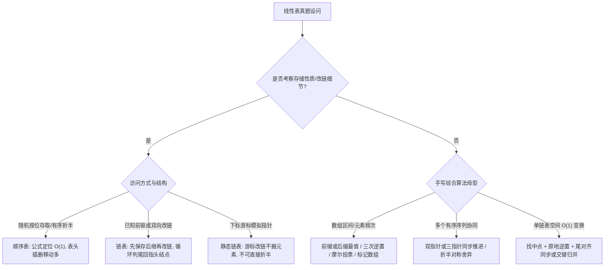

# 第2章 线性表

> [!abstract] 本章复盘目标
> 线性表研究具有先后次序的一组数据元素。要先分清逻辑上的线性关系，再比较顺序存储与链式存储如何表示这种关系。复习重点是**顺序表的移动次数、单链表和双链表的指针修改、循环链表的判空与尾指针，以及线性表算法的边界和复杂度**。

> [!important] 近 18 年 408 数据结构真题雷达（2009—2026）
> - **返回总控**：[[00_408数据结构｜考前急救与真题落点总控|返回数据结构总控]]
> - **考频定位**：**高频核心压轴章**（近 18 年主考单选 8 题 + 跨章单选 4 题 + 主考综合大题 9 题 + 跨章大题 1 题；近 5 年 2022—2026 覆盖 `2023-T01/T02`、`2024-T01/T05`、`2025-T41`、`2026-T01/T02`）
> - **考场高频坑**：混淆顺序表“随机存取 $O(1)$”与按值查找/插删耗时；双向链表改链漏画步骤图导致 `p->next` 覆盖原后继；循环单链表删首结点未判单元素回退尾指针；手写算法题忘记从 `i <= j` 后缀约束或双指针边界出发
> - **急救路线**：先盯带 `🔥` 的顺序表/单双循环链表操作与 9 道大题母型 $\rightarrow$ 再看带 `⚡` 的真题指针改链易错点 $\rightarrow$ 重点精读折叠母题 `2025-T41`

## 考纲定位

- **线性表的基本概念**：定义、逻辑特征和基本操作。
- **线性表的实现**：顺序存储和链式存储，包括顺序表、单链表、双链表、循环链表、静态链表及其操作。
- **线性表的应用**：依据题目要求选择存储结构，分析并设计查找、插入、删除、合并、逆置等算法。

> [!note] 本章真题核对记录
> 教材标注的统考选择题、逐项判断及笔记对应位置见 [[数据结构/复盘/_核对记录/第2章|第2章真题逐项核对记录]]。

## 章节知识脉络

1. **2.1 定义和基本操作**：线性表是逻辑结构，操作说明“做什么”。
2. **2.2 顺序表示**：使用一组地址连续的存储单元，通过下标实现随机存取。
3. **2.3 链式表示**：通过指针或游标表示相邻关系；修改指针前先确定结点和边界。
4. **算法应用**：顺序表关注下标、移动和双指针；链表关注保存后继、修改指针和释放结点。

---

# 2.1 线性表的定义和基本操作

## 2.1.1 线性表的定义【📌 扫一眼｜确认“我还会”就过】

线性表是具有**相同数据类型**的 $n$ 个数据元素构成的**有限序列**：

$$L=(a_1,a_2,\ldots,a_n),\qquad n\ge 0$$

$n$ 为表长；$n=0$ 时为空表。非空表中，除第一个元素外，每个元素有且仅有一个直接前驱；除最后一个元素外，每个元素有且仅有一个直接后继。只有一个元素时，它既没有前驱，也没有后继。

> [!important] 线性表与存储方式
> **线性表描述元素之间一对一的逻辑关系；顺序表、链表是存储结构。** 数据元素在逻辑上有次序，但具体存储时是否物理相邻取决于存储方式。线性表中的一个元素可含多个数据项，在该表操作层次上作为一个整体处理。

## 2.1.2 线性表的基本操作【📌 扫一眼｜确认“我还会”就过】

| 操作 | 含义 | 常用边界 |
|---|---|---|
| `InitList` / `DestroyList` | 初始化空表 / 销毁并释放空间 | 初始化不等于插入一个元素 |
| `Length` / `Empty` | 求元素个数 / 判断是否为空 | 表长不包含头结点 |
| `GetElem(L,i)` | 按位查找第 $i$ 个元素 | 合法位序 $1\le i\le n$ |
| `LocateElem(L,e)` | 按值查找等于 $e$ 的元素 | 未找到按接口约定返回失败标志 |
| `ListInsert(L,i,e)` | 在第 $i$ 个位置插入 $e$ | $1\le i\le n+1$；插入后表长加 1 |
| `ListDelete(L,i,e)` | 删除第 $i$ 个元素并返回其值 | $1\le i\le n$；删除后表长减 1 |
| `PrintList` | 按逻辑次序输出全部元素 | 遍历不能因地址布局打乱顺序 |

具体实现依赖存储结构。下面采用教材常见的**位序从 1 开始、数组下标从 0 开始**的约定。

---

# 2.2 线性表的顺序表示

## 2.2.1 顺序表的定义【🔥⚡ 必背+避坑｜停下来默背 1 遍 + 精读 1 分钟】

顺序表用一组**地址连续**的存储单元依次存放线性表元素，元素的逻辑顺序与物理顺序一致。设首元素地址为 $LOC(a_1)$，每个元素占 $d$ 个存储单元，则：

$$LOC(a_i)=LOC(a_1)+(i-1)d$$

由首地址和位序<mark>可以直接计算目标元素物理位置</mark>，所以顺序表支持**随机存取**，按位访问为 $O(1)$；按值查找仍需按数据和算法分析，不能一概说为 $O(1)$。 `[真题·2023-T01]`

- **静态分配**：数组容量在声明时确定；当前表长可以小于容量。
- **动态分配**：运行时申请数组；容量不足时可申请更大连续空间并复制元素。**动态分配不等于链式存储**：数据仍按顺序存储。
- 顺序表存储密度高，不需为每个元素设置链接域；插入、删除一般需要移动元素。

## 2.2.2 顺序表基本操作【🔥⚡ 必背+避坑｜停下来默背 1 遍 + 精读 1 分钟】

### 一、插入与删除：先判边界，再移动【🔥⚡ 必背+避坑｜停下来默背 1 遍 + 精读 1 分钟】

| 操作 | 合法位置 | 需要移动的元素数 | 方向 |
|---|---|---:|---|
| 在第 $i$ 位插入 | $1\le i\le n+1$，且尚有容量或已扩容 | $n-i+1$ | 从后向前移动，避免覆盖 |
| 删除第 $i$ 位 | $1\le i\le n$ | $n-i$ | 从前向后填补空位 |

<mark>表尾插入或删除不需要移动已有元素</mark>；表头插入需移动 $n$ 个，表头删除需移动 $n-1$ 个。 `[真题·2026-T01]` 若分别假设各合法插入位置、删除位置**等概率**，平均移动次数为：

$$E_{insert}=\frac n2,\qquad E_{delete}=\frac{n-1}{2}$$

- `【⚡ 真题补丁｜2026-T01】` 顺序列保持顺序且空间充足时，表头插入（后移 $n$ 个）与表头删除（前移 $n-1$ 个）必然移动多个元素；表尾插入与表尾删除移动次数恒为 0。

> [!warning] 平均复杂度与条件（2023 真题）
> 在顺序存储的有序表中，按位获取第 $i$ 个元素为 **$O(1)$**；按值查找即使用折半查找也通常是 $O(\log n)$，<mark>保持有序的插入及按位删除一般需移动元素</mark>，平均为 $O(n)$。不能把“随机存取”误当成“按值查找、插入和删除都为常数时间”。 `[真题·2023-T01]`

- `【⚡ 真题补丁｜2023-T01】` 顺序有序表四项辨析：获取第 $i$ 位支持随机存取为 $O(1)$；按值查找用折半为 $O(\log n)$、顺序查为 $O(n)$；有序插入与按位删除均需移动元素，平均 $O(n)$。

### 二、基本操作示例【📌 扫一眼｜确认“我还会”就过】

以下是固定容量、元素为整数的 C++ 示例。`length` 是当前表长；返回 `false` 表示位置不合法或插入时表满。

```cpp
const int MaxSize = 100;
struct SqList {
    int data[MaxSize];
    int length;
};

bool ListInsert(SqList &L, int i, int e) {
    if (i < 1 || i > L.length + 1 || L.length == MaxSize)
        return false;
    for (int j = L.length; j >= i; --j)
        L.data[j] = L.data[j - 1];
    L.data[i - 1] = e;
    ++L.length;
    return true;
}

bool ListDelete(SqList &L, int i, int &e) {
    if (i < 1 || i > L.length) return false;
    e = L.data[i - 1];
    for (int j = i; j < L.length; ++j)
        L.data[j - 1] = L.data[j];
    --L.length;
    return true;
}
```

检查动作：插入第 $n+1$ 位时循环不执行；删除第 $n$ 位时循环也不执行。若使用动态容量，需要另外处理扩容及申请失败。

### 三、按值查找【📌 扫一眼｜确认“我还会”就过】

无序顺序表从前向后逐一比较：成功时的比较次数取决于目标位置，失败时检查全部 $n$ 个元素。若目标等概率出现在每个位置，成功的平均比较次数为：

$$ASL=\frac{1+2+\cdots+n}{n}=\frac{n+1}{2}$$

<mark>有序顺序表可按题设使用折半查找</mark>；是否允许重复元素、要求返回哪一个位置，都要另看题目要求。 `[真题·2024-T05]`

---

# 2.3 线性表的链式表示

## 2.3.1 单链表的定义【🔥 必背｜停下来默背 1 遍】

单链表用一组**不要求地址连续**的存储单元存放元素；结点包括数据域 `data` 和指向后继的指针域 `next`。最后一个结点的 `next` 为 `nullptr`。

| 项目 | 带头结点 | 不带头结点 |
|---|---|---|
| 头指针 `L` 指向 | 头结点 | 第一个数据结点；空表时为空指针 |
| 第一个数据结点 | `L->next` | `L` |
| 空表 | `L->next == nullptr` | `L == nullptr` |
| 首元素插删 | 前驱统一为头结点 | 可能需要单独修改头指针 |

**头指针不是头结点**：头指针是标识链表起点的指针；头结点是可选的附加结点，不计入表长。链表不能根据位序直接计算第 $i$ 个结点的地址，通常从头沿 `next` 查找。

## 2.3.2 单链表基本操作【🔥⚡ 必背+避坑｜停下来默背 1 遍 + 精读 1 分钟】

### 一、查找与求长度【📌 扫一眼｜确认“我还会”就过】

- **求表长**：从首个数据结点走到空指针，计数不包括头结点，时间 $O(n)$。
- **按位查找**：带头结点时可从头结点计为第 0 位，逐个向后走到第 $i$ 个数据结点；失败时避免解引用空指针。
- **按值查找**：逐结点比较，找到目标或走到表尾；时间一般为 $O(n)$。

### 二、插入与删除的指针顺序【🔥⚡ 必背+避坑｜停下来默背 1 遍 + 精读 1 分钟】

设 `p` 为目标位置的**前驱结点**，`s` 是待插入新结点，`q` 是待删除结点：

```cpp
// 在 p 后插入 s：先让 s 接住原后继，再修改 p
s->next = p->next;
p->next = s;

// 删除 p 的后继：先保存目标，再改链，最后释放
q = p->next;
p->next = q->next;
delete q;
```

这些操作要求 `p` 有效；删除时还要先确认 `p->next` 非空。若只知道第 $i$ 位而不知道前驱，<mark>通常需要先从头遍历寻找前驱</mark>，整个操作为 $O(n)$；**已知前驱后改链本身为 $O(1)$**。 `[真题·2024-T01]`

> [!warning] 不要丢失后继
> 在 `p` 后插入时，如果先令 `p->next=s`，又用 `s->next=p->next`，则 `s->next` 会指向自己，原后继也可能丢失。删除时先保存 `q`，再改链，最后释放；不能释放后继续读取 `q->next`。

### 三、带头结点单链表的实现示例【📌 扫一眼｜确认“我还会”就过】

```cpp
struct LNode {
    int data;
    LNode *next;
};

// L 指向已初始化的头结点；i 从 1 开始
bool ListInsert(LNode *L, int i, int e) {
    if (L == nullptr || i < 1) return false;
    LNode *p = L;
    for (int j = 0; p != nullptr && j < i - 1; ++j)
        p = p->next;
    if (p == nullptr) return false;
    LNode *s = new LNode{e, p->next};
    p->next = s;
    return true;
}

bool ListDelete(LNode *L, int i, int &e) {
    if (L == nullptr || i < 1) return false;
    LNode *p = L;
    for (int j = 0; p != nullptr && j < i - 1; ++j)
        p = p->next;
    if (p == nullptr || p->next == nullptr) return false;
    LNode *q = p->next;
    e = q->data;
    p->next = q->next;
    delete q;
    return true;
}
```

示例中结点采用 `new` 创建，故采用 `delete` 回收；若使用教材 C 风格的 `malloc`，应配对使用 `free`。这里的 `new` 在分配失败时按 C++ 默认机制抛出异常；题目要求处理分配失败时应另行说明。

### 四、已知结点的特殊操作【⚡ 避坑｜最值钱，必须精读 1 分钟】

- **已知结点 $p$ 后插**：无需找前驱，$O(1)$。
- **在 $p$ 前插且允许改变结点数据**：可先在 $p$ 后插入新结点，再交换 $p$ 和新结点的数据；最终数据顺序等效，但**结点身份与原数据的对应关系改变**。
- **只知道待删除结点 $p$**：若 $p$ 不是尾结点且允许修改数据，可复制后继数据到 $p$，再删后继；这不等同于释放原来的物理结点 $p$，也不能用于无后继的尾结点。

### 五、头插法与尾插法【🔥 必背｜停下来默背 1 遍】

| 方法 | 每次插入位置 | 最终次序 | 要注意 |
|---|---|---|---|
| **头插法** | 头结点之后 | <mark>与依次输入的次序相反</mark> `[真题·2013-T01 / 2024-T01]` | 每次先让新结点指向原首结点 |
| **尾插法** | 当前尾结点之后 | 与输入次序相同 | 维护尾指针，结束时尾结点指向空 |

建立 $n$ 个结点时，每次插入 $O(1)$，总时间 $O(n)$。原地逆置单链表时，也可从原首结点开始逐个摘下并头插，必须先保存后继。

- `【⚡ 真题补丁｜2024-T01】` 带头结点 `h` 的单链表执行 `q=p->next; p->next=q->next; q->next=h->next; h->next=q;`：先摘除 `p` 后继 `q`，再头插到 `h` 之后，等价于将 `q` 移至首元素位置。
- `【⚡ 真题补丁｜2013-T01】` 两升序单链表（长 $m,n$）合并为降序表时，边比较边摘较小结点头插建表，总最坏时间为 $O(\max(m,n))$（即 $O(m+n)$）。

## 2.3.3 双链表【🔥⚡ 必背+避坑｜停下来默背 1 遍 + 精读 1 分钟】

双链表结点设置 `prior` 和 `next`，可直接访问其前驱和后继。已知操作位置时插删只需常数次指针修改；若仍需按位查找，查找本身仍通常为 $O(n)$。

在非尾结点 `p` 之后插入 `s`，设原后继存在：

```cpp
s->next = p->next;
p->next->prior = s;
s->prior = p;
p->next = s;
```

四个链接最终需保持一致：`p->next == s`、`s->prior == p`、`s->next` 指原后继、原后继的 `prior == s`。上面是一个安全次序，不是唯一合法次序；若 `p` 可能为非循环表的尾结点，则<mark>必须先判断原后继是否为空</mark>。 `[真题易错·2026-T02]`

删除非空结点 `q` 时，在前后邻居均存在的情况下，<mark>须把前驱与后继两条链同时改接</mark>（即先令 `q->prior->next=q->next`、`q->next->prior=q->prior`），再释放 `q`；头尾结点按实际结构另行处理。 `[真题·2016-T02]`

> [!important] 真题指针题怎么判断（2016、2023、2026）
> 给原前驱、目标、后继画出三个结点；**每执行一条语句就更新图**。注意某表达式如 `p->next` <mark>在赋值后可能已指向新结点</mark>；仅凭语句看上去对称，不能保证双向链接都正确。循环双链表中删除结点时，需要同时把前驱的 `next` 指向后继、后继的 `prior` 指向前驱。 `[真题易错·2023-T02]`

- `【⚡ 真题补丁｜2023-T02】` `p` 后插 `s` 先执行 `s->next=p->next; p->next=s;` 后，须借 `s->prev=s->next->prev; s->next->prev=s;` 找回旧前驱再接后继。
- `【⚡ 真题补丁｜2026-T02】` 循环置各结点 `p2` 指向 `p1` 后继时，推进 `cu=cu->p1` 须放在 `if(cu->p1!=NULL)` 分支之外，否则尾结点置空后分支走偏或空指针解引用。

## 2.3.4 循环链表【🔥⚡ 必背+避坑｜停下来默背 1 遍 + 精读 1 分钟】

### 一、循环单链表【🔥⚡ 必背+避坑｜停下来默背 1 遍 + 精读 1 分钟】

尾结点的 `next` 指回头结点或首结点，具体以是否带头结点为准。带头结点、头指针为 `L` 时，空表满足 `L->next == L`。

- 从任一结点沿 `next` 走可以回到起点；遍历终止条件应与起点或头结点比较，而不是等待空指针。
- 仅设头指针时，寻找尾结点仍需遍历；只设尾指针 `r` 且带头结点时，头结点可由 `r->next` 得到，表头、表尾插入都可为 $O(1)$。
- **2021 真题边界**：带头结点、头指针和尾指针的非空循环单链表删除首元素时，先保存首结点再摘链；<mark>若它同时是尾结点删后让尾指针回头结点</mark>。 `[真题易错·2021-T01]`

### 二、循环双链表【🔥 必背｜停下来默背 1 遍】

带头结点的空表满足 `L->next == L` 且 `L->prior == L`。头结点的 `prior` 指向尾结点，因此已知头结点时可直接到达表尾；插删仍需维护前后两个方向。

## 2.3.5 静态链表【⚡ 避坑｜最值钱，必须精读 1 分钟】

静态链表使用数组模拟链式存储，结点中的 `next` 保存**数组下标（游标）**，按约定值如 `-1` 表示结束。数组本身连续，但逻辑相邻的元素不必位于相邻下标；<mark>按位查找一般仍要沿游标依次遍历</mark>。 `[真题·2024-T05]`

<mark>插入与删除直接通过修改游标链接实现</mark>，不必像顺序表那样移动一批元素；数组容量的分配与空闲位置管理仍需题设说明。 `[真题·2016-T01]`

- `【⚡ 真题补丁｜2016-T01】` 静态地址单链表在结点 `a` 与 `e` 之间插入 `f` 时，仅需改 `a` 的 `next` 为 `f` 的存储地址、置 `f` 的 `next` 为原 `e` 地址，`e` 的 `next` 不变。

## 2.3.6 顺序表和链表的比较【🔥⚡ 必背+避坑｜停下来默背 1 遍 + 精读 1 分钟】

| 比较方面 | 顺序表 | 单链表 |
|---|---|---|
| 逻辑关系 | 两者均为线性表 | 两者均为线性表 |
| 按位访问 | <mark>根据首地址直接计算目标位址</mark>，$O(1)$ `[真题·2011-T10 / 2023-T01]` | 从头遍历，一般 $O(n)$ |
| 无序表按值查找 | 一般 $O(n)$ | 一般 $O(n)$ |
| 已知操作位置的插删 | 仍可能移动一批元素 | 已知前驱或相应结点时改链为 $O(1)$ |
| 容量与空间 | 要连续空间；动态扩容可能复制元素 | 按需分配结点，但每个结点需链接域 |
| 适用情形 | <mark>按位随机访问频繁且规模相对稳定</mark> `[真题·2017-T11 / 2024-T05]` | 已获得操作位置且插删频繁、规模变化较大 |

> [!warning] 比较要先写前提
> “链表插删都是 $O(1)$”遗漏了按位查找前驱的代价；“顺序表插删都是 $O(n)$”忽略了表尾插删等特殊情况；“链表结点一定不连续”也不正确。

- `【⚡ 真题补丁｜2011-T10】` 快排划分需靠下标双端随机移动 `low/high`，宜用顺序存储；链式无随机访问，散列无序，索引表增加多余开销。
- `【⚡ 真题补丁｜2017-T11】` 顺序存储改链式存储后，希尔排序（步长 `d` 跳跃）与堆排序（下标 `2i` 寻子）因丧失随机存取而效率降低；直插、简单选择、起泡仍为 $O(n^2)$。
- `【⚡ 真题补丁｜2024-T05】` 折半查找同时依赖“有序”与“$O(1)$ 随机访问”，因此有序链表、无序数组、有序静态链表、无序静态链表均不适合直接折半查找。

---

# 本章算法题型与解题方法

## 一、顺序表：先找不变量，再决定是否需要移动【🔥⚡ 必背+避坑｜停下来默背 1 遍 + 精读 1 分钟】

| 题型 | 方法 | 条件与复杂度 |
|---|---|---|
| 删除满足条件的元素 | 读指针扫描，写指针记录保留区末尾；只把保留元素写入 | 一趟扫描 $O(n)$、额外 $O(1)$；若要求相对次序不变，不能随意用尾元素覆盖 |
| 有序表去重 | 保留区最后一个元素与当前元素比较，相同则跳过 | 依赖相同值在有序表中相邻；$O(n)$ |
| 合并两个有序表 | 两指针比较当前元素，输出较小者，再处理剩余部分 | 两个输入总长度为 $m+n$，时间 $O(m+n)$；输出空间按题目是否允许新表确定 |
| 原地左移 $p$ 位 | <mark>依次逆置前段后段及整个序列</mark> | $0<p<n$ 时三个区间有效；时间 $O(n)$，额外空间 $O(1)$ `[真题·2010-T42]` |
| 求主元素 | <mark>配对抵消得候选再重新计数验证过半</mark> | $O(n)$ 时间、$O(1)$ 额外空间；不存在主元素时不能直接输出候选值 `[真题·2013-T41]` |
| 找最小未出现正整数 | <mark>只需关注一至n是否出现并做下标标记</mark> | 使用标记数组可达 $O(n)$ 时间、$O(n)$ 额外空间；其他方法须说明是否可改写输入 `[真题·2018-T41]` |
| 三升序数组最小距离 | <mark>三指针每次推进最小值所在数组指针</mark> | 距离 $D=2(\max-\min)$ 仅取决于当前极值；时间 $O(n_1+n_2+n_3)$、额外 $O(1)$ `[真题·2020-T41]` |
| 数组后缀最值乘积 `CalMulMax` | <mark>逆序扫描维护后缀最大与后缀最小值</mark> | 守住 $0\le i\le j\le n-1$ 顺序；时间 $O(n)$、额外空间 $O(1)$ `[真题易错·2025-T41]` |

> [!example] 两个等长升序序列的中位数（2011 统考综合题）
> 设两个升序序列各有 $n\ge 1$ 个元素，本题中位数指合并后的 $2n$ 个元素中**第 $n$ 个**，不是两个中间值的平均数。
>
> <mark>比较当前两个等长区间各自的中位数</mark> $a$、$b$：若相等，返回该值；若 $a<b$，同时舍弃 $A$ 中较小的一部分和 $B$ 中较大的一部分，且**两侧舍弃的元素个数相同**；若 $a>b$，反过来舍弃。 `[真题·2011-T42]` 然后在保留的两个等长区间上重复。
>
> 每个区间长度为奇数时，两边都保留各自的中间元素；长度为偶数且采用靠左的中位数时，较小中位数所在序列舍弃该中位数，较大中位数所在序列保留它。最后两边各剩一个元素时，取较小者。
>
> 例如 $A=(11,13,15,17,19)$、$B=(2,4,6,8,20)$，所求中位数为 **11**。用下标维护区间，时间复杂度为 $O(\log n)$，额外空间复杂度为 $O(1)$。

> [!tip] 2010 左移真题的三次逆置
> 将序列分为前段 $A$ 和后段 $B$，目标是由 $AB$ 变为 $BA$。先逆置 $A$、再逆置 $B$、最后逆置整体，即得到 $BA$。检查每次操作的左右端点，别把左移和右移混淆。

## 二、链表：遍历、改链、释放分步检查【🔥⚡ 必背+避坑｜停下来默背 1 遍 + 精读 1 分钟】

1. **删除所有指定值结点**：维护当前结点的前驱；删除后前驱不前进，继续检查其新的后继，才能处理连续匹配结点。
2. **原地逆置**：保存当前结点原后继，再修改其 `next`；空表与单结点表无需特殊移动但要保证安全。
3. **倒数第 $k$ 个**：<mark>快指针先走k步再双指针同步走到尾</mark>；不足 $k$ 个时失败。 `[真题·2009-T42]` 然后快慢指针同步走到快指针到尾，慢指针所指即目标；先明确从头结点还是首个数据结点起步。
4. **两个单链表的公共后缀**：先求两表长度，让长表先走长度差，再同步前进；<mark>首次指向同一结点地址是公共后缀起点</mark>，数据值相等不够。 `[真题·2012-T42]`
5. **有环检测**：快慢指针分别每次前进两步、一步；快指针到空表示无环，环内相遇表示有环。求入口时，一指针回到起点、另一指针留在相遇点，再每次一步，相遇处是入口；使用该结论时快慢指针的起点与步速须符合上述模型。
6. **重排链表**：题目要求头尾交替时，<mark>先找中点逆置后半段再交替合并</mark>；每一步都要保存后继，检查奇偶长度和尾结点。 `[真题·2019-T41]`
7. **单链表按绝对值首次保留去重**：题目给出节点值绝对值不超过 $n$ 时，开辟大小为 $n+1$ 的标记数组；<mark>边扫描边判重并摘除后续重复绝对值结点</mark>，时间 $O(m)$、空间 $O(n)$。 `[真题·2015-T41]`

## 三、综合算法的检查顺序【⚡ 避坑｜最值钱，必须精读 1 分钟】

1. 写清输入是否允许为空、是否带头结点、是否允许改变原数据和结点身份。
2. 画出首、尾、相邻结点及指针，确定循环不变量和停止条件。
3. 针对空表、单结点、首尾位置、全匹配和无匹配手推。
4. 说明时间复杂度和**额外空间复杂度**；有序条件、输入范围及概率假设不可省略。

## 四、线性表解题选型决策树【🔥 必背｜停下来默背 1 遍】



## 五、近 5 年真题母题精讲（2022—2026）

> [!example]- ⚡ 真题母题 2025-T41｜数组后缀最值乘积 CalMulMax
> - **题目要点**：给定长度为 $n$ 的一维整型数组 `A[n]` 与 `res[n]`，要求对每个下标 $i$ 计算满足 $0\le i\le j\le n-1$ 的乘积 `A[i]*A[j]` 的最大值并存入 `res[i]`（例如 `A[]={1,4,-9,6}` 时 `res[]={6,24,81,36}`）。函数原型 `void CalMulMax(int A[], int res[], int n)`。
> - **为什么这么想**：
>   - **最优思路（$O(n)$ 时间、$O(1)$ 辅助空间）**：正负号相乘时，若 `A[i] >= 0` 应配右侧后缀最大值，若 `A[i] < 0` 应配右侧后缀最小值（负数乘绝对值更大的负数反而最大）；同时约束 $j\ge i$ 允许 $j=i$，因此从右向左扫描 `n-1 -> 0`，动态更新涵盖自身在内的后缀最大值 `sufMax` 与后缀最小值 `sufMin`，只需比较 `A[i]*sufMax` 与 `A[i]*sufMin` 即可一次得出 `res[i]`。
>   - **保底思路（$O(n^2)$ 时间、$O(1)$ 辅助空间）**：双重 `for` 循环枚举所有 `0 <= i <= j < n`，逐个打擂求最大，可拿暴力档大部分分数。
> - **规范 C/C++ 核心代码**：
> ```cpp
> void CalMulMax(int A[], int res[], int n) {
>     if (n <= 0) return;
>     int sufMax = A[n - 1];
>     int sufMin = A[n - 1];
>     res[n - 1] = A[n - 1] * A[n - 1];
>     for (int i = n - 2; i >= 0; --i) {
>         if (A[i] > sufMax) sufMax = A[i];
>         if (A[i] < sufMin) sufMin = A[i];
>         int p1 = A[i] * sufMax;
>         int p2 = A[i] * sufMin;
>         res[i] = (p1 > p2) ? p1 : p2;
>     }
> }
> ```
> - **复杂度核验**：一趟逆序循环访问每个元素常数次，时间复杂度 $O(n)$；仅使用 `sufMax`、`sufMin` 等常数个临时变量，额外空间复杂度 $O(1)$（`res` 为题目要求输出数组，不计入辅助空间）。
> - **考场扣分点提醒**：切忌先全表扫一遍求出全局最大与全局最小再直接乘 `A[i]`，因为这会破坏 $i\le j$ 的后缀边界条件；另外别忘了 $j$ 可以等于 $i$（如负元素配自身平方得正），初始化 `sufMax = sufMin = A[n-1]` 正是覆盖了 `j = i` 的情形。

# 选择题快速判断结论

- 顺序表按位访问为 $O(1)$；按值查找与插删代价取决于题设。
- 单链表已知前驱后的改链为 $O(1)$，但从头找前驱一般为 $O(n)$。
- 带头结点循环单链表的空表是 `L->next == L`，不是 `L == nullptr`。
- 双链表插删必须分别检查前驱的 `next` 与后继的 `prior`；释放前保存仍需使用的信息。
- 静态链表的游标表示链接关系，数组下标邻接不等于逻辑相邻。

# 本章高频题型总表

| 题干特征 | 优先方法/起手式 | 真题印证与避坑 |
|---|---|---|
| 问顺序表操作复杂度或插删移动次数 | 区分按位读写 $O(1)$ 与搬移 $O(n)$；记准表尾 0 次、表头 $n$ / $n-1$ 次 | `2023-T01`、`2026-T01`；别把随机存取当按值查找也 $O(1)$ |
| 给单/双/循环链表片段判指针正误 | 按序手画结点链，每次赋值更新指向；判首尾/单元素特例 | `2016-T01/T02`、`2021-T01`、`2023-T02`、`2024-T01`、`2026-T02` |
| 排序/折半能否用于链表或静态链表 | 检验是否依赖下标跳跃访问与物理顺序有序性 | `2011-T10`、`2017-T11`、`2024-T05`；静态链表不能直接折半 |
| 线性表手工/数组高频算法大题 | 对齐 $O(n)/O(1)$ 套路：逆置、双/三指针、抵消验证、后缀极值、标记数组 | `2009-T42`～`2020-T41`、`2025-T41`、`2011-T42`、`2015-T41` |

# 冲刺主动回忆卡（遮挡自测）

> [!question] 回忆卡 1：顺序存储的有序表，哪些操作是 $O(1)$？为什么表头插删总比表尾慢？
> > [!success]- 正确解释
> > 只有按位读取第 $i$ 个元素（随机存取）是 $O(1)$；按值查找用折半是 $O(\log n)$，有序插入和按位删除因需保持物理相邻并移动元素，平均都是 $O(n)$。表尾插删无需移动已有元素（0 次），而表头插入需后移 $n$ 个、表头删除需前移 $n-1$ 个元素（`2023-T01`、`2026-T01`）。

> [!question] 回忆卡 2：双链表 `p` 后插 `s` 时若已经先写了 `s->next = p->next; p->next = s;`，接下来哪两条语句才能不丢链接？
> > [!success]- 正确解释
> > 此时 `p->next` 已经被覆写为 `s`，不能再用 `p->next->prev` 取原后继。必须先借 `s->next` 找到原后继并取出它仍保存着 `p` 的旧 `prev`，即先执行 `s->prev = s->next->prev;`，再执行 `s->next->prev = s;`（若表非循环且原后继为空须先判空）（`2023-T02`）。

> [!question] 回忆卡 3：带头结点且同时设头指针 `h`、尾指针 `p` 的非空单循环链表，删除首元结点最容易漏掉哪一行？
> > [!success]- 正确解释
> > 最容易漏掉“全表仅 1 个数据结点时（即 `p == q`）”的尾指针维护：此时首元结点同时也是尾结点，释放 `q` 之前或同时必须写 `if (p == q) p = h;`，否则 `p` 会变成悬空指针（`2021-T01`）。

> [!question] 回忆卡 4：2025-T41 `CalMulMax` 为什么不能先遍历一次求出整个数组的全局最大值 `maxVal` 和全局最小值 `minVal`？
> > [!success]- 正确解释
> > 因为题目要求 $0\le i\le j\le n-1$，即 $A[i]$ 只能与自己或右侧元素相乘。若全局最值出现在 $i$ 左侧，配对就违反了 $j\ge i$；正确做法是从右向左逆序扫描并维护随 $i$ 变化的后缀最大 `sufMax` 和后缀最小 `sufMin`（`2025-T41`）。

# 本章自测清单

- [ ] 能推导顺序表在第 $i$ 位插入、删除的移动次数和均匀分布下的平均次数。
- [ ] 能分别写出带头结点和不带头结点单链表的判空条件。
- [ ] 能在纸上追踪插入、删除和头插逆置的每次指针变化。
- [ ] 能说明循环链表只有一个数据结点时删除首元素对尾指针的影响。
- [ ] 能区分已知结点位置的改链开销与查找该位置的总开销。
