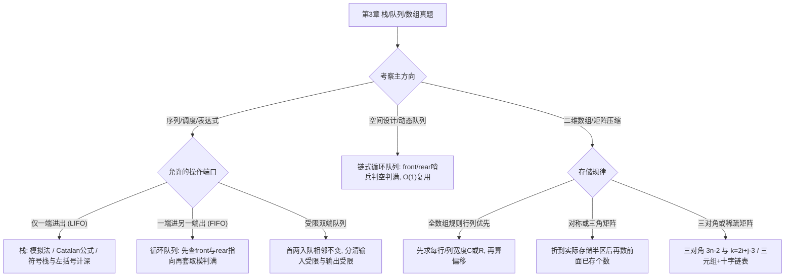

# 第3章 栈、队列和数组

> [!abstract] 本章复盘目标
> 按教材从栈、队列的基本概念和存储结构出发，理解其应用，再通过数组和特殊矩阵的地址映射处理压缩存储。解题时应明确操作规则、指针含义、下标起点和题目给定的存储顺序。

> [!important] 近 18 年 408 数据结构真题雷达（2009—2026）
> - **返回总控**：[[00_408数据结构｜考前急救与真题落点总控|返回数据结构总控]]
> - **考频定位**：**高频计算与模拟压轴章**（近 18 年主考单选 26 题 + 跨章单选 2 题 + 主考综合大题 2 题 + 跨章大题 1 题；近 5 年 2022—2026 覆盖 `2022-T02`、`2023-T03`、`2024-T02`、`2025-T02`、`2026-T42`）
> - **考场高频坑**：混淆循环队列队尾指针约定（指向末元素 vs 末元素下一位）；忽视受限双端队列最早入队两元素的相邻约束；算表达式栈深漏算未匹配的左括号；矩阵压缩混用行优先与列优先以及数组 0/1 起始下标
> - **急救路线**：先背带 `🔥` 的循环队列判空判满、表达式转换、矩阵下标计数法 $\rightarrow$ 再看带 `⚡` 的受限入出栈/双端队列与卡特兰特例 $\rightarrow$ 重点精读折叠母题 `2026-T42`

## 考纲定位

- 栈和队列的基本概念、顺序存储结构及链式存储结构。
- 多维数组的存储、特殊矩阵的压缩存储，以及栈、队列和数组的应用。

> [!note] 本章真题核对记录
> 教材标注的统考选择题、逐项判断及笔记对应位置见 [[数据结构/复盘/_核对记录/第3章|第3章真题逐项核对记录]]。

## 章节知识脉络

1. **3.1 栈**：后进先出、出入栈序列、顺序栈、共享栈与链栈。
2. **3.2 队列**：先进先出、循环队列、链队列与双端队列。
3. **3.3 栈和队列的应用**：括号匹配、表达式、递归、层次遍历与系统应用。
4. **3.4 数组和特殊矩阵**：多维数组地址、对称与三角矩阵、三对角矩阵和稀疏矩阵。

---

> 这份笔记按讲义顺序重讲第三章。选择题只作为提醒：哪些地方容易考、容易绕。真正的目标是把每个知识点讲成你能长期记住的东西。

## 本章先建立一张总图

本章讨论栈、队列和数组：栈和队列是对线性表的操作位置加以限制，数组则是线性表的推广。

线性表可以在指定位置插入、删除或访问元素。栈和队列是“被限制了操作位置的线性表”：栈只允许在一端进出；队列只允许一端进、另一端出。数组一旦定义，其维数和维界固定，除初始化和销毁外，主要进行取值和修改；逻辑上的数组通常映射到一段连续存储空间，重点是根据下标找到元素。

可以这样记：

| 内容 | 一句话理解 | 本章最常考的脑回路 |
|---|---|---|
| 栈 | 只在栈顶进出的一摞东西 | 后进先出，出栈序列要模拟 |
| 队列 | 从队尾进、队头出的一排东西 | 先进先出，循环队列要看指针含义 |
| 数组 | 维数和维界固定，通常映射到连续存储空间 | 二维位置如何映射成一维地址 |
| 特殊矩阵 | 有规律的矩阵只存必要部分 | 数目标元素前面有多少个元素 |

先看一张本章关系图：

```text
线性表
├─ 操作位置受限
│  ├─ 栈：一端进，一端出        => LIFO
│  └─ 队列：一端进，另一端出    => FIFO
└─ 推广为数组：维数和维界固定，通常连续存储
   └─ 特殊矩阵压缩存储：二维下标 -> 一维数组下标
```

这张图想说明：本章不是散装知识点。栈、队列是在“操作规则”上限制线性表；数组和矩阵是在“存储映射”上考察线性展开。

本章很多题不是难在知识点深，而是难在细节条件。你做题前先问：

1. 它问的是逻辑结构，还是存储结构？
2. 指针 `top/front/rear` 指向元素本身，还是指向下一个位置？
3. 数组下标从 0 开始还是从 1 开始？
4. 存储顺序是按行优先、按列优先，还是题目另有规定？

这四个问题问清楚，本章大半题都不会乱。

# 3.1 栈

## 3.1.1 栈的基本概念【🔥⚡ 必背+避坑｜停下来默背 1 遍 + 精读 1 分钟】

### 1. 栈的定义【📌 扫一眼｜确认“我还会”就过】

栈是只允许在一端进行插入和删除操作的线性表。允许插入、删除的一端叫栈顶，另一端叫栈底。

你可以把栈想成一摞从下往上放的书。新书只能放在最上面，拿书也只能先拿最上面那本。越晚放上去的，越早被拿走。这就是后进先出，也叫 LIFO。

```text
        栈顶 Top
          ↓
        ┌────┐  ← 最后入栈，最先出栈
        │ a5 │
        ├────┤
        │ a4 │
        ├────┤
        │ a3 │
        ├────┤
        │ a2 │
        ├────┤
        │ a1 │  ← 最早入栈，通常最后出栈
        └────┘
        栈底 Bottom
```

图里最上面的 `a5` 离出口最近，所以它先出去。栈题的所有限制，本质都来自“只能碰栈顶”。

注意，栈的本质不是“用数组实现”，也不是“用链表实现”，而是一种操作规则。只要满足只能在栈顶插入和删除，它就是栈；至于底层用数组还是链表，是存储结构的问题。

| 名称 | 含义 | 记忆方式 |
|---|---|---|
| 栈顶 `Top` | 能插入、能删除的一端 | 所有操作都在这里发生 |
| 栈底 `Bottom` | 固定不变的另一端 | 最早进去的通常压在最下面 |
| 空栈 | 不含任何元素的栈 | 没有栈顶元素 |
| 后进先出 | 最后进入的最先出去 | 栈最核心的性质 |

讲义里说，若元素按 `a1,a2,a3,a4,a5` 入栈，且全部入栈后再出栈，则出栈顺序是 `a5,a4,a3,a2,a1`。这只是最简单的情况。考试更常考的是“入栈和出栈交替进行”，此时输出序列就不一定是完全逆序。

例如输入 `1,2,3,4`，可以得到输出 `2,1,4,3`：

```text
入 1，入 2，出 2，出 1，入 3，入 4，出 4，出 3
```

这个过程画成栈的变化是：

```text
目标输出 2,1,4,3

入1:       入2:       出2:       出1:
┌───┐      ┌───┐      ┌───┐      空
│ 1 │      │ 2 │      │ 1 │
└───┘      ├───┤      └───┘
           │ 1 │
           └───┘

入3:       入4:       出4:       出3:
┌───┐      ┌───┐      ┌───┐      空
│ 3 │      │ 4 │      │ 3 │
└───┘      ├───┤      └───┘
           │ 3 │
           └───┘
```

但不能得到 `3,1,2,4`。因为为了先出 3，必须先把 1、2、3 都入栈，出 3 后栈顶是 2，1 被压在下面，不能绕过 2 直接出 1。

这就是栈序列题最重要的长期记忆点：某个元素如果被压住，就必须等压在它上面的元素先出去。

### 2. 栈的基本操作【🔥⚡ 必背+避坑｜停下来默背 1 遍 + 精读 1 分钟】

讲义列出的基本操作可以分成三类。

第一类是创建和销毁：

| 操作 | 含义 |
|---|---|
| `InitStack(&S)` | 初始化一个空栈 |
| `DestroyStack(&S)` | 销毁栈，释放空间 |

第二类是状态判断和读取：

| 操作 | 含义 | 是否改变栈 |
|---|---|---|
| `StackEmpty(S)` | 判断栈是否为空 | 不改变 |
| `GetTop(S, &x)` | 读取栈顶元素 | 不改变 |

第三类是真正改变栈内容：

| 操作 | 含义 | 是否改变栈 |
|---|---|---|
| `Push(&S, x)` | 把 `x` 放到栈顶 | 改变 |
| `Pop(&S, &x)` | 删除栈顶元素，并用 `x` 返回它 | 改变 |

`GetTop` 和 `Pop` 很容易混。`GetTop` 是“看一眼最上面的东西”，看完还在；`Pop` 是“拿走最上面的东西”，拿完栈变了。

考研题里如果问“下列不是栈的基本操作”，删除栈底元素、访问第 `i` 个元素、在栈中间插入，通常都不是。因为栈不允许直接碰中间和底部。

栈还有一个数学性质：`n` 个不同元素按固定顺序入栈，<mark>合法出栈序列总数等于卡特兰数</mark>： `[真题·2015-T02 / 2026-T42]`

$$
C_n=\frac{1}{n+1}C_{2n}^{n}
$$

- `【⚡ 真题补丁｜2015-T02】` 求先序遍历为 `a,b,c,d` 的不同二叉树种数，等价于以 `a,b,c,d` 为入栈序列时所有合法中序出栈序列数，即 $C_4=\frac{1}{5}C_8^4=14$。

这个公式用于“问总数”的题。例如 `n=3` 时：

$$
C_3=\frac{1}{4}C_6^3=5
$$

但只要题目加了额外条件，比如“以某个元素开头”“不允许连续三次入栈”“经过一个队列中转”，就不要硬套 Catalan，要老老实实模拟。

小图记忆：

```text
问“总共有多少种”      => 想 Catalan
问“这个序列行不行”    => 手工模拟
问“某步栈里有几个”    => 画栈状态
```

> [!important] 统考题型：由入栈顺序判断出栈序列
> - 已知入栈次序和目标出栈次序时，依次寻找目标元素：它尚未入栈就继续入栈；它在栈顶就出栈；若所有元素都已入栈而目标仍被栈顶挡住，则该序列不可能。<mark>入栈与出栈交替时可相同或互逆</mark>，并非入栈确定出栈就唯一，且栈只能从栈顶一端操作。 `[真题易错·2017-T02 / 2022-T02]`
> - 元素出栈后依次进入 FIFO 队列时，<mark>队列不改变元素离开栈的先后顺序</mark>，故队列的输出顺序就是栈的输出顺序；记录模拟过程中的栈深最大值即可求所需最小栈容量。 `[真题·2009-T02 / 2020-T02]`
> - 题目另有操作限制时要同时验证。例如禁止连续三次出栈，<mark>就要逐次计数验证连续出栈次数</mark>，而不能只判断输出排列是否为一般意义上的合法栈序列。 `[真题·2010-T01]`
> - 已知某个较晚入栈元素先出栈时，比它更早入栈且尚未出栈的元素必须按栈顶到栈底的次序离开；后续尚未入栈的元素可以在允许的间隙入栈、出栈。条件计数应据此枚举，不能直接套无附加条件的 Catalan 数。

- `【⚡ 真题补丁｜2022-T02】` 给定进栈序列可用模拟算法判定出栈序列合法性，反之给定出栈序列也可等价逆推检验；边进边出可使两序列完全相同，全入再全出则互为倒序。

> [!example] 限定出栈位置：保持相对次序，再求可能值
> **2011 年真题**：$a,b,c,d,e$ 依次入栈，若 $d$ 第一个出栈，则 $d$ 出栈后，<mark>栈中元素相对出栈次序完全固定</mark>；尚未入栈的 $e$ 可在这三个元素之前、之间或之后出栈，共 **4** 种序列。 `[真题·2011-T02]`
>
> **2013 年真题**：$1,2,\ldots,n$ 依次入栈（$n\ge3$），若第二个出栈的是 3，求第三个出栈的元素有哪些可能。让 1 先出、3 第二个出，可以让 2 接着出，也可以继续将 $4,5,\ldots,k$ 依次入栈后让 $k$ 出（$4\le k\le n$）；让 2 先出、3 第二个出，则可以让 1 接着出。因此<mark>第三个出栈元素可为除三外任一元素</mark>，共 **$n-1$ 种**。 `[真题易错·2013-T02]`
>
> 这是对不同合法操作情况取**并集**，不是说第一个出栈元素只能是 1 或 2；当 $n\ge4$ 时，先入栈到 4 并令 4、3 依次出栈也是合法情况。

## 3.1.2 栈的顺序存储结构【🔥 必背｜停下来默背 1 遍】

### 1. 顺序栈的实现【🔥 必背｜停下来默背 1 遍】

顺序栈就是用一段连续数组存栈中元素，再用一个整型变量 `top` 记录栈顶位置。

常见定义是：

```c
#define MaxSize 50

typedef struct {
    ElemType data[MaxSize];
    int top;
} SqStack;
```

这里最关键的不是代码，而是 `top` 的含义。讲义采用的主模型是：

```text
空栈：top = -1
栈顶元素：data[top]
```

图示如下：

```text
数组下标:    0     1     2     3     4
          ┌────┬────┬────┬────┬────┐
data      │    │    │    │    │    │
          └────┴────┴────┴────┴────┘
top = -1  ↑
          在第 0 个位置前面，表示没有栈顶元素

入栈 A 后：

数组下标:    0     1     2     3     4
          ┌────┬────┬────┬────┬────┐
data      │ A  │    │    │    │    │
          └────┴────┴────┴────┴────┘
             ↑
           top=0
```

这张图说明：`top=-1` 时，第一个元素不能直接写 `data[top]`，因为 `top` 还在数组外面，所以必须先 `++top`。

为什么空栈时 `top=-1`？因为数组第一个位置是 `data[0]`，空栈时没有任何元素，`top` 就放在第一个位置的前面。第一个元素入栈时，`top` 先从 `-1` 变成 `0`，再把元素放进去。

所以在 `top=-1` 模型下：

| 情况 | 公式 | 为什么 |
|---|---|---|
| 栈空 | `S.top == -1` | 没有任何有效元素 |
| 栈满 | `S.top == MaxSize - 1` | 栈顶已经到数组最后一格 |
| 栈长 | `S.top + 1` | 下标从 0 到 `top`，共有 `top+1` 个 |
| 入栈 | `S.data[++S.top] = x` | 先移动到新栈顶，再写入 |
| 出栈 | `x = S.data[S.top--]` | 先取当前栈顶，再把栈顶下移 |

另一个常见模型是 `top=0`。这时 `top` 不指向栈顶元素，而是指向“下一个可以插入的位置”。第一个元素直接写入 `data[0]`，写完后 `top` 变成 1。

| 模型 | `top` 含义 | 空栈 | 入栈 | 出栈 |
|---|---|---|---|---|
| `top=-1` | 指向栈顶元素 | `top==-1` | `data[++top]=x` | `x=data[top--]` |
| `top=0` | 指向下一个可插入位置 | `top==0` | `data[top++]=x` | `x=data[--top]` |

两种模型放在一起看：

```text
模型一：top 指向“栈顶元素”

空栈： top=-1
       ↓
      [ ] [ ] [ ] [ ]

入 A：先 top++，再写 A
          top
           ↓
      [ A ] [ ] [ ] [ ]


模型二：top 指向“下一个可插入位置”

空栈： top=0
        ↓
      [ ] [ ] [ ] [ ]

入 A：先写 A，再 top++
              top
               ↓
      [ A ] [ ] [ ] [ ]
```

长期记忆点：`top` 指向栈顶元素，就“先移动到新栈顶”；`top` 指向空位，就“先填空位”。

这两个模型一定要分清。很多题就是故意给一个不同初值，让你背错公式。

一个稳定的判断方法是：

1. 空栈时 `top` 在哪里？
2. 第一个元素应该进入哪个数组位置？
3. `top` 当前是否已经指向那个位置？
4. 若已经指向，就先写；若还没指向，就先移动。

例如 `data[1..n]`，空栈 `top=1`。第一个元素应该放到 `data[1]`，而 `top` 已经是 1，所以是：

```c
data[top++] = x;
```

如果 `data[1..n]`，空栈 `top=n+1`，说明栈从高地址向低地址增长。第一个元素应放到 `data[n]`，所以要先减：

```c
data[--top] = x;
```

### 2. 顺序栈的基本操作【📌 扫一眼｜确认“我还会”就过】

在 `top=-1` 模型下，顺序栈常用操作如下。

初始化：

```c
void InitStack(SqStack &S) {
    S.top = -1;
}
```

判空：

```c
bool StackEmpty(SqStack S) {
    return S.top == -1;
}
```

入栈：

```c
bool Push(SqStack &S, ElemType x) {
    if (S.top == MaxSize - 1) {
        return false;
    }
    S.data[++S.top] = x;
    return true;
}
```

出栈：

```c
bool Pop(SqStack &S, ElemType &x) {
    if (S.top == -1) {
        return false;
    }
    x = S.data[S.top--];
    return true;
}
```

读栈顶：

```c
bool GetTop(SqStack S, ElemType &x) {
    if (S.top == -1) {
        return false;
    }
    x = S.data[S.top];
    return true;
}
```

这里有一个很重要的理解：出栈之后，原来数组位置里的值可能还在内存中，但它已经不属于栈了。因为栈的有效范围由 `top` 决定。栈里有什么，不看数组里残留了什么，而看 `top` 指到哪里。

顺序栈的优点是简单、访问栈顶快、空间连续；缺点是最大容量预先固定，可能栈满。

| 特点 | 顺序栈 |
|---|---|
| 存储空间 | 连续 |
| 入栈出栈时间 | $O(1)$ |
| 是否可能栈满 | 可能，因为数组大小固定 |
| 是否需要指针域 | 不需要 |

### 3. 共享栈【📌 扫一眼｜确认“我还会”就过】

共享栈是顺序栈的一种空间优化。两个栈共用一个数组，一个从左往右长，一个从右往左长。

```text
初始状态：

数组下标    0     1     2     3     4     5
          ┌────┬────┬────┬────┬────┬────┐
data      │    │    │    │    │    │    │
          └────┴────┴────┴────┴────┴────┘
       top0=-1                              top1=6


若 0 号栈入 A、B，1 号栈入 X、Y：

数组下标    0     1     2     3     4     5
          ┌────┬────┬────┬────┬────┬────┐
data      │ A  │ B  │    │    │ Y  │ X  │
          └────┴────┴────┴────┴────┴────┘
                    ↑          ↑
                  top0        top1

0 号栈向右长，1 号栈向左长。
```

假设数组是 `data[0..MaxSize-1]`：

```text
左边栈：top0 = -1，向右增长
右边栈：top1 = MaxSize，向左增长
```

初始时两个栈都空：

```text
top0 = -1
top1 = MaxSize
```

入栈：

```c
// 0号栈入栈
data[++top0] = x;

// 1号栈入栈
data[--top1] = x;
```

栈满条件：

```text
top0 + 1 == top1
```

也就是说，两个栈顶马上要撞上了。

共享栈的好处是，如果两个栈的使用量不均衡，空闲空间可以被另一个栈利用。它不是让每次操作更快，入栈、出栈本来就是 $O(1)$；它解决的是空间利用率问题。

## 3.1.3 栈的链式存储结构【📌 扫一眼｜确认“我还会”就过】

链栈就是用链表实现栈。通常用单链表，且把表头作为栈顶。

```text
top
 ↓
┌────┬────┐   ┌────┬────┐   ┌────┬────┐
│ C  │  ──┼──>│ B  │  ──┼──>│ A  │NULL│
└────┴────┘   └────┴────┘   └────┴────┘

C 是栈顶，A 是栈底附近的元素。
入栈在表头插入，出栈也删除表头。
```

为什么把表头作为栈顶？因为单链表在表头插入、删除都很方便，时间复杂度是 $O(1)$。如果把表尾作为栈顶，普通单链表删除尾结点时还要找前驱，反而麻烦。

不带头结点的链栈，可以这样理解：

```text
top 指向当前栈顶结点
top == NULL 表示空栈
```

入栈时，新结点先指向原栈顶，再让 `top` 指向新结点：

```c
s->next = top;
top = s;
```

这两句顺序不能反。如果先 `top=s`，原来的栈顶地址就丢了。

出栈时，先保存原栈顶，再让 `top` 下移：

```c
p = top;
x = p->data;
top = top->next;
free(p);
```

链栈和顺序栈的比较：

| 项目 | 顺序栈 | 链栈 |
|---|---|---|
| 存储方式 | 数组连续存储 | 结点分散存储 |
| 空间大小 | 固定 | 动态申请 |
| 栈满问题 | 可能栈满 | 通常不栈满，除非内存不足 |
| 每个元素额外空间 | 无指针域 | 需要指针域 |
| 入栈出栈 | $O(1)$ | $O(1)$ |

长期记忆点：顺序栈怕“空间估小”，链栈怕“指针操作和额外空间”。考试问链栈相对顺序栈的明显优势，通常就是“不容易栈满”。

# 3.2 队列

## 3.2.1 队列的基本概念【📌 扫一眼｜确认“我还会”就过】

### 1. 队列的定义【📌 扫一眼｜确认“我还会”就过】

队列也是操作受限的线性表。它只允许在一端插入，在另一端删除。插入的一端叫队尾，删除的一端叫队头。

生活中的排队就是队列。先来的人在前面，先接受服务；后来的人排到后面。这就是先进先出，也叫 FIFO。

```text
出队方向
  ←
队头 front                         队尾 rear
  ↓                                  ↓
┌────┬────┬────┬────┐
│ a1 │ a2 │ a3 │ a4 │
└────┴────┴────┴────┘
  ↑                    ↑
最先入队               最新入队
最先出队               最后出队

入队从右边进，出队从左边出。
```

| 名称 | 含义 |
|---|---|
| 队头 `front` | 允许删除的一端 |
| 队尾 `rear` | 允许插入的一端 |
| 入队 | 新元素进入队尾 |
| 出队 | 队头元素离开 |
| 空队列 | 不含任何元素 |

栈和队列都属于线性结构，但操作规则完全不同。

```text
栈：同一端进，同一端出，后进先出
队列：一端进，另一端出，先进先出
```

### 2. 队列常见的基本操作【📌 扫一眼｜确认“我还会”就过】

队列的基本操作和栈很像，只是名字不同。

| 操作 | 含义 | 是否改变队列 |
|---|---|---|
| `InitQueue(&Q)` | 初始化空队列 | 改变 |
| `QueueEmpty(Q)` | 判断队列是否为空 | 不改变 |
| `EnQueue(&Q, x)` | 元素 `x` 入队 | 改变 |
| `DeQueue(&Q, &x)` | 删除队头元素，并用 `x` 返回 | 改变 |
| `GetHead(Q, &x)` | 读取队头元素但不出队 | 不改变 |

队列不能直接访问中间元素。比如排队时，正常规则是队头先服务，不能从中间随便拉一个人出来。

## 3.2.2 队列的顺序存储结构【🔥⚡ 必背+避坑｜停下来默背 1 遍 + 精读 1 分钟】

### 1. 队列的顺序存储【📌 扫一眼｜确认“我还会”就过】

顺序队列用一段数组存元素，再设置两个指针：

```text
front：队头指针
rear：队尾指针
```

讲义中常用约定是：

```text
front 指向队首元素
rear 指向队尾元素的下一个位置
```

初始化：

```text
front = rear = 0
```

入队：

```c
data[rear] = x;
rear++;
```

出队：

```c
x = data[front];
front++;
```

这很直观，但会有“假溢出”。假溢出是顺序队列的一个关键概念。

假设数组有 5 个位置，先入队 5 个元素，`rear` 到了数组末尾；再出队 4 个元素，队列里只剩 1 个元素。此时数组前面 4 个位置其实空出来了，但 `rear` 已经走到末尾，不能继续往后走。看起来“溢出”，其实空间没满，所以叫假溢出。

```text
数组容量 5，普通顺序队列：

1. 入队 A B C D E

下标      0    1    2    3    4
        ┌────┬────┬────┬────┬────┐
data    │ A  │ B  │ C  │ D  │ E  │
        └────┴────┴────┴────┴────┘
front=0                          rear=5

2. 出队 A B C D 后

下标      0    1    2    3    4
        ┌────┬────┬────┬────┬────┐
data    │    │    │    │    │ E  │
        └────┴────┴────┴────┴────┘
                         front=4  rear=5

前面 0~3 明明空着，但 rear 不能继续向后走。
这就是假溢出。
```

记忆方式：

```text
真溢出：空间真的没了。
假溢出：数组前面有空位，但 rear 不会回头。
```

解决假溢出的办法是把数组在逻辑上首尾相接，形成循环队列。

### 2. 循环队列【🔥⚡ 必背+避坑｜停下来默背 1 遍 + 精读 1 分钟】

循环队列把数组看成一个环。指针走到最后一个位置后，再前进一步就回到 0。

```text
循环队列把数组“弯成一圈”：

           [0]
        ┌──────┐
   [5]  │      │  [1]
        │      │
   [4]  │      │  [2]
        └──────┘
           [3]

指针从 5 再前进一步，不是到 6，而是回到 0。
```

如果数组容量是 `MaxSize`，指针前进一步写成：

```c
p = (p + 1) % MaxSize;
```

取模运算 `%` 的意义就是“走到尾部就绕回开头”。

最常见模型：

```text
front 指向队首元素
rear 指向队尾元素的下一个位置
```

在这个模型下：

| 项目 | 公式 |
|---|---|
| 队空 | `front == rear` |
| 入队后 rear 前进 | `rear = (rear + 1) % MaxSize` |
| 出队后 front 前进 | `front = (front + 1) % MaxSize` |
| 队列长度 | `(rear - front + MaxSize) % MaxSize` |

但是循环队列会遇到一个新问题：只看 `front==rear`，无法区分队空和队满。

为什么？因为空队列时，`front` 和 `rear` 重合；如果元素不断入队，`rear` 绕一圈追上 `front`，它们也重合。这时到底是空还是满，光看两个指针不够。

解决办法有三种。

第一种：牺牲一个存储单元。这是考研最常见的方法。

```text
队空：front == rear
队满：(rear + 1) % MaxSize == front
```

也就是说，`rear` 的下一个位置如果是 `front`，就认为队满，不再继续入队。这样<mark>永远留一个空格用来区分空和满</mark>。 `[真题·2014-T03]`

- `【⚡ 真题补丁｜2014-T03】` `end1` 指队头、`end2` 指队尾后一位且容量为 $M-1$ 时，即使两端均可出入队，判空仍为 `end1==end2`，判满为 `end1==(end2+1)%M`。

如果数组写作 `A[0..n]`，说明一共有 `n+1` 个位置。牺牲一个单元后，最多只能存 `n` 个元素。

牺牲一个单元的状态可以这样看：

```text
MaxSize = 6
front = 2, rear = 1

环形顺序：0 -> 1 -> 2 -> 3 -> 4 -> 5 -> 0

        rear
         ↓
下标:  0   1   2   3   4   5
      [E] [ ] [A] [B] [C] [D]
              ↑
            front

队列元素从 front 开始到 rear 前一格：A, B, C, D, E
rear 的下一个位置是 front 时，就判满。
那个空格用来区分“满”和“空”。
```

第二种：增设 `size`。

```text
队空：size == 0
队满：size == MaxSize
```

每次入队 `size++`，每次出队 `size--`。这样所有数组位置都能用，但多维护一个变量。

第三种：增设 `tag`。

```text
出队后 tag = 0
入队后 tag = 1
front == rear 且 tag == 0：队空
front == rear 且 tag == 1：队满
```

`tag` 记录“最近一次让指针重合的操作是什么”。最近一次是出队，说明删空了；最近一次是入队，说明装满了。

做循环队列题要特别小心不同教材对 `front` 和 `rear` 的约定。另一个常见模型是：

```text
front 指向队首元素的前一个位置
rear 指向队尾元素
```

这时入队要先移动 `rear` 再存，出队要先移动 `front` 再取：

```c
rear = (rear + 1) % MaxSize;
data[rear] = x;

front = (front + 1) % MaxSize;
x = data[front];
```

所以不要背“入队一定先存再移动”。先看指针指向哪里。

> [!important] 真题提示：队尾指针的另一种约定
> 若非空时 `front` 指向队首元素、`rear` 指向队尾元素，入队时先让 `rear` 循环加 1 再存入，且要求第一个元素存入 `A[0]`，则<mark>初始应设队头零且队尾在末位</mark>（即设 `front=0`、`rear=n-1`）；第一个元素入队后两者均为 0。这与上面 `rear` 指向队尾后一位置的模型不同，空、满条件不能直接照搬。 `[真题易错·2011-T03]`

### 3. 循环队列的操作（基于牺牲一个单元法）【🔥 必背｜停下来默背 1 遍】

按照讲义主模型：`front` 指向队头元素，`rear` 指向队尾元素的下一个位置。

初始化：

```c
void InitQueue(SqQueue &Q) {
    Q.front = Q.rear = 0;
}
```

判空：

```c
bool QueueEmpty(SqQueue Q) {
    return Q.front == Q.rear;
}
```

入队：

```c
bool EnQueue(SqQueue &Q, ElemType x) {
    if ((Q.rear + 1) % MaxSize == Q.front) {
        return false;
    }
    Q.data[Q.rear] = x;
    Q.rear = (Q.rear + 1) % MaxSize;
    return true;
}
```

出队：

```c
bool DeQueue(SqQueue &Q, ElemType &x) {
    if (Q.front == Q.rear) {
        return false;
    }
    x = Q.data[Q.front];
    Q.front = (Q.front + 1) % MaxSize;
    return true;
}
```

这段代码的长期记忆点是：`rear` 永远指向“下一次要放的位置”，所以入队是先放在 `rear`，再让 `rear` 后移；`front` 指向当前队头，所以出队是先取 `front`，再让 `front` 后移。

## 3.2.3 队列的链式存储结构【🔥⚡ 必背+避坑｜停下来默背 1 遍 + 精读 1 分钟】

### 1. 队列的链式存储【🔥 必背｜停下来默背 1 遍】

链式队列本质上是带有队头指针和队尾指针的单链表。

如果不带头结点：

```text
front 指向队头结点
rear 指向队尾结点
front == NULL 且 rear == NULL 表示空队列
```

不带头结点时，第一个元素入队和最后一个元素出队都要特殊处理。

第一个元素入队：

```text
front 和 rear 都要指向这个新结点
```

最后一个元素出队：

```text
front 和 rear 都要置为 NULL
```

所以讲义说不带头结点边界处理比较烦琐。实际更常用的是带头结点的链式队列。

带头结点时：

```text
front 指向头结点
rear 指向队尾结点
空队列：front == rear
第一个真正元素：front->next
```

图示如下：

```text
带头结点的链式队列：

front
  ↓
┌────┬────┐   ┌────┬────┐   ┌────┬────┐   ┌────┬────┐
│头结点│ ──┼──>│ A  │ ──┼──>│ B  │ ──┼──>│ C  │NULL│
└────┴────┘   └────┴────┘   └────┴────┘   └────┴────┘
                                                ↑
                                               rear

出队删除 A，即 front->next。
入队接到 C 后面，再移动 rear。
```

有了头结点后，队头删除时总是删 `front->next`，入队时总是接到 `rear` 后面，代码更统一。

<mark>链式队列适合元素数量频繁变化场景</mark>。 `[真题易错·2019-T42]` 它不像顺序队列那样要预先估计最大容量，只要内存够，就可以继续申请结点。

- `【⚡ 真题补丁｜2019-T42】` 实现“空间只增不减、出队可复用且出入队 $O(1)$”：用带头尾指针单向循环链表，空为 `front==rear`，满为 `rear->next==front`，出队后移 `front` 不释放结点。

### 2. 链式队列的基本操作【📌 扫一眼｜确认“我还会”就过】

带头结点的链式队列初始化：

```c
void InitQueue(LinkQueue &Q) {
    Q.front = Q.rear = (LinkNode *)malloc(sizeof(LinkNode));
    Q.front->next = NULL;
}
```

判空：

```c
bool QueueEmpty(LinkQueue Q) {
    return Q.front == Q.rear;
}
```

入队：

```c
void EnQueue(LinkQueue &Q, ElemType x) {
    LinkNode *s = (LinkNode *)malloc(sizeof(LinkNode));
    s->data = x;
    s->next = NULL;
    Q.rear->next = s;
    Q.rear = s;
}
```

出队：

```c
bool DeQueue(LinkQueue &Q, ElemType &x) {
    if (Q.front == Q.rear) {
        return false;
    }
    LinkNode *p = Q.front->next;
    x = p->data;
    Q.front->next = p->next;
    if (Q.rear == p) {
        Q.rear = Q.front;
    }
    free(p);
    return true;
}
```

出队里最容易忘的是：

```c
if (Q.rear == p) {
    Q.rear = Q.front;
}
```

这表示如果删掉的是最后一个结点，删除后队列为空，`rear` 必须回到头结点。否则 `rear` 会指向已经释放的结点。

顺序队列和链式队列比较：

| 项目 | 顺序循环队列 | 链式队列 |
|---|---|---|
| 存储空间 | 数组连续 | 结点分散 |
| 容量 | 通常固定 | 动态增长 |
| 是否假溢出 | 普通顺序队列会，循环队列解决 | 不存在假溢出 |
| 入队出队 | $O(1)$ | $O(1)$ |
| 额外空间 | 两个下标变量 | 每个结点多一个指针域 |

## 3.2.4 双端队列【🔥⚡ 必背+避坑｜停下来默背 1 遍 + 精读 1 分钟】

双端队列允许在两端进行插入和删除。普通队列只有队尾进、队头出；双端队列两端都能参与操作。

```text
普通队列：
出队 ← [ a ][ b ][ c ] ← 入队

双端队列：
入队/出队 ↔ [ a ][ b ][ c ] ↔ 入队/出队
```

讲义又介绍了两种受限双端队列。

| 类型 | 规则 | 直观理解 |
|---|---|---|
| 输出受限双端队列 | 两端都能插入，只有一端能删除 | 入口多，出口只有一个 |
| 输入受限双端队列 | 只有一端能插入，两端都能删除 | 入口只有一个，出口多 |

```text
输入受限双端队列：

只能入队
   ↓
左端 [          ] 右端
   ↑              ↑
 可出队          可出队


输出受限双端队列：

可入队          可入队
   ↓              ↓
左端 [          ] 右端
                  ↑
                只能出队
```

这类题不要死背所有排列。最重要的是把限制翻译清楚。

输入受限双端队列中，元素只能从同一端进入。如果也从这一端删除，就像栈；如果从另一端删除，就像队列；如果两端混合删除，可以得到更多序列，但仍不是任意排列。

输出受限双端队列中，元素可以从两端进入，但只能从一端输出。因为出口固定，某些已经被夹在里面的元素仍然无法按任意顺序出来。

做题时可以用“构造法”：

1. 按目标输出序列看第一个要输出谁。
2. 为了让它出现在可删除端，尝试安排前面元素从哪一端进入。
3. 若某个元素被无法越过的元素挡住，就说明该输出序列不可能。

讲义提醒得很实在：真实考试不会要求你枚举全部情况，通常只要能根据限制代入验证、排除选项即可。

> [!important] 统考题型：受限双端队列的出队序列
> 输出受限表示两端都可入、仅一端可出；输入受限表示一端可入、两端可出。先确认题目是否要求**全部入队后再出队**：若是输出受限且全部入队后才出队，可按入队先后把每个元素放在队首或队尾，所得最终排列再从唯一出口依次读出。若允许入队、出队交替，就须逐步记录队列两端，不能把全部入队的限制额外加进题目。
>
> 如按 `1,2,3,4,5` 入队、只允许一端出队，若要求 `4` 最先出，则 `1、2、3` 已经入队且尚未出队。<mark>最初相邻元素无法被后来元素隔开</mark>，因此 `4,1,3,2,5` 不可能是出队序列。 `[真题易错·2010-T02 / 2021-T02]`
>
> 例如队列初始为 $1,2,3,4,5,6$，允许直接出队输出、出队入栈、出栈输出。若先输出 3，则 1、2 已先后入栈；<mark>不重复入栈时后入元素压在先入之上</mark>，因此不可能后来先输出 1 再输出 2。 `[真题·2018-T02]`

- `【⚡ 真题补丁｜2010-T02】` 输入两端、输出一端时，`a,b` 作为最先入队两元素在队列内必然紧邻，故 `dbcae` 中 `a,b` 被 `c` 隔开不可能出现。

# 3.3 栈和队列的应用

## 3.3.1 栈在括号匹配中的应用【🔥 必背｜停下来默背 1 遍】

括号匹配用栈，是因为“最近出现的左括号，最先需要被匹配”。

例如扫描：

```text
[ ( [ ] [ ] ) ]
```

先看到 `[`，就期待未来出现 `]`；接着看到 `(`，这个 `(` 比之前的 `[` 更晚出现，所以它的匹配要先完成；再看到 `[`，又要先匹配这个最新的 `[`。这种“后出现的期待先完成”，正好是栈。

算法思想：

1. 建一个空栈。
2. 从左到右扫描括号序列。
3. 遇到左括号，入栈。
4. 遇到右括号，看栈顶是否是对应的左括号。
5. 如果匹配，弹出栈顶；如果不匹配，序列非法。
6. 扫描结束后，若栈为空，则全部匹配；若栈不空，则有左括号没被匹配。

以 `[([])]` 的核心过程为例，可以看“未完成的期待”怎样入栈、出栈：

```text
扫描项     动作                 栈内等待匹配的左括号
  [        左括号入栈           [
  (        左括号入栈           [ (
  [        左括号入栈           [ ( [
  ]        与栈顶 [ 匹配，出栈  [ (
  )        与栈顶 ( 匹配，出栈  [
  ]        与栈顶 [ 匹配，出栈  空
```

栈顶永远代表“当前最急着被匹配的左括号”。

三种典型错误：

| 错误类型 | 例子 | 解释 |
|---|---|---|
| 右括号多 | `())` | 遇到右括号时栈已空 |
| 类型不匹配 | `([)]` | 当前右括号和栈顶左括号不对应 |
| 左括号多 | `(()` | 扫描结束后栈里还有左括号 |

如果题目问括号匹配算法需要多大栈，不是数括号总数，而是数“同时还没被匹配的左括号最多有几个”。

> [!example] 括号匹配的栈容量（2025 统考真题）
> 对合法括号序列，扫描时忽略运算数和运算符，<mark>同时未匹配的左括号最大值即栈容量</mark>；该最大值就是本算法所需的最小栈容量。 `[真题·2025-T02]` 2025 年题的四个选项最大嵌套深度依次为 3、3、3、4：容量为 3 时，第四项在第 4 个左括号入栈时无法继续处理。
>
> 栈容量足够只说明不会因容量不足而中断，仍需检查左右括号**类型匹配**且扫描结束时栈为空。

## 3.3.2 栈在表达式求值中的应用【🔥⚡ 必背+避坑｜停下来默背 1 遍 + 精读 1 分钟】

### 1. 算术表达式【📌 扫一眼｜确认“我还会”就过】

人习惯写中缀表达式，比如：

```text
a + b * (c - d)
```

运算符在两个操作数中间，所以叫中缀。但中缀表达式需要依赖括号和优先级，不适合计算机直接处理。

后缀表达式把运算符放在操作数后面。例如：

```text
a b c d - * +
```

它不需要括号，因为运算顺序已经隐含在操作数和运算符的位置里。

表达式树可以帮助理解三种表达式：

| 表达式 | 对应遍历 |
|---|---|
| 前缀表达式 | 表达式树先序遍历 |
| 中缀表达式 | 表达式树中序遍历，通常要加括号 |
| 后缀表达式 | 表达式树后序遍历 |

所以讲义里说，中缀表达式对应的后缀表达式与表达式树的后序遍历序列一致。

### 2. 中缀表达式转后缀表达式【🔥⚡ 必背+避坑｜停下来默背 1 遍 + 精读 1 分钟】

手算中缀转后缀，先用加括号法理解最稳。

以：

```text
A + B * (C - D) - E / F
```

为例。

先看运算顺序：

```text
1. C - D
2. B * (C - D)
3. A + B * (C - D)
4. E / F
5. 前面结果 - E/F
```

逐步变后缀：

```text
C - D          => C D -
B * (C-D)      => B C D - *
A + ...        => A B C D - * +
E / F          => E F /
整体相减       => A B C D - * + E F / -
```

所以后缀表达式是：

```text
A B C D - * + E F / -
```

这个转换可以画成“表达式树后序遍历”：

```text
        -
      /   \
     +     /
   /  \   / \
  A    * E   F
      / \
     B   -
        / \
       C   D

后序遍历：A B C D - * + E F / -
也就是后缀表达式。
```

如果不用加括号法，而用运算符栈，规则如下：

| 扫描到 | 怎么处理 |
|---|---|
| 操作数 | 直接输出到后缀表达式 |
| 左括号 `(` | 入栈 |
| 右括号 `)` | 弹出运算符直到遇到左括号，左括号丢弃 |
| 运算符 | 比较它与栈顶运算符优先级 |
| 扫描结束 | 弹出栈中所有剩余运算符 |

遇到运算符时要牢记：

```text
当前运算符优先级高于栈顶：当前运算符入栈
当前运算符优先级低于或等于栈顶：先弹出栈顶，再考虑当前运算符
```

为什么同级也要弹出？因为 `+ - * /` 通常是左结合。比如 `a-b+c` 应先算 `a-b`，不能让后来的 `+` 抢在前面的 `-` 前面。

再看一个迷你过程，表达式 `A+B*C`：

```text
扫描项   运算符栈   后缀表达式
A        空         A
+        +          A
B        +          AB
*        + *        AB
C        + *        ABC
结束     空         ABC*+
```

`*` 比 `+` 优先级高，所以扫描到 `*` 时不用弹出 `+`，先把 `*` 入栈。

### 3. 后缀表达式求值【🔥 必背｜停下来默背 1 遍】

后缀表达式求值用操作数栈。

规则非常固定：

1. 从左到右扫描。
2. 遇到操作数，入栈。
3. 遇到运算符，弹出两个操作数。
4. 先弹出的是右操作数，后弹出的是左操作数。
5. 计算后把结果再压回栈。

例如后缀表达式：

```text
A B C D - * + E F / -
```

前半部分：

```text
A 入栈
B 入栈
C 入栈
D 入栈
遇到 -，弹出 D 和 C，算 C-D，结果入栈
遇到 *，弹出 C-D 和 B，算 B*(C-D)，结果入栈
遇到 +，弹出 B*(C-D) 和 A，算 A+B*(C-D)，结果入栈
```

后半部分：

```text
E 入栈
F 入栈
遇到 /，算 E/F
遇到 -，算 [A+B*(C-D)] - [E/F]
```

非交换运算最容易错。遇到 `-` 或 `/` 时，先弹出的不是左操作数，而是右操作数。

```text
栈中 ... X Y
遇到运算符 op
先弹出 Y，再弹出 X
计算 X op Y
```

用一个极短例子固定顺序：

```text
后缀表达式：A B -

扫描 A：入栈        [A]
扫描 B：入栈        [A, B]
扫描 -：弹出 B，再弹出 A，计算 A-B

所以 AB- 表示 A-B，不是 B-A。
```

如果题目问表达式求值时栈最大深度，就模拟整个过程，记录栈内元素最多的一刻。

> [!tip] 统考题型：表达式转换与栈深
> 中缀转后缀时，操作数直接输出；左括号入运算符栈，右括号使栈内运算符弹出到左括号为止并丢弃左括号；对本章的左结合二元运算符，<mark>新运算符不高于栈顶时先弹出栈顶</mark>。 `[真题易错·2014-T02 / 2024-T02]` 求最大栈深时，<mark>未消除的左括号也计入栈内元素</mark>。 `[真题·2012-T02]`
>
> 后缀求值遇到二元运算符时，第一次出栈为右操作数，第二次为左操作数，再计算“左 运算符 右”；减法和除法不能把两者颠倒。双栈计算表达式时<mark>操作数栈与运算符栈配合依次归约</mark>。 `[真题·2018-T01]` 递归调用的信息<mark>按调用次序压入工作栈并在返回时退出</mark>； `[真题·2015-T01]` <mark>递归改写成非递归并不总需要显式栈</mark>，具体取决于算法。 `[真题易错·2017-T02]`

- `【⚡ 真题补丁｜2014-T02 / 2024-T02】` 中缀 `a/b+(c*d-e*f)/g` 扫到 `f` 时，`*` 先于 `-` 弹出，运算符栈从底到顶为 `+ ( - *`；`x+y*(z-u)/v` 转后缀为 `xyzu-*v/+`。
- `【⚡ 真题补丁｜2018-T01】` 双栈求值依序从操作数栈弹出两个数并按运算符栈顶计算再压回，如依序归约 `3+2=5`、`8-5=3`、`5*3=15`。

## 3.3.3 栈在递归中的应用【🔥⚡ 必背+避坑｜停下来默背 1 遍 + 精读 1 分钟】

递归是函数直接或间接调用自己。递归必须有两样东西：

| 内容 | 作用 |
|---|---|
| 递归表达式 | 把大问题拆成更小的同类问题 |
| 递归出口 | 问题小到某种程度时停止 |

以 Fibonacci 为例：

$$
F(n)=
\begin{cases}
0, & n=0 \\
1, & n=1 \\
F(n-1)+F(n-2), & n>1
\end{cases}
$$

`F(n-1)+F(n-2)` 是递归表达式，`n=0` 和 `n=1` 是递归出口。

为什么递归和栈有关？因为每次函数调用时，系统都要保存本层函数的信息，比如返回地址、参数、局部变量。下一层调用结束后，才能回到上一层继续执行。最近调用的函数最先返回，这就是栈的后进先出。

```text
调用 F(3) 时的工作栈示意：

┌────────────┐
│ F(1)现场   │  ← 最后调用，最先返回
├────────────┤
│ F(2)现场   │
├────────────┤
│ F(3)现场   │
└────────────┘

返回时从上往下弹出。
```

递归的优点是表达简洁，缺点是可能效率低、<mark>递归深度直接决定占用工作栈空间</mark>。 `[真题·2012-T01]` 比如朴素递归 Fibonacci 会重复计算很多次 `F(3)`、`F(2)`。递归深度过大，还可能造成栈溢出。

- `【⚡ 真题补丁｜2012-T01】` 递归计算 `n!` 共产生 $n$ 层函数调用、每层执行常数时间，故其时间复杂度与递归工作栈空间复杂度均为 $O(n)$。
- `【⚡ 真题补丁｜2017-T02】` 栈概念四辨析：尾递归改非递归可仅用循环无需栈；函数调用由系统栈保存现场；入栈确定但出栈仍可多种；栈仅允许栈顶一端操作。

记忆方式：

```text
递归写起来像“向下钻”。
系统栈负责记住每一层从哪里来、回哪里去。
```

任何递归算法都可以改成非递归算法，常见办法是自己建立一个栈，把系统隐含做的事显式写出来。

## 3.3.4 队列在层次遍历中的应用【🔥 必背｜停下来默背 1 遍】

层次遍历需要一层一层处理。队列非常适合，因为它能保证先进入等待区的结点先被处理。

以二叉树层次遍历为例：

1. 根结点入队。
2. 队列非空时，队头结点出队并访问。
3. 若它有左孩子，左孩子入队。
4. 若它有右孩子，右孩子入队。
5. 重复直到队列为空。

```text
        A
       / \
      B   C
     /   / \
    D   E   F

层次遍历过程：

步骤   访问/操作              队列
1      A 入队                 A
2      A 出队，B C 入队       B C
3      B 出队，D 入队         C D
4      C 出队，E F 入队       D E F
5      D 出队                 E F
6      E 出队                 F
7      F 出队                 空

访问序列：A B C D E F
```

伪代码：

```c
EnQueue(Q, root);
while (!QueueEmpty(Q)) {
    DeQueue(Q, p);
    visit(p);
    if (p->left != NULL) {
        EnQueue(Q, p->left);
    }
    if (p->right != NULL) {
        EnQueue(Q, p->right);
    }
}
```

队列里保存的是“已经发现，但还没访问”的结点。根访问后，把它的孩子排进去；孩子们按顺序出队时，又把下一层排进去。于是访问顺序自然就是一层一层的。

这一思想以后在图的广度优先搜索中还会反复出现。

## 3.3.5 队列在计算机系统中的应用【🔥⚡ 必背+避坑｜停下来默背 1 遍 + 精读 1 分钟】

队列在计算机系统里最常见的作用是“按到达顺序公平处理”。

第一类应用是缓冲区。例如主机和打印机速度不匹配。主机输出快，打印机打印慢。如果没有缓冲区，数据可能来不及处理。解决办法是把待打印数据先放进打印缓冲区，打印机按进入顺序取出。<mark>打印缓冲区逻辑上就是先进先出队列</mark>。 `[真题·2009-T01]`

- `【⚡ 真题补丁｜2009-T01】` 打印缓冲区选型四辨析：队列 FIFO 保证先提交先打印；栈 LIFO 会颠倒先后次序；树（一对多）与图（多对多）均为非线性结构，不适用流式缓冲。

长期记忆：

```text
先进入缓冲区的数据，先被打印。
所以打印缓冲区是队列。
```

第二类应用是资源竞争。例如多个进程竞争 CPU，系统可把就绪进程排成队列，从队头取出进程运行；若其时间片用完后仍处于就绪状态，则重新排到队尾。

常见队列应用总结：

| 场景 | 为什么是队列 |
|---|---|
| 打印缓冲区 | 先提交的数据先打印 |
| CPU 时间片轮转 | 就绪进程按队列顺序依次获得时间片 |
| 二叉树层次遍历 | 先发现的结点先访问 |
| 图的广度优先搜索 | 先发现的顶点先扩展 |
| FIFO 页面置换 | 最早进入内存的页面最先淘汰 |

> [!important] 真题方法：多条先进先出轨道的最少数量
> 每条轨道可看成一个队列，同一轨道上列车的驶出次序必须与驶入次序一致。<mark>用递减到达元素数量证明最少轨道下界</mark>，再构造可行安排证明该下界可以达到。 `[真题易错·2016-T03]`
>
> 例如驶入次序为 `8,4,2,5,3,9,1,6,7`，要求按 `1~9` 驶出。`1` 到达前无法驶出任何车；`8、4、2` 按递减次序到达，必须分占三条轨道，随后到达的 `1` 还必须位于可最先驶出的位置，因此至少需四条。安排为 `8,9`；`4,5,6,7`；`2,3`；`1` 四条轨道即可，故最少为 4。

# 3.4 数组和特殊矩阵

## 3.4.1 数组的定义【📌 扫一眼｜确认“我还会”就过】

数组是由相同类型数据元素组成的有限序列。每个元素用下标标识位置。

数组可以看成线性表的推广：

| 数组 | 怎么理解 |
|---|---|
| 一维数组 | 元素排成一条线 |
| 二维数组 | 每个元素本身又是一维数组 |
| 多维数组 | 继续推广 |

数组一旦定义，维数和每一维的范围就固定了。所以数组通常不讨论插入、删除，而主要讨论读取和修改。

这点和线性表不同。线性表可以增长、缩短；数组定义好后，形状基本固定。

## 3.4.2 数组的存储结构【🔥 必背｜停下来默背 1 遍】

数组在内存中通常是一段连续空间。问题是：二维数组在逻辑上是“行和列”，内存却是一条线，所以必须规定展开顺序。

一维数组最简单。若 `A[0..n-1]` 的首地址为 `base`，每个元素占 `L` 个存储单元，则：

$$
LOC(A[i]) = base + iL
$$

二维数组有两种常见存储顺序。

### 按行优先

按行优先就是先存完第 1 行，再存第 2 行，再存第 3 行。

```text
二维数组 A[2][3]：

          j=0   j=1   j=2
        ┌─────┬─────┬─────┐
i=0     │ a00 │ a01 │ a02 │
        ├─────┼─────┼─────┤
i=1     │ a10 │ a11 │ a12 │
        └─────┴─────┴─────┘

按行优先展开：

[ a00 ][ a01 ][ a02 ][ a10 ][ a11 ][ a12 ]
   0      1      2      3      4      5
```

对 `A[l1..h1][l2..h2]`，列数为：

$$
C=h_2-l_2+1
$$

元素 `A[i][j]` 前面有：

```text
前面完整的行数：(i-l1)
每行元素个数：C
当前行中前面的列数：(j-l2)
```

所以：

$$
LOC(A[i][j])=base+[(i-l_1)C+(j-l_2)]L
$$

如果下标从 0 开始，也就是 `A[0..h1][0..h2]`，公式就变成：

$$
LOC(A[i][j])=base+[i(h_2+1)+j]L
$$

### 按列优先

按列优先就是先存完第 1 列，再存第 2 列，再存第 3 列。

```text
同一个 A[2][3] 按列优先展开：

[ a00 ][ a10 ][ a01 ][ a11 ][ a02 ][ a12 ]
   0      1      2      3      4      5

先走完第 0 列，再走第 1 列，再走第 2 列。
```

对 `A[l1..h1][l2..h2]`，行数为：

$$
R=h_1-l_1+1
$$

元素 `A[i][j]` 前面有：

```text
前面完整的列数：(j-l2)
每列元素个数：R
当前列中前面的行数：(i-l1)
```

所以：

$$
LOC(A[i][j])=base+[(j-l_2)R+(i-l_1)]L
$$

数组地址题不要背成一团。你只要问“目标元素前面有多少个元素”，地址就是：

```text
首地址 + 前面元素个数 * 每个元素长度
```

## 3.4.3 特殊矩阵的压缩存储【🔥⚡ 必背+避坑｜停下来默背 1 遍 + 精读 1 分钟】

压缩存储的目标是节省空间。特殊矩阵里有大量相同元素或零元素，如果老老实实用二维数组全存，会浪费空间。

压缩存储的思想：

```text
有规律重复的元素，只存一份。
大量零元素，不专门存。
需要访问时，再通过下标映射找到对应位置。
```

做特殊矩阵题，永远按这个顺序：

1. 看矩阵下标从 0 还是从 1 开始。
2. 看一维数组下标从 0 还是从 1 开始。
3. 看存的是上三角、下三角、三对角，还是稀疏矩阵。
4. 看按行优先还是按列优先。
5. 数目标元素前面已经存了多少个元素。

### 1. 对称矩阵【🔥 必背｜停下来默背 1 遍】

对称矩阵满足：

$$
a_{i,j}=a_{j,i}
$$

也就是说，主对角线两边是镜像的。存了下三角，就能知道上三角；存了上三角，也能知道下三角。

```text
对称矩阵 A：

        j=1   j=2   j=3   j=4
      ┌─────┬─────┬─────┬─────┐
i=1   │ a11 │ a12 │ a13 │ a14 │
      ├─────┼─────┼─────┼─────┤
i=2   │ a21 │ a22 │ a23 │ a24 │
      ├─────┼─────┼─────┼─────┤
i=3   │ a31 │ a32 │ a33 │ a34 │
      ├─────┼─────┼─────┼─────┤
i=4   │ a41 │ a42 │ a43 │ a44 │
      └─────┴─────┴─────┴─────┘

满足 a12=a21，a13=a31，a24=a42 ...

只存下三角：

第1行：a11
第2行：a21 a22
第3行：a31 a32 a33
第4行：a41 a42 a43 a44

一维 B：
[a11][a21][a22][a31][a32][a33][a41][a42][a43][a44]
  0    1    2    3    4    5    6    7    8    9
```

`n` 阶对称矩阵只需要存：

$$
1+2+\cdots+n=\frac{n(n+1)}{2}
$$

个元素。

若矩阵下标为 `1..n`，只存下三角，按行优先放入 `B[0..]`。对 `i>=j` 的元素 `a_{i,j}`：

```text
前面完整的行：第1行1个，第2行2个，...，第i-1行i-1个
当前行前面的元素：j-1个
```

所以：

$$
k=\frac{i(i-1)}{2}+j-1
$$

若 `i<j`，说明它在上三角，不直接存；根据对称性用 `a_{j,i}` 的位置：

$$
k=\frac{j(j-1)}{2}+i-1
$$

如果数组 `B` 从 1 开始，就整体加 1：

$$
k=
\begin{cases}
\frac{i(i-1)}{2}+j, & i\ge j \\
\frac{j(j-1)}{2}+i, & i<j
\end{cases}
$$

记忆抓手：对称矩阵不是背公式，而是“折到存储的那一边，再数前面有几个”。

### 2. 三角矩阵【🔥 必背｜停下来默背 1 遍】

三角矩阵不是指另一半都是 0，而是另一半元素都相同。这个相同值可以是 0，也可以不是 0。因为另一半全相同，所以只需要额外存一份这个常量。

因此 `n` 阶三角矩阵需要：

$$
\frac{n(n+1)}{2}+1
$$

个存储单元。

下三角矩阵：存下三角含主对角线，再额外存上三角常量。

```text
下三角矩阵：

┌────┬────┬────┬────┐
│ a11│ c  │ c  │ c  │
├────┼────┼────┼────┤
│ a21│ a22│ c  │ c  │
├────┼────┼────┼────┤
│ a31│ a32│ a33│ c  │
├────┼────┼────┼────┤
│ a41│ a42│ a43│ a44│
└────┴────┴────┴────┘

只存非 c 的下三角，再把常量 c 单独存 1 次：

[a11][a21][a22][a31][a32][a33][a41][a42][a43][a44][ c ]
  0    1    2    3    4    5    6    7    8    9   10
```

若矩阵下标 `1..n`，数组下标从 0 开始，按行优先存下三角：

$$
k=
\begin{cases}
\frac{i(i-1)}{2}+j-1, & i\ge j \\
\frac{n(n+1)}{2}, & i<j
\end{cases}
$$

上三角矩阵：存上三角含主对角线，再额外存下三角常量。

若矩阵下标 `1..n`，数组下标从 0 开始，按行优先存上三角。对 `i<=j`：

<mark>按行逐行累加前面已存上三角元素数</mark>，第 1 行有 `n` 个，第 2 行有 `n-1` 个，一直到第 `i-1` 行。当前第 `i` 行里，`a_{i,j}` 前面有 `j-i` 个。 `[真题·2011-T41]`

- `【⚡ 真题补丁｜2011-T41】` 上三角压缩结合图论大题：先将压缩向量按行优先下标还原邻接矩阵，再求有向网关键路径（$0\to 1\to 2\to 3\to 5$，总长度 16）。

所以：

$$
k=\frac{(i-1)(2n-i+2)}{2}+(j-i)
$$

若 `i>j`，它在下三角常量区：

$$
k=\frac{n(n+1)}{2}
$$

三角矩阵题的易错点是最后那个常量位置。数组从 0 开始时，常量位置是第 `n(n+1)/2` 号；数组从 1 开始时，常量位置是第 `n(n+1)/2+1` 号。

### 3. 三对角矩阵【🔥⚡ 必背+避坑｜停下来默背 1 遍 + 精读 1 分钟】

三对角矩阵满足：

$$
|i-j|>1 \Rightarrow a_{i,j}=0
$$

也就是说，非零元素只可能在三条线上：

```text
主对角线
主对角线上方一条
主对角线下方一条
```

所以它叫三对角矩阵。

```text
三对角矩阵：

┌────┬────┬────┬────┬────┐
│ a11│ a12│ 0  │ 0  │ 0  │
├────┼────┼────┼────┼────┤
│ a21│ a22│ a23│ 0  │ 0  │
├────┼────┼────┼────┼────┤
│ 0  │ a32│ a33│ a34│ 0  │
├────┼────┼────┼────┼────┤
│ 0  │ 0  │ a43│ a44│ a45│
├────┼────┼────┼────┼────┤
│ 0  │ 0  │ 0  │ a54│ a55│
└────┴────┴────┴────┴────┘

按行优先只存三条对角线：

[a11][a12][a21][a22][a23][a32][a33][a34] ... [a54][a55]
  0    1    2    3    4    5    6    7          ...
```

对 $n\ge 2$，三对角矩阵按该方式需要存储的对角线位置数量是：

$$
3n-2
$$

为什么不是 `3n`？因为第一行和最后一行各有 2 个需要存储的位置，中间 `n-2` 行各有 3 个位置；其中某些值也可能为零：

$$
2+3(n-2)+2=3n-2
$$

若矩阵下标为 `1..n`，按行优先存入数组 `B[0..]`，则对满足 `|i-j|\le 1` 的元素：

$$
k=2i+j-3
$$

如果数组 `B` 从 1 开始，则：

$$
k=2i+j-2
$$

这公式也可以不硬背。比如求 `a_{i,j}`，你可以数：

```text
第1行有2个
第2行到第i-1行，每行有3个
第i行中，再看 a_{i,j} 是这一行第几个需要存储的位置
```

三对角矩阵最常见错误：以为每行都有 3 个需存储的位置。$n\ge2$ 时首行和末行各有 2 个；这些位置上的值也可能为零。

> [!important] 真题计算：地址与压缩下标
> - 已知行优先存储且下标从 0 起，元素占一个存储单元时，相隔行列下标分别为 $\Delta i,\Delta j$ 的两个元素，<mark>其地址偏移量随列数呈线性关系</mark>（即 $\Delta i\,C+\Delta j$）；先由题给地址差求每行列数 $C$，再代入目标位置。 `[真题·2021-T03]`
> - 对称矩阵只存上三角时，<mark>下三角元素先按对称性折到上三角</mark>；然后按题给的行优先或列优先数目标位置之前已存元素，最后核对一维数组下标从 0 还是 1 起。 `[真题·2018-T03 / 2020-T01]`
> - 三对角矩阵只存三条对角线时，$3n-2$ 是 $n\ge2$ 时**应存位置数**，并不是这些位置的值一定非零；按行存储、矩阵从 1 开始且一维数组从 0 开始时，<mark>三对角位置按行优先线性映射下标</mark>（$k=2i+j-3$）。 `[真题·2016-T04]`

- `【⚡ 真题补丁｜2018-T03 / 2020-T01】` 12 阶上三角行优先存 `N[0..]` 时 $m_{6,6}$ 下标 $12+11+10+9+8=50$；10 阶上三角列优先时 $m_{7,2}=m_{2,7}$ 前计 $(1+\cdots+6)+1=22$ 个元素。
- `【⚡ 真题补丁｜2016-T04】` 100 阶三对角矩阵行优先存入 0 起始数组时，`m[30][30]` 下标 $k=2\times 30+30-3=87$。

## 3.4.4 稀疏矩阵【🔥 必背｜停下来默背 1 遍】

稀疏矩阵是非零元素很少的矩阵。注意，不是矩阵规模小，而是非零元素占比小。

例如 `100 x 100` 的矩阵有 10000 个位置，如果只有几十个非零元素，就很稀疏。

```text
稀疏矩阵示意：

┌───┬───┬───┬───┐
│ 0 │ 0 │ 5 │ 0 │
├───┼───┼───┼───┤
│ 0 │ 0 │ 0 │ 0 │
├───┼───┼───┼───┤
│ 7 │ 0 │ 0 │ 0 │
├───┼───┼───┼───┤
│ 0 │ 0 │ 0 │ 9 │
└───┴───┴───┴───┘

三元组表：

行  列  值
1   3   5
3   1   7
4   4   9
```

稀疏矩阵没有对称矩阵、三角矩阵那样整齐的规律，所以不能只靠公式压缩。它通常只保存非零元素，并且每个非零元素必须保存三件事：

```text
行号，列号，值
```

这就是三元组。

例如一个非零元素在第 3 行第 5 列，值为 8，就存成：

```text
(3, 5, 8)
```

但<mark>只存全部三元组还须保留矩阵维度</mark>。因为你还要知道原矩阵一共有多少行、多少列。否则同一组三元组可能属于不同大小的矩阵。 `[真题·2023-T03]`

- `【⚡ 真题补丁｜2023-T03】` 三元组存储稀疏矩阵除各非零元三元组外，还必须单存矩阵总行数和总列数；含非零元的行数与列数可通过扫描三元组统计，不必额外保存。

所以稀疏矩阵通常还要保存：

| 信息 | 为什么需要 |
|---|---|
| 矩阵总行数 | 确定原矩阵规模 |
| 矩阵总列数 | 确定原矩阵规模 |
| 非零元素个数 | 确定三元组表长度，便于操作 |

稀疏矩阵常见存储方式：<mark>常用三元组表与十字链表压缩存储</mark>。 `[真题·2017-T03]`

| 存储方式 | 特点 |
|---|---|
| 三元组表 | 简单，适合非零元变化不频繁 |
| 十字链表 | 同时按行、按列链接，适合插入删除较多 |

- `【⚡ 真题补丁｜2017-T03】` 适用稀疏矩阵压缩存储的两种结构是三元组表和十字链表；邻接矩阵耗费 $O(n^2)$ 属稠密图表示，二叉链表用于树结构。

三元组表通常不能像普通二维数组那样直接由行列下标算出元素位置，需要查找对应的三元组；对称矩阵等采用规则下标映射的压缩存储仍可直接计算位置。

## 3.5 栈、队列与压缩矩阵选型决策树【🔥 必背｜停下来默背 1 遍】



## 3.6 近 5 年真题母题精讲（2022—2026）

> [!example]- ⚡ 真题母题 2026-T42｜栈出栈序列合法性与卡特兰递推
> - **题目要点**：给定 $1,2,\ldots,n$ 依次进栈的栈操作模型：(1) 当 $n=9$ 时判断 `{2,3,1,6,4,7,5,9,8}` 与 `{2,3,1,5,6,7,4,9,8}` 能否作为出栈序列；(2) 若出栈序列为 $\{P_1, P_2, \ldots, P_n\}$，写出该序列不合法的充要大小关系条件；(3) 当 $n=4$ 时求以 `2` 开头的合法出栈序列个数；(4) 已知 $n=k-1$ 时的合法出栈序列总数为 $M$，分别求 $n=k$ 时以 `1` 开头的序列数、以 `2` 开头的序列数以及合法出栈序列总数（用 $M, k$ 表示）。
> - **为什么这么想**：
>   - **第 (1) 问模拟追踪**：按栈模拟“未进栈则进、栈顶相等则出”。第一串出 `6` 后栈内 `5` 压住 `4`（此时栈由顶向底为 `5,4,1` 已出 `1` 则剩 `5,4`），紧接着欲出 `4` 被 `5` 挡住，故**不能**；第二串按序进出可顺利输出，故**能**。
>   - **第 (2) 问三元组不变量**：若存在三元位置 $1\le i<j<k\le n$（即下标 $i$ 先出、$j$ 次之、$k$ 最后出）满足 $P_i > P_k > P_j$，意味着大元素 $P_i$ 先入栈并出栈时，较小的 $P_j$ 与中间大小的 $P_k$ 早已在栈内（因 $P_j < P_k < P_i$），此时压在上面的必定是更大的 $P_k$ 而不是较小的 $P_j$，绝无可能让 $P_j$ 反超 $P_k$ 出栈。
>   - **第 (3) 问固定首元枚举**：$n=4$ 且首出为 `2` 时，`1` 必压在栈底（等价于 1 与剩余 `{3,4}` 组成的受限位置交错），合法共 **5** 种：`2,1,3,4`、`2,1,4,3`、`2,3,1,4`、`2,3,4,1`、`2,4,3,1`。
>   - **第 (4) 问递推推导**：$n=k-1$ 总数为 $M = C_{k-1}$。当 $n=k$ 时：① 以 `1` 开头意味着 `1` 立即出栈，剩下 `{2..k}` 共 $k-1$ 个元素独立进出栈，共 **$M$** 种；② 以 `2` 开头意味着 `1,2` 入栈后 `2` 出、`1` 留栈底，后续等效于 `1` 与 `{3..k}` 在 `2` 出栈后的所有合法操作交错（共 $k-1$ 个元素互异顺序），恰好也是 **$M$** 种（即首项同为 $C_{k-1}$）；③ 总数代入卡特兰数通项递推比值 $\frac{C_k}{C_{k-1}}=\frac{2(2k-1)}{k+1}$，得 $C_k = \frac{2(2k-1)}{k+1}M$。
> - **独立验算标准答案**：
>   - (1) `{2,3,1,6,4,7,5,9,8}` **不能**；`{2,3,1,5,6,7,4,9,8}` **能**。
>   - (2) 存在 $i<j<k$ 使 $P_i > P_k > P_j$。
>   - (3) **5**。
>   - (4) 以 `1` 开头：**$M$**；以 `2` 开头：**$M$**；总数：**$\frac{2(2k-1)}{k+1}M$**。
> - **易错步骤提醒**：① 部分网传回忆卷曾错漏第二串或误写第一串为两处相同的 `4`，请以完整 $1\dots 9$ 排列为准；② 注意第 (2) 问写三元组下标顺序是 $P_i > P_k > P_j$（部分解析错写成 $P_i>P_j>P_k$）；③ 第 (4) 问递推分子系数是 $2(2k-1)$ 而不是 $2(2k+1)$（可用 $k=2, M=C_1=1 \Rightarrow C_2=\frac{2\times 3}{3}\times 1=2$ 随手代值验算）。

## 归纳总结

这一章的知识点可以压成三句话。

第一，栈和队列都是线性表，只是操作位置被限制。栈是后进先出，队列是先进先出。

第二，顺序存储题一定先看指针含义。`top`、`front`、`rear` 的初值和指向不同，入栈、出栈、入队、出队的代码就会不同。

第三，数组和矩阵压缩题的核心是数数。数目标元素前面已经存了多少个元素，再根据数组下标从 0 还是 1 开始调整。

最后给自己留一张考前速记表：

| 知识点 | 长期记忆抓手 |
|---|---|
| 栈 | 最近进去的，最先出来 |
| 出栈序列 | 被压住的元素不能越过上面的元素 |
| 顺序栈 | `top` 指向哪里，决定先移动还是先取值 |
| 共享栈 | 两个栈从数组两端向中间长 |
| 队列 | 先来先服务 |
| 循环队列 | 指针取模绕圈，空满要额外区分 |
| 链式队列 | 带头结点后，边界处理更统一 |
| 双端队列 | 先看输入端、输出端哪个受限制 |
| 括号匹配 | 栈保存尚未完成的左括号 |
| 后缀表达式 | 操作数入栈，运算符触发计算 |
| 递归 | 系统用栈保存每一层调用现场 |
| 层次遍历 | 队列保存已发现但未访问的结点 |
| 二维数组地址 | 首地址 + 前面元素个数 * 元素长度 |
| 对称矩阵 | 折到存储的一边再数 |
| 三角矩阵 | 存一半，再存一个常量 |
| 三对角矩阵 | n≥2 时，第一行和最后一行各有 2 个需要存储的对角线位置 |
| 稀疏矩阵 | 只存非零元，但要保存行、列、值 |

## 思维拓展：一个能快速取最小值的栈

讲义最后提到一个经典问题：设计一个栈，使 `Push`、`Pop` 和 `min` 都能在 $O(1)$ 时间完成。

核心思想是用两个栈。

主栈正常保存元素；辅助栈同步保存“当前位置为止的最小值”。

例如依次入栈：

```text
5, 3, 7, 2
```

主栈：

```text
5, 3, 7, 2
```

辅助栈：

```text
5, 3, 3, 2
```

每次入栈一个元素 `x`，辅助栈也入栈一个值：

```text
min(x, 当前最小值)
```

这样辅助栈栈顶永远是当前主栈所有元素的最小值。主栈出栈时，辅助栈也同步出栈，所以最小值也能自动回退到上一状态。

这个题的本质是“用空间换时间”。为了让 `min` 查询快到 $O(1)$，我们额外存了一份历史最小值。

# 本章高频题型总表

| 题干特征 | 优先方法/起手式 | 真题印证与避坑 |
|---|---|---|
| 问合法出栈/双端队列序列或方案数 | 按目标顺序模拟栈状态；遇无附加约束计数再用卡特兰公式 | `2009-T02`、`2010-T01/T02`、`2011-T02`、`2013-T02`、`2015-T02`、`2022-T02`、`2026-T42` |
| 给循环队列 `front/rear` 初值或满条件 | 先确认 `rear` 指向末元素还是末元素后一格，再写判空判满公式 | `2011-T03`、`2014-T03`、`2019-T42`；切勿死背单一模型公式 |
| 表达式中缀转后缀、栈深或括号嵌套 | 同级运算符先退栈；最大栈深记得计入尚未消去的左括号 | `2012-T02`、`2014-T02`、`2018-T01`、`2024-T02`、`2025-T02`；扫到 `f` 栈为 `+ ( - *` |
| 二维数组寻址、对称/三角/三对角/稀疏 | 先看 0/1 起始下标与行列优先，算目标元素前面总个数；稀疏表需总行列 | `2016-T04`、`2017-T03`、`2018-T03`、`2020-T01`、`2021-T03`、`2023-T03`、`2011-T41` |

# 冲刺主动回忆卡（遮挡自测）

> [!question] 回忆卡 1：非空循环队列 `front` 指队头、`rear` 指队尾（不是队尾下一位），且首元素存入 `A[0]` 前队列为空，初值该怎么设？
> > [!success]- 正确解释
> > 当采用“先 `rear=(rear+1)%n` 再写入 `A[rear]`”时，为使第一个元素正好落入 `A[0]`，初始必须设 `front = 0`、`rear = n - 1`；首元入队后 `front` 与 `rear` 同时等于 0（`2011-T03`）。

> [!question] 回忆卡 2：将中缀 `a/b+(c*d-e*f)/g` 转为后缀表达式时，扫描到 `f` 时运算符栈内从底到顶有哪些符号？
> > [!success]- 正确解释
> > 扫到 `+` 时弹出 `/`，遇到 `(` 与 `*` 入栈，遇到 `-` 时优先级低于 `*` 故弹出 `*` 后入栈 `-`，再遇 `e*f` 时 `*` 优先级高于 `-` 直接入栈，因此在 `f` 处运算符栈从底到顶依次是 `+ ( - *`（`2014-T02`）。

> [!question] 回忆卡 3：只存上三角或下三角且矩阵下标从 1 起、一维数组从 0 起，如何秒算对称矩阵元素下标而不错位？
> > [!success]- 正确解释
> > 先若落在未存储半区就按 $a_{i,j}=a_{j,i}$ 互换下标折入已存储半区；再逐行（或逐列）数目标位置前面一共已存储多少个元素（比如第 $1\dots r-1$ 完整行/列数加当前行/列前几个），这个总数直接就是 0 起始一维数组下标（`2018-T03`、`2020-T01`）。

> [!question] 回忆卡 4：2026-T42 中，判断栈出栈排列不合法的三元组特征与卡特兰递增公式分别是什么？常见回忆版错在哪里？
> > [!success]- 正确解释
> > 存在下标 $i<j<k$ 使 $P_i > P_k > P_j$ 时序列必定非法（切勿错写成 $P_i > P_j > P_k$）；由 $C_{k-1}=M$ 推 $C_k$ 时以 `1` 开头和以 `2` 开头均占 $M$ 种，总数为 $C_k=\frac{2(2k-1)}{k+1}M$（注意分子是 $2k-1$ 而非 $2k+1$，可代入 $k=2,M=1\Rightarrow C_2=2$ 速检）（`2026-T42`）。

> [!question] 回忆卡 5：三元组表表示稀疏矩阵时，除了非零元三元组 `(row, col, val)` 之外还必须保存哪两项矩阵信息？
> > [!success]- 正确解释
> > 必须额外保存原矩阵的**总行数**和**总列数**（以便唯一还原原矩阵维界）；至于含非零元的行数和列数，只需扫描一遍三元组表即可统计出，不必单独保存（`2023-T03`）。
