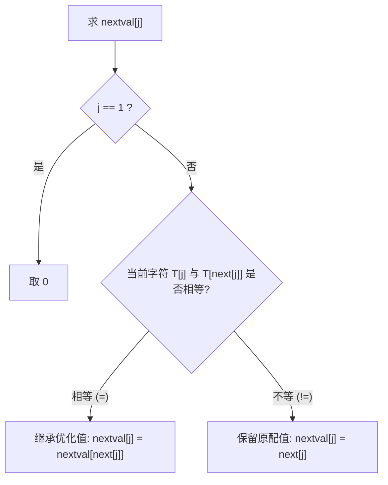
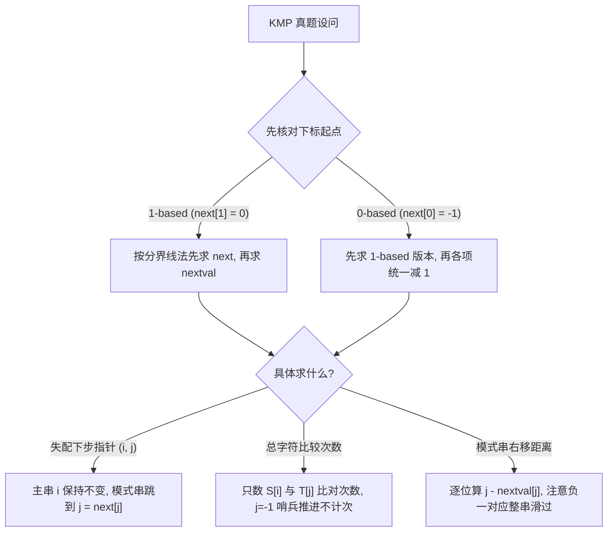

# 第4章 串

> [!abstract] 本章复盘目标
> 掌握串的模式匹配，比较简单模式匹配与 KMP 的指针变化；按题设下标定义求出 next 与 nextval 数组，记录每次字符比较并计算匹配位置和次数。

> [!important] 近 18 年 408 数据结构真题雷达（2009—2026）
> - **返回总控**：[[00_408数据结构｜考前急救与真题落点总控|返回数据结构总控]]
> - **考频定位**：**轻量单选高频坑点章**（近 18 年主考单选 3 题：`2015-T08`、`2019-T09`、`2024-T06`；无大题；近 5 年 2022—2026 覆盖 `2024-T06`）
> - **考场高频坑**：混淆 1 起始（`next[1]=0`）与 0 起始（`next[0]=-1`）下标口径；误将哨兵回退 `-1` 后同时加 1 的那一步也算作字符比较；把 `nextval[j]` 最大值当成模式串右滑最大距离（漏算 $j - nextval[j]$）
> - **急救路线**：`4.1` 考纲外基础直接跳过 $\rightarrow$ 重点手算 `4.2.2` / `4.2.3` 的 0/1 起始 `next` 与 `nextval` 换算 $\rightarrow$ 精读真题右滑步长与字符比较计数法

## 考纲定位

- **字符串模式匹配**：简单模式匹配、KMP 算法原理、next 数组与优化的 nextval 数组。
- 教材将 **4.1 串的定义和实现**标为考纲外的参考内容；为便于理解模式匹配，保留原笔记中的相关基础。

> [!note] 本章真题核对记录
> 教材标注的统考选择题、逐项判断及笔记对应位置见 [[数据结构/复盘/_核对记录/第4章|第4章真题逐项核对记录]]。

## 章节知识脉络

1. **4.1 串的定义和实现**：串的基本概念、基本操作及存储结构，作为参考基础。
2. **4.2 串的模式匹配**：从主串回溯的简单匹配，到主串不回溯的 KMP 及 nextval 优化。

---

> [!TIP]
> **本章 408 考纲核心**：本章的重中之重是**“字符串模式匹配”**。虽然串的定义、基本操作和存储结构需要了解，但在选择题中真正反复考察、极易失分的是：**朴素模式匹配、KMP 算法的原理、`next` 数组的手算、`nextval` 数组的优化、失配后双指针的变化情况以及字符比较次数的计算**。

---

# 4.1 串的定义和实现

## 4.1.1 串的定义【💤 可跳过｜冲刺期直接跳过不看】
**串（String）**是由零个或多个字符组成的有限序列。一般记为：
$$
S='a_1a_2\cdots a_n'\quad(n\ge 0)
$$

其中：
*   **串名**：$S$ 是串的名字。
*   **串值**：单引号括起来的字符序列 `'a_1a_2...a_n'` 是串的值。
*   **串长**：串中字符的个数 $n$。
*   **空串**：长度为 0 的串，记为 $\varnothing$ 或 `""`。
*   **空格串**：由一个或多个空格字符组成的串，其长度为空格的个数（注意：**空格串绝非空串**）。

### 📌 常用概念辨析（参考）：
| 概念 | 定义与说明 |
| :--- | :--- |
| **子串** | 串中任意多个**连续**的字符组成的子序列。 |
| **主串** | 包含该子串的串。 |
| **位置** | 字符在串中的序号（**通常从 1 开始编号**）。 |
| **子串位置** | 子串的**第一个字符**在主串中的位置。 |
| **串相等** | 两个串的**长度相等**，且**对应位置的字符都相同**。 |

> [!WARNING]
> **空串与空格串对比**：
> *   `''` 是空串，长度 = 0。
> *   `'   '` 是空格串，由 3 个空格组成，长度 = 3。

**串与线性表的逻辑结构对比**：
串的逻辑结构与线性表极其相似，都是**线性结构**。
区别在于：**串的数据对象限定为字符集**。在操作上，线性表通常以“单个数据元素”为单位进行插入或删除，而串的操作通常以“子串”为单位进行查找或替换。

---

## 4.1.2 串的基本操作【💤 可跳过｜冲刺期直接跳过不看】
以下是串的常见基本操作，供理解模式匹配时参考：

| 操作接口 | 功能描述 |
| :--- | :--- |
| **`StrAssign(&T, chars)`** | **赋值操作**：生成一个值等于字符串常量 `chars` 的串 `T`。 |
| `StrCopy(&T, S)` | **复制操作**：由串 `S` 复制得串 `T`。 |
| `StrEmpty(S)` | **判空操作**：若串 `S` 为空串，则返回 true，否则返回 false。 |
| `StrCompare(S, T)` | **比较操作**：比较 `S` 和 `T` 的大小。若 $S > T$，返回值 $>0$；若 $S = T$，返回值 $=0$；若 $S < T$，返回值 $<0$。 |
| `StrLength(S)` | **求串长**：返回串 `S` 中的元素个数。 |
| **`SubString(&Sub, S, pos, len)`** | **求子串**：用 `Sub` 返回串 `S` 的第 `pos` 个字符起长度为 `len` 的子串。 |
| **`Concat(&T, S1, S2)`** | **串联接**：用 `T` 返回由 `S1` 和 `S2` 联接而成的新串。 |
| **`Index(S, T)`** | **定位操作（模式匹配）**：若主串 `S` 中存在与模式串 `T` 相同的子串，则返回它在主串中第一次出现的位置；否则返回 0。 |
| `ClearString(&S)` | **清空操作**：将串 `S` 清为空串，释放占用的部分空间。 |
| `DestroyString(&S)` | **销毁操作**：销毁串 `S`，释放其占用的全部存储空间。 |

> [!IMPORTANT]
> **最小操作子集**：
> 串的最小操作子集包括：`StrAssign`、`StrCompare`、`StrLength`、`Concat`、`SubString`。利用这 5 个基本操作可以实现串的其他所有复杂操作。
> 例如，**定位操作 `Index(S, T)` 的基本实现思路**：
> 我们可以利用 `SubString` 在主串 $S$ 中不断截取与模式串 $T$ 长度相同的子串，然后通过 `StrCompare` 进行比对。若相等，则当前截取的起始位置即为所求。

---

## 4.1.3 串的存储结构【💤 可跳过｜冲刺期直接跳过不看】

### 1. 定长顺序存储【💤 可跳过｜冲刺期直接跳过不看】
用**一组地址连续的存储单元**存放串值，系统预先为每个串变量分配固定长度的存储空间。

```c
#define MAXLEN 255 // 用户预定义的最大串长

typedef struct {
    char ch[MAXLEN + 1]; // 1-based 写法：ch[1..length] 存储字符，ch[0] 不用
    int length;      // 串的实际长度
} SString;
```

*   **优点**：支持随机访问，实现简单。
*   **缺点**：最大长度固定，容易发生**截断（Overrun）**错误。
*   **长度表示**：可以通过 `length` 显式记录，也可以在串末尾添加结束标记 `'\0'`（此时实际串长不计 `'\0'`）。

---

### 2. 堆分配存储【💤 可跳过｜冲刺期直接跳过不看】
仍然使用**地址连续的物理空间**存放字符，但存储空间是在程序运行时**动态申请（malloc）**的。

```c
typedef struct {
    char *ch;   // 指向动态分配的存储区首地址
    int length; // 串的实际长度
} HString;
```

*   **优点**：不受固定最大串长的限制，空间利用率高，不易溢出。
*   **注意**：**定长顺序存储和堆分配存储都属于顺序存储结构**，只是一个空间在编译时静态确定，另一个在运行时动态申请。

---

### 3. 块链存储【💤 可跳过｜冲刺期直接跳过不看】
串也可以采用链式存储。由于一个字符仅占 1 字节，如果一个结点只存 1 个字符，那么指针域的开销（4/8 字节）将远大于数据域，导致存储密度极低。因此，通常采用**“块链”**设计，即**每个结点存放多个字符**（称为一个块），最后一个结点若未填满，可用特殊字符（如 `#`）补齐。

---

# 4.2 串的模式匹配

## 4.2.1 朴素模式匹配算法【📌 扫一眼｜确认“我还会”就过】
**模式匹配**是指在主串 $S$（长度为 $n$）中查找与模式串 $T$（长度为 $m$）完全相同的子串的过程。

### 💡 算法思想：
从主串 $S$ 的第一个字符开始，与模式串 $T$ 的第一个字符比较。若相等，则继续比较后续字符；若失配，则主串指针**回溯**到本趟比对起始位置的下一个字符，模式串指针**回溯**到 $1$，重新开始下一趟比对。

```text
第一趟比对：
主串 S:    a  b  a  [a]  b  c       (在第 4 个字符处失配)
                 |
模式串 T:   a  b  a  [b]              
                 x

第二趟比对（主串回溯到第 2 个字符 'b'，模式串重置到 1）：
主串 S:    a  [b] a  a  b  c
                 |
模式串 T:      [a] b  a  b           (在第 1 个字符处失配)
                 x
```

### 💻 C 语言标准实现 (1-based)：
```c
int Index(SString S, SString T) {
    int i = 1; // 主串指针
    int j = 1; // 模式串指针
    while (i <= S.length && j <= T.length) {
        if (S.ch[i] == T.ch[j]) {
            ++i;
            ++j; // 字符匹配成功，双指针同步后移
        } else {
            i = i - j + 2; // 主串指针回溯到本趟起始位置的下一位
            j = 1;         // 模式串指针重置为 1
        }
    }
    if (j > T.length) {
        return i - T.length; // 匹配成功，返回起始下标
    }
    return 0; // 匹配失败
}
```

*   **最坏时间复杂度**：$O(nm)$。每一次都在模式串最后一个字符失配，且主串指针频繁回溯。
*   **缺点**：主串指针频繁回溯导致大量的重复比对，效率低下。

---

## 4.2.2 KMP 模式匹配算法【🔥⚡ 必背+避坑｜停下来默背 1 遍 + 精读 1 分钟】
为了消除朴素匹配算法中主串指针的回溯，Knuth、Morris 和 Pratt 提出了 **KMP 算法**。

### 🌟 核心思想：
**主串指针 `i` 不回溯**，仅让模式串指针 `j` 退回到一个能够**最大程度复用已匹配前缀**的位置。这个退回的位置由 **`next` 数组** 决定。

```text
已匹配部分（灰色区）：
主串 S:    a  b  a  a  b  [?]       (主串指针 i 保持不动，这个 [?] 必不是 'b')
           \_____/        |
模式串 T:   a  b  a  a  b  [b]       (模式串指针 j=6 失配)
           \_____/        x

KMP 匹配（模式串直接右滑，让 j 指针回退到 next[6] = 3 处，保持主串 i 不变）：
主串 S:    a  b  a  a  b  [?]
                 \_____/  |
模式串 T:         a  b  [a]  a  b  b
                 \_____/  ? (i 与 j=3 继续比对，免去了中间多余的滑行比对)
```

---

### 1. PM（部分匹配）表与 `next` 数组的关系【🔥 必背｜停下来默背 1 遍】
`next` 数组来源于模式串自身的**最长相等前缀和后缀**。
在王道教材采用的 **1-based** 索引下，有如下对应关系：
$$
next[j] = PM[j-1] + 1 \quad (j>1), \quad next[1] = 0
$$

以模式串 `abcac` 为例：
*   **前缀**：除最后一个字符外，所有包含首字符的连续子串（如 `a`, `ab`, `abc`, `abca`）。
*   **后缀**：除第一个字符外，所有包含尾字符的连续子串（如 `c`, `ac`, `cac`, `bcac`）。
*   **PM（部分匹配值）**：最长相等前缀和后缀的长度。

| 序号 $j$ | 1 | 2 | 3 | 4 | 5 |
| :--- | :---: | :---: | :---: | :---: | :---: |
| 模式串 $T$ | a | b | c | a | c |
| **最长相等前后缀** | 无 | 无 | 无 | `"a"` | 无 |
| **PM 对应值** | 0 | 0 | 0 | 1 | 0 |
| `next[j]` | 0 | 1 | 1 | 1 | 2 |

---

### 2. 核心手算法：王道分界线滑行法【🔥 必背｜停下来默背 1 遍】
下面用分界线滑行法求 `next` 数组；计算前应先明确下标起点与失配回退的定义。

### 判定规则：
1.  **`next[1] = 0`**（首项取 0）。
2.  **`next[2] = 1`**（第二项取 1）。
3.  **求 `next[j]` ($j \ge 3$)**：
    *   **划线**：在不匹配的字符 $j$ 前面，划一根“分界线” `|`。
    *   **滑行**：将分界线左侧的模式串，**一步一步向右滑行**。
    *   **对齐**：直到分界线左侧的字符能够**完全对齐重合**，或者模式串**完全跨过分界线**为止。
    *   **计数**：看滑动后的模式串在分界线右侧、与原失配位置对齐的字符是模式串的第几个字符，其序号就是 `next[j]`（如果模式串完全退出分界线左侧，则重置指向第 1 个字符，即 `next[j] = 1`）。

---

### 🎬 实战演练 1：以 $T = \text{"google"}$ 为例
*   `next[1] = 0`
*   `next[2] = 1`

*   **求 `next[3]`**：在第 3 个字符 `'o'` 前划线：`g o | o g l e`
    ```text
    【状态 0：画定分界线】
    序号j: 1  2 | 3  4  5  6
    原串 : g  o | o  g  l  e
                | (分界线)

    【状态 1：向右滑动 1 位】
    原串 : g  o | o  g  l  e
    滑串 :    g | o  o  g  l  e
                | (线左侧原串的 'o' 与滑串的 'g' 错位，匹配失败)

    【状态 2：向右滑动 2 位（完全滑出分界线）】
    原串 : g  o | o  g  l  e
    滑串 :      | g  o  o  g  l  e
                | (滑串首字母 'g' 越过分界线，默认 j 恢复指向 1)
    ```
    故：$\mathbf{next[3] = 1}$

*   **求 `next[4]`**：在第 4 个字符 `'g'` 前划线：`g o o | g l e`
    ```text
    原串 : g  o  o | g  l  e
    滑 1 :    g  o | o  g  l  e (线左侧尾字符 'o' 对齐了 'o'，但前面 'g' 对 'o' 错位)
    滑 2 :       g | o  o  g  l  e (线左侧尾字符 'o' 对齐 'g'，错位)
    滑 3 :         | g  o  o  g  l  e (完全越过分界线)
    ```
    故：$\mathbf{next[4] = 1}$

*   **求 `next[5]`**：在第 5 个字符 `'l'` 前划线：`g o o g | l e`
    ```text
    原串 : g  o  o  g | l  e
    滑 1 :    g  o  o | g  l  e (线左侧尾字符 'g' 对齐 'o'，错位)
    滑 2 :       g  o | o  g  l  e (线左侧尾字符 'g' 对齐 'o'，错位)
    滑 3 :          g | o  o  g  l  e 
                      | 
                      (完全重合：线左侧尾部的 'g' 与滑串首字母 'g' 成功对齐)
                      (此时分界线右侧滑串的第 1 个字符为 'o'，它对应模式串的序号 2)
    ```
    故：$\mathbf{next[5] = 2}$

*   **求 `next[6]`**：在第 6 个字符 `'e'` 前划线：`g o o g l | e`
    ```text
    经过逐位向右滑行，尾部的 'l' 无法与滑串的任意前缀对齐，直至完全滑出分界线。
    ```
    故：$\mathbf{next[6] = 1}$

> **$T = \text{"google"}$ 的 `next` 数组为：`[0, 1, 1, 1, 2, 1]`**。

---

### 🎬 实战演练 2：以 $T = \text{"ababaa"}$ 为例
*   `next[1] = 0`
*   `next[2] = 1`

*   **求 `next[3]`**：在 `'a'` 前划线：`a b | a b a a`
    ```text
    原串 : a  b | a  b  a  a
    滑 1 :    a | b  a  b  a  a (线左侧 'b' 对齐 'a'，错位)
    滑 2 :      | a  b  a  b  a  a (完全越过)
    ```
    故：$\mathbf{next[3] = 1}$

*   **求 `next[4]`**：在 `'b'` 前划线：`a b a | b a a`
    ```text
    原串 : a  b  a | b  a  a
                   | (分界线)
    滑 1 :    a  b | a  b  a  a (线左侧尾部 'a' 对齐 'b'，错位)
    滑 2 :       a | b  a  b  a  a
                   | (重合成功：线左侧尾部 'a' 与滑串首字母 'a' 对齐，分界线右侧首字符为 'b'，序号 2)
    ```
    故：$\mathbf{next[4] = 2}$

*   **求 `next[5]`**：在 `'a'` 前划线：`a b a b | a a`
    ```text
    原串 : a  b  a  b | a  a
    滑 1 :    a  b  a | b  a  a (尾部 'b' 对 'a'，错位)
    滑 2 :       a  b | a  b  a  a
                      | (重合成功：线左侧尾部的 'a b' 与滑串前缀 'a b' 重合，分界线右侧首字符为 'a'，序号 3)
    ```
    故：$\mathbf{next[5] = 3}$

*   **求 `next[6]`**：在 `'a'` 前划线：`a b a b a | a`
    ```text
    原串 : a  b  a  b  a | a
    滑 1 :    a  b  a  b | a  a (尾部 'a' 对 'b'，错位)
    滑 2 :       a  b  a | b  a  a
                         | (重合成功：线左侧尾部 'a b a' 与滑串前缀 'a b a' 重合，分界线右侧首字符为 'b'，序号 4)
    ```
    故：$\mathbf{next[6] = 4}$

> **$T = \text{"ababaa"}$ 的 `next` 数组为：`[0, 1, 1, 2, 3, 4]`**。

---

### 3. KMP 代码实现与分析【📌 扫一眼｜确认“我还会”就过】

### (1) 求 `next` 数组代码 (`get_next`)
```c
// 求模式串 T 的 next 数组 (1-based)
void get_next(SString T, int next[]) {
    int i = 1; // i 指向模式串的当前后缀字符
    int j = 0; // j 指向当前最长相等前缀的后继字符
    next[1] = 0; // 边界设定
    
    while (i < T.length) {
        if (j == 0 || T.ch[i] == T.ch[j]) {
            ++i;
            ++j;
            next[i] = j; // 匹配成功，指针后移，记录 next 值
        } else {
            j = next[j]; // 匹配失败，j 指针沿 next 退回
        }
    }
}
```

### (2) KMP 匹配主算法 (`IndexKMP`)
```c
// 标准 KMP 匹配算法，返回第一次成功匹配的起始下标，失败返回 0
int IndexKMP(SString S, SString T, int next[]) {
    int i = 1; // 主串指针，不回溯
    int j = 1; // 模式串指针
    
    while (i <= S.length && j <= T.length) {
        if (j == 0 || S.ch[i] == T.ch[j]) {
            ++i;
            ++j; // 字符匹配成功或 j 归零，双指针后移
        } else {
            j = next[j]; // 字符失配，j 回溯至 next[j]，i 不动
        }
    }
    
    if (j > T.length) {
        return i - T.length; // 匹配成功
    }
    return 0; // 匹配失败
}
```

*   **时间复杂度**：KMP 算法的整体时间复杂度为 **$O(n+m)$**。其中求 `next` 数组时间复杂度为 $O(m)$，主串匹配过程为 $O(n)$。

---

## 4.2.3 KMP 算法的进一步优化：`nextval`【🔥⚡ 必背+避坑｜停下来默背 1 遍 + 精读 1 分钟】

> [!NOTE]
> 本节说明如何利用模式串自身的字符关系，减少已知必然失败的重复比较。

### 1. 为什么要优化 `next` 数组？（直观图解）【📌 扫一眼｜确认“我还会”就过】

我们以 $T = \text{"abaabc"}$ 为例。假设它的 `next` 数组已求出：

| 序号 $j$ | 1 | 2 | 3 | 4 | 5 | 6 |
| :--- | :---: | :---: | :---: | :---: | :---: | :---: |
| 模式串 $T$ | a | b | a | a | b | c |
| `next[j]` | 0 | 1 | 1 | 2 | 2 | 3 |

### 🎬 案发现场：在 $j=3$ 处发生失配
主串 $S$ 与模式串 $T$ 匹配到第 3 个字符时失败了：

```text
主串 S:    ?  ?  [?]  ?  ?  ?       <-- 此时主串指向 i=3，这个字符 [?] 必不是 'a'
                 |
模式串 T:   a  b  [a]  a  b  c       <-- 此时模式串指向 j=3，字符为 'a'
                 x  (失配)
```

### 🚫 优化前的普通 KMP 做法：
当 $T[3]$ 失配时，普通 KMP 令指针 $j$ 回退到 $next[3] = 1$ 的位置重新比对：
```text
主串 S:    ?  ?  [?]  ?  ?  ?       <-- 主串 i=3 不变，仍然是那个非 'a' 的字符 [?]
                 |
模式串 T:         [a]  b  a  a  b  c <-- 模式串回退，让 j=1 ('a') 与 [?] 进行比较
                 ?  (还要再比一次)
```
**重复比较**：既然我们在第一步就知道主串的 `[?]` **肯定不是 `'a'`**，那么我们退回到 $j=1$（字符也是 `'a'`）去和它再比一次，是**注定会失败的**。

### ✨ 优化后的 `nextval` 做法：
既然退回到 $j=1$ 注定失败，我们直接跳过 $j=1$，去看 $j=1$ 匹配失败后该跳到哪里（即 `next[1] = 0`）。
因此，我们一步到位优化 $j=3$ 处的退路：**`nextval[3] = 0`**。

---

### 2. 🛠️ 核心手算口诀：两步判定法【🔥 必背｜停下来默背 1 遍】

求 `nextval` 极其直观，只需记住这句口诀：
> **“当前字符”对比“回退位置的字符”。相同则继承退路的 `nextval`，不同则保留原配 `next`。**

对于当前位置 $j$：
1.  **若 $j = 1$**：首位取 `0`（`nextval[1] = 0`）。
2.  **若 $j > 1$**：比较当前位置字符 $T[j]$ 与回退位置字符 $T[next[j]]$。
    *   **若 $T[j] \neq T[next[j]]$**（不相等）：**`nextval[j] = next[j]`**（保留原配值）。
    *   **若 $T[j] == T[next[j]]$**（相等）：**`nextval[j] = nextval[next[j]]`**（直接继承退路已优化好的值）。



---

### 3. 📝 课件练习 1 详解：$T = \text{"ababaa"}$ (课件第27-28页)【📌 扫一眼｜确认“我还会”就过】
*   已知 $next = [0, 1, 1, 2, 3, 4]$

下面我们**无跳步**手把手推导：

1.  **$j = 1$**：
    *   **判定**：首字符。
    *   **计算**：取 `0`。
    *   **结果**：$\mathbf{nextval[1] = 0}$
2.  **$j = 2$**：
    *   当前字符 $T[2] = \text{'b'}$，回退位置 $next[2] = 1$，对应字符 $T[1] = \text{'a'}$。
    *   **判定**：$T[2] \neq T[1]$ (`'b' != 'a'`)，字符**不相等**。
    *   **计算**：保留原配值。
        $nextval[2] = next[2] = 1$
    *   **结果**：$\mathbf{nextval[2] = 1}$
3.  **$j = 3$**：
    *   当前字符 $T[3] = \text{'a'}$，回退位置 $next[3] = 1$，对应字符 $T[1] = \text{'a'}$。
    *   **判定**：$T[3] == T[1]$ (`'a' == 'a'`)，字符**相等**。
    *   **计算**：继承退路已优化值 `nextval[1]`。
        $nextval[3] = nextval[1] = 0$
    *   **结果**：$\mathbf{nextval[3] = 0}$
4.  **$j = 4$**：
    *   当前字符 $T[4] = \text{'b'}$，回退位置 $next[4] = 2$，对应字符 $T[2] = \text{'b'}$。
    *   **判定**：$T[4] == T[2]$ (`'b' == 'b'`)，字符**相等**。
    *   **计算**：继承退路已优化值 `nextval[2]`。
        $nextval[4] = nextval[2] = 1$
    *   **结果**：$\mathbf{nextval[4] = 1}$
5.  **$j = 5$**：
    *   当前字符 $T[5] = \text{'a'}$，回退位置 $next[5] = 3$，对应字符 $T[3] = \text{'a'}$。
    *   **判定**：$T[5] == T[3]$ (`'a' == 'a'`)，字符**相等**。
    *   **计算**：继承退路已优化值 `nextval[3]`。
        $nextval[5] = nextval[3] = 0$
    *   **结果**：$\mathbf{nextval[5] = 0}$
6.  **$j = 6$**：
    *   当前字符 $T[6] = \text{'a'}$，回退位置 $next[6] = 4$，对应字符 $T[4] = \text{'b'}$。
    *   **判定**：$T[6] \neq T[4]$ (`'a' != 'b'`)，字符**不相等**。
    *   **计算**：保留原配值。
        $nextval[6] = next[6] = 4$
    *   **结果**：$\mathbf{nextval[6] = 4}$

### 🏆 练习 1 对照总结表：
| 序号 $j$ | 1 | 2 | 3 | 4 | 5 | 6 |
| :--- | :---: | :---: | :---: | :---: | :---: | :---: |
| 模式串 $T$ | a | b | a | b | a | a |
| 原 `next[j]` | 0 | 1 | 1 | 2 | 3 | 4 |
| **关系判定** | (首位) | $T[2]\neq T[1]$ | $T[3]== T[1]$ | $T[4]== T[2]$ | $T[5]== T[3]$ | $T[6]\neq T[4]$ |
| **继承方式** | (取 0) | 保留 `next` | 继承 `nextval[1]` | 继承 `nextval[2]` | 继承 `nextval[3]` | 保留 `next` |
| `nextval[j]` | 0 | 1 | 0 | 1 | 0 | 4 |

---

### 4. 📝 课件练习 2 详解：$T = \text{"aaaab"}$ (课件第29-30页)【📌 扫一眼｜确认“我还会”就过】
*   已知 $next = [0, 1, 2, 3, 4]$

下面我们进行**无跳步**手把手推导：

1.  **$j = 1$**：首位取 `0` $\rightarrow$ $\mathbf{nextval[1] = 0}$。
2.  **$j = 2$**：
    *   当前字符 $T[2] = \text{'a'}$，回退位置 $next[2] = 1$，对应字符 $T[1] = \text{'a'}$。
    *   **判定**：$T[2] == T[1]$，字符**相等**。
    *   **计算**：继承退路值。$nextval[2] = nextval[1] = 0$
    *   **结果**：$\mathbf{nextval[2] = 0}$
3.  **$j = 3$**：
    *   当前字符 $T[3] = \text{'a'}$，回退位置 $next[3] = 2$，对应字符 $T[2] = \text{'a'}$。
    *   **判定**：$T[3] == T[2]$，字符**相等**。
    *   **计算**：继承退路值。$nextval[3] = nextval[2] = 0$
    *   **结果**：$\mathbf{nextval[3] = 0}$
4.  **$j = 4$**：
    *   当前字符 $T[4] = \text{'a'}$，回退位置 $next[4] = 3$，对应字符 $T[3] = \text{'a'}$。
    *   **判定**：$T[4] == T[3]$，字符**相等**。
    *   **计算**：继承退路值。$nextval[4] = nextval[3] = 0$
    *   **结果**：$\mathbf{nextval[4] = 0}$
5.  **$j = 5$**：
    *   当前字符 $T[5] = \text{'b'}$，回退位置 $next[5] = 4$，对应字符 $T[4] = \text{'a'}$。
    *   **判定**：$T[5] \neq T[4]$，字符**不相等**。
    *   **计算**：保留原配值。$nextval[5] = next[5] = 4$
    *   **结果**：$\mathbf{nextval[5] = 4}$

### 🏆 练习 2 对照总结表：
| 序号 $j$ | 1 | 2 | 3 | 4 | 5 |
| :--- | :---: | :---: | :---: | :---: | :---: |
| 模式串 $T$ | a | a | a | a | b |
| 原 `next[j]` | 0 | 1 | 2 | 3 | 4 |
| **关系判定** | (首位) | $T[2]== T[1]$ | $T[3]== T[2]$ | $T[4]== T[3]$ | $T[5]\neq T[4]$ |
| **继承方式** | (取 0) | 继承 `nextval[1]` | 继承 `nextval[2]` | 继承 `nextval[3]` | 保留 `next` |
| `nextval[j]` | 0 | 0 | 0 | 0 | 4 |

---

### 5. 💻 KMP 优化求 `nextval` 标准 C 实现 (`get_nextval`)【📌 扫一眼｜确认“我还会”就过】
```c
// 求模式串 T 的 nextval 优化数组 (1-based)
void get_nextval(SString T, int nextval[]) {
    int i = 1;
    int j = 0;
    nextval[1] = 0; // 边界条件设定
    
    while (i < T.length) {
        if (j == 0 || T.ch[i] == T.ch[j]) {
            ++i;
            ++j;
            if (T.ch[i] != T.ch[j]) {
                nextval[i] = j; // 后继字符不相等，保留退路原值
            } else {
                nextval[i] = nextval[j]; // 后继字符相等，发生必失配，继承退路优化值
            }
        } else {
            j = nextval[j]; // 匹配失败，j 指针沿 nextval 退回
        }
    }
}
```

---

> [!important] 统考真题方法：确定下标口径后逐次比较
> - 1 起始口径通常令 `next[1]=0`，0 起始且以 `-1` 为哨兵时，相同回退定义对应的数值整体减 1。**不能只凭数组从 0 开始，就假定所有材料的 next 定义相同**；应看题目对首项及失配后的指针规则如何约定。
> - 对模式串 `abaabc`，按 0 起始、首项为 `-1` 的口径，`next = [-1,0,0,1,1,2]`。失配在 `i=j=5` 时，<mark>主串指针不变且模式串仅做单侧回退</mark>（即 `i` 保持 5 不动、`j` 变为 `next[5]=2`）。不要把主串和模式串同时重置，也不要在处理这次失配时让 `i` 先加 1。 `[真题易错·2015-T08]`
> - 主串为 `abaabaabcabaabc`、模式串为 `abaabc` 时，同一口径下第一次连续比较 6 次，第 6 次失配后将模式串指针退至 2，再连续比较 4 次匹配成功，<mark>哨兵分支推进不产生字符比较</mark>，实际字符比较共 **10 次**。 `[真题易错·2019-T09]`
> - 模式串 `aabaab` 的 0 起始 `nextval` 为 `[-1,-1,1,-1,-1,1]`；<mark>右移距离等于失配下标减去回退值</mark>（按该模型在 $j$ 处失配时右移 $j-nextval[j]$ 位，最大右移 5 位）。六个位置的位移依次为 **1、2、1、4、5、4**，最大值出现在 $j=4$。若回退值为 $-1$，它是哨兵而不是可访问的字符下标：先令 $j=-1$，再按算法同时推进 $i$ 和 $j$。不能简单把数组中的最大值当成最大位移。 `[真题易错·2024-T06]`

- `【⚡ 真题补丁｜2024-T06】` 计算 KMP 最大右移步长切勿只看 `nextval` 数组里的最大元素（如 `1`），必须逐位算位移 $j - nextval[j]$（0 起始时 `j=4, nextval[4]=-1` 右移 $4-(-1)=5$ 位）。

## 4.2.4 KMP 题型判断与下标换算决策树【🔥 必背｜停下来默背 1 遍】



# 选择题快速判断与易错点

> [!IMPORTANT]
> **两种下标口径的换算**：
> 在全国统考 408 中，大题和选择题对 `next` 数组和 `nextval` 数组的下标可能有两种定义方式（1-based 与 0-based）。
> 
> *   **1-based**：王道标准，首位 `next[1] = 0`。
> *   **0-based 的 -1 版本**：部分高校及真题标准，首位 `next[0] = -1`。
> 
> **换算前提**：两种数组都表示相同的失配回退位置，一种从 1 编号且首项为 0，另一种从 0 编号且首项为 -1。
> 题目采用上述相同的回退规则时，可以先按 1 起始口径计算，再换算到 0 起始口径；若规则不同，应依题设重新计算。
> 正确的做法是：
> 1.  先严格按照上面教你的**分界线滑行法**，算出一版标准的 **1-based** 数组。
> 2.  **直接将该 1-based 数组中的每一个元素的值，通通减去 1**。
> 3.  得到的结果就是这类 **0-based/-1 版本** 的答案。
> 
> *例如*：$T = \text{"ababaa"}$
> *   1-based 的 `nextval` 数组：`[0, 1, 0, 1, 0, 4]`
> *   0-based/-1 版本的 `nextval` 数组：`[-1, 0, -1, 0, -1, 3]` （直接将原数组每个元素 -1 得到）

---

# 一分钟回顾

*   **串的定义**：是由零个或多个字符组成的有限序列。
*   **模式匹配**：`Index(S, T)` 意为模式匹配，指在主串 $S$ 中定位子串 $T$。**注意区分：求子串是复制出指定位置的一段，而模式匹配是在主串里寻找。**
*   **朴素匹配**：双指针均会回溯，最坏时间复杂度为 $O(nm)$。
*   **KMP 算法**：主串指针 $i$ **始终不回溯**，仅让模式串指针 $j$ 回退，整体最坏时间复杂度为 $O(n+m)$。
*   **`next` 数组意义**：代表当前字符失配后，下一次用模式串的第几个字符重新去与主串当前的字符比对。
*   **`nextval` 数组意义**：是对 `next` 数组的二次优化，消除了由于回退前后字符相同导致的注定重复失败的比对，使回退效率直接“一步到位”。

# 本章高频题型总表

| 题干特征 | 优先方法/起手式 | 真题印证与避坑 |
|---|---|---|
| 给 0 起始模式串求某位置失配后的 `(i, j)` | 先用 1 起始求 `next` 再统一减 1；主串 `i` 不动，`j` 退为 `next[j]` | `2015-T08`；切忌失配时同时让 `i` 自增 |
| 求 KMP 成功匹配为止的单个字符比较次数 | 逐趟跟踪 `i, j`，若退成哨兵 `-1` 后仅同时推进指针则该步 0 次比较 | `2019-T09`；共 6+4=10 次比较 |
| 求 `nextval` 优化后一次失配最大右滑距离 | 对每个下标计算 $j - nextval[j]$，取最大值而非直接取数组最大元素 | `2024-T06`；`aabaab` 在 $j=4$ 达最大位移 5 |

# 冲刺主动回忆卡（遮挡自测）

> [!question] 回忆卡 1：KMP 在 0 起始（`next[0]=-1`）口径下，若 `j=5` 处失配且 `next[5]=2`，下一步 `(i, j)` 如何变化？
> > [!success]- 正确解释
> > 当模式串字符 `T[j]` 与主串 `S[i]` 失配且 `j != -1` 时，主串指针 `i` 保持原地不动，仅模式串指针回退至 `j = next[5] = 2`，然后继续比对 `S[i]` 与 `T[2]`（`2015-T08`）。

> [!question] 回忆卡 2：为什么 KMP 算字符比较次数时，主串从头到尾常出现 `j = -1` 却不计入字符比较次数？
> > [!success]- 正确解释
> > `j == -1`（或 1 起始时的 `j == 0`）只是代码触发“首字符也失配、整串右移 1 位”的哨兵分支 `if (j == -1)`，在短路逻辑下根本不会执行右侧的 `S[i] == T[j]` 字符比对，因此不计入单个字符间的比较次数（`2019-T09`）。

> [!question] 回忆卡 3：已知 0 起始模式下某位置 `nextval[j] = -1`，说明在 `j` 处失配后模式串右滑了多少位？
> > [!success]- 正确解释
> > 失配后模式串需整体向右滑动，使原本下标为 `nextval[j]` 的字符对准当前主串位置，故向右移动了 $j - nextval[j]$ 位；当 $j=4, nextval[4]=-1$ 时，右滑了 $4 - (-1) = 5$ 位（`2024-T06`）。
