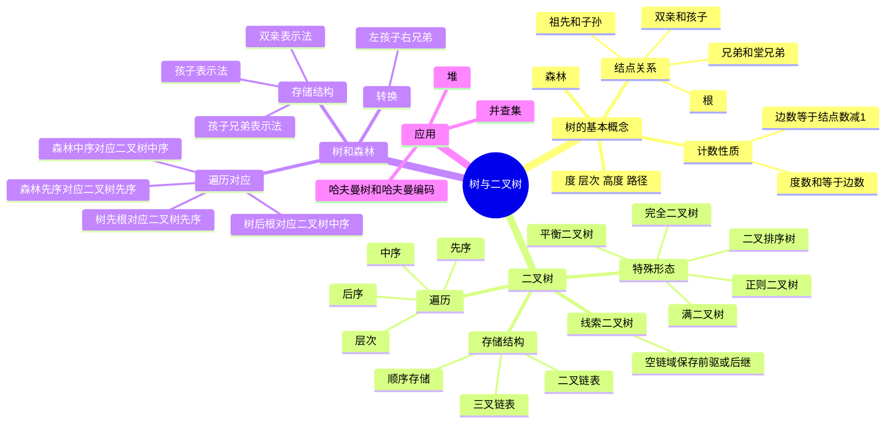
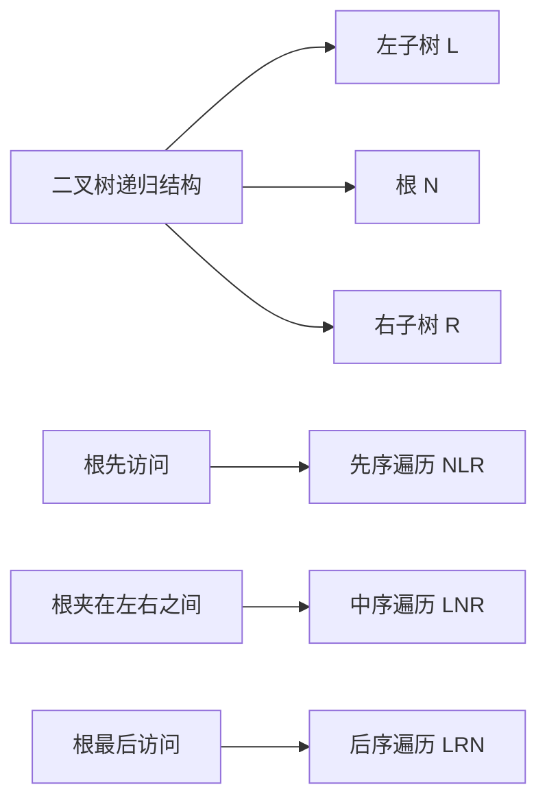
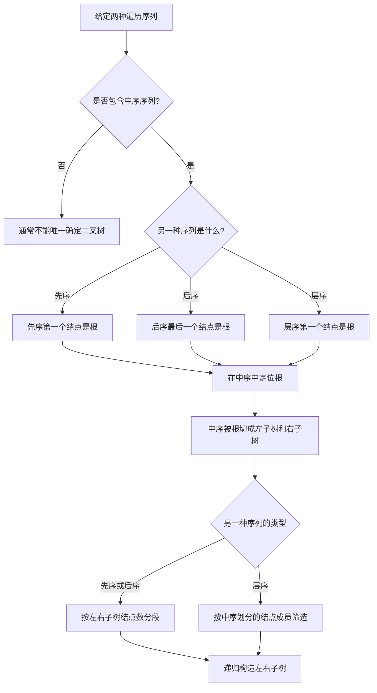
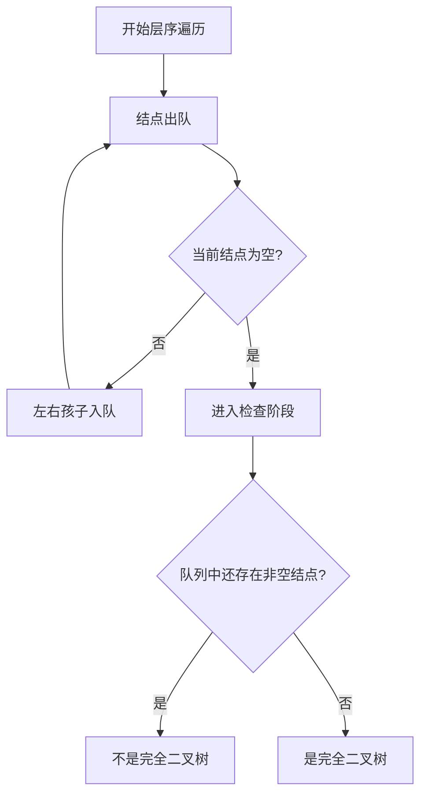
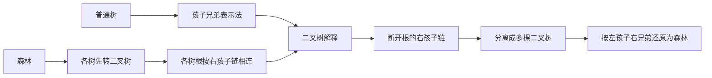
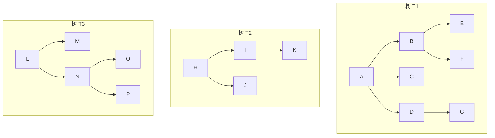
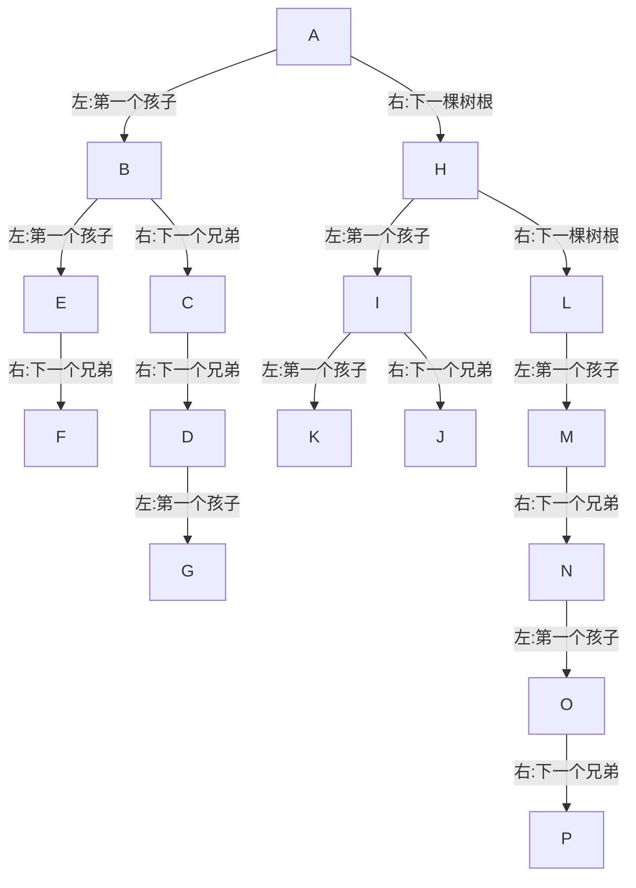
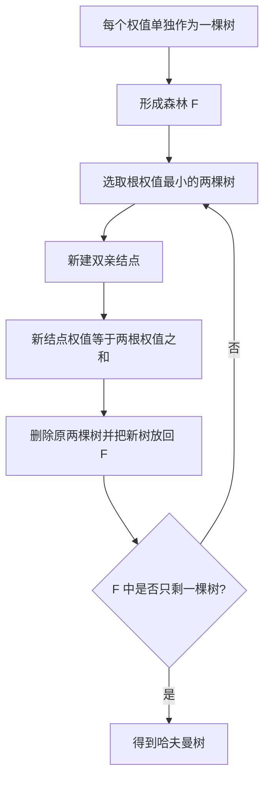
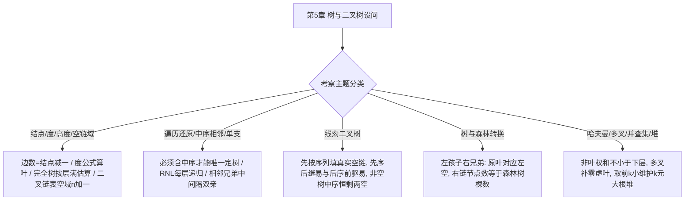

# 第5章 树与二叉树

> [!important] 近 18 年 408 数据结构真题雷达（2009—2026）
> - **返回总控**：[[00_408数据结构｜考前急救与真题落点总控|返回数据结构总控]]
> - **考频定位**：**第一大核心压轴章**（近 18 年主考单选 41 题 + 跨章单选 11 题 + 主考大题 4 题 + 跨章大题 4 题；近 5 年 2022—2026 覆盖 `2022-T03/T04/T05/T41/T42`、`2023-T04/T05`、`2024-T03/T09`、`2025-T03/T04/T05`、`2026-T03/T04/T05/T41`）
> - **考场高频坑**：混淆树边数与二叉树空右链数；单支树/中序相邻结点逻辑反推遗漏左右孩子空指针；森林转二叉树树高排序搞反；多叉哈夫曼树忘记补足权值为 0 的虚叶结点
> - **急救路线**：优先默背带 `🔥` 的树与二叉树性质公式、三种遍历还原与线索、树森林转换及哈夫曼 WPL $\rightarrow$ 重点精读带 `⚡` 的真题反例补丁 $\rightarrow$ 堆与 BST 结合大题联动第 7/8 章母题

## 考纲定位

树的基本概念；二叉树的定义、主要特征、顺序与链式存储、遍历、线索二叉树的基本概念和构造；树与森林的存储、转换及遍历；哈夫曼树和编码、并查集及其应用、堆及其应用。

## 章节知识脉络

1. **5.1 树的基本概念**：结点关系、度、层次与森林，利用边数和度数关系统计。
2. **5.2 二叉树的概念**：区分不同形态，掌握主要性质与存储方式。
3. **5.3 二叉树的遍历和线索二叉树**：从访问时机理解遍历、序列还原和线索构造。
4. **5.4 树、森林**：用“左孩子右兄弟”理解存储、转换和遍历对应。
5. **5.5 树与二叉树的应用**：构造哈夫曼树，运用并查集与堆。

> [!NOTE] 复盘与练习记录
> 本文保留原知识点，并在对应章节链接原错题强化。教材标注的统考选择题及正文对应情况见 [[第5章 树与二叉树核对记录]]；原错题强化文件本身尚未逐题重新核验。

---


> [!TIP]
> 本章要掌握树的概念与性质、遍历、树和森林转换、哈夫曼编码、并查集和堆，并能理解相应算法的执行过程。选择题可先从限定条件和性质入手，复习算法时再结合遍历代码。

# 本章先建立一张总图

第五章看起来内容很多，其实可以压成下面这张图：



最容易混的不是单个定义，而是几组“长得像”的东西：

| 容易混的对象 | 关键区别 |
|---|---|
| 树的高度 vs 结点的高度 | 树的高度是整棵树最大层数；结点高度是以该结点为根的子树高度 |
| 树的度 vs 结点的度 | 结点的度是孩子个数；树的度是所有结点度的最大值 |
| 二叉树 vs 度为 2 的有序树 | 二叉树可以为空，且单孩子也必须区分左/右；度为 2 的树至少有一个结点度为 2 |
| 满二叉树 vs 完全二叉树 | 满二叉树每层都满；完全二叉树是从满二叉树按层序从右往左删掉若干结点 |
| 树的先根遍历 vs 二叉树先序遍历 | 树转为二叉树后，二者序列相同 |
| 树的后根遍历 vs 二叉树中序遍历 | 树转为二叉树后，二者序列相同 |
| 哈夫曼树形态 vs WPL | 哈夫曼树可能不唯一，但最小 WPL 唯一 |

本章做题前可以先问自己四个问题：

1. 题目说的是普通树、二叉树、完全二叉树，还是森林？
2. 层次编号从 1 开始还是数组下标从 0 开始？
3. 题目是在数结点、数边，还是在数空指针域？
4. 遍历题要求访问根的时机，还是要求利用遍历顺序做某个附加操作？

---

# 5.1 树的基本概念

> [!example]- 原错题强化：5.1
> 以下保留原逐题推导的入口；原记录尚未逐题复核，若与本复盘有出入，以核对后的结论为准。
> - [[第5章 树与二叉树-错题强化#5.1 树的基本概念]]

## 5.1.1 树的定义【📌 扫一眼｜确认“我还会”就过】

树是 $n(n\ge 0)$ 个结点的有限集合。

当 $n=0$ 时，称为空树。任意一棵非空树都满足：

1. 有且仅有一个根结点。
2. 当 $n>1$ 时，除根外的其余结点可分为若干个互不相交的有限集合，每个集合本身又是一棵树，称为根的子树。

树的定义是递归的，所以很多树的算法天然适合递归写法。

==【补充】== 从数据关系看，树最适合表示*元素之间具有分支层次关系*的数据，例如文件目录、组织结构、家谱、语法分析树等。

> [!TIP]
> ==【补充】== 选择题看到“树适合表示什么数据”，优先选*分支层次关系*。如果题干强调“任意两个元素之间可能有多种联系”，那更像图，不是树。

树最重要的结构特征是：

| 特征 | 含义 |
|---|---|
| 唯一根 | 非空树只有一个根 |
| 唯一前驱 | 除根外，每个结点有且仅有一个双亲 |
| 多个后继 | 每个结点可以有 0 个或多个孩子 |
| 无回路 | 从根到任一结点路径唯一 |

一棵有 **$n$ 个结点的非空树**，一定**有 $n-1$ 条边**。因为除了根以外，每个结点都由唯一一条边连接到它的双亲。

```text
n 个结点
├─ 1 个根：没有入边
└─ n - 1 个非根结点：每个恰好 1 条入边

所以边数 = n - 1
```

## 5.1.2 基本术语【🔥 必背｜停下来默背 1 遍】

这些术语不需要孤立背，最好放在一条从根到某结点的路径里理解。

| 术语       | 含义               | 做题抓手         |
| -------- | ---------------- | ------------ |
| 根        | 没有双亲的唯一结点        | 非空树只有一个      |
| 双亲       | 某结点上一层的直接相邻结点    | 除根外每个结点唯一    |
| 孩子       | 某结点下一层的直接相邻结点    | 个数可以是 0 到多个  |
| 兄弟       | 双亲相同的结点          | 同父才是兄弟       |
| 堂兄弟      | 双亲在同一层的结点        | 不是同父也可以      |
| 祖先       | 从根到该结点路径上的所有前驱结点 | 不包括自己        |
| 子孙       | 以该结点为根的子树中的其他结点  | 不包括自己        |
| 叶结点      | 度为 0 的结点         | 也叫终端结点       |
| **分支结点** | **度大于 0 的结点**    | 也叫非终端结点      |
| 结点的度     | 该结点的孩子个数         | 看直接孩子        |
| 树的度      | 树中所有结点度的最大值      | 至少有一个结点达到这个度 |

层次、深度、高度是本章经常失分的概念。

| 概念          | 王道常用约定                |
| ----------- | --------------------- |
| 结点层次        | 根为第 1 层，孩子为第 2 层，以此类推 |
| 结点深度        | 通常等同于结点所在层次           |
| **树的高度/深度** | **树中结点的最大层数**         |
| 结点高度        | 以该结点为根的子树高度           |
| 路径长度        | 路径上边的条数，不是结点数         |

注意这里的“高度”按层数算。若根在第 1 层，只有一个根结点的树高度为 1；从根到自己的路径长度为 0。

### ==【补充】== 路径长度与树的路径长度

这里有一个很容易在选择题里混淆的概念：

| 名称 | 含义 | 做题提醒 |
|---|---|---|
| 某条路径的路径长度 | 这条路径上的边数 | 根到根的路径长度为 0 |
| 根到某结点的路径长度 | 从根到该结点经过的边数 | 若结点在第 $k$ 层，则路径长度为 $k-1$ |
| 树的路径长度 | 从树根到每个结点的路径长度之和 | 不是最大值，也不是平均值 |

所以，若题目问“树的路径长度是从根到每个结点路径长度的什么”，答案是**总和**。

> [!WARNING]
> ==【补充】== 树的路径长度不要和哈夫曼树的带权路径长度混淆：前者是所有结点路径长度之和；后者通常只对叶结点求 $w_i l_i$ 之和。

### 有序树和无序树

若树中各结点的子树从左到右有固定次序，不能随意交换，则称为有序树。否则称为无序树。

二叉树一定是有序的。即使某结点只有一个孩子，也必须说明它是左孩子还是右孩子。

### 森林

森林是 $m(m\ge 0)$ 棵互不相交的树的集合。

树和森林可以互相理解：

| 操作 | 结果 |
|---|---|
| 删除树的根 | 根的各棵子树形成一个森林 |
| 给森林加一个共同根 | 森林变成一棵树 |

==若森林中共有 $n$ 个结点、$k$ 棵树，则森林中的边数是：==

$$
n-k
$$

因为每棵树若有 $n_i$ 个结点，则有 $n_i-1$ 条边，全部相加：

$$
\sum(n_i-1)=\sum n_i-k=n-k
$$

## 5.1.3 树的性质【🔥⚡ 必背+避坑｜停下来默背 1 遍 + 精读 1 分钟】

### 1. 结点数与度数和【🔥 必背｜停下来默背 1 遍】

**树中所有结点的度数之和等于边数**，因此：

$$
\sum_{v\in T} degree(v)=n-1
$$

所以：

$$
n=\sum degree(v)+1
$$

这条性质是很多计数题的起点。

### 2. **各度结点数量关系**【🔥 必背｜停下来默背 1 遍】

设树中度为 $i$ 的结点数为 $n_i$，树的最大度为 $m$，则：

$$
n=n_0+n_1+n_2+\cdots+n_m
$$

边数也等于所有结点的度数之和：

$$
n-1=n_1+2n_2+\cdots+mn_m
$$

把两式相减，可得叶结点数：

$$
n_0=1+\sum_{i=2}^{m}(i-1)n_i
$$

常用特例：

| 已知结点度分布 | 叶结点数 |
|---|---|
| 只有度 0、1、2 的树 | $n_0=n_2+1$ |
| 只有度 0、1、2、3 的树 | $n_0=n_2+2n_3+1$ |
| $m$ 叉哈夫曼树，只有度 0 和度 $m$ | $n_0=(m-1)n_m+1$ |

<mark>树中总结点数等于所有结点度数之和加一</mark>，据此由分支结点各度数分布可直接反推叶结点个数。 `[真题·2010-T05]`

- `【⚡ 真题补丁｜2010-T05】` 度 4 树含 20 个度 4、10 个度 3、1 个度 2、10 个度 1 结点，则总结点减非叶数为 $(20\times 4+10\times 3+2+10+1)-(20+10+1+10)=82$。

### 3. 度为 $m$ 的树，第 $i$ 层最多结点数【📌 扫一眼｜确认“我还会”就过】

度为 $m$ 的树，第 $i$ 层最多有：

$$
m^{i-1}\quad(i\ge 1)
$$

根所在第 1 层最多 $1=m^0$ 个；第 2 层最多 $m$ 个；第 3 层最多 $m^2$ 个。

### 4. 高度为 $h$ 的 $m$ 叉树最多结点数【📌 扫一眼｜确认“我还会”就过】

高度为 $h$ 的 $m$ 叉树，最多有：

$$
1+m+m^2+\cdots+m^{h-1}
=\frac{m^h-1}{m-1}
$$

这里默认 $m>1$。若 $m=1$，就是一条链，高度为 $h$ 时最多也是 $h$ 个结点。

### 5. 具有 $n$ 个结点的 $m$ 叉树最小高度【🔥 必背｜停下来默背 1 遍】

要让高度最小，就尽量把前面各层填满。若 $m=1$ 且 $n\ge 1$，非空树是一条链，最小高度为 $n$。当 $m>1$ 时，<mark>尽量填满前面各层此时高度最小</mark>（如 244 结点三叉树需高 6）： `[真题·2022-T04]`

$$
h_{\min}=\left\lceil \log_m(n(m-1)+1)\right\rceil
$$

这个公式来自：

$$
n\le \frac{m^h-1}{m-1}
$$

变形得到：

$$
h\ge \log_m(n(m-1)+1)
$$

### 6. 度为 $m$、具有 $n$ 个结点的树最大高度(**注意这个高度的定义**)【📌 扫一眼｜确认“我还会”就过】

若题目说“树的度为 $m$”，表示至少有一个结点的度恰好为 $m$。要让高度最大，就让一个结点伸出 $m$ 个孩子，其余结点尽量排成单链。

以下公式适用于 $m\ge 1$ 且这样的树存在：给定结点数时须有 $n\ge m+1$，给定高度时须有 $h\ge 2$。当 $m=0$ 时，非空树只有根结点，$n=h=1$，不套用以下公式。

最大高度为：

$$
h_{\max}=n-m+1
$$

反过来，高度为 $h$、度为 $m$ 的树至少有：

$$
h+m-1
$$

个结点。

### 树性质速记

| 题目问法 | 第一反应 |
|---|---|
| 树适合表示的数据 | 元素之间具有分支层次关系 |
| 树中边数 | $n-1$ |
| 森林中边数 | <mark>森林总边数等于结点数减去树棵数</mark>（即 $n-k$） `[真题·2016-T05]` |
| 所有结点度数和 | $n-1$ |
| 树的路径长度 | 根到每个结点路径长度的总和 |
| 根到最深结点的最大路径长度 | 树高 $h-1$，根为第 1 层时 |
| 叶子数与其他度数 | $n_0=1+\sum_{i=2}^{m}(i-1)n_i$ |
| 第 $i$ 层最多结点 | $m^{i-1}$ |
| 高度 $h$ 最多结点 | $m>1$ 时为 $(m^h-1)/(m-1)$；$m=1$ 时为 $h$ |
| 给 $n$ 求最小高度 | $m>1$ 时尽量填满，用对数上取整；$m=1$ 的非空树高度为 $n$ |
| 给 $n$ 求最大高度且树的度为 $m$ | $m\ge 1$ 时为 $n-m+1$；$m=0$ 时只有根，树高为 1 |

---

# 5.2 二叉树的概念

> [!example]- 原错题强化：5.2
> 以下保留原逐题推导的入口；原记录尚未逐题复核，若与本复盘有出入，以核对后的结论为准。
> - [[第5章 树与二叉树-错题强化#5.2 二叉树的概念]]

## 5.2.1 二叉树的定义【📌 扫一眼｜确认“我还会”就过】

二叉树是一种特殊的树形结构：它可以为空；非空二叉树由根结点及互不相交的左子树、右子树组成。每个结点至多有两棵子树，且**左右子树有确定次序**，只有一个孩子时也要区分左、右。

二叉树最关键的不是“最多两个孩子”，而是“左右有别”。

```text
只有一个孩子时：

    A          A
   /            \
  B              B

这两棵二叉树不同。
```

### 二叉树与度为 2 的有序树的区别【📌 扫一眼｜确认“我还会”就过】

| 对比项           | 二叉树         | 度为 2 的有序树              |
| ------------- | ----------- | ---------------------- |
| 是否可为空         | **可以为空**    | **通常至少有结点**            |
| 是否必须有度为 2 的结点 | **不必须**     | **树的度为 2，至少有一个结点度为 2** |
| 单孩子是否区分左右     | 必须区分        | 只有一个孩子时，左右次序意义不明显      |
| 本质            | 递归定义的左右子树结构 | 普通树加上兄弟次序              |

### 二叉树形态计数：卡特兰数【🔥 必背｜停下来默背 1 遍】

$n$ 个相同元素确定先序后，<mark>不同形态二叉树的个数等于卡特兰数</mark>（如 4 结点有 $C_4=14$ 种）。 `[真题·2015-T02]`

选择题若问“$n$ 个结点能构成多少种不同形态的二叉树”，直接用**卡特兰数**：

$$
C_n=\frac{1}{n+1}\binom{2n}{n}
$$

注意这里数的是**形态数**。如果题目还给每个结点贴上互不相同的标号，并且允许任意放置标号，则还要再乘 $n!$。

卡特兰数也常和栈序列联系起来：

> 固定先序序列作为入栈顺序，中序序列可看作出栈顺序。若给出的中序序列不满足栈的后进先出约束，则它不可能和该先序序列构成一棵二叉树。

例如入栈顺序为 `1, 2, 3` 时，出栈序列 `3, 1, 2` 不合法，所以先序 `1, 2, 3` 与中序 `3, 1, 2` 不能确定一棵合法二叉树。

## 5.2.2 几种特殊二叉树【🔥⚡ 必背+避坑｜停下来默背 1 遍 + 精读 1 分钟】

### 1. 满二叉树【📌 扫一眼｜确认“我还会”就过】

高度为 $h$，且含有 $2^h-1$ 个结点的二叉树，称为满二叉树。

满二叉树的特点：

| 性质 | 结论 |
|---|---|
| 每层结点数 | 第 $i$ 层有 $2^{i-1}$ 个 |
| 总结点数 | $2^h-1$ |
| 叶结点数 | $2^{h-1}$ |
| 分支结点数 | $2^{h-1}-1$ |
| 叶结点位置 | 全部在最后一层 |
| 非叶结点度 | 全部为 2 |

> [!TIP]
> ==【补充】== *分支结点 = 非叶结点 = 度大于 0 的结点*，判断标准是“有没有孩子”，不是“是不是根”。所以满二叉树高度 $h>1$ 时，根结点也算分支结点；只有 $h=1$ 时，根没有孩子，才是叶结点而不是分支结点。

按层序从 1 开始编号时，满二叉树有非常清楚的编号关系：

| 结点编号     | 关系                                |
| -------- | --------------------------------- |
| $i$ 的双亲  | $\lfloor i/2\rfloor$，$i>1$，(向下取整) |
| $i$ 的左孩子 | $2i$                              |
| $i$ 的右孩子 | $2i+1$                            |

### 2. 完全二叉树【🔥⚡ 必背+避坑｜停下来默背 1 遍 + 精读 1 分钟】

高度为 $h$、有 $n$ 个结点的二叉树，若其结点与同高度满二叉树中编号 $1$ 到 $n$ 的结点一一对应，则称为完全二叉树。

直观理解：完全二叉树就是满二叉树从最后一层最右边开始连续删掉若干结点后得到的树。

完全二叉树最重要的特点：

| 性质               | 结论                                                           |
| ---------------- | ------------------------------------------------------------ |
| 叶结点位置            | **只可能在最后两层**                                                 |
| 度为 1 的结点         | **最多一个，并且只有左孩子**                                             |
| 若编号 $i$ 为叶或只有左孩子 | **所有编号大于 $i$ 的结点都是叶**                                        |
| 最后一个分支结点         | **$n\ge 2$ 时编号为 $\lfloor n/2\rfloor$**；$n=1$ 时没有分支结点 |
| 叶结点编号范围          | **$\lfloor n/2\rfloor+1$ 到 $n$**                             |
| 高度               | **$\lfloor\log_2 n\rfloor+1$，也等于 $\lceil\log_2(n+1)\rceil$** |
完全二叉树中，总结点数 $n$ 的奇偶性很有用：

| $n$ 的奇偶 | 结论                        |
| ------- | ------------------------- |
| $n$ 为奇数 | 每个分支结点都有左右孩子，$n_1=0$      |
| $n$ 为偶数 | <mark>编号二分之总结点仅有左孩子</mark>且 $n_1=1$ `[真题·2011-T04]` |

完全二叉树中叶结点数：

$$
n_0=\left\lceil \frac{n}{2}\right\rceil
$$

分情况写成：

$$
n_0=
\begin{cases}
(n+1)/2, & n\text{ 为奇数}\\
n/2, & n\text{ 为偶数}
\end{cases}
$$

度为 2 的结点数：

$$
n_2=\left\lfloor \frac{n-1}{2}\right\rfloor
$$

==【补充】== 完全二叉树如果刚好有 $2^h-1$ 个结点，就不仅是完全二叉树，而且是一棵高度为 $h$ 的满二叉树。比如 $7=2^3-1$，所以 7 个结点的完全二叉树结构固定为 3 层满二叉树。

完全二叉树若给出“第 $L$ 层有 $k$ 个叶结点”，可分别分析以下两个极端情况：

| 情况 | 总结点数 |
|---|---|
| 最少：高度就是 $L$，第 $L$ 层只有这 $k$ 个结点 | $2^{L-1}-1+k$ |
| 最多：高度为 $L+1$，<mark>第L层其余结点都各自挂满两孩</mark> `[真题易错·2009-T05]` | $2^{L+1}-2k-1$ |

记法：前 $L-1$ 层一定满；若再多一层，则第 $L$ 层除这 $k$ 个叶结点外，其余结点都可以有两个孩子。

- `【⚡ 真题补丁｜2009-T05】` 完全二叉树第 6 层有 8 个叶结点求最多结点数：第 7 层缺 $8\times 2=16$ 个叶，最多有 $(2^7-1)-16=111$ 个。

### 3. 二叉排序树【🔥⚡ 必背+避坑｜停下来默背 1 遍 + 精读 1 分钟】

二叉排序树也叫二叉搜索树，满足：

1. 左子树上所有结点关键字都小于根结点关键字。
2. 右子树上所有结点关键字都大于根结点关键字。
3. 左、右子树本身也分别是二叉排序树。

它的核心结论：

> **二叉排序树的中序遍历序列是递增序列**；若改为中序降序则<mark>极值位置必然缺少外侧孩子指针</mark>。 `[真题易错·2015-T04]`

所以判断一棵树是否为二叉排序树，常用方法就是中序遍历，看<mark>二叉排序树中序序列是否严格递增</mark>。 `[真题·2022-T41 / 2026-T41]`

- `【⚡ 真题补丁｜2015-T04】` 若题设改为“中序降序（左大右小）”的非空 AVL 树：最大元素位于最左端故必无左子树（D 对）；2 结点 AVL 根度为 1（A 错）；最小元素在最右仍可有左孩子（B 错）；末次插入可因旋转非叶（C 错）。

### 4. 平衡二叉树【🔥 必背｜停下来默背 1 遍】

平衡二叉树中，<mark>任意结点的左右子树高度差的绝对值</mark>不超过 1。 `[真题·2009-T04]`

更详细的平衡二叉树内容通常在查找章展开。本章只需要记住它关注的是“高度差”，不是“结点数差”；<mark>给定高且偏斜极小时总结点数最小</mark>。 `[真题·2012-T04]`

- `【⚡ 真题补丁｜2012-T04】` 高度为 6 且所有非叶结点平衡因子均为 1 的 AVL 树即极小结点数树，按 $N_h=N_{h-1}+N_{h-2}+1$ 得 $N_1=1, N_2=2\Rightarrow N_6=20$。

### 5. 正则二叉树【🔥 必背｜停下来默背 1 遍】

**正则二叉树**中，每个分支结点都有两个孩子。也就是说，<mark>正则树结点的度只可能为零或二</mark>（满二叉树同理满足 $n_0=k\Rightarrow n=2k-1$）。 `[真题·2018-T04]`

它也常叫严格二叉树或 proper binary tree。

正则二叉树中<mark>每个分支结点度均为二</mark>，可推广至正则 $k$ 叉树，其结点总数与叶数均受极值公式严格约束。 `[真题·2016-T42]`

- `【⚡ 真题补丁｜2016-T42】` 含 $m$ 个分支结点的正则 $k$ 叉树：叶数 $n_0=(k-1)m+1$；高 $h$ 总结点上界为 $\frac{k^h-1}{k-1}$，下界为 $1+(h-1)k$。

正则二叉树一定满足：

$$
n_0=n_2+1
$$

其实这条对所有非空二叉树都成立。

## 5.2.3 二叉树的性质【🔥 必背｜停下来默背 1 遍】

### 1. 非空二叉树中 $n_0=n_2+1$【🔥 必背｜停下来默背 1 遍】

设二叉树中：

- $n_0$：度为 0 的结点数，即叶结点数
- $n_1$：度为 1 的结点数
- $n_2$：度为 2 的结点数

总结点数：

$$
n=n_0+n_1+n_2
$$

边数也可由出边数计算：

$$
n-1=n_1+2n_2
$$

两式相减：

$$
n_0=n_2+1
$$

这条是二叉树计数题里最常用的公式。

==【补充】== 它还可以推出两个选择题很快用的结论：

1. 二叉树总结点数 $n=n_0+n_1+n_2=2n_2+n_1+1$，所以总结点数的奇偶性由 $n_1$ 决定。
2. 若总结点数为偶数，则 $n_1$ 一定为奇数；若总结点数为奇数，则 $n_1$ 一定为偶数。

==【补充】== 例如题目说二叉树有 $2n$ 个结点，则度为 1 的结点数 $n_1$ 必为奇数，所以“不可能有偶数个度为 1 的结点”。

### 2. 第 $k$ 层最多结点数【📌 扫一眼｜确认“我还会”就过】

非空二叉树第 $k$ 层最多有：

$$
2^{k-1}\quad(k\ge 1)
$$

### 3. 高度为 $h$ 的二叉树最多结点数【📌 扫一眼｜确认“我还会”就过】

高度为 $h$ 的二叉树最多有：

$$
2^h-1
$$

### 4. 具有 $n$ 个结点的二叉树高度范围【🔥 必背｜停下来默背 1 遍】

如果只说普通二叉树，则高度范围是：

$$
\lceil \log_2(n+1)\rceil \le h \le n
$$

左边是尽量接近满二叉树时的最小高度；右边是单支树时的最大高度。

==【补充】== 若题目进一步说“有 $n$ 个结点且高度也为 $n$”，说明这棵二叉树一定是*单支树*：除最后一个叶结点外，每个结点都只有一个孩子。

==【补充】== 单支二叉树的形态数常考：

$$
2^{n-1}
$$

==【补充】== 原因是除根以外共有 $n-1$ 条父子关系，每一步都可以选择作为父结点的左孩子或右孩子。

如果题目说完全二叉树，则高度被唯一确定：

$$
h=\lfloor\log_2 n\rfloor+1=\lceil\log_2(n+1)\rceil
$$

### 5. 完全二叉树编号关系【🔥 必背｜停下来默背 1 遍】

按层序从 1 开始编号，完全二叉树中编号为 $i$ 的结点满足：

| 条件 | 关系 |
|---|---|
| $i>1$ | 双亲为 $\lfloor i/2\rfloor$ |
| $2i\le n$ | 左孩子为 $2i$ |
| $2i+1\le n$ | 右孩子为 $2i+1$ |
| $i\le \lfloor n/2\rfloor$ | $i$ 是分支结点 |
| $i> \lfloor n/2\rfloor$ | $i$ 是叶结点 |
| 结点 $i$ 所在层次 | $\lfloor\log_2 i\rfloor+1$ |

如果数组下标从 0 开始，对应关系变成：

| 数组下标 $i$ | 关系 |
|---|---|
| 双亲 | $\lfloor(i-1)/2\rfloor$，$i>0$ |
| 左孩子 | $2i+1$ |
| 右孩子 | $2i+2$ |

做题时一定先看题目编号体系。王道讲解常建议从 1 开始存树中结点，这样编号和数组下标一致，公式最顺。

## 5.2.4 二叉树的存储结构【🔥⚡ 必背+避坑｜停下来默背 1 遍 + 精读 1 分钟】

### 1. 顺序存储结构【🔥⚡ 必背+避坑｜停下来默背 1 遍 + 精读 1 分钟】

顺序存储就是**用一组连续空间按层序存放二叉树结点**。

完全二叉树和满二叉树非常适合顺序存储，因为编号关系可以直接反映父子关系。

```text
编号：  1  2  3  4  5  6  7
数组： [A, B, C, D, E, F, G]

结点 2 的左孩子：4
结点 2 的右孩子：5
结点 5 的双亲：2
```

普通二叉树若硬性顺序存储，需要补很多空结点。例如一棵高度为 $h$ 的单支树，实际只有 $h$ 个结点，却可能需要接近 $2^h-1$ 个位置，空间浪费严重。

顺序存储的选择题常考两个底层约束：

| 问法 | 结论 |
|---|---|
| 合法性判定 | <mark>若某位置有结点则双亲位不可为空</mark>；不能出现“子结点存在而父结点为空”的空洞 `[真题·2025-T03]` |
| 高度为 $h$、有 $n$ 个结点时，数组容量的必然下界 | 至少需要 $\max(n,2^{h-1})$ 个存储单元 |
| ==【补充】== 任意高度为 $h$ 的二叉树都能顺序存下时 | 最稳要按高度为 $h$ 的满二叉树预留，即 $2^h-1$ 个存储单元 |

如果数组下标从 0 开始，位置 $i>0$ 有结点时，位置 $\lfloor(i-1)/2\rfloor$ 必须有结点。这里的 $\max(n,2^{h-1})$ 是“至少要这么多”的下界：具体某棵树如果最后一层结点偏右，实际占用位置可能更大，最坏可达<mark>满二叉树对应的最大连续数组下界</mark> $2^h-1$。

> [!WARNING]
> ==【补充】== 看清题干是“某一棵二叉树”还是“任意一棵二叉树”。若题目说“任意一棵高度为 $h$ 的二叉树都能保存”，必须考虑最坏位置，容量按 $2^h-1$ 算。比如高度为 5 时至少要 31 个单元，而不是只看结点数或最后一层最左位置。 `[真题易错·2020-T03]`

### 2. 链式存储结构【📌 扫一眼｜确认“我还会”就过】

二叉树更常用二叉链表存储：

```c
typedef struct BiTNode {
    ElemType data;
    struct BiTNode *lchild, *rchild;
} BiTNode, *BiTree;
```

若需要快速找双亲，可增加父指针，形成三叉链表：

```c
typedef struct TriTNode {
    ElemType data;
    struct TriTNode *lchild, *rchild, *parent;
} TriTNode, *TriTree;
```

### 3. 二叉链表中的空链域数【🔥 必背｜停下来默背 1 遍】

以下空链域公式均以**非空树 $n\ge 1$** 为前提；空树没有结点链域，空的根指针不属于结点链域。

**含有 $n$ 个结点的二叉链表，共有 $2n$ 个指针域。**

**非空指针域对应树中的边，共有 $n-1$ 个。**

所以空链域数为：

$$
2n-(n-1)=n+1
$$

这条结论非常重要，因为线索二叉树就是利用这些空链域保存遍历前驱和后继。

如果题目换成其他链式表示，也可以用“总指针域数 - 非空指针域数”秒算：

| 存储结构 | 总指针域数 | 非空指针域数 | 空指针域数 |
|---|---:|---:|---:|
| 二叉链表 | $2n$ | $n-1$ | $n+1$ |
| 三叉链表（左右孩子 + 双亲） | $3n$ | $(n-1)+(n-1)$ | $n+2$ |
| $m$ 叉树孩子指针数组表示 | $mn$ | $n-1$ | $(m-1)n+1$ |

三叉链表多出来的 $n$ 个双亲指针中，只有根结点的双亲指针为空，其余 $n-1$ 个都非空。

==【我的理解】== 三叉链表的非空指针域可以拆成两部分数：

1. 左、右孩子指针中，非空的仍然对应树中的父子边，共 $n-1$ 个。
2. 双亲指针中，除根结点外，每个结点都有一个非空双亲指针，也有 $n-1$ 个。

所以三叉链表的非空指针域总数是：

$$
(n-1)+(n-1)=2n-2
$$

再用总指针域 $3n$ 去减：

$$
3n-(2n-2)=n+2
$$

这道题的关键不是把非空指针域误看成 $3n-1$，而是先分清“孩子指针贡献的非空数”和“双亲指针贡献的非空数”。

==【补充】== 三叉链表选择题还喜欢考“某结点被几个指针指向”：

| 结点情况        | 被指向情况                                   |
| ----------- | --------------------------------------- |
| 根结点         | 没有双亲，因此不一定被双亲指针指向；整棵树只有根时，根不被任何指针指向 |
| 非根结点        | 一定被其双亲的某个孩子指针指向                         |
| 有左孩子/右孩子的结点 | 会分别被孩子的双亲指针指向                           |
| 度为 2 的非根结点  | 通常被 3 个指针指向：双亲的孩子指针 + 两个孩子的双亲指针         |
| 度为 2 的根结点   | 只被两个孩子的双亲指针指向，不是 3 个                    |
| 叶结点         | 非根叶结点被双亲的孩子指针指向；若整棵树只有根，叶结点不会被任何指针指向    |

## 5.2.5 二叉树性质速记表

| 知识点 | 公式或结论 |
|---|---|
| 非空二叉树叶子数 | $n_0=n_2+1$ |
| 第 $k$ 层最多结点 | $2^{k-1}$ |
| 高度 $h$ 最多结点 | $2^h-1$ |
| 普通二叉树最小高度 | $\lceil\log_2(n+1)\rceil$ |
| 普通二叉树最大高度 | $n$ |
| 完全二叉树高度 | $\lfloor\log_2 n\rfloor+1$ |
| 完全二叉树最后一个分支结点 | $n\ge 2$ 时为 $\lfloor n/2\rfloor$，$n=1$ 时不存在 |
| 完全二叉树叶结点数 | $\lceil n/2\rceil$ |
| 二叉链表空链域（$n\ge 1$） | $n+1$ |
| 三叉链表空指针（$n\ge 1$） | $n+2$ |
| $m$ 叉链表空指针（$n\ge 1$） | $(m-1)n+1$ |
| 二叉树形态数 | $C_n=\frac{1}{n+1}\binom{2n}{n}$ |

---

# 5.3 二叉树的遍历和线索二叉树

> [!example]- 原错题强化：5.3
> 以下保留原逐题推导的入口；原记录尚未逐题复核，若与本复盘有出入，以核对后的结论为准。
> - [[第5章 树与二叉树-错题强化#5.3 二叉树的遍历和线索二叉树]]

## 5.3.1 二叉树遍历的核心【🔥 必背｜停下来默背 1 遍】

> [!IMPORTANT] 非常规遍历次序（2009）
> $N,L,R$ 分别代表访问根、递归访问左子树和递归访问右子树；题目也可能把右子树放在左子树之前。读到 **RNL** 时，<mark>应在每一棵子树都按右根左递归</mark>，而不只是交换整棵树第一层的访问次序。 `[真题·2009-T03]`

遍历就是按某种规则访问二叉树中每个结点，且每个结点访问一次。

二叉树递归结构是：

```text
根 N
左子树 L
右子树 R
```

在坚持“先左后右”的前提下，根结点出现的位置决定了三种递归遍历：



| 遍历方式 | 顺序 | 根的位置 |
|---|---|---|
| 先序遍历 | NLR | 根在最前 |
| 中序遍历 | LNR | 根在中间 |
| 后序遍历 | LRN | 根在最后 |

可以这样记：

```text
先序：先访问根，再处理左右
中序：左边处理完，再访问根，再处理右边
后序：左右都处理完，最后访问根
```

### 1. 先序遍历

```c
void PreOrder(BiTree T) {
    if (T != NULL) {
        visit(T);
        PreOrder(T->lchild);
        PreOrder(T->rchild);
    }
}
```

常见用途：

| 用途 | 原因 |
|---|---|
| 复制一棵树 | 先建根，再建左右子树 |
| 输出目录结构 | 先看到父目录，再看到子目录 |
| 根到叶路径问题 | 先把当前结点加入路径 |

### 2. 中序遍历

```c
void InOrder(BiTree T) {
    if (T != NULL) {
        InOrder(T->lchild);
        visit(T);
        InOrder(T->rchild);
    }
}
```

常见用途：

| 用途              | 原因            |
| --------------- | ------------- |
| **二叉排序树输出递增序列** | 左 < 根 < 右     |
| **判断二叉排序树**     | 中序序列应严格递增     |
| **表达式树转中缀表达式**  | 左操作数、运算符、右操作数 |

### 3. 后序遍历

```c
void PostOrder(BiTree T) {
    if (T != NULL) {
        PostOrder(T->lchild);
        PostOrder(T->rchild);
        visit(T);
    }
}
```

常见用途：

| 用途 | 原因 |
|---|---|
| 释放整棵树 | 先释放左右子树，再释放根 |
| 求树高 | 先知道左右子树高度，再算根高度 |
| 删除子树 | 先删孩子，最后删根 |
| 计算表达式树 | 先算左右操作数，再算运算符 |

==【补充】== 后序遍历的祖先/子孙关系很重要：若 $n$ 是 $m$ 的子孙，则后序遍历时一定先访问 $n$，再访问 $m$。因为后序是“先处理孩子，最后处理根”。但“$n$ 在 $m$ 左方”只能说明很多情况下会更早访问，不足以保证在所有二叉树中都成立。

三种递归遍历的时间复杂度都是 $O(n)$。递归栈空间取决于树高，最坏是单支树，空间复杂度为 $O(n)$。

### 4. 层次遍历

层次遍历从上到下、从左到右访问结点，需要借助队列。

```c
void LevelOrder(BiTree T) {
    InitQueue(Q);
    BiTree p;

    if (T != NULL) {
        EnQueue(Q, T);
    }

    while (!IsEmpty(Q)) {
        DeQueue(Q, p);
        visit(p);

        if (p->lchild != NULL) {
            EnQueue(Q, p->lchild);
        }
        if (p->rchild != NULL) {
            EnQueue(Q, p->rchild);
        }
    }
}
```

层次遍历的核心是不急着深入，而是把已经发现但还没访问的结点放进队列。

常见用途：

| 用途          | 原因                 |
| ----------- | ------------------ |
| **判断完全二叉树** | 层序中一旦出现空，后面不能再出现非空 |
| 求树高的非递归算法   | 一层一层处理             |
| 求宽度         | 统计每层结点数            |
| 找某结点双亲      | 出队时检查左右孩子          |

## 5.3.2 遍历序列构造二叉树【🔥⚡ 必背+避坑｜停下来默背 1 遍 + 精读 1 分钟】

本节讨论唯一确定时，默认各结点身份可区分，且给出的序列合法并对应同一棵树。若数据值允许重复、又没有其他标识，仅凭两种值序列不能保证唯一；例如先序和中序均为 `A A` 时，第二个结点可以是左孩子，也可以是右孩子。

一棵确定的二叉树，其先序、中序、后序、层序序列都是唯一的。

但是反过来，仅凭一种遍历序列通常无法唯一确定二叉树。

### 必须抓住中序序列的作用

中序序列的特殊性是：根会把序列切成左右子树。

```text
中序序列：左子树序列  根  右子树序列
```

所以只要知道根是谁，再结合中序序列，就能划分左右子树。



| 已知序列 | 是否能唯一确定二叉树 | 方法 |
|---|---|---|
| 先序 + 中序 | 能 | 先序第一个是根，用中序划分左右 |
| 后序 + 中序 | 能 | 后序最后一个是根，用中序划分左右 |
| 层序 + 中序 | 能 | 层序第一个是根，用中序划分左右 |
| 先序 + 后序 | 通常不能 | 单孩子方向无法确定 |
| 先序 + 层序 | 通常不能 | 左右子树边界不一定清楚 |
| 后序 + 层序 | 通常不能 | 左右子树边界不一定清楚 |

### 1. 先序 + 中序

步骤：

1. 先序第一个结点是根。
2. 在中序序列中找到根。
3. 根左边是左子树中序序列，根右边是右子树中序序列。
4. 根据左右子树结点个数，把先序序列切成左、右子树先序序列。
5. 递归处理。

```text
先序：根 | 左子树先序 | 右子树先序
中序：左子树中序 | 根 | 右子树中序
```

小例子：已知

```text
先序：A B C D E F G H I
中序：B C A E D G H F I
```

构造过程可以这样走：

| 步骤 | 操作 | 结果 |
|---|---|---|
| 1 | 先序第一个是 `A` | `A` 是整棵树的根 |
| 2 | 在中序中找 `A` | `BC` 是左子树中序，`EDGHFI` 是右子树中序 |
| 3 | 左子树有 2 个结点 | 左子树先序为 `BC`，右子树先序为 `DEFGHI` |
| 4 | 递归处理左子树 `先序 BC / 中序 BC` | `B` 为左子树根，`C` 是 `B` 的右孩子 |
| 5 | 递归处理右子树 `先序 DEFGHI / 中序 EDGHFI` | `D` 为右子树根，继续用中序切左右 |

这类题最稳的做法是：**先用先序找根，再用中序切左右，最后按左右子树结点数去切先序**。

### 2. 后序 + 中序【🔥 必背｜停下来默背 1 遍】

步骤类似，只是根在后序最后；<mark>根据后序末尾找根并在中序划分左右</mark>： `[真题·2017-T05 / 2023-T05]`

```text
后序：左子树后序 | 右子树后序 | 根
中序：左子树中序 | 根 | 右子树中序
```

### 3. 层序 + 中序【🔥 必背｜停下来默背 1 遍】

步骤：

1. 层序第一个结点是根。
2. 用根在中序中划分左右子树。
3. 扫描剩余层序序列，<mark>按中序划分把层序筛选归入左右子树</mark>（把属于左子树的结点放进左子树层序，把属于右子树的结点放进右子树层序）。 `[真题·2026-T03]`
4. 递归处理。

层序 + 中序题的关键不是“层序第二个一定是左孩子”，而是要看它是否落在中序划出的左子树范围内。

### 4. 特殊情况与性质【🔥⚡ 必背+避坑｜停下来默背 1 遍 + 精读 1 分钟】

下列由遍历序列推断形态的结论，默认序列中的结点身份可区分；若仅比较允许重复的数据值，不一定成立。

- **正则二叉树**：对普通二叉树，先序 + 后序不能唯一确定，因为单孩子可能是左孩子，也可能是右孩子。若题目明确每个分支结点都有两个孩子，则**先序 + 后序可以唯一确定二叉树**。满二叉树也满足这一条件；一般正则二叉树未必是满二叉树。
- **先序和后序判断根的孩子数（2012）**：结点互异时，<mark>若先序首子等于后序末子则根独子</mark>；仅凭这两个序列不一定能确定它是左孩子还是右孩子。 `[真题·2012-T03]`
- **非空二叉树的先序序列与后序序列相反**：
  - **结论**：该二叉树每层仅有一个结点，高度等于其结点数 $h=n$（即**单支树** / 链状树）。其叶子结点数必为 1。空树的两个空序列也互逆，但没有叶结点。
  - *原理*：先序为 `根 -> 左 -> 右`，后序为 `左 -> 右 -> 根`。二者相反意味着对于任意结点，其左子树或右子树必有一个为空（若两子树均不为空，则两者不能完全相反，如先序 `A B C`，后序 `B C A` 不相反）。
  - **中序序列判别（2011）**：在单支树中，<mark>每个子树根只能位于该子树中序首尾</mark>。例如先序为 $1,2,3,4$、后序为 $4,3,2,1$ 时，候选中序 $3,2,4,1$ 不可能成立：结点 2 的子树中序为 $3,2,4$，根 2 夹在中间，意味着左右子树均非空。 `[真题易错·2011-T05]`
- **先序序列与后序序列相同**：
  - **结论**：该二叉树**为空树，或仅有一个根结点**。
  - *原理*：`根 -> 左 -> 右` 等于 `左 -> 右 -> 根`，仅在左右子树均为空时成立。
- **先序序列与中序序列相反**：
  - **结论**：该二叉树是一棵**向左倾斜的单支树**（任意结点无右孩子）。
  - *原理*：`根 -> 左` 与 `左 -> 根` 相反。
- **后序序列与中序序列相同**：
  - **结论**：树的任意结点**没有右子树**。
  - ==【我的理解】== 也就是一棵*向左倾斜的单支树*：每个结点最多只有左孩子，没有右孩子。
- **先序序列与中序序列相同**：
  - **结论**：非空二叉树任意结点<mark>全部非叶结点只有右子树而无左子树</mark>。 `[真题·2017-T04]`
  - ==【我的理解】== 也就是一棵*向右倾斜的单支树*：每个结点最多只有右孩子，没有左孩子。

- `【⚡ 真题补丁｜2017-T04】` 非空二叉树先序（NLR）与中序（LNR）相同当且仅当所有非叶结点只有右子树；若只有左子树、度均 1 含左分支或度均 2，NLR 与 LNR 均不同。

## 5.3.3 选择题视角下的遍历常考点【🔥⚡ 必背+避坑｜停下来默背 1 遍 + 精读 1 分钟】

> [!IMPORTANT] 中序相邻结点的真题判断（2022、2024）
> 若中序序列中 $p$ 紧接在 $v$ 前，$q$ 紧接在 $v$ 后，且 $v$ 左右孩子均非空，则 $p$ 是左子树中最右的结点，故<mark>左子树最右结点无右孩子而右最左无左</mark>（即 $p$ 无右孩子、$q$ 无左孩子）。 `[真题易错·2024-T03]` 仅给出“$p,q$ 中序相邻”时，$q$ 可以是 $p$ 的双亲、右孩子或祖父，但<mark>两个兄弟的中序访问之间必隔着双亲</mark>，故 $q$ 不可能是 $p$ 的右兄弟。 `[真题易错·2022-T03]`

- `【⚡ 真题补丁｜2022-T03】` 中序相邻 $p$ 在 $q$ 前四关系辨析：$q$ 可为 $p$ 双亲（$p$ 无右子）、$p$ 右子（$q$ 无左子）或 $p$ 祖父（$p$ 在左子树最右），唯不能是 $p$ 右兄弟。

第一轮只做选择题时，不必急着背完整算法代码，但要知道“某类操作适合哪种遍历”。很多选择题会用一句话描述操作，让你判断遍历顺序、辅助结构或时间复杂度。

| 问法或操作           | 选择题抓手                        |
| --------------- | ---------------------------- |
| 求**树高**         | 先知道左右子树高度，再算根，属于**后序**思想     |
| **统计叶结点/双分支结点** | **任意遍**历都能做，核心是每个结点访问一次      |
| **交换所有结点左右孩子**  | 每个结点交换一次，**先序或后序**都可         |
| 二叉排序树输出**升序**   | **中序遍历**                     |
| 表达式树转**中缀表达式**  | <mark>中序遍历除根与叶外均加前后括号</mark> `[真题·2017-T41]` |
| **释放整棵二叉树**     | **后序**遍历，先释放孩子再释放根           |
| **层次**遍历        | 必须借助**队列**                   |
| **判断完全二叉树**     | **层序**中**出现空位后，后面不能再出现非空结点** |
| 后序非递归遍历         | 访问某结点时，栈中保存它的祖先路径            |
| 共享公共子表达式建图 | <mark>提取公共子表达式化为有向无环图</mark>（如 5 顶点） `[真题·2019-T06]` |

后序非递归遍历有一个选择题常考细节：

> 在典型的“栈 + 上次访问结点”算法中，**访问到结点 $x$ 时，栈中结点均为 $x$ 的祖先；从栈底到栈顶就是从根到 $x$ 双亲的路径**。

所以用后序非递归遍历可以顺手求某结点的祖先或两个结点的最近公共祖先。先序、中序非递归遍历的栈通常不稳定对应“当前访问结点的全部祖先”。

### 1. 判断完全二叉树

层次遍历时，把空结点也入队。一旦遇到空结点，后面就不能再出现非空结点。



它的逻辑可以简化成一句话：

> **完全二叉树的层序序列中，空位之后不能再有非空结点。**

### 2. 顺序存储二叉树中两个结点的最近公共祖先

若完全二叉树或按完全二叉树编号的顺序存储结构从 1 开始编号，则结点 $i$ 的双亲是 $\lfloor i/2\rfloor$。

谁编号大，谁先向上走，即不断把较大的编号替换为它的双亲编号，直到两个编号相等。相等时的编号就是最近公共祖先。

### 3. 常见综合应用与算法思路

下面这些常见于综合应用题或算法题，先掌握遍历思路，再结合题意设计并检查代码：

| 内容 | 解题思路 |
|---|---|
| 删除以值为 $x$ 的结点为根的子树 | 删除整棵子树要用后序思想，先删孩子再删根 |
| 表达式树转中缀表达式 | 中序遍历，非根非叶子子表达式通常要加括号 |
| 顺序存储 BST 判定 | BST 的中序序列应严格递增 |
| 满二叉树先序转后序 | 满二叉树左右子树规模相等，可递归切分 |
| 求二叉树宽度 | 层次遍历，统计各层结点数最大值 |
| 叶子结点串成链表 | 可利用叶结点空闲指针域 |


## 5.3.4 线索二叉树【🔥⚡ 必背+避坑｜停下来默背 1 遍 + 精读 1 分钟】

> [!IMPORTANT] 后序线索按完整序列核对（2010）
> 先写出整棵树的后序序列，再对每个**空**左、右链域分别填该结点的前驱、后继；<mark>有真实孩子的链域保留为孩子指针</mark>。 `[真题易错·2010-T03]` 例如后序为 $d,b,c,a$ 时，$d$ 的前驱为空、后继为 $b$；$b$ 的前驱为 $d$；$c$ 的前驱为 $b$、后继为 $a$。该例中末结点 $a$ 有右孩子 $c$，因此右链域仍指向孩子，并不存在空的右后继线索。
> 
> 首结点没有前驱、末结点没有后继；**只有对应链域原本为空，才建立指向空的线索**，若题设带头结点则按其规定处理。

### 1. 为什么需要线索二叉树

普通二叉链表只能找到一个结点的左孩子和右孩子，不能直接找到它在某种遍历序列中的前驱和后继。

但二叉链表有 $n+1$ 个空链域。线索二叉树的想法就是：

> 把原本浪费的空指针利用起来，让它指向遍历序列中的前驱或后继。

规定：

- 若某结点没有左子树，则 `lchild` 指向其遍历前驱。
- 若某结点没有右子树，则 `rchild` 指向其遍历后继。

为了区分指针到底是孩子还是线索，需要增加标志位：

| 标志 | 含义 |
|---|---|
| `ltag = 0` | `lchild` 指向左孩子 |
| `ltag = 1` | `lchild` 指向前驱线索 |
| `rtag = 0` | `rchild` 指向右孩子 |
| `rtag = 1` | `rchild` 指向后继线索 |

结点结构：

```c
typedef struct ThreadNode {
    ElemType data;
    struct ThreadNode *lchild, *rchild;
    int ltag, rtag;
} ThreadNode, *ThreadTree;
```

### 2. 线索化的本质

线索化本质上就是遍历。

因为某结点的前驱和后继只有在遍历过程中才能确定。

以中序线索化为例，需要一个 `pre` 指针保存刚刚访问过的结点。线索化前，先把各结点的 `ltag`、`rtag` 初始化为 0；原来空的孩子链域在线索化时再按情况改为线索并将相应标志置为 1。

```c
void InThread(ThreadTree p, ThreadTree *pre) {
    if (p != NULL) {
        InThread(p->lchild, pre);

        if (p->lchild == NULL) {
            p->lchild = *pre;
            p->ltag = 1;
        }

        if (*pre != NULL && (*pre)->rchild == NULL) {
            (*pre)->rchild = p;
            (*pre)->rtag = 1;
        }

        *pre = p;
        InThread(p->rchild, pre);
    }
}

void CreateInThread(ThreadTree T) {
    ThreadTree pre = NULL;
    if (T != NULL) {
        InThread(T, &pre);
        if (pre->rchild == NULL) {
            pre->rtag = 1; // 最后一个结点没有后继，右线索置空
        }
    }
}
```

关键理解：

```text
pre：刚刚访问过的结点
p：当前访问的结点

所以：
pre 是 p 的中序前驱
p 是 pre 的中序后继
```

### 3. 中序线索二叉树找后继

中序序列是 `左 根 右`。

对结点 `p` 找中序后继：

| 情况 | 后继 |
|---|---|
| `p->rtag == 1` | `p->rchild` 直接就是后继线索 |
| `p->rtag == 0` | 后继是右子树中最左下结点 |

代码：

```c
ThreadNode *FirstNode(ThreadNode *p) {
    while (p != NULL && p->ltag == 0) {
        p = p->lchild;
    }
    return p;
}

ThreadNode *NextNode(ThreadNode *p) {
    if (p->rtag == 0) {
        return FirstNode(p->rchild);
    }
    return p->rchild;
}
```

于是中序线索二叉树可以不用栈、不用递归遍历：

```c
void InOrderThread(ThreadTree T) {
    for (ThreadNode *p = FirstNode(T); p != NULL; p = NextNode(p)) {
        visit(p);
    }
}
```

### 4. 中序线索二叉树找前驱

对称地，找中序前驱：

| 情况 | 前驱 |
|---|---|
| `p->ltag == 1` | `p->lchild` 直接就是前驱线索 |
| `p->ltag == 0` | 前驱是左子树中最右下结点 |

### 5. 先序和后序线索二叉树的难点与死循环陷阱

先序与后序线索二叉树在查找和线索化时，存在极其经典且高频的考点。

#### ① 线索化过程中的先序死循环陷阱

在**先序线索化**过程中，如果结点没有左孩子，其左链域会被线索化为指向前驱 `*pre`。`*pre` 是先序遍历中刚访问过的结点，不一定是父辈：例如根 $A$ 有左右叶孩子 $B$、$C$，访问 $C$ 时前驱是兄弟 $B$。

如果接下来不区分孩子与线索，就盲目执行 `PreThread(p->lchild, pre)`，可能沿线索回到已访问的结点，形成**无限递归**。若前驱恰好为空，则该次调用会直接返回，所以不是每次都会死循环。
*   **前提条件**：在线索化开始前，树中所有结点的 `ltag` 和 `rtag` 必须被**初始化为 0**（表示孩子指针而非线索）。否则 `if (p->ltag == 0)` 等判断将不可靠。
*   **本算法的处理**：递归左、右子树前，分别用 `ltag == 0`、`rtag == 0` 区分孩子链和线索，避免把线索当作孩子递归；空孩子自然返回。

```c
void PreThread(ThreadTree p, ThreadTree *pre) {
    if (p != NULL) {
        // 1. 访问当前结点：建立线索
        if (p->lchild == NULL) {
            p->lchild = *pre;
            p->ltag = 1;
        }
        if (*pre != NULL && (*pre)->rchild == NULL) {
            (*pre)->rchild = p;
            (*pre)->rtag = 1;
        }
        *pre = p;
        
        // 2. 递归左子树（关键防死循环判定：ltag == 0）
        if (p->ltag == 0) {
            PreThread(p->lchild, pre);
        }
        // 3. 递归右子树（关键防死循环判定：rtag == 0）
        if (p->rtag == 0) {
            PreThread(p->rchild, pre);
        }
    }
}

void CreatePreThread(ThreadTree T) {
    ThreadTree pre = NULL;
    if (T != NULL) {
        PreThread(T, &pre);
        if (pre->rchild == NULL) {
            pre->rtag = 1; // 最后一个结点没有先序后继
        }
    }
}
```

#### ② 前驱与后继查找的对称关系

线索二叉树在不借助栈和递归的情况下求前驱与后继，其对称性规律是选择题的高频考点：
- **中序线索树**：求前驱、后继**无需借助栈或递归，直接沿孩子链进行查找即可（整树遍历可达 $O(n)$ 时间复杂性）**。
  - *注意*：若结点 `ltag=0`，前驱为左子树最右下结点；若 `rtag=0`，后继为右子树最左下结点。**在最坏情况下，查找单个结点的直接前驱/后继的时间复杂度为 $O(h)$（$h$ 为树的高度），并非严格的常数级 $O(1)$。**
- **先序线索树**：
  - 找**后继**极易：若有左孩子，后继为左孩子；若无左孩子但有右孩子，后继为右孩子；若无孩子，则 `rchild` 直接指向后继（皆为 $O(1)$）。
  - 找**前驱**：若有前驱线索可直接取得；否则一般需要双亲信息。若该结点是双亲的右孩子且双亲有左子树，还需沿左子树找到先序遍历的最后一个结点。双亲指针有助于查找，但**不保证每次均为 $O(1)$**。
- **后序线索树**：
  - 找**前驱**极易：若有右孩子，前驱为右孩子；若无右孩子但有左孩子，前驱为左孩子；若无孩子，则 `lchild` 直接指向前驱（皆为 $O(1)$）。
  - 找**后继**：若有后继线索可直接取得；否则一般需要双亲信息。若该结点是双亲的左孩子且双亲有右子树，还需寻找右子树后序遍历的第一个结点。即使有双亲指针，向下查找也可能需要 $O(h)$。
  - **真题特例（2013）**：若叶结点 $X$ 是其双亲的右孩子，则后序访问完 $X$ 后紧接着访问双亲；<mark>右叶结点没有右孩则右线索指双亲</mark>。题目给出“$X$ 有左兄弟”时，即满足这一情形。 `[真题易错·2013-T05]`

> [!TIP]
> **记忆口诀**：**先序后继易，前驱难；后序前驱易，后继难**。“难”指一般情形需要更多结构信息或查找，不能忽略已有线索等特殊情况，也不能断言增加双亲指针后都是 $O(1)$。

### 线索二叉树速记【🔥 必背｜停下来默背 1 遍】

| 问法              | 结论                     |
| --------------- | ---------------------- |
| 线索是什么           | 指向遍历前驱或后继的指针           |
| 为什么能线索化         | 二叉链表有 $n+1$ 个空链域       |
| 线索化本质           | 在遍历过程中建立前驱/后继关系        |
| `ltag=1`        | `lchild` 指向前驱          |
| `rtag=1`        | `rchild` 指向后继          |
| 不带头结点的非空线索树，线索化后剩余空指针 | 中序恒为 2 个；先序、后序可能为 1 个或 2 个 |
| 中序后继            | <mark>有右子树找最左下否则用右线索</mark> `[真题·2014-T04]` |
| 后序线索难点          | 找后继常需要双亲信息             |

> [!TIP] 无头结点时的空指针条件
> 对非空二叉树：中序线索化后恒有 2 个空指针；先序线索化时，根**有左孩子**则剩 1 个，否则剩 2 个；后序线索化时，根**有右孩子**则剩 1 个，否则剩 2 个。首、末结点没有前驱、后继，不代表它们必然分别具有左、右线索。

---

# 5.4 树、森林

> [!IMPORTANT] 真题中的计数条件（2011、2014）
> 非空森林转换后二叉树的空左指针对应原森林的叶结点；<mark>空右指针等于原森林非叶结点加一</mark>。 `[真题易错·2011-T06]` 例如一棵树有 2011 个结点、116 个叶结点，则对应二叉树无右孩子结点数为 $2011-116+1=1896$。

> [!example]- 原错题强化：5.4
> 以下保留原逐题推导的入口；原记录尚未逐题复核，若与本复盘有出入，以核对后的结论为准。
> - [[第5章 树与二叉树-错题强化#5.4 树、森林]]

## 5.4.1 树的存储结构【📌 扫一眼｜确认“我还会”就过】

普通树不像二叉树那样天然只有两个孩子，所以存储时要解决一个问题：

> 怎样唯一表示每个结点的双亲和孩子关系？

常见三种方式如下。

### 1. 双亲表示法

用数组存放所有结点。每个结点额外保存一个 `parent` 域，表示双亲在数组中的下标。根结点的 `parent` 记为 `-1`。

```c
#define MAX_TREE_SIZE 100

typedef struct {
    ElemType data;
    int parent;
} PTNode;

typedef struct {
    PTNode nodes[MAX_TREE_SIZE];
    int n;
} PTree;
```

优缺点：

| 操作 | 效率 |
|---|---|
| 找某结点双亲 | 很快，直接看 `parent` |
| 找某结点孩子 | 较慢，需要扫描整个数组 |
| 找根 | 找 `parent == -1` |

双亲表示法利用的是“除根外，每个结点有且仅有一个双亲”。

注意它和二叉树顺序存储不同：

| 存储方式 | 下标的作用 |
|---|---|
| 树的双亲表示法 | 下标只是结点位置，父子关系靠 `parent` 显式记录 |
| 完全二叉树顺序存储 | 下标直接隐含父子关系 |

一般树不能直接套用完全二叉树的下标公式。

### 2. 孩子表示法

每个结点的孩子形成一个单链表。所有孩子链表的头指针放在一个数组中。

优缺点：

| 操作 | 效率 |
|---|---|
| 找某结点孩子 | 很快，沿该结点孩子链表即可 |
| 找某结点双亲 | 较慢，需要扫描所有孩子链表 |

孩子表示法适合经常查询孩子的场景。

### 3. 孩子兄弟表示法

孩子兄弟表示法也叫二叉树表示法。每个结点只保存两个指针：

- `firstchild`：指向第一个孩子
- `nextsibling`：指向下一个右兄弟

```c
typedef struct CSNode {
    ElemType data;
    struct CSNode *firstchild, *nextsibling;
} CSNode, *CSTree;
```

它的核心思想是：

```text
左指针：第一个孩子
右指针：下一个兄弟
```

这就是“左孩子右兄弟”。

优点：

1. 能自然把普通树转换为二叉树。
2. 每个结点只需要两个指针域。
3. 可以复用二叉树的很多算法。

缺点：

1. 找双亲不方便。
2. 若要快速找双亲，可再增加 `parent` 指针。

## 5.4.2 树、森林与二叉树的转换【🔥⚡ 必背+避坑｜停下来默背 1 遍 + 精读 1 分钟】

<mark>树森林与二叉树按左孩子右兄弟转换</mark>，是树和森林还原、计数与祖先关系判定的总钥匙。 `[真题易错·2009-T06]`

- `【⚡ 真题补丁｜2009-T06】` 森林转二叉树后 $u$ 是 $v$ 祖先（如爷孙）关系：原森林中 $u,v$ 可以是父子（$v$ 为非长子即沿右链挂下）或兄弟（中间隔着兄弟连成右链）；若仅 $u,v$ 的双亲是兄弟则分处不同左子树。



### 1. 树转换为二叉树【🔥 必背｜停下来默背 1 遍】

规则：

| 原树关系 | 转换后指针 |
|---|---|
| 第一个孩子 | 左孩子 |
| 下一个右兄弟 | 右孩子 |

手工画法：

1. 在所有兄弟结点之间连线。
2. 对每个结点，只保留它与第一个孩子的连线，删去它与其他孩子的连线。
3. 以根为轴顺时针旋转约 $45^\circ$，整理成二叉树形态。

转换后的重要结论：

1. **一棵树转换成二叉树后，根结点一定没有右子树**。因为普通树的根没有兄弟。
2. **原树叶子与二叉树空左链域的对应关系**：
   - **定理**：一棵普通树 $T$ 转换为二叉树 $BT$ 后，<mark>原树叶结点数等于左指针为空结点数</mark>（即 `lchild == NULL` 的结点数）。 `[真题易错·2014-T05]`
   - *原理*：“左孩子右兄弟”中，二叉树结点的左指针为空，说明在原树中该节点没有第一个孩子（即没有子嗣），所以它在原树中必然是叶子结点。
   - 可据此由二叉树空左链域的个数求原树的叶结点数。

- `【⚡ 真题补丁｜2014-T05】` 森林 `F` 转二叉树 `T` 选项辨析：原森林叶数等于 `T` 中左指针为空的结点数（C 对）；原叶在右链上常挂着右兄弟故非 `T` 中叶数（A 错），也不等 `T` 中度 1 数（B 错）或右空数（D 错）。

### 2. 森林转换为二叉树【🔥⚡ 必背+避坑｜停下来默背 1 遍 + 精读 1 分钟】

森林是多棵树。<mark>任意森林均可通过孩子兄弟法唯一转为树</mark>（即唯一对应一棵二叉树）。转换方法： `[真题·2025-T04]`

1. 先把每棵树分别转换为二叉树。
2. 把各棵树的根看作兄弟，用右指针连起来。
3. 第一棵树的根作为最终二叉树的根。

重要结论：

| 森林情况 | 对应二叉树 |
|---|---|
| 第一棵树的根 | 二叉树的根 |
| 第一棵树根的第一个孩子 | 二叉树根的左子树 |
| 第二棵树及后续树 | 二叉树根的右子树 |

若森林共有 $k$ 棵树，则对应二叉树的根沿右孩子方向能看到各棵树的根。

常见计数题：

| 问法 | 结论 |
|---|---|
| 森林 $F$ 有 3 棵树，结点数分别为 $M_1,M_2,M_3$，对应二叉树根的右子树结点数 | $M_2+M_3$ |
| 森林 $F$ 第一棵树有 $M_1$ 个结点，对应二叉树根的左子树结点数 | $M_1-1$ |
| 对应二叉树总共 $m$ 个结点，根的右子树有 $n$ 个结点，森林第一棵树结点数 | $m-n$ |
| 森林对应二叉树的根右链上有 $k$ 个结点 | 森林共有 $k$ 棵树 `[真题·2021-T04]` |
| 第 $i$ 棵树的根是右链第 $i$ 个结点 | 第 $i$ 棵树结点数 = 该根的左子树结点数 + 1 |

<mark>欲使森林所转二叉树高度最小需降序排列</mark>：各树先取自身最小高度，再把最高的树放在右链最前（左前方）。 `[真题易错·2026-T04]`

- `【⚡ 真题补丁｜2026-T04】` 5 棵树（结点数 2,3,4,5,7）任意排序转二叉树求最小高：各树最小高 `[2,3,3,4,4]` 降序排右链，树高 $\max(4+0,4+1,3+2,3+3,2+4)=6$。

还有一个“右指针为空”的计数结论：

> 非空森林 $F$ 转换为二叉树后，二叉树中**没有右孩子的结点数** = 森林中**非叶结点数** + 1；空森林对应空二叉树，不适用这一 $+1$ 计数。

原因是右孩子表示“下一个兄弟”。每一组兄弟里最后一个结点没有右孩子；兄弟组来自每个非叶结点的孩子表，再加上森林根结点这一组，所以数量是“非叶结点数 + 1”。

==【补充】== 复杂一点的森林与二叉树互相转换例子：

先给出一个森林 $F$，它有 3 棵树：



按“左孩子右兄弟”规则转换：

- 每个结点的第一个孩子，变成二叉树里的左孩子。
- 同一组兄弟中，右边的兄弟，变成二叉树里的右孩子。
- 森林中各棵树的根 $A,H,L$ 也看成一组兄弟，所以 $A$ 的右孩子是 $H$，$H$ 的右孩子是 $L$。

转换后的二叉树是：



对照检查几个关键点：

| 原森林中的关系 | 转换后二叉树中的关系 |
|---|---|
| $A$ 的孩子是 $B,C,D$ | $A.left=B,\ B.right=C,\ C.right=D$ |
| $B$ 的孩子是 $E,F$ | $B.left=E,\ E.right=F$ |
| 森林根是 $A,H,L$ | $A.right=H,\ H.right=L$ |
| $N$ 的孩子是 $O,P$ | $N.left=O,\ O.right=P$ |

再用这个例子理解“没有右孩子”公式：

- 原森林非叶结点：$A,B,D,H,I,L,N$，共 7 个。
- 按公式，转换后二叉树中没有右孩子的结点数应为 $7+1=8$。
- 转换图中没有右孩子的结点是：$D,F,G,J,K,L,N,P$，正好 8 个。

反向还原时，从二叉树看：

1. 根右链 $A \to H \to L$ 表示森林有 3 棵树。
2. 每个结点的左孩子表示它在普通树中的第一个孩子。
3. 沿右孩子链走到的结点，表示同一组兄弟。

### 3. 二叉树转换为森林

反向转换规则：

1. 二叉树的根对应森林第一棵树的根。
2. 根的左子树对应第一棵树的孩子结构。
3. 根的右子树对应森林中剩余树。
4. 沿右指针不断断开，分离出每棵树的根。
5. 对每棵分离出的二叉树按“左孩子右兄弟”还原为普通树。

二叉树转换为树或森林的结果是唯一的。

## 5.4.3 树和森林的遍历【🔥⚡ 必背+避坑｜停下来默背 1 遍 + 精读 1 分钟】

### 1. 树的遍历【🔥 必背｜停下来默背 1 遍】

普通树主要有两种深度遍历方式。

#### 先根遍历

若树非空：

1. 先访问根结点。
2. 再依次先根遍历根的每棵子树。

树的先根遍历序列，与其对应二叉树的先序遍历序列相同。

#### 后根遍历

若树非空：

1. 先依次后根遍历根的每棵子树。
2. 最后访问根结点。

树的后根遍历序列，<mark>与对应二叉树的中序遍历序列相同</mark>。 `[真题易错·2019-T02]`

注意，普通树一般不说“中序遍历”。树的后根遍历对应的是转换后二叉树的中序遍历。

### 2. 森林的遍历

森林可以看成：

```text
第一棵树 + 剩余森林
```

#### 森林先序遍历

若森林非空：

1. 访问第一棵树的根。
2. 先序遍历第一棵树根的子树森林。
3. 先序遍历除第一棵树外的剩余森林。

森林先序遍历序列，与对应二叉树的先序遍历序列相同。

#### 森林中序遍历

若森林非空：

1. 中序遍历第一棵树根的子树森林。
2. 访问第一棵树的根。
3. 中序遍历除第一棵树外的剩余森林。

森林中序遍历序列，与对应二叉树的中序遍历序列相同。

有些教材把森林的中序遍历称为后序遍历，因为从普通树视角看，根确实在孩子之后访问。王道这里按严蔚敏教材习惯，称为森林中序遍历。

### 3. 遍历对应关系总表【🔥 必背｜停下来默背 1 遍】

| 原结构 | 遍历方式 | 对应二叉树遍历 |
|---|---|---|
| 树 | 先根遍历 | 先序遍历 |
| 树 | 后根遍历 | 中序遍历 |
| 森林 | 先序遍历 | 先序遍历 |
| 森林 | 中序遍历 | 中序遍历 `[真题·2020-T04]` |

树、森林转换题经常把“转换”和“遍历”合起来考。抓住对应关系后，很多题不需要真的画完整转换图。

---

# 5.5 树与二叉树的应用

> [!IMPORTANT] 哈夫曼真题：从合并过程得到 WPL 和码长
> 每次合并的两个最小权值之和累计，即得到最终 WPL。<mark>累加每次合并产生的新权值等于WPL</mark>：权值为 $10,12,16,21,30$ 时，合并权依次为 $22,37,52,89$，故最小 WPL 为 **200**；频数为 $3,4,5,6,8,10$ 时，合并权为 $7,11,15,21,36$，平均码长为 $90/36=2.5$。 `[真题·2021-T05 / 2023-T04]` 编码是否为前缀编码应逐一检查：<mark>任何完整码字不能是另一码字前缀</mark>。 `[真题·2014-T06 / 2017-T06 / 2018-T05]`

> [!example]- 原错题强化：5.5
> 以下保留原逐题推导的入口；原记录尚未逐题复核，若与本复盘有出入，以核对后的结论为准。
> - [[第5章 树与二叉树-错题强化#5.5 树与二叉树的应用]]

## 5.5.1 哈夫曼树【🔥⚡ 必背+避坑｜停下来默背 1 遍 + 精读 1 分钟】

### 1. 路径长度、权和 WPL【🔥 必背｜停下来默背 1 遍】

先区分几个概念：

| 概念 | 含义 |
|---|---|
| 结点的权 | 赋给结点的某个数值，如频度、概率、代价 |
| 路径长度 | 从根到该结点路径上的边数 |
| 带权路径长度 | 结点权值 $\times$ 从根到该结点的路径长度 |
| 树的 WPL | <mark>所有叶结点带权路径长度之和</mark> `[真题·2014-T41]` |

WPL 公式：

$$
\mathrm{WPL}=\sum_{i=1}^{n}w_i l_i
$$

其中 $w_i$ 是叶结点权值，$l_i$ 是从根到该叶结点的路径长度。

若权值表示字符出现频度，则：

$$
\text{加权平均长度}=\frac{\mathrm{WPL}}{\text{所有叶结点权值之和}}
$$

### 2. 哈夫曼树的定义

给定 $n$ 个带权叶结点，WPL 最小的二叉树称为哈夫曼树，也称最优二叉树。

哈夫曼树解决的是：

> 如何把权值大的叶结点放得更靠近根，把权值小的叶结点放得更深，从而让总体带权路径长度最小。

### 3. 哈夫曼树构造方法

给定权值集合 $\{w_1,w_2,\dots,w_n\}$：



1. 把每个权值看成一棵只有根的树，组成森林。
2. 每次从森林中选根权值最小的两棵树。
3. 新建一个结点作为它们的双亲，新结点权值等于两棵树根权值之和。
4. 删除原来的两棵树，把新树放回森林。
5. 重复，直到森林中只剩一棵树。

小例子：权值 `2, 4, 5, 7`

```text
2 + 4 = 6
5 + 6 = 11
7 + 11 = 18
```

WPL 可以直接用每次合并产生的新权值求：

$$
\mathrm{WPL}=6+11+18=35
$$

这等价于对所有叶结点求 $w_i l_i$。

### 4. 哈夫曼树性质【🔥⚡ 必背+避坑｜停下来默背 1 遍 + 精读 1 分钟】

| 性质 | 结论 |
|---|---|
| 初始权值结点 | 最终都成为叶结点 |
| 分支结点 | 每次合并新建一个，共 $n-1$ 个 |
| 总结点数 | $2n-1$ |
| 结点度 | 只有度 0 和度 2，没有度 1 |
| 树形 | 可能不唯一 |
| WPL | 最小且唯一 |
| 左右分支 0/1 | 可任意约定，不影响 WPL |

> [!IMPORTANT] 哈夫曼树的形态与权值（2010）
> - <mark>哈夫曼树不一定是完全二叉树形态</mark>。每个分支结点都有两个孩子，但不同叶结点的层数可以相差较大。 `[真题易错·2010-T06]`
> - 对初始叶结点权值均为正且互异的情况，最小的两个权值在第一次合并，因而成为兄弟结点。
> - 对按教材方法构造的正权哈夫曼树，**任一非叶结点的权值不小于下一层任一结点的权值**。若下一层结点是它的孩子，结论由父结点权值等于两孩子权值之和得到；若不在它的子树中，假设下一层结点权值更大，交换这两棵子树会减小 WPL，与最优性矛盾。不能仅由父子权值关系直接跳过跨子树的比较。

- `【⚡ 真题补丁｜2010-T06】` 哈夫曼树四选项辨析：未必是完全二叉树（如斜树，A 错）；无度 1 结点（B 对）；正互异最小两权必兄弟（C 对）；非叶权必不小于下层任一结点（D 对）。

哈夫曼树没有度为 1 的结点，所以它也是正则二叉树。

若哈夫曼树有 $n$ 个叶结点，则：

$$
n_2=n-1,\quad N=2n-1
$$

若题目给总结点数 $N$，问能产生多少个码字：<mark>叶结点个数等于总结点数加一除二</mark>： `[真题·2019-T03]`

$$
n=\frac{N+1}{2}
$$

因为码字对应叶结点。

### 5. 哈夫曼树 WPL 的两种算法【🔥 必背｜停下来默背 1 遍】

方法一：按定义算所有叶结点。

把每个叶结点的“权值 × 深度”相加，根的深度按 0 算，<mark>计算带权长度时非叶结点不计入权</mark>（适用于 `2014-T41` 算法大题）。 `[真题·2014-T41]`

方法二：在哈夫曼构造过程中，把每次合并得到的新权值加起来。

它等价于另一个选择题常用结论：

> [!IMPORTANT]
> 对哈夫曼树而言，$\mathrm{WPL}$ 等于**所有非叶结点（分支结点）权值之和**。因为每次合并产生的新结点都是一个分支结点，而“累加每次合并的新权值”正好就是把所有分支结点的权值加起来。

```text
权值：5, 7, 2, 3, 6, 8, 9

2 + 3 = 5
5 + 5 = 10
6 + 7 = 13
8 + 9 = 17
10 + 13 = 23
17 + 23 = 40

WPL = 5 + 10 + 13 + 17 + 23 + 40 = 108
```

这对选择题和计算题尤其快。

### 6. 哈夫曼树路径权值合法性判定【⚡ 避坑｜最值钱，必须精读 1 分钟】

选择题如果给出若干“路径上的权值序列”，让判断是否可能属于同一棵哈夫曼树，抓住一条代数约束：

> 哈夫曼树中任一非叶结点的权值，必须等于其两个孩子权值之和。

判定时把路径的公共前缀对齐，找到同一个分叉点下的左右孩子，<mark>检查双亲权值等于两孩子权值之和</mark>。 `[真题易错·2015-T03]` 一处不满足，就不可能是同一棵哈夫曼树。**权值和条件是必要条件，不能单凭它充分证明符合哈夫曼贪心构造**：通过初筛后，还需检查叶权能否按每次选最小两棵树合并的顺序构造。

## 5.5.2 哈夫曼编码【🔥⚡ 必背+避坑｜停下来默背 1 遍 + 精读 1 分钟】

### 1. 固定长度编码与可变长度编码

| 编码方式 | 含义 |
|---|---|
| 固定长度编码 | 每个字符使用相同位数 |
| 可变长度编码 | 不同字符可以使用不同位数 |

固定长度编码的位数这样算：若有 $n$ 个字符，每个字符固定使用 $k$ 位二进制，则必须满足：

$$
2^k \ge n
$$

所以最少位数为：

$$
k=\lceil \log_2 n \rceil
$$

如果有 6 个字符，固定长度编码至少需要 3 位，因为：

$$
2^2=4<6\le 8=2^3
$$

也就是说，2 位二进制最多只能表示 4 种不同编码，不够表示 6 个字符；3 位二进制最多可以表示 8 种不同编码，足够表示 6 个字符。多出来的编码可以不用。

例如可以这样分配：

| 字符 | 固定长度编码 |
|---|---|
| A | 000 |
| B | 001 |
| C | 010 |
| D | 011 |
| E | 100 |
| F | 101 |

可变长度编码可以让高频字符短一些、低频字符长一些，从而降低总编码长度。

### 2. 前缀编码

若一个编码集合中，没有任何编码是另一个编码的前缀，则称为前缀编码。

例如：

```text
A: 0
B: 10
C: 110
D: 111
```

这是前缀编码，因为没有任何一个码字是另一个码字的开头。

前缀编码的好处是解码无歧义。从左到右扫描比特串，只要匹配到一个叶结点，就能确定一个字符。

### 3. 用二叉树表示前缀编码【📌 扫一眼｜确认“我还会”就过】

规定左分支为 0，右分支为 1。每个字符放在叶结点上，根到叶的路径就是该字符编码。

因为字符都在叶结点上，所以<mark>一个字符路径不可能是另一字符前缀</mark>。于是自然得到前缀编码。 `[真题·2020-T42]`

- `【⚡ 真题补丁｜2020-T42】` 0/1 二叉判定树检验不等长二进制码前缀性：逐条插入时若把已有叶结点扩展成内结点或新码止步于既有内结点，则说明互为前缀，不具前缀性。

### 4. 哈夫曼编码【🔥⚡ 必背+避坑｜停下来默背 1 遍 + 精读 1 分钟】

> [!IMPORTANT] 前缀编码与最优编码（2018、2022、2025、2026）
> “没有码字是其他码字的前缀”只能说明可即时无歧义译码；要判断是否为给定频数的哈夫曼编码，还要按频数构造树、核对码长和兄弟关系。<mark>定长编码树的所有叶结点都在同一层</mark>；哈夫曼编码树和定长编码树的结点数、高度不必相同，频数不同的字符也可能同层。 `[真题易错·2022-T05]`
>
> 例如频数 $2,3,4,6,8,10,11$，依次合并得到 $5,9,14,19,25,44$；<mark>最终码长至少三位的共五个较低频字符</mark>（频数为 $2,3,4,6,8$ 者）。 `[真题·2025-T05 / 2026-T05]`

- `【⚡ 真题补丁｜2022-T05】` 哈夫曼树 T1 与定长树 T2 对比：仅定长编码不同频次同处最底层叶（D 对）；两者结点数与树高不必有固定大小关系（A/B 错），不同频次在 T1 中亦可同层（C 错，如 2026-T05）。
- `【⚡ 真题补丁｜2026-T05】` 权 `1,2,4,5,8,10,12` 合并依次得 `3,7,12,18,22,40`，叶 `e(8)` 与 `f(10), g(12)` 同处在根下第 2 层。

哈夫曼编码步骤：

1. 把字符出现频度作为权值。
2. 构造哈夫曼树。
3. 约定左分支为 0、右分支为 1，或反过来。
4. 每个字符的编码就是根到该叶结点路径上的 0/1 串。

哈夫曼编码得到的是带权路径长度最短的二进制前缀编码。

注意：

| 常见说法 | 正误 |
|---|---|
| 哈夫曼编码一定唯一 | 错 |
| 哈夫曼树一定唯一 | 错 |
| 哈夫曼树 WPL 一定最小 | 对 |
| 哈夫曼编码是前缀编码 | 对 |
| 频度越高，编码一定不长于频度低的字符 | 对常规哈夫曼构造成立，可理解为高频尽量靠近根 |
| 左 0 右 1 是强制的 | 错，只是约定 |

### 5. 多叉哈夫曼树补充【🔥⚡ 必背+避坑｜停下来默背 1 遍 + 精读 1 分钟】

若题目考 $m$ 叉哈夫曼树，通常要求每个分支结点都有 $m$ 个孩子，即只有度 0 和度 $m$ 的结点。

设叶结点数为 $n_0$，度为 $m$ 的结点数为 $n_m$，则有：

$$
n_0=(m-1)n_m+1
$$

所以，度为 $m$ 的分支结点数共有：

$$
n_m=\frac{n_0-1}{m-1}
$$

若 $(n_0-1)$ 不能被 $(m-1)$ 整除，说明当前叶子结点数不够每次合并 $m$ 个结点。<mark>须补足若干个权值为零的虚叶结点</mark>使其能够满足条件。 `[真题易错·2013-T04 / 2019-T11]`

- `【⚡ 真题补丁｜2013-T04 / 2019-T11 / 2012-T41】` 3 叉 6 叶权 2..7 需补 1 个 0 权虚叶（总 WPL=46）；12 路 120 段因 `119%11=9` 需补 2 虚段；2 路最佳归并策略合并 6 表共比 825 次。 `[真题·2012-T41]`

虚叶结点只用于让构造过程满足“每次合并 $m$ 个结点”的结构要求；它的权值置为 0，最终给真实字符编码时要舍弃，不计入实际码字集合。

#### 应补虚叶结点数的计算
设余数 $r = (n_0 - 1) \pmod{m - 1}$，则所需补齐的虚结点个数 $u$ 为：
- **若 $r == 0$**：无需添加虚叶子，即 $u = 0$。
- **若 $r \neq 0$**：
$$
u = (m - 1) - r
$$

*例题*：8 个叶子结点，要求构造一棵 3 叉哈夫曼树。
- 口算：$r=(8-1)\bmod(3-1)=7\bmod 2=1$，所以 $u=(3-1)-r=1$ 个。
- 结论：补 1 个权值为 0 的虚结点，总叶子数变为 9，即可满足每次合并 3 个结点的条件。

## 5.5.3 并查集【🔥 必背｜停下来默背 1 遍】

### 1. 并查集解决什么问题

并查集用于维护若干个互不相交的集合，支持：

| 操作 | 含义 |
|---|---|
| `Initial(S)` | 初始化，让每个元素单独成为一个集合 |
| `Find(S, x)` | 找到元素 $x$ 所在集合的代表元，也就是根 |
| `Union(S, Root1, Root2)` | 合并两个不同集合 |

常见应用：

| 应用 | 思路 |
|---|---|
| 判断两个元素是否属于同一集合 | 比较 `Find` 得到的根是否相同 |
| 判断无向图连通性 | 遍历边，把边两端顶点合并 |
| 判断无向图是否有环 | 若一条边两端顶点已在同一集合，再加入会成环 |
| Kruskal 最小生成树 | 加边前判断两个端点是否属于同一集合 |

### 2. 并查集存储结构

并查集通常用树的双亲表示法。

数组下标表示元素，数组值表示该元素的双亲下标。根结点的数组值为负数，可仅作为根标记；若要按集合大小合并，则需要始终维护其绝对值等于集合大小。

初始化：

```text
元素：  0   1   2   3   4
S：    -1  -1  -1  -1  -1
```

每个元素都是一个单元素集合。

### 3. 基本实现

```c
#define SIZE 100

int UFSets[SIZE];

void Initial(int S[]) {
    for (int i = 0; i < SIZE; i++) {
        S[i] = -1;
    }
}
```

查找根：

```c
int Find(int S[], int x) {
    while (S[x] >= 0) {
        x = S[x];
    }
    return x;
}
```

合并两个集合：

```c
void Union(int S[], int Root1, int Root2) {
    if (Root1 == Root2) {
        return;
    }
    S[Root2] = Root1;
}
```

调用 `Union` 时，`Root1` 和 `Root2` 应先由 `Find` 得到。这个基础版本只保留根标记，**没有更新根结点记录的集合大小**；不能直接把它的结果当作维护了大小的结构交给下面的 `UnionBySize`。没有优化时，若树退化成链，`Find` 最坏时间复杂度是 $O(n)$。

### 4. 按大小合并

为了避免小集合根上挂大集合，可以让小树并入大树。

根结点的负值表示集合规模，因此数值越小，集合越大。例如 `-8` 表示 8 个元素，比 `-3` 更大。

```c
void UnionBySize(int S[], int Root1, int Root2) {
    if (Root1 == Root2) {
        return;
    }

    if (S[Root1] <= S[Root2]) {
        S[Root1] += S[Root2];
        S[Root2] = Root1;
    } else {
        S[Root2] += S[Root1];
        S[Root1] = Root2;
    }
}
```

按大小合并后，树的高度会被明显压低。

### 5. 路径压缩

路径压缩是在 `Find` 时做的优化：

1. 先找到根。
2. 再把从 $x$ 到根路径上的所有结点直接挂到根下面。

```c
int FindCompress(int S[], int x) {
    int root = x;

    while (S[root] >= 0) {
        root = S[root];
    }

    while (x != root) {
        int parent = S[x];
        S[x] = root;
        x = parent;
    }

    return root;
}
```

按大小合并 + 路径压缩后，并查集操作效率非常高，近似可以看成常数级。严格地说，复杂度与反 Ackermann 函数 $\alpha(n)$ 有关，增长极慢，常见规模下通常不超过 4。

## 5.5.4 考纲补充：堆及其应用【🔥⚡ 必背+避坑｜停下来默背 1 遍 + 精读 1 分钟】

教材本节主要展开哈夫曼树和并查集；考纲还包括堆及其应用。堆排序的完整过程结合排序章复习，这里先梳理堆的基本操作。

### 1. 堆的定义【🔥⚡ 必背+避坑｜停下来默背 1 遍 + 精读 1 分钟】

堆是一棵<mark>按完全二叉树顺序存储的极值树</mark>，分为大根堆和小根堆。 `[真题易错·2020-T09]`

| 类型 | 性质 |
|---|---|
| 大根堆 | 每个结点值都大于或等于其孩子值，根是最大值 |
| 小根堆 | 每个结点值都小于或等于其孩子值，根是最小值 |

堆必须是完全二叉树，所以常用数组存储。

- `【⚡ 真题补丁｜2020-T09】` 含至少 2 个元素的大根堆四项辨析：可视为完全二叉树（I 对）、可用顺序存储（II 对）、次大值必在根的左右孩子之一即第二层（IV 对），但只约束父子大小不约束左右兄弟，故非二叉排序树（III 错）。

按 1-based 编号：

| 结点 $i$ | 关系 |
|---|---|
| 双亲 | $\lfloor i/2\rfloor$ |
| 左孩子 | $2i$ |
| 右孩子 | $2i+1$ |

### 2. 堆的基本操作【🔥 必背｜停下来默背 1 遍】

| 操作 | 核心动作 | 复杂度 |
|---|---|---|
| 插入 | 新元素放到最后，再向上调整 `[真题·2009-T09 / 2011-T11 / 2021-T11]` | $O(\log n)$ |
| 删除堆顶 | 用最后一个元素补到根，再向下调整 `[真题·2015-T10 / 2024-T09]` | $O(\log n)$ |
| 建堆 | 从最后一个分支结点开始向下调整 | $O(n)$ |
| 取最大/最小 | 直接看根 | $O(1)$ |

建堆为什么是 $O(n)$，而不是 $O(n\log n)$？直觉是：需要下沉很多层的结点很少，数量最多的底层结点几乎不需要下沉。按层累加“结点数 $\times$ 下沉代价”，得到的是一个收敛的等比求和：

$$
\frac{n}{4}\cdot 1+\frac{n}{8}\cdot 2+\frac{n}{16}\cdot 3+\cdots = O(n)
$$

### 3. 堆与哈夫曼的联系【📌 扫一眼｜确认“我还会”就过】

构造哈夫曼树时，每次都要选两个最小权值。实际实现中常用小根堆维护当前森林的根权值，这样可以高效取最小值。

从抽象数据类型看，堆常用来实现**优先队列**：普通队列按进入先后出队，优先队列按关键字优先级出队。大根堆适合快速取最大优先级元素，小根堆适合快速取最小优先级元素。求海量数据最小 $k$ 个元素时<mark>应维护容量为目标数的极值大根堆</mark>（`2022-T42` 详见第 8 章母题）。 `[真题易错·2022-T42]`

## 5.6 树、森林、线索与哈夫曼解题决策树【🔥 必背｜停下来默背 1 遍】



---

# 本章选择题做题套路

## 1. 先判断题目限定的树类型

同一个结论，在普通二叉树、完全二叉树、满二叉树、正则二叉树里强度不同。做题先圈关键词：

| 关键词 | 直接联想 |
|---|---|
| 普通树 | 边数 $n-1$，度数和 $n-1$ |
| 普通二叉树 | $n_0=n_2+1$ |
| 完全二叉树 | 层序编号；$n\ge 2$ 时最后一个分支结点为 $\lfloor n/2\rfloor$ |
| 满二叉树 | 总结点数 $2^h-1$，所有叶子在最后一层 |
| 正则二叉树 | 只有度 0 和度 2 |
| 森林 | 树根之间会变成右孩子链 |

## 2. 看到遍历题，先定位“根在哪里”

| 遍历或序列 | 选择题抓手 |
|---|---|
| 先序 NLR | 第一个是根 |
| 中序 LNR | 根把序列切成左、右子树 |
| 后序 LRN | 最后一个是根 |
| 层序 | 第一个是根，按层从左到右 |
| 二叉排序树中序 | 严格递增 |
| 树先根 | 对应二叉树先序 |
| 树后根 | 对应二叉树中序 |
| 森林先序/中序 | 对应二叉树先序/中序 |

## 3. 看到完全二叉树判断，就想层序空位

核心判据：

```text
层序遍历中，出现第一个空位置后，后面不能再出现非空结点。
```

这比背复杂定义更稳。

## 4. 看到 WPL，先判断能不能用合并权值和

如果题目给的是哈夫曼构造过程或权值集合，WPL 最快算法通常是：

```text
每次取两个最小值合并，把合并得到的新权值累加。
```

如果题目给的是一棵已经画好的带权二叉树，就按定义：

```text
WPL = 所有叶结点权值 × 叶结点深度 的和
```

## 5. 看到并查集，先找根

并查集选择题一般围绕三件事：

| 问法 | 抓手 |
|---|---|
| 两个元素是否同集合 | 分别 `Find`，根相同则同集合 |
| 合并两个集合 | 让一个根指向另一个根 |
| 根结点数组值为负 | 不是双亲，常表示集合规模 |

## 6. 综合题中的遍历思想

综合应用题中的删除子树、表达式树、叶子串链表、打印祖先和求路径和等，要结合代码理解其遍历思想：先序看根，后序先处理孩子，中序常和二叉排序树/表达式有关，层序要用队列。

---

# 本章易错点

## 1. 路径长度是边数，不是结点数

从根到第 1 层根结点，路径长度是 0；从根到第 3 层结点，路径长度是 2。

这在 WPL 里尤其重要。

## 2. 树高按层数算

王道通常根为第 1 层，只有根的树高度为 1。递归求高度时，空树返回 0，叶结点返回 1。

## 3. 完全二叉树不是“每个结点都有两个孩子”

完全二叉树可以有一个度为 1 的结点，但最多只有一个，且只有左孩子。

## 4. 满二叉树一定是完全二叉树，完全二叉树不一定是满二叉树

满二叉树每层都满；完全二叉树只要求从左到右连续排列。

## 5. 二叉树不等于度为 2 的有序树

二叉树可以为空，且左右子树位置是结构的一部分。

## 6. 中序序列是构造二叉树的关键

先序、后序、层序都能帮你找到根，但真正划分左右子树的是中序序列。

## 7. 线索二叉树里的指针不一定指孩子

看 `ltag` 和 `rtag`：

- tag 为 0：指孩子。
- tag 为 1：指前驱或后继线索。

## 8. 树转二叉树后，普通树的兄弟变成右孩子链

“左孩子右兄弟”是所有转换题的核心。

## 9. 哈夫曼树不唯一，WPL 唯一

权值相同、左右子树交换、合并选择不同，都可能让树形不同。但只要按哈夫曼规则构造，最小 WPL 相同。

## 10. 并查集根结点的负数不是双亲

根结点数组值为负数，用来标识根，常顺便记录集合大小。非根结点数组值才是双亲下标。

---

# 本章速记卡片

| 知识点 | 速记 |
|---|---|
| 树边数 | $n-1$ |
| 森林边数 | $n-k$ |
| 树度数和 | $n-1$ |
| 普通树叶子公式 | $n_0=1+\sum_{i=2}^{m}(i-1)n_i$ |
| 二叉树叶子公式 | $n_0=n_2+1$ |
| 二叉树形态数 | $C_n=\frac{1}{n+1}\binom{2n}{n}$ |
| 二叉树第 $k$ 层最多结点 | $2^{k-1}$ |
| 高度 $h$ 二叉树最多结点 | $2^h-1$ |
| 完全二叉树高度 | $\lfloor\log_2 n\rfloor+1$ |
| 完全二叉树最后一个分支结点 | $n\ge 2$ 时为 $\lfloor n/2\rfloor$，$n=1$ 时不存在 |
| 二叉链表空链域（$n\ge 1$） | $n+1$ |
| 三叉链表空指针（$n\ge 1$） | $n+2$ |
| $m$ 叉链表空指针（$n\ge 1$） | $(m-1)n+1$ |
| 顺序存储合法性 | 子结点存在则双亲必须存在 |
| 先序 | 根左右，NLR |
| 中序 | 左根右，LNR |
| 后序 | 左右根，LRN |
| 层序 | 队列 |
| 构造二叉树 | 中序负责切左右 |
| 后序非递归栈 | 访问结点时栈中保存祖先路径 |
| 线索化后空指针 | 非空且不带头结点：中序恒为 2 个，先序和后序为 1 个或 2 个，取决于根相应的孩子是否存在 |
| 树转二叉树 | 左孩子右兄弟 |
| 树先根 | 对应二叉树先序 |
| 树后根 | 对应二叉树中序 |
| 森林先序 | 对应二叉树先序 |
| 森林中序 | 对应二叉树中序 |
| 哈夫曼总结点数 | $2n-1$，$n$ 为叶结点数 |
| 哈夫曼 WPL | 叶子 $w\times l$ 之和，也可累加每次合并值，等于所有分支结点权值之和 |
| 前缀编码 | 没有码字是另一个码字的前缀 |
| 并查集 | 双亲表示法的森林 |
| 并查集优化 | 按大小合并 + 路径压缩 |

# 最后复习顺序建议

第一遍先把二叉树性质和完全二叉树编号关系记熟，因为选择题经常直接考。

第二遍重点练遍历：先序、中序、后序、层次不仅要会写，还要知道它们适合解决什么问题。

第三遍看树、森林、二叉树转换。只要“左孩子右兄弟”想明白，转换题会清爽很多。

第四遍复习哈夫曼和并查集。哈夫曼重点是 WPL、前缀编码、结点数关系；并查集重点是双亲数组、`Find`、`Union`、路径压缩。

复习时先把选择题高频公式、特殊树性质、遍历序列关系、树森林转换、哈夫曼和并查集做熟，再结合遍历代码练习综合应用。

# 本章高频题型总表

| 题干特征 | 优先方法/起手式 | 真题印证与避坑 |
|---|---|---|
| 完全二叉树奇偶性、高 $h$ 容积或第 $L$ 层叶数 | 用 `n0+n1+n2` 与奇偶判 $n_1=0/1$；“任意树”按 $2^h-1$ 估最坏容量 | `2009-T05`、`2011-T04`、`2020-T03`、`2025-T03`；`2016-T42` 正则树极值 |
| 遍历序列还原、中序相邻或先/中/后相同相反 | 画二叉树中序切左右；中序紧邻两结点决不能是左右亲兄弟 | `2009-T03`、`2011-T05`、`2017-T04/T05`、`2022-T03`、`2023-T05`、`2024-T03`、`2026-T03` |
| 森林/树与二叉树转换计数、最矮树高与遍历 | 左孩子右兄弟：森林叶=`lchild` 空、非叶+1=`rchild` 空；高树放左前 | `2009-T06`、`2011-T06`、`2014-T05`、`2019-T02`、`2020-T04`、`2021-T04`、`2025-T04`、`2026-T04` |
| 哈夫曼权值、WPL、前缀编码及多叉虚叶补齐 | 累计合并分支权得 WPL；$(n_0-1)\bmod(m-1)\neq 0$ 先补 0 权虚叶 | `2010-T06`、`2013-T04`、`2015-T03`、`2019-T03/T11`、`2021-T05`、`2022-T05`、`2025-T05`、`2026-T05` |

# 冲刺主动回忆卡（遮挡自测）

> [!question] 回忆卡 1：非空森林 $F$ 转换为二叉树 $BT$ 后，“$BT$ 左指针为空”与“$BT$ 右指针为空”的结点分别统计的是原森林的什么？
> > [!success]- 正确解释
> > “左孩子右兄弟”中，没有第一个孩子意味着原树无子嗣，因此 **$BT$ 中左指针为空的结点数 = 原森林的叶结点数**；没有右兄弟意味着是兄弟链最末一个（含各树树根链末位），因此 **$BT$ 中右指针为空的结点数 = 原森林的非叶结点数 + 1**（`2011-T06`、`2014-T05`）。

> [!question] 回忆卡 2：将多棵不同结点的树按任意次序连成一棵二叉树，如何排序才能让转化后的二叉树高度最小？
> > [!success]- 正确解释
> > 先让每棵树内部尽量多分支达到各自最小高度 $h_i$；由于后续树沿根的右链依次下沉 1 层（最终第 $i$ 棵树贡献高 $h_i+i-1$），必须把**自身高度最高的树放在最前（左前方）、最低的树放末尾**降序连接，才能压低最大深度（`2026-T04`）。

> [!question] 回忆卡 3：中序序列中紧邻的 $p$ 在 $q$ 前，有可能哪几种亲属关系？唯一绝不可能的是哪一种？
> > [!success]- 正确解释
> > $q$ 可以是 $p$ 的双亲（$p$ 无右子）、$p$ 的右孩子（$q$ 无左子）或 $p$ 的祖先（$p$ 是某左子树最右下结点）；**唯一绝不可能的是 $q$ 为 $p$ 的右兄弟**，因为中序（LNR）访问同父两兄弟中间必定隔着双亲结点（`2022-T03`）。

> [!question] 回忆卡 4：关于正权哈夫曼树与定长编码树，下列哪个判断必成立：完全二叉树？同层必异频？非叶不小于下层？定长叶必同层？
> > [!success]- 正确解释
> > 哈夫曼树未必是完全二叉树（如权值倍增成斜树），且不同频次的字符极可能同处一层（如 `2026-T05` 的 `8,10,12`）；必定成立的是：**非叶结点权值不小于下一层任一结点**（由最优性反证）以及**定长编码所有叶结点必定处同一层**（`2010-T06`、`2022-T05`、`2026-T05`）。

> [!question] 回忆卡 5：构造 3 叉哈夫曼树且有 6 个权值或 12 路归并 120 个初始段时，为什么要补虚叶/虚段？补几个？
> > [!success]- 正确解释
> > 要保证每步合并正好取够 $m$ 棵树直至仅剩 1 根，叶总数须满足 $(n_0-1)\equiv 0\pmod{m-1}$。3 叉 6 叶时 $(6-1)\bmod 2=1\Rightarrow$ 补 $2-1=1$ 个权 0 虚叶；12 路 120 段时 $(120-1)\bmod 11=9\Rightarrow$ 补 $11-9=2$ 个虚段（`2013-T04`、`2019-T11`）。

> [!question] 回忆卡 6：用后序（L-R-N）线索化二叉树时，若叶结点 $X$ 有左兄弟（即为双亲的右孩子），$X$ 的右线索指向谁？
> > [!success]- 正确解释
> > 叶结点 $X$ 无右孩子故 `rtag=1`，且作为双亲的右孩子，后序序列访问顺序为“左兄弟子树 $\to X \to$ 双亲”，因此 $X$ 的后继恰好就是它的双亲，右线索直接指向双亲结点（`2013-T05`）。
