# 第6章 图

> [!important] 近 18 年 408 数据结构真题雷达（2009—2026）
> - **返回总控**：[[00_408数据结构｜考前急救与真题落点总控|返回数据结构总控]]
> - **考频定位**：**第二大核心压轴章**（近 18 年主考单选 33 题 + 主考综合大题 10 题；近 5 年 2022—2026 覆盖 `2022-T06/T07`、`2023-T06/T41`、`2024-T04/T41`、`2025-T06/T42`、`2026-T06/T07`）
> - **考场高频坑**：混淆 MST（总权最小，不保两点最短）与 Dijkstra（源点到各点最短）；把无向图连通分量与大题有向环混淆；邻接多重表把 `ivex/jvex` 当成有向弧头弧尾；AOE 多条关键路径加速遗漏并行活动或错用起点 `vl`
> - **急救路线**：先盯带 `🔥` 的四大存储结构与六大核心算法（BFS/DFS/Prim/Kruskal/Dijkstra/拓扑与 AOE）$\rightarrow$ 再精读带 `⚡` 的极值、唯一性及概念辨析补丁 $\rightarrow$ 重点手敲 `2023-T41`、`2024-T41`、`2025-T42` 三道近 5 年母题

## 考纲定位

图的基本概念；图的存储及基本操作，包括邻接矩阵、邻接表、邻接多重表和十字链表；图的深度优先和广度优先遍历；最小代价生成树、最短路径、拓扑排序和关键路径。

## 章节知识脉络

1. **6.1 图的基本概念**：区分无向图和有向图、连通分量和强连通分量，以及生成树。
2. **6.2 图的存储及基本操作**：比较四种存储方式及其基本操作的代价。
3. **6.3 图的遍历**：根据邻接关系模拟 BFS、DFS，分析复杂度和连通性。
4. **6.4 图的应用**：区分最小生成树与最短路径，掌握拓扑排序和关键路径。

> [!NOTE] 复盘与练习记录
> 本文保留原知识点，并在对应章节链接原重点题目。教材标注的统考选择题及正文对应情况见 [[第6章 图核对记录]]；原重点题目文件本身尚未逐题重新核验。

---


> [!TIP]
> 按教材顺序掌握“概念 → 存储 → 遍历 → 应用”，注意概念辨析、复杂度、适用条件和算法手工模拟，并结合题目理解图算法的实现过程。

# 本章先建立一张总图

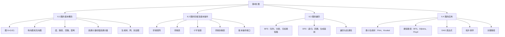

本章做题前先问五个问题：

1. 题目讨论的是无向图、有向图，还是带权图？
2. 图是连通、强连通、DAG，还是 AOV/AOE 网？
3. 存储结构是邻接矩阵还是邻接表？复杂度往往直接由它决定。
4. 算法是在“选顶点”还是“选边”？Prim、Dijkstra 偏选顶点，Kruskal 偏选边。
5. 题目问的是最小生成树还是最短路径？二者不能互相替代。

---

# 6.1 图的基本概念

> [!example]- 原重点题目：本节逐题推导
> 以下保留原逐题分析的入口；原记录尚未逐题复核，若与本复盘有出入，以核对后的结论为准。
> - [[第六章重点题目#6.1-02：DFS 一次访问所有顶点能推出什么？]]
> - [[第六章重点题目#6.1-10：生成树、连通分量、极小/极大的区别]]
> - [[第六章重点题目#6.1-11：给定顶点数和边数，连通分量最多]]
> - [[第六章重点题目#6.1-12：强连通分量怎么判断？]]
> - [[第六章重点题目#6.1-13：环有多少棵生成树？]]

## 6.1.1 图的定义【🔥⚡ 必背+避坑｜停下来默背 1 遍 + 精读 1 分钟】

图由顶点集和边集组成，记为：

$$
G=(V,E)
$$

其中：

| 符号 | 含义 |
|---|---|
| $V(G)$ | 图 $G$ 的顶点集，必须非空 |
| $E(G)$ | 图 $G$ 的边集，可以为空 |
| $\lvert V\rvert$ | 顶点数 |
| $\lvert E\rvert$ | 边数或弧数 |

> [!WARNING]
> 线性表可以是空表，树可以是空树，但图不能是空图。图至少要有一个顶点，边集可以为空。

### 1. 有向图

若边有方向，称为有向边或弧。弧是顶点的有序对：

$$
\langle v,w\rangle
$$

其中 $v$ 是弧尾，$w$ 是弧头，表示从 $v$ 指向 $w$。

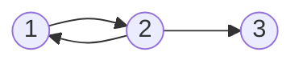

### 2. 无向图

若边没有方向，称为无向边。边是顶点的无序对：

$$
(v,w)=(w,v)
$$

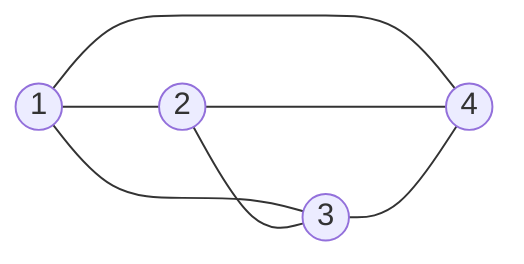

### 3. 简单图和多重图

简单图满足：

1. 不存在重复边。
2. 不存在顶点到自身的边。

多重图允许两个顶点之间有多条边，也允许自环。王道本章默认讨论简单图。

### 4. 顶点的度、入度和出度【🔥⚡ 必背+避坑｜停下来默背 1 遍 + 精读 1 分钟】

无向图中，顶点 $v$ 的度记为 $\mathrm{TD}(v)$，表示依附于该顶点的边数。

无向图有一个非常常用的公式：

$$
\sum_{v\in V}\mathrm{TD}(v)=2|E|
$$

因为每条无向边会贡献两个端点度数。

有向图中：

| 概念 | 记号 | 含义 |
|---|---|---|
| 入度 | $\mathrm{ID}(v)$ | 以 $v$ 为终点的弧数 |
| 出度 | $\mathrm{OD}(v)$ | 以 $v$ 为起点的弧数 |
| 度 | $\mathrm{TD}(v)$ | $\mathrm{ID}(v)+\mathrm{OD}(v)$ |

有向图也有两个常用公式：

$$
\sum_{v\in V}\mathrm{ID}(v)=\sum_{v\in V}\mathrm{OD}(v)=|E|
$$

$$
\sum_{v\in V}\mathrm{TD}(v)=2|E|
$$

> [!TIP]
> 选择题看到“所有顶点入度之和”，直接想到弧数；看到“所有顶点度数之和”，不管有向无向，都是 $2|E|$。
> 奇数度顶点的个数一定是偶数：因为<mark>所有顶点度数之和恒为边数两倍</mark>，而偶数度顶点不改变总和的奇偶性，因此奇数度顶点必有偶数个。有向图中的度按入度与出度之和计算；无向连通图<mark>存在欧拉路径充要条件奇度为零或二</mark>。 `[真题易错·2009-T07 / 2021-T41]`

- `【⚡ 真题补丁｜2009-T07】` 无向连通图性质三项辨析：全部顶点度之和恒为 $2|E|$ 必为偶（I 对）；$n$ 顶点树恰有 $n-1$ 条边而非必大于 $n-1$（II 错）；环图或 $K_n(n\ge 3)$ 均无度为 1 的顶点（III 错）。
- `【⚡ 真题补丁｜2021-T41】` 判定无向连通图存在 EL 路径：统计邻接矩阵各行之和，若奇度顶点数 `count == 0 || count == 2` 则返回 1，否则返回 0（时间 $O(n^2)$、空间 $O(1)$）。

> [!example] 由度数和求顶点数下界（2017）
> 无向图有 16 条边，总度数为 32。已知 3 个顶点度为 4、4 个顶点度为 3，贡献 $3\times4+4\times3=24$；<mark>其余顶点尽量取最大可能度求最小点数</mark>，剩余度数 8 至少需要 4 个顶点。因此顶点数至少为 $3+4+4=11$；该下界在题设条件下可以达到。 `[真题·2017-T07]`

> [!NOTE]
> 有 $n$ 个顶点的简单有向图中，单个顶点的最大度数可达 $2(n-1)$：最多有 $n-1$ 条入弧和 $n-1$ 条出弧。

### 5. 路径、路径长度和回路【🔥⚡ 必背+避坑｜停下来默背 1 遍 + 精读 1 分钟】

从顶点 $v_p$ 到 $v_q$ 的一条路径，是顶点序列：

$$
v_p,v_{i_1},v_{i_2},\dots,v_{i_m},v_q
$$

路径长度是路径上边的条数。第一个顶点和最后一个顶点相同的路径称为回路或环。

若一个**无向图**有 $n$ 个顶点，且边数大于 $n-1$，则图中一定存在环。反过来不成立：边数不超过 $n-1$ 时，也可能有环，例如某个小连通分量内部成环，其他顶点孤立。对 $n$ 顶点无环有向图，因为<mark>简单路径不重复顶点最多含n减一条边</mark>（最长字符序列长 $n-1$），而有环图可绕出任意长度序列。 `[真题易错·2026-T07]`

- `【⚡ 真题补丁｜2026-T07】` $n$ 顶点有向图路径串集合 $S$ 四辨析：无环则不重顶点故 $S$ 有穷（A 对）、最多 $n-1$ 边故不存在长 $n$ 串（B 错）；有环可绕行故既有大于 $n$ 串（C 对），也必有经最短路进环的小于 $2n$ 串（D 对）。

### 6. 简单路径和简单回路【🔥⚡ 必背+避坑｜停下来默背 1 遍 + 精读 1 分钟】

> [!IMPORTANT] 顶点度与回路（2025）
> 有限简单无向图中，<mark>若各顶点度均不小于二则必存在回路</mark>。 `[真题易错·2025-T06]` 取一条最长简单路径，其端点除路径上的相邻点外至少还有一个邻点；若这个邻点不在路径上，路径可继续延长，与最长矛盾。因此这个邻点在路径上，与路径的一段共同构成回路。

| 概念 | 定义 |
|---|---|
| 简单路径 | <mark>路径序列中顶点不重复出现</mark>（一般回路可重经中间点，非简单路径） `[真题易错·2011-T08]` |
| 简单回路 | 除第一个和最后一个顶点相同外，其余顶点不重复 |

### 7. 距离

从 $u$ 到 $v$ 的最短路径长度称为距离。若不存在路径，则距离为 $\infty$。

### 8. 子图和生成子图

设 $G=(V,E)$，$G'=(V',E')$。若 $V'\subseteq V$ 且 $E'\subseteq E$，并且 $E'$ 中边关联的顶点都在 $V'$ 中，则 $G'$ 是 $G$ 的子图。

若 $V(G')=V(G)$，则 $G'$ 是 $G$ 的生成子图。

> [!WARNING]
> 不是任意顶点子集和边子集都能构成子图。边所关联的顶点必须也被选入顶点集。

### 9. 连通、连通图和连通分量【🔥⚡ 必背+避坑｜停下来默背 1 遍 + 精读 1 分钟】

在无向图中，若从 $v$ 到 $w$ 存在路径，则称 $v$ 和 $w$ 连通。

| 概念 | 含义 |
|---|---|
| 连通图 | 任意两个顶点都连通的无向图 |
| 非连通图 | 至少存在两个顶点不连通 |
| 连通分量 | 无向图中的极大连通子图 |

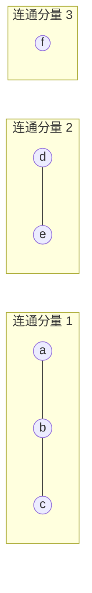

常用边数结论：

| 条件 | 结论 |
|---|---|
| 无向连通图有 $n$ 个顶点 | 至少有 $n-1$ 条边 |
| 无向图边数少于 $n-1$ | <mark>边数少于顶点数减一必定非连通</mark> `[真题易错·2022-T06]` |
| 无向连通图恰有 $n-1$ 条边 | 一定是一棵树 |
| $n\ge2$ 的简单无向非连通图最多有多少条边 | $\dfrac{(n-1)(n-2)}{2}$，即 $n-1$ 个顶点构成完全图，另 1 个顶点孤立 |

- `【⚡ 真题补丁｜2022-T06】` 无向图边数与连通性四项：当 $|V|>|E|+1$ 即 $|E|<|V|-1$ 时必不连通（D 对）；$|V|>|E|$ 或 $|V|<|E|$ 均可能因孤立点成非连通或全通（A/B 错）；$|V|=|E|-1$ 可构成连通图（C 错）。

> [!IMPORTANT]
> **连通极值陷阱**：
> 1. 无向连通图的最少边数是 $n-1$，此时图是一棵树。
> 2. 当 $n\ge2$ 时，<mark>保证简单无向图必然连通最少边数</mark>需 $\dfrac{(n-1)(n-2)}{2}+1$ 条边。思路是：非连通图最多能让 $n-1$ 个顶点构成完全图，另 1 个顶点孤立；再多 1 条边就必然连通（如 7 顶点至少 16 条边）。 `[真题易错·2010-T07]`

> [!TIP]
> **给定 $n\ge1$ 个顶点、$e$ 条边，求简单无向图最多有几个连通分量**：
> 1. 若 $e=0$，所有顶点都是孤立点，连通分量数为 $n$。
> 2. 若 $e>0$，为使连通分量尽量多，把边放入尽可能少的顶点中，其余顶点保持孤立；找满足 $\dfrac{k(k-1)}{2}\ge e$ 的最小正整数 $k$。
> 3. 此时最大连通分量数为 $(n-k)+1$。其中 $k$ 个顶点构成一个非孤立连通分量，剩余 $n-k$ 个顶点各自为一个连通分量。

### 10. 强连通图和强连通分量

在有向图中，若 $v$ 到 $w$ 有路径，且 $w$ 到 $v$ 也有路径，则称 $v$ 和 $w$ 强连通。

| 概念 | 含义 |
|---|---|
| 强连通图 | 任意一对顶点都强连通的有向图 |
| 强连通分量 | 有向图中的极大强连通子图 |

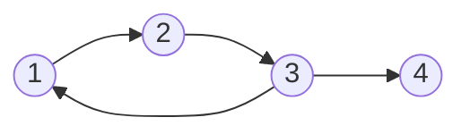

上图中 $\{1,2,3\}$ 是一个强连通分量，顶点 4 不是该强连通分量的一部分。

> [!TIP]
> 无向图讨论“连通”，有向图讨论“强连通”。有向强连通图若有 $n$ 个顶点且 $n\ge 2$，至少需要 $n$ 条弧，例如一个有向环。

### 11. 生成树和生成森林

连通图的生成树是包含全部顶点的极小连通子图。若图有 $n$ 个顶点，则任一生成树都恰有 $n-1$ 条边。

生成树有两个典型性质：

1. 删除任意一条边，图变为非连通。
2. 添加任意一条原图中的非树边，会形成回路。

非连通图中，每个连通分量的生成树共同构成生成森林。

> [!NOTE]
> **森林计算公式**：设森林中顶点总数为 $n$，边数为 $e$，树的棵数为 $k$，则有
> $$
> k=n-e
> $$
> 因为每棵树都满足“边数 = 顶点数 - 1”，把每棵树累加即可。


> [!IMPORTANT]
> 极大连通子图是连通分量，强调顶点和边尽量多；极小连通子图是生成树，强调保持连通但边尽量少。

### 12. 边的权、网和带权路径长度

边上的数值称为权值。带权图也称网。路径上所有边权值之和称为带权路径长度。

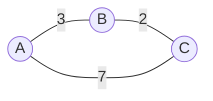

上图中，路径 $A\to B\to C$ 的带权路径长度为 $3+2=5$。

### 13. 完全图

| 图类型 | 最大边数 | 达到最大边数时 |
|---|---:|---|
| 无向简单图 | $\dfrac{n(n-1)}{2}$ | 无向完全图 |
| 有向简单图 | $n(n-1)$ | 有向完全图 |

有向完全图中，任意两个不同顶点之间都有方向相反的两条弧。

### 14. 稠密图和稀疏图

边数较少称为稀疏图，边数较多称为稠密图。一般可粗略认为：

$$
|E|<|V|\log_2|V|
$$

时是稀疏图。这个界限不是严格定义，主要用于帮助选择存储结构。

### 15. 有向树

有向树的底层无向图应连通；作为从根向外的有向树，恰有一个顶点入度为 0，其余顶点入度均为 1。仅有入度条件还不够：例如一个孤立顶点加一个有向环也满足上述入度计数，但不是一棵有向树。

---

# 6.2 图的存储及基本操作

> [!example]- 原重点题目：本节逐题推导
> 以下保留原逐题分析的入口；原记录尚未逐题复核，若与本复盘有出入，以核对后的结论为准。
> - [[第六章重点题目#6.2-01：邻接矩阵下三角为 0 与拓扑序列]]
> - [[第六章重点题目#6.2-10：邻接表边表结点个数的奇偶性]]
> - [[第六章重点题目#6.2-11：边表中出现次数为什么是入度？]]
> - [[第六章重点题目#6.2-13：建立无向图邻接表的时间复杂度]]
> - [[第六章重点题目#6.2-14：有向图邻接表中删除与某顶点相关的所有边]]
> - [[第六章重点题目#6.2-15：有向图邻接表中求某顶点入度]]
> - [[第六章重点题目#6.2-16：邻接表说法辨析]]

图的存储要完整反映顶点集和边集。第 6 章选择题里，存储结构往往直接决定空间复杂度、查找邻接点复杂度、求度数复杂度和遍历复杂度。

## 6.2.1 邻接矩阵法【🔥⚡ 必背+避坑｜停下来默背 1 遍 + 精读 1 分钟】

邻接矩阵用一个一维数组保存顶点信息，用一个二维数组保存边或弧的邻接关系。

设顶点编号为 $v_1,v_2,\dots,v_n$，邻接矩阵 $A$ 为 $n\times n$：

$$
A[i][j]=
\begin{cases}
1, & (v_i,v_j)\text{ 或 }\langle v_i,v_j\rangle\text{ 存在}\\
0, & \text{不存在}
\end{cases}
$$

带权图中：

$$
A[i][j]=
\begin{cases}
w_{ij}, & (v_i,v_j)\text{ 或 }\langle v_i,v_j\rangle\text{ 存在}\\
0\text{ 或 }\infty, & \text{不存在}
\end{cases}
$$

> [!TIP]
> 带权图对角线通常设为 0，不存在的边常设为 $\infty$。若边权允许为 0，就不能同时用 0 无歧义地表示“不存在边”；普通邻接矩阵常用 0/1 表示边是否存在。

邻接矩阵特点：

| 项目 | 结论 |
|---|---|
| 空间复杂度 | $O(n^2)$ |
| 适合图类型 | 稠密图 |
| 判断两点是否有边 | $O(1)$ |
| 查找某顶点所有邻接点 | 扫描一整行，$O(n)$ |
| 表示是否唯一 | 顶点编号固定时唯一 |

度数计算：对于**无自环的无权图 0/1 邻接矩阵**，按值为 1 的元素计数：

| 图类型 | 邻接矩阵中的计算方法 |
|---|---|
| 无向图 | 第 $i$ 行或第 $i$ 列中 1 的个数为 $\mathrm{TD}(v_i)$ |
| 有向图出度 | <mark>第i行非零或一的个数为出度</mark> `[真题·2013-T07 / 2023-T41]` |
| 有向图入度 | 第 $i$ 列中 1 的个数为 $\mathrm{ID}(v_i)$ |

带权矩阵按题设的无边标记识别实际边，不能笼统数非零元素：无边可能记为 $\infty$，真实边权也可能为 0；无自环时，排除对角线上的初始化值。

无向图的邻接矩阵一定是对称矩阵，实际存储时可只存上三角或下三角。

> [!IMPORTANT]
> 若 $A$ 是用 0/1 表示边的邻接矩阵，则普通矩阵乘法得到的 $A^k[i][j]$ 表示<mark>点对间长度为k的路径总条数</mark>；顶点和边可以重复，不能误认为只数简单路径。教材将此处称为长度为 $k$ 的路径数。 `[真题·2015-T42]`

## 6.2.2 邻接表法【🔥⚡ 必背+避坑｜停下来默背 1 遍 + 精读 1 分钟】

邻接表把每个顶点的邻接边用链表串起来，适合稀疏图。

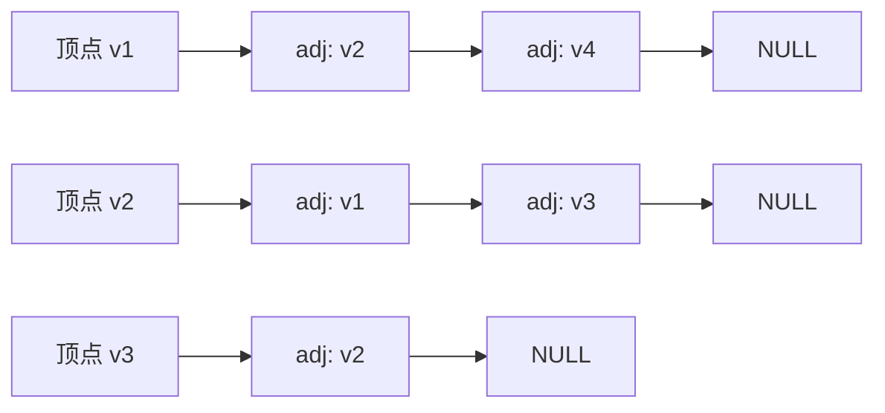

邻接表包含两类结点：

| 结点 | 主要字段 | 含义 |
|---|---|---|
| 顶点表结点 | `data`, `firstarc` | 保存顶点信息和第一条边的指针 |
| 边表结点 | `adjvex`, `nextarc`, `info` | 保存邻接点编号、下一条边指针，可选边权 |

空间复杂度：

| 图类型 | 空间复杂度 |
|---|---|
| 无向图 | $O(n+2e)$，每条边出现两次 |
| 有向图 | $O(n+e)$，每条弧出现一次 |

邻接表特点：

| 操作或性质 | 结论 |
|---|---|
| 查找某顶点所有邻接点 | 只遍历该顶点边表，较方便 |
| 判断 $x,y$ 是否有边 | 需查找 $x$ 的边表，不如邻接矩阵 |
| 无向图求顶点度 | 该顶点边表结点个数 |
| 有向图求出度 | 该顶点出边表结点个数 |
| 有向图求入度 | <mark>需要遍历全部顶点与边表统计</mark>（耗时 $O(\lvert V\rvert+\lvert E\rvert)$） `[真题易错·2026-T06]` |
| 表示是否唯一 | 不唯一，取决于边输入顺序 |

> [!TIP]
> **邻接表边结点奇偶性**：无向图的每条边在邻接表中存两次，所以边表结点总数一定为偶数，即 $2e$。若某图的邻接表边表结点总数为奇数，则该图必定是有向图。

> [!WARNING]
> 同一张图，邻接矩阵唯一；邻接表不唯一。因此同源点出发的 BFS/DFS 序列，邻接矩阵通常固定，邻接表可能因边表顺序不同而不同。

## 6.2.3 十字链表【📌 扫一眼｜确认“我还会”就过】

十字链表用于有向图。它把每条弧只存一次，同时让同一弧尾、同一弧头的弧都能被方便地串起来。

弧结点结构：

| `tailvex` | `headvex` | `hlink` | `tlink` | `info` |
|---|---|---|---|---|
| 弧尾顶点编号 | 弧头顶点编号 | 指向弧头相同的下一条弧 | 指向弧尾相同的下一条弧 | 可选信息 |

顶点结点结构：

| `data` | `firstin` | `firstout` |
|---|---|---|
| 顶点信息 | 指向第一条入弧 | 指向第一条出弧 |

十字链表的优势：

1. 容易找到以某顶点为尾的弧。
2. 容易找到以某顶点为头的弧。
3. 容易求入度和出度。
4. 表示不唯一，取决于弧输入顺序。

## 6.2.4 邻接多重表【🔥⚡ 必背+避坑｜停下来默背 1 遍 + 精读 1 分钟】

> [!IMPORTANT] 关联边计数（2024）
> 邻接多重表用于**无向图**。<mark>判断顶点的度须数所有依附它的边</mark>；不要把 `ivex`、`jvex` 当成弧头、弧尾。教材例题中，$b$ 关联 $(a,b),(b,d)$ 两条边，$d$ 关联 $(a,d),(b,d),(c,d),(d,e)$ 四条边，度分别为 **2、4**。 `[真题易错·2024-T04]`

邻接多重表用于无向图。邻接表中一条无向边会存成两个边表结点，而邻接多重表让每条无向边只用一个结点表示。

边结点结构：

| `ivex` | `ilink` | `jvex` | `jlink` | `info` |
|---|---|---|---|---|
| 边依附的一个顶点 | 指向依附于 `ivex` 的下一条边 | 边依附的另一个顶点 | 指向依附于 `jvex` 的下一条边 | 可选信息 |

顶点结点结构：

| `data` | `firstedge` |
|---|---|
| 顶点信息 | 指向依附于该顶点的第一条边 |

邻接多重表适合需要频繁处理无向图边的场景，例如删除边、判断边、访问同一条边的两个端点。

## 四种存储方式对比

设 $n=|V|$，$e=|E|$。

| 存储方式 | 适用对象 | 空间复杂度 | 找邻接边 | 表示是否唯一 |
|---|---|---|---|---|
| 邻接矩阵 | 稠密图（存稀疏图比邻接表更费空间） `[真题易错·2011-T08]` | $O(n^2)$ | 扫描行或列，$O(n)$ | 唯一 |
| 邻接表 | 稀疏图 | 无向 $O(n+2e)$，有向 $O(n+e)$ | 找出边方便，找入边较麻烦 | 不唯一 |
| 十字链表 | 有向图 | $O(n+e)$ | 入边和出边都方便 | 不唯一 |
| 邻接多重表 | 无向图 | $O(n+e)$ | 处理边较方便 | 不唯一 |

## 6.2.5 图的基本操作【📌 扫一眼｜确认“我还会”就过】

这些操作是后面 BFS、DFS、拓扑排序、最短路径等算法的抽象基础。

| 操作 | 含义 |
|---|---|
| `Adjacent(G,x,y)` | 判断是否存在边 $(x,y)$ 或弧 $\langle x,y\rangle$ |
| `Neighbors(G,x)` | 列出与 $x$ 邻接的边或顶点 |
| `InsertVertex(G,x)` | 插入顶点 |
| `DeleteVertex(G,x)` | 删除顶点及相关边 |
| `AddEdge(G,x,y)` | 添加边或弧 |
| `RemoveEdge(G,x,y)` | 删除边或弧 |
| `FirstNeighbor(G,x)` | 返回 $x$ 的第一个邻接点，不存在返回 -1 |
| `NextNeighbor(G,x,y)` | 返回 $x$ 在 $y$ 之后的下一个邻接点，不存在返回 -1 |
| `Get_edge_value(G,x,y)` | 获取边或弧权值 |
| `Set_edge_value(G,x,y,v)` | 设置边或弧权值 |

基本操作在不同存储结构下的时间复杂度：

| 基本操作 | 邻接矩阵 | 邻接表（有向图） | 邻接表（无向图） |
|---|---|---|---|
| 判断是否邻接 `Adjacent(G,x,y)` | $O(1)$ | $O(\mathrm{OD}(x))$ | $O(\mathrm{TD}(x))$ |
| 求顶点出度 $\mathrm{OD}(x)$ | $O(n)$ | $O(\mathrm{OD}(x))$ | 等同于求 $\mathrm{TD}(x)$ |
| 求顶点入度 $\mathrm{ID}(x)$ | $O(n)$ | $O(n+e)$，需扫描全表 | 等同于求 $\mathrm{TD}(x)$ |
| 删除顶点 `DeleteVertex(G,x)` | 清空行列为 $O(n)$；若压缩矩阵需移动大量元素，可达 $O(n^2)$ | $O(n+e)$，删除出边并扫描入边 | $O(n+e)$ |
| 删除边 `RemoveEdge(G,x,y)` | $O(1)$ | $O(\mathrm{OD}(x))$ | $O(\mathrm{TD}(x))$ |

> [!TIP]
> 王道后续许多伪代码通过 `FirstNeighbor` 和 `NextNeighbor` 抽象图的存储细节。看题时先判断底层是矩阵还是邻接表，再推复杂度。
> 邻接表实现 BFS/DFS 时，可用边结点指针沿 `nextarc` 依次扫描，使每个边结点只被访问常数次；若每找一个后继邻接点都从表头重新查找，则不能直接套用 $O(n+e)$。

---

# 6.3 图的遍历

> [!IMPORTANT] 遍历选择题判断步骤
> BFS 使用队列，发现顶点时就标记并<mark>按发现层序依次入队不跨层回退</mark>，同一顶点最多入队一次； `[真题·2013-T08]` DFS 总是先沿一个未访问邻接点深入，<mark>找不到未访问邻接点时才逐层回退</mark>。 `[真题·2016-T06]` 给定邻接表时按边表顺序模拟；只给出图而未限定邻接点顺序时，可能有多个合法序列。无向图从每个未访问顶点重新启动的次数等于连通分量数；有向图不能照搬这一结论。

> [!example]- 原重点题目：本节逐题推导
> 以下保留原逐题分析的入口；原记录尚未逐题复核，若与本复盘有出入，以核对后的结论为准。
> - [[第六章重点题目#6.3-02：图遍历说法判断]]
> - [[第六章重点题目#6.3-04：邻接表下 DFS/BFS 的时间复杂度和空间复杂度]]
> - [[第六章重点题目#6.3-07：DFS 序列判断]]
> - [[第六章重点题目#6.3-12：用 DFS 判断有向图是否有回路]]

图的遍历是从某个顶点出发，沿边访问图中顶点，并保证每个顶点只访问一次。

与树相比，图更容易出现回路，所以遍历图必须设置访问标记数组：

```text
visited[i] = true / false
```

## 6.3.1 广度优先搜索 BFS【🔥⚡ 必背+避坑｜停下来默背 1 遍 + 精读 1 分钟】

BFS 类似树的层序遍历。它从起点出发，先访问距离为 1 的顶点，再访问距离为 2 的顶点，按层向外扩展。

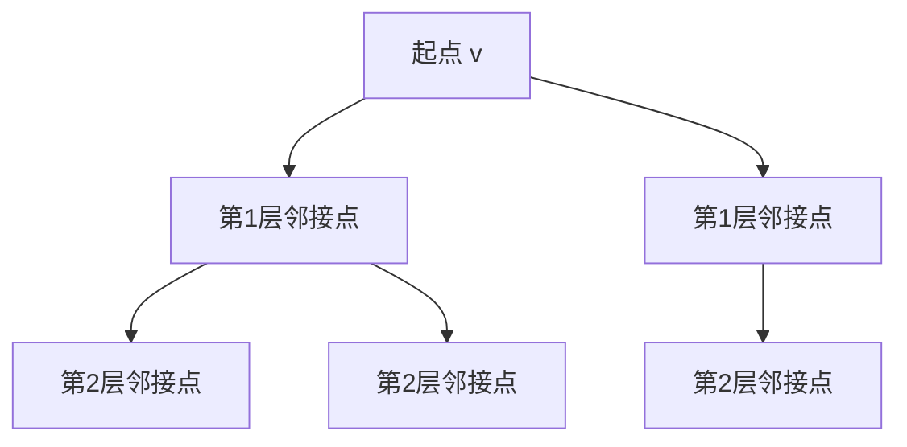

BFS 的核心工具是队列：

```text
访问起点并入队
while 队列非空:
    队首顶点出队
    依次检查它的所有邻接点
    若邻接点未访问:
        访问并入队
```

BFS 的关键特点：

| 项目 | 结论 |
|---|---|
| 数据结构 | 队列 |
| 搜索方式 | 分层扩展 |
| 与树遍历关系 | 类似层序遍历 |
| 是否递归 | 通常非递归 |
| 可解决问题 | 无权图单源最短路径 |
| 辅助空间 | 最坏 $O(n)$ |

### BFS 时间复杂度【📌 扫一眼｜确认“我还会”就过】

| 存储结构 | 时间复杂度 | 原因 |
|---|---|---|
| 邻接矩阵 | $O(n^2)$ | 每访问一个顶点都要扫描一整行 |
| 邻接表 | $O(n+e)$ | <mark>每个顶点与每条边只访问常数次</mark> `[真题·2012-T05]` |

### BFS 求无权图单源最短路径【🔥⚡ 必背+避坑｜停下来默背 1 遍 + 精读 1 分钟】

无权图中，每条边都可视为长度 1。BFS 按边数递增顺序访问顶点，因此某顶点第一次被访问时，从源点到它的路径就是最短路径。若带权图所有边权均为同一非负常数（例如均为 1），<mark>最少边数路径也是最小权值路径</mark>，BFS 同样可用；边权不等时，BFS 一般不能保证权值最小。 `[真题·2023-T06]`

- `【⚡ 真题补丁｜2023-T06】` 边权全为 1 的无向图求单源最短路三算法辨析：BFS（III 对）逐层扩展即最优；Prim（I 错）与 Kruskal（II 错）只求总权最小生成树，不保证单源距离最短。

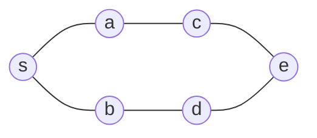

从 $s$ 开始，$a,b$ 是距离 1，$c,d$ 是距离 2，$e$ 是距离 3。BFS 能自然得到这些距离。

### 广度优先生成树

BFS 遍历过程中第一次访问某顶点所经过的边，会构成广度优先生成树。

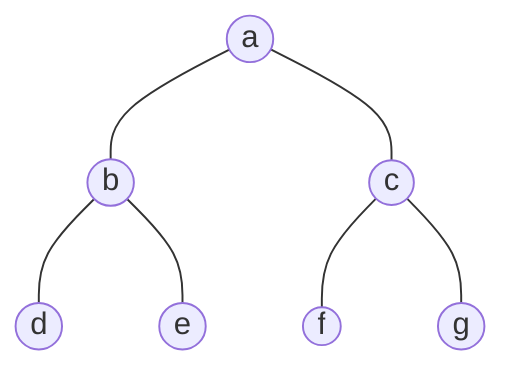

> [!IMPORTANT]
> 邻接矩阵表示唯一，所以固定起点和扫描顺序时 BFS 生成树唯一。邻接表边表顺序不唯一，所以 BFS 生成树可能不唯一。

## 6.3.2 深度优先搜索 DFS【🔥 必背｜停下来默背 1 遍】

DFS 类似树的先序遍历。它从起点出发，沿一个未访问邻接点尽可能向深处走；走不动时回退，再尝试其他未访问邻接点。

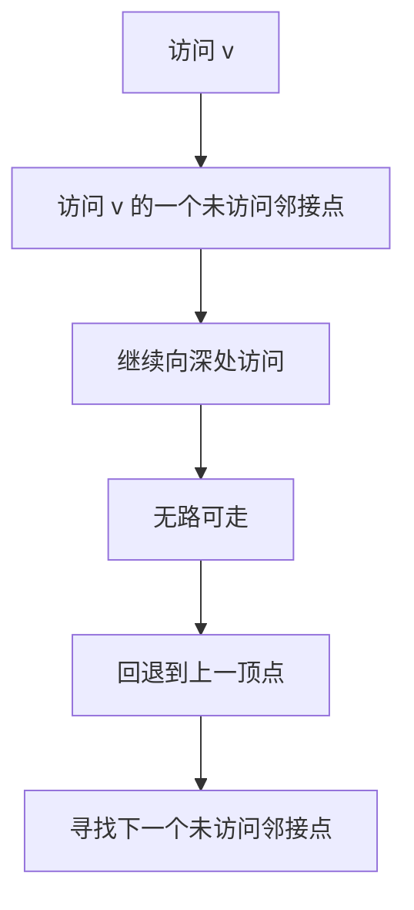

DFS 的核心是递归工作栈：

```text
DFS(v):
    visit(v)
    visited[v] = true
    for 每个邻接点 w:
        if !visited[w]:
            DFS(w)
```

> [!TIP]
> **DFS 判环机制**：
> 1. 无向图中，DFS 过程中若遇到已访问顶点，且该顶点不是当前顶点的双亲，则存在环。
> 2. 有向图中，DFS 过程中若遇到一条指向“已访问且仍在递归工作栈中”的祖先顶点的边，即回边，则存在有向环。

> [!example] DFS 遍历序列计数（2015）
> 有向图的弧为 $\langle v_0,v_1\rangle$、$\langle v_0,v_2\rangle$、$\langle v_0,v_3\rangle$、$\langle v_1,v_3\rangle$，从 $v_0$ 出发，按首先深入的邻接点分类：
> - 先选 $v_1$，必须继续访问 $v_3$，回溯后访问 $v_2$：$v_0,v_1,v_3,v_2$，共 1 种。
> - 先选 $v_2$，回溯后可先选 $v_1$ 或 $v_3$：$v_0,v_2,v_1,v_3$、$v_0,v_2,v_3,v_1$，共 2 种。
> - 先选 $v_3$，回溯后可先选 $v_1$ 或 $v_2$：$v_0,v_3,v_1,v_2$、$v_0,v_3,v_2,v_1$，共 2 种。
> 因此共有 $1+2+2=5$ 种。枚举不同方案时，应在分支处恢复该方案之前的访问状态；<mark>同一次遍历中回溯不撤销访问标记</mark>。 `[真题·2015-T05]`

DFS 的关键特点：

| 项目 | 结论 |
|---|---|
| 数据结构 | 递归栈，也可手动用栈 |
| 搜索方式 | 尽量深入，不能继续时回溯 |
| 与树遍历关系 | 类似先序遍历 |
| 辅助空间 | 最坏 $O(n)$ |

### DFS 时间复杂度

DFS 和 BFS 的时间复杂度都只取决于存储结构：

| 存储结构 | 时间复杂度 |
|---|---|
| 邻接矩阵 | $O(n^2)$ |
| 邻接表 | $O(n+e)$ |

### 深度优先生成树和生成森林

连通图从一个起点 DFS，可以得到一棵覆盖所有顶点的深度优先生成树。非连通图需要多次调用 DFS，每个连通分量得到一棵树，这些树构成深度优先生成森林。

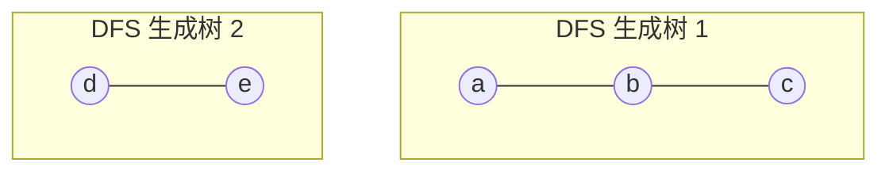

> [!NOTE]
> **遍历生成树高度性质**：对连通图从同一源点出发，广度优先生成树的高度总是小于或等于深度优先生成树的高度：
> $$
> H_{\text{BFS}}\le H_{\text{DFS}}
> $$
> 因为 BFS 按无权最短路径分层，源点到各顶点在 BFS 树中的层数最小。

## 6.3.3 图的遍历与连通性【📌 扫一眼｜确认“我还会”就过】

为了遍历整个图，BFS/DFS 的外层通常有一个 `for` 循环：若某个顶点未访问，就从它开始再次遍历。

对无向图：

| 情况 | 结论 |
|---|---|
| 图连通 | 从任一顶点出发，一次 BFS/DFS 可访问全部顶点 |
| 图非连通 | 一次 BFS/DFS 只能访问一个连通分量 |
| 外层调用 BFS/DFS 的次数 | 等于连通分量个数 |

对有向图：

1. 一次 BFS/DFS 只能访问从起点可达的顶点。
2. 即使图弱连通，也不一定能一次访问所有顶点。
3. 若从某点一次遍历能访问全部顶点，只能说明该点能到达所有顶点，不能直接说明图强连通。

> [!WARNING]
> “遍历一次访问全部顶点”在无向图中可用于判断连通；在有向图中不能直接得出强连通。

---

# 6.4 图的应用

> [!IMPORTANT] 真题常见区分
> **最小生成树**优化全树边权和，不保证树中两点路径为原图的最短路径；**最短路径**优化指定起终点的路径权和。Prim 在当前树与树外之间选最小边，Kruskal 按权值递增选边并避环。拓扑序由入度为 0 的顶点逐次删除得到；每步可选顶点都只有一个时，拓扑序唯一。AOE 网的关键路径是源点到汇点**持续时间最长**的路径；存在多条关键路径时，要缩短总工期，须让所有当前关键路径的长度都降低。
>
> 例如三角形 $A,B,C$ 的三条边权均为 1，选 $AB,BC$ 得到一棵最小生成树，但树中 $A$ 到 $C$ 的路径长为 2，原图直接边 $AC$ 的长度为 1。等权时 BFS 可求最短路径，最小生成树却不保证给出该路径（2023）。

本节是第 6 章最重要的部分。选择题常要求手工模拟算法过程，而不是写完整程序。

## 6.4.1 最小生成树【🔥⚡ 必背+避坑｜停下来默背 1 遍 + 精读 1 分钟】

> [!IMPORTANT] 最小边、最小生成树与唯一性（2012、2017）
> <mark>最小生成树总权值唯一但树形未必唯一</mark>。 `[真题易错·2012-T08]` 例如三个顶点两两相连且边权都为 1，任取两条边都是最小生成树，因此每条边虽都是最小权边，却不一定出现在所有最小生成树中。Prim 或 Kruskal 遇到同权候选边时，可得到不同的最小生成树；两种算法也可能得到同一棵。

- `【⚡ 真题补丁｜2012-T08】` MST 四辨析：同一连通网最小总代价唯一（I 对）；存在同最小权边时未必每条都必入选（II 错）；同权边致 Prim 不同起点或得不同树（III 错）；权互异时 Prim 与 Kruskal 所得相同（IV 错）。

**最小生成树**针对的是**带权连通无向图**；实际如<mark>光缆铺设总代价最小化结合跳数约束</mark>时需在多种生成树方案间校核。 `[真题·2018-T42]`

生成树包含所有顶点，且恰有 $n-1$ 条边。若一棵生成树的边权之和最小，则称为最小生成树，简称 MST。

最小生成树性质：

| 性质 | 说明 |
|---|---|
| 边数 | 一定是 $n-1$ |
| 总权值 | 所有生成树中最小 |
| 是否唯一 | <mark>边权互不相同唯一同权时可能不唯一</mark> `[真题易错·2017-T42]` |
| 总权值是否唯一 | 即使 MST 不唯一，最小总权值也相同 |
| 原图本身是树 | MST 就是原图本身 |

- `【⚡ 真题补丁｜2017-T42】` 最小生成树唯一的常用充分条件（答任一等价即可）：① 图中所有边的权值互不相等；② 对图中任意环，其最大权值的边唯一（即每次加边时跨割集最小权边唯一）。

> [!WARNING]
> 最小生成树只保证整棵树的边权总和最小，不保证任意两个顶点之间路径最短。

> [!IMPORTANT]
> **最小生成树边权陷阱**：MST 选出的 $n-1$ 条边不一定是全图权值最小的 $n-1$ 条边。某条很小的边如果加入后会成环，也不能选；某条已选树边的权值也可能大于某条未选非树边。

> [!TIP]
> **破圈法理解 MST**：在带权连通无向图中，如果某个环上有一条权值严格最大的边，那么这条边不可能出现在任何最小生成树中。选择题里可用它判断“某条边一定不属于 MST”。若环上最大权值不唯一，要注意 MST 可能不唯一，不能随意断定某一条并列最大边一定不选。

例如：

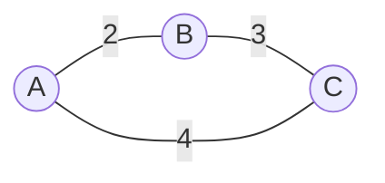

若 MST 选 $A-B$ 和 $B-C$，总权值为 5，但图中 $A$ 到 $C$ 的最短路径是直接边，长度为 4。

### MST 的核心贪心性质

设 $U$ 是顶点集 $V$ 的一个非空子集。若边 $(u,v)$ 满足 $u\in U$、$v\in V-U$，且是所有跨越 $U$ 与 $V-U$ 的边中权值最小的一条，则一定存在一棵 MST 包含这条边。

这就是 Prim 和 Kruskal 的共同基础。

### 1. Prim 算法

Prim 从某个顶点开始，让生成树一点点“长大”。

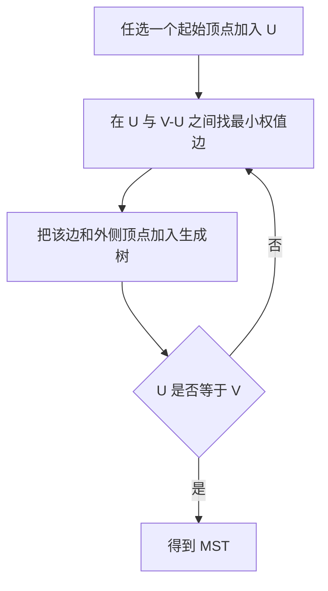

Prim 的过程：

1. 初始化 $U=\{u_0\}$，$E_T=\varnothing$。
2. 在所有一端属于 $U$、另一端属于 $V-U$ 的边中，选择权值最小的一条。
3. 将该边和新顶点加入树。
4. 重复，直到所有顶点都进入 $U$。

Prim 特点：

| 项目 | 结论 |
|---|---|
| 每轮增加 | 1 个顶点和 1 条边 |
| 主要思想 | 从当前树向外扩展最短边 |
| 时间复杂度 | 朴素实现 $O(n^2)$ |
| 适合图类型 | 稠密图 |
| 与 Dijkstra 相似处 | 都维护一个已确定顶点集合，并不断选一个最小值顶点 |

### 2. Kruskal 算法

Kruskal 从所有边中按权值从小到大选边，能选就选，成环就跳过。

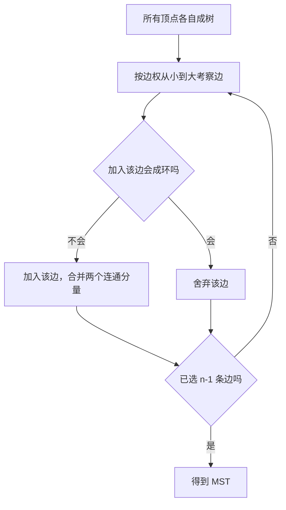

Kruskal 的过程：

1. 初始时，$T$ 含全部顶点但不含边，每个顶点自成一个连通分量。
2. 按权值递增顺序考察边。
3. 若当前边连接两个不同连通分量，则加入；否则舍弃。
4. 直到选出 $n-1$ 条边。

Kruskal 特点：

| 项目 | 结论 |
|---|---|
| 每轮增加 | 可能增加 1 条边 |
| 判断是否成环 | 常用并查集 |
| 时间复杂度 | 常写作 $O(e\log e)$ |
| 适合图类型 | 稀疏图 |

### Prim 和 Kruskal 对比

| 项目 | Prim | Kruskal |
|---|---|---|
| 出发点 | 从一个顶点开始扩展 | 从所有边开始筛选 |
| 每步选择对象 | 当前树到外部的最小边 | 全图当前未处理且不成环的最小边 |
| 中间状态 | 始终是一棵树 | 一个森林逐渐合并 |
| 适合 | 稠密图 | 稀疏图 |
| 复杂度 | $O(n^2)$ | $O(e\log e)$ |

> [!TIP] Prim 与 Kruskal 选边次序（2015、2020）
> Prim 每次选的边必须一端在当前树的顶点集 $U$ 中、一端在 $U$ 外；两端都在 $U$ 外的边，本轮不可能由 Prim 选中。<mark>Kruskal按边权升序并避环选边</mark>；仅凭边的两端都在 Prim 树外，不能断定 Kruskal 在本轮一定选它，还须比较边权并判断是否成环。 `[真题·2015-T06 / 2020-T07]`
> 例如先选权值为 5 的 $(v_1,v_4)$ 后，Prim 从 $v_4$ 出发时 $U=\{v_1,v_4\}$，第二条边不能是两端都在 $U$ 外的 $(v_2,v_3)$；Kruskal 可在权值同为 8 的候选边中先选不成环的 $(v_2,v_3)$。

## 6.4.2 最短路径【🔥⚡ 必背+避坑｜停下来默背 1 遍 + 精读 1 分钟】

最短路径可以分为：

1. 无权图单源最短路径：BFS。
2. 带权图单源最短路径：Dijkstra。
3. 所有顶点对之间最短路径：Floyd。

最短路径具有最优子结构：最短路径上的任意子路径，也是对应两个端点之间的最短路径。

### 1. Dijkstra 算法【🔥⚡ 必背+避坑｜停下来默背 1 遍 + 精读 1 分钟】

> [!IMPORTANT] 先选最小暂定距离，再完成松弛（2012、2016、2021）
> 某题从顶点 1 出发，按顶点 $2,3,4,5$ 的次序初始化 $dist=(26,3,\infty,6)$：先确定 3，松弛后为 $(25,3,\infty,6)$；再确定 5，完成该轮松弛后为 **$(21,3,14,6)$**。注意选点看的是<mark>源点到候选点的当前累计路径长度</mark>，不是仅比较最后一条边；题目询问某轮结束后的 $dist$ 时，不要遗漏该轮更新。 `[真题·2012-T07 / 2016-T08 / 2021-T08]`

Dijkstra 用于求带权图的单源最短路径，但不适用于带负权边的图。

核心辅助数组：

| 数组 | 含义 |
|---|---|
| `final[]` | 标记顶点是否已确定最短路径，即是否属于集合 $S$ |
| `dist[]` | 源点到各顶点当前已知的最短路径长度 |
| `path[]` | 记录最短路径上的前驱，用于回溯路径 |

基本过程：

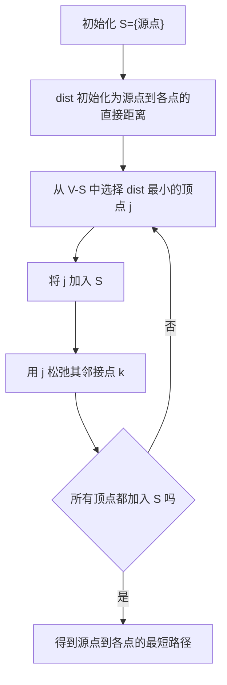

松弛条件：

$$
\text{若 }dist[j]+arcs[j][k]<dist[k]\text{，则更新 }dist[k]
$$

Dijkstra 特点：

| 项目 | 结论 |
|---|---|
| 适用 | 非负权图的单源最短路径 |
| 不适用 | 存在负权边的图 |
| 复杂度 | 朴素邻接矩阵实现 $O(n^2)$；邻接表加最小堆通常为 $O((n+e)\log n)$，连通图中可简写为 $O(e\log n)$ |
| 即使只求到某个终点 | 最坏仍为 $O(n^2)$ |

- `【⚡ 真题补丁｜2014-T42】` 路由拓扑如 OSPF 链路状态库抽象通常建模为带权无向图并用邻接表存储，再运行 Dijkstra 计算单源最短路径。

<mark>实际路由拓扑多建模成带权无向图与邻接表</mark>，再结合最短路径算法求解转发树。 `[真题易错·2014-T42]`

> [!WARNING]
> Dijkstra 的贪心逻辑是“已加入 $S$ 的顶点最短路径不再变化”。负权边会破坏这个前提；同时<mark>每步局部贪心选最近邻点不能求最短路</mark>，因为走入死胡同或先近后远无法回溯改路。 `[真题易错·2009-T41]`

### Prim 和 Dijkstra 的区别【📌 扫一眼｜确认“我还会”就过】

| 对比点 | Prim | Dijkstra |
|---|---|---|
| 目标 | 构造最小生成树 | 求单源最短路径 |
| 图类型 | 带权连通无向图 | 非负权图，可有向可无向 |
| 选择标准 | 离当前树最近的外部顶点 | 源点到该顶点当前距离最小 |
| 更新依据 | 顶点到当前树的最小边权 | 源点经已确定顶点到该点的最短距离 |
| 路径含义 | 不保证源点到各点最短 | 保证源点到各点最短 |

### 2. Floyd 算法

Floyd 用于求所有顶点对之间的最短路径。

定义：

$$
A^{(k)}[i][j]
$$

表示从 $v_i$ 到 $v_j$，只允许使用编号不超过 $k$ 的顶点作为中间顶点时的最短路径长度。

初始：

$$
A^{(-1)}[i][j]=arcs[i][j]
$$

递推：

$$
A^{(k)}[i][j]=\min\{A^{(k-1)}[i][j],A^{(k-1)}[i][k]+A^{(k-1)}[k][j]\}
$$

可理解为：

```text
允许顶点 k 作为中转点后，
检查 i -> k -> j 是否比原来的 i -> j 更短。
```

Floyd 特点：

| 项目 | 结论 |
|---|---|
| 用途 | 所有顶点对之间最短路径 |
| 核心结构 | 三重循环 |
| 时间复杂度 | $O(n^3)$ |
| 负权边 | 可以有 |
| 负权回路 | 不允许有 |
| 无向图 | 可把每条无向边看成两条反向同权弧 |

> [!WARNING] 无向图中的负权边
> 若无向边 $(u,v)$ 的权值 $w<0$，将它看作两条反向同权弧后，$u\to v\to u$ 构成权值为 $2w<0$ 的负权回路。按允许重复经过边的最短路模型，若起点可到达该回路且回路可到达终点，反复绕行会使该顶点对的路径权值无下界，因而不存在有限最短路径。**其他不受该负权回路影响的顶点对不一定无解**。

### 最短路径算法对比

| 算法 | 用途 | 无权图 | 带权图 | 负权边 | 负权回路 | 时间复杂度 |
|---|---|---|---|---|---|---|
| BFS | 单源最短路径 | 适用 | 边权均为同一非负常数时适用 | 一般不适用 | 不适用 | 矩阵 $O(n^2)$，邻接表 $O(n+e)$ |
| Dijkstra | 单源最短路径 | 适用 | 适用 | 不适用 | 不适用 | $O(n^2)$ |
| Floyd | 所有顶点对最短路径 | 适用 | 适用 | 适用 | 不适用 | $O(n^3)$ |

## 6.4.3 有向无环图描述表达式【🔥 必背｜停下来默背 1 遍】

有向无环图简称 DAG，是不含有向环的有向图。

DAG 可以有效表示含公共子表达式的代数表达式。<mark>合并共享重复子表达式可压缩顶点总数</mark>（如 $((x+y)+(x+y)/x)$ 最少只需 5 个顶点），让多个父结点共享它。 `[真题·2019-T06]`

例如表达式 $(a+b)\times(a+b)$：

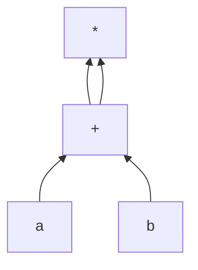

> [!TIP]
> 表达式 DAG 的关键是“公共子表达式共享”。在 DAG 表示中，不会为同一个公共子表达式重复建等价结点。

> [!TIP]
> **手算表达式 DAG 最少顶点数的规则**：
> 1. 先统计所有不同的变量和常量，它们作为叶子结点，不重复建点。
> 2. 再自底向上统计运算符结点。若两个子表达式的运算符相同，且左右操作数也对应相同，则复用已有结点。
> 3. 总顶点数 = 唯一操作数结点数 + 唯一运算符结点数。

## 6.4.4 拓扑排序【🔥⚡ 必背+避坑｜停下来默背 1 遍 + 精读 1 分钟】

AOV 网是用有向无环图表示工程活动的网络：

| 元素 | 含义 |
|---|---|
| 顶点 | 活动 |
| 有向边 $\langle V_i,V_j\rangle$ | 活动 $V_i$ 必须先于 $V_j$ 进行 |

拓扑排序是把 DAG 中的顶点排成一个线性序列，使得：

1. 每个顶点恰好出现一次。
2. 若存在从 $A$ 到 $B$ 的路径，则 $A$ 必须排在 $B$ 之前。<mark>每步只能从未输出集合选入度为零点</mark>（有前驱未输出时不可抢先输出）。 `[真题·2014-T07 / 2018-T07 / 2021-T07]`

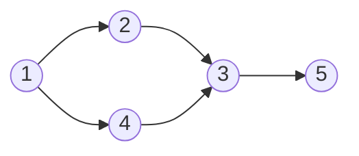

上图的一个拓扑序列是：

```text
1, 2, 4, 3, 5
```

### 拓扑排序步骤

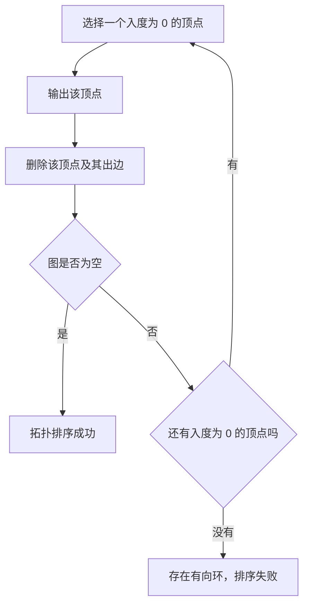

实现时常用栈或队列保存当前入度为 0 的顶点。

复杂度：

| 存储结构 | 时间复杂度 |
|---|---|
| 邻接表 | <mark>拓扑排序遍历全部顶点和边表</mark> $O(n+e)$ `[真题·2016-T07]` |
| 邻接矩阵 | $O(n^2)$ |

### 拓扑排序与环【🔥 必背｜停下来默背 1 遍】

| 情况 | 结论 |
|---|---|
| DAG | <mark>存在完整拓扑序当且仅当有向图无环</mark> `[真题易错·2011-T08]` |
| 拓扑排序过程中所有顶点都输出 | 无环 |
| 尚有顶点未输出但无入度为 0 的顶点 | 有环 |

- `【⚡ 真题补丁｜2011-T08】` 图综合三辨析：简单路径不重顶点，一般回路可重经过某点（I 错）；稀疏图邻接矩阵 $O(V^2)$ 比邻接表更耗空间（II 错）；有拓扑序列必无有向环（III 对）。

### 拓扑序列是否唯一【🔥⚡ 必背+避坑｜停下来默背 1 遍 + 精读 1 分钟】

> [!TIP] 拓扑序列个数（2010）
> <mark>每遇到多个入度为零点就分别分支计数</mark>，继续删除并在分支结束后汇总；也可先列出所有先后约束。 `[真题·2010-T08]` 比如 $a$ 必须最先、$d$ 必须最后、$b$ 必须在 $c$ 前，而 $e$ 可放在 $b,c$ 的前、中、后三个位置，则共有 3 种序列。

拓扑序列可能不唯一。

选择题常用判断方法：

1. <mark>每一步入度为零的顶点都恰只有一个</mark>（且共输出 $|V|$ 步），则拓扑序列唯一。 `[真题易错·2024-T41]`
2. 对 DAG，若某一步有多个入度为 0 的顶点可选，则拓扑序列不唯一：先选其中不同顶点，都能继续得到完整拓扑序。

更强的说法：若 AOV 网中任意两个顶点之间都有明确的先后关系，即存在某个方向的路径，则拓扑序列唯一。

> [!WARNING]
> **拓扑序列唯一性陷阱**：拓扑序列唯一，不能唯一确定一个有向无环图的结构。例如图 1 为 $A\to B\to C$，图 2 在此基础上再加一条 $A\to C$，二者拓扑序列都唯一为 $A,B,C$，但边集不同。

### DFS 实现拓扑排序【🔥⚡ 必背+避坑｜停下来默背 1 遍 + 精读 1 分钟】

对 DAG 进行 DFS 后，将所有顶点按“完成时间”降序排列，可以得到一个拓扑序列。

原因是：对 DAG 中每条边 $u\to v$，DFS 检查该边时，若 $v$ 尚未发现，则递归访问 $v$ 并先于 $u$ 完成；若 $v$ 已发现，则它不能是尚未结束的 DFS 祖先，否则形成有向环，所以它已经完成。因此 $v$ 的完成时间早于 $u$，完成时间降序满足每条边的先后约束。<mark>递归退出时直接输出得逆拓扑序</mark>，反转后才是拓扑序。 `[真题易错·2020-T06]`

- `【⚡ 真题补丁｜2020-T06】` 递归 DFS 退出前输出顶点：越深越无出度的后继越先返回，故产生**逆拓扑有序序列**（B 对）；反转后才是拓扑序（A 错），进入时输出才是普通 DFS 序（D 错）。

### 逆拓扑排序【📌 扫一眼｜确认“我还会”就过】

逆拓扑排序从没有后继的顶点开始：

1. 选择一个出度为 0 的顶点并输出。
2. 删除该顶点及所有以它为终点的边。
3. 重复直到图为空。

### 拓扑排序与邻接矩阵【🔥⚡ 必背+避坑｜停下来默背 1 遍 + 精读 1 分钟】

若按拓扑序列重新给顶点编号，则 DAG 的邻接矩阵可以变成**严格上三角矩阵**（主对角线及其以下均为 0）。反过来，若邻接矩阵能通过顶点重排变成严格上三角矩阵，则它一定是 DAG；若只说一般上三角，须另加无自环条件。

> [!NOTE]
> 邻接矩阵经重排后成为严格上三角矩阵，说明图无环，<mark>因此拓扑序列一定存在但未必唯一</mark>。 `[真题易错·2012-T06]`

- `【⚡ 真题补丁｜2012-T06】` 邻接矩阵下三角（含主对角线）全为 0 意味着仅存 $i<j$ 有向边（DAG），此时 `0,1,...,n-1` 即为一个合法拓扑序列，故拓扑序列必然存在，但是否唯一需看入度零队列是否每轮单选。

## 6.4.5 关键路径【🔥⚡ 必背+避坑｜停下来默背 1 遍 + 精读 1 分钟】

AOE 网是用边表示活动的带权有向无环图：

| 元素 | 含义 |
|---|---|
| 顶点 | 事件 |
| 有向边 | 活动 |
| 边权 | 活动持续时间或开销 |

AOV 和 AOE 的区别：

| 网络 | 顶点 | 边 | 是否带权 |
|---|---|---|---|
| AOV 网 | 活动 | 活动先后关系 | 通常无权 |
| AOE 网 | 事件 | 活动 | 带权 |

AOE 网通常有一个源点和一个汇点：

| 顶点 | 特征 | 含义 |
|---|---|---|
| 源点 | 入度为 0 | 工程开始 |
| 汇点 | 出度为 0 | 工程结束 |

### 关键路径和关键活动【🔥⚡ 必背+避坑｜停下来默背 1 遍 + 精读 1 分钟】

<mark>从源点到汇点路径权值和最大路径为关键路径</mark>（并非边数最多路径）。关键路径上的活动称为关键活动。 `[真题易错·2011-T41 / 2020-T08]`

- `【⚡ 真题补丁｜2020-T08】` 关键路径四辨析：关键路径是权值和最大而非边数最多（A 错、B 对）；延长任一关键活动必延误工期（C 错）；缩短单个关键活动未必缩短工期，因可能存在多条并行关键路径（D 错）。

工程最短完成时间 = 关键路径长度。

```mermaid
flowchart LR
    V1((v1)) -->|3| V2((v2))
    V1 -->|2| V3((v3))
    V2 -->|2| V4((v4))
    V3 -->|4| V4
    V2 -->|3| V5((v5))
    V3 -->|3| V6((v6))
    V4 -->|2| V6
    V5 -->|1| V6
```

上图中可重点比较从 $v_1$ 到 $v_6$ 的多条路径长度，最长路径决定总工期。

### 1. 事件最早发生时间 $v_e(k)$

$v_e(k)$ 表示从源点到事件 $v_k$ 的最长路径长度，也就是事件 $v_k$ 最早能发生的时间。

源点：

$$
v_e(\text{源点})=0
$$

递推：

$$
v_e(k)=\max\{v_e(j)+Weight(v_j,v_k)\}
$$

计算方向：按拓扑序从前往后推。

### 2. 事件最迟发生时间 $v_l(k)$

$v_l(k)$ 表示在不推迟整个工程完成时间的前提下，事件 $v_k$ 最迟必须发生的时间。

汇点：

$$
v_l(\text{汇点})=v_e(\text{汇点})
$$

递推：

$$
v_l(k)=\min\{v_l(j)-Weight(v_k,v_j)\}
$$

计算方向：按逆拓扑序从后往前推。

### 3. 活动最早开始时间 $e(i)$

若活动 $a_i$ 对应边 $\langle v_k,v_j\rangle$，则：

$$
e(i)=v_e(k)
$$

活动最早开始时间等于其起点事件的最早发生时间。

### 4. 活动最迟开始时间 $l(i)$

若活动 $a_i$ 对应边 $\langle v_k,v_j\rangle$，则：

$$
l(i)=v_l(j)-Weight(v_k,v_j)
$$

活动最迟开始时间等于其终点事件的最迟发生时间减去活动持续时间。

### 5. 时间余量 $d(i)$

$$
d(i)=l(i)-e(i)
$$

若：

$$
d(i)=0
$$

则活动 $a_i$ 是关键活动。

### 求关键路径步骤

```mermaid
flowchart TD
    A["按拓扑序计算所有事件 ve"] --> B["按逆拓扑序计算所有事件 vl"]
    B --> C["对每条活动边计算 e(i)"]
    C --> D["对每条活动边计算 l(i)"]
    D --> E["计算 d(i)=l(i)-e(i)"]
    E --> F["d(i)=0 的活动为关键活动"]
    F --> G["关键活动连成关键路径"]
```

手算时建议按这个顺序列两张表：

| 事件 | $v_e$ | $v_l$ |
|---|---:|---:|
| $v_1$ |  |  |
| $v_2$ |  |  |
| $\dots$ |  |  |

| 活动 | 起点 | 终点 | 权值 | $e(i)$ | $l(i)$ | $d(i)$ |
|---|---|---|---:|---:|---:|---:|
| $a_1$ |  |  |  |  |  |  |
| $a_2$ |  |  |  |  |  |  |

### 关键路径注意点【🔥⚡ 必背+避坑｜停下来默背 1 遍 + 精读 1 分钟】

> [!IMPORTANT] 活动时间与多条关键路径（2013、2019、2022、2025）
> - 对活动 $d=\langle v_2,v_4\rangle$，持续时间 7，若 $v_e(2)=12$、$v_l(4)=21$，则 **最早开始** $e(d)=12$，<mark>最迟开始等于终点最迟减去活动持续</mark> $l(d)=21-7=14$，余量为 2。不要用活动起点的最迟发生时间直接代替 $l(d)$。 `[真题·2019-T05]`
> - 比较余量时，对每条弧分别算 $d(i)=v_l(\text{终点})-v_e(\text{起点})-\text{持续时间}$；<mark>先算全网最早最迟再比各边时间余量</mark>（例如四个候选余量依次为 2、6、2、2 时，第二项才最大）。 `[真题·2022-T07]`
> - 若当前关键路径为 $b\!\to d\!\to c\!\to g$、$b\!\to d\!\to e\!\to h$ 和 $b\!\to f\!\to h$，则同时加快 $d$ 与 $f$ 可以覆盖三条关键路径，<mark>多条关键路径须同时缩短全部关键链</mark>（不要求单个活动为全部路径共有）。 `[真题易错·2013-T09]`

1. 关键路径可能不止一条。
2. 关键路径上的活动全是关键活动。
3. 关键活动延误，整个工程一定延误。
4. 加快某个关键活动不一定能缩短总工期，因为关键路径可能转移。
5. 若有多条关键路径，要缩短总工期，必须使**所有当前关键路径**均缩短。可以加快它们共有的活动，也可以同时加快分别覆盖所有关键路径的一组活动；<mark>延期或压缩某活动须连带核验后续链条</mark>，判断非关键路径是否转为新的关键路径。 `[真题易错·2025-T42]`

### 图算法复杂度总表

设 $n=|V|$，$e=|E|$。

| 算法 | 常用存储 | 时间复杂度 | 适用或用途 |
|---|---|---|---|
| BFS | 邻接矩阵 | $O(n^2)$ | 遍历、无权图单源最短路径 |
| BFS | 邻接表 | $O(n+e)$ | 遍历、无权图单源最短路径 |
| DFS | 邻接矩阵 | $O(n^2)$ | 遍历、连通性、拓扑相关 |
| DFS | 邻接表 | $O(n+e)$ | 遍历、连通性、拓扑相关 |
| Prim | 邻接矩阵 | $O(n^2)$ | MST，稠密图 |
| Kruskal | 边集数组、并查集 | $O(e\log e)$ | MST，稀疏图 |
| Dijkstra | 邻接矩阵；邻接表加堆 | 朴素 $O(n^2)$；堆优化通常 $O((n+e)\log n)$ | 非负权单源最短路径 |
| Floyd | 邻接矩阵 | $O(n^3)$ | 所有顶点对最短路径 |
| 拓扑排序 | 邻接表 | $O(n+e)$ | DAG/AOV 网 |
| 关键路径 | 邻接表 | $O(n+e)$ | AOE 网 |

---

# 本章选择题做题套路

## 1. 看到“度数”先分有向无向

无向图：度数和等于 $2e$。

有向图：入度和 = 出度和 = $e$，总度数和 = $2e$。

## 2. 看到“连通”先判断图类型

无向图看连通分量；有向图看强连通分量。不要把“可达所有点”直接当成“强连通”。

## 3. 看到“边数”先想几个极值

| 场景 | 边数 |
|---|---|
| 无向完全图 | $\dfrac{n(n-1)}{2}$ |
| 有向完全图 | $n(n-1)$ |
| 连通无向图最少边 | $n-1$ |
| 强连通有向图最少弧 | $n$（$n\ge 2$） |
| 生成树边数 | $n-1$ |

## 4. 看到“遍历序列”先看存储结构

邻接矩阵固定编号和扫描顺序时，遍历序列通常唯一。邻接表受边表顺序影响，BFS/DFS 序列可能不唯一。

## 5. 看到“MST”不要套最短路径

最小生成树只管总权值最小，不管任意两点路径是否最短。

## 6. 看到“最短路径”先判断边权

| 图 | 首选算法 |
|---|---|
| 无权图单源最短路径 | BFS |
| 非负权图单源最短路径 | Dijkstra |
| 所有顶点对最短路径 | Floyd |
| 有负权边但无负权环 | Floyd 可用，Dijkstra 不可用 |

## 7. 看到“拓扑排序”先找入度 0

每次输出入度为 0 的顶点，再删除它的出边。若图未空但没有入度为 0 的顶点，则存在有向环。

## 8. 看到“关键路径”先列 $v_e$ 和 $v_l$

关键活动满足：

$$
e(i)=l(i)
$$

或：

$$
d(i)=l(i)-e(i)=0
$$

---

# 本章易错点

## 1. 图不能没有顶点

边集可以为空，顶点集不能空。

## 2. 无向图的连通分量是极大连通子图

“极大”不是边数最少，而是不能再加入顶点或边仍保持连通分量意义。

## 3. 生成树是极小连通子图

“极小”强调边数少到不能再删，恰好 $n-1$ 条边。

## 4. 邻接矩阵适合稠密图，邻接表适合稀疏图

邻接矩阵判断边快，邻接表找邻接点省空间。

## 5. 有向图邻接表求入度不方便

出度看自己的边表，入度要扫所有边表。十字链表能同时方便处理入边和出边。

## 6. BFS 能求无权图最短路径

这是因为 BFS 分层访问，第一次访问到某顶点时路径长度最短。

## 7. DFS/BFS 的时间复杂度与访问顺序无关

复杂度主要由存储结构决定：矩阵 $O(n^2)$，邻接表 $O(n+e)$。

## 8. Dijkstra 不保证处理含负权边的图

存在负权边时，Dijkstra 的贪心策略可能提前确定错误的最短距离；个别例子恰好得到正确结果，也不能说明其普遍适用。

## 9. Floyd 可以处理负权边，注意负权回路

从起点可到达负权回路，且该回路可到达终点时，可反复绕环使相应路径权值无下界，故该顶点对没有有限最短路径。Floyd 可通过最终距离矩阵对角线出现负值检测负权回路；有负权回路不等于所有顶点对的最短路径都无定义。

## 10. 全部顶点能排成拓扑序当且仅当图为 DAG

存在有向环就无法得到完整拓扑序列。

## 11. AOV 和 AOE 不要混

AOV 顶点是活动，边是先后关系；AOE 边是活动，顶点是事件。

## 12. 关键路径可能有多条

只缩短某一条关键路径上的活动，不一定缩短总工期。

---

# 最后复习顺序建议

1. 先背熟 6.1 的定义和边数、度数公式。
2. 再对比 6.2 四种存储结构，尤其是矩阵和邻接表。
3. 然后用一张小图手推 BFS、DFS，理解序列为什么可能不唯一。
4. 最后集中练 6.4：Prim、Kruskal、Dijkstra、Floyd、拓扑排序、关键路径都要能手工模拟。

第一轮只做选择题时，优先把“条件、步骤、复杂度、适用范围、反例”吃透。大段算法代码可以先读流程，不必急着背完整实现。

## 6.5 图算法选型决策树与近 5 年真题母题（2022—2026）

```mermaid
flowchart TD
    R["第6章 图论真题设问"] --> Q{"考察环节分类"}
    Q -->|"存储/矩阵度数/唯一性"| A1["稠密矩阵O(n^2)与稀疏表O(n+e) / 无向多重表全计数 / 行出列入"]
    Q -->|"最小生成树 vs 最短路"| A2{"全树总权最小还是点对最短?"}
    A2 -->|"全连通树总权最小 (MST)"| B1["Prim适合稠密图 / Kruskal边权升序并避环适合稀疏图"]
    A2 -->|"无权或等权单源最短"| B2["BFS逐层扩展O(n+e)"]
    A2 -->|"非负权单源/全源"| B3["Dijkstra松弛O(n^2) / Floyd处理负权且防负权回路O(n^3)"]
    Q -->|"拓扑排序/AOE关键路径"| A3["Kahn每步单选才唯一 / DFS退出输出逆拓扑 / 并行关键链须全缩"]
```

> [!example]- ⚡ 真题母题 2023-T41｜邻接矩阵有向图输出并计数 K 顶点
> - **题目要点**：对于有向图 $G$，若某顶点出度大于入度则称为 **K 顶点**。图用邻接矩阵 `MGraph` 存储（`numVertex, numEdge, VertexList[MAXV], Edge[MAXV][MAXV]`），要求实现函数 `int printVertices(MGraph G)` 输出全部 K 顶点并返回 K 顶点总数。
> - **为什么这么想**：
>   - **最优思路（$O(|V|^2)$ 时间、$O(1)$ 辅助空间）**：邻接矩阵中第 `i` 行代表所有从 `i` 出发的出边，第 `i` 列代表所有指向 `i` 的入边。逐个顶点 `i` 统计第 `i` 行非零（`> 0`）个数 `outDegree` 与第 `i` 列非零个数 `inDegree`；只要 `outDegree > inDegree` 即打印 `G.VertexList[i]` 并累加计数 `count`。无需创建额外 `indegree/outdegree` 数组即可到达最省空间。
>   - **保底思路**：若题目未限定 $O(1)$ 空间，也可预先开两个长度为 `G.numVertex` 的数组，一趟二重循环顺便累加出/入度，再线性输出（时间同 $O(|V|^2)$、空间 $O(|V|)$）。
> - **规范 C/C++ 核心代码**：
> ```cpp
> int printVertices(MGraph G) {
>     int count = 0;
>     for (int i = 0; i < G.numVertex; ++i) {
>         int outDegree = 0, inDegree = 0;
>         for (int j = 0; j < G.numVertex; ++j) {
>             if (G.Edge[i][j] != 0) outDegree++;
>             if (G.Edge[j][i] != 0) inDegree++;
>         }
>         if (outDegree > inDegree) {
>             printf("%c\n", G.VertexList[i]);
>             count++;
>         }
>     }
>     return count;
> }
> ```
> - **复杂度核验**：外层与内层循环各执行 `|V|` 次，时间复杂度 $O(|V|^2)$；只使用常数个整型变量，额外空间复杂度 $O(1)$。
> - **考场扣分点提醒**：切勿把“行和 = 出度、列和 = 入度”记反；看清结构字段名 `numVertex` / `VertexList` / `Edge` 拼写与题目保持完全一致，且既要**输出**所有 K 顶点字符又要**返回**总数 `count`。

> [!example]- ⚡ 真题母题 2024-T41｜邻接矩阵有向图判定唯一拓扑序列 uniquely
> - **题目要点**：给定邻接矩阵存储的有向图 `MGraph G`（`numVertices, numEdges, VerticesList[MAXV], Edge[MAXV][MAXV]`），设计函数 `int uniquely(MGraph G)` 判断有向图是否存在**唯一的拓扑序列**：存在返回 `1`，不存在（有环或存在多个拓扑序列）返回 `0`。
> - **为什么这么想**：
>   - **最优思路（Kahn 算法变形：$O(|V|^2)$ 时间、$O(|V|)$ 辅助空间）**：拓扑序列唯一的充要条件是：在 Kahn 拓扑排序的每一轮中，当前**入度为 0 的候选顶点有且仅有 1 个**，并且该过程能顺畅执行满 `G.numVertices` 轮（无环）。用 `degree[]` 统计各顶点入度；每轮检查候选指针 `in0`，若某步出现 $\ge 2$ 个入度 0 顶点（`in0 = -2`）或出现有向环导致找不到入度 0 顶点（提前退出时 `count < G.numVertices`），均立即判为非唯一并返回 `0`。
>   - **保底思路**：仅写标准 Kahn 算法判断是否有环（并记录入队前队列长度是否始终 $\le 1$）也可拿到大部分过程分，但切忌忘记检测“存在有向环”即 `count < G.numVertices` 的情况。
> - **规范 C/C++ 核心代码**：
> ```cpp
> int uniquely(MGraph G) {
>     int n = G.numVertices;
>     int *degree = (int *)malloc(n * sizeof(int));
>     int count = 0, in0 = -1, prev_in0;
>     for (int j = 0; j < n; ++j) {
>         degree[j] = 0;
>         for (int i = 0; i < n; ++i)
>             if (G.Edge[i][j] != 0) degree[j]++;
>         if (degree[j] == 0)
>             in0 = (in0 == -1) ? j : -2; // -2 表示超过1个入度0顶点
>     }
>     while (in0 >= 0) {
>         count++;
>         prev_in0 = in0;
>         in0 = -1;
>         for (int j = 0; j < n; ++j) {
>             if (G.Edge[prev_in0][j] != 0) {
>                 if (--degree[j] == 0)
>                     in0 = (in0 == -1) ? j : -2;
>             }
>         }
>     }
>     free(degree);
>     return (count == n) ? 1 : 0;
> }
> ```
> - **复杂度核验**：初始化 `degree` 扫矩阵 $O(|V|^2)$，主循环每顶点至多出队扫描一行 $O(|V|^2)$，总时间复杂度 $O(|V|^2)$；辅助数组 `degree[]` 占用空间复杂度 $O(|V|)$。
> - **考场扣分点提醒**：千万不能只在初始阶段看入度为 0 顶点是否只有一个，必须在剥离顶点的**每一轮**都检验；也不能忘记最终判断 `count == n` 排除图中含环（无拓扑序）时 `in0` 变成 `-1` 提前退出循环的伪唯一假象。

> [!example]- ⚡ 真题母题 2025-T42｜12 活动 AOE 网工期、并行与压缩策略
> - **题目要点**：给定包含事件 `1..7` 与 12 项活动 `a..n` 的带权有向 AOE 网（活动边权：`a(1->3,2)`, `b(1->2,5)`, `c(3->6,1)`, `d(1->4,3)`, `e(3->4,3)`, `f(4->2,4)`, `g(4->6,1)`, `h(6->7,1)`, `j(4->5,1)`, `k(2->5,2)`, `m(4->7,4)`, `n(7->5,3)`）：(1) 求最短总工期及关键活动；(2) 求可与 `e` 并行的活动；(3) 求余量最大活动及其余量值；(4) 若 `b` 开始时间推迟至 6，不压缩其他活动时 `b` 最多持续多少（需压缩多少）？若保持 `b` 原长而压他活动应压缩哪一项？
> - **为什么这么想**：按拓扑序 `1, 3, 4, 2, 6, 7, 5` 先正推事件最早发生时间 `ve`，再按逆拓扑序倒推事件最迟发生时间 `vl`；然后由 $e(i)=ve(\text{起点})$、$l(i)=vl(\text{终点})-w$、余量 $d(i)=l(i)-e(i)$ 逐边建表，即可一网打尽全部时间参数、重叠窗口与关键链压缩问题。
> - **独立验算标准解答**：
>   - **事件时间**：`ve = {1:0, 3:2, 4:5, 2:9, 6:6, 7:9, 5:12}`；`vl = {1:0, 3:2, 4:5, 2:10, 6:8, 7:9, 5:12}`。
>   - (1) 最短工期（总完成时间）为 **12**；余量 $d=0$ 的关键活动为 **`a, e, m, n`**。
>   - (2) `e` 的执行跨度在 `[ve[3], vl[4]] = [2, 5]`（关键窗口）。时间允许区间 `[e, vl_end]` 与 `[2, 5]` 有交集且无因果先后的并发活动为：**`b, c, d`**（`b` 最早 0 最迟 10，`c` 占据 `[2,8]`，`d` 占据 `[0,5]`；其余活动均位于事件 4 之后故必等待 `e` 完成）。
>   - (3) 余量最大活动是 **`j`**（`e=5, l=11`，时间余量 **`6`**）。
>   - (4) 活动 `b` 走通路 `1 -> 2 -> 5`，其后继 `k(2->5)` 耗时 2。若 `b` 推迟至时刻 6 开始，须满足 `6 + dur(b) + 2 <= 12`，故不压他活时 `b` 持续时间上限为 **4**（须压缩 1）；若要压缩其他活动替代，只压缩 **`k`**（将 `k` 由 2 压缩至 **1**）即可使 `6 + 5 + 1 = 12`。
> - **易错步骤提醒**：`b` 后继顶点 2 的最迟发生时间 `vl(2) = 10` 包含上游延迟上限，因此别把 `b` 的耗时压错方向；判“与 `e` 并行”要看是否有有向通路依赖（如 `f, g, j, m` 虽可能紧随其后却在逻辑上严格依赖事件 4，故不能与 `e` 并发）。

# 本章高频题型总表

| 题干特征 | 优先方法/起手式 | 真题印证与避坑 |
|---|---|---|
| 无向/有向图顶点数、边数、度数与连通极值 | 套用 $\sum TD=2e$、非连通最多完全图加孤立点、度 $\ge 2$ 必有环 | `2009-T07`、`2010-T07`、`2017-T07`、`2022-T06`、`2025-T06`、`2026-T07` |
| 四种存储结构、边表奇偶性与复杂度 | 矩阵适合稠密与 `A^k` 路径计数，邻接表有向入度须扫全表 $O(V+E)$ | `2011-T08`、`2013-T07`、`2015-T42`、`2024-T04`、`2026-T06`、`2023-T41` |
| BFS/DFS、MST（Prim/Kruskal）与最短路径 | 全 1 权最短路用 BFS；MST 保树总权不保点对最短；Dijkstra 源起累加 | `2012-T05/T07/T08`、`2015-T05/T06`、`2020-T07`、`2021-T08`、`2023-T06`、`2014-T42` |
| 拓扑序列唯一性/个数与 AOE 网关键路径参数 | Kahn 仅每轮单选才唯一；关键活动多条须全部缩短；$l=vl_{\text{终}}-w$ | `2010-T08`、`2012-T06`、`2013-T09`、`2019-T05`、`2020-T06/T08`、`2022-T07`、`2024-T41`、`2025-T42` |

# 冲刺主动回忆卡（遮挡自测）

> [!question] 回忆卡 1：保证任何分布的 7 个顶点简单无向图一定连通，最少需要多少条边？若仅给 6 条边呢？
> > [!success]- 正确解释
> > 7 顶点非连通图最多让 6 个顶点构成完全图 $K_6$（$\frac{6\times 5}{2}=15$ 条边）、第 7 个顶点孤立，因此再加 1 条即 **16 条边**必连通（`2010-T07`）。只要边数 $<n-1=6$ 必不连通（`|V|>|E|+1`）；反过来各顶点度均 $\ge 2$ 时图内必有回路（`2022-T06`、`2025-T06`）。

> [!question] 回忆卡 2：给定 `n` 顶点无环有向图与有环有向图，沿边走出的顶点字符串长度分别满足什么界限？
> > [!success]- 正确解释
> > 若无环，路径不能重复顶点，最多经过 `n` 个点（`n-1` 条边），故字符串集合有穷且**不可能有长度等于 `n`（即 `n` 条边）的串**；若有环，可沿环任意绕圈产生长度 $>n$ 的串，且从起点沿最短路径进入环再绕至长度 $<2n$ 亦总能成立（`2026-T07`）。

> [!question] 回忆卡 3：使用 Kahn 算法判定一个 DAG 的拓扑序列是否唯一时，程序里要卡死哪两个条件？
> > [!success]- 正确解释
> > 一是**每轮入度为 0 的候选顶点必须有且仅有 1 个**（$\ge 2$ 表示此时有多种入队分叉，序列不唯一）；二是**循环结束时已输出的顶点数 `count` 必须等于 `G.numVertices`**（排除图中存在有向环导致提前退出、误判唯一）（`2024-T41`）。

> [!question] 回忆卡 4：递归 DFS 退出结点前直接输出顶点得到什么序列？邻接矩阵经重排呈严格下全 0（严格上三角）说明什么？
> > [!success]- 正确解释
> > 递归退出时越靠后继（无出度或已先返回者）越先打印，因此得到的是**逆拓扑有序序列**，逆置后才是拓扑序（`2020-T06`）。邻接矩阵严格上三角等价于有向图无环（DAG），所以拓扑序列**必定存在，但不一定唯一**（`2012-T06`）。

> [!question] 回忆卡 5：最小生成树（MST）若边权有相等情况，哪些性质仍一定成立，哪些不成立？
> > [!success]- 正确解释
> > 同一带权连通无向图的 **MST 总代价（总权值）始终唯一**；但有并列最小边权时树形可能不唯一，因此“某条最小权边必出现在所有 MST 中”“Prim 换起点必得同棵树”“Prim 与 Kruskal 结果总不同”这三句全错（`2012-T08`）。

> [!question] 回忆卡 6：2025-T42 中，判断 AOE 活动“与 `e` 并行”以及“计算最迟开始时间 $l(i)$”最常犯的两个错误是什么？
> > [!success]- 正确解释
> > ① 算 $l(i)$ 易错写成终点减 `ve`，正确是**终点事件最迟 `vl(终点)` 减去活动持续时间 `w`**；② 判“与 `e` 并行”易误把 `e` 结束时刻 5 之后才启动的后继活动也算入，实际上只有时间窗口与 `e` 的 `[2,5]` 重叠且无先驱依赖关系的 `b, c, d` 才可并行（`2025-T42`）。
