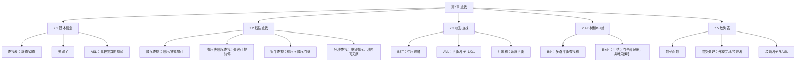
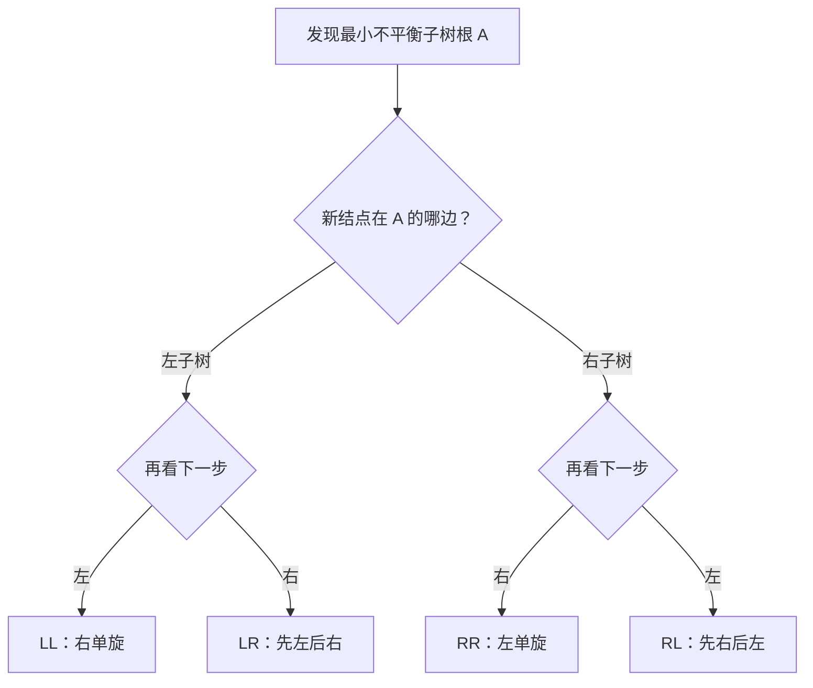
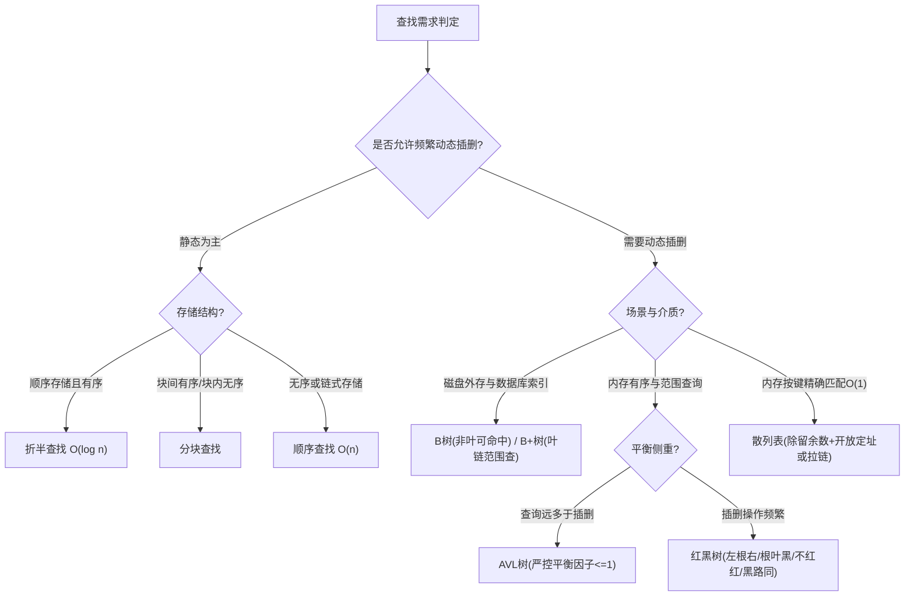

# 第7章 查找

> [!abstract] 本章复盘目标
> 从查找表的组织方式出发，掌握线性表查找、树形查找、B 树和散列查找的适用条件与查找过程。重点会构造判定树和查找结构，计算成功或失败的平均查找长度，并辨析插入、删除、平衡调整和散列冲突。

> [!important] 近 18 年 408 数据结构真题雷达（2009—2026）
> - **考频定位**：18 年主考单选 **39 题**（+3 跨章）、近 5 年单选 **11 题**；主考综合大题 **6 题**（`2010-T41`、`2011-T42`、`2013-T42`、`2022-T41`、`2024-T42`、`2026-T41`，含近 5 年 3 道）+ 1 跨章（`2022-T42`）。 [[00_408数据结构｜考前急救与真题落点总控|返回数据结构总控]]
> - **命题风向**：折半与 BST/AVL 判定树区间界定、红黑树着色与黑高、B 树阶数/结点数/构型计数/删除调整、散列表除留余数失败分母与删除标记 ASL；近 5 年大题连续考查顺序存储 BST 判别（2022-T41）、平方探测散列（2024-T42）与 BST 最近值结点（2026-T41）。

## 考纲定位

- **查找的基本概念**：查找表、关键字、查找成功与失败、平均查找长度。
- **顺序查找和折半查找**：顺序查找、有序表折半查找、分块查找及效率分析。
- **树形查找**：二叉排序树、平衡二叉树、红黑树的基本概念与应用。
- **B 树和 B+ 树**：基本概念，B 树的插入、删除及查找分析。
- **散列查找**：散列函数、冲突处理方法、散列表查找及性能分析。

> [!note] 复盘与逐题记录
> 保留原有知识整理和方法；教材统考选择题的题号、答案及选项判断见 [[数据结构/复盘/_核对记录/第7章|第7章真题逐项核对记录]]。本章考纲首页实际位于“第6章 图.pdf”的末页。

> [!TIP]
> 本章是 408 数据结构的重点章。第一轮做选择题时，不要只背“哪种查找快”，而要先确认查找表是否有序、是否顺序存储、是否支持动态插入删除、ASL 统计的是成功还是失败，以及树/散列表的手工构造过程。

## 本章先建立一张总图



本章做题前先问：

1. 表是否有序？若无序，折半查找直接不能用。
2. 表是否顺序存储？链表即使有序，也不适合教材所讲依靠下标随机访问的高效折半查找。
3. 查找表是静态还是动态？频繁插入删除时，要优先想到树表或散列表。
4. 题目求的是查找成功 ASL，还是查找失败 ASL？二者经常不是同一个分母。
5. 题目中的“叶结点”是实际存关键字的结点，还是 B 树/判定树里的失败外部结点？

---

## 7.1 查找的基本概念【📌 扫一眼｜确认“我还会”就过】

### 1. 查找与查找表

查找是在数据集合中寻找满足某种条件的数据元素的过程。结果只有两类：

| 结果 | 含义 |
|---|---|
| 查找成功 | 找到满足条件的数据元素 |
| 查找失败 | 数据集合中不存在满足条件的元素 |

查找表是用于查找的数据集合，通常由同一类型的数据元素或记录组成。

| 查找表类型 | 操作特点 | 常见方法 |
|---|---|---|
| 静态查找表 | 操作仅涉及查找，无须动态修改 | 顺序查找、折半查找、分块查找 |
| 动态查找表 | 查找过程中还要插入或删除 | 二叉排序树、AVL、红黑树、B树、散列表 |

选择题常见陷阱：

| 说法 | 判断 |
|---|---|
| 静态表不能用散列表 | 错。散列表既可用于静态，也可用于动态，取决于实现 |
| 动态表不能用顺序表 | 错。只是插入删除代价可能较高 |
| 链表适合折半查找 | 错。折半查找需要随机访问中间元素 |

### 2. 关键字

关键字是数据元素中能唯一标识该元素的数据项。基于关键字查找时，查找结果应当唯一。

例：学生记录中的学号可以作为关键字；姓名通常不一定能唯一标识一名学生。

### 3. 平均查找长度 ASL

一次查找的长度通常指关键字比较次数。平均查找长度是比较次数的加权平均：

$$
\mathrm{ASL}=\sum_{i=1}^{n}P_i C_i
$$

其中：

| 符号 | 含义 |
|---|---|
| $P_i$ | 查找第 $i$ 个元素的概率 |
| $C_i$ | 找到第 $i$ 个元素所需比较次数 |
| $n$ | 查找表中的元素个数 |

等概率查找时，$P_i=1/n$。

> [!WARNING]
> ASL 的核心不是“套公式”，而是先列出每种查找对象的比较次数，再按概率加权。查找成功和查找失败通常要分开算。

若分别计算成功、失败 ASL，两部分各按对应的条件概率加权。若总体查找成功的概率为 $p$，则**综合 ASL = $p$ × 成功 ASL + $(1-p)$ × 失败 ASL**，不能把两个分别算出的平均值直接相加。

---

## 7.2 顺序查找和折半查找【🔥⚡ 必背+避坑｜停下来默背 1 遍 + 精读 1 分钟】

### 7.2.1 顺序查找【📌 扫一眼｜确认“我还会”就过】

顺序查找也叫线性查找，从表的一端开始逐个比较。

| 特点 | 说明 |
|---|---|
| 存储结构 | 顺序存储、链式存储都可以 |
| 是否要求有序 | 不要求 |
| 优点 | 简单，对存储结构要求低 |
| 缺点 | $n$ 较大时 ASL 较大 |
| 时间复杂度 | $O(n)$ |

#### 1. 一般线性表的顺序查找

王道教材中常用“哨兵”版本说明顺序查找：

```c
int Search_Seq(SSTable ST, ElemType key) {
    ST.elem[0] = key;          // 哨兵
    for (int i = ST.TableLen; ST.elem[i] != key; --i)
        ;
    return i;                  // 成功返回位置，失败返回 0
}
```

哨兵的作用：省去每次循环中的越界判断。循环最终一定会停在某个位置，要么是表中元素，要么是下标 0 的哨兵。

若从表尾向前查找，第 $i$ 个元素被查到时比较次数为：

$$
C_i=n-i+1
$$

等概率时，查找成功 ASL 为：

$$
\mathrm{ASL}_{成功}=\frac{n+1}{2}
$$

若按教材哨兵代码统计，查找失败会比较到哨兵：

$$
\mathrm{ASL}_{失败}=n+1
$$

> [!WARNING]
> 若题目没有哨兵且只统计与表中关键字的比较，失败比较次数可能记为 $n$。考试时要看题目给出的算法或教材语境。王道本节的哨兵实现写的是 $n+1$。

#### 2. 有序线性表的顺序查找

若线性表按关键字有序，则查找失败时可以提前停止。

例如升序表从前往后查找：

| 当前比较 | 结论 |
|---|---|
| 当前元素等于 key | 查找成功 |
| 当前元素大于 key | key 不可能在后面，查找失败 |
| 当前元素小于 key | 继续向后 |

若各记录被查找的概率相等，且比较的访问次序一致，查找成功 ASL 与无序顺序查找相同：

$$
\mathrm{ASL}_{成功}=\frac{n+1}{2}
$$

查找失败时，判定树有 $n+1$ 个失败结点。等概率失败时：

$$
\mathrm{ASL}_{失败}
=\frac{1+2+\cdots+n+n}{n+1}
=\frac{n}{2}+\frac{n}{n+1}
$$

有序顺序查找和折半查找的区别：

| 对比项 | 有序顺序查找 | 折半查找 |
|---|---|---|
| 基本思想 | 仍然逐个比较，只是失败可提前停 | 每次取中间位置，缩小一半范围 |
| 存储要求 | 顺序表、链表都可以 | 只能顺序存储 |
| 是否需要有序 | 需要 | 需要 |
| 时间复杂度 | $O(n)$ | $O(\log_2 n)$ |

> [!WARNING]
> 有序链表不适合教材所讲的高效折半查找：虽然可以遍历定位中点，但<mark>链表不能常数时间按秩取中间结点</mark>，无法直接获得顺序表上的对数时间优势。 `[真题·2023-T01 / 2024-T05]`

> [!warning] 真题补充：比较次数和数组边界
> 2016 年真题采用每次向后跳 3 个位置的顺序查找。其具体输入可能比折半查找更快，但最坏情况下仍要线性扫描量级；<mark>某次更快不等于最坏复杂度更低</mark>。 `[真题·2016-T09]` 教材伪代码检查 `A[k-1]`、`A[k-2]` 时还需检查下标非负：当 `k=0` 且目标小于首项时，否则可能访问数组边界之外。

### 7.2.2 折半查找【🔥⚡ 必背+避坑｜停下来默背 1 遍 + 精读 1 分钟】

折半查找也叫二分查找，<mark>折半查找只适用于有序的顺序表</mark>。 `[真题·2024-T05]`

- `【⚡ 真题补丁｜2024-T05】` 折半查找同时依赖“有序”与“下标随机访问”，因此有序链表（无随机访问）、无序数组（不有序）、有序静态链表、无序静态链表均不适合直接折半查找。
- `【⚡ 真题补丁｜2023-T01】` 顺序有序表中仅按位获取第 $i$ 个元素为随机存取 $O(1)$；按值折半查找为 $O(\log n)$，保持有序的插入及按位删除均需移动元素，平均 $O(n)$。

必须同时满足：

1. 关键字有序。
2. 顺序存储，能随机访问中间位置。

基本流程：

```text
low = 表头下标
high = 表尾下标
while low <= high:
    mid = (low + high) / 2
    若 A[mid] == key: 成功
    若 key < A[mid]: high = mid - 1
    若 key > A[mid]: low = mid + 1
循环结束：失败
```

> [!WARNING]
> 中间位置可向下取整，也可向上取整，但同一道题必须始终使用同一种取整方式。不同取整方式会影响查找路径和判定树形态。

#### 1. 折半查找判定树的构造与金标准【🔥⚡ 必背+避坑｜停下来默背 1 遍 + 精读 1 分钟】

折半查找过程可以用判定树描述：

| 结点类型 | 含义 |
|---|---|
| 圆形内部结点 | 表中实际存在的关键字 |
| 方形外部结点 | 查找失败的区间 |

由于同一个折半查找算法中的 `mid` 取整方式固定，所以判定树左右子树的结点数也有严格约束。

| 取整方式 | 任一结点左右子树结点数约束 |
|---|---|
| 向下取整 $\lfloor (low+high)/2 \rfloor$ | $N_R-N_L\in\{0,1\}$，即右子树结点数等于左子树，或比左子树多 1 |
| 向上取整 $\lceil (low+high)/2 \rceil$ | $N_L-N_R\in\{0,1\}$，即左子树结点数等于右子树，或比右子树多 1 |

> [!IMPORTANT]
> 判断一棵二叉树能否成为折半查找判定树时，不只看“是否平衡”。若候选树中有的结点左子树结点数更多，有的结点右子树结点数更多，<mark>就不能由同一种取整规则统一生成</mark>。 `[真题易错·2017-T08]`

判定树性质：

1. 中序序列为有序表。
2. 左子树关键字均小于根，右子树关键字均大于根。
3. 含 $n$ 个关键字时，有 $n$ 个成功结点和 $n+1$ 个失败结点。
4. 折半查找判定树是平衡二叉树，但不一定是满二叉树或完全二叉树。

查找长度：

| 情况 | 查找长度 |
|---|---|
| 查找成功 | 从根到目标成功结点路径上的结点数 |
| 查找失败 | 从根到对应失败结点父结点路径上的结点数 |

> [!WARNING]
> 失败结点是虚构结点，失败 ASL 通常按其父结点层数算，不是把方形失败结点自身再多算一层。

#### 2. 折半查找的高度和比较次数【🔥 必背｜停下来默背 1 遍】

含 $n$ 个元素的折半查找判定树高度为：

$$
h=\lceil \log_2(n+1)\rceil
$$

<mark>折半查找最多比较次数等于判定树高</mark>（如 16 个元素最多 5 次，600 个元素最多 10 次）： `[真题·2010-T09 / 2023-T08]`

$$
C_{\max}=\lceil \log_2(n+1)\rceil
$$

时间复杂度：

$$
O(\log_2 n)
$$

各记录等概率被查找时，无论判定树是否满层，查找成功 ASL 都可用层次加权：

$$
\mathrm{ASL}_{成功}=\frac{1}{n}\sum_{i=1}^{n}l_i
$$

判定树各层均填满，即 $n=2^h-1$ 时，上述加权和可化为：

$$
\mathrm{ASL}_{成功}
=\frac{n+1}{n}\log_2(n+1)-1
\approx \log_2(n+1)-1
$$

$n$ 不满足满层条件时，不能把该等式直接当作精确值；应根据实际判定树逐层计算。

实际做题时更稳的方法：

1. 根据 $n$ 画判定树。
2. 数每层成功结点个数，做“层数 $\times$ 结点数”的加权。
3. 失败 ASL 另数失败区间对应的父结点层数。

#### 3. 折半查找常考辨析【🔥⚡ 必背+避坑｜停下来默背 1 遍 + 精读 1 分钟】

| 说法 | 判断 |
|---|---|
| 折半查找只要求有序 | 错，还要求顺序存储 |
| 折半查找适合链表 | 错 |
| 折半查找判定树一定平衡 | 对 |
| 折半查找判定树一定满 | 错，只有 $n=2^h-1$ 时才满 |
| 折半查找一定比顺序查找 ASL 小 | <mark>不等概率且高频排在前面时顺序更优</mark> `[真题·2013-T42]` |
| 静态有序顺序表适合折半查找 | 对 |

双等长有序数组求中位数时，比较两区中位数后<mark>对称舍弃左小半与右大半</mark>，可保持合集中位数不变。 `[真题·2011-T42]`

- `【⚡ 真题补丁｜2011-T42】` 等长升序表 $A$ 与 $B$ 求中位数：比较当前中位数 $a$ 与 $b$，相等直接返回，否则等距各舍一半直至单元素取较小，时间 $O(\log_2 n)$、空间 $O(1)$。

> [!important] 真题补充：用上下界排除不可能的查找路径
> 每比较一个结点，<mark>就保留此前全部比较产生的区间</mark>：向左使上界收紧，向右使下界收紧。 `[真题·2011-T07 / 2015-T07 / 2024-T07]` 后续关键字必须同时满足所有祖先的上下界，不能只与相邻两次比较结果核对。对有序数组的折半查找，除区间条件外还要检查题设的中点取整规则；对 BST 则检查各祖先的子树范围。

### 7.2.3 分块查找【🔥 必背｜停下来默背 1 遍】

分块查找也叫索引顺序查找，兼有顺序查找和折半查找的特点。

基本要求：

| 部分 | 要求 |
|---|---|
| 块内 | 可以无序 |
| 块间 | 必须有序。前一块最大关键字小于后一块所有关键字 |
| 索引表 | 记录每块最大关键字和该块起始地址，按最大关键字有序 |

查找过程分两步：

1. 索引表按各块的最大关键字递增排列，可用**顺序查找或折半查找**，确定第一个最大关键字不小于待查关键字的块。
2. 在该块内顺序查找；确定候选块后仍可能查找失败。

若待查关键字小于第一块的最大关键字，就进入第一块；若大于所有块的最大关键字，则直接判定查找失败。

因此：

$$
\mathrm{ASL}=L_I+L_S
$$

其中 $L_I$ 是索引表查找平均长度，$L_S$ 是块内查找平均长度。

索引表采用折半查找时，$L_I$ 应按各查找对象的比较次数及其概率加权；**最多比较次数不能直接当作平均查找长度**。

若长度为 $n$ 的表均匀分为 $b$ 块，每块 $s$ 个记录，且 $n=bs$，各记录被成功查找的概率相等，索引表和块内都采用顺序查找，则：

$$
\mathrm{ASL}
=\frac{b+1}{2}+\frac{s+1}{2}
=\frac{s^2+2s+n}{2s}
$$

当：

$$
s=\sqrt n
$$

<mark>每块大小取表长平方根时平均查找最小</mark>（如 400 个元素每块取 20 个），连续取值时 ASL 取最小值： `[真题·2025-T07]`

$$
\sqrt n+1
$$

等长分块时 $s$ 还必须是能整除 $n$ 的正整数。若 $\sqrt n$ 不满足条件，就应比较题目允许的整数块长；此时 $\sqrt n+1$ 未必能实际取到。

> [!WARNING]
> 分块查找的“有序”指块间有序，不是每个块内部有序。块内可以乱序。

---

## 7.3 树形查找【🔥⚡ 必背+避坑｜停下来默背 1 遍 + 精读 1 分钟】

### 7.3.1 二叉排序树 BST【🔥⚡ 必背+避坑｜停下来默背 1 遍 + 精读 1 分钟】

二叉排序树又称二叉查找树。它或者为空，或者满足：

1. 若左子树非空，则左子树所有结点关键字均小于根结点。
2. 若右子树非空，则右子树所有结点关键字均大于根结点。
3. 左右子树也分别是二叉排序树。

核心结论：

$$
\text{BST 的中序遍历序列是递增有序序列}
$$

> [!WARNING]
> 对本节默认的左小右大、关键字互异的 BST，<mark>中序遍历必然严格递增如可判顺序</mark>（如 `2022-T41` 与 `2026-T41` 核心依据）；先序、后序、层序一般不保证递增，但对某些特定形状也可能恰好有序。 `[真题·2018-T06 / 2022-T41 / 2026-T41]`

- `【⚡ 真题补丁｜2020-T09 / 2009-T09 / 2022-T42】` 区分 BST 与堆：堆是完全二叉树且仅限父子极值有序，并非左右递增的 BST（`2020-T09`）；小根堆尾部插元素沿双亲上浮（`2009-T09`）；海量数据筛最小 $k$ 个须维护 $k$ 元大根堆（`2022-T42`）。

<mark>堆只限制父子极值关系并非二叉排序树</mark>，千万不可混用两者的左右子树大小不等式。 `[真题易错·2020-T09 / 2009-T09 / 2022-T42]`

#### 1. BST 查找【🔥 必背｜停下来默背 1 遍】

从根开始比较：

| 比较结果 | 下一步 |
|---|---|
| key 等于当前结点 | 查找成功 |
| key 小于当前结点 | 转向左子树 |
| key 大于当前结点 | 转向右子树 |
| 遇到空指针 | 查找失败 |

比较次数取决于查找路径长度，最坏不超过树高。判断一条路径是否合法时，**沿途维护所有祖先给出的上下界**，每个后继关键字都必须落在当前允许区间中。

#### 2. BST 插入和构造【🔥 必背｜停下来默背 1 遍】

插入过程与查找过程一致：先查找，查找失败的位置就是插入位置。

插入结点特点：

1. 新结点一定作为叶结点插入。
2. 若关键字重复，通常插入失败或忽略，不再插入。
3. <mark>同一组关键字不同插序可得不同树形</mark>（可用于反向排除不可能序列）。 `[真题·2020-T05]`

从空树开始，按给定关键字序列逐个插入，即可构造 BST。

> [!WARNING]
> BST 的形态由插入顺序决定。若插入序列本身有序，BST 会退化成单支树。

#### 3. BST 删除【🔥⚡ 必背+避坑｜停下来默背 1 遍 + 精读 1 分钟】

删除结点时要保持 BST 性质，分三种情况：

| 被删结点情况 | 处理 |
|---|---|
| 叶结点 | 直接删除 |
| 只有一棵子树 | 让唯一子树替代被删结点 |
| 有左右两棵子树 | 用中序直接前驱或直接后继替代，再删除前驱/后继 |

若用直接后继替代，则直接后继是右子树中最小结点；若用直接前驱替代，则直接前驱是左子树中最大结点。

> [!WARNING]
> 删除后再插入同一个关键字，所得 BST 不一定与原树相同。因为删除时可能用前驱或后继替代，结构已经变了。

#### 4. BST 查找效率

BST 的查找效率取决于树高。

| 形态 | 查找效率 |
|---|---|
| 接近平衡 | $O(\log_2 n)$ |
| 退化为单支树 | $O(n)$ |

BST 与折半查找的区别：

| 对比项 | 折半查找 | BST |
|---|---|---|
| 存储结构 | 有序顺序表 | 链式树结构 |
| 判定树 | 有序表和中点取整规则均固定时唯一 | 由插入顺序决定 |
| 查找效率 | $O(\log_2 n)$ | 树形接近平衡时 $O(\log_2 n)$，最坏 $O(n)$ |
| 插入删除 | 需要移动大量元素，$O(n)$ | 沿树查找并修改指针，树高为 $h$ 时为 $O(h)$ |
| 适用 | 静态查找表 | 动态查找表 |

> [!important] 普通 BST 删除后再插入：先看删除的是叶还是非叶
> - **删除叶结点**：<mark>普通排序树删叶再插保持原树不变</mark>，而删非叶再插因用孩子或前驱/后继补位、重插变叶导致树形改变。 `[真题易错·2013-T06]`
> - **AVL 树另论**：<mark>平衡树删叶再插也可能因旋转变树形</mark>；删除非叶再插后，树形可能相同也可能不同，须按实际调整过程判断。 `[真题易错·2019-T04]`
>
> 例如原 AVL 树根为 2、左孩子为 1、右孩子为 3，3 的右孩子为 4。删除叶 1 后左旋得到根 3、左右孩子 2 和 4；再插入 1 后，1 成为 2 的左孩子，结果与原树不同。
>
> 排序方向也要服从题设：教材默认左小右大、中序递增；若真题明确规定中序**降序**，<mark>须按左右镜像判断如最大元无左子树</mark>。 `[真题易错·2015-T04]`

- `【⚡ 真题补丁｜2013-T06 / 2019-T04】` BST 删 `v` 再插：`v` 是叶则树形同（II 对、I 错），`v` 非叶则树形必变（III 对、IV 错）；AVL 树删 `v` 再插：`v` 是叶因旋转也可能不同（I 对），`v` 非叶可同亦可异（II/III 错）。
- `【⚡ 真题补丁｜2015-T04】` 中序降序（左大右小）非空 AVL：最大元在最左必无左子树（D 对）；2 结点时根度为 1（A 错）；最小元在最右仍可有左孩（B 错）；末次插入可经旋转非叶（C 错）。

### 7.3.2 平衡二叉树 AVL【🔥⚡ 必背+避坑｜停下来默背 1 遍 + 精读 1 分钟】

AVL 树是特殊的二叉排序树。它或者为空，或者满足：

1. 左右子树都是平衡二叉树。
2. <mark>任意结点左右子树高度差的绝对值</mark>不超过 1。 `[真题·2009-T04]`

平衡因子定义为：

$$
BF=\text{左子树高度}-\text{右子树高度}
$$

AVL 中所有结点的平衡因子只能是：<mark>仅可取负一零或正一这三种值</mark>（如 1..7 满平衡树三个分支点平衡因子全 0）。 `[真题·2013-T03]`

$$
-1,\ 0,\ 1
$$

#### 1. 插入后的调整原则【🔥 必背｜停下来默背 1 遍】

插入新结点后：

1. 按 BST 规则插入。
2. 沿插入路径向上检查平衡因子。
3. 找到离新结点最近的第一个失衡祖先结点 $A$。
4. 以 $A$ 为根的子树称为最小不平衡子树。
5. 只调整这棵最小不平衡子树。

> [!WARNING]
> 插入时通常只需对最小不平衡子树调整一次，整棵树即可恢复平衡。

#### 2. 四类旋转【🔥 必背｜停下来默背 1 遍】

判断方法：从失衡结点 $A$ 出发，看插入路径的前两步方向。

| 类型 | 插入位置 | 调整方式 | 口令 |
|---|---|---|---|
| LL | $A$ 的左孩子的左子树 | 右单旋 | 左左失衡，向右旋 |
| RR | $A$ 的右孩子的右子树 | 左单旋 | 右右失衡，向左旋 |
| LR | $A$ 的左孩子的右子树 | 先左旋，再右旋 | 左右失衡，先把折线拉直 |
| RL | $A$ 的右孩子的左子树 | <mark>右左失衡先右旋再左旋调整</mark> `[真题·2010-T04 / 2021-T06]` | 右左失衡，先把折线拉直 |

示意：



> [!WARNING]
> LR 和 RL 中，新结点插在中间结点 $C$ 的左子树还是右子树，不影响旋转类型；看的是从失衡结点出发的“左-右”或“右-左”路径。

> [!TIP]
> 单旋时记住“中间子树要让出来”：
> - LL 右单旋：$A$ 的左孩子为 $B$。先把 $B$ 的右子树挂到 $A$ 的左子树上，再让 $A$ 成为 $B$ 的右孩子，最后 $B$ 顶替 $A$ 成为子树根。
> - RR 左单旋：$A$ 的右孩子为 $B$。先把 $B$ 的左子树挂到 $A$ 的右子树上，再让 $A$ 成为 $B$ 的左孩子，最后 $B$ 顶替 $A$ 成为子树根。

#### 3. 删除后的调整

AVL 删除先按 BST 删除，再回溯检查平衡。

删除与插入的区别：

| 操作 | 调整特点 |
|---|---|
| 插入 | 通常只需调整一次最小不平衡子树 |
| 删除 | 可能需要多次调整，甚至一路回溯到根 |

删除后定位：

1. 找到第一个不平衡结点 $z$。
2. $y$ 是 $z$ 的较高子树根。
3. $x$ 是 $y$ 的较高子树根。
4. 根据 $x,y,z$ 相对位置执行 LL、LR、RR、RL 调整。

#### 4. AVL 查找高度【🔥⚡ 必背+避坑｜停下来默背 1 遍 + 精读 1 分钟】

AVL 查找过程与 BST 相同，最多比较次数等于树的深度。

设 $n_h$ 表示深度为 $h$ 的 AVL 树最少结点数：

$$
n_0=0,\quad n_1=1,\quad n_2=2
$$

递推式：

$$
n_h=n_{h-1}+n_{h-2}+1
$$

常用数值：

| $h$ | 0 | 1 | 2 | 3 | 4 | 5 | 6 | 7 |
|---|---:|---:|---:|---:|---:|---:|---:|---:|
| $n_h$ | 0 | 1 | 2 | 4 | 7 | 12 | 20 | 33 |

> [!WARNING]
> 上述递推默认“单根树深度/高度为 1”。若题目特别声明“单根树高度为 0”，则整体平移一层：高度为 $h$ 的最少结点数对应标准表中的 $n_{h+1}$。此时可写成 $n_0=1,n_1=2$，且仍有 $n_h=n_{h-1}+n_{h-2}+1$。

用途：给定结点数 $n$，求 AVL 查找最多比较次数时，找满足 $n_h \le n$ 的最大深度范围。例如高 6 所有非叶平衡因子均为 1 的极小 AVL 总结点数为 **20**； `[真题·2012-T04]` 高 4 平衡二叉树根的左右子树结点数最大差值为<mark>高三满树七个减高二极小二个得五</mark>。 `[真题易错·2026-T08]`

- `【⚡ 真题补丁｜2026-T08】` 高度为 4 的 AVL 树根结点左右子树结点数绝对值差最大取 **5**：一侧取高 3 满二叉树 $2^3-1=7$ 个结点，另一侧取高 2 极小 AVL（$n_2=2$），两者相差 $7-2=5$。

### 7.3.3 红黑树【🔥 必背｜停下来默背 1 遍】

红黑树是放宽平衡条件的二叉排序树。它比 AVL 没那么严格平衡，但插入删除调整次数通常更少。

#### 1. 红黑性质

一棵红黑树满足：

1. 每个结点或红或黑。
2. 根结点是黑色。
3. 叶结点是黑色。这里的叶结点指虚构的外部 NULL 结点。
4. 不存在两个相邻红结点。也就是说，红结点的父结点和孩子结点都是黑色。
5. 从任一结点到任意一个叶结点的简单路径上，黑结点数量相同。

黑高：从某结点出发，不含该结点，到达外部叶结点的任一路径上的黑结点数。

> [!WARNING]
> 红黑树中的“叶结点”通常是外部 NULL 结点，不是普通二叉树里存关键字的终端结点。

#### 2. 红黑树的重要结论

| 结论 | 含义 |
|---|---|
| 根到叶的最长路径不超过最短路径的 2 倍 | 红结点不能连续，只能在黑结点之间插入 |
| 有 $n$ 个内部结点的红黑树高度 $h\le 2\log_2(n+1)$ | 查找复杂度仍是 $O(\log_2 n)$ |
| 黑高为 $h$ 时，内部结点数最少 $2^h-1$，最多 $2^{2h}-1$ | 选择题可用于计数判断 |

AVL 与红黑树：

| 对比项 | AVL | 红黑树 |
|---|---|---|
| 平衡标准 | 高度平衡，左右高度差不超过 1 | 适度平衡 |
| 查找 | 通常更快 | 稍慢但仍 $O(\log n)$ |
| 插入删除 | 调整较频繁 | 调整开销较小 |
| 适用 | 查找远多于插入删除 | 插入删除频繁 |

#### 3. 红黑树插入

红黑树插入先按 BST 规则插入。

新插入结点初始应染成红色。

原因：若新结点染黑，所在路径黑结点数会增加，容易破坏性质 5；染红只可能破坏“不能有连续红结点”，局部调整即可。

插入调整：

| 情况 | 处理 |
|---|---|
| 新结点是根 | 染黑，结束 |
| 父结点是黑色 | 性质未破坏，结束 |
| 父结点是红色，叔结点也是红色 | 父和叔染黑，爷染红，再把爷当作新结点继续向上 |
| 父红、叔黑，且形成 LL/RR | 单旋，父染黑，爷染红 |
| 父红、叔黑，且形成 LR/RL | 先旋成 LL/RR，再单旋，重新着色 |

> [!WARNING]
> 红黑树插入中，叔结点为红色时主要靠“变色并向上回溯”；叔结点为黑色时通常要旋转。

#### 4. 红黑树删除

王道本节红黑树删除难度较高、考查概率较低，第一轮选择题先掌握以下判断：

1. 删除前先按 BST 删除规则处理。
2. 若被删结点有两个非空子树，先用中序后继或前驱替代，最终转化为删除至多有一个孩子的结点。
3. 删除红色叶结点通常最简单，直接删。
4. 删除黑色结点容易破坏各路径黑高相同，需要“双黑”修正。
5. 双黑修正围绕兄弟结点及其孩子颜色展开，可能旋转、变色或继续向上调整。

> [!TIP]
> 红黑树删除的一个高频特例：若被删黑结点有且仅有一个孩子，则这个唯一孩子必定是红色终端结点。处理时用该红孩子替代被删黑结点，并把它染黑即可，不需要旋转。

==【补充】== 第一轮复习不建议在这里过度展开红黑树删除的全部分支。选择题更常考红黑性质、黑高、插入初始颜色、AVL 与红黑树的适用差异。

---

## 7.4 B树和B+树【🔥⚡ 必背+避坑｜停下来默背 1 遍 + 精读 1 分钟】

### 7.4.1 B树及其基本操作【🔥⚡ 必背+避坑｜停下来默背 1 遍 + 精读 1 分钟】

$m$ 阶 B 树是一种自平衡的 $m$ 路查找树。所有<mark>外部失败结点都位于同一层</mark>。 `[真题易错·2009-T08 / 2016-T10]`

> [!CAUTION]
> B 树“叶结点”是本节最容易被术语绕住的地方。做题时先看题目采用哪套口径：
> 
> | 口径 | 叶结点指什么 | 外部失败结点叫什么 | 常见结论 |
> |---|---|---|---|
> | 统考真题常见口径，如 2023 年真题 | 最底层存关键字的真实结点，也就是王道常说的终端结点 | 外部结点或失败结点 | 插入初始位置在叶结点，但最终可能因分裂上升；删除最终可转化为在叶结点上删除 |
> | 王道教材/部分习题口径 | 最底层虚构的 NULL 失败结点 | 叶结点 | 含 $K$ 个关键字的 B 树有 $K+1$ 个叶结点 |

#### 1. $m$ 阶 B 树定义【🔥 必背｜停下来默背 1 遍】

一棵 $m$ 阶 B 树为空，或满足：

| 性质 | 说明 |
|---|---|
| 最多子树数 | <mark>每个结点至多有m棵子树</mark>（含根结点） `[真题·2009-T08]` |
| 最多关键字数 | 每个结点至多有 $m-1$ 个关键字 |
| 根结点下限 | 若根结点下方还有实际子树，则至少有 2 棵子树，至少 1 个关键字 |
| 非根非叶下限 | 至少有 $\lceil m/2\rceil$ 棵子树，至少 $\lceil m/2\rceil-1$ 个关键字 |
| 关键字有序 | <mark>结点内关键字按序递增排列</mark>（题设亦可按统一规则有序） `[真题·2009-T08]` |
| 子树区间 | 各子树关键字落在相邻关键字划分出的区间内 |
| 外部失败结点 | 所有不存关键字的外部失败结点在同一层 |

结点内若有 $n$ 个关键字，则有：

$$
n+1 \text{ 棵子树}
$$

非根结点关键字数范围：

$$
\lceil m/2\rceil-1 \le n \le m-1
$$

根结点关键字数范围：

$$
1 \le n \le m-1
$$

#### 2. B 树关键字与结点数极值【⚡ 避坑｜最值钱，必须精读 1 分钟】

若一棵 $m$ 阶 B 树共有 $N$ 个存关键字的实际结点，则关键字总数满足下界：

$$
K\ge (N-1)(\lceil m/2\rceil-1)+1
$$

推导：根结点至少 1 个关键字，其余 $N-1$ 个实际结点各至少 $\lceil m/2\rceil-1$ 个关键字。当根仅含 1 个关键字且各分支均取最低分叉数 $\lceil m/2\rceil$ 满层展开时，<mark>高h的B树取到最少关键字总数</mark>； `[真题易错·2013-T10 / 2018-T08]` 反之，当非根结点均只取关键字下限时，给定关键字总数可分配出<mark>最多含关键字实际结点数</mark>。 `[真题·2014-T09]` **该下界不一定可取到**：还要检查结点数、各层分支数和所有终端结点同层等条件是否允许同时取等。

- `【⚡ 真题补丁｜2013-T10 / 2014-T09 / 2018-T08】` 高 2 的 5 阶树最少 $1+2\times 2=5$ 键；高 5 的 3 阶树最少 $2^5-1=31$ 键；15 键 4 阶树每结点下限 1 键最多 15 结点。

例如 4 阶 B 树有 10 个实际结点，公式只给出 $K\ge10$。若取等，所有结点均恰有 1 个关键字，此时各非终端结点都有两个实际孩子且终端结点同层，实际结点数须为 $2^h-1$，不可能是 10。可构造根含 2 个关键字、其余 9 个结点各含 1 个关键字的树，此时 $K=11$。

若按“外部失败结点”口径统计叶结点数，则：

$$
N_{\text{外部叶}}=K+1
$$

> [!WARNING]
> 这里的 $N$ 是“存关键字的实际结点数”，不是关键字总数。若题目说“非叶结点数”，要先判断它是否把外部失败结点称为叶结点。

#### 3. B 树查找【🔥 必背｜停下来默背 1 遍】

B 树查找由两部分组成：

1. 在 B 树中定位结点。
2. 在结点内的有序关键字表中查找。

结点内查找可用顺序查找或折半查找。B 树常用于外存，因此磁盘 I/O 次数主要由树高决定。

查找过程：

```text
从根结点开始
在当前结点关键字表中查找
    找到：查找成功
    未找到：根据关键字区间进入对应子树
到达外部叶结点：查找失败
```

> [!WARNING]
> B 树查找<mark>在非叶结点命中即立刻返回</mark>，不必继续向下到叶结点；这一点与 B+ 树不同。 `[真题易错·2023-T07]`

#### 4. B 树高度【🔥 必背｜停下来默背 1 遍】

王道此处的 B 树高度不包括最底层外部失败叶结点。

设 B 树有 $n$ 个关键字，高度为 $h$，阶数为 $m$。

最小高度：每个结点尽量满。

$$
n \le m^h-1
$$

所以：

$$
h \ge \log_m(n+1)
$$

最大高度：每个结点尽量少。

外部叶结点数恒为：

$$
n+1
$$

且：

$$
n+1\ge 2(\lceil m/2\rceil)^{h-1}
$$

所以：

$$
h\le \log_{\lceil m/2\rceil}\frac{n+1}{2}+1
$$

> [!NOTE]
> 若题目明确把最底层外部失败结点也计入高度，设该高度为 $h'$，则相当于在王道公式基础上加 1：
> $$
> h'\ge \log_m(n+1)+1
> $$
> $$
> h'\le \log_{\lceil m/2\rceil}\frac{n+1}{2}+2
> $$

做题步骤：

1. 先确认题目是否把外部叶结点计入高度。
2. 用上下界公式算出高度范围。
3. 高度必须取整数。
4. 若问磁盘存取次数，通常看实际访问了几层实际结点。

#### 5. B 树插入【🔥⚡ 必背+避坑｜停下来默背 1 遍 + 精读 1 分钟】

B 树插入一定先查找失败，再<mark>初始插入到最底层终端结点</mark>。 `[真题易错·2023-T07]`

流程：

1. 查找 key，若已存在则按题意处理。
2. 找到失败外部叶结点，其父结点就是实际插入位置。
3. 将 key 插入该终端结点，保持结点内有序。
4. 若关键字数不超过 $m-1$，结束。
5. 若插入后达到 $m$ 个关键字，结点溢出，必须分裂。

分裂规则：

1. 将 $m$ 个关键字按序排列。
2. 第 $\lceil m/2\rceil$ 个关键字上升到父结点，因此<mark>新插入关键字若遇分裂可能上移</mark>。 `[真题易错·2020-T10 / 2023-T07]`
3. 左半部分留在原结点。
4. 右半部分放入新结点。
5. 若父结点也溢出，继续向上分裂。
6. 若根结点分裂，则<mark>根分裂使B树树高增加一层</mark>，否则插入不改高度。 `[真题易错·2023-T07]`

- `【⚡ 真题补丁｜2020-T10】` 4 阶 B 树满 3 键后再插第 4 键触发分裂，取第 $\lceil 4/2\rceil=2$ 位上移；依次插 `5,6,9,13,8,2,12,15` 得根关键字 `6,9`。

> [!WARNING]
> B 树插入时，上升的是“中间关键字”，不是整个结点。插入位置最开始在最底层终端结点，但上升后关键字可能进入父结点甚至新根。

#### 6. B 树删除【⚡ 避坑｜最值钱，必须精读 1 分钟】

B 树删除要保证结点关键字数不低于下限：

$$
\lceil m/2\rceil-1
$$

若被删关键字不在终端结点：

1. 用其直接前驱或直接后继替代。
2. 再到对应终端结点中删除前驱/后继。

因此最终都转化为删除终端结点中的关键字，<mark>删除非叶键必引起终端叶结点变化</mark>。 `[真题易错·2023-T07]`

终端结点删除分三类：

| 情况 | 条件 | 处理 |
|---|---|---|
| 直接删除 | 删除前关键字数 $\ge \lceil m/2\rceil$ | 删除后仍不少于下限 |
| 兄弟够借 | 当前结点删除后不够，且相邻兄弟关键字数 $\ge \lceil m/2\rceil$ | 父子换位，向兄弟借关键字 |
| 兄弟不够借 | 当前结点和相邻兄弟都只有下限关键字 | 当前结点、兄弟、父中分隔关键字合并 |

兄弟够借时：

```text
右兄弟够借：
    父关键字下移到当前结点
    右兄弟最小关键字上移到父结点

左兄弟够借：
    父关键字下移到当前结点
    左兄弟最大关键字上移到父结点
```

兄弟不够借时：

```text
当前结点 + 父中分隔关键字 + 一个相邻兄弟 合并为新结点
父结点关键字数减 1
若父结点也低于下限，继续向上处理
若根结点关键字数减为 0，则合并后的新结点成为根，树高减 1
```

> [!WARNING]
> B 树删除非终端关键字时，不是直接把该关键字删掉，而是先用前驱/后继替代，再在终端结点中删除。

> [!important] 真题补充：B 树结点个数与构型计数
> 1. 题目给出某层关键字总数并要求结点数最多时，先利用每结点关键字上下限确定该层最多能分成多少个结点，再用<mark>每结点分支数等于关键字数加一</mark>确定下一层可能的结点数。 `[真题·2021-T09]`
> 2. 例如 3 阶 B 树高度为 3、第 2 层有 4 个关键字，第 2 层最多为 `2+1+1` 共 3 个结点，向下有 $3+2+2=7$ 个分支，连同根结点共 $1+3+7=11$ 个含关键字结点。 `[真题易错·2021-T09]`
> 3. 对 7 个互异关键字的 4 阶 B 树，可<mark>先按树高与根关键字数枚举构型</mark>：高度为 2 时，根含 1、2、3 个关键字分别有 1、6、1 种分配；高度为 3 时有 1 种，共 9 种（高度计数不含外部失败结点）。 `[真题易错·2025-T08]`
> 4. 删除后的选项可反向校验<mark>关键字下界区间与终端同层三条件</mark>是否全部满足。 `[真题易错·2012-T09 / 2022-T08]`
> - `【⚡ 真题补丁｜2012-T09 / 2022-T08】` 3 阶删除优先看兄弟是否够借再决定父子换位或合并（2012-T09）；5 阶删非叶键须用前驱或后继替代并逐项核对下界与同层（2022-T08）。

### 7.4.2 B+树的基本概念【🔥 必背｜停下来默背 1 遍】

B+树是数据库和文件系统中常用的 B 树变体，<mark>典型应用于关系数据库系统索引</mark>（词法分析常用有限自动机、路由器查表用前缀树/硬件表、磁盘空闲块多用位图或成组链接）。 `[真题·2017-T09]`

$m$ 阶 B+ 树满足：

1. 每个分支结点最多有 $m$ 棵子树。
2. 非叶根结点至少有 2 棵子树，与 B 树同样<mark>非单根至少两分支且结点含关键字</mark>；其余分支结点至少有 $\lceil m/2\rceil$ 棵子树。 `[真题·2016-T10]`
3. 分支结点的关键字个数等于子树个数。
4. 所有关键字及其记录指针都在叶结点中。
5. 叶结点按关键字升序链接，<mark>通过叶结点指针链直接支持顺序查找</mark>和范围查询（B 树并不要求叶结点之间指针链接）。 `[真题易错·2009-T08 / 2016-T10]`
6. 非叶结点只起索引作用，其关键字通常是对应子树中最大关键字的副本。

#### B 树与 B+ 树对比【📌 扫一眼｜确认“我还会”就过】

| 对比项 | B 树 | B+ 树 |
|---|---|---|
| $n$ 个关键字对应子树数 | $n+1$ 棵子树 | $n$ 棵子树 |
| 非根内结点关键字范围 | $\lceil m/2\rceil-1 \sim m-1$ | $\lceil m/2\rceil \sim m$ |
| 数据记录位置 | 各层结点都可存关键字和记录 | 全部记录都在叶结点 |
| 非叶结点功能 | 可直接命中并结束查找 | 只作索引 |
| 关键字是否重复 | 一般不重复出现 | 非叶关键字是叶关键字副本，会重复 |
| 顺序查找 | 不天然支持叶链 | 叶结点链表天然支持范围查询 |
| 查找终点 | 命中即可结束 | 无论成功失败都走到叶结点 |

> [!WARNING]
> B+ 树中，即使在非叶结点遇到等于 key 的关键字，也不能停止，必须继续向下到叶结点。

---

> [!note] B 树与 B+ 树的顺序访问
> B+ 树叶结点按关键字链接，便于顺序扫描和范围查询；普通 B 树虽不要求叶结点串链，仍可通过中序遍历按序输出关键字，不能把“没有叶链”理解成“无法按序遍历”。

## 7.5 散列（Hash）表【🔥⚡ 必背+避坑｜停下来默背 1 遍 + 精读 1 分钟】

### 7.5.1 散列表的基本概念【📌 扫一眼｜确认“我还会”就过】

散列函数将关键字映射到存储地址：

$$
H(\mathrm{key})=\mathrm{Addr}
$$

散列表是根据关键字直接访问的数据结构。

| 概念 | 含义 |
|---|---|
| 散列函数 | 将关键字映射到地址的函数 |
| 散列地址 | 散列函数计算出的存储位置 |
| 冲突 | 不同关键字映射到同一地址 |
| 同义词 | 发生冲突的不同关键字 |
| 散列表 | 基于关键字到地址映射组织的数据结构 |

理想情况下散列查找时间复杂度为：

$$
O(1)
$$

不同关键字可能映射到同一地址而产生冲突；当关键字取值集合大于地址集合时，不能避免所有可能关键字之间的冲突。实际性能要看散列函数、冲突处理方法和装填因子。

### 7.5.2 散列函数的构造方法【📌 扫一眼｜确认“我还会”就过】

构造散列函数时要注意：

1. 定义域要覆盖全部关键字。
2. 地址应尽可能均匀分布。
3. 函数尽量简单，便于快速计算。

#### 1. 直接定址法

直接取关键字或关键字的线性函数作为地址：

$$
H(\mathrm{key})=\mathrm{key}
$$

或：

$$
H(\mathrm{key})=a\cdot \mathrm{key}+b
$$

特点：

| 优点 | 缺点 | 适用 |
|---|---|---|
| 计算简单，不产生冲突 | 关键字稀疏时浪费空间 | 关键字基本连续 |

#### 2. 除留余数法

设散列表长度为 $m$，选取不超过 $m$ 且尽可能接近 $m$ 的质数 $p$：

$$
H(\mathrm{key})=\mathrm{key}\%p
$$

关键是选好 $p$，使关键字尽量均匀分布。

#### 3. 数字分析法

从关键字若干数位中选择分布较均匀的位组成散列地址。

适用：关键字集合已知且固定。

缺点：关键字集合变化后，可能需要重新选取数位或重新构造函数。

#### 4. 平方取中法

取关键字平方值的中间若干位作为散列地址。

适用：关键字各位分布不均，或关键字位数较少。

### 7.5.3 处理冲突的方法【🔥⚡ 必背+避坑｜停下来默背 1 遍 + 精读 1 分钟】

当发生散列冲突时，需要按选定的冲突处理方法安排关键字；具体关键字集合和散列函数也可能不产生冲突。

设初始地址为 $H(\mathrm{key})$，第 $i$ 次探测地址：

$$
H_i=(H(\mathrm{key})+d_i)\%m
$$

其中 $d_i$ 是增量序列，$m$ 是散列表长度。

#### 1. 开放定址法【🔥⚡ 必背+避坑｜停下来默背 1 遍 + 精读 1 分钟】

开放定址法：记录存放在散列表本身，发生冲突时按规定的探测序列寻找可用位置；某种探测序列未必覆盖整个表。

常见增量序列：

| 方法 | 增量序列 | 特点 |
|---|---|---|
| 线性探测法 | $1,2,\dots,m-1$ | 会顺序向后找空位，容易产生堆积 |
| 平方探测法 | $1^2,-1^2,2^2,-2^2,\dots$ | 减少堆积，但不一定能探测到所有位置 |
| 双散列法 | $iH_2(\mathrm{key})$ | 用第二个散列函数决定步长 |
| 伪随机序列法 | 伪随机数序列 | 按伪随机增量探测 |

> [!NOTE]
> 堆积/聚集也要分层次：
> - 一次聚集：不同初始散列地址的关键字争夺同一段连续探测位置。线性探测法容易产生一次聚集。
> - 二次聚集：初始散列地址相同的同义词拥有相同探测序列。平方探测法能减轻一次聚集，但仍有二次聚集。
> - 双散列法：步长由第二个散列函数决定，可同时减轻一次聚集和二次聚集。

线性探测：

$$
H_i=(H(\mathrm{key})+i)\%m
$$

教材一种平方探测设置可选表长为 $4k+3$ 型素数，并按 $\pm i^2$ 等规定顺序探测；若题干明确指定单向平方序列（如 $H_i=(H_0+i^2)\%m$），应<mark>严格按题干所给平方增量探测</mark>，不可套用正负交替公式。 `[真题易错·2024-T42]`

双散列：

$$
H_i=(H(\mathrm{key})+iH_2(\mathrm{key}))\%m
$$

> [!WARNING]
> 线性探测的“堆积”会<mark>拉长探测链直接增大平均查找长度</mark>。 `[真题易错·2014-T08]` 它只影响探测步长，不会改变存储占槽率、散列函数定义或装填因子本身。 `[真题易错·2014-T08]`

> [!important] 真题补充：探测是否遍历全表
> 线性探测依次循环访问表中各位置，<mark>只要散列表未满一定能找到空位</mark>； `[真题·2025-T09]` 平方探测是否覆盖全部地址取决于表长和具体增量序列，表未满也可能找不到空位。线性探测和平方探测的冲突均可能发生在同义词或非同义词之间。

#### 2. 开放定址法的删除【⚡ 避坑｜最值钱，必须精读 1 分钟】

开放定址法**不能随意将已占位置直接置为空**；通常使用删除标记，或采用能保持查找路径正确的重建等办法。

原因：直接删除会截断后续同义词的探测路径，使本来存在的元素被误判为查找失败。

常见做法：设置删除标记，进行逻辑删除；也可采用能保持查找路径正确的重建等方法。

副作用：删除标记过多时，表看起来有空位，但查找路径仍要经过这些位置，效率下降。

#### 3. 拉链法【🔥 必背｜停下来默背 1 遍】

拉链法把散列到同一地址的同义词组织成链表。

| 操作 | 说明 |
|---|---|
| 插入 | 插入到对应散列地址的链表中 |
| 查找 | 先算地址，再在对应链表中顺序查找 |
| 删除 | 可在链表中物理删除 |

适用：插入删除频繁的场景。

开放定址法与拉链法：

| 对比项 | 开放定址法 | 拉链法 |
|---|---|---|
| 存储位置 | 元素都放在散列表数组内 | 数组中存链表头指针 |
| 删除 | 不能简单置空截断探测路径，通常用删除标记或正确重建 | 可以物理删除链表结点 |
| 聚集问题 | 线性探测易堆积 | 不存在连续地址堆积 |
| 装填因子 | 通常要求 $\alpha<1$ | 可大于 1 |

### 7.5.4 散列查找及性能分析【🔥⚡ 必背+避坑｜停下来默背 1 遍 + 精读 1 分钟】

散列表查找过程与构造过程一致：

```text
Addr = H(key)
若 Addr 处为空：查找失败
若 Addr 处关键字等于 key：查找成功
否则按冲突处理方法求下一个地址，继续检查
```

虽然散列表建立了 key 到地址的映射，但由于冲突存在，查找仍要比较关键字。因此 ASL 仍然是性能指标。

#### 1. 装填因子【🔥 必背｜停下来默背 1 遍】

装填因子：

$$
\alpha=\frac{\text{表中记录数 }n}{\text{散列表长度 }m}
$$

影响散列表平均查找长度的三大因素包括：<mark>散列函数冲突处理策略与装填因子</mark>。 `[真题·2022-T09]` 要提高查找效率，应<mark>设计少冲突函数并避免聚集现象</mark>，而增大装填因子反而会加剧冲突并降低查找效率。 `[真题易错·2011-T09]`

> [!WARNING]
> 散列表 ASL 主要依赖装填因子 $\alpha$，不直接依赖 $n$ 或 $m$。但“主要依赖”不等于“只由装填因子决定”，因为散列函数和冲突处理方法也会影响冲突分布。

#### 2. 散列表 ASL 手算流程【🔥⚡ 必背+避坑｜停下来默背 1 遍 + 精读 1 分钟】

查找成功 ASL：

1. 按题目给定顺序构造散列表。
2. <mark>按查找路径统计各已插键比较次数</mark>。 `[真题·2018-T09]`
3. 等概率时用“所有关键字比较次数之和 / 关键字个数”。

查找失败 ASL：

1. 先确认散列函数可能产生哪些初始地址。
2. 对每个可能初始地址，按冲突处理方法探测到第一个空位或判定失败的位置。
3. 等概率时用“各失败入口比较次数之和 / 可能初始地址个数”。

> [!WARNING]
> 查找失败 ASL 的分母不一定是表长。若散列函数是 $H(key)=key\%p$，则<mark>失败入口只取散列函数可能值域</mark>（即 $0\sim p-1$），而不是数组下标的全部范围。 `[真题易错·2010-T41 / 2019-T08]`

- `【⚡ 真题补丁｜2010-T41】` $\alpha=0.7$ 得表长 10，$H(k)=k\%7$ 失败入口仅 `0..6` 共 7 位：成功 $ASL=12/7$，失败 $ASL=(3+2+1+2+2+4+4)/7=18/7$。
- `【⚡ 真题补丁｜2018-T09 / 2019-T08】` 2018-T09 表长 7 线性探测 3 键得成功 $ASL=2$；2019-T08 表长 11 模 7 失败分母取 7 得 $ASL=(9+8+7+6+5+4+3)/7=6$。

> [!example] 真题补充：删除标记参与失败探测（2023）
> 表长 5，$H(k)=(k+4)\bmod 5$，依次插入 2022、12、25 后删除 25。地址 1、2 分别存放 2022、12，地址 4 是**删除标记**。从地址 $0,1,2,3,4$ 开始的失败探测次数依次为 $1,3,2,1,2$，等概率时失败 $ASL=9/5=1.8$。删除标记不是从未使用的空位，<mark>失败探测遇到删除标记须继续后移</mark>。 `[真题易错·2023-T09]`

#### 3. 拉链法查找失败 ASL 的口径【📌 扫一眼｜确认“我还会”就过】

设散列函数为 $H(key)=key\%p$，共有 $p$ 个链表入口；表中共有 $n$ 个元素，装填因子为：

$$
\alpha=\frac{n}{p}
$$

等概率查找失败时，分母是 $p$。若题目直接写 $H(key)=key\%m$，则 $p=m$。

| 口径 | 每个入口失败比较次数 | 失败 ASL |
|---|---|---|
| 只统计与关键字比较 | 链长为 $L_i$ 时比较 $L_i$ 次；空链比较 0 次 | $\mathrm{ASL}_{失败}=\frac{\sum L_i}{p}=\frac{n}{p}=\alpha$ |
| 把空指针或空链判断也算一次 | 链长为 $L_i$ 时记 $L_i+1$ 次；空链记 1 次 | $\mathrm{ASL}_{失败}=\frac{\sum(L_i+1)}{p}=\frac{n+p}{p}=\alpha+1$ |

王道部分题目会特别说明“查找失败的计算中只将与关键字的比较次数计算在内”。遇到这类题，按题干口径来。

### 7.5.5 本章常见方法对比【📌 扫一眼｜确认“我还会”就过】

| 查找方法 | 是否要求有序 | 存储要求 | 动态性 | 平均/最坏特点 |
|---|---|---|---|---|
| 顺序查找 | 不要求 | 顺序、链式均可 | 一般 | $O(n)$ |
| 有序表顺序查找 | 要求有序 | 顺序、链式均可 | 一般 | 成功仍 $O(n)$，失败可提前停 |
| 折半查找 | 要求有序 | 顺序存储 | 静态更合适 | $O(\log n)$ |
| 分块查找 | 块间有序 | 索引 + 顺序块 | 较好 | 介于顺序与折半之间 |
| BST | 按 BST 性质有序 | 链式树 | 好 | 树形接近平衡时 $O(\log n)$，最坏 $O(n)$ |
| AVL | BST + 高度平衡 | 链式树 | 好但调整多 | $O(\log n)$ |
| 红黑树 | BST + 红黑性质 | 链式树 | 插删更友好 | $O(\log n)$ |
| B树 | 多路平衡 | 常用于外存 | 好 | 磁盘 I/O 少 |
| B+树 | 叶结点链式有序 | 数据库索引 | 好 | 范围查询友好 |
| 散列表 | 不要求 | 数组/链表 | 好 | 理想 $O(1)$，受冲突影响 |

## 本章最后抓这些易错点

1. 有序链表不能直接利用下标随机访问，不适合教材所讲的高效折半查找。
2. 比较相同的访问次序与查找概率时，有序顺序查找可提前判定失败，成功 ASL 与普通顺序查找相同。
3. 折半查找失败结点是虚构结点，失败 ASL 不要多算一层。
4. 默认左小右大且关键字互异时，BST 中序遍历必然递增；其他遍历对特定形态也可能恰好有序。树的形态与插入顺序有关。
5. AVL 插入看最小不平衡子树，按 LL/RR/LR/RL 旋转；算最少结点前先看题目如何定义高度。
6. 红黑树新插入结点初始染红。
7. B 树题先判断“叶结点”口径：统考真题常指终端结点，王道部分习题可能指外部失败结点。
8. B 树结点有 $n$ 个关键字时有 $n+1$ 棵子树；B+ 树是 $n$ 个关键字对应 $n$ 棵子树。
9. B 树查找在非叶结点命中即可结束；B+ 树必须走到叶结点。
10. B 树插入溢出时上升的是中间关键字；删除不够时优先借，不能借才合并。
11. 开放定址法删除时不能简单置空截断探测路径；常用删除标记，也可采用保持查找正确性的重建方法。
12. 散列表 ASL 受散列函数、冲突处理方法和装填因子共同影响。
13. 散列表查找失败 ASL 的分母要看可能的初始散列地址，不要机械用表长。

---

## 7.6 查找算法选型决策树与近 5 年真题母题（2022—2026）【🔥⚡ 必背+避坑｜停下来默背 1 遍 + 精读 1 分钟】

### 查找结构实战选型决策树



### 近 5 年综合大题精讲（2022—2026）

> [!example]- ⚡ 真题母题 2022-T41｜顺序存储二叉树判别二叉搜索树 SqBiTree
> **题目要点**：给定非空二叉树顺序存储结构体 `SqBiTree`（结点值均正整数，`-1` 表示空位置，数组下标从 `0` 开始，`ElemNum` 为占用元素总数），设计尽可能高效的算法判断其是否为二叉搜索树（BST）。
>
> **为什么这么想**：
> - **最优思路（区间上下界传参 / 中序遍历递增检验，时间 $O(n)$、空间 $O(h)$）**：BST 不只是“左孩子小于根、右孩子大于根”，而是左子树所有结点均小于根、右子树所有结点均大于根；若单结点检验，反例 `根=20, 左=10, 左的右孩子=25` 会误判。利用数组下标左 `2k+1`、右 `2k+2`，可边中序遍历边与 `prev` 比较严格递增，或向递归传下 `(low, high)` 区间上下界直接检验。
> - **保底思路**：中序遍历将非空正整数存入辅助数组，再线性扫描检查是否严格递增（时间 $O(n)$、额外空间 $O(n)$）。
>
> **规范 C/C++ 核心代码**：
> ```c
> typedef struct {
>     int SqBiTNode[MAX_SIZE];
>     int ElemNum;
> } SqBiTree;
>
> bool judgeBSTUtil(const SqBiTree &bt, int idx, int &prev) {
>     if (idx >= bt.ElemNum || bt.SqBiTNode[idx] == -1) return true;
>     if (!judgeBSTUtil(bt, 2 * idx + 1, prev)) return false;
>     if (bt.SqBiTNode[idx] <= prev) return false;
>     prev = bt.SqBiTNode[idx];
>     return judgeBSTUtil(bt, 2 * idx + 2, prev);
> }
>
> bool isBST(SqBiTree bt) {
>     int prev = -1; // 题意结点均为正整数
>     return judgeBSTUtil(bt, 0, prev);
> }
> ```
>
> **复杂度与扣分提醒**：时间复杂度 $O(n)$（按有效阵元范围每下标至多访问一次，若空洞较多亦可只到 `ElemNum`），递归栈空间 $O(h)$（最坏 $O(n)$）。考场最常见扣分点：仅比较 `bt[k]` 与 `bt[2k+1]`、`bt[2k+2]` 未传递全子树上下界或中序 `prev`；忘记判断下标越界 `idx >= bt.ElemNum` 或空位 `== -1`。

> [!example]- ⚡ 真题母题 2024-T42｜平方探测散列表构造、查找比较序列与失败地址
> **题目要点**：散列表 `HT[0..10]`（表长 11），散列函数 $H(k)=(k\times 3)\bmod 11$，冲突处理严格规定为 $H_i=(H_0+i^2)\bmod 11$（仅加 $+i^2$）。依次插入关键字 `20, 3, 11, 18, 9, 14, 7`，求装填因子、查找 `14` 的比较序列及查找 `8` 失败停止地址。
>
> **为什么这么想**：看到平方探测第一步先锁定题干公式是正负交替还是仅 $+i^2$，逐个手算 $H_0$ 并列探测轨迹表：
> - `20`: $(60)\%11=5\to HT[5]=20$；`3`: $(9)\%11=9\to HT[9]=3$；
> - `11`: $(33)\%11=0\to HT[0]=11$；`18`: $(54)\%11=10\to HT[10]=18$；
> - `9`: $(27)\%11=5$ 冲突，$i=1\to(5+1)\%11=6\to HT[6]=9$；
> - `14`: $(42)\%11=9$ 冲突，$i=1\to(9+1)\%11=10$ 冲突，$i=2\to(9+4)\%11=2\to HT[2]=14$；
> - `7`: $(21)\%11=10$ 冲突，$i=1\to(10+1)\%11=0$ 冲突，$i=2\to(10+4)\%11=3\to HT[3]=7$。
>
> **独立验算标准解答**：
> 1. 构造结果 `HT = [11, 空, 14, 7, 空, 20, 9, 空, 空, 3, 18]`，装填因子 $\alpha = 7/11$。
> 2. 查找 `14`：$H_0=9$ 比较 `3`（不相等），$i=1$ 查下标 `10` 比较 `18`（不相等），$i=2$ 查下标 `2` 比较 `14`（命中），比较关键字序列为 **`3, 18, 14`**。
> 3. 查找 `8`：$H_0=(8\times 3)\%11=2$（遇 `14`）$\to i=1$ 查 `3`（遇 `7`）$\to i=2$ 查 `6`（遇 `9`）$\to i=3$ 查 `(2+9)%11=0`（遇 `11`）$\to i=4$ 查 `(2+16)%11=7`（为空），失败地址为 **`7`**。
>
> **易错步骤提醒**：默认把 $+i^2$ 套成 $1,-1,4,-4$ 会把第 2 步算错；题目问“查找关键字比较序列”只列实际碰到的关键字（不含最后触发停车的空单元）。

> [!example]- ⚡ 真题母题 2026-T41｜二叉排序树中与 K 差值绝对值最小的所有结点
> **题目要点**：已知二叉树链表结点 `BSTNode`（含 `data`、`left`、`right`，`typedef BSTNode BTNode;`），给定整数 `K`，在二叉排序树 `T` 中找出关键字与 `K` 之差的绝对值最小的所有结点，并输出该最小绝对值与对应结点关键字。
>
> **为什么这么想**：
> - **最优思路（利用 BST 单调走一条根到叶路径，时间 $O(h)$、空间 $O(1)$）**：若只遍历整棵树是 $O(n)$；利用 BST 有序性，查找 `K` 过程中只会经过唯一从根向目标逼近的路径。沿途若遇 `p->data == K`，最小差值直接为 `0` 且输出 `K`（互异 BST 中唯一，若允许等值则向左/右子树继续核查）；若未命中，最接近 `K` 的结点必位于路径上“不超过 `K` 的最大前驱 `floorNode`”或“不小于 `K` 的最小后继 `ceilNode`”之中，且当两边与 `K` 等距时两个都属于最小集合。
> - **保底思路（两趟遍历，时间 $O(n)$、空间 $O(h)$）**：第一趟遍历求全树最小绝对值差 `minDiff`，第二趟遍历输出所有 `|p->data - K| == minDiff` 的结点关键字。
>
> **规范 C/C++ 核心代码（最优 $O(h)$ 做法）**：
> ```c
> typedef struct BSTNode {
>     int data;
>     struct BSTNode *left, *right;
> } BSTNode;
> typedef BSTNode BTNode;
>
> void printNearestNodes(BSTNode *T, int K) {
>     if (!T) return;
>     BSTNode *floorNode = NULL, *ceilNode = NULL, *p = T;
>     while (p) {
>         if (p->data == K) {
>             printf("minDiff = 0, key = %d\n", p->data);
>             return;
>         } else if (p->data < K) {
>             floorNode = p;
>             p = p->right;
>         } else {
>             ceilNode = p;
>             p = p->left;
>         }
>     }
>     long long d1 = floorNode ? (long long)K - floorNode->data : -1;
>     long long d2 = ceilNode ? (long long)ceilNode->data - K : -1;
>     long long minDiff = (d1 != -1 && (d2 == -1 || d1 <= d2)) ? d1 : d2;
>     printf("minDiff = %lld, keys:", minDiff);
>     if (floorNode && d1 == minDiff) printf(" %d", floorNode->data);
>     if (ceilNode && d2 == minDiff) printf(" %d", ceilNode->data);
>     printf("\n");
> }
> ```
>
> **复杂度与扣分提醒**：利用 BST 路径剪枝时间 $O(h)$、辅助空间 $O(1)$。若树允许重复关键字且命中 `K`，需沿左或右子树把其余 `K` 一并输出；漏判 `d1 == d2` 时对称两个结点都要输出会丢边界分；用 `long long` 做差避免整型 `INT_MIN` 减法溢出。

---

# 本章高频题型总表

| 题干特征 | 优先方法/起手式 | 真题印证与避坑 |
|---|---|---|
| 有序顺序表 / 双序列找中位数 / 折半比较路径 | 先画下标中点取整判定树，逐层收紧上下界区间；双表对比中位数各舍一半 | `2011-T42`、`2015-T07`、`2024-T07` 均卡在未保留历史祖先区间或中点向下/向上取整混淆 |
| AVL 插入旋转 / 最少结点递推 | 定位最小不平衡子树判 LL/RR/LR/RL；套递推 $N_h=N_{h-1}+N_{h-2}+1$ | `2009-T09`、`2015-T04`、`2020-T05`、`2026-T08` 注意高度从 1 起算，且对称最偏树左右结点差最大 |
| 红黑树着色调整 / 最值结点与黑高 | 口诀“左根右、根叶黑、不红红、黑路同”，新插初染红看叔父颜色 | `2021-T06`、`2026-T08` 插入全黑叶高至少 2 倍，最长路径不超过最短路径 2 倍 |
| B 树阶数、最少关键字、最多结点数或删除 | 区分叶结点口径；分清“非根至少 $\lceil m/2\rceil-1$ 键”与“根至少 1 键” | `2013-T10`、`2021-T09`、`2023-T07`、`2025-T08` 删非叶先前驱后继替代，检查下界与同层 |
| 散列表构造、ASL 成功/失败与墓碑删除 | 失败分母只看 $H(key)$ 可能初始值域；删除置标记后失败探测遇墓碑不断行 | `2010-T41`、`2019-T08`、`2023-T09`、`2024-T42` 平方探测先看仅 $+i^2$ 还是正负交替 |
| 顺序/链表 BST 算法设计 | 按下标左 $2k+1$ 右 $2k+2$ 传区间或中序 `prev`；或记录前驱 `floor` 与后继 `ceil` | `2022-T41`、`2026-T41` 避免只查父子关系，防止漏判等距双结点 |

---

# 冲刺主动回忆卡（遮挡自测）

> [!question] 卡片 01：有序顺序表折半查找成功 ASL 一定会小于顺序查找吗？如何判断一个关键字序列是否为合法折半查找比较序列？
> > [!success]- 正确解释
> > 1. 不一定；当关键字按查找概率降序排列（不等概率）时，高频元素排在表头附近可使顺序查找平均查找长度优于折半查找（`2013-T42`）。
> > 2. 判断合法比较序列时，每次向左走收紧上界、向右走收紧下界，后续所有比较值必须落在此前全部祖先构成的开区间内，且遵循题设取整规则（`2011-T07`、`2015-T07`、`2024-T07`）。

> [!question] 卡片 02：高度为 $h$（含 1 个结点高度为 1）的 AVL 树最少有多少结点？若高度为 4，根的左右子树结点数之差最大是多少？
> > [!success]- 正确解释
> > 1. 递推式为 $N_1=1, N_2=2, N_h=N_{h-1}+N_{h-2}+1$，因此 $N_3=4, N_4=7, N_5=12, N_6=20$（`2012-T04`、`2020-T05`）。
> > 2. 高度为 4 时（`2026-T08`），一侧放高 3 满树（7 个结点）、另一侧放高 2 最少树（$N_2=2$ 个结点），此时根结点的左右子树结点个数之差最大为 $7-2=5$（平衡因子仍为 $|3-2|=1$）。

> [!question] 卡片 03：红黑树新插入结点默认染什么颜色？“若父为黑直接结束，若父为红看叔父”的两类情况如何处理？
> > [!success]- 正确解释
> > 1. 新插入非根结点初始染红色，以尽量保持各路径黑高不变。
> > 2. 叔父为红：父、叔染黑，爷染红，将爷视为新插入结点继续向上检查；叔父为黑：对爷—父—新结点执行与 AVL 相同的 LL/RR/LR/RL 旋转，并将旋转后的新子根与原爷结点变色，调整直接结束（`2021-T06`）。

> [!question] 卡片 04：按照 408 统考标准口径，关于 B 树的查找、插入和删除有哪些高频误区？
> > [!success]- 正确解释
> > 1. 查找在非叶结点命中即可返回，无需走到叶结点（B+ 树才必须走到叶结点）。
> > 2. 新关键字初始插入在最底层终端结点，但若触发结点满 $m$ 键分裂，中间第 $\lceil m/2\rceil$ 键会上移到父结点，因此新关键字最终未必停留在终端叶结点。
> > 3. 删除非终端关键字时须先用前驱/后继替代，再去终端结点删除，故删除操作会改变叶结点层（`2023-T07`）。

> [!question] 卡片 05：散列表长度为 11，散列函数为 $H(k)=k\bmod 7$，采用线性探测再散列，计算查找失败的平均查找长度时分母是多少？若删除了某个元素置入删除标记呢？
> > [!success]- 正确解释
> > 1. 失败 ASL 的分母是散列函数可能映射出的初始地址个数（`0..6` 共 7 个），而不是表长 11（`2010-T41`、`2019-T08`）。
> > 2. 开放定址法删除不能直接置空，需置逻辑删除标记；计算失败 ASL 时探测到删除标记不可停下，必须继续向后探测直到遇到真正的空单元为止（`2023-T09`）。

> [!question] 卡片 06：平方探测法看到 $H_i=(H_0+i^2)\bmod m$ 时需要注意什么？如何防止遗漏顺序存储 BST 或寻最近结点题边界？
> > [!success]- 正确解释
> > 1. 先按题干给定增量序列模拟：教材常见 $\pm i^2$ 交替，但如 `2024-T42` 明确限定 $H_i=(H_0+i^2)\bmod 11$，必须严格仅按 $+1,+4,+9,\dots$ 探测。
> > 2. `SqBiTree` 判 BST 需传递区间或做中序递增比较，不可只查直接孩子（`2022-T41`）；BST 找与 `K` 差值绝对值最小结点利用根到叶轨迹维护前驱 `floor` 与后继 `ceil`，且相等距离时两个结点都要输出（`2026-T41`）。
