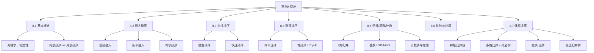
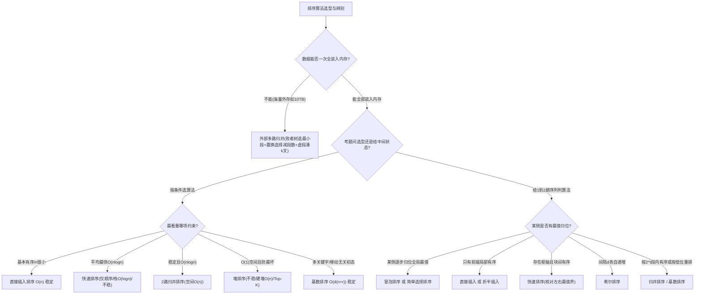

# 第8章 排序

> [!abstract] 本章复盘目标
> 按插入、交换、选择、归并、基数与外部排序的教材顺序，掌握各算法的基本思想、过程特征、稳定性和时空性能。复习时能够根据一趟或若干趟的结果识别算法，手算堆调整、归并比较次数、基数分配和外部排序过程。

> [!important] 近 18 年 408 数据结构真题雷达（2009—2026）
> - **考频定位**：18 年主考单选 **39 题**、近 5 年单选 **13 题**（全书最高频之一）；主考综合大题 **5 题**（`2012-T41`、`2016-T43`、`2021-T42`、`2022-T42`、`2023-T42`，含近 5 年 2 道）。 [[00_408数据结构｜考前急救与真题落点总控|返回数据结构总控]]
> - **命题风向**：选择题围绕“1–2 趟中间序列反推算法或增量、快排归位枢轴检验、堆插入上浮 vs 删除下沉比较次数、排序稳定性与存储适用性、外部败者树冠军结点与最佳归并补虚段”；大题聚焦快排划分/Top-K 堆筛选（2022-T42）与置换-选择外部归并（2023-T42）。

## 考纲定位

- **排序的基本概念**：稳定性、内部排序与外部排序。
- **内部排序**：直接插入、折半插入、希尔、冒泡、快速、简单选择、堆、归并和基数排序，以及各算法的分析与应用。
- **外部排序**：多路归并、败者树、置换-选择与最佳归并树。
- 原笔记保留的计数排序已标注为**大纲外**，只作为原有延伸内容，不作为本次考纲补充要求。

> [!note] 复盘与逐题记录
> 保留原有知识整理和方法；教材统考选择题的题号、答案及选项判断见 [[数据结构/复盘/_核对记录/第8章|第8章真题逐项核对记录]]。本章考纲及开头实际位于“第7章 查找.pdf”末三页。

> [!TIP]
> 本章是 408 数据结构的压轴大章。第一轮做选择题时，不要只背复杂度表，而要先问：**这一趟结束后长什么样？**  
> 排序题最常考的不是“背公式”，而是三类能力：  
> 1）**过程识别**（给中间序列判算法）；  
> 2）**过程推演**（写一趟/两趟结果、数比较次数）；  
> 3）**性质对比**（稳定/不稳定、与初态有关无关、适合什么场景）。  
> 把“过程特征”吃透，表 8.1 自然就记住了。

## 本章先建立一张总图



本章做题前先问：

1. 题目给的是**一趟后**还是**两趟后**？有序区是**局部有序**还是**全局有序**？
2. 是否每趟一定能把某个元素放到**最终位置**？
3. 算法是否要求**随机访问**（顺序表）？链表还能不能用？
4. 题目考的是**比较次数**、**移动次数**，还是**趟数**？三者别混。
5. 若是大文件 / 10TB，立刻想到**外部排序（归并）**，而不是快排堆排。

---

## 8.1 排序的基本概念【📌 扫一眼｜确认“我还会”就过】

### 1. 什么是排序【📌 扫一眼｜确认“我还会”就过】

排序：重新排列表中元素，使元素按关键字有序。

| 项目 | 含义 |
|---|---|
| 输入 | $n$ 个记录及其关键字 |
| 输出 | 重排后的序列，满足 $k'_1 \le k'_2 \le \cdots \le k'_n$（或递减） |
| 关键字 | 用于比较/排序的数据项，可以不唯一 |

### 2. 算法评价指标

| 指标 | 关注什么 |
|---|---|
| 时间复杂度 | 比较次数、移动/交换次数 |
| 空间复杂度 | 辅助数组、递归栈 |
| 稳定性 | 相同关键字的相对次序是否改变 |
| 适用性 | 顺序/链式；内部/外部 |

**稳定性定义**：若 $key_i=key_j$ 且排序前 $R_i$ 在 $R_j$ 前，排序后仍保持这个前后关系，则稳定。

> [!WARNING]
> 稳定不一定“更好”。没有稳定性需求时，快排/堆排往往更香；有多关键字排序（先排次关键字再排主关键字）时，稳定性就关键了。

### 3. 内部排序与外部排序

| 类型 | 数据在哪 | 核心矛盾 |
|---|---|---|
| 内部排序 | 全部能装入内存 | 时空复杂度、稳定性 |
| 外部排序 | 数据在外存，内存装不下 | **磁盘 I/O 次数** |

### 4. 本章算法家族速记

```text
插入类：直接插入、折半插入、希尔
交换类：冒泡、快速
选择类：简单选择、堆
归并类：2路归并
分配类：基数、计数（计数不在大纲但思想常考）
```

---

## 8.2 插入排序【🔥⚡ 必背+避坑｜停下来默背 1 遍 + 精读 1 分钟】

### 核心一句话

> 把待插入元素插进前面已经有序的子表，让有序区从左往右“长大”。

有序区特点是**局部有序**：前 $i$ 个元素有序，但不一定在全局最终位置。

---

### 8.2.1 直接插入排序【🔥⚡ 必背+避坑｜停下来默背 1 遍 + 精读 1 分钟】

#### 1. 思想【📌 扫一眼｜确认“我还会”就过】

对 $i=2,\ldots,n$，第 $i-1$ 趟把 $A[i]$ 插入 $A[1..i-1]$ 的有序区。常用哨兵 $A[0]$ 暂存待插元素，从后往前边比较边后移。

> [!important] 教材中 $A[0]$ 的作用
> 以数组下标从 1 开始的实现为例，$A[0]$ 既暂存待插元素，又起哨兵作用：向前比较时若 $j$ 减到 0，`A[0] < A[j]` 不成立，循环结束，从而避免继续向前越界。

#### 2. 性能【🔥 必背｜停下来默背 1 遍】

| 项目 | 结论 |
|---|---|
| 最好（正序） | 比较 $n-1$ 次，几乎不移动，$O(n)$；<mark>序列越接近正序时比较次数越少</mark> `[真题·2026-T09]` |
| 最坏（逆序） | 比较/移动约 $n(n-1)/2$，$O(n^2)$ |
| 平均 | $O(n^2)$ |
| 空间 | $O(1)$ |
| 稳定性 | **稳定**（从后往前插，相等时不越过） |
| 适用 | 顺序表、链表都可；链表无需大挪移 |

- `【⚡ 真题补丁｜2026-T09】` 给定多组序列比较直接插入总次数：逐元素数其前方逆序对或首次停下前比较次数，多数元素已在位附近仅局部前移时比较次数最少。

> [!TIP]
> 精确统计比较次数时，要看题目或代码是否计入与哨兵的比较，以及是否重复比较前驱。下方最坏次数 $n(n-1)/2$ 按每个待插元素与前面元素逐个比较、每对至多计一次且不计哨兵的口径计算。

#### 3. 题型融合：直接插入常考什么【🔥⚡ 必背+避坑｜停下来默背 1 遍 + 精读 1 分钟】

**题型 A：比较次数上下界**

- 最坏：$n(n-1)/2$
- 最好：$n-1$
- 例：$n=5$ 最多比较 10 次

**题型 B：基本有序时谁最快**

- 直接插入（或冒泡）最好 $O(n)$，此时往往优于快排、归并
- 记忆：**越接近有序，插入越香**

**题型 C：看“两趟后的序列”判算法**

| 算法 | 两趟后的典型特征 |
|---|---|
| 直接插入 | <mark>两趟后前三个元素呈现局部有序</mark>（第 0/1 个可视为已有序，又插了 2 个） `[真题易错·2009-T10]` |
| 冒泡/简单选择 | <mark>两趟后一侧已有两个全局最值归位</mark>（取决于升降序与扫描方向） `[真题易错·2009-T10 / 2010-T11]` |
| 堆排序 | 类似选择，堆顶输出侧会有全局最值归位 |
| 快速排序 | 至少有枢轴在最终位置，左右块间有序 |

做题口诀：

1. 先看有没有“已在最终位置”的端点元素；  
2. 再看前缀是否局部有序；  
3. 再看是否出现“间隔分组有序”（希尔）。

**题型 D：最后一趟开始前，所有元素都不在最终位置——可能是谁？**

- **直接插入可以**（最后一个应插到最前时，前面有序区全都不在最终位置）
- 冒泡/选择/堆/快排每趟至少确定一个最终位置，通常不行

**题型 E：哪趟不一定把某个元素放到最终位置**

- **希尔、归并、直接插入**都可能
- 一定能的：冒泡、简单选择、堆、快速（枢轴）

---

### 8.2.2 折半插入排序【🔥⚡ 必背+避坑｜停下来默背 1 遍 + 精读 1 分钟】

#### 1. 思想【📌 扫一眼｜确认“我还会”就过】

把“找插入位置”和“移动元素”分开：

1. 在有序区用**折半查找**定位；
2. 统一后移，再插入。

为保持稳定性，折半时相等关键字应继续向**右半区**找（`A[mid] > A[0]` 才 `high=mid-1`，否则 `low=mid+1`），最终插在 `high+1`。

#### 2. 性能【🔥 必背｜停下来默背 1 遍】

| 项目 | 与直接插入比 |
|---|---|
| 比较次数 | 对通常的折半定位实现，数量级为 $\Theta(n\log_2 n)$；具体次数可能随插入位置变化 |
| 移动次数 | 仍依赖初态，**没减少**（最好 $O(n)$，最坏 $O(n^2)$） |
| 总时间 | **最好 $\Theta(n\log n)$**（比较主导，基本有序时几乎不移动）；平均/最坏仍 $O(n^2)$（移动主导） |
| 空间 | $O(1)$ |
| 稳定性 | 稳定 |
| 适用 | **仅顺序表**（需要随机访问 mid） |

> [!TIP]
> 要分清数量级与具体次数：通常折半插入的关键字比较次数为 $\Theta(n\log n)$，其数量级不随初态改变，但**精确次数可能随插入位置改变**。教材说比较次数与初态无关时，按其复杂度分析口径理解。最好总时间为 $\Theta(n\log n)$，平均与最坏情况下元素后移可能占主导。

#### 3. 题型融合【⚡ 避坑｜最值钱，必须精读 1 分钟】

**2012 真题精髓**：折半插入 vs 直接插入，可能不同的是？

| 项目 | 是否相同 |
|---|---|
| 总趟数 | 同（排序总趟数都是 $n-1$ 趟） `[真题·2012-T11]` |
| 移动次数 | 同（元素移动次数均取决于初态） `[真题·2012-T11]` |
| 辅助空间 | 同（使用辅助空间均为 $O(1)$） `[真题·2012-T11]` |
| **比较次数** | <mark>仅元素间比较次数两者可能不同</mark>：折半降低定位比较的数量级上界，但对某些具体序列并不一定更少 `[真题易错·2012-T11]` |

记忆：**比较被折半压住了，搬家没变。** 最好时总代价由比较主导 $\to\Theta(n\log n)$；乱序时搬家仍可能把总时间拉回 $O(n^2)$。

---

> [!example] 真题补充：折半插入不保证每个输入都更少比较
> 对已经递增的 `1,2,3`，直接插入每趟只需与前一个元素比较；通常的折半插入在将 3 插入长度为 2 的有序区时，可能需要比较两次。结论是两种方法的**比较次数可能不同**，而不是折半对任意输入都更少。

### 8.2.3 希尔排序（缩小增量排序）【🔥⚡ 必背+避坑｜停下来默背 1 遍 + 精读 1 分钟】

#### 1. 思想【🔥 必背｜停下来默背 1 遍】

利用“基本有序时插入排序很快”的特性：

1. 取增量 $d_1>d_2>\cdots>d_r=1$；
2. 每次把相隔 $d$ 的元素分成 $d$ 组，<mark>希尔排序组内采用直接插入排序</mark>（不采用折半插入、快速排序或归并排序）； `[真题·2015-T11]`
3. 增量缩小到 1 时，做最后一次全局直接插入。

> [!warning] 希尔排序中的 $A[0]$
> 教材实现中 $A[0]$ 只用来暂存待插元素，**不作哨兵**。下标每次减去增量 $d$，可能越过 0（如 $j=2$、$d=3$ 时下一次为 $-1$），因此比较前要先检查 `j > 0`；不能因为某些分组恰好能到达 0，就省略边界判断。

#### 2. 性能【🔥 必背｜停下来默背 1 遍】

| 项目 | 结论 |
|---|---|
| 时间 | 依赖增量序列；常见约 $O(n^{1.3})$，最坏可达 $O(n^2)$ |
| 空间 | $O(1)$ |
| 稳定性 | **不稳定**（同关键字可能分到不同组） |
| 适用 | **仅顺序表** |
| 本质分类 | 仍属**插入排序**改进 |

#### 3. 题型融合：希尔的“指纹”【🔥⚡ 必背+避坑｜停下来默背 1 遍 + 精读 1 分钟】

**题型 A：由一趟结果反推增量**

做法：

1. 确认升降序（看最小/最大是否往正确方向走）；
2. 对选项中的增量 $d$，检查所有下标差为 $d$ 的子序列是否**组内有序**；
3. 不满足就排除。

例：第一趟后 `9,1,4,13,7,8,20,23,15`，<mark>一趟结果反推增量须全组各自有序</mark>，检验间隔 3 的三组均有序故增量可能为 3。 `[真题·2014-T10]`

**题型 B：给两趟结果求两个增量**

分别验证第一趟、第二趟各组是否有序，<mark>多趟希尔须依次检验各组是否各自有序</mark>（常考如两趟增量为 5 和 3 的组合）。 `[真题·2018-T10]`

**题型 C：组内用什么排序？**

- 标准答案：**直接插入排序**
- 不是折半、不是快排、不是归并

**题型 D：识别“只能是希尔”的中间序列**

若第 1、2 趟后呈现“<mark>下标模固定步长分组各自递增趋势</mark>”，随步长收敛逐步局部有序，可判定为希尔排序。 `[真题·2025-T11]`

---

> [!example] 2025 真题：由两趟结果反推希尔增量
> 初始序列 `5,25,40,30,10,20,45,15,35`：按增量 3 组内直接插入后为 `5,10,20,30,15,35,45,25,40`；再按增量 2 分组后为 `5,10,15,25,20,30,40,35,45`。教材解析将第二趟增量写成 1；若增量为 1，该趟就是对全表直接插入排序，结果应当全局有序，与题目所列结果不符，按题目序列应为 **3、2**。

## 8.3 交换排序【🔥⚡ 必背+避坑｜停下来默背 1 遍 + 精读 1 分钟】

### 8.3.1 冒泡排序【🔥 必背｜停下来默背 1 遍】

#### 1. 思想【📌 扫一眼｜确认“我还会”就过】

反复比较相邻元素，逆序则交换。一趟后，当前未排序部分的最小/最大元素到达端点（气泡上浮或石头下沉）。可用 `flag` 在无交换时提前结束。

#### 2. 性能【📌 扫一眼｜确认“我还会”就过】

| 情况 | 时间 |
|---|---|
| 最好（有序） | 1 趟，$n-1$ 次比较，$O(n)$ |
| 最坏（逆序） | $n-1$ 趟，比较 $n(n-1)/2$，移动 $3n(n-1)/2$，$O(n^2)$ |
| 平均 | $O(n^2)$ |
| 空间 | $O(1)$ |
| 稳定性 | **稳定**（相等不交换） |
| 适用 | 顺序、链式均可 |

#### 3. 关键过程特征【🔥 必背｜停下来默背 1 遍】

> 每趟产生的有序子序列是**全局有序**的：已排序部分全体 ≤（或 ≥）未排序部分全体。  
> 所以每趟能把一个元素放到**最终位置**。

这和直接插入的“局部有序”形成对照，是判题金钥匙。

#### 4. 题型融合【📌 扫一眼｜确认“我还会”就过】

| 题型 | 做法 |
|---|---|
| 交换次数最多 | 逆序时最多 |
| 交换次数等于什么 | **相邻交换的冒泡，交换次数 = 逆序对个数** |
| 有序序列做冒泡比较几次 | 若带提前终止：约 $n-1$；若问逆序比较总数：$n(n-1)/2$ |
| 双向冒泡 | 正反交替，一趟从左到右、一趟从右到左都算一趟；最后常需一趟无交换确认结束 |
| 看多趟结果判冒泡 | 每趟一个最值沉底/上浮，<mark>多趟后同一端连续全局最值归位</mark>（如三趟后末尾三个最值归位） `[真题·2010-T11]` |

---

### 8.3.2 快速排序【🔥⚡ 必背+避坑｜停下来默背 1 遍 + 精读 1 分钟】

#### 1. 思想【📌 扫一眼｜确认“我还会”就过】

1. 选枢轴（pivot，考研常取首元素）；
2. **一趟划分**：左小右大（或左大右小），枢轴归位；
3. 对左右子表递归。

#### 2. 一趟划分（必须会手写）【🔥 必背｜停下来默背 1 遍】

```c
int Partition(ElemType A[], int low, int high) {
    ElemType pivot = A[low];
    while (low < high) {
        while (low < high && A[high] >= pivot) --high;
        A[low] = A[high];
        while (low < high && A[low] <= pivot) ++low;
        A[high] = A[low];
    }
    A[low] = pivot;
    return low;
}
```

记忆口诀：

- **先右后左**（先找小于枢轴的，再找大于枢轴的）；
- 挖坑填坑，最后枢轴落入 `low`。

#### 3. 性能【🔥⚡ 必背+避坑｜停下来默背 1 遍 + 精读 1 分钟】

| 项目 | 结论 |
|---|---|
| 最好 | 每次均匀划分，$O(n\log_2 n)$ |
| 平均 | $O(n\log_2 n)$，**平均性能最优的内部排序之一** |
| 最坏 | 基本有序/逆序且枢轴取端点，$O(n^2)$ |
| 空间（递归栈） | 平均 $O(\log_2 n)$，最坏 $O(n)$ |
| 稳定性 | **不稳定** |
| 适用 | <mark>快排宜采用顺序存储支持双向定位</mark>（链式、散列、索引均不利于双向指针扫描） `[真题·2011-T10]` |

改进划分平衡性：三数取中、随机选枢轴。

#### 4. 过程特征（超高频）【🔥⚡ 必背+避坑｜停下来默背 1 遍 + 精读 1 分钟】

- 每趟**至少确定 1 个**最终位置：当前枢轴；
- **不**产生“端到端的全局有序区”，但保证：<mark>划分后左右两部分块间有序块内可乱</mark>（左侧均 $\le$ 枢轴，右侧均 $\ge$ 枢轴）； `[真题易错·2024-T08]`
- 左右块内部仍可能无序，且两块元素个数未必大致相等，两块中仍可能存在相等元素。 `[真题易错·2024-T08]`

#### 5. 题型融合：快排六大经典题型【🔥⚡ 必背+避坑｜停下来默背 1 遍 + 精读 1 分钟】

**题型 A：一趟划分结果手算**

以第一个为基准，严格按“右→左→右→左”模拟。注意教材挖坑法与“交换法”细节不同，但最终枢轴位置与块间有序一致。

**题型 B：判断“可能是第 k 趟快排结果”**

核心检验：序列中是否存在足够多的“已归位枢轴”。

第二趟结果的两种合法形态：

| 情况 | 第一趟枢轴位置 | 第二趟后至少确定的最终位置数 |
|---|---|---|
| ① 第一趟枢轴在端点 | 首或尾 | ≥2（端点侧继续出枢轴） |
| ② 第一趟枢轴不在端点 | 中间 | ≥3（左右各再出一个） |

排除法：若<mark>归位枢轴过少或枢轴两侧大小错乱</mark>，即不可能为对应趟次快排结果。 `[真题易错·2014-T11 / 2019-T10]`

- `【⚡ 真题补丁｜2014-T11 / 2019-T10】` 本层所有长于 1 的子区各划一趟，第 2 趟通常至少有 2 个（全在端点）或 3 个以上归位枢轴且各自划分块间有序。

> [!note] 两趟判断的边界
> 这里的“一趟”沿用真题口径：对本层所有尚未归位的子序列分别划分；只有一个元素的子序列自然已经在最终位置。上述位置数量是**必要条件**，满足后仍要检查枢轴两侧大小关系，不能仅凭位置数量断定某种结果一定可构造。

**题型 C：给划分后序列求枢轴**

1. 写出最终有序序列；  
2. 找“当前位置 = 最终位置”的候选；  
3. 再验证：<mark>左侧所有元素不大于它右侧均不小于它</mark>（如 2023 真题仅 81 满足全左小右大）。 `[真题·2023-T11]`

**题型 D：最快/最慢情形**

- 最快：每次枢轴尽量均分；
- 最慢：已有序或逆序（枢轴总是最值）。

**题型 E：递归次数/深度**

- 最大深度约 $n$（极不平衡）；
- 最小深度约 $\log_2 n$（均匀）；
- 递归次数依赖于数据初始排列；但固定划分树下，<mark>快排递归调用总次数与分区顺序无关</mark>（先处理长区或短区只影响最大栈深，不改变总调用次数）。 `[真题易错·2010-T10]`

> [!note] 调用次数、调用栈和存储条件
> 2010 真题的“与分区处理顺序无关”指固定划分结果时的**递归调用总次数**。采用先处理较短分区并配合尾递归消除等优化时，最大栈深可以改变。教材所写双向扫描的快排适合顺序存储；不能由此断言所有链表快速排序变体都不存在。

**题型 F：快排思想的应用题（综合题）**

| 问题 | 套路 |
|---|---|
| 奇数移前偶数移后 | 一次划分，$O(n)$ 时间 $O(1)$ 空间 |
| 第 $k$ 小 | 划分后看枢轴下标 $m$ 与 $k$ 关系，只递归一侧，平均 $O(n)$ |
| 荷兰国旗 / 三色 | 三指针划分 |
| 划分成两半使 $\lvert n_1-n_2\rvert$ 最小且和差最大 | 找中位数后分成大小两半；<mark>用快排划分定第k小无需全表排序</mark> `[真题·2016-T43]` |

- `【⚡ 真题补丁｜2016-T43】` 历史大题顺延特例：循环执行 `Partition` 定位第 $\lfloor n/2\rfloor$ 小元素即停，左半放 `A1`、右半放 `A2`，时间 $O(n)$、空间 $O(1)$。

## 8.4 选择排序【🔥⚡ 必背+避坑｜停下来默背 1 遍 + 精读 1 分钟】

### 总思想

每趟在未排序部分选最小（或最大），放到有序区边界。堆排序是选择思想的高效实现。

---

### 8.4.1 简单选择排序【🔥 必背｜停下来默背 1 遍】

#### 1. 思想【📌 扫一眼｜确认“我还会”就过】

采用从 0 开始的下标，第 $i+1$ 趟（$i=0,\ldots,n-2$）在 $A[i..n-1]$ 找最小，与 $A[i]$ 交换。共 $n-1$ 趟。

#### 2. 性能【🔥 必背｜停下来默背 1 遍】

| 项目 | 结论 |
|---|---|
| 比较次数 | **恒为** $n(n-1)/2$，与初态无关 |
| 移动次数 | 最多 $3(n-1)$，有序时可为 0 |
| 时间 | 恒 $O(n^2)$ |
| 空间 | $O(1)$ |
| 稳定性 | **不稳定**（例：`{2a,2b,1}` → `{1,2b,2a}`，两个相等关键字的先后顺序改变） |
| 适用 | 顺序、链式均可；关键字少、记录大时移动少是优势 |

#### 3. 题型融合【🔥⚡ 必背+避坑｜停下来默背 1 遍 + 精读 1 分钟】

| 考点 | 结论 |
|---|---|
| 比较次数与初态 | **无关**（对比插入/冒泡/快排） |
| 最坏移动次数最少是谁 | <mark>简单选择最坏移动次数最少仅O(n)</mark>（每趟至多交换 1 次，而冒泡/插入/快排最坏均 $O(n^2)$） `[真题·2025-T10]` |
| 基本有序时为何插入比选择快 | <mark>基本有序时插入比较次数可降至线性</mark>，而选择比较次数仍为 $O(n^2)$；两者空间均为 $O(1)$ 且基本有序下移动次数均极少 `[真题易错·2020-T11]` |

---

### 8.4.2 堆排序【🔥⚡ 必背+避坑｜停下来默背 1 遍 + 精读 1 分钟】

#### 1. 堆的定义【📌 扫一眼｜确认“我还会”就过】

将序列看作完全二叉树，对所有 $1\le i\le\lfloor n/2\rfloor$，只与**存在的孩子**比较：

| 堆类型 | 条件 |
|---|---|
| 大根堆 | 左孩子存在时 $L(i)\ge L(2i)$；右孩子存在时 $L(i)\ge L(2i+1)$ |
| 小根堆 | 左孩子存在时 $L(i)\le L(2i)$；右孩子存在时 $L(i)\le L(2i+1)$ |

其中左孩子存在的条件为 $2i\le n$，右孩子存在的条件为 $2i+1\le n$；结点只有左孩子时不能引用不存在的右孩子。

#### 2. 堆的重要性质（2020）【🔥⚡ 必背+避坑｜停下来默背 1 遍 + 精读 1 分钟】

| 说法 | 对错 |
|---|---|
| 堆是完全二叉树 | 对 `[真题易错·2020-T09]` |
| 可用顺序存储 | 对 `[真题易错·2020-T09]` |
| 堆一定是二叉排序树 | 错（<mark>堆只限父子大小不限左右子树大小</mark>；某些具体堆也可能碰巧满足） `[真题易错·2020-T09]` |
| 大根堆中第二大的元素 | $n\ge2$ 时，<mark>大根堆次大值至少一个在根的孩子层</mark>；关键字互异时，唯一次大值必在这一层 `[真题易错·2020-T09]` |
| 层序遍历一定有序 | **错** |
| 根到任意叶路径有序 | 对（大根非增 / 小根非减，允许相等） |

非空小根堆中，**至少有一个最大值在叶结点**，叶结点位置范围为 $\lfloor n/2\rfloor+1\sim n$；若允许重复关键字，其他相同的最大值也可能出现在非叶结点。

#### 3. 建堆（自底向上）【🔥⚡ 必背+避坑｜停下来默背 1 遍 + 精读 1 分钟】

从最后一个分支结点 $\lfloor n/2\rfloor$ 扫到 1，对每个结点<mark>自底向上对各分支做向下筛选</mark>。 `[真题·2018-T11]`

- 自底向上建堆时间为 **$O(n)$**：靠近叶子的结点多、下沉距离短；可能下沉较远的上层结点少，各层调整代价相加仍为线性。
- 关键字比较次数不超过 $4n$ 量级
- 若从空堆开始**逐个插入**，每次上浮最坏为 $O(\log n)$，总时间最坏为 $O(n\log n)$；这与自底向上建堆是不同过程。

> [!WARNING]
> **“依次插入空堆”** 和 **“一次性调整建堆”** 结果可能不同。<mark>依次插入建堆须每插一元素即上浮</mark>一步步调整。 `[真题·2021-T11]`

#### 4. 堆排序流程【📌 扫一眼｜确认“我还会”就过】

1. 建成大根堆；  
2. 堆顶与堆尾交换（最大值归位）；  
3. 对剩余 $n-1$ 个元素向下调整；  
4. 重复直到堆中剩 1 个元素。

时间：最好/最坏/平均均为 $O(n\log_2 n)$  
空间：$O(1)$  
稳定性：**不稳定**  
适用：仅顺序表

#### 5. 插入与删除（比较次数极易错）【🔥⚡ 必背+避坑｜停下来默背 1 遍 + 精读 1 分钟】

| 操作 | 做法 | 时间 |
|---|---|---|
| 插入 | 放堆尾，**向上调整（上浮）** | $O(\log_2 n)$ |
| 删除堆顶 | 堆尾补到堆顶，**向下调整（下沉）** | $O(\log_2 n)$ |

> [!WARNING]
> **插删手算比较次数是两套口径，别混用。**  
> 2011（插 18）、2015（删 8）都栽在这里。

| | 插入上浮 | 删除下沉 |
|---|---|---|
| 路径 | 新结点 → 父 → … → 根 | 堆顶 → 子 → … → 叶方向 |
| 每层和谁比 | <mark>插入上浮每层只和当前父结点比一次</mark> `[真题·2009-T09 / 2011-T11]` | 有双孩子：<mark>删除下沉有双孩子先比孩子再比自身</mark>（共约 2 次） `[真题·2015-T10]` |
| 和兄弟比吗 | **不比**（堆不要求左右有序） | 两孩子会先互比；不是和“堂兄弟”乱比 |
| 何时少 1 次 | — | **只有一个孩子**时，没有“孩子互比”，只和该孩子比 1 次 |
| 何时停 | 不违反堆序，或已到根 | 不违反堆序，或已无孩子 |
| 真题感 | 插 18：只比父 10、再比父 25 → **2 次**（不和 13 比） | 删 8 后 12 下沉：15vs10、12vs10、12vs16 → **3 次** |

口诀：

> **插：只比爹。**  
> **删顶：先比俩娃，再比自己；单娃少一次。**

#### 6. Top-K 与优先队列【🔥⚡ 必背+避坑｜停下来默背 1 遍 + 精读 1 分钟】

**海量数据求最小的 k 个**：

1. 用前 $k$ 个数建<mark>求最小k个数维护容量k大根堆</mark>（或升序定长表）； `[真题易错·2022-T42]`  
2. 后面每个数：若 ≥ 堆顶则丢弃，否则替换堆顶并向下调整；  
3. 结束时堆内即最小 k 个。

复杂度：$O(n\log_2 k)$ 时间，$O(k)$ 空间（当 $k=10$ 为常数时平均时间 $O(n)$、空间 $O(1)$）。  
若求最大 k 个，则维护容量 k 的**小根堆**。

优先队列：顺序存储的堆实现，入队/出队 $O(\log n)$。

#### 7. 题型融合：堆排序高频套路【📌 扫一眼｜确认“我还会”就过】

| 题型 | 做法 |
|---|---|
| 判断是否为堆 | 画成完全二叉树，逐个检查父≥子或父≤子 |
| 初始建堆过程 | 从 $\lfloor n/2\rfloor$ 往 1 筛，写出每步序列 |
| 插入后堆 | 尾插 + 上浮；**数比较 = 与祖先比的次数** |
| 删除后堆 | 尾补顶 + 下沉；**数比较 = 孩子互比 + 与选中孩子比** |
| 输出两个最小后剩余堆 | 连续两次堆尾补顶并<mark>按小根或大根堆序两次下沉调整</mark> `[真题·2024-T09]` |
| 只要前 k 小的部分有序 | 堆排序/选择思路，比全排序快 |
| 堆 vs BST | BST 左右有序、中序有序；堆只保证父子关系 |
| 插/删比较次数 | 上浮不碰兄弟；下沉有双孩子时每层常 2 次 |

---

## 8.5 归并排序、基数排序和计数排序【🔥⚡ 必背+避坑｜停下来默背 1 遍 + 精读 1 分钟】

### 8.5.1 2 路归并排序【🔥 必背｜停下来默背 1 遍】

#### 1. 思想【📌 扫一眼｜确认“我还会”就过】

把 $n$ 个元素看成 $n$ 个长度为 1 的有序表，两两合并，直到合成一个长度为 $n$ 的有序表。

- 非递归：第 $t$ 趟把长度为 $h$ 的段合成 $2h$ 的段，共 $\lceil\log_2 n\rceil$ 趟  
- 递归：分治到单个元素再 Merge 回来

#### 2. Merge 要点【🔥 必背｜停下来默背 1 遍】

Merge 操作的核心功能是<mark>将两个有序表合并为新的有序表</mark>（而非按长度均分、拆到单元素或快排式的按大小分两块），再拷回原表； `[真题·2022-T10]` 相等时取前一段，保证**稳定**。

#### 3. 性能【🔥 必背｜停下来默背 1 遍】

| 项目 | 结论 |
|---|---|
| 时间 | 每趟 $O(n)$，共 $\lceil\log_2 n\rceil$ 趟 → **$O(n\log_2 n)$**（与初态无关） |
| 空间 | **$O(n)$**（辅助数组；本章内部排序中通常最大） |
| 稳定性 | **稳定** |
| 适用 | 顺序、链式均可 |
| 过程特征 | 每趟后得到若干局部有序段；**不保证**有元素到最终位置 |

k 路归并趟数：$\lceil\log_k N\rceil$。

#### 4. 题型融合【🔥⚡ 必背+避坑｜停下来默背 1 遍 + 精读 1 分钟】

| 题型 | 做法 |
|---|---|
| 第 t 趟结果 | <mark>二路归并第t趟按长度2的t次方有序</mark>（第 2 趟每 4 个一组有序） `[真题易错·2009-T10]` |
| 两有序表合并比较次数 | **两个表各含 $N$ 个元素时**：最少 $N$（一表元素全小于另一表），最多 $2N-1$（交错取完） |
| 多段 2 路归并比较次数 | 按从左到右两两合并时，<mark>多段二路按题设顺序累加最坏比较数</mark> `[真题·2024-T10]` |
| 最少总比较合表策略 | 若自由决定多个不等长有序表的两两合并次序，应<mark>每次选当前最短的两个有序表合并</mark> `[真题·2012-T41]` |
| 空间对比 | 平均空间：堆 $O(1)$ < 快 $O(\log n)$ < 归并 $O(n)$ |

- `【⚡ 真题补丁｜2012-T41 / 2024-T10】` 两长 $m,n$ 有序表合并最多比较 $m+n-1$ 次；6 个不等长表自由选序总比较最少按哈夫曼思路累加得 825 次（2012-T41），指定左至右三段直接累加得 5 次（2024-T10）。

> [!example] 两个升序链表合成降序链表（2013）
> 每次比较两个表头，取较小结点**头插**到结果链表；某表用尽后，将另一表剩余结点逐个头插。需要处理 $m+n$ 个结点，时间为 $\Theta(m+n)=\Theta(\max(m,n))$，不用误选 $O(\min(m,n))$。

### 8.5.2 基数排序【🔥⚡ 必背+避坑｜停下来默背 1 遍 + 精读 1 分钟】

#### 1. 本质【📌 扫一眼｜确认“我还会”就过】

**不比较关键字整体**，而按各位（多关键字）做分配-收集。是稳定的“分配类”排序。

| 方法 | 顺序 |
|---|---|
| LSD（最低位优先） | 个位 → 十位 → … → 最高位 |
| MSD（最高位优先） | 最高位先分桶，再递归处理各桶 |

教材重点：**链式基数 + LSD**。

#### 2. 一趟操作【📌 扫一眼｜确认“我还会”就过】

对当前位：

1. **分配**：元素按该位数字进入队列 $Q_0\sim Q_{r-1}$；  
2. **收集**：按 $Q_0$ 到 $Q_{r-1}$ 顺序串成新表。

基数 $r$：十进制常取 10（10 个队列）。  
趟数 $d$：关键字位数。

#### 3. 性能【🔥 必背｜停下来默背 1 遍】

| 项目 | 结论 |
|---|---|
| 时间 | $O(d(n+r))$，**与序列初态无关** |
| 空间 | $O(r)$（队头队尾指针等） |
| 稳定性 | **稳定**（同号队列先进先出） |
| 适用 | 顺序、链式均可，链式更合适 |
| 移动次数 | <mark>基数排序移动次数与序列初态无关</mark>（直接插入、冒泡、快排移动均受初态影响） `[真题·2015-T09]` |

#### 4. 题型融合【🔥 必背｜停下来默背 1 遍】

| 题型 | 做法 |
|---|---|
| 一趟后结果 | <mark>LSD首趟按个位数字稳定进出队列</mark> `[真题·2021-T10]` |
| 第二趟后结果 | <mark>LSD第二趟已按个位与十位组合有序</mark> `[真题·2013-T11]` |
| 队列个数 | 等于基数 $r$，不是 $n$，也不是位数 $d$ |
| 生日排序为何快 | $n$ 大但“月、日”排序码少且基数小 → 近线性 |
| 多关键字排序 | 先排次关键字，再按主关键字用<mark>多关键字保序排法首选基数排序</mark>（快排、希尔、选择均因不稳破坏原序） `[真题·2026-T10]` |
| 关键字类型限制 | **不能直接处理普通浮点关键字**（float/double 的“位”不好当排序码）；适合整数、定长串等 |

多关键字排序选型口诀（先 $k_2$ 再 $k_1$）：

- 后一轮必须用**稳定**算法（直接插入 √，简单选择 ×）

---

### 8.5.3 计数排序（大纲外，思想常考）【📌 扫一眼｜确认“我还会”就过】

#### 1. 思想

统计小于 $x$ 的元素个数，从而直接确定 $x$ 的位置。

经典稳定实现：

1. `C[x]` 计频次；  
2. 前缀和得到 ≤x 的个数；  
3. **从后往前**把 `A[i]` 放入 `B[C[A[i]]-1]`，并 `C[A[i]]--`。

#### 2. 性能

- 时间 $O(n+k)$，空间 $O(n+k)$  
- **前提：关键字为非负整数，且取值范围 $k$ 较小**；否则辅助数组过大，效率反而不如比较排序  
- $k=O(n)$ 时可近线性；$k$ 过大则不如比较排序  
- 稳定（依赖“从后往前”）

真题常见变体：用两两比较计数位置（`cmpCountSort`），需执行 $n(n-1)/2$ 次比较，且<mark>相等分支含等号才保证排序稳定</mark>（例如将判断改写为 `if (a[i] <= a[j])`）。 `[真题·2021-T42]`

- `【⚡ 真题补丁｜2021-T42】` `cmpCountSort` 把统计值作为下标放入新数组 `b[]` 并保留原 `a[]` 不变；例题模拟 `b={-10,10,11,19,25,25}`。

---

## 8.6 各种内部排序算法的比较及应用【🔥⚡ 必背+避坑｜停下来默背 1 遍 + 精读 1 分钟】

### 8.6.1 一张总表（务必背熟）【🔥 必背｜停下来默背 1 遍】

| 算法 | 最好 | 平均 | 最坏 | 空间(均) | 稳定 | 每趟定最终位置 |
|---|---|---|---|---|---|---|
| 直接插入 | $O(n)$ | $O(n^2)$ | $O(n^2)$ | $O(1)$ | 是 | 否 |
| 折半插入 | $\Theta(n\log n)$ | $O(n^2)$ | $O(n^2)$ | $O(1)$ | 是 | 否 |
| 希尔 | 依赖增量 | 约 $O(n^{1.3})$ | 可达 $O(n^2)$ | $O(1)$ | 否 | 否 |
| 冒泡 | $O(n)$ | $O(n^2)$ | $O(n^2)$ | $O(1)$ | 是 | 是 |
| 快速 | $O(n\log n)$ | $O(n\log n)$ | $O(n^2)$ | $O(\log n)$ | 否 | 是(枢轴) |
| 简单选择 | $O(n^2)$ | $O(n^2)$ | $O(n^2)$ | $O(1)$ | 否 | 是 |
| 堆 | $O(n\log n)$ | $O(n\log n)$ | $O(n\log n)$ | $O(1)$ | 否 | 是 |
| 2路归并 | $O(n\log n)$ | $O(n\log n)$ | $O(n\log n)$ | $O(n)$ | 是 | 否 |
| 基数 | $O(d(n+r))$ | 同左 | 同左 | $O(r)$ | 是 | 通常否 |

稳定记忆口诀：

> **插泡归基稳，选快希堆不稳。**  
> <mark>不稳定排序含选择快排希尔与堆排</mark>，平均 $O(n\log n)$ 里只有归并与基数、插泡同属稳定阵营。 `[真题·2023-T10]`

### 8.6.2 适用性【⚡ 避坑｜最值钱，必须精读 1 分钟】

| 仅顺序表 | 顺序+链式 |
|---|---|
| 折半插入、希尔、快速、堆 | 直接插入、冒泡、简单选择、归并、基数 |

换成链式存储后时间效率明显降低的是：<mark>希尔和堆排序依赖下标随机访问</mark>（直接插入、简单选择、冒泡原本即 $O(n^2)$，改链式不改变复杂度阶）。 `[真题易错·2017-T11]`

### 8.6.3 过程特征总对照【🔥 必背｜停下来默背 1 遍】

| 算法 | 中间状态“长什么样” |
|---|---|
| 直接插入 | 前缀局部有序 |
| 折半插入 | 同直接插入（移动相同） |
| 希尔 | 间隔 $d$ 的子序列有序 |
| 冒泡 | 端点最值归位，有序区全局有序 |
| 简单选择 | 端点最值归位 |
| 堆 | 先建堆，再不断输出堆顶到尾部 |
| 快速 | 存在枢轴，左右块间有序、块内可乱 |
| 归并 | 长度为 $2,4,8,\ldots$ 的段内有序 |
| 基数 | 按位分配收集，稳定重排 |

### 8.6.4 如何选算法【🔥 必背｜停下来默背 1 遍】

选排序算法时须综合考虑<mark>规模存储方式稳定性与初始状态</mark>四要素（还可参考关键字结构与辅助空间限制）： `[真题·2019-T07]`

1. 数据规模 $n$  
2. 存储方式  
3. 稳定性要求  
4. 初始状态  
5. 关键字结构、辅助空间限制  

**选型速查：**

| 场景 | 优先选 |
|---|---|
| $n$ 很小 | 直接插入 / 简单选择 |
| 记录大、移动贵 | 简单选择（移动少） |
| 基本有序 | 直接插入、冒泡 |
| $n$ 大、关键字随机、要快 | 快速排序 |
| $n$ 大、要防最坏、空间紧 | 堆排序 |
| $n$ 大、要稳定且 $O(n\log n)$ | 归并排序 |
| 关键字位数少、可拆分 | 基数排序 |
| 内存放不下 | 外部归并 |

基于比较的排序，最坏情况下下界是 $\Omega(n\log n)$。

### 8.6.5 本节选择题题型地图【🔥⚡ 必背+避坑｜停下来默背 1 遍 + 精读 1 分钟】

| 题型 | 关键判断 |
|---|---|
| 稳定 + $O(n\log n)$ | 只有归并 |
| 基本有序时三者复杂度 | 插入 $O(n)$，归并 $O(n\log n)$，快排可能 $O(n^2)$ |
| 辅助空间关系 | 堆 < 快(均) < 归并 |
| 趟数与初态无关 | 简单选择、基数、直接插入、归并、堆…；冒泡/快排有关 |
| 每趟至少定一个最终位置 | <mark>选择快排堆排冒泡每趟定一个终位</mark>（希尔、归并与直接插入均不一定） `[真题易错·2012-T10]` |
| 并行与趟间依赖 | 快排完成一次划分后，两侧子区间可分别处理；基数和冒泡的常规多趟过程存在先后依赖，但不据此断定每趟内部都不能并行 |
| 为何用归并不用插入 | <mark>选归并不用插入因运行效率更高</mark>（并非代码更短或更省辅助空间） `[真题·2017-T10]` |
| 为何用插入不用快排 | <mark>基本有序规模小要省空间或求稳定</mark> —— 四条都可以 `[真题·2022-T11]` |
| 看前几趟结果判算法 | 用上表“指纹”逐项排除 |

---

## 8.7 外部排序【🔥⚡ 必背+避坑｜停下来默背 1 遍 + 精读 1 分钟】

### 8.7.1 基本概念【🔥 必背｜停下来默背 1 遍】

数据在外存，内存装不下，排序依赖多次内外存交换。  
时间公式：

$$
\text{总时间} \approx \text{内部排序} + \text{外存 I/O} + \text{内部归并}
$$

其中 **I/O 占主要耗时**。

大文件外存排序用什么？—— 对远超内存容量的 10TB 大文件应采用<mark>外部多路归并而非内部快排堆希尔</mark>。 `[真题·2016-T11]`

### 8.7.2 两个阶段【🔥⚡ 必背+避坑｜停下来默背 1 遍 + 精读 1 分钟】

1. **生成初始归并段（顺串）**  
   把文件按内存能装下的大小切块，内部排序后写回，得到多个有序段。

2. **多路归并**  
   反复把多个有序段合并成更长有序段，直到只剩一个有序文件。

减少 I/O 的两条主线：

| 手段 | 效果 | 实现 |
|---|---|---|
| 增大归并路数 $k$ | <mark>增大归并路数可减少归并趟数</mark> $d=\lceil\log_k r\rceil$ `[真题易错·2026-T11]` | 败者树 |
| 减少初始段数 $r$ | 同样使 $d$ 变小；<mark>归并趟数依赖初始段数与可用内存</mark>（可用内存大小也限制初始归并段的长度） `[真题易错·2026-T11]` | 置换-选择生成更长段 |

### 8.7.3 多路平衡归并与败者树【🔥⚡ 必背+避坑｜停下来默背 1 遍 + 精读 1 分钟】

#### 1. 为什么需要败者树【📌 扫一眼｜确认“我还会”就过】

朴素 $k$ 路归并：每次从 $k$ 个候选中选最小要 $k-1$ 次比较，内部归并时间随 $k$ 变差。  
败者树：更新当前最小值通常需 $O(\log_2 k)$ 次比较。理想化地忽略取整和各趟剩余段差异，多趟比较量可理解为约 $n\log_2 r$，其主要数量级不因 $k$ 改变；实际次数受取整、归并段长度和树的实现影响，不能把简化式当成精确恒等式。

#### 2. 败者树要点【⚡ 避坑｜最值钱，必须精读 1 分钟】

- 完全二叉树；
- 叶：各归并段当前元素；
- 内部结点记**败者**（较大者）的段号；
- 总冠军（最小者）记录在 `ls[0]`，<mark>冠军结点保存最小关键字所在段号</mark>（不保存最大关键字或仅存关键字值本身，方便直接推进该归并段）。 `[真题易错·2024-T11]`

#### 3. 选择题小对比：败者树 vs 堆【📌 扫一眼｜确认“我还会”就过】

| 点 | 败者树 | 堆（如小顶堆） |
|---|---|---|
| 每层比较 | 通常 **1 次**（胜者与父结点记下的败者比） | 有左右孩子时通常 **2 次**（先比两孩子，再与当前比） |
| 调整路径 | 从叶到根，**一般要走到根** | 向下调整，**中途满足堆序可提前停** |
| 外排序用途 | $k$ 路归并选当前最小 | 也可，但教材主推败者树做多路归并 |

注意：$k$ 不是越大越好。内存固定时，路数过多会让每个输入缓冲区变小，反而可能增加 I/O。

### 8.7.4 置换-选择排序（生成初始归并段）【🔥⚡ 必背+避坑｜停下来默背 1 遍 + 精读 1 分钟】

目标：生成**长度可超过内存工作区 $w$** 的初始段，从而减少 $r$。

#### 算法骨架

1. 读入 $w$ 个记录到 WA；  
2. 选 WA 中最小者作为 MINIMAX 输出；  
3. 从 FI 补进一个新记录；  
4. 在 WA 中所有 **≥ 当前 MINIMAX** 的记录里选最小者继续输出；  
5. 若 WA 中再也没有 ≥ MINIMAX 的，则当前段结束（写段结束符），开新段。

#### 关键结论

| 问题 | 答案 |
|---|---|
| 段长是否相等 | **不一定** |
| 第一段最长 | 可达 $n$（输入已有序） |
| 第一段最短 | 可为 $w$（新来的都比当前 MINIMAX 小） |
| 平均段长 | 约 $2w$（理想模型） |

<mark>置换选择首段极长可达总数极短为容</mark>，新读入关键字小于 `MINIMAX` 时冻结留在工作区等待下一段。 `[真题易错·2023-T42]` 做题时按表格逐步模拟：FO / WA / FI 三列。

### 8.7.5 最佳归并树【🔥⚡ 必背+避坑｜停下来默背 1 遍 + 精读 1 分钟】

初始段长度不等时，归并顺序影响总 I/O。  
把段长当权值，构造 **$k$ 叉哈夫曼树（最佳归并树）**，使 WPL 最小。

若把每段权值计为磁盘块数，且每次归并对参与的块各读写一次，则归并阶段的块 I/O 次数为：

$$
\text{归并阶段块 I/O 次数}=2\times\mathrm{WPL}\quad\text{（每层读、写各一次）}
$$

若权值按记录数计，$2\mathrm{WPL}$ 是记录读写量；换算磁盘块 I/O 还要考虑块大小和实际装块。初始段生成阶段的 I/O 须另计。

#### 虚段怎么补【⚡ 避坑｜最值钱，必须精读 1 分钟】

严格 $k$ 叉树：$n_0=(k-1)n_k+1$，故 $n_k=(n_0-1)/(k-1)$。

- 若 $(n_0-1)\%(k-1)=0$：不用补；  
- 否则需要<mark>补充权为零虚段使差整除路数减一</mark>。 `[真题易错·2019-T11]`

**快捷公式（常用）：**

补虚段个数，使 $n_0 + n_{\text{补}}$ 满足上式最小非负解。例：120 个初始段做 12 路归并，由 $(120-1)\%(12-1)=9$ 得须补 2 个虚段。

> [!example] 三路最佳归并的虚段和 WPL（2013）
> 真实段权为 $2,3,4,5,6,7$。要构造严格三叉归并树，先补一个权为 0 的虚段；依次合并 $(0,2,3)\to5$、$(4,5,5)\to14$、$(6,7,14)\to27$，所以 $\mathrm{WPL}=5+14+27=46$。虚段不产生实际读写量，但参与构造。
>
> 此处求得的是按给定权值单位计的带权路径长度；若权值是记录数，先得到记录读写量，再按具体块大小计算块 I/O。

### 8.7.6 外部排序题型清单【📌 扫一眼｜确认“我还会”就过】

| 题型 | 公式/做法 |
|---|---|
| 归并趟数 | $S=\lceil\log_k r\rceil$，$r=\lceil n/w\rceil$（等长初始段） |
| 至少几路 $m$ 趟完成 | $k^m \ge r$，取最小整数 $k$ |
| 缓冲区约束 | $k$ 个输入 + 1 个输出 ≤ 可用缓冲区/文件数 |
| 败者树选最小 | $O(\log_2 k)$ |
| 最佳归并 WPL | 仿哈夫曼，小权先合；可用分支结点权和快速算 |
| 虚段个数 | $(n_0-1)\bmod(k-1)$ 调到 0 |
| 置换-选择模拟 | 严格按 ≥MINIMAX 规则手推 |

---

## 本章“题型 × 做法”速查总表

| 题型大类 | 你要做什么 | 对应知识点 |
|---|---|---|
| 中间序列判算法 | 对照过程指纹排除 | 8.2~8.6 |
| 数比较/移动次数 | 分最好最坏；注意哨兵是否计入 | 插入/冒泡/选择/归并 |
| 稳定性判断 | 构造反例或看是否跨越相等元素 | 全章 |
| 快排第 k 趟可能结果 | 数已归位枢轴 + 块间有序检验 | 8.3.2 |
| 希尔反推增量 | 检查所有间距 $d$ 子序列是否有序 | 8.2.3 |
| 堆的插删建 | 上浮/下沉一步步画 | 8.4.2 |
| Top-K | 容量 k 的对偶堆 | 8.4.2 |
| 基数第 t 趟 | 按第 t 低位分配收集 | 8.5.2 |
| 算法选型 | n、初态、稳定、空间、存储一起看 | 8.6 |
| 外排序 I/O | 增 $k$、减 $r$、最佳归并树、败者树 | 8.7 |

---

## 本章最后抓这些易错点

1. **局部有序 ≠ 全局有序**：插入/归并是局部；冒泡/选择/堆的有序区是全局。  
2. **快排每趟确定的是枢轴**，不是“左边已经全部排好”。  
3. **折半插入**：比较次数的数量级为 $\Theta(n\log n)$，具体次数可能随初态变化；**最好总时间 $\Theta(n\log n)$**，平均/最坏因移动仍可能 $O(n^2)$。  
4. **希尔组内是直接插入**；它本身不稳定。  
5. **简单选择不稳定**，虽然思想简单。  
6. **建堆 $O(n)$**，堆排序整体 $O(n\log n)$；别把建堆说成 $O(n\log n)$ 就完了（虽然也能过，但不够准）。  
7. **依次插入建堆 ≠ 一次性筛选建堆**。  
8. **堆插 vs 堆删顶的比较次数（超易错）**：上浮**只比父、不比兄弟**；下沉有双孩子时**先比两孩子再比自己**，单孩子少一次。别把下沉算法套到上浮题上（2011 插 18 / 2015 删 8）。  
9. **平均 $O(n\log n)$ 且稳定：归并**；快排平均更快但不稳定，最坏 $O(n^2)$。  
10. **归并空间 $O(n)$**，是内部排序里“空间大户”。  
11. **比较与初态**：简单选择的比较次数本身固定；折半插入和归并的比较次数数量级固定，但具体次数可随输入变化；教材基数排序不比较完整关键字。  
12. **基数队列数 = 基数 r**，不是关键字个数，也不是位数；**普通浮点关键字一般不直接用基数排序**。  
13. **多关键字排序**：次关键字先排，主关键字后排，且后排必须稳定。  
14. **10TB 大文件 → 外部归并**，不是堆/快/希尔。  
15. **败者树冠军结点存段号**（高效），不是只存关键字；调整时每层比 1 次且通常到根，堆每层常比 2 次且可提前停。  
16. **虚段长度为 0**，不产生真实 I/O，但用来凑满 k 叉哈夫曼形态。  
17. **置换-选择**产出的是不等长初始段；它不是完整外排序的全部，只是“生成初始段”阶段。  
18. **冒泡交换次数 = 逆序对数**；两趟冒泡/选择后是**同一侧**两个全局最值归位，不是“左右两端各一个”的默认图景。  
19. **计数排序**适合关键字取值范围较小的情形；基数和冒泡的常规多趟过程有先后依赖，快排划分后两侧可分别处理。  
20. 每趟至少确定一个最终位置：**冒泡、简单选择、堆、快排（枢轴）**；希尔、归并、直接插入不一定。  
21. 背口诀：**插泡归基稳；选快希堆不稳；小规模插选，基本有序插泡，大规模快堆归，要稳归并，位短基数，外存归并。**

---

## 课后自测：看到中间序列怎么想（30 秒决策树）

```text
给一趟/两趟后的序列
│
├─ 前缀局部有序，端点未必最终？ → 插入类
├─ 间隔 d 的位置各自有序？ → 希尔
├─ 端点最值已归位，且有序区全局？ → 冒泡 / 简单选择
├─ 存在“左全小、右全大”的枢轴？ → 快速
├─ 段长 2/4/8… 内部有序？ → 归并
├─ 只按个位/十位重排且稳定？ → 基数
└─ 完全二叉树父子堆序 + 尾部已输出最值？ → 堆
```

把这张决策树练熟，本章选择题会从“靠感觉”变成“靠特征”。

---

## 附：各算法一句话最终记忆

| 算法 | 一句话 |
|---|---|
| 直接插入 | 摸牌插入；基本有序真快；稳 |
| 折半插入 | 比较 $\Theta(n\log n)$；最好总时间 $\Theta(n\log n)$，乱序仍可能 $O(n^2)$ |
| 希尔 | 先远后近分组插；不稳 |
| 冒泡 | 相邻交换，最值沉浮；可提前停 |
| 快速 | 挖坑划分，枢轴归位；平均王者，有序变慢 |
| 简单选择 | 每趟找最小交换；比较死多，移动很少 |
| 堆 | 建堆 $O(n)$，再反复取顶；适合求 Top-K |
| 归并 | 先分后合；稳且 $O(n\log n)$，要额外数组 |
| 基数 | 按位入队出队；不比关键字整体 |
| 外排序 | 先顺串，再多路归并；败者树 + 置换选择 + 最佳归并树 |

> 复盘建议：先合上书，用上面的“30 秒决策树”做一节选择题；错题只标“指纹认错”还是“复杂度记混”，第二天只重练错的那一类指纹。

---

## 8.8 排序选型/趟数识别决策树与近 5 年真题母题（2022—2026）【🔥⚡ 必背+避坑｜停下来默背 1 遍 + 精读 1 分钟】

### 排序算法选型与中间序列判别决策树



### 近 5 年综合大题精讲（2022—2026）

> [!example]- ⚡ 真题母题 2022-T42｜海量数组求最小 10 个数（Top-K 大根堆与有序数组方案）
> **题目要点**：给定 $n$（$n > 100000$）个整数保存在一维数组 `M` 中，要求查找 `M` 中最小的 10 个数，设计平均情况下比较次数尽可能少的算法思路（不要求编写代码），并分析平均时间与空间复杂度。
>
> **为什么这么想**：
> - 若先对 `M` 全局快排或归并，时间要 $O(n\log_2 n)$，浪费大量与第 11 到第 $n$ 名相关的比较。
> - **官方标准思路 1（容量 10 的大根堆，重点掌握）**：取前 10 个元素（或初值全为最大整数 `MAX`）维护一个容量固定为 10 的**大根堆 `H`**（堆顶 `H[0]` 是当前最小 10 个中的最大值）。继续扫描 `M` 中后续每个元素 `s`，若 `s >= H[0]` 则只需 1 次比较直接舍弃；若 `s < H[0]` 则用 `s` 替换堆顶并向下调整。
> - **官方标准思路 2（容量 10 的升序数组）**：维护长度 10 的升序数组 `A[0..9]`，扫描每个 `s`，仅当 `s < A[9]` 时丢弃 `A[9]` 并将其插入到 `A` 中合适位置。
>
> **独立验算复杂度**：
> - 随机分布下，第 $i$ 个元素（$i > 10$）能挤入最小前 10 的概率仅为 $10/i$，期望替换次数为 $\sum_{i=11}^{n} \frac{10}{i} = O(\log n)$；每次调整代价至多为常数 $O(\log_2 10)$ 或 $10$，总调整代价仅 $O(\log n)$。因此总扫描比较次数仅比 $n$ 略多一点，**平均时间复杂度 $O(n)$、空间复杂度 $O(1)$**（常数 10 个存储单元）。
>
> **易错步骤提醒**：最常见反转错误是“求最小 10 个错建成小根堆”——小根堆堆顶只知道最小值，无法 $O(1)$ 判别一个新元素是否比第 10 小元素更小；求最小 $k$ 个必须建**大根堆**，求最大 $k$ 个才建**小根堆**。

> [!example]- ⚡ 真题母题 2023-T42｜置换-选择排序生成初始归并段与长度极值
> **题目要点**：使用置换-选择排序生成外部排序初始归并段，内存工作区最多存 $m$ 个记录，文件总共有 $n$ 个记录：(1) 给定 $n=19, m=4$ 与输入关键字 `51,94,37,92,14,63,15,99,48,56,23,60,31,17,43,8,90,166,100`，写出生成的初始归并段个数与每段具体内容；(2) 对任意 $m$（$n \gg m > 0$），写出第一个初始归并段的最大与最小可能长度。
>
> **为什么这么想**：每次工作区补满 $m=4$ 个后，只从**不小于当前段已输出最大值 `MINIMAX` 的未冻结记录**里选最小值输出并更新 `MINIMAX`；若新补入的记录小于 `MINIMAX`，不输出而是**冻结留在工作区归入下一段**。当工作区全部元素都被冻结时，关闭当前段，把冻结元素全部解冻开启下一段。
>
> **独立验算标准解答**：
> 1. 逐步模拟（工作区初装 `[51,94,37,92]`）：
>    - 段 1：输出 `37`（补 14 冻结），出 `51`（补 63），出 `63`（补 15 冻结），出 `92`（补 99），出 `94`（补 48 冻结），出 `99`（补 56 冻结）；此时工作区全冻结 `[14,15,48,56]`，封段 1：`37, 51, 63, 92, 94, 99`。
>    - 段 2：解冻 `[14,15,48,56]`，出 `14`（补 23），出 `15`（补 60），出 `23`（补 31），出 `31`（补 17 冻结），出 `48`（补 43 冻结），出 `56`（补 8 冻结），出 `60`（补 90），出 `90`（补 166），出 `166`（补 100 冻结）；此时工作区剩 `[17,43,8,100]` 全冻结，封段 2：`14, 15, 23, 31, 48, 56, 60, 90, 166`。
>    - 段 3：解冻后全排序输出得段 3：`8, 17, 43, 100`。
>    共生成 **3** 个初始归并段。
> 2. 第一个初始段**最大可能长度为 $n$**（例如输入全体非递减或任何后续新记录均不小于当前输出最小值）；**最小可能长度为 $m$**（当工作区初装 $m$ 个输出完毕后，后继补入记录全都小于刚输出的 `MINIMAX`，如输入整体严格递减）。
>
> **易错步骤提醒**：新补入记录 `< MINIMAX` 后占用工作区 1 个名额且不能参与本段筛选，容易漏算冻结格数导致多算新元素入段；若题目同时给文件结束，工作区残余直接按升序归并输出封尾。

---

# 本章高频题型总表

| 题干特征 | 优先方法/起手式 | 真题印证与避坑 |
|---|---|---|
| 给 1–2 趟中间序列反推算法 | 一查端点是否固定全局最值（泡/选）、二查前缀局部有序（插）、三查间隔 $d$（希尔）、四查枢轴左右大小界（快排） | `2009-T10`、`2010-T11`、`2014-T10`、`2018-T10`、`2023-T11`、`2025-T11` 必须核验快排枢轴全左小右大 |
| 堆插删手算比较次数或建堆 | 插入放堆尾“只比父不比兄”；删顶尾补顶“双孩先互比再比自身”；注意逐个插入 vs 自底向上筛选区别 | `2009-T09`、`2011-T11`、`2015-T10`、`2020-T09`、`2021-T11`、`2024-T09` |
| 排序稳定性、适用存储与选型四要素 | 口诀“插泡归基稳，选快希堆不稳”；希尔、堆、折半、快排依赖随机访问，链式会退化 | `2011-T10`、`2012-T10`、`2017-T11`、`2019-T07`、`2022-T11`、`2026-T10` |
| 不等长归并或海量 Top-K | 自由合多表按哈夫曼每次选最短两表；海量求最小 $k$ 建容量 $k$ 大根堆保平均 $O(n)$ | `2012-T41`、`2022-T42`、`2024-T10` 求最小 $k$ 个切忌误用小根堆 |
| 外部归并、败者树、置换-选择与虚段 | `ls[0]` 存最小关键字所在归并段号；置换-选择小于 `MINIMAX` 冻结进下段；补虚段满足 $(n_0+x-1)\bmod(k-1)=0$ | `2016-T11`、`2019-T11`、`2023-T42`、`2024-T11`、`2026-T11` |

---

# 冲刺主动回忆卡（遮挡自测）

> [!question] 卡片 01：给出一趟或两趟后的中间序列，如何一分钟内快速排除干扰项？
> > [!success]- 正确解释
> > 1. 先检查单端或双端是否有全局最值归位：两趟后同一侧有两个全局最值归位，对应冒泡排序或简单选择排序（`2009-T10`、`2010-T11`）。
> > 2. 若两端并非最值、但前 3 个元素局部有序，通常是直接插入或折半插入；若每隔 $d$ 个位置分别递增，则为希尔排序（`2014-T10`、`2018-T10`、`2025-T11`）。
> > 3. 若能找到若干已落在最终位置的元素且左侧全不大于它、右侧全不小于它，就是快速排序；若按段长 $2^t$ 各自有序，则是归并排序（`2023-T11`）。

> [!question] 卡片 02：快速排序的递归调用次数与分区处理顺序有关吗？每趟划分后左右两区满足什么性质？
> > [!success]- 正确解释
> > 1. 递归调用总次数取决于数据初始排列形成的划分树结构，与先递归长区间还是短区间无关（`2010-T10`）；先处理短区间仅能减少递归调用栈的最大深度，不能减少总递归次数。
> > 2. 第 1 趟划分后只保证左块 `P` 与右块 `Q` 块间有序（$P\le pivot\le Q$），不保证块内有序、不保证两块元素个数相等、也不排除含相等元素（`2024-T08`）。

> [!question] 卡片 03：在堆排序中，向堆尾插入新元素上浮与删除堆顶下沉，比较次数规则有什么根本区别？依次插入建堆与自底向上筛选结果总一致吗？
> > [!success]- 正确解释
> > 1. 插入上浮每层只需与当前父结点比较 1 次，从不与兄弟比较（`2009-T09`、`2011-T11`）；删除堆顶下沉时，若当前结点有两个孩子，要先让两孩子互比选最值（1 次），再拿自己与选中孩子比较（1 次），只有一个孩子时仅比 1 次（`2015-T10`）。
> > 2. 不一致。自底向上从 $\lfloor n/2\rfloor$ 筛选耗时 $O(n)$，而从空堆依次尾插并上浮建堆最坏耗时 $O(n\log n)$ 且各结点位置可能不同（`2021-T11`）。

> [!question] 卡片 04：所有内部排序中，哪几种“顺序改链式”后时间复杂度明显变差？为什么选归并不用插入？多关键字排重用谁？
> > [!success]- 正确解释
> > 1. 希尔排序与堆排序（`2017-T11`）：希尔依赖下标间隔 $d$、堆依赖下标 $2i$ 与 $2i+1$ 随机访问，改链表后失去常数时间定位；插入、冒泡、简单选择原本即为 $O(n^2)$，改链式不改变数量级。快速排序双向定位也宜采用顺序存储（`2011-T10`）。
> > 2. 选归并排序替代直接插入通常是因为运行时间 $O(n\log n)$ 更高效（`2017-T10`），反而会耗费更大 $O(n)$ 辅助空间。多关键字先排次关键字再排主关键字时，后一轮必须用基数等稳定排序（`2026-T10`）。

> [!question] 卡片 05：海量数组找最小的 10 个数为什么建大根堆而不是小根堆？平均时间复杂度为什么能到 $O(n)$？
> > [!success]- 正确解释
> > 1. 容量为 10 的大根堆堆顶正好记录当前最小 10 个元素的“门槛最大值”，后续元素只要不小于堆顶，比较 1 次即可直接丢弃，若小则替换堆顶并下沉（`2022-T42`）；小根堆无法在 $O(1)$ 内判断新数能否进入前 10。
> > 2. 随扫描推进，后续元素落入前 10 触发调整的概率按 $10/i$ 递减，总调整期望仅 $O(\log n)$ 次且每次下沉耗常数代价 $O(\log_2 10)$，因此平均时间为 $O(n)$、空间为 $O(1)$。

> [!question] 卡片 06：外部排序中败者树总冠军 `ls[0]` 存什么？置换-选择中小于 `MINIMAX` 的元素去哪了？什么时候要补虚段？
> > [!success]- 正确解释
> > 1. `ls[0]` 存放的是当前胜出（最小关键字）所在的归并段号，便于算法直接从对应归并段读入下一个元素（`2024-T11`）。
> > 2. 置换-选择排序中若补入元素小于当前段已输出 `MINIMAX`，并不会被丢弃，而是被冻结在工作区中等待本段全部元素冻结封闭后再开启下一段（`2023-T42`），由此一段最长可达 $n$、最短为 $m$。
> > 3. 构造 $k$ 路最佳归并树时，若 $(n_0-1)\bmod(k-1)\ne 0$，须先补充权为 0 的虚段使其凑成严格 $k$ 叉哈夫曼树（`2019-T11`）。
