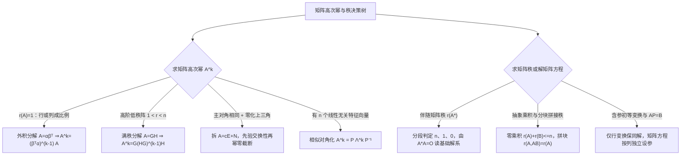

# 第3—4讲 矩阵运算与矩阵的秩｜二轮强化复盘

> [!abstract] 资料与范围
> 强化讲义：[[第3讲_矩阵运算.pdf]]、[[第4讲_矩阵的秩.pdf]]（印刷第 14—48 页）；一轮笔记：[[考研数学/线性代数/知识点与考点整理/第2讲 矩阵|第2讲 矩阵]]。
> 题源：例题编号对应强化讲义；1000B：[[考研数学/强化/试题册_强化篇与综合篇/18_强化篇_线代_第3章_矩阵运算.pdf|第3章试题]]、[[考研数学/强化/解析册_强化篇与综合篇/18_强化篇_线代_第3章_矩阵运算.pdf|第3章解析]]、[[考研数学/强化/试题册_强化篇与综合篇/19_强化篇_线代_第4章_矩阵的秩.pdf|第4章试题]]、[[考研数学/强化/解析册_强化篇与综合篇/19_强化篇_线代_第4章_矩阵的秩.pdf|第4章解析]]。
> 数二范围：讲义第 3 讲中“基、基和维数”标注仅数学一，不展开。
---

> [!important] 近 17 年数二线代真题雷达（2010—2026｜S+ 级核心高频模块）
> - **考频画像**：主考 **18 题**（含 5 道解答 `13-T22`、`14-T22`、`15-T22`、`18-T23`、`26-T22`；近 6 年新大纲 **8 题，2021—2026 每年均有考查**），跨讲渗透 **12 次**。
> - **真题落点**：
>   - *2021—2026 新大纲*：`21-T10(选)`、`22-T16(填)`、`23-T8(选)`、`24-T8(选)`、`24-T9(选)`、`25-T9(选)`、`26-T8(选)`、`26-T22(解·压轴)`
>   - *2015—2020 经典*：`15-T22(解)`、`16-T14(填)`、`18-T8(选)`、`18-T23(解)`、`19-T7(选)`、`20-T7(选)`
>   - *2010—2014 早期补齐*：`11-T7(选)`、`12-T14(填)`、`13-T22(解)`、`14-T22(解)`
> - **跨大纲高频反套路与破题核心**：
>   1. **2026 压轴转向（满秩分解 + 结合律降阶求幂）**：**`26-T22`** 打破连续 5 年特征值/二次型格局，考查 4 阶矩阵极大无关组 + 满秩分解 $A=GH$ + $A^{10}=G(HG)^9H$（其中 $HG$ 不可对角化，须走 $E+N$ 幂零截断）。
>   2. **初等变换与置换/分块伴随矩阵高频设卡**：`11-T7` & `22-T16`（左行右列与求逆反序律）、`21-T10`（$PAQ=\Lambda$ 先借单位阵排除）、`23-T8`（分块上三角伴随阵用 $M^*=|M|M^{-1}$ 推导，防 $|A|,|B|$ 与乘序放反）、`24-T8`（$P^TAP^2$ 须先算清 $P^2$）、**`25-T9`**（**仅初等行变换**保行等价/同解，不等价于秩相等）、**`26-T8`**（置换阵 $|A|=\pm 1$ 致 $A^*=\pm A^{-1}$ 符号不定）。
>   3. **伴随矩阵、秩不等式与长方阵方程求解**：`24-T9`（$A(A-A^*)=O$ 且 $A\ne A^*\Rightarrow A^2=O\Rightarrow r(A)\le 2$，勿误选 $3$）；`20-T7`（$A_{12}\ne 0$ 划去第 1 行第 2 列，故 $\alpha_1,\alpha_3,\alpha_4$ 无关）；`18-T23`（解 $AP=B$ 须附加 $|P|\ne 0$ 约束）；`13-T22` & `14-T22`（矩阵交换方程 $AC-CA=B$ 与长方阵右逆 $AB=E$ 通解列自由度独立）。
> - **每日复习聚焦**：第二部分开头的求幂/秩决策树 + 初等矩阵左行右列与行等价边界 + 满秩分解 $G(HG)^{k-1}H$ + 伴随阵三段秩与分块伴随 + 秩不等式与拼块秩 $r(A,AB)=r(A)$。

---

## 第一部分｜知识点与核心结论

### 【第3讲：矩阵运算】

**1. 矩阵乘法的形状、列行表示与几何映射**【🔥 必背｜停下来默背 1 遍】
- **[形状大观与运算本质]**：设 $A$ 是 $m\times s$ 矩阵、$B$ 是 $s\times n$ 矩阵，才可计算乘积 $AB$，且结果是 $m\times n$ 矩阵：
  $$(AB)_{ij} = \sum_{k=1}^s a_{ik} b_{kj}$$
  矩阵乘法满足结合律 $(AB)C = A(BC)$ 与分配律 $A(B+C) = AB+AC$，但一般**不满足交换律和消去律**：
  $$AB \ne BA, \qquad AB=O \ \not\Rightarrow\ A=O \text{ 或 } B=O$$
  乘积为零矩阵，两个因子均可为非零矩阵。
- **[常见乘法形状与结构识别表]**：

  | 形状 | 运算实质 | 结构特征与解题识别 |
  |---|---|---|
  | 行向量 $\times$ 列向量 | 内积 $\alpha^T \beta$（标量） | 平方和、模长、正交检验（内积为 0 即正交） |
  | 列向量 $\times$ 行向量 | 外积 $\alpha \beta^T$（两向量均非零时秩为 1） | 每一列与 $\alpha$ 共线，<mark>求高次幂优先提取标量</mark> $\beta^T\alpha$ `[真题·2013-T23 / 2026-T22]` |
  | 全 1 行向量左乘 $\mathbf{1}^T A$ | 各列元素之和（行向量） | “按列求和”，特征值与矩阵行和/列和分析 |
  | $A$ 右乘全 1 列向量 $A \mathbf{1}$ | 各行元素之和（列向量） | “按行求和”，寻找全 1 特征向量 $(1,\dots,1)^T$ |
  | $\mathbf{1}^T A \mathbf{1}$ | $A$ 的全部元素之总和（标量） | 全矩阵元素统计与二次型代数特征 |
  | 对角矩阵左乘 $\operatorname{diag}(d_i) A$ | 各行分别倍乘 $d_i$ | **左乘看行**，用于行初等倍乘与消元 |
  | $A$ 右乘对角矩阵 $A \operatorname{diag}(d_j)$ | 各列分别倍乘 $d_j$ | **右乘看列**，用于列初等倍乘与消元 |
  | 初等矩阵左乘 $P A$ | 对应初等行变换 | 口算消元与<mark>行阶梯形与行向量组转化</mark> `[真题易错·2025-T09]` |
  | $A$ 右乘初等矩阵 $A Q$ | 对应初等列变换 | <mark>列变换右乘且还原须取逆</mark> `[真题易错·2011-T07 / 2024-T08]` |
  | 相似变换 $P^{-1}AP$ | 坐标基变换 | 特征值不变、迹与行列式保持不变 |
  | 正交相似变换 $Q^T A Q$ | 刚体旋转与反射 | 保内积、保距离，实对称矩阵对角化标准工具 |
  | 反对角置换阵 $J_{\text{anti}}$ | 翻转行列次序 | 左乘上下翻转行序，右乘左右翻转列序 |
- **[通过列向量理解乘积（核心列表示定理）]**：
  设 $A = [\alpha_1, \dots, \alpha_s]$，$B$ 的第 $j$ 列为 $\beta_j = (b_{1j}, \dots, b_{sj})^T$，则
  $$AB = [A\beta_1, \dots, A\beta_n], \qquad A\beta_j = \sum_{i=1}^s b_{ij} \alpha_i$$
  **核心定理**：$AB$ 的每一列都是 $A$ 的列向量组的线性组合。
  由此直接推得两条核心性质：
  ① 秩不等式 $r(AB) \le r(A)$；
  ② 横向拼接矩阵的秩恒等式：$r([A \mid AB]) = r(A)$（因<mark>追加列均可由左阵列向量表出</mark>，等价于 $[A\mid AB]=A[E\mid B]$ 右乘行满秩阵不改秩 `[真题易错·2018-T08]`）。注意 $BA$ 的列由 $B$ 生成而非 $A$，故 $r(A,BA)=r(A)$ 与将横拼转置误作 $r(A^T,B^T)$、以及把下界 $\max\{r(A),r(B)\}$ 误当等式均不成立（用正交基底 $E_{11},E_{22}$ 或 $E_{11},E_{12}$ 秒排）`[真题易错·2018-T08]`。
- **[通过行向量理解乘积（核心行表示定理）]**：
  设 $B$ 的第 $i$ 行为 $\gamma_i^T$，$A = (a_{ik})_{m\times s}$，则
  $$\operatorname{row}_i(AB) = \sum_{k=1}^s a_{ik} \gamma_k^T$$
  **核心定理**：$AB$ 的每一行都是 $B$ 的行向量组的线性组合。
  由此直接推得两条核心性质：
  ① 秩不等式 $r(AB) \le r(B)$；
  ② 纵向拼接矩阵的秩恒等式：$r\left(\begin{bmatrix} B \\ AB \end{bmatrix}\right) = r(B)$（因追加的行均可由 $B$ 线性表出）。
  **行列对应关系**：$AB$ 的列由 $A$ 的列线性表示；$AB$ 的行由 $B$ 的行线性表示。“<mark>右乘可逆阵仅保列向量组等价</mark>、左乘可逆阵仅保行向量组等价” `[真题易错·2013-T07]`。

**2. 证零矩阵与特殊矩阵（对称、反对称、正交、迹与平方和）**【📌 扫一眼｜确认“我还会”就过】
- **[迹与实矩阵平方和定理]**：
  设 $A = (a_{ij})_{m\times n}$ 为实矩阵，则 $A^T A$ 的主对角元为各列向量的欧氏长度平方，其迹为
  $$\operatorname{tr}(A^T A) = \sum_{j=1}^n (A^T A)_{jj} = \sum_{j=1}^n \sum_{i=1}^m a_{ij}^2 = \sum_{i=1}^m \sum_{j=1}^n a_{ij}^2$$
  即 $\operatorname{tr}(A^T A)$ 等于 $A$ 的全元素平方和。
  **实数域等价链**：
  $$A = O \iff A^T A = O \iff \operatorname{tr}(A^T A) = 0 \iff AA^T = O \iff \operatorname{tr}(AA^T) = 0$$
  **证零典型场景**：遇实矩阵关系式形如 $(A^T - A)A = O$，令 $X = A^T - A$，展开 $XX^T$ 并取迹得 $\operatorname{tr}(XX^T) = 0$，由实数平方和为零推得 $X = O \iff A = A^T$；未证 $A$ 可逆前不能消去 $A$。
  **严密性边界**：该定理仅对实矩阵成立，<mark>非零实矩阵某行平方和必严格为正</mark>（遇 $A_{ij}=-a_{ij}$ 等代换借实数平方和定号排除 $|A|=0$ `[真题·2013-T14]`）；复数域内 $\operatorname{tr}(A^TA)=0$ 不推出 $A=O$（反例：$A = \begin{bmatrix} 1 & \mathrm{i} \\ 0 & 0 \end{bmatrix}$，$\operatorname{tr}(A^TA) = 1 + \mathrm{i}^2 = 0$ 但 $A \ne O$）。$|A|=0$ 仅表示降秩，不能推出 $A=O$。
- **[对称矩阵与反对称矩阵的核心性质]**：
  - **定义**：对称矩阵满足 $A^T = A$；反对称矩阵满足 $A^T = -A$（主对角元必全为 0：$a_{ii} = -a_{ii} \implies a_{ii} = 0$）。
  - **矩阵的对称分解定理**：任一方阵可唯一分解为一个对称矩阵与一个反对称矩阵之和：
    $$A = \frac{A + A^T}{2} + \frac{A - A^T}{2}$$
  - **乘积对称性充要条件**：若 $A, B$ 均为对称矩阵，则 $(AB)^T = B^T A^T = BA$。因此：
    $$AB \text{ 为对称矩阵} \iff AB = BA \quad (A, B \text{ 可交换})$$
  - **反对称矩阵与二次型恒零律**：对任意实向量 $x$，实反对称矩阵 $K$ 的二次型恒为零：
    $$x^T K x = (x^T K x)^T = x^T K^T x = -x^T K x \implies x^T K x = 0$$
- **[实反对称矩阵的奇偶律（行列式与特征值）]**：
  设 $A$ 为 $n$ 阶实反对称矩阵，则 $|A| = |A^T| = |-A| = (-1)^n |A|$。
  - **当 $n$ 为奇数时**：$|A| = -|A| \implies |A| = 0$。奇数阶实反对称矩阵必不可逆，其秩必为偶数（实反对称矩阵的秩必为偶数），必有特征值 0。
  - **当 $n$ 为偶数时**：$|A| \ge 0$。实反对称矩阵的特征值或者为 0，或者为成对共轭的纯虚数 $\pm b\mathrm{i}$（$b \ne 0$），纯虚特征值乘积 $(\lambda)(-\lambda) = b^2 > 0$，故偶数阶实反对称矩阵行列式非负。
- **[正交矩阵性质]**：
  实方阵 $Q$ 满足 $Q^T Q = Q Q^T = E \iff Q^{-1} = Q^T$。
  ① 行列式 $|Q| = \pm 1$（$|Q|=1$ 为纯旋转变换，$|Q|=-1$ 为含反射变换）；
  ② 列向量组为标准正交基，行向量组亦为标准正交基；
  ③ 保持向量内积与模长不变：$(Qx)^T (Qy) = x^T Q^T Q y = x^T y$；
  ④ 特征值的复模长恒为 1：$|\lambda| = 1$。

**3. 矩阵高次幂 $A^n$ 计算通用全景法**【🔥⚡ 必背+避坑｜停下来默背 1 遍 + 精读 1 分钟】
- **[法一：秩 1 矩阵（外积展开法）]**：
  - **特征**：$r(A) = 1 \iff A = \alpha \beta^T$（$\alpha, \beta$ 为非零列向量）。
  - **核心递推**：$A^2 = (\alpha \beta^T)(\alpha \beta^T) = \alpha (\beta^T \alpha) \beta^T = (\beta^T \alpha) A$。
  - **高次幂公式**：
    $$A^n = (\beta^T \alpha)^{n-1} A = [\operatorname{tr}(A)]^{n-1} A \quad (n \ge 1)$$
  - **特征值结构**：$\lambda_1 = \beta^T\alpha = \operatorname{tr}(A)$，$\lambda_2 = \dots = \lambda_n = 0$。
- **[法二：二项式展开与幂零截断法]**：
  - **特征**：$A = cE + N$，其中 $N$ 为幂零矩阵（即存在正整数 $k \le n$ 使得 $N^k = O$）。
  - **可交换条件**：因为 $cE$ 与任意矩阵可交换（$(cE)N = N(cE) = cN$），二项式定理成立：
    $$A^n = (cE + N)^n = c^n E + n c^{n-1} N + \binom{n}{2} c^{n-2} N^2 + \dots + \binom{n}{k-1} c^{n-k+1} N^{k-1}$$
  - **易错警示**：若 $A = B + C$ 但 $BC \ne CB$，即便 $C^2 = O$，<mark>二项式展开与幂零截断前须先验可交换</mark> `[真题·2015-T22 / 2026-T22]`。
- **[法三：递推归纳法与周期性]**：
  - **周期性识别**：平面旋转矩阵 $A = \begin{bmatrix} \cos\theta & -\sin\theta \\ \sin\theta & \cos\theta \end{bmatrix}$ 满足 $A^k=E$ 的充要条件是 $k\theta$ 为 $2\pi$ 的整数倍；存在正整数周期当且仅当 $\theta/(2\pi)$ 为有理数。例如 $\theta=\frac{\pi}{3}$ 时 $A^6=E$，可将高次幂的指数按周期化简。
  - **递推因式分解**：若计算低次幂满足 $A^2 = aA + bE$，两端乘以 $A^{n-2}$ 建立二阶常系数齐次线性递推关系式求解，<mark>低次递推结构诱导矩阵高次方幂</mark> `[真题易错·2016-T23]`。
- **[法四：相似对角化法（跨讲联系）]**：
  - 若 $A$ 存在 $n$ 个线性无关特征向量，则存在可逆阵 $P$ 使 $P^{-1}AP = \Lambda = \operatorname{diag}(\lambda_1, \dots, \lambda_n)$。
  - 矩阵方幂为：
    $$A^n = P \Lambda^n P^{-1} = P \operatorname{diag}(\lambda_1^n, \dots, \lambda_n^n) P^{-1}$$
- **[法五：满秩分解与降阶法]**：
  - 设 $A_{m\times n}$ 且 $r(A) = r$。总存在列满秩矩阵 $B_{m\times r}$ 与行满秩矩阵 $C_{r\times n}$ 使得 $A = BC$。
  - 当 $m=n$、$A$ 是方阵时，对任意正整数 $k$，<mark>满秩分解接结合律将高阶降为低阶方幂</mark> `[真题·2026-T22]`：
    $$A^k = (BC)^k = B (CB)^{k-1} C$$
    其中 $CB$ 是 $r\times r$ 阶低维方阵，先计算 $(CB)^{k-1}$，再乘以外部 $B$ 与 $C$。
  - `【⚡ 真题补丁｜2026-T22】` 4阶低秩阵先求列极大无关组拼 $G$，行最简得 $H$ 使 $A=GH$，再用结合律算 $A^{10}=G(HG)^9H$；$HG$ 不可对角化须转 $E+N$ 幂零截断。

**4. 可逆矩阵、伴随矩阵与初等变换**【🔥⚡ 必背+避坑｜停下来默背 1 遍 + 精读 1 分钟】
- **[可逆矩阵等价判定全景]**：
  设 $A$ 为 $n$ 阶方阵，下列命题等价：
  ① $|A| \ne 0$；
  ② $r(A) = n$；
  ③ $A$ 的列（行）向量组线性无关；
  ④ 齐次方程组 $Ax = 0$ 仅有零解；
  ⑤ 对任意 $b$，$Ax = b$ 存在唯一解；
  ⑥ 等价标准形为 $E_n$（可经初等变换化为 $E_n$）；
  ⑦ $A$ 可表示为有限个初等矩阵的乘积；
  ⑧ $0$ 不是 $A$ 的特征值；
  ⑨ 实方阵时 $A^T A$ 为正定矩阵。
- **[可逆矩阵加法经典公式（基础30讲考点）]**：
  - **定理**：设 $A, B$ 为同阶可逆方阵，且 $A^{-1} + B^{-1}$ 可逆，则 <mark>提取左右可逆因子将和式化为乘积</mark> `[真题·2010-T14]`：
    $$A+B = A(A^{-1} + B^{-1})B$$
    $$(A+B)^{-1} = B^{-1}(A^{-1} + B^{-1})^{-1} A^{-1} = A^{-1}(A^{-1} + B^{-1})^{-1} B^{-1}$$
  - **严格证明**：
    $$A+B = AE + EB = A(B^{-1}B) + (AA^{-1})B = A(B^{-1}+A^{-1})B = A(A^{-1}+B^{-1})B$$
    因为 $A, A^{-1}+B^{-1}, B$ 均可逆，由乘积可逆性定理知 $A+B$ 必可逆；求逆取各因子反序逆乘积即证。
  - **易错警示**：一般有 $(A+B)^{-1} \ne A^{-1} + B^{-1}$，不能把求逆运算直接分配到加法上。
- **[教材中的特殊上三角矩阵求逆（第 21 页）]**：
  设 $N$ 为 $n$ 阶矩阵，其主对角线上方紧邻的一条对角线全为 $1$，其余元素为 $0$，则 $N^n=O$。主对角线及上方元素均为 $1$ 的上三角矩阵与 $E-N$ 互为逆矩阵：
  $$
  (E-N)^{-1}=E+N+\cdots+N^{n-1}
  =\begin{bmatrix}1&1&\cdots&1\\0&1&\cdots&1\\\vdots&\vdots&\ddots&\vdots\\0&0&\cdots&1\end{bmatrix}.
  $$
  更一般地，当 $a\ne0$ 时，
  $$
  (aE-N)^{-1}
  =\frac1aE+\frac1{a^2}N+\cdots+\frac1{a^n}N^{n-1}
  =\begin{bmatrix}
  \frac1a&\frac1{a^2}&\cdots&\frac1{a^n}\\
  0&\frac1a&\cdots&\frac1{a^{n-1}}\\
  \vdots&\vdots&\ddots&\vdots\\
  0&0&\cdots&\frac1a
  \end{bmatrix}.
  $$
- **[伴随矩阵的核心公式体系]**：
  - 基础恒等式：$AA^* = A^*A = |A|E$。
  - 行列式公式：$|A^*| = |A|^{n-1}$。
  - 逆矩阵公式：若 $|A| \ne 0$，则 <mark>伴随矩阵与逆矩阵按行列式倍互化</mark>（且 $\operatorname{tr}(A^{-1})=\operatorname{tr}(A^*)/|A|$），$(A^*)^{-1} = \frac{1}{|A|}A = (A^{-1})^*$ `[真题易错·2012-T14 / 2022-T16]`。
  - 数乘伴随公式：$(kA)^* = k^{n-1} A^*$（易错：系数指数是 $n-1$）。
  - 转置伴随公式：$(A^T)^* = (A^*)^T$；乘积伴随公式：$(AB)^* = B^* A^*$（反序乘积）。
  - 复合伴随公式：$(A^*)^* = |A|^{n-2} A$（$n \ge 2$）。
  - `【⚡ 真题补丁｜2022-T16】` $P_1AP_2=B$ 还原须反序取逆；求逆迹用 $\sum A_{ii}/\lvert A\rvert$；实阵 $\lambda^2+1=0$ 为复根 $\pm\mathrm{i}$ 勿误写 $0$。
- **[伴随矩阵的秩（严格分段判定定理）]**：
  以下设 $n\ge2$。
  $$r(A^*) = \begin{cases} n, & r(A) = n \\ 1, & r(A) = n - 1 \\ 0, & r(A) \le n - 2 \end{cases}$$
  - **机理解析**：
    - 当 $r(A) = n$ 时，$|A| \ne 0 \implies |A^*| = |A|^{n-1} \ne 0 \implies r(A^*) = n$；
    - 当 $r(A) = n-1$ 时，至少存在一个 $n-1$ 阶非零子式，故 $A^* \ne O$，即 $r(A^*) \ge 1$；由 $AA^* = |A|E = O$，据 Sylvester 不等式 $r(A)+r(A^*) \le n \implies r(A^*) \le 1$，故 $r(A^*)=1$。$A^*$ 的任一非零列都是 $Ax=0$ 的解，且单独构成一个基础解系；同时 <mark>满足唯一解空间的原阵极大无关列组</mark> 构成 $A^*x=0$ 的基础解系 `[真题易错·2011-T08 / 2020-T07]`；而由 $Ax=0$ 基础解系维数可 <mark>逆向锁定伴随矩阵的精确分段秩</mark> `[真题·2019-T07]`。
    - 当 $r(A) \le n-2$ 时，所有 $n-1$ 阶子式恒为 0，故 $A^* = O \implies r(A^*) = 0$。
  - **奇异情形**：本节 $n\ge2$；当 $|A|=0$ 时，$A^*$ 也奇异，不能使用 $(A^*)^{-1}$。
  - **教材公式⑪（第 23 页）**：若 $r(A)=n-1$，则 $r(A^*)=1$，故对整数 $k\ge2$，
    $$
    (A^*)^k=[\operatorname{tr}(A^*)]^{k-1}A^*.
    $$
    教材列出了其中 $k=n$ 的情形；这里由秩 1 矩阵的幂公式推广至一般 $k$。
- **[伴随矩阵保留的关系（可交换、等价、相似、合同）]**：
  - **可交换性**：$AB = BA \implies A^* B^* = B^* A^*$；
  - **等价性**：$A \simeq B \iff r(A) = r(B) \implies r(A^*) = r(B^*) \iff A^* \simeq B^*$；
  - **相似性**：$A \sim B \implies A^* \sim B^*$（若 $P^{-1}AP=B$，则 $P^{-1}A^*P=B^*$ 对可逆与奇异方阵均恒成立）；
  - **合同性**：若 $C^T A C = B$（$C$ 可逆），两端取伴随得 $C^* A^* (C^*)^T = B^*$，令 $D = (C^*)^T$，因 $C^*$ 可逆，$D$ 可逆，故 $D^T A^* D = B^*$，伴随矩阵合同性成立。
- **[初等矩阵与初等变换的对应机制]**：
  - 运算对应律：<mark>左乘对应初等行变换而右乘对应列变换</mark>（反推 $P_2AP_1=E \implies A=P_2^{-1}P_1^{-1}$，注意区分互换阵 $P_2^{-1}=P_2$ 与倍加阵 $P_1^{-1}\ne P_1$，切忌乘序错位或右乘还原漏取逆 `[真题易错·2011-T07]`）。
  - 初等矩阵的基本性质（教材第 29 页，记号 $E_{ij}, E_i(k), E_{ij}(k)$ 分别对应换行/列、第 $i$ 行/列乘 $k$、第 $j$ 行/列乘 $k$ 加到第 $i$ 行/列）：
    - **行列式**：$|E_{ij}| = -1$，$\;|E_{ij}(k)| = 1$，$\;|E_i(k)| = k$（$k \ne 0$）；
    - **转置**：$E_{ij}^T = E_{ij}$，$\;E_{ij}^T(k) = E_{ji}(k)$（注意下标对调），$\;E_i^T(k) = E_i(k)$；
    - **逆矩阵**（仍为同类初等矩阵）：$E_{ij}^{-1} = E_{ij}$，$\;E_i^{-1}(k) = E_i\left(\frac{1}{k}\right)$（$k \ne 0$），$\;E_{ij}^{-1}(k) = E_{ij}(-k)$；
    - **伴随矩阵**：$E_{ij}^* = |E_{ij}|E_{ij}^{-1} = -E_{ij}$，$\;E_{ij}^*(k) = E_{ij}(-k)$，$\;E_i^*(k) = kE_i\left(\frac{1}{k}\right)$。
  - `【⚡ 真题补丁｜2025-T09】` 限定仅通过初等行变换化简等价于行向量组等价与齐次同解，主元列不同即不可互化，不等价于仅秩相等。
  - `【⚡ 真题补丁｜2026-T08】` 置换矩阵是行交换初等矩阵之积，必正交故 $A^{-1}=A^T$ 仍为置换阵；但 $\lvert A\rvert=(-1)^k=\pm 1$ 致 $A^*=\pm A^{-1}$ 出现 $-1$ 即非置换阵。
  - `【⚡ 真题补丁｜2011-T07 / 2021-T10 / 2024-T08】` 判 $PAQ=\Lambda$ 借单位阵速排（$P=E$ 仅列变换）；连续变换求逆反序 $P_2^{-1}P_1^{-1}$ 且勿漏倍加阵取逆；遇 $P^TAP^2$ 先算清 $P^2$。

**5. 分块矩阵运算与分块消元**【📌⚡ 扫一眼+避坑｜最值钱，必须精读 1 分钟】
- **[分块对角矩阵的方幂与求逆（基础30讲考点）]**：
  - 分块对角阵的方幂：
    $$\begin{bmatrix} A_1 & & O \\ & \ddots & \\ O & & A_s \end{bmatrix}^k = \begin{bmatrix} A_1^k & & O \\ & \ddots & \\ O & & A_s^k \end{bmatrix}$$
  - 主对角分块求逆：若各子块均可逆，
    $$\begin{bmatrix} A & O \\ O & B \end{bmatrix}^{-1} = \begin{bmatrix} A^{-1} & O \\ O & B^{-1} \end{bmatrix}$$
  - 副对角分块求逆（位置对调）：
    $$\begin{bmatrix} O & A \\ B & O \end{bmatrix}^{-1} = \begin{bmatrix} O & B^{-1} \\ A^{-1} & O \end{bmatrix}$$
- **[分块伴随公式]**：
  设 $A$ 为 $m$ 阶方阵，$B$ 为 $n$ 阶方阵（若同为 $n$ 阶方阵，则符号因子为 $(-1)^{n^2} = (-1)^n$）：
  $$\begin{bmatrix} A & O \\ O & B \end{bmatrix}^* = \begin{bmatrix} |B|A^* & O \\ O & |A|B^* \end{bmatrix}, \qquad \begin{bmatrix} O & A \\ B & O \end{bmatrix}^* = (-1)^{mn} \begin{bmatrix} O & |A|B^* \\ |B|A^* & O \end{bmatrix}$$
  - **机理推导**：由分块副对角行列式公式 $|M| = \begin{vmatrix} O & A \\ B & O \end{vmatrix} = (-1)^{mn} |A||B|$ 与副对角分块逆矩阵公式 $M^{-1} = \begin{bmatrix} O & B^{-1} \\ A^{-1} & O \end{bmatrix}$，利用 $M^* = |M| M^{-1}$ 相乘收拢：
    $$M^* = (-1)^{mn} |A||B| \begin{bmatrix} O & B^{-1} \\ A^{-1} & O \end{bmatrix} = (-1)^{mn} \begin{bmatrix} O & |A|(|B|B^{-1}) \\ |B|(|A|A^{-1}) & O \end{bmatrix} = (-1)^{mn} \begin{bmatrix} O & |A|B^* \\ |B|A^* & O \end{bmatrix}$$
    （若记为 $\begin{bmatrix} O & B \\ A & O \end{bmatrix}^*$ 则同理为 $(-1)^{mn} \begin{bmatrix} O & |B|A^* \\ |A|B^* & O \end{bmatrix}$。特别地，$m=n$ 时符号因子为 $(-1)^{n^2}$，奇数阶取负、偶数阶取正，勿漏符号因子 $(-1)^{mn}$ 或 $(-1)^{n^2}$。）
  - `【⚡ 真题补丁｜2023-T08】` 分块上三角伴随由 $M^*=\lvert M\rvert M^{-1}$ 现场导出，对角因子 $\lvert B\rvert A^*,\lvert A\rvert B^*$ 勿放反，右上为 $-A^*CB^*$。
  - **分块上三角公式与选项全覆盖**：对 $M=\begin{bmatrix}A&C\\O&B\end{bmatrix}$，有 $M^*=\lvert A\rvert\lvert B\rvert\begin{bmatrix}A^{-1}&-A^{-1}CB^{-1}\\O&B^{-1}\end{bmatrix}=\begin{bmatrix}\lvert B\rvert A^*&-A^*CB^*\\O&\lvert A\rvert B^*\end{bmatrix}$；<mark>分块三角伴随主对角乘异块行列式</mark>且右上块负乘积遵循 $-A^*CB^*$（下三角左下块才是 $-B^*CA^*$），切忌放反 $\lvert A\rvert,\lvert B\rvert$ 或擅自交换 $A^*,B^*$ 顺序 `[真题易错·2023-T08]`。
- **[分块初等变换与消元通法（Schur 补）]**：
  若 $A$ 可逆，左乘初等分块矩阵消去左下块：
  $$\begin{bmatrix} E & O \\ -CA^{-1} & E \end{bmatrix} \begin{bmatrix} A & B \\ C & D \end{bmatrix} = \begin{bmatrix} A & B \\ O & D - CA^{-1}B \end{bmatrix}$$
  消元变换矩阵行列式为 1，不改变矩阵行列式与秩：
  $$\begin{vmatrix} A & B \\ C & D \end{vmatrix} = |A| \cdot |D - CA^{-1}B|, \qquad r\begin{bmatrix} A & B \\ C & D \end{bmatrix} = r(A) + r(D - CA^{-1}B)$$

**6. 矩阵方程的解法与充要条件**【🔥 必背｜停下来默背 1 遍】
- **[标准型矩阵方程解法（基础30讲考点）]**：
  - $AX = B$（$A$ 可逆）：两端左乘 $A^{-1}$ 得唯一解 $X = A^{-1}B$。初等行变换法：$[A \mid B] \xrightarrow{\text{行}} [E \mid A^{-1}B]$。
  - $XA = B$（$A$ 可逆）：两端右乘 $A^{-1}$ 得唯一解 $X = BA^{-1}$。初等列变换法：$\begin{bmatrix} A \\ B \end{bmatrix} \xrightarrow{\text{列}} \begin{bmatrix} E \\ BA^{-1} \end{bmatrix}$，或转置行变换 $[A^T \mid B^T] \xrightarrow{\text{行}} [E \mid X^T]$。
  - $AXB = C$（$A, B$ 均可逆）：两端左乘 $A^{-1}$、右乘 $B^{-1}$ 得唯一解 $X = A^{-1}CB^{-1}$。
- **[矩阵方程 $AX=B$ 和 $XA=B$ 的充要条件]**：
  - **左系数方程 $AX = B$**：
    - 有解充要条件：<mark>右端各列可由系数阵各列线性表出</mark>，即 $r(A) = r([A \mid B])$ `[真题·2026-T09]`；
    - 解的唯一性：有解且 $r(A) = n$（列满秩）时，解唯一；$r(A) < n$ 时，有无穷多解；$r(A) \ne r([A \mid B])$ 时无解。
  - **右系数方程 $XA = B$**：
    - 有解充要条件：$r(A) = r\left(\begin{bmatrix} A \\ B \end{bmatrix}\right) \iff B$ 的每个行向量均可由 $A$ 的行向量组线性表示；
    - 解的唯一性：有解且 $r(A) = m$（行满秩）时，解唯一；$r(A) < m$ 时，有无穷多解。
- **[齐次与非齐次通解构造法]**：
  - 将未知矩阵按列拆分：$X = [x_1, \dots, x_s]$，$B = [b_1, \dots, b_s]$，等价于求解 $s$ 个独立的线性方程组 $Ax_j = b_j$；
  - 每一列通解为 $x_j = x_j^* + \sum_{i=1}^{n-r} k_{ij} \xi_i$；
  - **参数独立性**：<mark>不同列自由参数必须分别独立设置</mark>；若要求 $X$ 可逆，再由 $|X|\ne0$ 筛选参数 `[真题易错·2018-T23]` `[真题·2013-T22 / 2014-T22]`。
  - `【⚡ 真题补丁｜2013-T22 / 2014-T22 / 2018-T23】` $AC-CA=B$ 展元定参，$AB=E$ 长方右逆及 $AP=B$ 按列拼特解加齐次通解，各列自由参数独立设并验 $\lvert P\rvert\ne 0$。

---

### 【第4讲：矩阵的秩】

**1. 矩阵的秩的概念、行阶梯形严格定义与判别**【📌 扫一眼｜确认“我还会”就过】
- **[矩阵的秩的非零子式定义]**：矩阵 $A_{m\times n}$ 中非零子式的最高阶数称为 $A$ 的秩，记作 $r(A)$ 或 $\operatorname{rank}(A)$。
  - $r(A) = r \iff A$ 中至少存在一个 $r$ 阶非零子式，且<mark>所有更高阶子式必须全为零</mark> `[真题易错·2016-T14 / 2020-T07]`。
  - 若存在一个 $k$ 阶非零子式，则 $r(A) \ge k$；若所有 $k$ 阶子式全为 0，则 $r(A) < k$。
- **[行阶梯形矩阵严格定义（基础30讲核心考点）]**：
  满足以下两条严格准则的矩阵称为行阶梯形矩阵：
  ① **零行下置**：若有零行（元素全为 0 的行），则所有零行必须全都在非零行的下方；
  ② **主元严格右移（列标严格递增）**：<mark>行阶梯主元列位置不同不可仅行变换</mark>（即使秩相等，行最简形或主元列不一致也无法仅由初等行变换互化 `[真题易错·2025-T09]`）。各非零行左起第一个非零元素的列指标自上而下必须**严格单调递增**。
- **[行最简阶梯形矩阵严格定义]**：在行阶梯形矩阵的基础上，进一步满足：各非零行的首个非零元素均为 1，且该非零元素所在列的其余元素全为 0。
- **[初等变换保秩定理]**：初等行（列）变换不改变矩阵的秩，故<mark>同型矩阵等价充要条件为两阵秩相等</mark>（含参定秩须逐一检验退化降秩参数以免漏筛或收增根 `[真题易错·2016-T14]`）。任意矩阵经初等行变换化为行阶梯形矩阵后，其**非零行的行数恰好等于矩阵的秩**。

**2. 矩阵的秩的核心不等式与恒等式**【🔥⚡ 必背+避坑｜停下来默背 1 遍 + 精读 1 分钟】
- **[加减法秩不等式]**：
  $$|r(A) - r(B)| \le r(A \pm B) \le r(A) + r(B)$$
  - 上界：$A+B$ 的列向量落在 $A, B$ 列向量生成的子空间内，故 $r(A+B) \le r([A \mid B]) \le r(A)+r(B)$；
  - 下界：$r(A) = r(A+B - B) \le r(A+B) + r(B) \implies r(A+B) \ge r(A) - r(B)$。
- **[乘积秩不等式（Sylvester 不等式与上下界）]**：
  设 $A_{m\times n}, B_{n\times s}$：
  $$r(A) + r(B) - n \le r(AB) \le \min\{r(A), r(B)\}$$
  - 上界：$AB$ 的列来自 $A$ 的列，$AB$ 的行来自 $B$ 的行；
  - 下界（Sylvester 定理）：由方程组解空间的维数定理给出。
  - **零乘积秩不等式**：若 $AB = O$，则<mark>零乘积导出两矩阵秩之和不超过维数</mark>（特别地，幂零阵 $A^2=O \implies 2r(A)\le n$，故 4 阶阵必 $r(A)\le 2$、3 阶非零幂零阵必 $r(A)=1$ `[真题易错·2024-T09 / 2026-T10]`）：
    $$r(A) + r(B) \le n \quad (n \text{ 为 } A \text{ 的列数 / } B \text{ 的行数})$$
  - `【⚡ 真题补丁｜2024-T09】` 4阶阵 $A(A-A^*)=O$ 且 $A\ne A^*$：若可逆得 $A=A^*$ 矛盾，故 $\lvert A\rvert=0\Rightarrow A^2=O$，从而 $1\le r(A)\le 2$（排 $0$ 与 $3$）。
- **[三矩阵乘积 Frobenius 秩不等式]**：
  <mark>三阵乘积秩不小于分段乘积秩减中间秩</mark> `[真题易错·2025-T10]`：
  $$r(ABC) \ge r(AB) + r(BC) - r(B)$$
- **[分块矩阵的秩公式（基础30讲考点）]**：
  - 对角分块秩：$r\begin{bmatrix} A & O \\ O & B \end{bmatrix} = r(A) + r(B)$；
  - 三角分块秩下界：$r\begin{bmatrix} A & C \\ O & B \end{bmatrix} \ge r(A) + r(B)$；
  - 拼接矩阵秩：$\max\{r(A), r(B)\} \le r([A \mid B]) \le r(A) + r(B)$；<mark>横拼满列生成保秩且转置必变纵拼</mark>（$r([A\mid B])=\max\{r(A),r(B)\}$ 与 $r([A\mid B])=r([A^T\mid B^T])$ 皆不恒成立 `[真题易错·2018-T08]`）。
- **[降阶公式（Schur 补秩恒等式）]**：
  若 $A$ 可逆，则初等消元保秩：
  $$r\begin{bmatrix} A & B \\ C & D \end{bmatrix} = r(A) + r(D - CA^{-1}B)$$
  若 $D$ 可逆，同理有 $r\begin{bmatrix} A & B \\ C & D \end{bmatrix} = r(D) + r(A - BD^{-1}C)$。
- **[实矩阵转置与乘积秩恒等式]**：
  在实数域内，齐次方程组 $A^T Ax = 0 \iff Ax = 0$（因 $x^T A^T Ax = \|Ax\|^2 = 0 \iff Ax = 0$），解空间完全一致，由维数定理直接推得<mark>实矩阵与其对称乘积四秩恒等</mark> `[真题·2012-T23 / 2026-T16]`：
  $$r(A^T A) = r(AA^T) = r(A) = r(A^T)$$

**3. 左右消去律严格充要秩条件**【📌 扫一眼｜确认“我还会”就过】
- **[左消去律充要条件与严格推导]**：
  - 命题：对任意同阶/同尺寸矩阵 $B, C$，$AB = AC \implies B = C$。
  - 推导：$AB = AC \iff A(B - C) = O$。
    令 $D = B - C = [d_1, \dots, d_s]$，则 $Ad_j = 0$ 对每一列均成立。
    要保证 $D = O$（即 $B = C$），充要条件是齐次线性方程组 $Ax = 0$ 仅有零解。
    由于 $A$ 为 $m\times n$ 矩阵，$Ax = 0$ 仅有零解的充要条件为 $A$ **列满秩**（$r(A) = n$）。
  - 结论：**左消去律成立 $\iff A$ 列满秩（$r(A) = n$）**。方阵时等价于 $A$ 可逆，且<mark>左乘列满秩阵不改变列向量组相关性</mark> `[真题易错·2014-T08]`。
- **[右消去律充要条件与严格推导]**：
  - 命题：对任意同尺寸矩阵 $B, C$，$BA = CA \implies B = C$。
  - 推导：$BA = CA \iff (B - C)A = O \iff A^T (B - C)^T = O$。
    由左消去结论，充要条件是 $A^T$ 列满秩，即 $A$ **行满秩**（$r(A) = m$）。
  - 结论：**右消去律成立 $\iff A$ 行满秩（$r(A) = m$）**。方阵时等价于 $A$ 可逆，且<mark>行满秩存在右逆对应长方阵方程通解</mark> `[真题·2014-T22]`。
- **[助记记忆法则]**：
  $$\text{左消去看列满秩 } (r(A)=n), \qquad \text{右消去看行满秩 } (r(A)=m)$$
  若 $A$ 为方阵，行满秩、列满秩与可逆三者完全等价。

**4. 幂等矩阵与矩阵秩的特征分解**【💤 可跳过｜冲刺期直接跳过不看】
- **[幂等矩阵定义与核心性质]**：
  - 定义：$A^2 = A \iff A(E - A) = O$。
  - 性质：特征值只能为 0 或 1；必可相似对角化；$r(A) = \operatorname{tr}(A)$。
  - 伴随幂等：$E - A$ 亦为幂等矩阵：$(E-A)^2 = E - A$。
- **[空间直和与秩和恒等式]**：
  由 $A(E-A) = O \implies r(A) + r(E-A) \le n$；由 $A + (E-A) = E \implies r(A) + r(E-A) \ge r(E) = n$。
  两式夹逼，必有：
  $$r(A) + r(E - A) = n$$
- **[不同根因式分解秩和定理]**：
  若 $(A - \lambda_1 E)(A - \lambda_2 E) = O$（$\lambda_1 \ne \lambda_2$），令 $M = \frac{A - \lambda_1 E}{\lambda_2 - \lambda_1}$ 为幂等矩阵，代入直和式得：
  $$r(A - \lambda_1 E) + r(A - \lambda_2 E) = n$$
  由此直接推出特征值的几何重数之和等于 $n$，$A$ 必可相似对角化。

---

## 第二部分｜题型体系与典型例题

### 一、证零与矩阵高次幂计算（第3讲）

| 题干特征 | 优先方法 | 真题印证与避坑 |
|---|---|---|
| 实矩阵、转置乘积关系、$(A^T-A)A=O$ | 平方和与迹定理 $\operatorname{tr}(XX^T)=0 \implies X=O$，不可消去未证可逆的矩阵 | <mark>仅适用于实矩阵</mark>，不能由 $\lvert A\rvert=0$ 断定 $A=O$ 或约去不可逆因子 `[真题·2013-T14]` |
| 秩 1 矩阵（各行/各列成比例）方幂 $A^n$ | 外积表示法 $A=\alpha\beta^T \implies A^n=(\beta^T\alpha)^{n-1}A$，以迹次方倍乘 | 注意幂次为 $n-1$ 而非 $n$，内积 $\beta^T\alpha=\operatorname{tr}(A)$ 是标量 `[真题·2013-T23]` |
| 上三角矩阵（主对角相同，副对角非零） | 二项式展开法 $A=cE+N$，先验证交换律 $EN=NE$，求幂零阶 $N^k=O$ 截断求和 | <mark>二项式展开前须先确认交换律</mark>，不交换的 $M+N$ 不能套用 `[真题·2015-T22 / 2026-T22]` |
| 正交矩阵、旋转矩阵的高次幂或负次幂 | 周期性验证 $A^3=-E, A^6=E$，指数模周期化简；由正交性 $A^{-1}=A^T$ 确定负次幂 | 求负幂须先验正交性或 $\lvert A\rvert\ne 0$ 确立可逆，再按周期加整数倍化正 |
| 矩阵乘积可交换因式、提取公因子转化为对角阵 | 提取公共左/右因子构造相似关系 $A=B\Lambda B^{-1} \implies A^n=B\Lambda^n B^{-1}$ | 算完 $\Lambda^n$ 后勿漏乘外侧 $B, B^{-1}$，提公因子不能改变左右顺序 `[真题易错·2016-T23]` |
| 高阶方阵但秩较低（满秩分解） | 对 $A_{n\times n}=GH$（$G_{n\times r}$ 列满秩、$H_{r\times n}$ 行满秩），$A^k=G(HG)^{k-1}H$ | 4 阶转 2 阶 $HG$ 不可对角化，须接 $E+N$ 幂零截断 `[真题·2026-T22]` |

> [!tip] 核心提醒
> 1. **二项式展开**：$AB=BA$ 时可用通常的二项式公式；仅有 $B^2=O$ 并不能保证两矩阵可交换。
> 2. **实矩阵证零**：$|A|=0$ 只能说明方阵奇异。可利用 $\operatorname{tr}(A^TA)=0\iff A=O$，或证明对任意 $x$ 都有 $Ax=0$。
>

> [!example]- 例3.1｜转置条件与迹证明对称矩阵（第17页）
> - **【题目】**：设 $A$ 为 3 阶实矩阵，$(A^T - A)A = O$，证明 $A = A^T$。
> - **【完整解答】**：
>   1. 令 $X = A^T - A$。显然 $X^T = (A^T - A)^T = A - A^T = -X$，即 $X$ 为实反对称矩阵。
>   2. 由题设 $XA = (A^T - A)A = O$，两端取转置得 $A^T X^T = O$，即 $A^T (-X) = O \implies A^T X = O$。
>   3. 计算 $X X^T$：
>      $$X X^T = (A^T - A)(A - A^T) = A^T A - A^2 - (A^T)^2 + AA^T$$
>      利用题设 $(A^T - A)A = O \implies A^T A = A^2$，代入上式得：
>      $$X X^T = (A^T - A)A - (A^T - A)A^T = O - (A^T - A)A^T = (A - A^T)A^T$$
>      两端取矩阵的迹（Trace），并由迹的线性性质与循环交换律 $\operatorname{tr}(MN) = \operatorname{tr}(NM)$：
>      $$\operatorname{tr}(X X^T) = \operatorname{tr}(A A^T - (A^T)^2) = \operatorname{tr}(A A^T) - \operatorname{tr}(A^2)$$
>      又由题设 $A^2 = A^T A$，故 $\operatorname{tr}(A^2) = \operatorname{tr}(A^T A) = \operatorname{tr}(A A^T)$。
>      代入即得：
>      $$\operatorname{tr}(X X^T) = \operatorname{tr}(A A^T) - \operatorname{tr}(A A^T) = 0$$
>   4. 因为 $X$ 为实矩阵，$\operatorname{tr}(X X^T) = \sum_{i,j} x_{ij}^2 = 0$，由实数平方和非负性必有每一个元素 $x_{ij} = 0$，即 $X = O$。
>      因此 $A^T - A = O \iff A = A^T$，命题得证。
> - **【复盘提醒】**：
>   1. **矩阵乘积为零的消去边界**：遇 $MN = O$ 证 $M = O$，未证 $N$ 可逆前不能右乘 $N^{-1}$；若 $N$ 不可逆，须改用迹定理或解空间包含关系推导。
>   2. **实数域限制**：迹等于元素平方和仅对实矩阵成立，复矩阵不成立。
>

> [!example]- 例3.2｜秩 1 矩阵的高次幂（外积法）（第17页）
> - **【题目】**：设 $A = \begin{bmatrix} 2&6&-4 \\ -1&-3&2 \\ 3&9&-6 \end{bmatrix}$，求 $A^{10}$。
> - **【完整解答】**：
>   1. 将 $A$ 分解为列向量与行向量的乘积：
>      提取第 1 列为列向量 $\alpha = \begin{bmatrix} 2 \\ -1 \\ 3 \end{bmatrix}$，对应比例系数为行向量 $\beta^T = \begin{bmatrix} 1 & 3 & -2 \end{bmatrix}$。
>      直接验证外积：
>      $$\alpha \beta^T = \begin{bmatrix} 2 \\ -1 \\ 3 \end{bmatrix} \begin{bmatrix} 1 & 3 & -2 \end{bmatrix} = \begin{bmatrix} 2&6&-4 \\ -1&-3&2 \\ 3&9&-6 \end{bmatrix} = A$$
>   2. 计算内积标量 $\beta^T \alpha$（即矩阵的迹 $\operatorname{tr}(A)$）：
>      $$\beta^T \alpha = 1\times 2 + 3\times(-1) + (-2)\times 3 = 2 - 3 - 6 = -7$$
>      （同时验证主对角线之和：$\operatorname{tr}(A) = 2 - 3 - 6 = -7$）。
>   3. 利用矩阵乘法结合律计算高次幂：
>      $$A^{10} = (\alpha \beta^T)^{10} = \alpha (\beta^T \alpha)^9 \beta^T = (-7)^9 \alpha \beta^T = -7^9 A$$
>      故所求结果为：
>      $$\boxed{A^{10} = -7^9 \begin{bmatrix} 2&6&-4 \\ -1&-3&2 \\ 3&9&-6 \end{bmatrix}}$$
> - **【复盘提醒】**：
>   1. **秩 1 矩阵特征值速判**：秩 1 方阵的非零特征值必等于其迹 $\lambda_1 = \operatorname{tr}(A) = -7$，其余 $n-1$ 个特征值全为 $0$。因此 $A^{10}$ 亦可由对角化快速验证。
>   2. **内积与外积次序**：$\alpha\beta^T$ 是矩阵，$\beta^T\alpha$ 是数；求幂时在相邻处结合为内积。
>

> [!example]- 例3.3｜二项式展开与幂零截断求高次幂（第18页）
> - **【题目】**：设 $A = \begin{bmatrix} 1&a&b \\ 0&1&a \\ 0&0&1 \end{bmatrix}$，$n \ge 2$，求 $A^n$。
> - **【完整解答】**：
>   1. 矩阵拆解：
>      令 $A = E + N$，其中
>      $$N = \begin{bmatrix} 0&a&b \\ 0&0&a \\ 0&0&0 \end{bmatrix}$$
>   2. 计算 $N$ 的方幂：
>      $$N^2 = \begin{bmatrix} 0&a&b \\ 0&0&a \\ 0&0&0 \end{bmatrix} \begin{bmatrix} 0&a&b \\ 0&0&a \\ 0&0&0 \end{bmatrix} = \begin{bmatrix} 0&0&a^2 \\ 0&0&0 \\ 0&0&0 \end{bmatrix}, \qquad N^3 = N^2 N = O$$
>   3. 二项式展开截断求和：
>      由于 $EN = NE$，对任意正整数 $n \ge 2$：
>      $$A^n = (E + N)^n = E^n + n E^{n-1} N + \binom{n}{2} E^{n-2} N^2 + \sum_{k=3}^n \binom{n}{k} N^k = E + n N + \frac{n(n-1)}{2} N^2$$
>   4. 代入矩阵分块相加：
>      $$A^n = \begin{bmatrix} 1&0&0 \\ 0&1&0 \\ 0&0&1 \end{bmatrix} + \begin{bmatrix} 0&na&nb \\ 0&0&na \\ 0&0&0 \end{bmatrix} + \begin{bmatrix} 0&0&\frac{n(n-1)}{2}a^2 \\ 0&0&0 \\ 0&0&0 \end{bmatrix} = \boxed{\begin{bmatrix} 1 & na & nb + \frac{n(n-1)}{2}a^2 \\ 0 & 1 & na \\ 0 & 0 & 1 \end{bmatrix}}$$
> - **【复盘提醒】**：
>   1. **右上角交叉项**：第 1 行第 3 列元素由一次项 $nN$ 中的 $nb$ 与二次项 $\binom{n}{2}N^2$ 中的 $\frac{n(n-1)}{2}a^2$ 相加得到，注意勿漏 $nb$。
>   2. **二项式定理前提**：展开前须在卷面显式写出 $EN = NE$。
>

> [!example]- 例3.4｜旋转矩阵的周期性与负次幂（第18—19页）
> - **【题目】**：设 $A = \begin{bmatrix} \frac{1}{2}&-\frac{\sqrt{3}}{2} \\ \frac{\sqrt{3}}{2}&\frac{1}{2} \end{bmatrix}$，求 $A^{-11}$。
> - **【完整解答】**：
>   1. 识别矩阵几何结构与正交性：
>      矩阵可表示为旋转矩阵 $R(\pi/3)$：
>      $$A = \begin{bmatrix} \cos\frac{\pi}{3} & -\sin\frac{\pi}{3} \\ \sin\frac{\pi}{3} & \cos\frac{\pi}{3} \end{bmatrix}$$
>      计算列向量模长与内积：两列均为单位向量且内积为 0，故 $A$ 为正交矩阵，$A^T A = E$，因而 $A$ 可逆且 $A^{-1} = A^T$。
>   2. 旋转矩阵乘法保角性与周期性：
>      旋转矩阵乘积对应角度相加：$R(\theta_1) R(\theta_2) = R(\theta_1 + \theta_2)$。因此
>      $$A^3 = R(3 \times \pi/3) = R(\pi) = \begin{bmatrix} -1 & 0 \\ 0 & -1 \end{bmatrix} = -E$$
>      $$A^6 = (A^3)^2 = (-E)^2 = E$$
>      矩阵 $A$ 的乘法周期为 6。
>   3. 指数模周期化简：
>      求 $A^{-11}$。因为 $A^6 = E \implies A^{12} = E$，两端左乘 $A^{-11}$ 得：
>      $$A^{-11} = A^{-11} \cdot A^{12} = A^1 = A$$
>      故所求结果为：
>      $$\boxed{A^{-11} = \begin{bmatrix} \frac{1}{2}&-\frac{\sqrt{3}}{2} \\ \frac{\sqrt{3}}{2}&\frac{1}{2} \end{bmatrix}}$$
> - **【复盘提醒】**：
>   1. **求负次幂的前置检验**：凡题设出现负指数 $A^{-k}$，首先必须在卷面上说明 $|A| \ne 0$ 或正交性，确立可逆性合法存在。
>   2. **周期指数化简技巧**：负指数模周期时，优先加上周期的整数倍化为正整数，如 $-11 + 2\times 6 = 1$，直接避免繁琐的求逆再求幂。
>

> [!example]- 例3.5｜对角扰动上三角矩阵幂零截断（第19页）
> - **【题目】**：设 $A = \begin{bmatrix} 1&1&-1 \\ 0&1&1 \\ 0&0&1 \end{bmatrix}$，求 $A^{10}$。
> - **【完整解答】**：
>   1. 矩阵拆解：令 $A = E + N$，其中
>      $$N = \begin{bmatrix} 0&1&-1 \\ 0&0&1 \\ 0&0&0 \end{bmatrix}$$
>   2. 计算 $N$ 的各次幂：
>      $$N^2 = \begin{bmatrix} 0&1&-1 \\ 0&0&1 \\ 0&0&0 \end{bmatrix} \begin{bmatrix} 0&1&-1 \\ 0&0&1 \\ 0&0&0 \end{bmatrix} = \begin{bmatrix} 0&0&1 \\ 0&0&0 \\ 0&0&0 \end{bmatrix}$$
>      $$N^3 = N^2 N = O$$
>   3. 二项式展开截断：
>      由于 $EN = NE$，
>      $$A^{10} = (E + N)^{10} = E + 10 N + \binom{10}{2} N^2 = E + 10 N + 45 N^2$$
>   4. 矩阵代入求和：
>      $$A^{10} = \begin{bmatrix} 1&0&0 \\ 0&1&0 \\ 0&0&1 \end{bmatrix} + \begin{bmatrix} 0&10&-10 \\ 0&0&10 \\ 0&0&0 \end{bmatrix} + \begin{bmatrix} 0&0&45 \\ 0&0&0 \\ 0&0&0 \end{bmatrix} = \boxed{\begin{bmatrix} 1 & 10 & 35 \\ 0 & 1 & 10 \\ 0 & 0 & 1 \end{bmatrix}}$$
> - **【复盘提醒】**：
>   1. **警惕对角化思维定势**：许多考生一见求高次幂便盲目求特征向量试图对角化。当特征值出现多重根且几何重数不足时代数不可对角化，幂零截断是标准通路。
>   2. **符号与系数合并**：第 1 行第 3 列元素为 $-10 + 45 = 35$，计算时切勿漏看负号。
>

> [!example]- 例3.6｜初等矩阵左右作用与行列表换（第20页）
> - **【题目】**：计算矩阵乘积：
>   $$\begin{bmatrix} 1&0 \\ -1&1 \end{bmatrix}^3 \begin{bmatrix} 1&2 \\ -1&3 \end{bmatrix} \begin{bmatrix} 0&1 \\ 1&0 \end{bmatrix}^{-5}$$
> - **【完整解答】**：
>   1. 分析左侧矩阵：
>      记 $P = \begin{bmatrix} 1&0 \\ -1&1 \end{bmatrix}$，对应初等行变换“第 2 行减第 1 行”。
>      连续实施 3 次该变换等价于“第 2 行减去第 1 行的 3 倍”，即：
>      $$P^3 = \begin{bmatrix} 1&0 \\ -3&1 \end{bmatrix}$$
>   2. 分析右侧矩阵：
>      记 $S = \begin{bmatrix} 0&1 \\ 1&0 \end{bmatrix}$，对应初等列变换“交换第 1、2 列”。
>      显然 $S^2 = E$，故 $S^{-1} = S$，且对任意奇数次幂 $S^{-5} = S^{-1} = S$。
>   3. 实施变换演算：
>      中间矩阵记为 $M = \begin{bmatrix} 1&2 \\ -1&3 \end{bmatrix}$。
>      - 先左乘 $P^3$（对 $M$ 进行行变换：$r_2 - 3r_1$）：
>        $$P^3 M = \begin{bmatrix} 1&0 \\ -3&1 \end{bmatrix} \begin{bmatrix} 1&2 \\ -1&3 \end{bmatrix} = \begin{bmatrix} 1&2 \\ -3(1)+(-1) & -3(2)+3 \end{bmatrix} = \begin{bmatrix} 1&2 \\ -4&-3 \end{bmatrix}$$
>      - 再右乘 $S$（对上述结果进行列变换：交换 $c_1, c_2$）：
>        $$(P^3 M) S = \begin{bmatrix} 1&2 \\ -4&-3 \end{bmatrix} \begin{bmatrix} 0&1 \\ 1&0 \end{bmatrix} = \boxed{\begin{bmatrix} 2&1 \\ -3&-4 \end{bmatrix}}$$
> - **【复盘提醒】**：
>   1. **初等矩阵求幂**：交换矩阵看奇偶：$S^{2k}=E,\ S^{2k+1}=S$；倍乘型 $E_i(a)^k=E_i(a^k)$；倍加型 $E_{ij}(c)^k=E_{ij}(kc)$。
>   2. **左右方向绝不可颠倒（个人易错点）**：左乘初等矩阵只能作用于行，右乘初等矩阵只能作用于列。做 1000B 第 3 章第 3 题时曾把**右乘交换矩阵误当成换行**；口算“右乘换列”后，至少对照一次最终矩阵的第一列是否确实来自原第二列。
>

> [!example]- 例3.7｜由乘积因式提取发现相似关系求幂（第20—21页）
> - **【题目】**：设 $A, B, C$ 为 3 阶矩阵，已知 $AB = B^2 - BC$，其中
>   $$B = \begin{bmatrix} 1&1&1 \\ 0&1&1 \\ 0&0&1 \end{bmatrix}, \qquad C = \begin{bmatrix} 0&1&1 \\ 0&0&1 \\ 0&0&1 \end{bmatrix}$$
>   求 $A^{99}$。
> - **【完整解答】**：
>   1. 提取公因式并解出相似表达式：
>      $$AB = B(B - C)$$
>      计算行列式 $|B| = 1 \ne 0$，故 $B$ 可逆。两边同时右乘 $B^{-1}$：
>      $$A = B(B - C)B^{-1}$$
>   2. 计算核心对角矩阵 $B - C$：
>      $$B - C = \begin{bmatrix} 1&1&1 \\ 0&1&1 \\ 0&0&1 \end{bmatrix} - \begin{bmatrix} 0&1&1 \\ 0&0&1 \\ 0&0&1 \end{bmatrix} = \begin{bmatrix} 1&0&0 \\ 0&1&0 \\ 0&0&0 \end{bmatrix} = \operatorname{diag}(1, 1, 0)$$
>   3. 计算逆矩阵 $B^{-1}$：
>      对 $[B \mid E]$ 作初等行变换消元：
>      $$B^{-1} = \begin{bmatrix} 1&-1&0 \\ 0&1&-1 \\ 0&0&1 \end{bmatrix}$$
>   4. 计算方幂：
>      $$A^{99} = [B (B-C) B^{-1}]^{99} = B (B-C)^{99} B^{-1}$$
>      因为 $B-C = \operatorname{diag}(1, 1, 0)$ 为对角矩阵，其 99 次幂为：
>      $$(B-C)^{99} = \operatorname{diag}(1^{99}, 1^{99}, 0^{99}) = \operatorname{diag}(1, 1, 0) = B-C$$
>      因此
>      $$A^{99} = B(B-C)B^{-1} = \begin{bmatrix} 1&1&1 \\ 0&1&1 \\ 0&0&1 \end{bmatrix} \begin{bmatrix} 1&0&0 \\ 0&1&0 \\ 0&0&0 \end{bmatrix} \begin{bmatrix} 1&-1&0 \\ 0&1&-1 \\ 0&0&1 \end{bmatrix}$$
>      $$= \begin{bmatrix} 1&1&0 \\ 0&1&0 \\ 0&0&0 \end{bmatrix} \begin{bmatrix} 1&-1&0 \\ 0&1&-1 \\ 0&0&1 \end{bmatrix} = \boxed{\begin{bmatrix} 1&0&-1 \\ 0&1&-1 \\ 0&0&0 \end{bmatrix}}$$
> - **【复盘提醒】**：
>   1. **提取公因子**：$B^2-BC=B(B-C)$；未经验证，不能交换因子写成 $(B-C)B$。
>   2. **中间矩阵方幂自锁**：算出 $(B-C)^{99} = B-C$ 后，直接得 $A^{99} = A$，化简为一步乘法。
>

> [!example]- 例3.16｜相似对角化关系计算高次幂（第30页）
> - **【题目】**：已知可逆矩阵 $P = \begin{bmatrix} 1&1&3 \\ 1&2&2 \\ 0&0&2 \end{bmatrix}$，且 $P^{-1} A P = \operatorname{diag}(-1, -2, 0)$，求 $A^{99}$。
> - **【完整解答】**：
>   令 $\Lambda=\operatorname{diag}(-1,-2,0)$。由 $P^{-1}AP=\Lambda$，得 $A^{99}P=P\Lambda^{99}$，其中
>   $$
>   P\Lambda^{99}=
>   \begin{bmatrix}-1&-2^{99}&0\\-1&-2^{100}&0\\0&0&0\end{bmatrix}.
>   $$
>   按教材方法，对竖拼矩阵 $\begin{bmatrix}P\\P\Lambda^{99}\end{bmatrix}$ 作初等列变换：上块化为 $E$，下块即为 $P\Lambda^{99}P^{-1}=A^{99}$。
>   $$
>   \left[\begin{array}{ccc}
>   1&1&3\\1&2&2\\0&0&2\\ \hline
>   -1&-2^{99}&0\\-1&-2^{100}&0\\0&0&0
>   \end{array}\right]
>   \xrightarrow{\substack{c_2-c_1\\c_3-3c_1}}
>   \left[\begin{array}{ccc}
>   1&0&0\\1&1&-1\\0&0&2\\ \hline
>   -1&1-2^{99}&3\\-1&1-2^{100}&3\\0&0&0
>   \end{array}\right].
>   $$
>   再作 $c_1-c_2$、$c_3+c_2$，最后将 $c_3$ 乘 $\frac12$，上块成为 $E$，下块为
>   $$
>   \boxed{A^{99}=\begin{bmatrix}
>   2^{99}-2&1-2^{99}&2-2^{98}\\
>   2^{100}-2&1-2^{100}&2-2^{99}\\
>   0&0&0
>   \end{bmatrix}}.
>   $$
> - **【复盘提醒】**：
>   1. **零对角元与矩阵结构**：第三个对角元为 0，使 $P\Lambda^{99}$ 的第三列为 0；本题 $P$ 的第三行前两项也为 0，所以 $P\Lambda^{99}$ 和 $A^{99}$ 的第三行均为 0。
>   2. **指数幂号计算细节**：最后一列要乘 $\frac12$，如 $(4-2^{99})/2=2-2^{98}$。
>   3. **相似求幂漏乘陷阱（个人易错点，1000B 第 3 章第 4 题）**：利用 $A = B D B^{-1}$（如 1000B 第 3 章第 4 题由 $AB = B^2 - BC$ 化为 $A = B(B-C)B^{-1}$）或 $A = P\Lambda P^{-1}$ 求高次幂时，曾在算出内部方幂后**漏乘外侧的 $B, B^{-1}$（或 $P, P^{-1}$）**；最后一行务必核查完整乘积 $PD^k P^{-1}$ 或 $BD^k B^{-1}$。
>

> [!example]- 例3.17｜满秩分解与降阶法计算矩阵方幂（第31—33页）
> - **【题目】**：已知
>   $$A = \begin{bmatrix} 1&1&1&1 \\ 1&1&1&1 \\ 2&1&0&-1 \\ -1&0&1&2 \end{bmatrix}, \quad B = \begin{bmatrix} 1&1 \\ 1&1 \\ 0&1 \\ 1&0 \end{bmatrix}, \quad A = BC$$
>   求 $C$ 和 $A^{10}$。
> - **【完整解答】**：
>   1. 初等行变换求 $C$：
>      设 $A = [\alpha_1, \alpha_2, \alpha_3, \alpha_4]$。初等行变换不改变列向量之间的线性表出关系：
>      $$A = \begin{bmatrix} 1&1&1&1 \\ 1&1&1&1 \\ 2&1&0&-1 \\ -1&0&1&2 \end{bmatrix} \xrightarrow{\substack{r_2-r_1\\ r_3-2r_1\\ r_4+r_1}} \begin{bmatrix} 1&1&1&1 \\ 0&0&0&0 \\ 0&-1&-2&-3 \\ 0&1&2&3 \end{bmatrix} \xrightarrow{r_4+r_3} \begin{bmatrix} 1&1&1&1 \\ 0&-1&-2&-3 \\ 0&0&0&0 \\ 0&0&0&0 \end{bmatrix} \xrightarrow{r_1+r_2} \begin{bmatrix} 1&0&-1&-2 \\ 0&1&2&3 \\ 0&0&0&0 \\ 0&0&0&0 \end{bmatrix}$$
>      由此可得 $r(A) = 2$。
>      题设给定的 $B$ 的两列恰为 $B = [\alpha_3, \alpha_2]$（注：$\alpha_3 = (1,1,0,1)^T, \alpha_2 = (1,1,1,0)^T$）。
>      由行最简形可知：
>      $$\alpha_1 = -\alpha_3 + 2\alpha_2 = 2\alpha_2 - \alpha_3, \qquad \alpha_4 = 2\alpha_3 - \alpha_2 = -\alpha_2 + 2\alpha_3$$
>      按 $B = [\alpha_3, \alpha_2]$ 的列次序写出坐标矩阵 $C$：
>      $$C = \begin{bmatrix} -1 & 0 & 1 & 2 \\ 2 & 1 & 0 & -1 \end{bmatrix}$$
>   2. 计算 2 阶低维方阵 $CB$：
>      $$CB = \begin{bmatrix} -1 & 0 & 1 & 2 \\ 2 & 1 & 0 & -1 \end{bmatrix} \begin{bmatrix} 1&1 \\ 1&1 \\ 0&1 \\ 1&0 \end{bmatrix} = \begin{bmatrix} -1+0+0+2 & -1+0+1+0 \\ 2+1+0-1 & 2+1+0+0 \end{bmatrix} = \begin{bmatrix} 1 & 0 \\ 2 & 3 \end{bmatrix}$$
>   3. 计算 2 阶下三角矩阵 $(CB)^9$：
>      由于 $CB$ 为对角线为 1 和 3 的下三角矩阵，特征值为 1 和 3，易求得其方幂公式为：
>      $$(CB)^k = \begin{bmatrix} 1 & 0 \\ 3^k - 1 & 3^k \end{bmatrix} \implies (CB)^9 = \begin{bmatrix} 1 & 0 \\ 3^9 - 1 & 3^9 \end{bmatrix}$$
>   4. 还原高阶方幂 $A^{10}$：
>      由结合律 $A^{10} = (BC)^{10} = B (CB)^9 C$：
>      $$B (CB)^9 = \begin{bmatrix} 1&1 \\ 1&1 \\ 0&1 \\ 1&0 \end{bmatrix} \begin{bmatrix} 1 & 0 \\ 3^9 - 1 & 3^9 \end{bmatrix} = \begin{bmatrix} 3^9 & 3^9 \\ 3^9 & 3^9 \\ 3^9 - 1 & 3^9 \\ 1 & 0 \end{bmatrix}$$
>      再右乘 $C$：
>      $$A^{10} = \begin{bmatrix} 3^9 & 3^9 \\ 3^9 & 3^9 \\ 3^9 - 1 & 3^9 \\ 1 & 0 \end{bmatrix} \begin{bmatrix} -1 & 0 & 1 & 2 \\ 2 & 1 & 0 & -1 \end{bmatrix} = \boxed{\begin{bmatrix} 3^9 & 3^9 & 3^9 & 3^9 \\ 3^9 & 3^9 & 3^9 & 3^9 \\ 3^9+1 & 3^9 & 3^9-1 & 3^9-2 \\ -1 & 0 & 1 & 2 \end{bmatrix}}$$
> - **【复盘提醒】**：
>   1. **满秩分解列序陷阱**：题设给定 $B$ 的各列必须与 $A$ 的对应原列建立精确坐标映射，本题中 $B$ 的第 1 列是 $\alpha_3$，第 2 列是 $\alpha_2$，写 $C$ 时行坐标次序绝不能颠倒。
>   2. **低阶降维核心思想**：降阶法 $A^n = B(CB)^{n-1}C$ 的威力在于将任意维度的复杂大矩阵方幂，直接降阶至其秩维度的极小方阵，是考研压轴方幂题的通性通法。
>

> [!example]- ⚡ 真题母题 2026-T22｜4 阶矩阵极大无关组 + 满秩分解 $A=GH$ + 结合律降阶求 $A^{10}$
> - **【真题原题】**（2026 数二第 22 题·压轴解答 12 分）：已知 4 维列向量组
>   $$\alpha_1 = \begin{pmatrix} 1 \\ 0 \\ -1 \\ -1 \end{pmatrix},\quad \alpha_2 = \begin{pmatrix} 1 \\ -1 \\ 0 \\ -2 \end{pmatrix},\quad \alpha_3 = \begin{pmatrix} 0 \\ -1 \\ 1 \\ -1 \end{pmatrix},\quad \alpha_4 = \begin{pmatrix} 0 \\ 1 \\ -1 \\ 1 \end{pmatrix}.$$
>   记矩阵 $A = (\alpha_1, \alpha_2, \alpha_3, \alpha_4)$，$G = (\alpha_1, \alpha_2)$。
>   （1）证明：$\alpha_1, \alpha_2$ 是向量组 $\alpha_1, \alpha_2, \alpha_3, \alpha_4$ 的一个极大线性无关组；
>   （2）求矩阵 $H$ 使得 $A = GH$，并求 $A^{10}$。
> - **【破题直觉】**：
>   - **结构识别**：2021—2025 连续 5 年压轴大题均考特征值/二次型，2026 转向 4 阶矩阵求 $A^{10}$。若硬算 4 阶特征多项式，不仅计算量大，而且**本题 $A$ 不可相似对角化**（2 阶内核 $HG$ 为若尔当块）。
>   - **标准通路**：第 (1) 问仅作初等行变换化行最简形，同步读出满秩分解 $A=GH \implies A^{10}=G(HG)^9 H$，再对不可对角化的 2 阶阵 $HG=E+N$ 用幂零二项式截断求解。
> - **【完整解答】**：
>   1. **第（1）问：仅作初等行变换化行最简形**：
>      $$A = \begin{pmatrix} 1 & 1 & 0 & 0 \\ 0 & -1 & -1 & 1 \\ -1 & 0 & 1 & -1 \\ -1 & -2 & -1 & 1 \end{pmatrix} \xrightarrow{\substack{r_3+r_1 \\ r_4+r_1}} \begin{pmatrix} 1 & 1 & 0 & 0 \\ 0 & -1 & -1 & 1 \\ 0 & 1 & 1 & -1 \\ 0 & -1 & -1 & 1 \end{pmatrix} \xrightarrow{\substack{r_3+r_2 \\ r_4-r_2}} \begin{pmatrix} 1 & 1 & 0 & 0 \\ 0 & -1 & -1 & 1 \\ 0 & 0 & 0 & 0 \\ 0 & 0 & 0 & 0 \end{pmatrix} \xrightarrow{\substack{-r_2 \\ r_1-r_2}} \begin{pmatrix} 1 & 0 & -1 & 1 \\ 0 & 1 & 1 & -1 \\ 0 & 0 & 0 & 0 \\ 0 & 0 & 0 & 0 \end{pmatrix}.$$
>      由此可见 $r(A) = 2$，且前两列对应的主元列线性无关（即 $\alpha_1, \alpha_2$ 线性无关），故 $\alpha_1, \alpha_2$ 是向量组 $\alpha_1, \alpha_2, \alpha_3, \alpha_4$ 的一个极大线性无关组。
>   2. **第（2）问第一步：读出行满秩因子 $H$**：
>      初等行变换不改变列向量间的线性表出关系，由行最简形前两非零行直接读出：
>      $$\alpha_1 = 1\alpha_1 + 0\alpha_2,\quad \alpha_2 = 0\alpha_1 + 1\alpha_2,\quad \alpha_3 = -\alpha_1 + \alpha_2,\quad \alpha_4 = \alpha_1 - \alpha_2.$$
>      按 $G = (\alpha_1, \alpha_2)$ 的列序，得 $2\times 4$ 矩阵：
>      $$H = \begin{pmatrix} 1 & 0 & -1 & 1 \\ 0 & 1 & 1 & -1 \end{pmatrix}, \qquad A = GH.$$
>   3. **第（2）问第二步：结合律降阶 + 幂零截断求 $A^{10}$**：
>      由乘法结合律，$A^{10} = (GH)^{10} = G (HG)^9 H$。先计算 2 阶方阵 $HG$：
>      $$HG = \begin{pmatrix} 1 & 0 & -1 & 1 \\ 0 & 1 & 1 & -1 \end{pmatrix} \begin{pmatrix} 1 & 1 \\ 0 & -1 \\ -1 & 0 \\ -1 & -2 \end{pmatrix} = \begin{pmatrix} 1+0+1-1 & 1+0+0-2 \\ 0+0-1+1 & 0-1+0+2 \end{pmatrix} = \begin{pmatrix} 1 & -1 \\ 0 & 1 \end{pmatrix}.$$
>      将 $HG$ 拆为 $HG = E + N$，其中 $N = \begin{pmatrix} 0 & -1 \\ 0 & 0 \end{pmatrix}$ 满足 $N^2 = O$ 且 $EN = NE$。由二项式截断公式：
>      $$(HG)^9 = (E + N)^9 = E + 9N = \begin{pmatrix} 1 & -9 \\ 0 & 1 \end{pmatrix}.$$
>      最后回代计算 $A^{10} = G (HG)^9 H$：
>      $$G(HG)^9 = \begin{pmatrix} 1 & 1 \\ 0 & -1 \\ -1 & 0 \\ -1 & -2 \end{pmatrix}\begin{pmatrix} 1 & -9 \\ 0 & 1 \end{pmatrix} = \begin{pmatrix} 1 & -8 \\ 0 & -1 \\ -1 & 9 \\ -1 & 7 \end{pmatrix},$$
>      $$A^{10} = \begin{pmatrix} 1 & -8 \\ 0 & -1 \\ -1 & 9 \\ -1 & 7 \end{pmatrix}\begin{pmatrix} 1 & 0 & -1 & 1 \\ 0 & 1 & 1 & -1 \end{pmatrix} = \boxed{\begin{pmatrix} 1 & -8 & -9 & 9 \\ 0 & -1 & -1 & 1 \\ -1 & 9 & 10 & -10 \\ -1 & 7 & 8 & -8 \end{pmatrix}}.$$
> - **【真题避坑复盘】**：
>   1. **不宜盲目对角化**：$HG$ 有二重特征值 1 且 $r(E-HG)=1$，不可对角化，须走幂零截断 $(E+N)^9=E+9N$。
>   2. **快速验算**：最终 $A^{10}$ 的列关系须与 $H$ 一致（第 3 列 $= -$第 1 列 $+$ 第 2 列，第 4 列 $= -$第 3 列），可逐行核验计算准确性。
---

### 二、伴随矩阵、求逆与初等矩阵（第3讲）

| 题干特征 | 优先方法 | 真题印证与避坑 |
|---|---|---|
| 伴随矩阵在可交换、等价、相似、合同中的保留性 | 判定矩阵是否可逆；可逆时全部保留，奇异时利用 $P^{-1}A^*P=(P^{-1}AP)^*$ | $\lvert A\rvert=0$ 时不存在 $(A^*)^{-1}$；$P^{-1}A^*P=B^*$ 对奇异阵仍成立 `[真题·2019-T07]` |
| 分块副对角/三角矩阵求伴随矩阵 | 利用 $M^* = \lvert M\rvert M^{-1}$，核对分块乘法左右顺序 | 上三角右上块为 $-A^*CB^*$、对角为 $\lvert B\rvert A^*,\lvert A\rvert B^*$ 勿放反 `[真题易错·2023-T08]` |
| 代数余子式线性组合等于矩阵行列式 | 将代数余子式转化为伴随矩阵转置 $A^* = \pm A^T$，由 $\lvert A^*\rvert=\lvert A\rvert^{n-1}$ 建方程 | 由元素不全为零与实数平方和定号排除 $\lvert A\rvert=0$ `[真题·2013-T14]` |
| 实反对称矩阵与其伴随矩阵关系 | 区分阶数奇偶性：奇数阶 $\lvert A\rvert=0$，伴随为对称阵；偶数阶 $\lvert A\rvert\ge 0$，伴随为反对称阵 | $( -A)^*=(-1)^{n-1}A^*$，指数为 $n-1$ 而非 $n$ `[真题易错·2012-T14]` |
| 矩阵多项式恒等式求逆 | 移项提因式法：将 $kE$ 移至右侧，因式分解左侧得 $(A-cE)g(A) = kE$ 凑逆 | <mark>凑逆乘积等于单位阵同步定逆</mark>，无须先证可逆 `[真题·2015-T22]` |
| 全 1 矩阵扰动单位阵 $(aE + b\mathbf{1}\mathbf{1}^T)^{-1}$ | 待定系数设逆为 $x E + y \mathbf{1}\mathbf{1}^T$，利用外积平方公式展开匹配 | 须检验可逆边界 $a\ne 0$ 且 $a+nb\ne 0$ `[真题·2010-T14]` |
| 幂零矩阵多项式求逆 $(E - N)^{-1}$ | 有限级数截断：$(E-N)^{-1} = E + N + N^2 + \dots + N^{k-1}$ | 亦可由特征值全为 1 判可逆 |
| 初等矩阵左右作用、置换矩阵与伴随矩阵 | 左行右列；置换阵 $S^*=\lvert S\rvert S^{-1}=\pm S^{-1}$；仅行变换 $\iff$ 行等价同解 | <mark>置换阵伴随受行列式正负影响</mark>、仅行变换非同秩 `[真题易错·2021-T10 / 2022-T16 / 2024-T08 / 2025-T09 / 2026-T08]` |

> [!tip] 核心提醒
> 1. 对 $n\ge 2$ 的方阵，若 $|A|=0$，则 $|A^*|=0$，不能使用 $(A^*)^{-1}$；可转用 $AA^*=|A|E=O$ 或伴随矩阵的秩公式。一阶时 $[a]^*=[1]$，须单独处理。
> 2. **伴随乘积的反序性**：$(AB)^* = B^* A^*$。右乘初等列变换 $S$ 作用于 $A$，取伴随后 $(AS)^* = S^* A^*$ 变为**左乘** $S^*$，列操作转为行操作。
>

> [!example]- 例3.8｜取伴随变换后矩阵关系的继承性（第23—24页）
> - **【题目】**：设 $A, B$ 为同阶方阵，判断下列命题的真伪：① 若 $AB = BA$，则 $A^* B = B A^*$；② 若 $A, B$ 等价，则 $A^*, B^*$ 等价；③ 若 $A, B$ 相似，则 $A^*, B^*$ 相似；④ 若 $A, B$ 合同，则 $A^*, B^*$ 合同。正确结论的个数为：(A) 1；(B) 2；(C) 3；(D) 4。
> - **【完整解答】**：
>   1. 命题 ① 判定：
>      若 $A$ 可逆，由 $AB=BA$ 左右分别乘 $A^{-1}$，得 $A^{-1}B=BA^{-1}$；乘以 $|A|$ 即得 $A^*B=BA^*$，无需假设 $B$ 可逆。
>      若 $A$ 奇异，令实参数扰动矩阵 $A_t = A + tE$。由于行列式 $|A_t|$ 是 $t$ 的多项式，除有限个根外几乎处处非零（可逆）。
>      因为 $(A + tE)B = AB + tB = BA + tB = B(A + tE)$，故对所有充分小的 $t > 0$ 均有 $A_t^* B = B A_t^*$。
>      由于伴随矩阵各元素是原矩阵元素的多项式，是关于 $t$ 的连续函数，两端令 $t \to 0$ 取极限，即得 $A^* B = B A^*$。命题 ① 恒成立。
>   2. 命题 ② 判定：
>      两同阶方阵等价的充要条件是秩相等：$A \simeq B \iff r(A) = r(B)$。
>      由伴随矩阵的秩严格分段定理：
>      $$r(A^*) = \begin{cases} n, & r(A) = n \\ 1, & r(A) = n - 1 \\ 0, & r(A) \le n - 2 \end{cases}$$
>      因为 $r(A) = r(B)$，显然落在同一个分段中，故必有 $r(A^*) = r(B^*)$，从而 $A^* \simeq B^*$。命题 ② 恒成立。
>   3. 命题 ③ 判定：
>      设 $A \sim B$，即存在可逆矩阵 $P$ 使得 $P^{-1} A P = B$。
>      对等式两端同时取伴随矩阵，利用乘积伴随公式 $(MN)^* = N^* M^*$：
>      $$(P^{-1} A P)^* = P^* A^* (P^{-1})^* = B^*$$
>      因为 $P$ 可逆，由伴随性质 $P^* = |P| P^{-1}$ 且 $(P^{-1})^* = |P^{-1}| (P^{-1})^{-1} = \frac{1}{|P|} P$。
>      代入即得：
>      $$P^* A^* (P^{-1})^* = |P| P^{-1} A^* \frac{1}{|P|} P = P^{-1} A^* P = B^*$$
>      因此存在可逆矩阵 $P$ 满足 $P^{-1} A^* P = B^*$，即 $A^* \sim B^*$。该推导无需假定 $A$ 或 $B$ 可逆。命题 ③ 恒成立。
>   4. 命题 ④ 判定：
>      设 $A \simeq B$（合同），即存在可逆矩阵 $C$ 使得 $C^T A C = B$。
>      两边取伴随：$(C^T A C)^* = C^* A^* (C^T)^* = B^*$。
>      由转置与伴随可交换性 $(C^T)^* = (C^*)^T$，得：
>      $$C^* A^* (C^*)^T = B^*$$
>      令可逆矩阵 $D = (C^*)^T$。则 $D^T = C^*$，代入上式即为：
>      $$D^T A^* D = B^*$$
>      因为 $C$ 可逆，故 $C^*$ 可逆，进而 $D$ 可逆。因此存在可逆矩阵 $D$ 使 $D^T A^* D = B^*$，即 $A^* \simeq B^*$（合同）。命题 ④ 恒成立。
>      综上，四项结论全部正确，正确选项为 **D**。
> - **【复盘提醒】**：
>   1. **相似关系的伴随保真**：公式 $P^{-1} A^* P = (P^{-1}AP)^*$ 对一切方阵成立，不要求 $A$ 可逆；常用于由 $A \sim B$ 推伴随矩阵的特征值与行列式。
>   2. **摄动极限法**：证明奇异矩阵恒等式时，加扰动 $A + tE$ 化为可逆情形后取 $t \to 0$ 是通用手法。
>

> [!example]- 例3.9｜分块伴随与乘法顺序（第24—25页）
> - **【题目】**：设 $A, B$ 为 $n \ge 2$ 阶可逆方阵，$C$ 同阶。下列伴随公式中错误的是哪一项？
>   $$\begin{array}{ll}
>   (A)\ \begin{bmatrix}A&O\\O&B\end{bmatrix}^* = \begin{bmatrix}|B|A^*&O\\O&|A|B^*\end{bmatrix}, &
>   (B)\ \begin{bmatrix}O&A\\B&O\end{bmatrix}^* = (-1)^{n^2}\begin{bmatrix}O&|A|B^*\\|B|A^*&O\end{bmatrix}, \\[8pt]
>   (C)\ \begin{bmatrix}A&C\\O&B\end{bmatrix}^* = \begin{bmatrix}|B|A^*&-A^*CB^*\\O&|A|B^*\end{bmatrix}, &
>   (D)\ \begin{bmatrix}A&O\\C&B\end{bmatrix}^* = \begin{bmatrix}|B|A^*&O\\-A^*CB^*&|A|B^*\end{bmatrix}.
>   \end{array}$$
> - **【完整解答】**：
>   1. 选项 (A) 核验：
>      记 $M = \begin{bmatrix}A&O\\O&B\end{bmatrix}$。其行列式 $|M| = |A||B|$。
>      由分块对角阵求逆公式：$M^{-1} = \begin{bmatrix}A^{-1}&O\\O&B^{-1}\end{bmatrix}$。
>      故伴随矩阵为：
>      $$M^* = |M| M^{-1} = |A||B| \begin{bmatrix}A^{-1}&O\\O&B^{-1}\end{bmatrix} = \begin{bmatrix}|B|(|A|A^{-1})&O\\O&|A|(|B|B^{-1})\end{bmatrix} = \begin{bmatrix}|B|A^*&O\\O&|A|B^*\end{bmatrix}$$
>      (A) 项公式完全正确。
>   2. 选项 (B) 核验：
>      记 $M = \begin{bmatrix}O&A\\B&O\end{bmatrix}$。其行列式 $|M| = (-1)^{n\times n} |A||B| = (-1)^{n^2} |A||B|$。
>      其逆矩阵为 $M^{-1} = \begin{bmatrix}O&B^{-1}\\A^{-1}&O\end{bmatrix}$。
>      故伴随矩阵为：
>      $$M^* = |M| M^{-1} = (-1)^{n^2} |A||B| \begin{bmatrix}O&B^{-1}\\A^{-1}&O\end{bmatrix} = (-1)^{n^2} \begin{bmatrix}O&|A|B^*\\|B|A^*&O\end{bmatrix}$$
>      (B) 项公式完全正确。
>   3. 选项 (C) 核验：
>      记 $M = \begin{bmatrix}A&C\\O&B\end{bmatrix}$。其行列式 $|M| = |A||B|$。
>      分块上三角求逆：设 $M^{-1} = \begin{bmatrix}A^{-1}&X\\O&B^{-1}\end{bmatrix}$，由 $AX + C B^{-1} = O \implies X = -A^{-1} C B^{-1}$。
>      代入伴随公式：
>      $$M^* = |A||B| \begin{bmatrix}A^{-1}&-A^{-1}CB^{-1}\\O&B^{-1}\end{bmatrix} = \begin{bmatrix}|B|A^*&-A^*CB^*\\O&|A|B^*\end{bmatrix}$$
>      （注意：$|A||B| A^{-1} C B^{-1} = (|A|A^{-1}) C (|B|B^{-1}) = A^* C B^*$）。(C) 项公式完全正确。
>   4. 选项 (D) 核验与排错：
>      记 $M = \begin{bmatrix}A&O\\C&B\end{bmatrix}$。其行列式 $|M| = |A||B|$。
>      分块下三角求逆：设 $M^{-1} = \begin{bmatrix}A^{-1}&O\\Y&B^{-1}\end{bmatrix}$，由 $C A^{-1} + B Y = O \implies Y = -B^{-1} C A^{-1}$。
>      代入伴随公式：
>      $$M^* = |A||B| \begin{bmatrix}A^{-1}&O\\-B^{-1}CA^{-1}&B^{-1}\end{bmatrix} = \begin{bmatrix}|B|A^*&O\\-B^*CA^*&|A|B^*\end{bmatrix}$$
>      注意左下角分块严格推导应为 $-B^* C A^*$，而题设 (D) 选项写成了 $-A^* C B^*$。
>      因为矩阵乘法一般不可交换（$B^* C A^* \ne A^* C B^*$），故 (D) 选项错误。
>      综上，错误选项为 **D**。
> - **【复盘提醒】**：
>   1. **分块伴随公式**：$M$ 可逆时可由 $M^* = |M|M^{-1}$ 计算；奇异时不能直接使用逆矩阵，可另用伴随定义或先对可逆情形证明、再用扰动法推广。
>   2. **拉普拉斯展开符号因子**：副对角分块方阵交换行列时，符号因子为 $(-1)^{mn}$，本题中两块均为 $n$ 阶方阵，故为 $(-1)^{n^2}$。
>

> [!example]- 例3.10｜代数余子式线性组合确定行列式（第25页）
> - **【题目】**：设 3 阶实矩阵 $A = (a_{ij})$ 的元素不全为零，若其每一个元素均满足 $a_{ij} = -A_{ij}$（其中 $A_{ij}$ 为对应元素 $a_{ij}$ 的代数余子式），求 $|A|$。
> - **【完整解答】**：
>   1. 建立伴随矩阵与原矩阵转置的矩阵方程：
>      根据伴随矩阵定义，$A^*$ 的第 $i$ 行第 $j$ 列元素为代数余子式 $A_{ji}$。
>      由题设 $a_{ij} = -A_{ij}$，可知 $A_{ji} = -a_{ji}$。因此
>      $$A^* = \begin{bmatrix} A_{11}&A_{21}&A_{31} \\ A_{12}&A_{22}&A_{32} \\ A_{13}&A_{23}&A_{33} \end{bmatrix} = -\begin{bmatrix} a_{11}&a_{21}&a_{31} \\ a_{12}&a_{22}&a_{32} \\ a_{13}&a_{23}&a_{33} \end{bmatrix} = -A^T$$
>   2. 两端取行列式建立代数方程：
>      $$|A^*| = |-A^T|$$
>      因为 $A$ 为 3 阶方阵，$|A^*| = |A|^{3-1} = |A|^2$，而 $|-A^T| = (-1)^3 |A^T| = -|A|$。
>      代入得方程：
>      $$|A|^2 = -|A| \iff |A|^2 + |A| = 0 \iff |A|(|A| + 1) = 0$$
>      候选解为 $|A| = 0$ 或 $|A| = -1$。
>   3. 排除假根（利用实数平方和与元素非零性）：
>      由按行展开定理，对任意第 $k$ 行（$k=1,2,3$）：
>      $$|A| = \sum_{j=1}^3 a_{kj} A_{kj}$$
>      代入题设条件 $A_{kj} = -a_{kj}$：
>      $$|A| = \sum_{j=1}^3 a_{kj} (-a_{kj}) = -\sum_{j=1}^3 a_{kj}^2$$
>      因为题设 $A$ 的元素不全为零，必存在某一行（设为第 $k$ 行）包含非零元素，此时该行的元素平方和 $\sum_{j=1}^3 a_{kj}^2 > 0$。
>      因此 $|A| = -\sum_{j=1}^3 a_{kj}^2 < 0$ 严格小于零。
>      由候选解 $|A| \in \{0, -1\}$，必须排除 0，故唯一解为：
>      $$\boxed{|A| = -1}$$
> - **【复盘提醒】**：
>   1. **伴随矩阵的排列**：$A^*$ 的第 $(i,j)$ 元为代数余子式 $A_{ji}$。
>   2. **实数平方和的严格定号**：$|A| = -\sum a_{kj}^2$，只有当元素为实数时，平方和才具备非负性。若在复数域内，$1^2 + \mathrm{i}^2 = 0$，结论不成立。
>

> [!example]- 例3.11｜实反对称矩阵及其伴随矩阵的性质（第25—26页）
> - **【题目】**：设 $n$ 阶实矩阵 $A$ 满足 $|A| = 1$ 且 $a_{ij} = -a_{ji}$（$i,j=1,\dots,n$），向量 $x = (1, 1, \dots, 1)^T$，求二次型 $x^T A^* x$ 的值。
> - **【完整解答】**：
>   1. 分析阶数 $n$ 的奇偶性：
>      由题设 $a_{ij} = -a_{ji}$，知 $A^T = -A$，$A$ 为实反对称矩阵。
>      两端取行列式：$|A| = |A^T| = |-A| = (-1)^n |A|$。
>      若 $n$ 为奇数，则 $|A| = -|A| \implies |A| = 0$，与题设 $|A| = 1$ 矛盾。
>      因此阶数 $n$ 必须为**偶数**（即 $n = 2k$，$k \in \mathbb{Z}^+$）。
>   2. 推导伴随矩阵 $A^*$ 的转置对称性：
>      利用伴随公式 $(A^*)^T = (A^T)^*$ 以及数乘伴随公式 $(cA)^* = c^{n-1} A^*$：
>      $$(A^*)^T = (A^T)^* = (-A)^* = (-1)^{n-1} A^*$$
>      因为 $n$ 为偶数，所以 $n - 1$ 为奇数，故 $(-1)^{n-1} = -1$。
>      代入即得：
>      $$(A^*)^T = -A^*$$
>      这严格证明了伴随矩阵 $A^*$ 亦为**实反对称矩阵**。
>   3. 计算二次型 $x^T A^* x$：
>      因为 $x^T A^* x$ 是一个实标量，其转置等于其自身：
>      $$x^T A^* x = (x^T A^* x)^T = x^T (A^*)^T x = x^T (-A^*) x = -(x^T A^* x)$$
>      移项得 $2 (x^T A^* x) = 0$，因此：
>      $$\boxed{x^T A^* x = 0}$$
> - **【复盘提醒】**：
>   1. **反对称矩阵的二次型**：若 $K^T=-K$，则对任意实向量 $x$，有 $x^TKx=0$。
>   2. **数乘伴随指数**：$(-A)^* = (-1)^{n-1} A^*$，指数为 $n-1$ 而非 $n$；偶数阶时 $n-1$ 为奇数，负号保留。
>

> [!example]- 例3.12｜矩阵多项式因式分解凑逆矩阵（第27—28页）
> - **【题目】**：设方阵 $A$ 满足 $A^3 - 2A^2 + 3A - 4E = O$，证明 $A - E$ 可逆，并求其逆矩阵 $(A - E)^{-1}$。
> - **【完整解答】**：
>   1. 按多项式因式 $A - E$ 整理多项式：
>      利用多项式带余除法，将 $\lambda^3 - 2\lambda^2 + 3\lambda - 4$ 除以 $\lambda - 1$：
>      $$\lambda^3 - 2\lambda^2 + 3\lambda - 4 = (\lambda - 1)(\lambda^2 - \lambda + 2) - 2$$
>      将矩阵 $A$ 代入多项式恒等式：
>      $$A^3 - 2A^2 + 3A - 4E = (A - E)(A^2 - A + 2E) - 2E$$
>   2. 结合题设构造逆矩阵定义式：
>      由题设 $A^3 - 2A^2 + 3A - 4E = O$，代入上式得：
>      $$(A - E)(A^2 - A + 2E) - 2E = O$$
>      将常数倍单位矩阵移至等式右端：
>      $$(A - E)(A^2 - A + 2E) = 2E$$
>      两边同除以非零常数 2：
>      $$(A - E) \left[ \frac{1}{2}(A^2 - A + 2E) \right] = E$$
>   3. 结论：
>      根据逆矩阵的定义，存在方阵 $B = \frac{1}{2}(A^2 - A + 2E)$ 满足 $(A - E) B = E$，
>      故 $A - E$ 必可逆，且其逆矩阵为：
>      $$\boxed{(A - E)^{-1} = \frac{1}{2}(A^2 - A + 2E)}$$
> - **【复盘提醒】**：
>   1. **无需预先证明可逆**：许多考生花费大量精力通过特征值尝试证明 $|A-E| \ne 0$，这是舍近求远。只要构造出方阵 $B$ 使 $(A-E)B = E$，由逆矩阵定义直接同步确立了“可逆性”与“逆矩阵表达式”。
>   2. **单位阵 $E$ 的配平**：除法展开后得到的余项必须为标量倍的单位矩阵 $kE$（$k \ne 0$）；若余项含有未消尽的 $A$ 项，说明分组错误。
>

> [!example]- 例3.13｜全 1 结构加边法与分块求逆（第28页）
> - **【题目】**：设 $n \ge 2$，$n$ 阶方阵 $A$ 的主对角元全为 0，其余元素全为 1，即
>   $$A = \begin{bmatrix} 0&1&\cdots&1 \\ 1&0&\cdots&1 \\ \vdots&\vdots&\ddots&\vdots \\ 1&1&\cdots&0 \end{bmatrix}$$
>   求 $A^{-1}$。
> - **【完整解答】**：
>   1. 结构外积化表示：
>      令全 1 列向量 $\alpha = (1, 1, \dots, 1)^T$。外积矩阵 $\alpha\alpha^T$ 的全元素均为 1。
>      原矩阵可表示为：
>      $$A = \alpha\alpha^T - E$$
>      计算外积方幂：$(\alpha\alpha^T)^2 = \alpha (\alpha^T\alpha) \alpha^T = n \alpha\alpha^T$。
>   2. 待定系数法求逆：
>      设 $A^{-1} = k \alpha\alpha^T - E$。展开乘积验证：
>      $$A A^{-1} = (\alpha\alpha^T - E)(k \alpha\alpha^T - E) = k (\alpha\alpha^T)^2 - \alpha\alpha^T - k \alpha\alpha^T + E$$
>      $$= k(n \alpha\alpha^T) - (k+1)\alpha\alpha^T + E = [kn - (k+1)] \alpha\alpha^T + E = [k(n-1) - 1] \alpha\alpha^T + E$$
>      要使 $A A^{-1} = E$，只需令 $\alpha\alpha^T$ 的系数为 0：
>      $$k(n-1) - 1 = 0 \iff k = \frac{1}{n-1} \quad (n \ge 2)$$
>   3. 还原逆矩阵元素：
>      $$A^{-1} = \frac{1}{n-1}\alpha\alpha^T - E = \frac{1}{n-1}(\alpha\alpha^T - (n-1)E)$$
>      因此 $A^{-1}$ 的主对角元为 $\frac{1}{n-1} - 1 = \frac{2-n}{n-1}$，非对角元全为 $\frac{1}{n-1}$：
>      $$\boxed{A^{-1} = \frac{1}{n-1} \begin{bmatrix} 2-n & 1 & \cdots & 1 \\ 1 & 2-n & \cdots & 1 \\ \vdots & \vdots & \ddots & \vdots \\ 1 & 1 & \cdots & 2-n \end{bmatrix}}$$
> - **【复盘提醒】**：
>   1. **外积待定系数法**：当 $a\ne0$ 且 $a+nb\ne0$ 时，可设 $(aE+b\mathbf1\mathbf1^T)^{-1}=xE+y\mathbf1\mathbf1^T$，再利用 $(\mathbf1\mathbf1^T)^2=n\mathbf1\mathbf1^T$ 求系数。
>   2. **可逆性条件**：当 $n=1$ 时公式分母为 0；题目已知 $n \ge 2$，且计算行列式 $|A| = (n-1)(-1)^{n-1} \ne 0$，确认恒可逆。
>

> [!example]- 例3.14｜幂零矩阵的多项式可逆性证明（第28页）
> - **【题目】**：设 $A$ 为 $n$ 阶非零方阵且满足 $A^3 = O$，判断矩阵 $E - A$ 与 $E + A$ 的可逆性：(A) 均不可逆；(B) $E - A$ 不可逆，$E + A$ 可逆；(C) 均可逆；(D) $E - A$ 可逆，$E + A$ 不可逆。
> - **【完整解答】**：
>   1. 构造 $E - A$ 的逆矩阵：
>      因为 $EA = AE$，因式分解恒等式在矩阵代数中严格成立：
>      $$(E - A)(E + A + A^2) = E(E + A + A^2) - A(E + A + A^2) = E + A + A^2 - (A + A^2 + A^3) = E - A^3$$
>      代入已知条件 $A^3 = O$，即得：
>      $$(E - A)(E + A + A^2) = E - O = E$$
>      由逆矩阵定义，$E - A$ 必可逆，且 $(E - A)^{-1} = E + A + A^2$。
>   2. 构造 $E + A$ 的逆矩阵：
>      同理，利用立方和展开：
>      $$(E + A)(E - A + A^2) = E - A + A^2 + A - A^2 + A^3 = E + A^3$$
>      代入已知条件 $A^3 = O$，即得：
>      $$(E + A)(E - A + A^2) = E + O = E$$
>      由逆矩阵定义，$E + A$ 必可逆，且 $(E + A)^{-1} = E - A + A^2$。
>   3. 判定结论：
>      $E - A$ 与 $E + A$ 均可逆，正确选项为 **C**。
> - **【复盘提醒】**：
>   1. **幂零矩阵的核心定理推广**：若 $A$ 为幂零矩阵（即存在正整数 $k$ 使 $A^k = O$），则矩阵 $E - A$ 必可逆，且其逆为有限级数截断：
>      $$(E - A)^{-1} = E + A + A^2 + \dots + A^{k-1}$$
>   2. **特征值判定视角**：$A^k = O$ 意味着 $A$ 的所有特征值全为 0。因此 $E \pm A$ 的特征值全为 $1 \pm 0 = 1 \ne 0$，行列式 $|E \pm A| = 1^n = 1 \ne 0$，必然全可逆。
>

> [!example]- 例3.15｜初等置换变换对伴随矩阵的影响（第29页）
> - **【题目】**：设 $A$ 为 3 阶可逆矩阵，将 $A$ 的第 1 列与第 2 列互换得到矩阵 $B$。试用伴随矩阵 $A^*$ 表示 $B^*$：(A) 交换 $A^*$ 的第 1、2 列；(B) 交换 $A^*$ 的第 1、2 行；(C) 交换 $-A^*$ 的第 1、2 列；(D) 交换 $-A^*$ 的第 1、2 行。
> - **【完整解答】**：
>   1. 初等矩阵表示列互换：
>      互换第 1、2 列的初等置换矩阵为：
>      $$S = \begin{bmatrix} 0&1&0 \\ 1&0&0 \\ 0&0&1 \end{bmatrix}$$
>      则列变换表示为右乘：$B = AS$。
>   2. 两端取伴随矩阵并利用反序律：
>      $$B^* = (AS)^* = S^* A^*$$
>      （注意：乘积伴随必须严格反序）。
>   3. 计算初等置换矩阵的伴随矩阵 $S^*$：
>      置换矩阵 $S$ 满足 $S^2 = E \implies S^{-1} = S$。
>      计算其行列式：$|S| = -1$。
>      由公式 $S^* = |S| S^{-1}$，得：
>      $$S^* = (-1) S = -S$$
>   4. 代入得出行变换几何动作：
>      $$B^* = S^* A^* = (-S) A^* = - (S A^*)$$
>      左乘矩阵 $S$ 代表对后方矩阵实施“互换第 1 行与第 2 行”的初等行变换。
>      因此 $B^* = - (S A^*)$ 代表：先将伴随矩阵 $A^*$ 变为 $-A^*$，再互换其第 1 行与第 2 行（或先互换 $A^*$ 的第 1、2 行，再整体变号取相反数）。
>      对照选项，正确答案为 **D**。
> - **【复盘提醒】**：
>   1. **列变换取伴随变行变换**：$(AS)^* = S^* A^*$。原矩阵的**右乘列变换**取伴随后变为对伴随矩阵的**左乘行变换**，不可误作列变换。
>   2. **符号因子**：初等对换矩阵行列式为 $-1$，取伴随时由 $S^* = |S|S^{-1}$ 引入负号，注意核对以免误选 (B)。
>
---

### 三、分块矩阵与矩阵方程求解（第3讲）

| 题干特征 | 优先方法 | 真题印证与避坑 |
|---|---|---|
| 横向拼接矩阵 $[A, B]$ 的秩判定 | 列空间包含关系：$r([A, B]) = r(A) \iff B$ 的每列可由 $A$ 的列线性表示 | $r(A,AB)=r(A)$ 恒成立，而 $r(A,BA)$ 未必等于 $r(A)$ `[真题·2026-T09]` `[真题易错·2018-T08]` |
| 伴随矩阵与列向量分块求逆/可逆性判定 | 分块初等消元法：消去左下块化为分块上三角，由主对角块判别 | Schur 补注意 $a^TA^{-1}a$ 是标量，勿把转置写反成外积矩阵 |
| 初等列变换化归、非齐次矩阵方程 $AP=B$ | 初等行消元解增广矩阵 $[A, B]$，独立设各列自由变量，二级条件筛 $\lvert P\rvert\ne 0$ | <mark>各列自由参数独立设并验行列式</mark>（如 $k_2\ne k_3$）`[真题易错·2018-T23]` `[真题·2014-T22]` |
| 相似对角化受阻、求矩阵方程解及平方根存在性 | 按列展开 $AP=PB$ 建链式方程；利用交换矩阵结构代回检验平方根相容性 | <mark>矩阵平方根须满足交换相容条件</mark>，先定 $B$ 结构再验元 `[真题·2013-T22]` |
| 求解与给定对角/准对角矩阵可交换的全部矩阵 | 剥离公共单位阵 $A=E+N$，分块匹配对角元；由 $NX=XN$ 解紧凑方程 | 先剥离 $aE$ 使矩阵稀疏化，大幅缩减算量 |
| 给定矩阵方程 $AB=A$ 求解全部矩阵 $B$ | 移项凑齐次矩阵方程 $A(B-E)=O$，求 $Ax=0$ 基础解系后按列独立拼装 | 非单位阵须注明 $(k_1,k_2,k_3)\ne(0,0,0)$，每列参数独立 |

> [!tip] 核心提醒
> 1. **矩阵方程通解的列参数独立性**：解非齐次矩阵方程 $AX=B$ 时，各列自由变量相互独立（第 1 列 $k_1\xi$，第 2 列 $k_2\xi$），不能共用同一参数 $k$。
> 2. **两级参数筛选**：含参矩阵方程求解须过两关：先验相容有解条件（$r(A)=r([A\mid B])$），再验附加属性（如 $P$ 可逆 $|P|\ne 0 \implies k_2 \ne k_3$）。
>

> [!example]- 例3.18｜横向拼接矩阵的秩判别（第36—37页）
> - **【题目】**：设 $A, B$ 为同阶方阵，下列哪一项恒成立？
>   $$(A)\ r([A \mid AB]) = r(A); \qquad (B)\ r([A \mid BA]) = r(A);$$
>   $$(C)\ r([A \mid B]) = \max\{r(A), r(B)\}; \qquad (D)\ r([A \mid B]) = r([A^T \mid B^T]).$$
> - **【完整解答】**：
>   1. 选项 (A) 证明：
>      将拼接矩阵提取右乘因子：
>      $$[A \mid AB] = A [E \mid B]$$
>      一方面，$A$ 是 $[A \mid AB]$ 的子矩阵，故 $r([A \mid AB]) \ge r(A)$；
>      另一方面，由乘积秩不等式，$r([A \mid AB]) = r(A [E \mid B]) \le r(A)$。
>      两端夹逼，恒有：
>      $$r([A \mid AB]) = r(A)$$
>      因此选项 (A) 恒成立。
>   2. 选项 (B) 构造反例排除：
>      若 $BA$ 的列不能由 $A$ 的列线性表出，秩将发生跃迁。
>      取 2 阶矩阵：$A = \begin{bmatrix} 1&0 \\ 0&0 \end{bmatrix}$（$r(A)=1$），$B = \begin{bmatrix} 0&1 \\ 1&0 \end{bmatrix}$。
>      则 $BA = \begin{bmatrix} 0&1 \\ 1&0 \end{bmatrix} \begin{bmatrix} 1&0 \\ 0&0 \end{bmatrix} = \begin{bmatrix} 0&0 \\ 1&0 \end{bmatrix}$。
>      拼接矩阵 $[A \mid BA] = \begin{bmatrix} 1&0&0&0 \\ 0&0&1&0 \end{bmatrix}$，其秩显然为 2。
>      此时 $r([A \mid BA]) = 2 > r(A) = 1$，排除 (B)。
>   3. 选项 (C) 构造反例排除：
>      取 $A = \begin{bmatrix} 1&0 \\ 0&0 \end{bmatrix}$，$B = \begin{bmatrix} 0&0 \\ 0&1 \end{bmatrix}$，则 $r(A)=1, r(B)=1$，$\max\{r(A),r(B)\} = 1$。
>      但 $[A \mid B] = \begin{bmatrix} 1&0&0&0 \\ 0&0&0&1 \end{bmatrix}$ 的秩为 2，排除 (C)。
>   4. 选项 (D) 构造反例排除：
>      取 $A = \begin{bmatrix} 1&0 \\ 0&0 \end{bmatrix}$，$B = \begin{bmatrix} 0&1 \\ 0&0 \end{bmatrix}$。
>      $[A \mid B] = \begin{bmatrix} 1&0&0&1 \\ 0&0&0&0 \end{bmatrix}$，其秩为 1。
>      而 $[A^T \mid B^T] = \begin{bmatrix} 1&0&0&0 \\ 0&0&1&0 \end{bmatrix}$，其秩为 2。两者不等，排除 (D)。
>      综上，正确答案为 **A**。
> - **【复盘提醒】**：
>   1. **列表示与右乘因子**：$r([A\mid C])=r(A)\iff C=AM$。$AB$ 的列可由 $A$ 的列表示；$BA$ 不一定具有这一性质，应另行判断。
>   2. **转置拼接不可混淆**：横拼矩阵转置后变为竖拼矩阵，转置虽保秩 $r([A \mid B]) = r\left(\begin{bmatrix} A^T \\ B^T \end{bmatrix}\right)$，但通常不等于横拼转置矩阵 $r([A^T \mid B^T])$。
>

> [!example]- 1000B 第3章第7题｜伴随矩阵与分块消元
> - **【题目】**：设 $A$ 为 $n$ 阶可逆方阵，$a$ 为 $n$ 维列向量，$b$ 为常数，记分块矩阵
>   $$P = \begin{bmatrix} E & O \\ -a^T A^* & |A| \end{bmatrix}, \qquad Q = \begin{bmatrix} A & a \\ a^T & b \end{bmatrix}$$
>   （1）计算并化简矩阵乘积 $PQ$；（2）证明 $Q$ 可逆的充要条件是 $a^T A^{-1} a \ne b$。
> - **【完整解答】**：
>   1. 计算乘积 $PQ$：
>      按分块矩阵乘法法则直接计算：
>      $$PQ = \begin{bmatrix} E & O \\ -a^T A^* & |A| \end{bmatrix} \begin{bmatrix} A & a \\ a^T & b \end{bmatrix} = \begin{bmatrix} EA + O a^T & E a + O b \\ -a^T A^* A + |A| a^T & -a^T A^* a + |A| b \end{bmatrix}$$
>      由于 $A^* A = |A| E$，左下角元素为：
>      $$-a^T (|A| E) + |A| a^T = -|A| a^T + |A| a^T = O_{1\times n}$$
>      右下角标量元素为：
>      $$-a^T A^* a + |A| b = -a^T (|A| A^{-1}) a + |A| b = |A| (b - a^T A^{-1} a)$$
>      因此乘积化简为分块上三角矩阵：
>      $$PQ = \begin{bmatrix} A & a \\ O & |A|(b - a^T A^{-1} a) \end{bmatrix}$$
>   2. 证明可逆充要条件：
>      由分块下三角矩阵行列式，计算 $|P|$：
>      $$|P| = \begin{vmatrix} E & O \\ -a^T A^* & |A| \end{vmatrix} = |E| \cdot ||A||_{1\times 1} = 1 \cdot |A| = |A|$$
>      因为 $A$ 为可逆矩阵，故 $|A| \ne 0$，因此 $|P| \ne 0$，$P$ 必为可逆矩阵。
>      由矩阵乘积行列式定理：$|PQ| = |P| |Q|$。
>      因为 $P$ 可逆，所以
>      $$Q \text{ 可逆} \iff |Q| \ne 0 \iff |PQ| \ne 0$$
>      计算分块上三角矩阵 $PQ$ 的行列式：
>      $$|PQ| = \begin{vmatrix} A & a \\ O & |A|(b - a^T A^{-1} a) \end{vmatrix} = |A| \cdot [|A|(b - a^T A^{-1} a)] = |A|^2 (b - a^T A^{-1} a)$$
>      因为 $|A| \ne 0 \implies |A|^2 \ne 0$，故：
>      $$|PQ| \ne 0 \iff b - a^T A^{-1} a \ne 0 \iff \boxed{a^T A^{-1} a \ne b}$$
>      结论得证：$Q$ 可逆的充要条件为 $a^T A^{-1} a \ne b$。
> - **【复盘提醒】**：
>   1. **Schur 补的消元本质**：消元因子 $b - a^T A^{-1} a$ 正是高阶矩阵代数中的 Schur 补。初等分块变换矩阵 $P$ 不改变后方矩阵的可逆性。
>   2. **行向量与列向量内积次序**：$a^T A^{-1} a$ 是一个数（实二次型）。若写错转置位置如 $a A^{-1} a^T$，则是 $n\times n$ 矩阵，概念完全混淆。
>

> [!example]- 例3.19｜增广消元、两级参数筛选与可逆解判定（第38—39页）
> - **【题目】**：已知 $a$ 是常数，且矩阵
>   $$A = \begin{bmatrix} 1&2&a \\ 1&3&0 \\ 2&7&-a \end{bmatrix}, \qquad B = \begin{bmatrix} 1&a&2 \\ 0&1&1 \\ -1&1&1 \end{bmatrix}$$
>   已知 $A$ 可经初等列变换化为 $B$。（1）求常数 $a$；（2）求满足 $AP=B$ 的所有可逆矩阵 $P$。
> - **【思路】**：先由列等价保秩求 $a$，再按列解 $AP=B$，最后检查 $P$ 的可逆性。
> - **【完整解答】**：
>   1. 第一级参数筛选（利用秩守恒求 $a$）：
>      初等列变换不改变矩阵的秩，故必有 $r(A)=r(B)$。
>      对 $A$ 作初等行变换：
>      $$\begin{bmatrix} 1&2&a \\ 1&3&0 \\ 2&7&-a \end{bmatrix} \xrightarrow{\substack{r_2-r_1\\ r_3-2r_1}} \begin{bmatrix} 1&2&a \\ 0&1&-a \\ 0&3&-3a \end{bmatrix} \xrightarrow{r_3-3r_2} \begin{bmatrix} 1&2&a \\ 0&1&-a \\ 0&0&0 \end{bmatrix} \xrightarrow{r_1-2r_2} \begin{bmatrix} 1&0&3a \\ 0&1&-a \\ 0&0&0 \end{bmatrix}$$
>      因此无论 $a$ 取何值，第三行恒为零行，前两行显然线性无关，故恒有 $r(A) = 2$。
>      对 $B$ 作初等行变换：
>      $$\begin{bmatrix} 1&a&2 \\ 0&1&1 \\ -1&1&1 \end{bmatrix} \xrightarrow{r_3+r_1} \begin{bmatrix} 1&a&2 \\ 0&1&1 \\ 0&a+1&3 \end{bmatrix} \xrightarrow{r_3-(a+1)r_2} \begin{bmatrix} 1&a&2 \\ 0&1&1 \\ 0&0&2-a \end{bmatrix}$$
>      若 $a \ne 2$，则第 3 行非零，此时 $r(B) = 3$；若 $a = 2$，则第 3 行为零行，此时 $r(B) = 2$。
>      由 $r(A)=r(B)=2$，唯一确定参数：
>      $$a = 2$$
>   2. 求解矩阵方程 $AP=B$ 的通解：
>      将 $a=2$ 代入 $A$ 与 $B$，构造增广矩阵 $[A \mid B]$ 统一实施初等行消元：
>      $$[A \mid B] = \left[\begin{array}{ccc|ccc} 1&2&2 & 1&2&2 \\ 1&3&0 & 0&1&1 \\ 2&7&-2 & -1&1&1 \end{array}\right] \xrightarrow{\substack{r_2-r_1\\ r_3-2r_1}} \left[\begin{array}{ccc|ccc} 1&2&2 & 1&2&2 \\ 0&1&-2 & -1&-1&-1 \\ 0&3&-6 & -3&-3&-3 \end{array}\right]$$
>      $$\xrightarrow{\substack{r_3-3r_2\\ r_1-2r_2}} \left[\begin{array}{ccc|ccc} 1&0&6 & 3&4&4 \\ 0&1&-2 & -1&-1&-1 \\ 0&0&0 & 0&0&0 \end{array}\right]$$
>      齐次方程组 $Ax = 0$ 的同解方程组为 $\begin{cases} x_1 + 6x_3 = 0 \\ x_2 - 2x_3 = 0 \end{cases}$，取自由变量 $x_3 = 1$，求得齐次基础解系：
>      $$\xi = \begin{bmatrix} -6 \\ 2 \\ 1 \end{bmatrix}$$
>      增广矩阵右端三列分别对应方程组 $Ax = b_j$（$j=1,2,3$），令自由变量全为 0，得到各自特解：
>      $$p_1^* = \begin{bmatrix} 3 \\ -1 \\ 0 \end{bmatrix}, \qquad p_2^* = \begin{bmatrix} 4 \\ -1 \\ 0 \end{bmatrix}, \qquad p_3^* = \begin{bmatrix} 4 \\ -1 \\ 0 \end{bmatrix}$$
>      因此矩阵方程 $AP = B$ 的列向量通解分别为 $p_j = p_j^* + k_j \xi$（$j=1,2,3$），拼成矩阵通解：
>      $$P = [p_1, p_2, p_3] = \begin{bmatrix} 3-6k_1 & 4-6k_2 & 4-6k_3 \\ -1+2k_1 & -1+2k_2 & -1+2k_3 \\ k_1 & k_2 & k_3 \end{bmatrix}$$
>      其中 $k_1, k_2, k_3$ 为彼此独立的任意实数常数。
>   3. 第二级参数筛选（可逆性筛选）：
>      计算矩阵 $P$ 的行列式。利用行倍加消元化简：
>      $$|P| = \begin{vmatrix} 3-6k_1 & 4-6k_2 & 4-6k_3 \\ -1+2k_1 & -1+2k_2 & -1+2k_3 \\ k_1 & k_2 & k_3 \end{vmatrix} \xrightarrow{\substack{r_1+6r_3\\ r_2-2r_3}} \begin{vmatrix} 3 & 4 & 4 \\ -1 & -1 & -1 \\ k_1 & k_2 & k_3 \end{vmatrix}$$
>      $$\xrightarrow{r_1+3r_2} \begin{vmatrix} 0 & 1 & 1 \\ -1 & -1 & -1 \\ k_1 & k_2 & k_3 \end{vmatrix} \xrightarrow{c_3-c_2} \begin{vmatrix} 0 & 1 & 0 \\ -1 & -1 & 0 \\ k_1 & k_2 & k_3 - k_2 \end{vmatrix} = (k_3 - k_2) \begin{vmatrix} 0 & 1 \\ -1 & -1 \end{vmatrix} = k_3 - k_2$$
>      题目要求 $P$ 必须为**可逆矩阵**，即要求 $|P| \ne 0$，因此必须满足充要约束条件：
>      $$\boxed{k_2 \ne k_3}$$
>      综上所述，参数 $a = 2$，所求满足条件的所有可逆矩阵为：
>      $$P = \begin{bmatrix} 3-6k_1 & 4-6k_2 & 4-6k_3 \\ -1+2k_1 & -1+2k_2 & -1+2k_3 \\ k_1 & k_2 & k_3 \end{bmatrix}, \qquad k_1, k_2, k_3 \in \mathbb{R} \text{ 且 } \boxed{k_2 \ne k_3}$$
> - **【复盘提醒】**：
>   **个人易错点**：各列自由变量独立，不能都设为同一个 $k$；否则本题第二、三列相等，所得 $P$ 恒奇异。
>

> [!example]- 例3.20｜构造相似矩阵与判定矩阵平方根存在性（第39—40页）
> - **【题目】**：设矩阵 $A = \begin{bmatrix} 0&1&2 \\ 0&0&3 \\ 0&0&0 \end{bmatrix}$。（1）求可逆矩阵 $P$，使得 $P^{-1} A P = \begin{bmatrix} 0&1&0 \\ 0&0&1 \\ 0&0&0 \end{bmatrix}$；（2）判断是否存在矩阵 $B$，使得 $B^2 = A$。
> - **【完整解答】**：
>   1. 第（1）问：按列解矩阵方程：
>      记目标矩阵为 $J = \begin{bmatrix} 0&1&0 \\ 0&0&1 \\ 0&0&0 \end{bmatrix}$。令可逆矩阵 $P = [p_1, p_2, p_3]$。
>      由 $AP = PJ$ 按列展开：
>      $$A [p_1, p_2, p_3] = [p_1, p_2, p_3] \begin{bmatrix} 0&1&0 \\ 0&0&1 \\ 0&0&0 \end{bmatrix} = [0, p_1, p_2]$$
>      即满足链式线性方程组：
>      $$\begin{cases} A p_1 = 0 \\ A p_2 = p_1 \\ A p_3 = p_2 \end{cases}$$
>      按教材顺序解这三个方程：由 $Ap_1=0$ 取 $p_1=(1,0,0)^T$；再由 $Ap_2=p_1$ 取 $p_2=(0,1,0)^T$。
>      设 $p_3=(y_1,y_2,y_3)^T$，由 $Ap_3=p_2$ 得 $3y_3=1$、$y_2+2y_3=0$。取 $y_1=0$，得到 $p_3=(0,-\frac23,\frac13)^T$。
>      可取可逆矩阵：
>      $$\boxed{P = \begin{bmatrix} 1&0&0 \\ 0&1&-\frac{2}{3} \\ 0&0&\frac{1}{3} \end{bmatrix}}$$
>      （其行列式 $|P| = 1/3 \ne 0$，验证可逆）。
>   2. 第（2）问：判定平方根矩阵 $B$ 的存在性：
>      假设存在矩阵 $B$ 使得 $B^2 = A$。
>      则 $BA = B(B^2) = B^3 = (B^2)B = AB$，即 $B$ 必须与 $A$ 可交换。
>      设 $B = (b_{ij})_{3\times 3}$。由 $A = \begin{bmatrix} 0&1&2 \\ 0&0&3 \\ 0&0&0 \end{bmatrix}$ 为严格上三角幂零阵（$A^3 = O$），
>      可交换条件 $AB = BA$ 要求 $B$ 必为上三角矩阵，且主对角元必须相等，可设 $B = \begin{bmatrix} u&v&w \\ 0&u&3v \\ 0&0&u \end{bmatrix}$。
>      计算 $B^2$：
>      $$B^2 = \begin{bmatrix} u^2 & 2uv & 2uw + 3v^2 \\ 0 & u^2 & 6uv \\ 0 & 0 & u^2 \end{bmatrix}$$
>      与已知矩阵 $A = \begin{bmatrix} 0&1&2 \\ 0&0&3 \\ 0&0&0 \end{bmatrix}$ 对比对应元素：
>      - 对角元比较：$u^2 = 0 \implies u = 0$；
>      - 将 $u = 0$ 代入第 1 行第 2 列：元素应为 $2uv = 2(0)v = 0$；
>      - 但 $A$ 的第 1 行第 2 列元素为 1，由此导出不可调和的矛盾：$0 = 1$。
>      因此，假设不成立，**不存在矩阵 $B$ 使得 $B^2 = A$**。
> - **【复盘提醒】**：
>   1. **链式方程**：本题也可利用 $A^3=O$，先取满足 $A^2p_3\ne0$ 的 $p_3$，再令 $p_2=Ap_3$、$p_1=A^2p_3$。
>   2. **矩阵根的必要条件**：若 $B^k=A$，则 $BA=AB$；可利用此关系限制 $B$ 的形式。
>

> [!example]- 1000B 第3章第8题｜求与给定矩阵可交换的全部矩阵
> - **【题目】**：设矩阵 $A = \begin{bmatrix} 1&1 \\ 0&1 \end{bmatrix}$，求所有与 $A$ 可交换的 2 阶实矩阵 $X$。
> - **【完整解答】**：
>   1. 剥离公共单位阵：
>      将 $A$ 拆解为单位阵与标准幂零阵之和：
>      $$A = E + N, \qquad N = \begin{bmatrix} 0&1 \\ 0&0 \end{bmatrix}$$
>      因为单位矩阵 $E$ 与任意 2 阶矩阵 $X$ 天然可交换（$EX = XE$），所以：
>      $$AX = XA \iff (E + N)X = X(E + N) \iff EX + NX = XE + XN \iff NX = XN$$
>   2. 设未知矩阵计算展开：
>      设 $X = \begin{bmatrix} u&v \\ w&z \end{bmatrix}$。分别计算左右乘积：
>      $$NX = \begin{bmatrix} 0&1 \\ 0&0 \end{bmatrix} \begin{bmatrix} u&v \\ w&z \end{bmatrix} = \begin{bmatrix} w&z \\ 0&0 \end{bmatrix}$$
>      $$XN = \begin{bmatrix} u&v \\ w&z \end{bmatrix} \begin{bmatrix} 0&1 \\ 0&0 \end{bmatrix} = \begin{bmatrix} 0&u \\ 0&w \end{bmatrix}$$
>   3. 比较对应元素解方程组：
>      由 $NX = XN$：
>      $$\begin{bmatrix} w&z \\ 0&0 \end{bmatrix} = \begin{bmatrix} 0&u \\ 0&w \end{bmatrix}$$
>      对比对应位置元素得：
>      $$\begin{cases} w = 0 \\ z = u \\ w = 0 \end{cases} \iff \begin{cases} w = 0 \\ z = u \end{cases}$$
>      其中 $u, v$ 为任意实数常数。
>   4. 结论：
>      所有与 $A$ 可交换的矩阵 $X$ 为：
>      $$\boxed{X = \begin{bmatrix} u&v \\ 0&u \end{bmatrix} = u E + v N, \qquad u, v \in \mathbb{R}}$$
> - **【复盘提醒】**：
>   1. **剥离单位矩阵化简法**：凡是求与 $aE + N$ 可交换的矩阵，首要动作一定是消去 $aE$。把高密度矩阵化为极度稀疏的幂零矩阵，计算量缩减 80%。
>   2. **多项式闭包结论**：与若尔当块 $J_n$ 可交换的矩阵，必可表示为 $J_n$ 的多项式：$X = \sum_{k=0}^{n-1} c_k N^k$。本题中 $X = uE + vN$ 完美吻合该代数理论。
>

> [!example]- 1000B 第3章第9题｜由矩阵乘积关系转化齐次方程组求解
> - **【题目】**：设矩阵 $A = \begin{bmatrix} 2&-2&-4 \\ -1&3&4 \\ 1&-2&-3 \end{bmatrix}$，是否存在非单位矩阵 $B$ 使得 $AB = A$？若存在，求出所有满足条件的矩阵 $B$。
> - **【完整解答】**：
>   1. 转化齐次矩阵方程：
>      $$AB = A \iff AB - AE = O \iff A(B - E) = O$$
>      令未知矩阵 $X = B - E$，则问题转化为求解齐次矩阵方程 $AX = O$。
>   2. 初等行变换求 $A$ 的基础解系：
>      对系数矩阵 $A$ 施加初等行变换：
>      $$A = \begin{bmatrix} 2&-2&-4 \\ -1&3&4 \\ 1&-2&-3 \end{bmatrix} \xrightarrow{r_1 \leftrightarrow r_3} \begin{bmatrix} 1&-2&-3 \\ -1&3&4 \\ 2&-2&-4 \end{bmatrix} \xrightarrow{\substack{r_2+r_1\\ r_3-2r_1}} \begin{bmatrix} 1&-2&-3 \\ 0&1&1 \\ 0&2&2 \end{bmatrix}$$
>      $$\xrightarrow{\substack{r_3-2r_2\\ r_1+2r_2}} \begin{bmatrix} 1&0&-1 \\ 0&1&1 \\ 0&0&0 \end{bmatrix}$$
>      因此 $r(A) = 2 < 3$，$Ax = 0$ 的基础解系包含 $3 - 2 = 1$ 个向量。
>      同解方程组为 $\begin{cases} x_1 - x_3 = 0 \\ x_2 + x_3 = 0 \end{cases}$，取自由未知量 $x_3 = 1$，得到基础解系：
>      $$\xi = \begin{bmatrix} 1 \\ -1 \\ 1 \end{bmatrix}$$
>   3. 构造矩阵通解 $X$ 与 $B$：
>      设 $X = [x_1, x_2, x_3]$，由 $AX = O$ 知 $X$ 的每一列都是 $Ax = 0$ 的解向量。
>      故每一列均可表示为基础解系 $\xi$ 的倍数，但**各列参数彼此独立**：
>      $$x_1 = k_1 \xi, \qquad x_2 = k_2 \xi, \qquad x_3 = k_3 \xi \quad (k_1, k_2, k_3 \in \mathbb{R})$$
>      将三列拼装得到矩阵 $X$：
>      $$X = [k_1\xi, k_2\xi, k_3\xi] = \begin{bmatrix} k_1 & k_2 & k_3 \\ -k_1 & -k_2 & -k_3 \\ k_1 & k_2 & k_3 \end{bmatrix}$$
>   4. 还原矩阵 $B$ 并排除单位阵：
>      因为 $B = E + X$，代入得：
>      $$B = \begin{bmatrix} 1&0&0 \\ 0&1&0 \\ 0&0&1 \end{bmatrix} + \begin{bmatrix} k_1 & k_2 & k_3 \\ -k_1 & -k_2 & -k_3 \\ k_1 & k_2 & k_3 \end{bmatrix} = \boxed{\begin{bmatrix} 1+k_1 & k_2 & k_3 \\ -k_1 & 1-k_2 & -k_3 \\ k_1 & k_2 & 1+k_3 \end{bmatrix}}$$
>      题目要求 $B$ 为非单位矩阵（$B \ne E$），故任意常数向量满足：
>      $$(k_1, k_2, k_3) \ne (0, 0, 0)$$
> - **【复盘提醒】**：
>   1. **矩阵方程的解不是单一向量**：$AX = O$ 中 $X$ 是矩阵，每一列都是方程组的解，每列必须设独立的常数参数 $k_1, k_2, k_3$，绝不可误写成 $X = k \begin{bmatrix} 1&1&1 \\ -1&-1&-1 \\ 1&1&1 \end{bmatrix}$。
>   2. **非单位阵条件检验**：题设特别要求“非单位矩阵 $B$”，在作答最后一步务必显式注明 $(k_1, k_2, k_3) \ne (0,0,0)$，防止扣掉关键细节分。
>
---

### 四、矩阵的秩的综合判定与不等式应用（第4讲）

| 题干特征 | 优先方法 | 真题印证与避坑 |
|---|---|---|
| 列满秩/行满秩矩阵乘积与齐次方程组解集比较 | 用消去律充要条件判定同解性，先核验未知向量维数是否一致 | 讨论同解前须核对 $x$ 维数是否一致（如 $\mathbb{R}^4$ 与 $\mathbb{R}^3$ 直接排除）`[真题易错·2014-T08]` |
| 行满秩矩阵 $C$ 满足 $BC=O$ 或 $BC=C$ | 构造右逆矩阵 $R$（$CR=E_n$）消去 $C$，判定唯一解与解的秩 | 左消去看列满秩、右消去看行满秩，未验秩不能约去 `[真题·2014-T22]` |
| 非方阵乘积 $AB=M$，已知高维乘积求低维乘积 $BA$ | 满秩分解与降阶法：由 $M$ 的秩判因子满秩性，因式分解后满秩消去 | 仅知 $BA$ 特征值全为 9 不能断定 $BA=9E$，须靠满秩消去 |
| 矩阵元素含多个未知参数求特定秩 | 取目标阶数子式令其非零建不等式，高阶子式全为零定候选参数，回代验秩 | <mark>划去行列后其余向量组线性无关</mark>（$A_{12}\ne 0$ 划第 1 行第 2 列）`[真题易错·2016-T14 / 2020-T07]` |
| 分块矩阵 $\begin{bmatrix}A&B\\C&D\end{bmatrix}$ 的秩化简与判定 | 初等分块消元化三角块，或构造可逆初等分块阵双侧乘积保秩 | 看准乘积左右方向，$AB$ 可列消，$BA$ 不可直接列消 `[真题易错·2018-T08 / 2019-T07]` |
| 乘积为零 $AB=O$、因子可逆与秩范围判定 | Sylvester 不等式与 $r(A)+r(B)\le n$ 定上界，可逆阵保秩定下界 | 零乘积给上界，可逆阵配三角不等式给下界 |
| 秩不等式链 $r(AB) \le \min\{r(A), r(B)\}$ 取等条件 | 列空间包含与投影充要条件判定，结合维数定理与初等变换 | $X\ge Y\ge Z$ 且 $X=Z\implies$ 中间全取等，2 阶投影阵造反例 |
| 三矩阵乘积 $ABC$ 的秩不等式证明 | 构造 $2\times 2$ 初等分块消元阵，利用 Frobenius 不等式或维数定理 | 熟记 $r(ABC)\ge r(AB)+r(BC)-r(B)$ `[真题易错·2025-T10]` |
| 零空间同解性判定矩阵乘积的秩 | 同解性推解空间维数相等 $n-r(M_1)=n-r(M_2) \implies r(M_1)=r(M_2)$ | 实矩阵 $r(A^TA)=r(AA^T)=r(A)$，复矩阵不成立 `[真题易错·2026-T16]` |
| 分块消元后的秩大小比较与等式关系 | 初等分块行消元化阶梯形，比较非零主元行数与子块秩和 | 实对称方幂保秩 $r((A^TA)^k)=r(A)$ 可化简 $r(A^TAA^T)=r(A)$ |
| 伴随矩阵的秩结合幂零条件 $A^k=O$ | 由 $A^k=O \implies \lvert A\rvert=0$，结合伴随秩分段定理 $r(A^*) \in \{0, 1\}$ 推演 | $A^2=O\implies r(A)\le n/2$，4 阶阵 $r(A)\le 2$ 勿误选 3 `[真题易错·2024-T09 / 2026-T10]` |

> [!tip] 核心提醒
> 1. **左右消去律的秩方向**：左消去 $AB=AC \implies B=C$ 充要条件为 $A$ 列满秩（$r(A)=n$）；右消去 $BA=CA \implies B=C$ 充要条件为 $A$ 行满秩（$r(A)=m$）。
> 2. **同解判定的维数前提**：讨论方程同解（如 $B^TA^Tx=0$ 与 $B^Tx=0$）前，先核验未知向量 $x$ 的维数是否一致；维数不同（如 $x \in \mathbb{R}^4$ 与 $x \in \mathbb{R}^3$）不能同解。
>

> [!example]- 例4.1｜列满秩同解性与方程维数核验（第42页）
> - **【题目】**：设 $A$ 为 $4\times 3$ 矩阵，$B$ 为 3 阶方阵，且 $r(A) = 3$。判断下列哪一组方程组必定同解：
>   (A) $ABx = 0$ 与 $Bx = 0$；
>   (B) $ABx = 0$ 与 $Ax = 0$；
>   (C) $B^T A^T x = 0$ 与 $A^T x = 0$；
>   (D) $B^T A^T x = 0$ 与 $B^T x = 0$。
> - **【完整解答】**：
>   1. 选项 (A) 判定：
>      在方程 $ABx = 0$ 中，系数矩阵 $AB$ 尺寸为 $4\times 3$，未知向量 $x \in \mathbb{R}^3$；在方程 $Bx = 0$ 中，系数矩阵 $B$ 尺寸为 $3\times 3$，未知向量 $x \in \mathbb{R}^3$。两者未知数维数完全一致。
>      - 若 $Bx = 0$，两边左乘 $A$ 显然有 $A(Bx) = A(0) = 0$，故 $Bx = 0$ 的解必为 $ABx = 0$ 的解；
>      - 反之，设 $x_0$ 满足 $ABx_0 = 0$，令 $y = Bx_0 \in \mathbb{R}^3$，则 $Ay = 0$。
>        由于 $A$ 是 $4\times 3$ 矩阵且 $r(A) = 3$（列满秩），齐次方程组 $Ay = 0$ 只有零解，因此必有 $y = 0$，即 $Bx_0 = 0$。
>      因此 $ABx = 0 \iff Bx = 0$，两方程组完全同解，选项 (A) 正确。
>   2. 选项 (B) 排除：
>      $Ax = 0$ 仅有零解（因 $r(A)=3$）；而 $B$ 为一般 3 阶方阵，若 $r(B) < 3$，则 $Bx = 0$（从而 $ABx = 0$）存在非零解，两方程组解集不同，排除 (B)。
>   3. 选项 (C) 排除：
>      $B^T A^T x = 0$ 中 $x \in \mathbb{R}^4$，而若 $r(B^T A^T) < r(A^T)$，两方程组基础解系维数不同，排除 (C)。
>   4. 选项 (D) 维数陷阱深度剖析：
>      在方程 $B^T A^T x = 0$ 中，系数矩阵 $B^T A^T$ 的尺寸为 $3\times 4$，未知向量 $x = (x_1, x_2, x_3, x_4)^T \in \mathbb{R}^4$；
>      在方程 $B^T x = 0$ 中，系数矩阵 $B^T$ 的尺寸为 $3\times 3$，未知向量 $x = (x_1, x_2, x_3)^T \in \mathbb{R}^3$。
>      两个方程组未知向量所在的欧式空间维数根本不符（4 维 vs 3 维），根本不能构成同一个未知向量的同解命题，排除 (D)。
>      综上，正确答案为 **A**。
> - **【复盘提醒】**：
>   1. **同解判定的首要前提——维数一致性**：讨论两方程组同解，先核实未知向量维数是否一致。选项 (D) 中 $B^TA^Tx=0$ 的 $x$ 为 4 维向量，而 $B^Tx=0$ 的 $x$ 为 3 维向量，定义域不同，不可误选。
>   2. **列满秩充要消去律的映射本质**：左乘列满秩矩阵保持方程组同解性：若 $A$ 列满秩，则 $A(Bx)=0 \iff Bx=0$。其几何实质是列满秩矩阵对应的线性变换为单射（Kernel 仅含零向量），不丢失任何解信息。
>

> [!example]- 例4.2｜行满秩矩阵右逆与消去律应用（第43页）
> - **【题目】**：设 $B$ 是 $n$ 阶方阵，$C$ 是 $n\times m$ 矩阵且 $r(C) = n$。判断下列命题的真伪：
>   ① $BC = O \implies B = O$；
>   ② $BC = C \implies B = E$；
>   ③ $BC = O \implies 1 \le r(B) < n$；
>   ④ $BC = C \implies r(B) = n$。
>   正确结论的序号组合为：(A) ①②④；(B) ②④；(C) ①③④；(D) ③④。
> - **【完整解答】**：
>   1. 行满秩右逆的存在性：
>      因为 $C$ 是 $n\times m$ 实矩阵且 $r(C) = n$（显然要求 $m \ge n$），$C$ 的行向量组线性无关。
>      矩阵乘积 $C C^T$ 为 $n$ 阶方阵，且 $r(C C^T) = r(C) = n$，故 $C C^T$ 必为可逆方阵。
>      构造矩阵 $R = C^T (C C^T)^{-1}$，其尺寸为 $m\times n$。
>      直接计算验证：
>      $$C R = C [C^T (C C^T)^{-1}] = (C C^T)(C C^T)^{-1} = E_n$$
>      因此 $C$ 严格存在右逆矩阵 $R$。
>   2. 命题 ①、③ 判定：
>      若 $BC = O$，两边同时右乘其右逆矩阵 $R$：
>      $$(BC)R = O R \implies B(CR) = O \implies B E_n = O \implies B = O$$
>      因此 $BC = O$ 必推出 $B = O$。
>      故命题 ① 为真命题；而命题 ③ 称 $1 \le r(B) < n$（即排除零矩阵），显然为假命题。
>   3. 命题 ②、④ 判定：
>      若 $BC = C$，两边同时右乘其右逆矩阵 $R$：
>      $$(BC)R = C R \implies B(CR) = E_n \implies B E_n = E_n \implies B = E_n$$
>      因此 $BC = C$ 必推出 $B = E$。
>      故命题 ② 为真命题；进而 $r(B) = r(E_n) = n$，故命题 ④ 亦为真命题。
>   4. 结论：
>      正确的结论序号为 ①、②、④。对照选项，正确答案为 **A**。
> - **【复盘提醒】**：
>   1. **右消去律的充要秩条件**：$BA = CA \implies B = C$ 成立的充要条件是 $A$ **行满秩**（或方阵可逆）。行满秩矩阵可以从右端消去，列满秩矩阵可以从左端消去。
>   2. **左右逆**：行满秩有右逆，列满秩有左逆；严格宽矩阵没有左逆，严格高矩阵没有右逆。方阵可逆时左右逆相同。
>

> [!example]- 例4.3｜从 $AB$ 求 $BA$ 的降阶与秩性质（第43页）
> - **【题目】**：设 $A, B$ 分别为 $3\times 2$ 与 $2\times 3$ 实矩阵，且乘积为
>   $$AB = M = \begin{bmatrix} 8&0&-4 \\ -\frac{3}{2}&9&-6 \\ -2&0&1 \end{bmatrix}$$
>   求乘积 $BA$。
> - **【完整解答】**：
>   1. 计算 $M$ 的秩与因子的满秩性：
>      由乘积秩不等式，$r(M) = r(AB) \le \min\{r(A), r(B)\} \le 2$。
>      考查 $M$ 的左上角 2 阶子式：
>      $$\begin{vmatrix} 8&0 \\ -\frac{3}{2}&9 \end{vmatrix} = 8\times 9 - 0 = 72 \ne 0$$
>      故 $r(M) \ge 2$。结合上界必有：
>      $$r(AB) = r(M) = 2$$
>      又因 $r(AB) \le r(A) \le 2$ 且 $r(AB) \le r(B) \le 2$，故推得：
>      $$r(A) = 2 \quad (A_{3\times 2} \text{ 列满秩}), \qquad r(B) = 2 \quad (B_{2\times 3} \text{ 行满秩})$$
>   2. 计算 $M^2$ 寻找矩阵多项式关系：
>      计算 $M^2 = (AB)(AB)$：
>      $$M^2 = \begin{bmatrix} 8&0&-4 \\ -\frac{3}{2}&9&-6 \\ -2&0&1 \end{bmatrix} \begin{bmatrix} 8&0&-4 \\ -\frac{3}{2}&9&-6 \\ -2&0&1 \end{bmatrix} = \begin{bmatrix} 64+0+8 & 0 & -32+0-4 \\ -12-\frac{27}{2}+12 & 81 & 6-54-6 \\ -16+0-2 & 0 & 8+0+1 \end{bmatrix} = \begin{bmatrix} 72&0&-36 \\ -\frac{27}{2}&81&-54 \\ -18&0&9 \end{bmatrix}$$
>      观察各元素恰好为 $M$ 的 9 倍：
>      $$M^2 = 9 M \iff (AB)^2 = 9 (AB)$$
>   3. 结合律整理并利用满秩消去律：
>      由 $(AB)(AB) = 9(AB)$，利用结合律改写为：
>      $$A(BA)B = A(9 E_2)B \iff A (BA - 9 E_2) B = O$$
>      令中间矩阵 $K = BA - 9 E_2$，其为 2 阶方阵。方程即为：
>      $$A K B = O$$
>      - 因为 $A_{3\times 2}$ 列满秩（$r(A)=2$），齐次方程 $Ax = 0$ 仅有零解，由左消去律，左侧可消去 $A$：
>        $$A (KB) = O \implies KB = O$$
>      - 因为 $B_{2\times 3}$ 行满秩（$r(B)=2$），由右消去律，右侧可消去 $B$：
>        $$KB = O \implies K = O$$
>   4. 结论：
>      由 $K = O$ 即得 $BA - 9 E_2 = O$，因此：
>      $$\boxed{BA = 9 E_2 = \begin{bmatrix} 9&0 \\ 0&9 \end{bmatrix}}$$
> - **【复盘提醒】**：
>   1. **两次满秩消去的严格条件**：消去左端 $A$ 依赖于 $A$ 列满秩；消去右端 $B$ 依赖于 $B$ 行满秩。两者缺一不可，绝不能在未验证秩的情况下盲目消去。
>   2. **特征值校验**：$AB$ 与 $BA$ 的非零特征值相同。仅凭 $BA$ 的两个特征值都是 9，不能断定 $BA=9E_2$；还需使用解答中的满秩消去。
>

> [!example]- 1000B 第4章第3题｜非零子式候选筛选与秩判定
> - **【题目】**：设矩阵 $A = \begin{bmatrix} 1&-1&1 \\ -2&2&1 \\ 1&-1&k \end{bmatrix}$，若矩阵满足秩不等式 $r((3E - A)^2) < r(3E - A)$，求常数 $k$ 的值。
> - **【完整解答】**：
>   1. 计算矩阵 $M = 3E - A$：
>      $$M = 3\begin{bmatrix} 1&0&0 \\ 0&1&0 \\ 0&0&1 \end{bmatrix} - \begin{bmatrix} 1&-1&1 \\ -2&2&1 \\ 1&-1&k \end{bmatrix} = \begin{bmatrix} 2&1&-1 \\ 2&1&-1 \\ -1&1&3-k \end{bmatrix}$$
>   2. 初等行变换分析 $r(M)$：
>      观察 $M$ 的前两行完全相同，实施初等行变换：
>      $$M = \begin{bmatrix} 2&1&-1 \\ 2&1&-1 \\ -1&1&3-k \end{bmatrix} \xrightarrow{r_2 - r_1} \begin{bmatrix} 2&1&-1 \\ 0&0&0 \\ -1&1&3-k \end{bmatrix}$$
>      考查其由第 1、3 行和第 1、2 列组成的 2 阶子式：
>      $$\begin{vmatrix} 2&1 \\ -1&1 \end{vmatrix} = 2\times 1 - 1\times(-1) = 3 \ne 0$$
>      由于存在 2 阶非零子式，且有一行全为 0，故对任意常数 $k$，恒有：
>      $$r(M) = 2$$
>   3. 降秩条件 $r(M^2) < 2$ 的代数分析：
>      因为 $r(M) = 2$，题设要求 $r(M^2) < r(M) = 2$，即要求：
>      $$r(M^2) \le 1$$
>      计算乘积矩阵 $M^2$：
>      $$M^2 = \begin{bmatrix} 2&1&-1 \\ 2&1&-1 \\ -1&1&3-k \end{bmatrix} \begin{bmatrix} 2&1&-1 \\ 2&1&-1 \\ -1&1&3-k \end{bmatrix}$$
>      分别计算第 1 行与各列的内积：
>      - $(M^2)_{11} = 2(2) + 1(2) + (-1)(-1) = 4 + 2 + 1 = 7$；
>      - $(M^2)_{12} = 2(1) + 1(1) + (-1)(1) = 2 + 1 - 1 = 2$；
>      - $(M^2)_{13} = 2(-1) + 1(-1) + (-1)(3-k) = -2 - 1 - 3 + k = k - 6$。
>      因第 2 行与第 1 行相同，故 $(M^2)_{21}=7, (M^2)_{22}=2, (M^2)_{23}=k-6$。
>      再计算第 3 行与各列的内积：
>      - $(M^2)_{31} = (-1)(2) + 1(2) + (3-k)(-1) = -2 + 2 - 3 + k = k - 3$；
>      - $(M^2)_{32} = (-1)(1) + 1(1) + (3-k)(1) = -1 + 1 + 3 - k = 3 - k$；
>      - $(M^2)_{33} = (-1)(-1) + 1(-1) + (3-k)(3-k) = 1 - 1 + (k-3)^2 = (k-3)^2$。
>   4. 由 $r(M^2) \le 1$ 建立方程解 $k$：
>      $M^2$ 的第一行非零（因为元素 7 和 2 非零）。若 $r(M^2) \le 1$，则 $M^2$ 的第三行必须与第一行成比例：
>      $$\frac{k - 3}{7} = \frac{3 - k}{2}$$
>      交叉相乘：
>      $$2(k - 3) = 7(3 - k) \iff 2k - 6 = 21 - 7k \iff 9k = 27 \iff \boxed{k = 3}$$
>      检验：当 $k = 3$ 时，第三行全为 0，此时 $M^2$ 仅有前两行且完全相同，非零行仅 1 行，确有 $r(M^2) = 1 < 2$。
>      故所求常数为：
>      $$\boxed{k = 3}$$
> - **【复盘提醒】**：
>   1. **秩的严格递减判据**：对于任意方阵，有秩不等式链 $r(M) \ge r(M^2) \ge r(M^3) \dots$。若 $r(M^2) < r(M)$，说明 $M$ 必有对应于特征值 0 的若尔当块阶数大于 1。
>   2. **成比例消元校验**：求出 $k=3$ 后，代入验证第三列元素 $(M^2)_{13} = 3-6 = -3$，此时第一行为 $(7, 2, -3)$，第三行为全 0，显然秩为 1。
>

> [!example]- 例4.4｜分块初等变换化简与秩的判定（第43—44页）
> - **【题目】**：设 $A, B, C$ 为 $n$ 阶方阵，且满足 $ABC = O$。下列三个分块矩阵：
>   $$M_1 = \begin{bmatrix} O & A \\ BC & E \end{bmatrix}, \qquad M_2 = \begin{bmatrix} AB & C \\ O & E \end{bmatrix}, \qquad M_3 = \begin{bmatrix} E & AB \\ AB & O \end{bmatrix}$$
>   的秩依次记为 $r_1, r_2, r_3$。判断它们的大小关系：(A) $r_1 \le r_2 \le r_3$；(B) $r_1 \le r_3 \le r_2$；(C) $r_3 \le r_1 \le r_2$；(D) $r_2 \le r_1 \le r_3$。
> - **【完整解答】**：
>   1. 初等分块消元计算 $r_1$：
>      对 $M_1 = \begin{bmatrix} O & A \\ BC & E \end{bmatrix}$，用第 2 分块行消去第 1 分块行（实施行变换 $r_1 - A r_2$）：
>      $$\begin{bmatrix} E & -A \\ O & E \end{bmatrix} \begin{bmatrix} O & A \\ BC & E \end{bmatrix} = \begin{bmatrix} -A(BC) & O \\ BC & E \end{bmatrix} = \begin{bmatrix} -ABC & O \\ BC & E \end{bmatrix}$$
>      由已知条件 $ABC = O$，左上角分块为零矩阵：
>      $$= \begin{bmatrix} O & O \\ BC & E \end{bmatrix}$$
>      再对第 2 分块行作列变换消去 $BC$（$c_1 - c_2 (BC)$）：
>      $$\sim \begin{bmatrix} O & O \\ O & E \end{bmatrix}$$
>      因此初等变换保秩给出：
>      $$r_1 = r(E) = n$$
>   2. 初等分块消元计算 $r_2$：
>      对 $M_2 = \begin{bmatrix} AB & C \\ O & E \end{bmatrix}$，用第 2 分块行的 $-C$ 倍加到第 1 分块行（$r_1-Cr_2$）：
>      $$\begin{bmatrix} E & -C \\ O & E \end{bmatrix} \begin{bmatrix} AB & C \\ O & E \end{bmatrix} = \begin{bmatrix} AB & O \\ O & E \end{bmatrix}$$
>      化为分块对角矩阵，对角分块秩直接相加：
>      $$r_2 = r(AB) + r(E) = n + r(AB)$$
>   3. 初等分块消元计算 $r_3$：
>      对 $M_3 = \begin{bmatrix} E & AB \\ AB & O \end{bmatrix}$，以左上角 $E$ 为主元消去第 2 分块行（$r_2 - (AB) r_1$）：
>      $$\begin{bmatrix} E & O \\ -AB & E \end{bmatrix} \begin{bmatrix} E & AB \\ AB & O \end{bmatrix} = \begin{bmatrix} E & AB \\ O & -(AB)^2 \end{bmatrix}$$
>      再消去右上分块：
>      $$\sim \begin{bmatrix} E & O \\ O & -(AB)^2 \end{bmatrix}$$
>      故初等变换保秩给出：
>      $$r_3 = r(E) + r(-(AB)^2) = n + r((AB)^2)$$
>   4. 综合比较 $r_1, r_2, r_3$：
>      由矩阵乘积的秩递减性质：
>      $$0 \le r((AB)^2) \le r(AB)$$
>      各项加上 $n$：
>      $$n \le n + r((AB)^2) \le n + r(AB)$$
>      即：
>      $$\boxed{r_1 \le r_3 \le r_2}$$
>      对照选项，正确答案为 **B**。
> - **【复盘提醒】**：
>   1. **分块消元**：分块倍加对应可逆初等变换，不改变秩；可利用单位块消去同行或同列的其他块。
>   2. **乘积幂秩不增**：$r(M^2) \le r(M)$ 恒成立，因此 $r_3 \le r_2$ 自然确立。
>

> [!example]- 例4.5｜零乘积上界与可逆阵下界的夹逼判秩（第45页）
> - **【题目】**：设 $A_{m\times n}, B_{n\times m}$，$C$ 为 $n$ 阶可逆方阵。已知 $r(A) = r < n$，且满足关系式 $A(C + BA) = O$，求矩阵 $C + BA$ 的秩。
> - **【完整解答】**：
>   1. 利用零乘积不等式确定上界：
>      已知 $A (C + BA) = O$。
>      由于 $A$ 的列数为 $n$，$C + BA$ 的行数亦为 $n$。
>      由 Sylvester 零乘积秩不等式：
>      $$r(A) + r(C + BA) \le n$$
>      代入已知条件 $r(A) = r$：
>      $$r(C + BA) \le n - r(A) = n - r$$
>   2. 利用加减法秩不等式确定下界：
>      考查矩阵和 $C + BA$。利用秩的三角不等式 $r(X + Y) \ge r(X) - r(Y)$：
>      $$r(C + BA) \ge r(C) - r(BA)$$
>      因为 $C$ 为 $n$ 阶可逆方阵，故 $r(C) = n$；
>      由乘积秩上界不等式，$r(BA) \le \min\{r(B), r(A)\} \le r(A) = r$。
>      因此：
>      $$r(C + BA) \ge n - r(BA) \ge n - r(A) = n - r$$
>   3. 双向夹逼得出精确结论：
>      综合上界与下界：
>      $$n - r \le r(C + BA) \le n - r$$
>      两端完全相等，故必有：
>      $$\boxed{r(C + BA) = n - r}$$
> - **【复盘提醒】**：
>   1. **秩的上下界双向夹逼法**：求解抽象矩阵的秩时，“零乘积给出紧上界（Sylvester）”与“可逆矩阵给出紧下界（和差不等式）”是考研数学线代证明中最经典、最高频的双向夹逼范式。
>   2. **可逆矩阵的保秩作用**：$r(C) = n$ 提供了极为坚固的下界锚点。
>

> [!example]- 例4.6｜秩不等式链的取等条件判定（第45—46页）
> - **【题目】**：设 $A, B, C$ 为 $n$ 阶方阵，且满足秩等式：$r(A) + r(B) + r(C) = r(ABC) + 2n$。判断下列四个命题的真伪：
>   ① $r(ABC) + n = r(AB) + r(C)$；
>   ② $r(AB) + n = r(A) + r(B)$；
>   ③ $r(A) = r(B) = r(C) = n$；
>   ④ $r(AB) = r(BC) = n$。
>   正确结论的组合为：(A) ①②；(B) ①③；(C) ②④；(D) ③④。
> - **【完整解答】**：
>   1. 建立 Sylvester 秩不等式级联链条：
>      对乘积 $(AB)C$ 应用 Sylvester 不等式（因均为 $n$ 阶方阵）：
>      $$r(ABC) \ge r(AB) + r(C) - n \iff r(ABC) + n \ge r(AB) + r(C)$$
>      两端同时加上 $n$：
>      $$r(ABC) + 2n \ge r(AB) + r(C) + n$$
>      再对乘积 $AB$ 应用 Sylvester 不等式：$r(AB) \ge r(A) + r(B) - n \iff r(AB) + n \ge r(A) + r(B)$。
>      代入上式得：
>      $$r(ABC) + 2n \ge [r(A) + r(B) - n] + r(C) + n = r(A) + r(B) + r(C)$$
>   2. 首尾取等判定中间不等式：
>      题设已知首尾严格相等：
>      $$r(ABC) + 2n = r(A) + r(B) + r(C)$$
>      因此上述级联链条中的每一个不等号必须**全部同时取等号**：
>      - 第一处取等：$r(ABC) + n = r(AB) + r(C)$，故命题 ① 恒成立；
>      - 第二处取等：$r(AB) + n = r(A) + r(B)$，故命题 ② 恒成立。
>   3. 构造特例排除命题 ③、④：
>      取 $n=2$，$A=\begin{bmatrix}1&0\\0&0\end{bmatrix}$、$B=\begin{bmatrix}0&0\\0&1\end{bmatrix}$、$C=E_2$，则 $AB=O$。
>      此时 $r(A)=1, r(B)=1, r(C)=2$。
>      $ABC = O \implies r(ABC) = 0$。
>      - 左端：$r(A) + r(B) + r(C) = 1 + 1 + 2 = 4$；
>      - 右端：$r(ABC) + 2n = 0 + 2(2) = 4$。
>      题设严格满足，但此时 $r(A)=1 \ne 2, r(B)=1 \ne 2, r(AB)=0 \ne 2$。
>      因此命题 ③ 与 ④ 均不成立。
>      综上，正确答案为 **A：①②**。
> - **【复盘提醒】**：
>   1. **不等式夹逼链条必取等**：$X \ge Y \ge Z$，若已知 $X = Z$，则必有 $X = Y = Z$。考研选择题中此类链式取等命题具有极高的确定性。
>   2. **反例构造技巧**：构造线代反例时，首选 2 阶矩阵，利用对角投影矩阵（如 $\operatorname{diag}(1,0)$）和零乘积，能在 30 秒内迅速击破多余的充分性结论。
>

> [!example]- 例4.7｜三矩阵乘积的秩不等式证明（第46页）
> - **【题目】**：设矩阵 $A_{m\times n}, B_{n\times s}$ 满足秩等式 $r(AB) = r(B)$。证明对任意尺寸相容的矩阵 $C_{s\times t}$，恒有：
>   $$r(ABC) = r(BC)$$
> - **【完整解答】**：
>   1. 乘积秩的上界性质：
>      $ABC=A(BC)$ 的各行均可由 $BC$ 的行向量线性表出，因此由乘积的秩不等式：
>      $$r(ABC) = r(A (BC)) \le r(BC)$$
>   2. 借助 Frobenius 秩不等式建立下界：
>      对三个矩阵的乘积 $A, B, C$，Frobenius 秩不等式表述为：
>      $$r(ABC) \ge r(AB) + r(BC) - r(B)$$
>      （注：该不等式可通过对分块矩阵 $\begin{bmatrix} B & BC \\ AB & ABC \end{bmatrix}$ 实施初等行消元直接证明）。
>   3. 代入题设条件推演：
>      题设已知 $r(AB) = r(B)$，移项即得 $r(AB) - r(B) = 0$。
>      代入 Frobenius 秩不等式：
>      $$r(ABC) \ge [r(AB) - r(B)] + r(BC) = 0 + r(BC) = r(BC)$$
>   4. 双向夹逼完成证明：
>      结合步骤 1 与步骤 3：
>      $$r(BC) \le r(ABC) \le r(BC)$$
>      因此等号严格成立：
>      $$\boxed{r(ABC) = r(BC)}$$
>      命题得证。
> - **【复盘提醒】**：
>   1. **Frobenius 不等式**：$r(ABC)\ge r(AB)+r(BC)-r(B)$；取中间矩阵 $B=E$ 可得 Sylvester 不等式。
>   2. **零空间交集映射视角**：条件 $r(AB)=r(B)$ 表明 $A$ 在 $B$ 的列空间上是单射；因此 $A$ 限制在更小的子空间（$BC$ 的列空间）上必然同样保持单射，故维数丝毫不损，必有 $r(ABC)=r(BC)$。
>

> [!example]- 例4.8｜分块矩阵的秩与反例构造（第47页）
> - **【题目】**：设 $A, B$ 为 $n$ 阶实矩阵，下列哪一项命题**不恒成立**？
>   $$\begin{array}{ll}
>   (A)\ r\begin{bmatrix} A & AB \\ O & A^T \end{bmatrix} = 2r(A), &
>   (B)\ r\begin{bmatrix} A & O \\ O & A^T A \end{bmatrix} = 2r(A), \\[8pt]
>   (C)\ r\begin{bmatrix} A & BA \\ O & AA^T \end{bmatrix} = 2r(A), &
>   (D)\ r\begin{bmatrix} A & O \\ BA & A^T \end{bmatrix} = 2r(A).
>   \end{array}$$
> - **【完整解答】**：
>   1. 选项 (A) 核验：
>      对 $\begin{bmatrix} A & AB \\ O & A^T \end{bmatrix}$ 实施初等分块列变换：第 2 分块列减去第 1 分块列右乘 $B$（$c_2 - c_1 B$）：
>      $$\begin{bmatrix} A & AB \\ O & A^T \end{bmatrix} \begin{bmatrix} E & -B \\ O & E \end{bmatrix} = \begin{bmatrix} A & O \\ O & A^T \end{bmatrix}$$
>      初等列变换保秩，故其秩等于对角分块之和：$r(A) + r(A^T) = r(A) + r(A) = 2r(A)$。(A) 项恒成立。
>   2. 选项 (B) 核验：
>      矩阵本身为分块对角矩阵，其秩等于两对角块之和：
>      $$r\begin{bmatrix} A & O \\ O & A^T A \end{bmatrix} = r(A) + r(A^T A)$$
>      因为 $A$ 为实矩阵，实矩阵乘积秩性质保证 $r(A^T A) = r(A)$。
>      故秩为 $r(A) + r(A) = 2r(A)$。(B) 项恒成立。
>   3. 选项 (D) 核验：
>      对 $\begin{bmatrix} A & O \\ BA & A^T \end{bmatrix}$ 实施初等分块行变换：第 2 分块行减去第 1 分块行左乘 $B$（$r_2 - B r_1$）：
>      $$\begin{bmatrix} E & O \\ -B & E \end{bmatrix} \begin{bmatrix} A & O \\ BA & A^T \end{bmatrix} = \begin{bmatrix} A & O \\ O & A^T \end{bmatrix}$$
>      初等行变换保秩，其秩为 $r(A) + r(A^T) = 2r(A)$。(D) 项恒成立。
>   4. 选项 (C) 深度剖析与反例排除：
>      考查矩阵 $\begin{bmatrix} A & BA \\ O & AA^T \end{bmatrix}$。右上角是 $BA$；一般不能仅凭其形式断定 $BA=AX$ 对某个 $X$ 成立，也不能直接用第 1 分块列消去它。下面用反例判定。
>      构造实矩阵反例：取 2 阶矩阵
>      $$A = \begin{bmatrix} 0&1 \\ 0&1 \end{bmatrix}, \qquad B = \begin{bmatrix} 0&0 \\ 1&1 \end{bmatrix}$$
>      计算各分块：
>      - $r(A) = 1$（两行相同），故 $2r(A) = 2$；
>      - $BA = \begin{bmatrix} 0&0 \\ 1&1 \end{bmatrix} \begin{bmatrix} 0&1 \\ 0&1 \end{bmatrix} = \begin{bmatrix} 0&0 \\ 0&2 \end{bmatrix}$；
>      - $AA^T = \begin{bmatrix} 0&1 \\ 0&1 \end{bmatrix} \begin{bmatrix} 0&0 \\ 1&1 \end{bmatrix} = \begin{bmatrix} 1&1 \\ 1&1 \end{bmatrix}$。
>      将它们拼成 4 阶矩阵：
>      $$M = \begin{bmatrix} A & BA \\ O & AA^T \end{bmatrix} = \left[\begin{array}{cc|cc} 0&1 & 0&0 \\ 0&1 & 0&2 \\ \hline 0&0 & 1&1 \\ 0&0 & 1&1 \end{array}\right]$$
>      对 $M$ 作初等行变换：$r_2 - r_1$ 与 $r_4 - r_3$：
>      $$M \sim \begin{bmatrix} 0&1&0&0 \\ 0&0&0&2 \\ 0&0&1&1 \\ 0&0&0&0 \end{bmatrix}$$
>      显然，前三行均为非零行且阶梯主元分别位于第 2、4、3 列，线性无关。
>      因此其秩为 $r(M) = 3$。
>      但 $2r(A) = 2 \times 1 = 2$。此时 $r(M) = 3 \ne 2$。
>      由此证明 (C) 命题不恒成立，故所选错误项为 **C**。
> - **【复盘提醒】**：
>   1. **分块消元的乘积左右方向**：(A) 中右上角 $AB$ 可用第 1 分块列右乘 $B$ 消去；(C) 中的 $BA$ 则不能仅凭形式保证可由第 1 分块列消去，须另查是否存在 $X$ 使 $AX=BA$。
>   2. **实数域条件**：对复矩阵，$r(A^TA)=r(A)$ 不一定成立。例如 $A=\begin{bmatrix}1\\\mathrm{i}\end{bmatrix}$ 时，$A^TA=0$，但 $r(A)=1$。
>

> [!example]- 1000B 第4章第4题｜零空间同解性判定矩阵秩
> - **【题目】**：设 $A, B$ 为 $n$ 阶实矩阵，下列命题中何者**不成立**？
>   $$\begin{array}{ll}
>   (A)\ r([A \mid AB]) = r(A), & (B)\ r([AB^T \mid AB^TB]) = r(AB^T), \\[8pt]
>   (C)\ r\begin{bmatrix} BA \\ B^TBA \end{bmatrix} = r(AB^T), & (D)\ r\begin{bmatrix} A^TA \\ B^TA \end{bmatrix} = r(A).
>   \end{array}$$
> - **【完整解答】**：
>   1. 选项 (A)、(B) 判定：
>      由列表示原理，$[M \mid MN] = M[E \mid N]$，第二分块的列均由第一分块线性表出，故 $r([M \mid MN]) = r(M)$ 恒成立。
>      对 (A) 取 $M = A, N = B$ 成立；对 (B) 取 $M = AB^T, N = B$ 亦完全成立。
>   2. 选项 (D) 严格证明（零空间同解法）：
>      记竖向拼接矩阵为 $K = \begin{bmatrix} A^TA \\ B^TA \end{bmatrix}$。
>      考查齐次线性方程组 $Kx = 0$ 与方程组 $Ax = 0$：
>      - 若 $Ax = 0$，显然 $A^T (Ax) = 0$ 且 $B^T (Ax) = 0$，故 $Kx = \begin{bmatrix} A^TAx \\ B^TAx \end{bmatrix} = \begin{bmatrix} 0 \\ 0 \end{bmatrix} = 0$。即 $Ax=0$ 的解必为 $Kx=0$ 的解。
>      - 反之，设 $x$ 满足 $Kx = 0$，则必有第一分块方程成立：
>        $$A^T A x = 0$$
>        两边左乘行向量 $x^T$：
>        $$x^T (A^T A x) = 0 \iff (Ax)^T (Ax) = 0 \iff \|Ax\|^2 = 0$$
>        因为讨论的是**实矩阵**，$Ax$ 为实向量，其自身内积为零必有：
>        $$Ax = 0$$
>      因此方程组 $Kx = 0$ 与 $Ax = 0$ 完全同解。
>      两方程组未知数个数均为 $n$，故其解空间的维数严格相等：
>      $$n - r(K) = n - r(A) \implies r(K) = r(A)$$
>      即 $r\begin{bmatrix} A^TA \\ B^TA \end{bmatrix} = r(A)$ 恒成立，(D) 项为真命题。
>   3. 选项 (C) 构造反例排除：
>      对 (C) 考查 $r\begin{bmatrix} BA \\ B^TBA \end{bmatrix} = r(AB^T)$。
>      取 2 阶实矩阵：
>      $$A = \begin{bmatrix} 0&1 \\ 0&0 \end{bmatrix}, \qquad B = \begin{bmatrix} 1&0 \\ 0&0 \end{bmatrix}$$
>      计算各分块：
>      - $BA = \begin{bmatrix} 1&0 \\ 0&0 \end{bmatrix} \begin{bmatrix} 0&1 \\ 0&0 \end{bmatrix} = \begin{bmatrix} 0&1 \\ 0&0 \end{bmatrix} \implies r(BA) = 1$；
>      - $B^T B A = B (BA) = \begin{bmatrix} 0&1 \\ 0&0 \end{bmatrix} = BA$；
>      故竖向拼接矩阵 $\begin{bmatrix} BA \\ B^TBA \end{bmatrix} = \begin{bmatrix} 0&1 \\ 0&0 \\ 0&1 \\ 0&0 \end{bmatrix}$，其秩显然为 1。
>      另一方面，计算 $AB^T$：
>      $$AB^T = \begin{bmatrix} 0&1 \\ 0&0 \end{bmatrix} \begin{bmatrix} 1&0 \\ 0&0 \end{bmatrix} = \begin{bmatrix} 0&0 \\ 0&0 \end{bmatrix} = O \implies r(AB^T) = 0$$
>      左端秩为 1，右端秩为 0，两者根本不相等。
>      因此 (C) 命题不成立，所求错误项为 **C**。
> - **【复盘提醒】**：
>   1. **同解判秩**：对实矩阵，$x^TA^TAx=\|Ax\|^2=0\iff Ax=0$；可用齐次方程组同解、解空间维数相等来判断矩阵的秩。
>   2. **乘积次序与转置**：$BA$ 与 $AB^T$ 一般并不互为转置，秩也可能不同；本题反例中分别为 1 和 0。
>

> [!example]- 1000B 第4章第5、7题｜分块消元后的秩比较
> - **【题目】**：
>   **（1）第 5 题**：设 $A$ 为 $n$ 阶实矩阵，$E$ 为单位矩阵，比较下列三个分块矩阵的秩 $r_1, r_2, r_3$：
>   $$M_1 = \begin{bmatrix} O & A \\ A^T & E \end{bmatrix}, \qquad M_2 = \begin{bmatrix} O & A^TA \\ A^T & E \end{bmatrix}, \qquad M_3 = \begin{bmatrix} A^T & E \\ A^TAA^T & A^TA \end{bmatrix}$$
>   **（2）第 7 题**：设 $A, B, C$ 为 $n$ 阶矩阵且满足 $r(AB) \le r(BA)$，比较下列三个分块矩阵的秩 $r_1, r_2, r_3$：
>   $$N_1 = \begin{bmatrix} O & AB \\ B & BC \end{bmatrix}, \qquad N_2 = \begin{bmatrix} B & BC \\ AB & O \end{bmatrix}, \qquad N_3 = \begin{bmatrix} BA & BAC \\ O & B \end{bmatrix}$$
> - **【完整解答】**：
>   1. **第 5 题解答**：
>      - 对 $M_1 = \begin{bmatrix} O & A \\ A^T & E \end{bmatrix}$，用第 2 分块行消去第 1 分块行（$r_1 - A r_2$）：
>        $$\begin{bmatrix} E & -A \\ O & E \end{bmatrix} \begin{bmatrix} O & A \\ A^T & E \end{bmatrix} = \begin{bmatrix} -AA^T & O \\ A^T & E \end{bmatrix} \sim \begin{bmatrix} -AA^T & O \\ O & E \end{bmatrix}$$
>        故 $r_1 = r(E) + r(AA^T) = n + r(A)$（因 $A$ 为实矩阵，$r(AA^T) = r(A)$）。
>      - 对 $M_2 = \begin{bmatrix} O & A^TA \\ A^T & E \end{bmatrix}$，同理用第 2 行消第 1 行（$r_1 - A^T A r_2$）：
>        $$\sim \begin{bmatrix} -A^TAA^T & O \\ O & E \end{bmatrix} \implies r_2 = n + r(A^TAA^T)$$
>        考查实矩阵乘积 $H = A^TA$。因为 $H$ 为对称矩阵，$r(H^2) = r(H) = r(A)$。
>        又由乘积秩不等式：$r(A) = r(H^2) = r(A^T (AA^T A)) \le r(A^TAA^T) \le r(A^TA) = r(A)$。
>        夹逼必有 $r(A^TAA^T) = r(A)$。因此 $r_2 = n + r(A)$。
>      - 对 $M_3 = \begin{bmatrix} A^T & E \\ A^TAA^T & A^TA \end{bmatrix}$，第 2 分块行减去第 1 分块行左乘 $A^TA$：
>        $$\begin{bmatrix} E & O \\ -A^TA & E \end{bmatrix} \begin{bmatrix} A^T & E \\ A^TAA^T & A^TA \end{bmatrix} = \begin{bmatrix} A^T & E \\ O & O \end{bmatrix} \sim \begin{bmatrix} O & E \\ O & O \end{bmatrix}$$
>        故 $r_3 = r(E) = n$。
>      综合比较第 5 题结果：
>      $$\boxed{r_1 = r_2 = n + r(A) \ge r_3 = n}$$
>   2. **第 7 题解答**：
>      - 对 $N_1 = \begin{bmatrix} O & AB \\ B & BC \end{bmatrix}$，以左下角 $B$ 为主元消去右下角（$c_2 - c_1 C$）：
>        $$N_1 \sim \begin{bmatrix} O & AB \\ B & O \end{bmatrix} \implies r_1 = r(B) + r(AB)$$
>      - 对 $N_2 = \begin{bmatrix} B & BC \\ AB & O \end{bmatrix}$，消去第 1 行第 2 块（$c_2 - c_1 C$）并消去第 2 行第 1 块（$r_2 - A r_1$）：
>        $$N_2 \sim \begin{bmatrix} B & O \\ O & -ABC \end{bmatrix} \implies r_2 = r(B) + r(ABC)$$
>      - 对 $N_3 = \begin{bmatrix} BA & BAC \\ O & B \end{bmatrix}$，消去第 1 行第 2 块（$c_2 - c_1 C$）：
>        $$N_3 \sim \begin{bmatrix} BA & O \\ O & B \end{bmatrix} \implies r_3 = r(B) + r(BA)$$
>      比较大小：
>      由乘积秩上界恒有 $r(ABC) = r((AB)C) \le r(AB)$，故 $r_2 \le r_1$；
>      再由已知条件 $r(AB) \le r(BA)$，两边加 $r(B)$ 即得 $r_1 \le r_3$。
>      串联不等式链，得出最终结果：
>      $$\boxed{r_2 \le r_1 \le r_3}$$
> - **【复盘提醒】**：
>   1. **实对称矩阵方幂保秩性**：对实矩阵，$A^TA$ 是实对称矩阵，其任意高次幂均满足 $r((A^TA)^k) = r(A^TA) = r(A)$，这是破解 $r(A^TAA^T)=r(A)$ 的最快工具。
>   2. **题设条件的触发节点**：第 7 题中 $r_2 \le r_1$ 属于通用数学性质，而 $r_1 \le r_3$ 才是题设条件的专用着落点。解题时若题设始终未用，必须反思推导环节。
>

> [!example]- 例4.9｜伴随矩阵的秩与幂零条件综合应用（第47页）
> - **【题目】**：设 $A$ 是 4 阶方阵，$A^*$ 为其伴随矩阵。已知矩阵方程满足 $A(A - A^*) = O$，且 $A \ne A^*$。求矩阵 $A$ 的秩 $r(A)$ 的全部可能取值：
>   (A) $0$ 或 $1$；(B) $1$ 或 $3$；(C) $2$ 或 $3$；(D) $1$ 或 $2$。
> - **【完整解答】**：
>   1. 证明 $|A| = 0$：
>      由题设 $A(A - A^*) = O$，且已知 $A - A^* \ne O$（即存在非零列向量）。
>      由齐次线性方程组理论，若 $A$ 可逆，两边左乘 $A^{-1}$ 即得 $A - A^* = O$，与题设矛盾。
>      因此 $A$ 必为不可逆矩阵，即：
>      $$|A| = 0$$
>   2. 推导 $A$ 的平方为零矩阵：
>      利用伴随矩阵基础恒等式 $AA^* = |A|E$。
>      将方程展开：
>      $$A^2 - AA^* = O \implies A^2 = AA^* = |A|E$$
>      因为 $|A| = 0$，代入即得：
>      $$A^2 = O$$
>   3. 推导 $r(A)$ 的取值范围：
>      由 Sylvester 乘积秩不等式应用到 $A^2 = A \cdot A = O$：
>      $$r(A) + r(A) - 4 \le r(A^2) = 0 \implies 2 r(A) \le 4 \implies r(A) \le 2$$
>      因为 $r(A) \le 2 \le 4 - 2$，根据伴随矩阵秩严格分段定理：
>      $$r(A) \le n - 2 = 2 \implies A^* = O$$
>      此时 $A^* = O$ 必为零矩阵。
>      再看题设条件：$A \ne A^*$ 即 $A \ne O$。
>      因为 $A \ne O$，所以矩阵的秩至少为 1：
>      $$r(A) \ge 1$$
>      结合上界 $r(A) \le 2$，得出 $r(A)$ 的可能取值只能为：
>      $$\boxed{r(A) = 1 \text{ 或 } r(A) = 2}$$
>   4. 构造具体矩阵验证可达性：
>      - 当 $r(A) = 1$ 时：取 $A = \begin{bmatrix} 0&1&0&0 \\ 0&0&0&0 \\ 0&0&0&0 \\ 0&0&0&0 \end{bmatrix}$。显然 $A^2 = O$，$r(A)=1$，$A^*=O$，满足所有题设条件；
>      - 当 $r(A) = 2$ 时：取 $A = \begin{bmatrix} 0&1&0&0 \\ 0&0&0&0 \\ 0&0&0&1 \\ 0&0&0&0 \end{bmatrix}$。显然 $A^2 = O$，$r(A)=2$，$A^*=O$，满足所有题设条件。
>      因此两值均可真实取到。对照选项，正确答案为 **D**。
> - **【复盘提醒】**：
>   1. **伴随为零的秩阈值**：当 $r(A) \le n-2$ 时，所有 $n-1$ 阶代数余子式均为零，故 $A^* = O$。对 4 阶矩阵，只要 $r(A) \le 2$ 即有 $A^* = O$。
>   2. **平方为零矩阵的秩上界**：$A^2 = O \implies 2r(A) \le n \implies r(A) \le n/2$，是判定幂零矩阵秩的直接依据。

> [!example]- ⚡ 真题母题 2024-T9｜$A(A-A^*)=O$ 判 4 阶阵的秩（与例 4.9 同源·防误选 $r=3$）
> - **【真题原题】**（2024 数二第 9 题·选择 5 分）：设 $A$ 为 4 阶矩阵，$A^*$ 为 $A$ 的伴随矩阵。若 $A(A - A^*) = O$ 且 $A \ne A^*$，则 $r(A)$ 的可能取值是（ ）
>   (A) $0$ 或 $1$　　(B) $1$ 或 $3$　　(C) $2$ 或 $3$　　(D) $1$ 或 $2$
> - **【决策链】**：
>   1. **判奇异**：若 $A$ 可逆，左乘 $A^{-1}$ 得 $A=A^*$ 矛盾，故 $|A|=0$。
>   2. **得幂零**：展开 $A^2 = AA^* = |A|E = O$（见 $AA^*$ 即替换为 $|A|E$）。
>   3. **定上界排 $r=3$**：由 $A^2=O$ 及 Sylvester 不等式 $r(A)+r(A)\le 4 \implies r(A)\le 2$，排除 (B)(C)。
>   4. **定下界排 $r=0$**：因 $r(A)\le 2 = 4-2$，有 $A^*=O$；结合 $A\ne A^*$ 得 $A\ne O \implies r(A)\ge 1$，排除 (A)，选 **(D)**。
> - **【可达性检验（防伪选项）】**：
>   - 取 4 阶非零幂零阵 $A_1 = E_{12}$（仅 $(1,2)$ 位为 1），满足 $A_1^2=O,\ A_1^*=O,\ A_1\ne O$，故 $r(A)=1$ 可取；
>   - 取 $A_2 = E_{12} + E_{34}$，满足 $A_2^2=O,\ A_2^*=O,\ A_2\ne O$，故 $r(A)=2$ 可取。
> - **【真题避坑复盘】**：仅由 $|A|=0$ 易误以为 $r(A)$ 可取 $n-1=3$；展开得 $A^2=O$ 后，4 阶方阵的秩被 $r(A)\le n/2=2$ 压入 $\{1,2\}$，同时触发 $A^*=O$。
