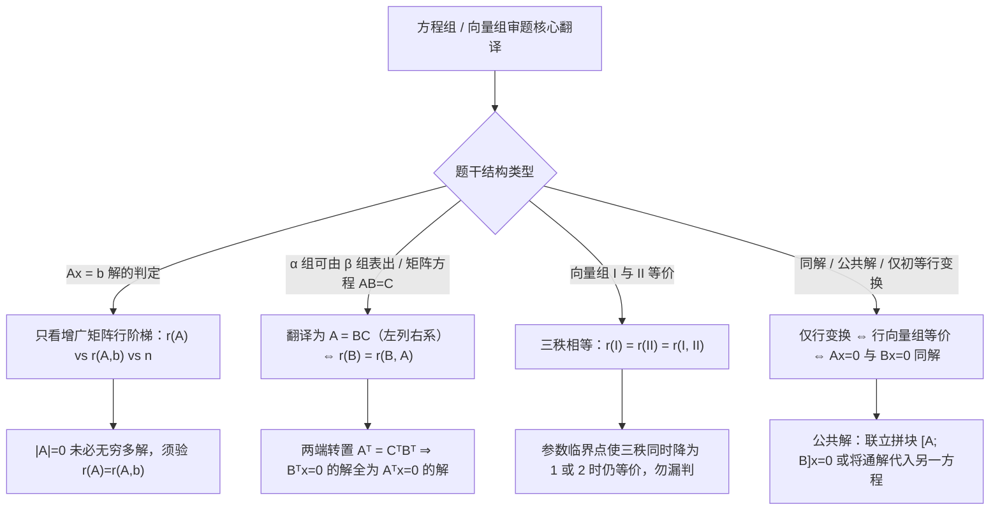

# 第5—6讲 线性方程组与向量组｜二轮强化复盘

> [!abstract] 资料与范围
> 强化讲义：[[第5讲_线性方程组.pdf]]、[[第6讲_向量组.pdf]]（印刷第 49—71 页）；一轮笔记：[[考研数学/线性代数/知识点与考点整理/第4讲 线性方程组|第4讲 线性方程组]]、[[考研数学/线性代数/知识点与考点整理/第3讲 向量组|第3讲 向量组]]。
> 题源：例题编号对应强化讲义；1000B：[[考研数学/强化/试题册_强化篇与综合篇/20_强化篇_线代_第5章_线性方程组.pdf|第5章试题]]、[[考研数学/强化/解析册_强化篇与综合篇/20_强化篇_线代_第5章_线性方程组.pdf|第5章解析]]、[[考研数学/强化/试题册_强化篇与综合篇/21_强化篇_线代_第6章_向量组.pdf|第6章试题]]、[[考研数学/强化/解析册_强化篇与综合篇/21_强化篇_线代_第6章_向量组.pdf|第6章解析]]。
> 数二范围：讲义第 5 讲空间平面位置关系、第 6 讲向量空间与过渡矩阵标注仅数学一，不展开。

---

> [!important] 近 17 年数二线代真题雷达（2010—2026｜S+ 级选填高频与全卷枢纽）
> - **考频画像**：主考 **20 题**（含 6 道解答 `10-T22`、`11-T22`、`12-T22`、`16-T22`、`17-T22`、`19-T22`；近 6 年新大纲 **8 题，2021—2026 每年考查 1～2 道选填**），跨讲渗透 **11 次**。
> - **真题落点**：
>   - *2021—2026 新大纲*：`21-T9(选)`、`22-T9(选)`、`22-T10(选)`、`23-T10(选)`、`24-T16(填)`、`25-T10(选)`、`25-T16(填)`、`26-T9(选)`
>   - *2015—2020 经典*：`15-T7(选)`、`16-T22(解)`、`17-T22(解)`、`19-T22(解)`
>   - *2010—2014 早期补齐*：`10-T7(选)`、`10-T22(解)`、`11-T8(选)`、`11-T22(解)`、`12-T7(选)`、`12-T22(解)`、`13-T7(选)`、`14-T8(选)`
> - **跨大纲高频反套路与破题核心**：
>   1. **“线性表出 ↔ 矩阵乘法 ↔ 方程组有解/同解”核心翻译网**：`21-T9`（$\alpha$ 由 $\beta$ 表出 $\iff A=BC \Rightarrow A^T=C^TB^T \Rightarrow B^Tx=0$ 解全为 $A^Tx=0$ 解）、`13-T7`（$AB=C$ 右乘可逆阵仅保列等价不保行等价）、`23-T10`（两组公共向量解齐次组并验非零）、`25-T16`（由列线性关系直接读出齐次基础解系与非齐次特解）、`26-T9`（$\exists B$ 使 $AB=C \iff r(A)=r(A,C)$）。
>   2. **退化边界、范德蒙德双行列式与参数增根**：`12-T22` & `15-T7` & `22-T9`（$|A|=0$ 未必有无穷多解：须同验增广矩阵，左同右异必无解）、`10-T22`（非齐次有不同解定无穷解参数）、`22-T10` & `19-T22`（参数临界值 $\lambda=1$ 时三秩同降为 $1$ 或 $2$ **仍等价**，勿误删）、`24-T16`（先排除任意两列成比例的 $a=1$ 再行化简）。
>   3. **概念推理反例与抽象秩证明**：`10-T7`（以少表多推 $r\le s$，反向含零向量秒排）、`11-T8`（$r(A)=n-1$ 须取 $n-1$ 个极大无关列构 $A^*x=0$ 基础解系）、`14-T8`（整体无关乘列满秩仍无关，取 $\alpha_3=0$ 否定充分性）、`25-T10`（$r(AB)=r(BA)+1\Rightarrow r\binom{ABA}{BAB}\le 2<3$ 必有公共非零解；反例 $A=E_{11},B=E_{13}$）。
> - **每日复习聚焦**：第二部分开头的 Mermaid 翻译网 + 同解/公共解/向量组等价三秩相等 + 退化临界点逐一验秩 + 矩阵方程 $AB=C$ 有解充要条件。

---

## 第一部分｜知识点与核心结论

### 【第5讲：线性方程组】

#### 1. 线性方程组的矩阵语言与解的判定定理【🔥⚡ 必背+避坑｜停下来默背 1 遍 + 精读 1 分钟】

- **矩阵形式与向量语言互译**：
  设 $A_{m\times n} = [\alpha_1, \alpha_2, \dots, \alpha_n]$（$\alpha_j \in \mathbb{R}^m$），则
  $$Ax = b \iff x_1 \alpha_1 + x_2 \alpha_2 + \dots + x_n \alpha_n = b$$
  - **列视角（几何实质）**：$Ax=b$ 有解 $\iff$ 右端向量 $b$ 可由 $A$ 的列向量组 $\alpha_1, \dots, \alpha_n$ 线性表出。
  - **行视角（行正交翻译，强化第 51 页）**：设 $A$ 按行分块为 $\gamma_1^T, \dots, \gamma_m^T$，则
    $$Ax = 0 \iff \gamma_i^T x = 0 \quad (i=1, 2, \dots, m)$$
    即 $A$ 的每一行向量均与齐次解 $x$ 正交。若已知向量 $\xi$ 与未知矩阵 $A$ 的各行正交，立刻翻译为“$\xi$ 是 $Ax=0$ 的解”。
- **解的存在性与唯一性判定表**（未知数个数均为 $n$）：

  | 方程组类型 | 解的状态 | 充要条件（秩判据） | 几何与向量空间意义 |
  |---|---|---|---|
  | 齐次方程组 $Ax=0$ | 只有零解 | $r(A) = n$（列满秩） | 列向量组线性无关，解空间维数 $\dim(\ker A) = 0$ |
  | 齐次方程组 $Ax=0$ | 有非零解 | $r(A) < n$（不满秩） | 列向量组线性相关，解空间维数 $\dim(\ker A) = n - r(A) > 0$ |
  | 非齐次方程组 $Ax=b$ | 无解（不相容） | $r(A) < r([A \mid b])$ | $b$ 不能由 $A$ 的列向量组线性表出，$b \notin \operatorname{Col}(A)$ |
  | 非齐次方程组 $Ax=b$ | 有唯一解 | $r(A) = r([A \mid b]) = n$ | <mark>系数矩阵列满秩且增广相容</mark> `[真题·2015-T07]` |
  | 非齐次方程组 $Ax=b$ | 有无穷多解 | $r(A) = r([A \mid b]) < n$ | <mark>系数与增广双行列式同为零</mark>且参数使两者秩相同 `[真题·2010-T22 / 2012-T22 / 2015-T07]` |

- **行满秩与列满秩的有解性边界（基础第 4 讲例 4.6）**：
  - **行满秩（$r(A)=m$）**：对任意 $b \in \mathbb{R}^m$，均有 $m = r(A) \le r([A \mid b]) \le m \implies r(A) = r([A \mid b]) = m$，故 $Ax=b$ **必有解**（当 $m < n$ 时必有无穷多解，不可能唯一解）。
  - **列满秩（$r(A)=n$）**：齐次组 $Ax=0$ 仅有零解（满足左消去律：$AB=AC \implies B=C$）；非齐次组 $Ax=b$ **不保证有解**，但只要有解必为**唯一解**（4 方程 3 未知数有解时 4 阶增广行列式必为 0 `[真题·2023-T16]`）。
  - **降秩避坑**：方程数小于未知数个数（$m < n$）时，齐次组 $Ax=0$ 必有非零解；但对非齐次组，<mark>系数降秩未必有无穷多解</mark>，须先验相容性 $r(A) = r([A \mid b])$（如范德蒙德阵配互异右端必现矛盾行而无解 `[真题易错·2022-T09]`）。
  - `【⚡ 真题补丁｜2022-T09】` 含参非齐次组 $\lvert A\rvert=0$ 未必有无穷多解；范德蒙德阵遇右端互异 $(1,2,4)^T$ 时所有退化参数均得左同右异矛盾行而无解，只能唯一解或无解。
- **克拉默法则（Cramer's Rule）与伴随矩阵统一**：
  - **适用充要条件**：① 系数矩阵 $A$ 为 $n$ 阶方阵；② $|A| \ne 0$。
  - **分量公式**：唯一解为
    $$x_j = \frac{D_j}{|A|} = \frac{\sum_{i=1}^n b_i A_{ij}}{|A|} \quad (j=1, 2, \dots, n)$$
    其中 $D_j$ 为将 $A$ 第 $j$ 列换为 $b$ 所得的 $n$ 阶行列式，$A_{ij}$ 为代数余子式。
  - **本质统一**：由 $x = A^{-1}b = \frac{1}{|A|} A^* b$，其第 $j$ 分量恰为 $\frac{1}{|A|} \sum_{i=1}^n A_{ij} b_i = \frac{D_j}{|A|}$，克拉默法则即伴随求逆公式的分量展开。
  - **失效边界**：$A$ 非方阵或 $|A| = 0$ 时失效，须改用初等行变换消元。

---

#### 2. 齐次线性方程组的解空间与基础解系【🔥 必背｜停下来默背 1 遍】

- **解空间 $\ker A$ 的线性封闭性**：
  - 若 $\xi_1, \xi_2$ 为 $Ax=0$ 的解，则任意线性组合 $k_1 \xi_1 + k_2 \xi_2$ 仍为解；零向量恒为解。
- **基础解系三要素**：
  设 $A$ 为 $m\times n$ 矩阵且 $r(A) = r < n$，向量组 $\xi_1, \dots, \xi_s$ 为 $Ax=0$ 的一组基础解系，须<mark>同时满足是解、线性无关且个数等于自由度</mark> `[真题易错·2011-T08]` `[真题·2017-T22]`：
  1. **是解**：$A\xi_i = 0$（$i=1, \dots, s$）；
  2. **线性无关**：$\xi_1, \dots, \xi_s$ 线性无关；
  3. **个数恰为自由度**：$s = n - r(A) = n - r$。
- **通解结构与维数公式**：
  - 通解为 $x = k_1 \xi_1 + k_2 \xi_2 + \dots + k_{n-r} \xi_{n-r}$（$k_i \in \mathbb{R}$），解空间维数 $\dim(\ker A) = n - r(A)$。
- **基础解系的非唯一性与可逆变换定理**：
  - 基础解系不唯一，但所含向量个数 $s = n - r(A)$ 唯一确定。
  - 设 $\Xi = [\xi_1, \dots, \xi_s]$ 为一组基础解系，则 $\mathrm{H} = [\eta_1, \dots, \eta_s]$ 也是基础解系 $\iff$ 存在 $s$ 阶**可逆矩阵** $P$ 使 $\mathrm{H} = \Xi P$（$P$ 不可逆则新组线性相关）。
  - **易错辨析**：仅知“与原基础解系等价”（如混入多余解变为 $s+1$ 个导致相关）或“等秩”（未必落入 $\ker A$），均不能直接充当基础解系。
- **标准求解步骤（行最简阶梯形）**：
  1. 对 $A$ 仅作**初等行变换**化为行最简阶梯形；
  2. 区分主元列（主变量）与非主元列（自由变量）；
  3. 令自由变量 $x_{i_1}, \dots, x_{i_s}$ 依次取 $s$ 阶单位矩阵各列（或各行），代回求主变量，即得规范基础解系。
- **已知基础解系反求系数矩阵 $A$（1000B 第 5 章第 6 题）**：
  - 记 $C = [\xi_1, \dots, \xi_s]_{n\times s}$，由 $AC = O \iff C^T A^T = O$：
  - 以 $C^T$ 为系数矩阵解 $C^T y = 0$，求得基础解系 $y_1, \dots, y_{n-s}$；
  - 取 $A$ 的各行为 $y_1^T, \dots, y_{n-s}^T$ 的线性组合，并保证 $r(A) = n - s$（若指定 $A$ 有 $m$ 行，须满足 $m \ge n - s$）。
  - **防错校验**：无论用 $C^T y = 0$ 还是直接解 $AC=O$，**必须核查 $r(A) = n - s$**；若秩偏小，原向量组将无法张满 $Ax=0$ 的解空间。

---

#### 3. 非齐次线性方程组的解结构与性质【🔥 必背｜停下来默背 1 遍】

- **相容条件与通解结构**：
  - $Ax=b$ 有解 $\iff r(A) = r([A \mid b])$。
  - 设 $\eta^*$ 为一个特解，$\xi_1, \dots, \xi_s$ 为导出组 $Ax=0$ 的基础解系（$s = n - r(A)$），则通解为：
    $$x = \eta^* + k_1 \xi_1 + k_2 \xi_2 + \dots + k_s \xi_s \quad (k_1, \dots, k_s \in \mathbb{R})$$
    即“一个非齐次特解 + 导出齐次组的全部通解”。
- **解的线性组合规律**：
  设 $\eta_1, \dots, \eta_k$ 为 $Ax=b$（$b \ne 0$）的解，$\xi$ 为导出组 $Ax=0$ 的解：
  1. **两特解之差为齐次解**：$A(\eta_1 - \eta_2) = 0$；
  2. **特解加齐次解仍为特解**：$A(\eta^* + \xi) = b$；
  3. **加权线性组合**：对 $x = \sum_{i=1}^k c_i \eta_i$，有 $Ax = \left(\sum_{i=1}^k c_i\right) b$：
     - $\sum_{i=1}^k c_i = 1 \iff$ 为非齐次组 $Ax=b$ 的解；
     - $\sum_{i=1}^k c_i = 0 \iff$ 为导出组 $Ax=0$ 的解。
- **非齐次组线性无关解的最大个数（强化第 52 页）**：
  - 导出组 $Ax=0$ 最多有 $n - r(A)$ 个线性无关解；
  - 非齐次组 $Ax=b$（$b \ne 0$）最多有 **$n - r(A) + 1$** 个线性无关解（如 $\eta^*, \eta^*+\xi_1, \dots, \eta^*+\xi_s$，任意解可由其按系数和为 1 线性表出）。
  - **反向定秩**：若 $Ax=b$ 有 $k$ 个**线性无关解** $\eta_1, \dots, \eta_k$，则 $\eta_2-\eta_1, \dots, \eta_k-\eta_1$ 是 $Ax=0$ 的 $k-1$ 个线性无关解，故
    $$n - r(A) \ge k - 1 \iff r(A) \le n - k + 1$$
    **警示**：前提须是“线性无关解”，仅知“$k$ 个不同解”不能推出该秩不等式。
- **从已知通解反读列向量关系**：
  - 已知 $Ax=b$ 通解为 $x = \eta^* + k \xi$，代回即得 $A\eta^* = b,\ A\xi = 0$。
  - 将 $A$ 按列写为 $[\alpha_1, \dots, \alpha_n]$，$A\xi=0$ 直接给出各列间的线性相关式（如 $\xi = (1, 1, -1, -1)^T \implies \alpha_1+\alpha_2=\alpha_3+\alpha_4$），这是<mark>由齐次解分量直读系数矩阵列间线性关系</mark>的破题方法（多自由变量换列重组同理 `[真题易错·2025-T16]` `[真题·2017-T22]`）。
  - 若题设给出若干一次式的平方和为零（如仅含 3 个相关平方和），先由<mark>实平方和为零必各一次式全零</mark>转为齐次方程组再求通解 `[真题·2018-T22]`。

---

#### 4. 方程组的公共解与同解判别体系（核心重难点）【🔥⚡ 必背+避坑｜停下来默背 1 遍 + 精读 1 分钟】

- **公共解的定义与三大求解路径**：
  公共解指同时满足方程组 (I) 与 (II) 的解向量（即 $\mathcal{S}_{\text{I}} \cap \mathcal{S}_{\text{II}}$）。
  - **路径 1｜联立消元法**：
    - 齐次联立 $\begin{bmatrix}A\\B\end{bmatrix}x = 0$：存在非零公共解 $\iff r\begin{bmatrix}A\\B\end{bmatrix} < n$；
    - 非齐次联立 $\begin{bmatrix}A\\B\end{bmatrix}x = \begin{bmatrix}b\\c\end{bmatrix}$：存在公共解 $\iff r\begin{bmatrix}A\\B\end{bmatrix} = r\begin{bmatrix}A&b\\B&c\end{bmatrix}$。
  - **路径 2｜通解代入法（计算最省）**：
    将较易求解的一组（如 $Ax=0$）通解 $x = [\xi_1, \dots, \xi_s] k$ 直接代入 $Bx=0$，化为关于参数 $k$ 的低维方程组 $(B[\xi_1, \dots, \xi_s])k = 0$，求非零参数 $k$ 再代回 $x$。
  - **路径 3｜秩不等式估计法（抽象证明）**：
    由 $r\begin{bmatrix}A\\B\end{bmatrix} \le r(A) + r(B)$，若 $r(A) + r(B) < n$，则必有 $r\begin{bmatrix}A\\B\end{bmatrix} < n$，即<mark>纵向拼接矩阵秩小于未知数必有非零公共解</mark>（如 3 阶阵满足 $r(AB)=r(BA)+1$ 时，由 $|AB|=|BA|=0$ 锁定秩界 `[真题易错·2025-T10]`）。
  - `【⚡ 真题补丁｜2025-T10】` 3阶 $r(AB)=r(BA)+1$ 得 $\lvert A\rvert=\lvert B\rvert=0$ 且 $r(BA)\le 1$，故拼块秩 $\le 2<3$ 必有公共非零解；反例取 $E_{11},E_{13}$。
- **同解的充要条件判定体系**（$\mathcal{S}_{\text{I}} = \mathcal{S}_{\text{II}}$，未知数均为 $n$ 个）：
  - **齐次方程组 $A_{m\times n}x=0$ 与 $B_{s\times n}x=0$ 同解的 5 个等价命题（强化第 56—57 页）**：
    1. $\ker A = \ker B$（两方程组同解）；
    2. $r(A) = r(B) = r\begin{bmatrix}A\\B\end{bmatrix}$；
    3. <mark>系数矩阵行向量组等价（可互相线性表示）</mark> `[真题易错·2025-T09]`；
    4. 存在矩阵 $P_{s\times m}, Q_{m\times s}$ 使 $B=PA$ 且 $A=QB$（$P, Q$ 不要求可逆）；
    5. <mark>单向解集包含且两系数矩阵秩相等</mark>（即 $\ker A \subseteq \ker B$ 且 $r(A) = r(B)$；仅知单向包含时则给出两秩的大小方向，常用于锁定对称阵零根或参数 `[真题·2024-T22]`）。
  - **非齐次方程组 (I) $Ax=b$ 与 (II) $Bx=c$ 同解判定（强化第 58—59 页）**：
    在**两组均相容有解**的前提下（若均无解则同为空集而平凡同解），以下 4 条等价：
    1. (I) 与 (II) 同解；
    2. 导出组 $Ax=0$ 与 $Bx=0$ 同解，**且** (I) 与 (II) 至少有一个公共解；
    3. $r\begin{bmatrix}A&b\\B&c\end{bmatrix} = r\begin{bmatrix}A\\B\end{bmatrix} = r(A) = r(B)$；
    4. 增广矩阵 $[A \mid b]$ 与 $[B \mid c]$ 的**行向量组等价**。
- **同解 vs 同秩、行等价 vs 列等价的辨析**：
  - **同解必同秩，同秩未必同解**：同解推出解空间维数相同，从而 $r(A)=r(B)$；反之同秩不保证解空间重合。
  - **列等价 $\to$ 转置同解（基础第 4 讲例 4.14）**：
    - 若 $A, B$ **列向量组等价**，则 $A^T, B^T$ 行等价，故 **$A^T x = 0$ 与 $B^T x = 0$ 同解**，但 $Ax=0$ 与 $Bx=0$ 未必同解；
    - 若 $Ax=b$ 有解，则 $b \in \operatorname{Col}(A)$，故 $r(A^T) = r\begin{bmatrix}A^T\\b^T\end{bmatrix}$，从而 **$A^T x = 0$ 与 $\begin{bmatrix}A^T\\b^T\end{bmatrix} x = 0$ 同解**。

---

#### 5. 分块初等变换、正规方程与矩阵方程【📌⚡ 扫一眼+避坑｜最值钱，必须精读 1 分钟】

- **分块左乘可逆阵的同解原理与防坑**：
  - 若存在可逆方阵 $M$ 使 $M\begin{bmatrix}A\\B\end{bmatrix} = \begin{bmatrix}D_1\\D_2\end{bmatrix}$，则 $\begin{bmatrix}A\\B\end{bmatrix} x = 0$ 与 $\begin{bmatrix}D_1\\D_2\end{bmatrix} x = 0$ 同解。
  - **思维避坑（例 5.6）**：变换矩阵 $M$ 不可逆仅说明无法由可逆性直接推同解，**不能据此断言不同解**，须改用解空间维数或反例判别。
- **实矩阵的正规方程与 $A^T A$ 同解定理**：
  对任意实矩阵 $A_{m\times n}$：
  - **齐次同解**：$Ax = 0 \iff A^T A x = 0$。
    - 推导：$A^T A x = 0 \implies x^T A^T A x = \|Ax\|^2 = 0 \implies Ax = 0$（仅限实数域）。
    - **四秩相等推论**：$r(A^T A) = r(A) = r(A^T) = r(A A^T)$。
  - **正规方程恒相容**：对任意实矩阵 $A$ 与任意 $b \in \mathbb{R}^m$，<mark>原方程组无解时其正规方程组恒相容有解</mark>，即 $A^T A x = A^T b$ 必有解 `[真题·2016-T22]`（因 $\operatorname{Col}(A^T A) = \operatorname{Col}(A^T)$，故 $A^T b \in \operatorname{Col}(A^T A)$）。
- **矩阵方程 $AX=B$ 的列展开求解**：
  设 $X = [x_1, \dots, x_t],\ B = [b_1, \dots, b_t]$，则 $AX = B \iff Ax_j = b_j$（$j=1, \dots, t$）：
  - **相容条件**：$r(A) = r([A \mid B])$（当 $A$ 不可逆时不存在 $X = A^{-1}B$）。
  - `【⚡ 真题补丁｜2026-T09】` 存在矩阵 $B$ 使 $AB=C \iff C$ 每列可由 $A$ 的列向量组线性表出 $\iff r(A)=r([A,C])$；注意右乘 $BA=C$ 对应行表出 $r(A)=r\binom{A}{C}$。
  - **求解与自由参数**：对 $[A \mid B]$ 统一作初等行变换，<mark>按列拆解方程且各列配独立自由常数</mark>（适用于交换方程 $AC-CA=B$ 与右逆 $AB=E$ `[真题·2013-T22 / 2014-T22]`），通解共含 $t(n - r(A))$ 个独立自由常数；若题设还要求 $X$ 可逆，须<mark>各列独立取自由常数并补验矩阵可逆</mark> `[真题易错·2018-T23]`。
  - **列序同步提醒（1000B 第 5 章第 12 题）**：对 $[A, \beta] = BC$ 型线性表出方程，<mark>右乘系数矩阵的各列即为对应表出系数</mark> `[真题易错·2016-T23]`；改变左端或 $B$ 的列序时，$C$ 中对应行、列顺序必须同步调整。

---

#### 6. 伴随矩阵、余子式与基础解系的跨讲联系【📌 扫一眼｜确认“我还会”就过】

- **由 $A A^* = A^* A = |A| E$ 读解向量**：
  当 $|A| = 0$ 时，$A^* A = O \implies A$ 的各列均为 $A^* x = 0$ 的解；$A A^* = O \implies A^*$ 的各列均为 $Ax = 0$ 的解。
- **伴随矩阵秩与基础解系维数对应**：
  $$r(A^*) = \begin{cases} n, & r(A) = n \\ 1, & r(A) = n - 1 \\ 0, & r(A) \le n - 2 \end{cases}$$
  - **单降秩情形（$r(A) = n - 1$）**：
    - $Ax=0$ 基础解系含 1 个向量，$A^*$ 任一非零列即可充当；
    - $A^* x = 0$ 基础解系含 $n - 1$ 个向量，即<mark>伴随齐次组基础解系恰为原阵极大无关列</mark>（如 $4$ 阶阵 $r(A)=3$ 须选 3 个线性无关列，切忌个数不足或误选含 $\alpha_1+\alpha_3=0$ 的相关列 `[真题易错·2011-T08]`），亦可逆向<mark>由基础解系维数反推伴随矩阵的秩</mark> `[真题·2019-T07]`。
  - **非零代数余子式线索**：若 $A_{ij} \ne 0$，说明划去第 $i$ 行、第 $j$ 列后的 $(n-1)$ 阶子式非零，故 $A$ 除去第 $j$ 列外的其余 $n-1$ 列必线性无关，可直接构成 $A^* x = 0$ 的基础解系 `[真题易错·2020-T07]`。

### 【第6讲：向量组】

#### 1. 向量组的线性相关性与核心判定定理【🔥⚡ 必背+避坑｜停下来默背 1 遍 + 精读 1 分钟】

- **线性表出与线性相关性定义**：
  设 $\alpha_1, \dots, \alpha_s \in \mathbb{R}^n$，$k_1, \dots, k_s \in \mathbb{R}$：
  - **线性表出**：存在 $k_1, \dots, k_s$ 使 $\beta = k_1 \alpha_1 + \dots + k_s \alpha_s$；
  - **线性相关**：存在**不全为零**的 $k_1, \dots, k_s$ 使 $k_1 \alpha_1 + \dots + k_s \alpha_s = 0$；
  - **线性无关**：仅当 $k_1 = \dots = k_s = 0$ 时上述齐次式成立。
  - **常用小推论（基础 30 讲）**：含零向量的组必相关；单零向量相关、单非零向量无关；两非零向量不成比例则无关。
- **七大核心判定定理**：
  - **定理 1（自身相关性充要条件）**：$\alpha_1, \dots, \alpha_s$（$s \ge 2$）线性相关 $\iff$ 至少有一个向量可由其余 $s-1$ 个向量线性表出（逆否：线性无关 $\iff$ 任一向量都不能由其余向量线性表出）。
  - **定理 2（唯一表示定理）**：若 $\alpha_1, \dots, \alpha_s$ 线性无关，而 $\alpha_1, \dots, \alpha_s, \beta$ 线性相关，则 $\beta$ 可由 $\alpha_1, \dots, \alpha_s$ **唯一线性表出**（几何上 $\beta$ 落入该 $s$ 维子空间且坐标唯一）。
  - **定理 3（以少表多，多的必相关 ★）**：
    - 若 (I) $\beta_1, \dots, \beta_t$ 可由 (II) $\alpha_1, \dots, \alpha_s$ 线性表出，且 $t > s$，则 (I) 必线性相关（低维空间容不下多于维数的无关向量）。
    - **逆否高频命题**：若 (I) 可由 (II) 线性表出，且<mark>被表出组线性无关时其个数不超过表出组</mark>（即 $t \le s$）；若被表出组相关或仅知表出组相关/无关，均可借含零向量或冗余向量构造反例，无法比较 $t$ 与 $s$ `[真题易错·2010-T07]`。
    - **秩不等式（教材第 68 页）**：(I) 可由 (II) 线性表出 $\implies r(\text{I}) \le r(\text{II})$（被表出组的秩不大于表出组）。
  - **定理 4（齐次方程与秩判据）**：
    - $\alpha_1, \dots, \alpha_s$ 线性相关 $\iff [\alpha_1, \dots, \alpha_s] x = 0$ 有非零解 $\iff r([\alpha_1, \dots, \alpha_s]) < s$；线性无关 $\iff$ 列满秩（$r = s$）。
    - 方阵拼块时，<mark>行列式恒为零且与参数无关则恒线性相关</mark>（若行列式为 $c_1$ 或 $c_3+c_4$ 等含参式则并非恒相关 `[真题·2012-T07]`）。
  - **定理 5（非齐次方程与增广秩判据）**：
    - $\beta$ 可由 $\alpha_1, \dots, \alpha_s$ 线性表出 $\iff [\alpha_1, \dots, \alpha_s]x = \beta$ 有解 $\iff r([\alpha_1, \dots, \alpha_s]) = r([\alpha_1, \dots, \alpha_s, \beta])$（矩阵形式：$\exists B$ 使 $AB=C \iff r(A)=r([A,C])$ `[真题·2026-T09]`）。
    - 不能线性表出 $\iff$ 增广秩严格增一：$r([\alpha_1, \dots, \alpha_s, \beta]) = r([\alpha_1, \dots, \alpha_s]) + 1$ `[真题·2011-T22]`。
    - **向量组表出 $\to$ 转置齐次方程包含**：<mark>列组可表出等价于转置齐次方程解集包含</mark>——若 $\alpha$ 组可由 $\beta$ 组表出，即 $A = BC \implies A^T = C^T B^T$，则 $B^T x = 0$ 的解必满足 $A^T x = 0$（未转置或反向包含均错 `[真题易错·2021-T09]`）。
    - `【⚡ 真题补丁｜2010-T07 / 2014-T08】` 以少表多逆否推论：被表出组无关则个数不超过表出组（反向含零向量皆伪）；整体无关乘列满秩阵仍无关，反之 $\alpha_3=0$ 否定充分性。
    - `【⚡ 真题补丁｜2021-T09】` $\alpha$ 组（列拼 $A$）可由 $\beta$ 组（列拼 $B$）表出 $\iff A=BC \Rightarrow A^T=C^TB^T$，故 $B^Tx=0$ 的解必满足 $A^Tx=0$（记住转置后含号朝左）。
    - `【⚡ 真题补丁｜2024-T16】` 遇“三向量相关但任意两向量无关”定参填空题，先排除使任意两列成比例的退化值（如 $a=1$），再作初等行变换，避免除以 $1-a$ 漏判或收增根。
  - **定理 6（部分与整体）**：部分相关 $\implies$ 整体必相关；整体无关 $\implies$ 任意部分必无关。
  - **定理 7（延伸与缩短）**：无关组增添分量（延伸）仍无关；相关组截去相同分量（缩短）仍相关；逆否地，缩短后无关 $\implies$ 原向量组无关。
- **矩阵作用与线性相关性的单向传递（1000B 第 6 章第 1 题）**：
  - 原组线性相关 $\implies A\alpha_1, \dots, A\alpha_s$ 线性相关；逆否：变换后无关 $\implies$ 原组无关。
  - <mark>线性无关组乘列满秩矩阵仍线性无关</mark>（如由无关组构造 $\alpha_1+k\alpha_3, \alpha_2+l\alpha_3$），但反之不成立——取退化零向量反例（如 $\alpha_3=0$ 而 $\alpha_1,\alpha_2$ 无关）即可否定充分性 `[真题易错·2014-T08]`。
- **向量个数 $s$ 与维数 $n$ 的三分支速判表**：

  | 条件分支 | 相关性结论与首选方法 | 解题操作与注意事项 |
  |---|---|---|
  | $s > n$ | **必线性相关**（由定理 3） | 特别地，$n+1$ 个 $n$ 维向量必相关，无需计算 |
  | $s = n$ | 拼成 $n$ 阶方阵 $A = [\alpha_1, \dots, \alpha_n]$ 算 $\lvert A \rvert$ | $\lvert A \rvert \ne 0 \iff$ 线性无关；$\lvert A \rvert = 0 \iff$ 线性相关 |
  | $s < n$ | 作**初等行变换**判秩 $r(A)$，或找 $s$ 阶非零子式 | 长方阵无行列式；找 $s$ 阶非零子式即利用“缩短无关则原组无关” |

---

#### 2. 极大线性无关组与初等变换【🔥 必背｜停下来默背 1 遍】

- **极大线性无关组的定义与边界**：
  部分组 $\alpha_{i_1}, \dots, \alpha_{i_r}$ 满足：① 自身线性无关；② 原组任一向量均可由其线性表出。
  - 极大线性无关组不唯一，但所含向量个数 $r$ 唯一，称为向量组的**秩** $r(\alpha_1, \dots, \alpha_s)$。
  - **边界特判**：全零向量组秩为 $0$，**不存在极大线性无关组**；线性无关组的极大线性无关组即其自身。
- **三秩相等定理**：任意矩阵 $A$ 均有 $r(A) =$ 行秩 $=$ 列秩。
- **为何求列关系只用初等行变换**：
  - 对 $A = [\alpha_1, \dots, \alpha_s]$ 作初等行变换等价于左乘可逆阵 $P$，齐次方程 $Ax = 0 \iff PAx = 0$ 解向量 $x$ 完全不变，故<mark>初等行变换保持列向量线性关系</mark> `[真题·2026-T22]`。
  - 初等列变换（右乘可逆阵 $Q$）会重组各列，不能直接将变换后各列的系数当作原列系数；若不得已使用列变换，须记录变换并还原原向量关系。
- **行最简阶梯形与满秩分解 $A = GH$（强化例 6.3 规范）**：
  1. 将向量按列拼成 $A$，仅作**初等行变换**化为行最简阶梯形；
  2. 主元列位置 $j_1, \dots, j_r$ 对应**原矩阵 $A$ 的列** $\alpha_{j_1}, \dots, \alpha_{j_r}$，构成极大线性无关组，记 $G = [\alpha_{j_1}, \dots, \alpha_{j_r}]$；
  3. **满秩分解 $A = GH$**：取行最简阶梯形前 $r$ 行非零行组成 $H_{r\times s}$，<mark>行最简形非零行直接给出各列唯一坐标</mark> `[真题·2026-T22]`。

---

#### 3. 向量组等价、矩阵等价与空间映射【🔥⚡ 必背+避坑｜停下来默背 1 遍 + 精读 1 分钟】

- **向量组等价的充要条件与单向表出**：
  - **定义与秩判据**：(I) 与 (II) 可相互线性表出 $\iff \operatorname{Span}(\text{I}) = \operatorname{Span}(\text{II}) \iff$
    $$r(\text{I}) = r(\text{II}) = r(\text{I}, \text{II})$$
  - `【⚡ 真题补丁｜2022-T10 / 2019-T22】` 含参向量组等价须对行列式归零临界点逐一验秩：$\lambda=1$ 时三秩同降为 1 仍等价，仅排除两秩不等（如 3 与 2）的 $\lambda=-1,-2$。
  - **单向等价推论（教材第 69 页）**：两向量组秩相等，且其中任一组可由另一组线性表出 $\iff$ 两组等价。
  - **严格单向表出（例 6.6）**：若 (I) 可由 (II) 表出但 (II) 不能由 (I) 表出，必有 $r(\text{I}) < r(\text{II})$。含参讨论时先由秩不等式筛出候选参数，再代回检验单向表出方向以防增根。
- **矩阵等价 vs 列等价 vs 行等价对比表**：
  （下表中可逆方阵与“初等变换互化”表述均假定 $A, B$ 同型；若向量个数不同，仍用秩或相互表出判等价，但不存在对应可逆方阵。）

  | 概念 | 几何与代数实质 | 充要条件 | 允许的初等变换与避坑 |
  |---|---|---|---|
  | **矩阵等价**（$A \sim B$） | 存在可逆阵 $P, Q$ 使 $PAQ = B$ | $r(A) = r(B)$ | 初等行、列变换可混用 |
  | **列向量组等价**（$\operatorname{Col}(A) \cong \operatorname{Col}(B)$） | 存在可逆阵 $P$ 使 $AP = B$（列空间相同） | $r(A) = r(B) = r([A \mid B])$ | <mark>右乘可逆阵仅保列向量组等价</mark> `[真题易错·2013-T07]` |
  | **行向量组等价**（$\operatorname{Row}(A) \cong \operatorname{Row}(B)$） | 存在可逆阵 $Q$ 使 $QA = B$（行空间相同） | $r(A) = r(B) = r\begin{pmatrix}A\\B\end{pmatrix}$ | <mark>仅用初等行变换互化保行等价与齐次同解</mark> `[真题易错·2025-T09]` |

  - **两类高频边界辨析**：
    - 同型矩阵等价（同秩）推不出列等价或行等价；在 $AB=C$（$B$ 可逆）中，$C$ 与 $A$ 列等价而不保行等价，且当 $A$ 不可逆时 $C$ 的行只能由 $B$ 的行单向表出，与 $B$ 的列亦无等价关系 `[真题易错·2013-T07]`；
    - 含参等价判定时，<mark>临界点处三秩同步降低仍保持向量组等价</mark>（除两行列式均非零的点外，仅淘汰两阵秩不等的临界值如 $\lambda=-1,-2$ `[真题易错·2022-T10]` `[真题易错·2019-T22]`）。
- **同时由两组向量表示的非零向量（例 6.1、1000B 第 6 章第 7 题）**：
  - 记 $U=[\alpha_1,\dots,\alpha_s],\ V=[\beta_1,\dots,\beta_t]$，设公共向量 $\gamma=Uk=Vl$，则
    $$[U,-V]\begin{bmatrix}k\\l\end{bmatrix}=0$$
    <mark>拼接双组向量列齐次方程求公共非零向量</mark>，解出系数后代回求 $\gamma$ `[真题·2023-T10]`。
  - **非零性校验**：系数方程有非零解**不一定**产出非零 $\gamma$（若某组自身相关，非零系数可组合出零向量）。仅当 $U, V$ 各自列向量线性无关时，$\gamma=0 \implies k=l=0$，此时任一非零系数解必对应非零公共向量（特别地，两组三维向量各含 2 个无关向量时，$[U,-V]$ 为 $3\times 4$ 必有非零解，故必存在非零公共向量）。

---

#### 4. 向量内积、正交矩阵双向性与施密特正交化【📌 扫一眼｜确认“我还会”就过】

- **内积、模长与正交基础**：
  - 内积 $(\alpha, \beta) = \alpha^T \beta = \sum_{i=1}^n a_i b_i$；模长 $\|\alpha\| = \sqrt{\alpha^T \alpha}$；正交 $\alpha \perp \beta \iff \alpha^T \beta = 0$。
  - **性质**：两两正交的非零向量组必线性无关。
  - **求同时正交的单位向量（基础 30 讲第 4 讲例 4.2 易漏点）**：将已知向量按行拼为 $A$ 解 $Ax=0$；若解空间为一维 $\operatorname{Span}(\beta_0)$，则单位向量有正反两向 $\pm \frac{\beta_0}{\|\beta_0\|}$，切忌漏掉 $\pm$ 号。
- **正交矩阵的双向规范正交性**：
  - $A$ 为 $n$ 阶实正交矩阵 $\iff A^T A = E \iff A A^T = E \iff A^{-1} = A^T$。
  - **双向等价**：$A$ 的列向量组为标准正交基 $\iff A$ 为正交矩阵 $\iff A$ 的行向量组为标准正交基（各行平方和为 1，异行内积为 0）。
- **施密特（Gram-Schmidt）正交化标准算法**：
  将线性无关组 $\alpha_1, \dots, \alpha_r$ 化为等价的标准正交组 $\eta_1, \dots, \eta_r$：
  - **第一步｜正交化（投影消去）**：
    $$\begin{aligned}
    \beta_1 &= \alpha_1 \\
    \beta_2 &= \alpha_2 - \frac{(\alpha_2, \beta_1)}{(\beta_1, \beta_1)} \beta_1 \\
    \beta_3 &= \alpha_3 - \frac{(\alpha_3, \beta_1)}{(\beta_1, \beta_1)} \beta_1 - \frac{(\alpha_3, \beta_2)}{(\beta_2, \beta_2)} \beta_2 \\
    &\;\;\vdots \\
    \beta_k &= \alpha_k - \sum_{j=1}^{k-1} \frac{(\alpha_k, \beta_j)}{(\beta_j, \beta_j)} \beta_j \quad (k=2, 3, \dots, r)
    \end{aligned}$$
  - **第二步｜单位化**：$\eta_i = \dfrac{\beta_i}{\|\beta_i\|} = \dfrac{\beta_i}{\sqrt{(\beta_i, \beta_i)}}$（$i=1, \dots, r$）。
  - **计算防错四检**：
    1. 分母锁定**已正交向量**的模平方 $(\beta_j, \beta_j)$，非 $(\alpha_k, \alpha_k)$；
    2. 每一投影项均为**减号**；
    3. 算出 $\beta_2$ 即口算 $(\beta_2,\beta_1)=0$，算出 $\beta_3$ 即验与 $\beta_1,\beta_2$ 正交，杜绝误差扩散；
    4. 若 $\beta_i$ 含分数，可先乘正整数公分母化整（不改方向与正交性），最后按化简后的模长单位化。

---

#### 5. 抽象向量关系的幂零链与方阵秩稳定定理【💤 可跳过｜冲刺期直接跳过不看】

- **幂零链的线性无关性定理（强化例 6.4）**：
  - 设 $A$ 为 $n$ 阶方阵，若存在非零向量 $\alpha$ 及正整数 $k$ 使 $A^{k-1}\alpha \ne 0$ 且 $A^k \alpha = 0$，则 $\alpha, A\alpha, A^2\alpha, \dots, A^{k-1}\alpha$ **线性无关**。
  - **证明（最高次幂消元）**：设 $l_0\alpha + l_1 A\alpha + \dots + l_{k-1}A^{k-1}\alpha = 0$，依次左乘 $A^{k-1}, A^{k-2}, \dots$，逐级消去高次项即可推得 $l_0 = l_1 = \dots = l_{k-1} = 0$。
- **方阵秩稳定定理**：
  - 对任意 $n$ 阶方阵 $A$，恒有
    $$\boxed{r(A^{n+1}) = r(A^n)}$$
  - **证明桥梁**：若存在 $y$ 使 $A^{n+1}y = 0$ 且 $A^n y \ne 0$，由上定理知 $y, Ay, \dots, A^n y$ 共 $n+1$ 个 $n$ 维向量线性无关，矛盾；故 $\ker(A^{n+1}) = \ker(A^n)$，从而秩相等。

---

## 第二部分｜题型体系与典型例题

#### 题型定位速查表

| 题型分类 | 核心题干特征 | 优先方法与破题核心 | 典型例题对应 | 真题印证与避坑 |
|---|---|---|---|---|
| **题型一：解的判定与结构** | 给定矩阵乘积为零（如 $AB^T=O$、$AC=O$），或含参非齐次组判解 | 按列读为齐次方程组的解，用 $n-r(A)$ 定维数；含参组看增广阵行阶梯 | 例 5.1、例 5.3 | $\lvert A\rvert=0$ 须验增广阵；通解勿漏 $k\in\mathbb{R}$ `[真题易错·2022-T09 / 2025-T16]` `[真题·2010-T22 / 2012-T22 / 2015-T07 / 2023-T16]` |
| **题型二：分块方程与矩阵方程** | 题干给出分块矩阵方程，或问 $\exists B$ 使 $AB=C$ 的充要条件 | 转化为正交性、行列式分块乘积，或 $r(A)=r(A,C)$（列线性表出） | 例 5.2 | $\exists B$ 使 $AB=C \iff r(A)=r(A,C)$，勿混淆 $BA=C$ `[真题·2026-T09 / 2013-T22 / 2014-T22 / 2016-T22]` `[真题易错·2018-T23]` |
| **题型三：公共解判定与求解** | 两个方程组有非零公共解，或已知抽象秩差 $r(AB)=r(BA)+1$ | 纵向拼接转化为 $r\binom{A}{B} < n$，或基础解系通解代入降维，或构造反例 | 例 5.4、例 5.5 | 由 $r(BA)\le 1$ 推 $r\binom{ABA}{BAB}\le 2<3$，反例 $A=E_{11},B=E_{13}$ `[真题易错·2025-T10]` |
| **题型四：同解判定与参数讨论** | 两个齐次/非齐次方程组同解，或仅通过初等行变换互化 | 判定行向量组等价、分块左乘可逆矩阵，或核验包含关系加秩相等 | 例 5.6、例 5.7、例 5.8 | 仅行变换 $\iff$ 同解；$A=BC\Rightarrow B^Tx=0$ 解全为 $A^Tx=0$ 解 `[真题易错·2021-T09 / 2025-T09]` `[真题·2024-T22]` |
| **题型五：向量线性表出与公共表示** | 一个向量同时由两组向量表出，或由列线性关系直接写通解 | 设 $\gamma = Xk = Yl$ 化齐次组求系数并验非零；列关系直读基础解系与特解 | 例 6.1、例 6.5 | 公共向量须验非零；系数组合遵循左列右系 `[真题·2011-T22 / 2023-T10]` `[真题易错·2016-T23 / 2025-T16]` |
| **题型六：相关性判定与参数分类** | 向量组线性相关但任意两向量无关，或含参行列式为零 | 先排除任意两列成比例的退化值，再初等行变换求阶梯形，防除零漏解 | 例 6.2 | 先排两列成比例的 $a=1$ 再消元；行列式恒零必相关 `[真题易错·2014-T08 / 2024-T16]` `[真题·2012-T07]` |
| **题型七：极大无关组与满秩分解** | 求极大线性无关组，并写成 $A = GH$ 满秩分解（甚至求 $A^{10}$） | **仅作初等行变换**化为行最简形，主元列取原向量作 $G$，非零行作 $H$ | 例 6.3 | 仅行变换保列间表出关系，降阶算 $A^{10}=G(HG)^9H$ `[真题·2026-T22 / 2017-T22]` `[真题易错·2011-T08 / 2020-T07]` |
| **题型八：抽象相关性与幂零结构** | 题设含 $A^{k-1}\alpha \ne 0$ 且 $A^k\alpha = 0$，证相关性或秩稳定 | 设组合式为零，依次左乘 $A$ 的方幂由最高次消元，反证法利用空间维数 | 例 6.4 | 低频压轴储备：左乘降次须从最高次 $A^{k-1}$ 开始消元 `[真题·2019-T07]` |
| **题型九：向量组单向表示与等价** | 向量组等价或单向表示但不等价，讨论参数取值 | 依三秩相等 $r(\text{I})=r(\text{II})=r(\text{I},\text{II})$ 或 $r(U) < r(V)$ 筛选并逐点验秩 | 例 6.6 | $\lambda=1$ 三秩同降仍等价；以少表多推 $r\le s$ `[真题易错·2010-T07 / 2013-T07 / 2019-T22 / 2022-T10]` `[真题·2018-T22]` |

---

### 一、齐次与非齐次线性方程组的求解与参数讨论（第5讲）

> [!example]- 例 5.1｜由 $AB^T=O$ 找基础解系
> **题目**（讲义第 52—53 页）：$A$ 是秩为 $2$ 的 $2\times5$ 矩阵，$B$ 是秩为 $3$ 的 $3\times5$ 矩阵，且 $AB^T=O$。对 $Ax=0$ 的任一非零解 $b$，判断：
>
> （A）$A^Ty=b$ 有唯一解；（B）$A^Ty=b$ 有无穷多解；（C）$B^Ty=b$ 有唯一解；（D）$B^Ty=b$ 有无穷多解。
>
> **为什么想到基础解系**：$AB^T=O$ 意味着 $B^T$ 的每一列都是 $Ax=0$ 的解；其列数正好等于 $n-r(A)=5-2=3$。
>
> **解**：$r(B^T)=3$，故 $B^T$ 的三列线性无关，恰为 $Ax=0$ 的一组基础解系。任意解 $b$ 都能且只能由这三列线性表示，即 $B^Ty=b$ 有唯一解，选 **（C）**。
>
> **复盘**：若 $A^Ty=b$，则 $b^Tb=b^TA^Ty=(Ab)^Ty=0$，与非零解 $b\ne0$ 矛盾。因此 $A^Ty=b$ 无解，也可排除（A）、（B）。

> [!example]- 例 5.2｜反对称矩阵、正交与分块方程
> **题目**（讲义第 53 页）：实二阶矩阵 $A=(a_{ij})$ 满足 $a_{ij}+a_{ji}=0$，令 $P=[\alpha,A\alpha]$，其中 $A\alpha$ 为非零列向量。判断：
>
> （A）$\begin{bmatrix}A+A^T&O\\E&P\end{bmatrix}x=0$ 只有零解；
>
> （B）$\begin{bmatrix}A+E&O\\E&P\end{bmatrix}x=0$ 有非零解；
>
> （C）$\begin{bmatrix}O&A+A^T\\P&E\end{bmatrix}x=\begin{bmatrix}\alpha\\A\alpha\end{bmatrix}$ 有无穷多解；
>
> （D）$\begin{bmatrix}O&A+E\\P&E\end{bmatrix}x=\begin{bmatrix}\alpha\\A\alpha\end{bmatrix}$ 有唯一解。
>
> **解**：$A^T=-A$，故 $\alpha^TA\alpha=(\alpha^TA\alpha)^T=-\alpha^TA\alpha=0$。又 $A\alpha\ne0$ 蕴含 $\alpha\ne0$，于是 $\alpha,A\alpha$ 是两个非零正交向量，$P$ 可逆。设 $A=\begin{bmatrix}0&c\\-c&0\end{bmatrix}$，则 $\lvert A+E\rvert=1+c^2>0$。
>
> - （A）上方两个分块全为零，系数矩阵不满秩，齐次组有非零解，错。
> - （B）分块下三角矩阵的行列式为 $\lvert A+E\rvert\lvert P\rvert\ne0$，只有零解，错。
> - （C）上半块要求 $0=\alpha$，与 $\alpha\ne0$ 矛盾，无解，错。
> - （D）将未知向量分块为 $x=(u^T,v^T)^T$，对应齐次组依次给出 $(A+E)v=0$、$Pu+v=0$，从而 $v=0,u=0$。系数矩阵可逆，非齐次组有唯一解，选 **（D）**。
>
> **复盘**：先从反对称性推出非零向量正交，再判断两个分块可逆；不必展开四阶行列式。

> [!example]- 例 5.3｜由 $AC=O$ 构造矩阵并限制秩
> **题目**（讲义第 53—54 页）：设
>
> $$A=\begin{bmatrix}2&1&-1\\1&-1&1\\4&5&-5\end{bmatrix}.$$
>
> （1）求一个秩为 $1$ 的三阶矩阵 $C$，使 $AC=O$；（2）证明不存在秩为 $2$ 的三阶矩阵 $C$ 使 $AC=O$。
>
> **解**：对 $A$ 作初等行变换，得到
>
> $$A\longrightarrow\begin{bmatrix}1&0&0\\0&1&-1\\0&0&0\end{bmatrix}.$$
>
> 故 $r(A)=2$，$Ax=0$ 的基础解系可取 $\xi=(0,1,1)^T$。令 $C$ 的各列均为 $\xi$，得到
>
> $$C=\begin{bmatrix}0&0&0\\1&1&1\\1&1&1\end{bmatrix},\qquad r(C)=1,\quad AC=O.$$
>
> 若 $AC=O$，$C$ 的每一列均属于 $Ax=0$ 的解集；该解集只需一个基础解向量，故 $r(C)\le1$，不可能有 $r(C)=2$。也可用 $r(A)+r(C)\le3$ 得同一结论。
>
> **复盘**：$AC=O$ 先按列读成齐次方程，再用基础解系的个数控制 $C$ 的秩。

> [!example]- 例 5.8｜非齐次方程的解包含与同解
> **题目**（讲义第 59—60 页）：设
>
> $$A=\begin{bmatrix}1&-1&0&-1\\1&1&0&3\\2&1&2&6\end{bmatrix},\quad B=\begin{bmatrix}1&0&1&2\\1&-1&a&a-1\\2&-3&2&-2\end{bmatrix},\quad\alpha=\begin{bmatrix}0\\2\\3\end{bmatrix},\quad\beta=\begin{bmatrix}1\\0\\-1\end{bmatrix}.$$
>
> （1）证明 $Ax=\alpha$ 的解均为 $Bx=\beta$ 的解；（2）若两方程组不同解，求 $a$。
>
> **解**：对 $[A,\alpha]$ 行变换，得到
>
> $$[A,\alpha]\longrightarrow\begin{bmatrix}1&0&0&1&1\\0&1&0&2&1\\0&0&1&1&0\end{bmatrix}.$$
>
> 因此第一组的通解为
>
> $$x=\begin{bmatrix}1\\1\\0\\0\end{bmatrix}+k\begin{bmatrix}-1\\-2\\-1\\1\end{bmatrix}.$$
>
> 代入 $B$，对所有 $a,k$ 都有 $Bx=(1,0,-1)^T=\beta$，证明单向包含。
>
> 再对 $[B,\beta]$ 消元：
>
> $$[B,\beta]\longrightarrow\begin{bmatrix}1&0&1&2&1\\0&1&1-a&3-a&1\\0&0&a-1&a-1&0\end{bmatrix}.$$
>
> 当 $a\ne1$ 时，继续化简可得到与第一组相同的通解；当 $a=1$ 时，第二组秩为 $2$，第一组秩为 $3$，且两组均有解，因此不可能同解。故 $\boxed{a=1}$。
>
> **复盘**：第（1）问只证单向包含；第（2）问必须再区分另一组是否出现更多解。

### 二、方程组的公共解与同解综合判定（第5讲）

> [!example]- 例 5.4｜重特征值与两个非零向量
> **题目**（讲义第 54—55 页）：设
>
> $$A=\begin{bmatrix}0&-1&2\\-1&0&2\\-1&-1&a\end{bmatrix},$$
>
> 且 $1$ 是 $A$ 的特征多项式的重根。（1）求 $a$；（2）求所有满足 $A\alpha=\alpha+\beta$、$A^2\alpha=\alpha+2\beta$ 的非零列向量 $\alpha,\beta$。
>
> **解**：特征多项式为
>
> $$\lvert\lambda E-A\rvert=(\lambda-1)[(\lambda-a)(\lambda+1)+4].$$
>
> 要使 $1$ 成为重根，需 $(1-a)\cdot2+4=0$，故 $a=3$。消去 $\beta$：由第一式 $\beta=(A-E)\alpha$，代入第二式得
>
> $$(A-E)^2\alpha=0.$$
>
> 此时直接计算 $(A-E)^2=O$，故 $\alpha=(a_1,a_2,a_3)^T$ 可任取，但还需保证 $\beta\ne0$。将其代回：
>
> $$\beta=(A-E)\alpha=(2a_3-a_1-a_2)\begin{bmatrix}1\\1\\1\end{bmatrix}.$$
>
> 所有解为上述 $\alpha,\beta$，其中 $a_1+a_2\ne2a_3$；该条件也自动排除了 $\alpha=0$。
>
> **讲义的另一种解法**：先消去 $\alpha$，由 $\beta=A\alpha-\alpha$ 和 $A^2\alpha-A\alpha=\beta$ 得 $(A-E)\beta=0$。解此齐次组：
>
> $$\beta=u\begin{bmatrix}-1\\1\\0\end{bmatrix}+v\begin{bmatrix}2\\0\\1\end{bmatrix}=\begin{bmatrix}-u+2v\\u\\v\end{bmatrix}.$$
>
> 再解非齐次组 $(A-E)\alpha=\beta$；其左侧三行相同，有解要求右侧三个分量相同，即 $u=v$。又 $\beta\ne0$，故 $u=v\ne0$。于是也可写成
>
> $$\beta=\begin{bmatrix}u\\u\\u\end{bmatrix},\qquad\alpha=\begin{bmatrix}-u-p+2q\\p\\q\end{bmatrix},\qquad u\ne0,\quad p,q\in\mathbb R.$$
>
> **复盘**：原方程同时要求两个向量非零，不能只写“$\alpha$ 任意”而漏掉 $\beta\ne0$。

> [!example]- 例 5.5｜秩不等式与非零公共解
> **题目**（讲义第 55—56 页）：三阶矩阵 $A,B$ 满足 $r(AB)=r(BA)+1$。判断：
>
> （A）$(A+B)x=0$ 只有零解；（B）$Ax=0$ 与 $Bx=0$ 均只有零解；（C）$Ax=0$ 与 $Bx=0$ 没有公共非零解；（D）$ABAx=0$ 与 $BABx=0$ 有公共非零解。
>
> **解**：$\lvert AB\rvert=\lvert BA\rvert$。若 $r(BA)=2$，则题设给出 $r(AB)=3$，两乘积的行列式一零一非零，矛盾；故 $r(BA)\le1$。于是
>
> $$r\begin{pmatrix}ABA\\BAB\end{pmatrix}\le r(ABA)+r(BAB)\le2r(BA)\le2<3.$$
>
> 联立后的齐次方程组有非零解，故 **（D）正确**。
>
> **教材排除法**：取
>
> $$A=\begin{bmatrix}1&0&0\\0&0&0\\0&0&0\end{bmatrix},\quad B=\begin{bmatrix}0&0&1\\0&0&0\\0&0&0\end{bmatrix}.$$
>
> 则 $AB=B$ 的秩为 $1$，$BA=O$，满足题设；$A+B$ 秩为 $1$，$A,B$ 均不满秩，且 $Ax=Bx=0$ 有非零公共解 $(0,1,0)^T$。因此 （A）—（C）都不一定成立。

> [!example]- 例 5.6｜同解与可逆分块变换
> **题目**（讲义第 57 页）：$A,B$ 为 $n$ 阶矩阵，$A^2-A=3E$。下列哪组方程与 $\begin{bmatrix}A\\B\end{bmatrix}x=0$ **不一定同解**？
>
> （A）$\begin{bmatrix}A-B\\A+AB\end{bmatrix}x=0$；
> （B）$\begin{bmatrix}A+B\\A+AB-B\end{bmatrix}x=0$；
> （C）$\begin{bmatrix}A-B\\2A+B\end{bmatrix}x=0$；
> （D）$\begin{bmatrix}A+B\\BA+B^2\end{bmatrix}x=0$。
>
> **解**：$(A+E)(A-2E)=E$，故 $A+E$、$A-2E$ 均可逆。分别把选项系数写成
>
> $$
> \begin{aligned}
> \begin{bmatrix}A-B\\A+AB\end{bmatrix}
> &=\begin{bmatrix}E&-E\\E&A\end{bmatrix}\begin{bmatrix}A\\B\end{bmatrix},\\
> \begin{bmatrix}A+B\\A+AB-B\end{bmatrix}
> &=\begin{bmatrix}E&E\\E&A-E\end{bmatrix}\begin{bmatrix}A\\B\end{bmatrix},\\
> \begin{bmatrix}A-B\\2A+B\end{bmatrix}
> &=\begin{bmatrix}E&-E\\2E&E\end{bmatrix}\begin{bmatrix}A\\B\end{bmatrix}.
> \end{aligned}
> $$
>
> 三个左乘分块矩阵经分块消元后，其对角块分别涉及 $A+E$、$A-2E$、$3E$，因此都可逆；（A）—（C）均同解。
>
> 对（D），第二块满足 $BA+B^2=B(A+B)$，它不再增加条件。取 $A=tE$、$B=-tE$，其中 $t=(1+\sqrt{13})/2$，则 $A^2-A=3E$；原方程只有零解，而（D）式的系数矩阵为零，任意 $x$ 都是解。因此选 **（D）**。
>
> **严谨性提醒**：讲义以相应分块变换矩阵不可逆说明“不一定同解”；仅凭该矩阵不可逆还不能排除特定情形恰好同解，上面的具体反例补足了这一方向。

> [!example]- 例 5.7｜由不同解反推行列式为零
> **题目**（讲义第 58 页）：设
>
> $$A=\begin{bmatrix}4&2&-3\\a&3&-4\\b&5&-7\end{bmatrix}.$$
>
> 若 $A^2x=0$ 与 $Ax=0$ 不同解，求 $a-b$。
>
> **解**：若 $A$ 可逆，则两组都只有零解。现在两组不同解，所以 $A$ 必不可逆，$\lvert A\rvert=0$。计算
>
> $$\lvert A\rvert=-a+b-4=0,\qquad\boxed{a-b=-4}.$$
>
> **复盘**：这里使用的是“不同解 $\Rightarrow A$ 不可逆”的必要条件；反过来，$A$ 不可逆未必使两组不同解。取 $a=5,b=9$ 时，
>
> $$A^2=\begin{bmatrix}-1&-1&1\\-1&-1&1\\-2&-2&2\end{bmatrix},\qquad r(A)=2,\quad r(A^2)=1,$$
>
> 两组确实不同解。

> [!example]- ⚡ 真题母题 2025-T10｜$r(AB)=r(BA)+1$ 推公共非零解（与例 5.5 同源·双通路）
> - **【真题原题】**（2025 数二第 10 题·选择 5 分）：设 3 阶矩阵 $A, B$ 满足 $r(AB) = r(BA) + 1$，则（ ）
>   (A) 方程组 $(A+B)x = 0$ 只有零解；
>   (B) 方程组 $Ax = 0$ 与 $Bx = 0$ 均只有零解；
>   (C) 方程组 $Ax = 0$ 与 $Bx = 0$ 没有公共非零解；
>   (D) 方程组 $ABAx = 0$ 与 $BABx = 0$ 有公共非零解。
> - **【通路一：反例排除法】**：
>   构造满足 $r(AB)=1,\ r(BA)=0$ 的 3 阶矩阵：取矩阵单位 $A = E_{11},\ B = E_{13}$，即
>   $$A = \begin{pmatrix} 1 & 0 & 0 \\ 0 & 0 & 0 \\ 0 & 0 & 0 \end{pmatrix},\qquad B = \begin{pmatrix} 0 & 0 & 1 \\ 0 & 0 & 0 \\ 0 & 0 & 0 \end{pmatrix}.$$
>   检验：$AB = E_{13} \implies r(AB) = 1$，$BA = O \implies r(BA) = 0$，满足 $r(AB) = r(BA) + 1$。
>   - 排 (A)：$A+B = \begin{pmatrix}1&0&1\\0&0&0\\0&0&0\end{pmatrix}$，$r(A+B)=1<3$，有非零解，排除；
>   - 排 (B)：$r(A)=r(B)=1<3$，均有非零解，排除；
>   - 排 (C)：取 $x = (0, 1, 0)^T \ne 0$，显然 $Ax = Bx = 0$，存在公共非零解，排除。
>   故选 **（D）**。
> - **【通路二：秩不等式证明】**：
>   1. **推导 $|A|=|B|=0$ 与 $r(BA)\le 1$**：
>      由 $|AB| = |BA|$，若 $r(BA) \ge 2$，则 $r(AB) = r(BA) + 1 \ge 3 \implies r(AB) = 3 \implies |AB| \ne 0 \implies |BA| \ne 0 \implies r(BA) = 3$，与 $r(AB) = r(BA) + 1$ 矛盾。
>      故 $r(BA) \le 1$，且 $|AB|=|BA|=0$（事实上若 $A,B$ 任一可逆，则 $AB$ 与 $BA$ 相似必同秩，故 $|A|=|B|=0$）。
>   2. **估计联立拼块矩阵的秩**：
>      由乘积秩不等式 $r(ABA) \le r(BA)$ 且 $r(BAB) \le r(BA)$，得：
>      $$r\begin{pmatrix} ABA \\ BAB \end{pmatrix} \le r(ABA) + r(BAB) \le 2r(BA) \le 2 < 3.$$
>      因此齐次联立方程组 $\begin{pmatrix} ABA \\ BAB \end{pmatrix}x = 0$ 有非零解，即 $ABAx=0$ 与 $BABx=0$ 有公共非零解，选 **（D）**。
> - **【真题避坑复盘】**：遇 $r(AB) \ne r(BA)$ 可直接读出两条推论：① $A,B$ 均不可逆（否则 $AB \sim BA$ 同秩）；② $r(BA)$ 不能取到 $n-1=2$（否则 $r(AB)=3$ 满秩反推 $r(BA)=3$ 矛盾），故 $r(BA)\le 1$。

### 三、向量组的线性表出、极大无关组与满秩分解（第6讲）

> [!example]- 例 6.1｜同时由两组向量表示
> **题目**（讲义第 65—66 页）：已知
>
> $$\alpha_1=\begin{bmatrix}1\\2\\3\end{bmatrix},\quad\alpha_2=\begin{bmatrix}2\\1\\1\end{bmatrix},\quad\beta_1=\begin{bmatrix}2\\5\\9\end{bmatrix},\quad\beta_2=\begin{bmatrix}1\\0\\1\end{bmatrix}.$$
>
> 若 $\gamma$ 既可由 $\alpha_1,\alpha_2$ 线性表示，也可由 $\beta_1,\beta_2$ 线性表示，求 $\gamma$。四个选项依次为 $k(3,3,4)^T$、$k(3,5,10)^T$、$k(-1,1,2)^T$、$k(1,5,8)^T$，其中 $k\in\mathbb R$。
>
> **解**：设
>
> $$\gamma=k_1\alpha_1+k_2\alpha_2=l_1\beta_1+l_2\beta_2.$$
>
> 移项得到 $k_1\alpha_1+k_2\alpha_2-l_1\beta_1-l_2\beta_2=0$。对四列拼成的矩阵行变换：
>
> $$[\alpha_1,\alpha_2,\beta_1,\beta_2]\longrightarrow\begin{bmatrix}1&0&0&-3\\0&1&0&1\\0&0&1&1\end{bmatrix}.$$
>
> 得 $k_1=3k,\ k_2=-k$。所以
>
> $$\boxed{\gamma=k(3\alpha_1-\alpha_2)=k\begin{bmatrix}1\\5\\8\end{bmatrix}},\qquad k\in\mathbb R.$$
>
> **检查**：$3\alpha_1-\alpha_2=\beta_1-\beta_2$，确实属于两组的线性表示范围。原题对应选项 **（D）**；题目没有要求非零，故 $k=0$ 保留。

> [!example]- 例 6.3｜极大线性无关组与满秩分解
> **题目**（讲义第 67 页）：设
>
> $$A=\begin{bmatrix}1&-1&3&0&-1\\-1&0&-2&-a&-1\\1&1&a&2&3\end{bmatrix},\qquad r(A)=2.$$
>
> （1）求 $a$；（2）求列向量组的一个极大线性无关组 $\alpha,\beta$，并求 $H$，使 $A=GH$、$G=[\alpha,\beta]$。
>
> **解**：行变换可得
>
> $$A\longrightarrow\begin{bmatrix}1&-1&3&0&-1\\0&-1&1&-a&-2\\0&0&a-1&2(1-a)&0\end{bmatrix}.$$
>
> 前两行有主元，$r(A)=2$ 要求第三行全零，故 $a=1$。代入后化为行最简形：
>
> $$A\longrightarrow\begin{bmatrix}1&0&2&1&1\\0&1&-1&1&2\\0&0&0&0&0\end{bmatrix}.$$
>
> 取原矩阵的前两列 $\alpha=\alpha_1=(1,-1,1)^T$、$\beta=\alpha_2=(-1,0,1)^T$，则
>
> $$G=\begin{bmatrix}1&-1\\-1&0\\1&1\end{bmatrix},\qquad H=\begin{bmatrix}1&0&2&1&1\\0&1&-1&1&2\end{bmatrix},\qquad A=GH.$$
>
> 例如第三列 $\alpha_3=2\alpha_1-\alpha_2$。注意选出的极大无关组必须取**原矩阵**对应列。

> [!example]- 例 6.5｜由列向量关系直接写通解
> **题目**（讲义第 69 页）：$A=[\alpha_1,\alpha_2,\alpha_3,\alpha_4]$，其中 $\alpha_1,\alpha_2,\alpha_3$ 线性无关，且 $\alpha_1+\alpha_2=\alpha_3+\alpha_4$。求 $Ax=\alpha_1+4\alpha_4$ 的通解。
>
> **解**：由所给关系知四列相关；前三列无关，故 $r(A)=3$。又
>
> $$A\begin{bmatrix}1\\1\\-1\\-1\end{bmatrix}=\alpha_1+\alpha_2-\alpha_3-\alpha_4=0.$$
>
> 因 $4-r(A)=1$，这一非零向量构成导出组的一组基础解系。直接观察右端可取特解 $\eta=(1,0,0,4)^T$，故
>
> $$\boxed{x=\begin{bmatrix}1\\0\\0\\4\end{bmatrix}+k\begin{bmatrix}1\\1\\-1\\-1\end{bmatrix}},\qquad k\in\mathbb R.$$
>
> **复盘**：题目没有给具体矩阵元素，也可以由列间关系直接构造基础解系和特解。

### 四、向量组的线性相关性证明与等价性判定（第6讲）

> [!example]- 例 6.2｜三向量相关、任意两个无关
> **题目**（讲义第 66—67 页）：设
>
> $$\alpha_1=\begin{bmatrix}a\\1\\-1\\1\end{bmatrix},\quad\alpha_2=\begin{bmatrix}1\\1\\b\\a\end{bmatrix},\quad\alpha_3=\begin{bmatrix}1\\a\\-1\\1\end{bmatrix}.$$
>
> 若三个向量线性相关，且其中任意两个都线性无关，求 $a,b$。
>
> （A）$a=1,b\ne-1$；（B）$a=1,b=-1$；（C）$a\ne-2,b=2$；（D）$a=-2,b=2$。
>
> **解**：条件等价于三列矩阵的秩为 $2$，且任意两列的秩均为 $2$。当 $a=1$ 时，$\alpha_1=\alpha_3$，不合题意。
>
> 当 $a\ne1$ 时，按讲义进行初等行变换：
>
> $$[\alpha_1,\alpha_2,\alpha_3]\longrightarrow\begin{bmatrix}1&1&a\\0&1&1+a\\0&0&-b(a+1)-2\\0&0&a+2\end{bmatrix}.$$
>
> 为使秩为 $2$，后两行的第三项均为零，故 $a=-2,\ b=2$。代回可见任意两列均不成比例，满足题设，故选 **（D）**。
>
> **复盘**：先排除令两个向量直接相同的参数，再为其余参数消元；涉及除以 $1-a$ 时，不能遗漏 $a=1$。

> [!example]- 例 6.4｜幂零链的无关性与秩稳定
> **题目**（讲义第 68—69 页）：$A$ 为 $n$ 阶方阵，$k$ 为正整数。证明：（1）若 $A^{k-1}\alpha\ne0$、$A^k\alpha=0$，则 $\alpha,A\alpha,\ldots,A^{k-1}\alpha$ 线性无关；（2）$r(A^{n+1})=r(A^n)$。
>
> **证明（1）**：设
>
> $$l_0\alpha+l_1A\alpha+\cdots+l_{k-1}A^{k-1}\alpha=0.$$
>
> 左乘 $A^{k-1}$，由 $A^k\alpha=0$ 得 $l_0A^{k-1}\alpha=0$，因此 $l_0=0$。再依次左乘 $A^{k-2},A^{k-3},\ldots$，逐一得到 $l_1=\cdots=l_{k-1}=0$，故向量组无关。
>
> **证明（2）**：$A^nx=0$ 的解显然满足 $A^{n+1}x=0$。反过来，若 $A^{n+1}y=0$ 却 $A^ny\ne0$，由（1）知 $y,Ay,\ldots,A^ny$ 是 $n+1$ 个线性无关的 $n$ 维向量，矛盾。两齐次组同解，从而秩相等。

> [!example]- 例 6.6｜单向表示但不等价的参数讨论
> **题目**（讲义第 70 页）：求 $a$，使
>
> $$\begin{aligned}
> &\alpha_1=(1,1,a)^T,\quad\alpha_2=(1,a,1)^T,\quad\alpha_3=(a,1,1)^T,\\
> &\beta_1=(1,1,a)^T,\quad\beta_2=(-2,a,4)^T,\quad\beta_3=(-2,a,a)^T
> \end{aligned}$$
>
> 中 $\alpha_1,\alpha_2,\alpha_3$ 能由 $\beta_1,\beta_2,\beta_3$ 线性表示，但 $\beta_1,\beta_2,\beta_3$ 不能由 $\alpha_1,\alpha_2,\alpha_3$ 线性表示。
>
> **解**：记 $U=[\alpha_1,\alpha_2,\alpha_3]$、$V=[\beta_1,\beta_2,\beta_3]$。题设为 $\operatorname{Col}(U)\subsetneq\operatorname{Col}(V)$，因此 $r(U)<r(V)\le3$，从而
>
> $$\lvert U\rvert=-(a-1)^2(a+2)=0.$$
>
> 候选值为 $a=1$ 或 $a=-2$。
>
> 当 $a=1$ 时，$\alpha_1=\alpha_2=\alpha_3=\beta_1=(1,1,1)^T$；而 $\beta_2=(-2,1,4)^T$ 不是该向量的倍数，满足题意。
>
> 当 $a=-2$ 时，按教材将两组向量拼接并作行变换：
>
> $$[V,U]=\left[\begin{array}{ccc|ccc}
> 1&-2&-2&1&1&-2\\
> 1&-2&-2&1&-2&1\\
> -2&4&-2&-2&1&1
> \end{array}\right]\longrightarrow
> \left[\begin{array}{ccc|ccc}
> 1&-2&-2&1&1&-2\\
> 0&0&-6&0&3&-3\\
> 0&0&0&0&-3&3
> \end{array}\right].$$
>
> 前三列的秩为 $r(V)=2$，加入 $\alpha_2$ 后秩为 3，故 $\alpha_2$ 不能由 $\beta_1,\beta_2,\beta_3$ 线性表出，$a=-2$ 不满足题意。综上 $\boxed{a=1}$。
>
> **复盘**：$r(U)<r(V)$ 是题设的必要条件；求出候选参数后，还须检查包含方向，不能只比较两组各自的秩。

> [!example]- ⚡ 真题母题 2022-T10｜含参向量组等价与退化临界点 $\lambda=1$ 验秩
> - **【真题原题】**（2022 数二第 10 题·选择 5 分）：设向量组
>   $$\alpha_1 = \begin{pmatrix} \lambda \\ 1 \\ 1 \end{pmatrix},\quad \alpha_2 = \begin{pmatrix} 1 \\ \lambda \\ 1 \end{pmatrix},\quad \alpha_3 = \begin{pmatrix} 1 \\ 1 \\ \lambda \end{pmatrix},\quad \alpha_4 = \begin{pmatrix} 1 \\ \lambda \\ \lambda^2 \end{pmatrix}.$$
>   若向量组 $\alpha_1, \alpha_2, \alpha_3$ 与向量组 $\alpha_1, \alpha_2, \alpha_4$ 等价，则 $\lambda$ 的取值范围是（ ）
>   (A) $(0, 1)$　　(B) $\{\lambda \in \mathbb{R} \mid \lambda \ne -2\}$　　(C) $\{\lambda \in \mathbb{R} \mid \lambda \ne -1,\ \lambda \ne -2\}$　　(D) $\{\lambda \in \mathbb{R} \mid \lambda \ne -1\}$
> - **【破题直觉】**：
>   - 两组均为 3 个 3 维向量：先算两组各自的 3 阶行列式 $|A|, |B|$，找出所有使行列式为 0 的临界点并**逐一验秩**，不可因 $|A|=|B|=0$ 就直接舍去 $\lambda=1$。
> - **【完整解答】**：
>   1. 记 $A = (\alpha_1, \alpha_2, \alpha_3)$，$B = (\alpha_1, \alpha_2, \alpha_4)$。两向量组等价 $\iff r(A) = r(B) = r(A, B)$。
>   2. 计算两个 3 阶方阵行列式：
>      - $|A| = \begin{vmatrix} \lambda & 1 & 1 \\ 1 & \lambda & 1 \\ 1 & 1 & \lambda \end{vmatrix} = (\lambda + 2)(\lambda - 1)^2$；
>      - $|B| = \begin{vmatrix} \lambda & 1 & 1 \\ 1 & \lambda & \lambda \\ 1 & 1 & \lambda^2 \end{vmatrix} \xlongequal{c_3 - c_2} \begin{vmatrix} \lambda & 1 & 0 \\ 1 & \lambda & 0 \\ 1 & 1 & \lambda^2 - 1 \end{vmatrix} = (\lambda^2 - 1)^2 = (\lambda - 1)^2 (\lambda + 1)^2$。
>   3. 分段讨论临界点 $\lambda = 1, -1, -2$：
>      - **一般情形（$\lambda \ne 1, -1, -2$）**：$|A| \ne 0$ 且 $|B| \ne 0$，故 $r(A) = r(B) = r(A, B) = 3$，两向量组等价；
>      - **临界点 $\lambda = 1$（易误删点）**：代入得 $\alpha_1 = \alpha_2 = \alpha_3 = \alpha_4 = (1, 1, 1)^T$，此时 $r(A) = r(B) = r(A, B) = 1$（三秩同降为 1），两向量组**仍等价**，须保留；
>      - **临界点 $\lambda = -1$**：$|A| = (-1+2)(-2)^2 = 4 \ne 0 \implies r(A) = 3$；而 $|B| = 0 \implies r(B) < 3$，秩不等，故不等价，舍去；
>      - **临界点 $\lambda = -2$**：$|A| = 0 \implies r(A) < 3$；而 $|B| = (-3)^2(-1)^2 = 9 \ne 0 \implies r(B) = 3$，秩不等，故不等价，舍去。
>   4. 综上，$\lambda$ 的充要取值范围为 $\{\lambda \in \mathbb{R} \mid \lambda \ne -1,\ \lambda \ne -2\}$，选 **（C）**。
> - **【真题避坑复盘】**：
>   1. **临界点逐一验秩**：行列式为 0 仅说明降秩，不等价于向量组不等价；当 $\lambda = 1$ 时三秩同降为 1 仍等价（同理见 `19-T22` 临界点三秩同降为 2）；
>   2. **行列式化简**：算 $|B|$ 时第 2、3 列前两行均为 $(1,\lambda)^T$，作 $c_3 - c_2$ 即可降阶得 $(\lambda^2-1)^2$。

