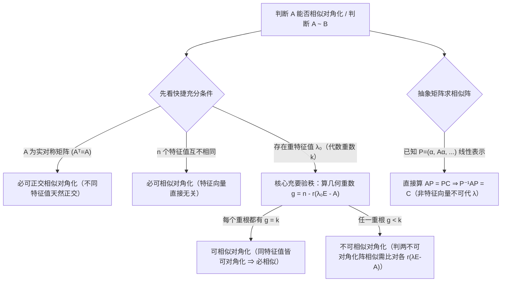

# 第7—8讲 特征值与相似理论｜二轮强化复盘合集

> [!abstract] 资料与范围
> 强化讲义：[[第7讲_特征值与特征向量.pdf]]、[[第8讲_相似理论.pdf]]（印刷第 72—92 页）；一轮笔记：[[考研数学/线性代数/知识点与考点整理/第5讲 特征值与特征向量|第5讲 特征值与特征向量]]、[[第五讲典题整理]]。
> 题源：例题编号对应强化讲义；1000B：[[考研数学/强化/试题册_强化篇与综合篇/22_强化篇_线代_第7章_特征值与特征向量.pdf|第7章试题]]、[[考研数学/强化/解析册_强化篇与综合篇/22_强化篇_线代_第7章_特征值与特征向量.pdf|第7章解析]]、[[考研数学/强化/试题册_强化篇与综合篇/23_强化篇_线代_第8章_相似理论.pdf|第8章试题]]、[[考研数学/强化/解析册_强化篇与综合篇/23_强化篇_线代_第8章_相似理论.pdf|第8章解析]]。
> 数二范围：保留具体矩阵相似计算；若尔当标准形的一般理论不展开。

> [!important] 近 17 年数二线代真题雷达（2010—2026｜S+ 级最高考频模块）
> - **考频画像**：主考 **24 题**（含 9 道解答 `10-T23`、`11-T23`、`14-T23`、`15-T23`、`16-T23`、`19-T23`、`20-T23`、`21-T22`、`23-T22`；近 6 年新大纲 **6 题，2021—2026 每年稳占 1 题**），跨讲渗透 **10 次**。
> - **真题落点**：
>   - *2021—2026 新大纲*：`21-T22(解)`、`22-T8(选)`、`23-T22(解)`、`24-T10(选)`、`25-T8(选)`、`26-T10(选)`
>   - *2015—2020 经典*：`15-T14(填)`、`15-T23(解)`、`16-T7(选)`、`16-T23(解)`、`17-T7(选)`、`17-T8(选)`、`17-T14(填)`、`18-T7(选)`、`18-T14(填)`、`19-T23(解)`、`20-T8(选)`、`20-T23(解)`
>   - *2010—2014 早期补齐*：`10-T8(选)`、`10-T23(解)`、`11-T23(解)`、`12-T8(选)`、`13-T8(选)`、`14-T23(解)`
> - **跨大纲高频反套路与破题核心**：
>   1. **重特征值可对角化与不可对角化比对**：`21-T22`（仅两个不同特征值须分 $b=1$ 与 $b=3$ 两支，分别令 $r(\lambda_0 E-A)=1$）；`17-T8` & `18-T7`（同特征值未必相似，可对角化验 $g_i=k_i$，两不可对角化阵须比对 $r(\lambda_0 E-A)$）。
>   2. **抽象交换矩阵与幂零矩阵几何重数（2024—2026 连续反套路）**：
>      - **`24-T10`**：$AB=BA$ 且 $A$ 有 2 个不同特征值 $\Rightarrow B$ 可相似对角化（充分不必要，反例 $A=B=E$；注意 $B\xi=0$ 仍说明 $\xi$ 是特征值 $0$ 的特征向量）；
>      - **`26-T10`**：$AB+BA=A^2+B^2 \iff (A-B)^2=O$，3 阶非零幂零阵有 $r(A-B)=1$，从而特征值 $0$ 有 **$3-1=2$ 个**线性无关特征向量。
>   3. **四大矩阵关系对比 & 实对称正交反求与过渡矩阵**：`22-T8`（等价/相似/正交相似/合同辨析）；`16-T7`（$A+A^T$ 与 $B+B^T$ 变换阵不同不相似）；`10-T23` & `11-T23`（正交性补全未知特征向量反求实对称阵）；`20-T23`（$P=(\alpha,A\alpha)$ 先算 $AP=PC$）；`23-T22`（由线性变换提矩阵 $A$ 并对齐 $P,\Lambda$）；`25-T8`（分块对称阵特征值符号直接配方判别）。
> - **每日复习聚焦**：第 8 讲第二部分开头的 Mermaid 决策树 + 重根必验 $n-r(\lambda E-A)$ + 不可逆/秩 1/幂零阵特征值结构 + 交换阵与指定基 $AP=PC$。

---

# 第7讲 特征值与特征向量｜二轮强化复盘

---

## 第一部分｜知识点与核心结论

### 1. 特征值、特征向量的严格定义与本质认知【🔥 必背｜停下来默背 1 遍】
- **[代数定义与方程映射]**：设 $A$ 为 $n$ 阶方阵。若存在**非零**列向量 $\xi$ 及数 $\lambda$，使得
  $$A\xi = \lambda\xi \iff (\lambda E - A)\xi = 0$$
  则称 $\lambda$ 为 $A$ 的特征值，$\xi$ 为 $A$ 对应于特征值 $\lambda$ 的特征向量（给出具体方程 <mark>已知特征向量代回方程即可定参数</mark> `[真题·2017-T14]`）。
  - **齐次方程非零解等价性**：$\lambda$ 是 $A$ 的特征值 $\iff$ 齐次线性方程组 $(\lambda E - A)x = 0$ 存在非零解 $\iff$ 特征多项式 $|\lambda E - A| = 0$ $\iff r(\lambda E - A) < n$；且在实矩阵中遇 <mark>无实根二次因子须读出共轭虚特征值</mark>（如 $\lambda^2+1=0 \implies \pm\mathrm{i}$，切忌误判为实数 $0$ `[真题易错·2022-T16]`）。
  - **三条基础翻译链**：
    1. $|A| = 0 \iff Ax = 0$ 有非零解 $\iff \lambda = 0$ 是 $A$ 的特征值；同时<mark>三条互异特征值对应特征向量列无关</mark>并可与已知列关系联立定矩阵秩 `[真题·2017-T22]`。
    2. $|A + kE| = 0 \iff -k$ 是 $A$ 的特征值；$|aA + bE| = 0$（$a \ne 0$）$\iff -\frac{b}{a}$ 是 $A$ 的特征值。
    3. $r(A) < n \iff 0$ 是特征值，且属于特征值 0 的特征子空间维数为 $n - r(A)$。
- **[特征向量的非零约束]**：
  - **非零前提**：$A\mathbf0=\lambda\mathbf0$ 对任意 $\lambda$ 成立，但零向量不是特征向量。
  - **零特征值合法**：特征值可取 0，其对应特征向量须为非零向量（即 $Ax=0$ 的非零解）。
- **[非方阵的处理机制]**：特征值与特征向量严格针对方阵定义。对于 $m \times n$ 长方矩阵 $A$，不能直接定义特征值，但考研中常转而考查其实对称半正定方阵 $A^T A$（$n$ 阶）或 $A A^T$（$m$ 阶）：
  - $A^T A$ 与 $A A^T$ 具有完全相同的非零特征值；
  - 实数域迹恒等式：$\operatorname{tr}(A^T A) = \operatorname{tr}(A A^T) = \sum_{i=1}^m \sum_{j=1}^n a_{ij}^2$（全元素平方和）。
- **[特征值求解标准四步法]**：
  1. 计算特征多项式 $p(\lambda) = |\lambda E - A|$，优先使用行列式行（列）相加提公因式、行阶梯消元或分块拉普拉斯展开，避免盲目按逆序数展开；
  2. 解特征方程 $|\lambda E - A| = 0$，按重数记录全部根；
  3. 对每个互异根 $\lambda_i$，解齐次方程 $(\lambda_i E - A)x = 0$，先由系数矩阵的秩计算自由未知量个数 $n - r(\lambda_i E - A)$，再求出基础解系；
  4. 属于 $\lambda_i$ 的全部特征向量即为基础解系的非零线性组合：$k_1 \xi_1 + \dots + k_s \xi_s$（$k_1, \dots, k_s$ 不全为 0）。
- **[三次特征多项式试根技巧（基础30讲考点）]**：
  1. **提公因式优先**：若每行（列）之和相等（均为 $S$），则将各行（列）加到第一行（列），必可提出公因子 $(\lambda - S)$；
  2. **常数项判根**：特征方程常数项为 $(-1)^n |A|$。若常数项为 0，则 $\lambda = 0$ 必为根；
  3. **有理根定理**：整系数多项式 $\lambda^3 + c_2 \lambda^2 + c_1 \lambda + c_0 = 0$ 的有理根必为常数项 $c_0$ 的正负因子（$\pm 1, \pm 2, \dots$）；试出一个根 $\lambda_1$ 后，通过多项式除法直接因式分解为二次方程降阶求解。

### 2. 迹、行列式、伴随矩阵、逆矩阵与转置的映射关系【🔥 必背｜停下来默背 1 遍】
- **[迹与行列式性质（韦达定理高阶版）]**：
  设 $n$ 阶方阵 $A$ 的全部特征值（按代数重数计）为 $\lambda_1, \lambda_2, \dots, \lambda_n$，则：
  $$\operatorname{tr}(A) = \sum_{i=1}^n a_{ii} = \sum_{i=1}^n \lambda_i, \qquad |A| = \prod_{i=1}^n \lambda_i$$
  - **应用场景**：三阶矩阵若已知两个特征值 $\lambda_1, \lambda_2$，无需展开多项式，直接由 $\lambda_3 = \operatorname{tr}(A) - \lambda_1 - \lambda_2$ 或 $\lambda_3 = \frac{|A|}{\lambda_1 \lambda_2}$ 快速补齐，还可借助<mark>行列式零点提因式定出特征值</mark> `[真题·2018-T14]`。
- **[主对角元代数余子式之和与二阶主子式（基础30讲考点）]**：
  对任意 3 阶方阵 $A$（无论 $A$ 是否可逆、能否对角化），<mark>主对角代数余子式之和等于交叉积和</mark> `[真题·2015-T14]` `[真题易错·2022-T16]`：
  $$A_{11} + A_{22} + A_{33} = \operatorname{tr}(A^*) = \lambda_1\lambda_2 + \lambda_1\lambda_3 + \lambda_2\lambda_3$$
  **推导逻辑**：在特征多项式 $|\lambda E - A| = \lambda^3 - \operatorname{tr}(A)\lambda^2 + \operatorname{tr}(A^*)\lambda - |A|$ 中，$\lambda$ 的一次项系数即为 $\operatorname{tr}(A^*)$。
- **[伴随矩阵特征值的分段讨论（高频易错）]**：
  设 $A$ 的特征值为 $\lambda_1, \lambda_2, \dots, \lambda_n$，伴随矩阵 $A^*$ 的特征值 $\mu_i$ 须按矩阵的秩分三段讨论：
  1. **若 $r(A) = n$（即 $|A| \ne 0$，满秩可逆）**：
     由 $A^* = |A| A^{-1}$，特征向量不变，伴随矩阵的特征值为
     $$\mu_i = \frac{|A|}{\lambda_i} = \prod_{j \ne i} \lambda_j \quad (i = 1, 2, \dots, n)$$
     此时 $|A^*| = |A|^{n-1} \ne 0$。
  2. **若 $r(A) = n - 1$**：
     此时 $|A|=0$，且 $0$ 的**几何重数**为 $n-r(A)=1$；其代数重数不一定是 $1$。由伴随矩阵秩的性质，$r(A^*)=1$。秩 1 矩阵的特征值为
     $$\mu_1=\operatorname{tr}(A^*)=\sum_{i=1}^n A_{ii},\qquad \mu_2=\cdots=\mu_n=0.$$
     这里 $\operatorname{tr}(A^*)$ **可能为 0**，故 $A^*$ 未必有非零特征值。若记 $A$ 的一个零特征值为 $\lambda_1=0$，则 $\operatorname{tr}(A^*)=\prod_{j=2}^n\lambda_j$，其非零当且仅当 $0$ 是 $A$ 的单重特征值。
     例如 $A=\begin{bmatrix}0&1\\0&0\end{bmatrix}$ 有 $r(A)=1$，但两个特征值均为 0；$A^*=\begin{bmatrix}0&-1\\0&0\end{bmatrix}$ 的秩为 1，特征值也全为 0。
  3. **若 $r(A) \le n - 2$（降秩 2 阶及以上）**：
     此时 $A^* = O$，故 $A^*$ 的全部特征值全为 0：
     $$\mu_1 = \mu_2 = \dots = \mu_n = 0$$
  - **边界提示**：公式 $\mu_i = \frac{|A|}{\lambda_i}$ 仅在 $|A| \ne 0$ 时成立；$A$ 不可逆或 $\lambda = 0$ 时不适用。
- **[逆矩阵与转置矩阵特征值]**：
  - **逆矩阵**：若 $A$ 可逆且 $A\xi = \lambda\xi$（$\lambda \ne 0$），则 $A^{-1}\xi = \frac{1}{\lambda}\xi$。逆矩阵与原矩阵共享相同的特征向量。
  - **转置矩阵**：$| \lambda E - A^T | = | (\lambda E - A)^T | = | \lambda E - A |$。$A$ 与 $A^T$ 的特征多项式与特征值完全相同；但其特征向量一般不同。
- **[双正交性质（强化教材第 73 页蓝框定理）]**：
  设 $A$ 为实方阵，$\alpha$ 是 $A$ 属于 $\lambda_1$ 的特征向量，$\beta$ 是 $A^T$ 属于 $\lambda_2$ 的特征向量。若 $\lambda_1 \ne \lambda_2$，则 $\alpha$ 与 $\beta$ 必正交：
  $$\lambda_1 \alpha^T \beta = (A\alpha)^T \beta = \alpha^T (A^T \beta) = \lambda_2 \alpha^T \beta \implies (\lambda_1 - \lambda_2)\alpha^T\beta = 0 \implies \alpha^T\beta = 0$$

### 3. 矩阵多项式、抽象矩阵与秩 1 矩阵特征值提取法【🔥⚡ 必背+避坑｜停下来默背 1 遍 + 精读 1 分钟】
- **[矩阵多项式映射定理]**：
  若 $A\xi = \lambda\xi$（$\xi \ne 0$），则对任意多项式 $f(x) = \sum_{k=0}^m a_k x^k$，有
  $$f(A)\xi = f(\lambda)\xi$$
  若 $A$ 可逆，公式可拓展至含逆矩阵与伴随矩阵的组合：
  $$\left[ a f(A) + b A^{-1} + c A^* \right]\xi = \left[ a f(\lambda) + \frac{b}{\lambda} + c \frac{|A|}{\lambda} \right]\xi$$
- **[多项式归零准则与因式分解法]**：
  - **核心准则**：若矩阵多项式满足 $f(A) = O$，则<mark>零化多项式制约特征值可选根集合</mark>（如 $A^2+A=O \implies \lambda\in\{0,-1\}$，不能取 $+1$，再凭 $A$ 实对称定重数 `[真题·2010-T08 / 2019-T08]`）。
  - **单向性防坑**：$f(A) = O \implies f(\lambda) = 0$ 成立，反之不成立；方程 $f(x) = 0$ 的根未必全在 $A$ 的特征值中出现。
  - **三大经典特例**：
    1. **幂等矩阵**：$A^2 = A \iff A(A-E) = O \implies \lambda \in \{0, 1\}$；
    2. **对合矩阵**：$A^2 = E \iff (A-E)(A+E) = O \implies \lambda \in \{-1, 1\}$；
    3. **幂零矩阵**：$A^k = O$（$k \ge 1$）$\implies \lambda = 0$（全部特征值为 0），且满足<mark>同为对角阵平方为零必为零阵</mark>与低阶不等式定特征向量数 `[真题易错·2026-T10]`。
    - `【⚡ 真题补丁｜2026-T10】` 3阶阵 $AB+BA=A^2+B^2$ 且 $A\ne B \iff (A-B)^2=O$（故 $(A-B)^3=O$、只有零特征值且非同为对角阵），由 $2r(A-B)\le 3$ 得 $r=1$，零特征向量有 $3-1=2$ 个。
- **[秩 1 矩阵特征值核心定理（基础30讲考点）]**：
  设 $A$ 为 $n$ 阶非零矩阵且 $r(A) = 1$，则 $A$ 可表示为外积 $A = \alpha \beta^T$（$\alpha, \beta \ne 0$）。
  - **高次幂与迹**：$A^2 = (\alpha \beta^T)(\alpha \beta^T) = \alpha (\beta^T \alpha) \beta^T = (\operatorname{tr}(A)) A$；
  - **特征值分布**：$A$ 有 $n-1$ 个零特征值，非零特征值至多 1 个（<mark>同阶秩一偏置阵同迹且皆可对角化</mark>即可直证相似 `[真题·2014-T23]`，且对称阵可用此式速定高次幂与标准形 `[真题·2013-T23]`）：
    $$\lambda_1 = \operatorname{tr}(A) = \alpha^T \beta = \sum_{i=1}^n a_{ii}, \qquad \lambda_2 = \lambda_3 = \dots = \lambda_n = 0$$
  - **对角化充要条件**：$r(A)=1$ 矩阵可相似对角化 $\iff \operatorname{tr}(A) \ne 0$。若 $\operatorname{tr}(A) = 0$ 且 $A \ne O$，则 $A$ 不可对角化。
- **[凯莱—哈密顿定理（Cayley-Hamilton）]**：
  设 $p(\lambda) = |\lambda E - A|$ 为 $A$ 的特征多项式，则方阵 $A$ 满足自身的特征方程：$p(A) = O$。常用于将高次多项式利用带余除法化简为低于 $n$ 次的矩阵多项式。

### 4. 代数重数与几何重数的内涵、不等式界限与反例【🔥 必背｜停下来默背 1 遍】
- **[代数重数（Algebraic Multiplicity, $k_i$）]**：
  特征值 $\lambda_i$ 作为特征方程 $|\lambda E - A| = 0$ 的根的重数。在特征多项式完全分解的数域（如 $\mathbb C$）内，所有不同特征值的代数重数之和为矩阵阶数：$\sum_{i=1}^s k_i = n$。
- **[几何重数（Geometric Multiplicity, $g_i$）]**：
  对应于特征值 $\lambda_i$ 的特征子空间 $V_{\lambda_i} = \ker(\lambda_i E - A)$ 的维数，即线性无关特征向量的极大个数：
  $$g_i = \dim\ker(\lambda_i E - A) = n - r(\lambda_i E - A)$$
- **[几何重数与代数重数的基本不等式]**：
  对矩阵 $A$ 的任一特征值 $\lambda_i$，恒有严格夹逼不等式：
  $$1 \le g_i = n - r(\lambda_i E - A) \le k_i$$
  - **单重根性质**：若 $\lambda_i$ 为单重特征值（$k_i = 1$），则其几何重数必为 $1$（$g_i = 1$），即单重根必恰好贡献 1 个线性无关特征向量。
  - **重根亏损与不可对角化**：若存在重特征值满足 $g_i < k_i$（几何重数小于代数重数），则矩阵缺失特征向量，**不可相似对角化**。
- **[经典辨析反例]**：
  若尔当块 $J = \begin{bmatrix} 0 & 1 \\ 0 & 0 \end{bmatrix}$，特征方程为 $\lambda^2 = 0$，特征值 0 的代数重数 $k_0 = 2$。但 $r(0E - J) = r(J) = 1$，故几何重数 $g_0 = 2 - 1 = 1 < 2$。“仅有一个线性无关特征向量”表示几何重数为 1，不代表该特征值是单根。

### 5. 特征向量的线性相关性、组合法则与空间直和【📌 扫一眼｜确认“我还会”就过】
- **[互异特征值特征向量无关定理]**：
  设 $\lambda_1, \lambda_2, \dots, \lambda_m$ 是矩阵 $A$ 的互异特征值，对应特征向量为 $\xi_1, \xi_2, \dots, \xi_m$，则 $\xi_1, \xi_2, \dots, \xi_m$ 线性无关。
  - **延伸结论**：各互异特征值对应的线性无关特征向量组合并后仍线性无关。
- **[同特征值 vs 异特征值的线性组合法则]**：
  - **同特征值闭合性**：若 $A\xi_1 = \lambda_0 \xi_1, A\xi_2 = \lambda_0 \xi_2$，则<mark>同一特征子空间线性组合仍为特征向量</mark> `[真题·2012-T08]` `[真题·2020-T08]`（反之如 $\alpha_1+\alpha_3$ 混加不同特征值特征向量则不再是特征向量 `[真题·2020-T08]`）。
  - **异特征值非闭合性**：若 $\lambda_1 \ne \lambda_2$，$\xi_1, \xi_2$ 分别属于 $\lambda_1, \lambda_2$，且 $k_1 \ne 0, k_2 \ne 0$，则 $k_1\xi_1 + k_2\xi_2$ **不是** $A$ 的特征向量。
- **[和差构造触发信号]**：
  若题干给出交错作用 $A\alpha = \beta, A\beta = \alpha$（$\alpha, \beta$ 线性无关），作和差即得：
  $$A(\alpha + \beta) = \alpha + \beta = 1 \cdot (\alpha + \beta), \qquad A(\alpha - \beta) = -(\alpha - \beta) = -1 \cdot (\alpha - \beta)$$
  直接提取特征值 $1, -1$ 及其特征向量 $\alpha + \beta, \alpha - \beta$。

### 6. 线性无关特征向量总数与强极值结论【💤 可跳过｜冲刺期直接跳过不看】
- **[全空间特征向量总数上界]**：
  $n$ 阶矩阵 $A$ 在复数域内线性无关特征向量的总数至多为 $n$；当且仅当总数达到 $n$ 时，矩阵可相似对角化。
- **[强极值结论（强化讲义第 75 页⑦，第 8 讲例 8.10 理论依据）]**：
  若在复数域 $\mathbb{C}$ 内统计全部特征向量（或已知特征多项式在该数域完全分解），$n$ 阶矩阵 $A$ **仅有 1 个线性无关的特征向量**（几何重数之和为 1），则 $A$ **有且仅有唯一一个 $n$ 重特征值 $\lambda_0$**。
  - **证明逻辑**：互异特征值至少各贡献 1 个线性无关特征向量，若有两个及以上互异特征值，则总数至少为 2，矛盾。故特征多项式必为 $(\lambda - \lambda_0)^n$，结合 $\operatorname{tr}(A) = n \lambda_0$ 直接解得 $\lambda_0 = \frac{\operatorname{tr}(A)}{n}$。

### 7. 可交换矩阵的特征向量与公共特征子空间【📌⚡ 扫一眼+避坑｜最值钱，必须精读 1 分钟】
- **[可交换性保持特征子空间]**：
  设 $A, B$ 同阶且满足 $AB = BA$。若 $Ax = \lambda x$，则
  $$A(Bx) = B(Ax) = \lambda (Bx)$$
  表明向量 $Bx$ 仍属于 $A$ 对应于 $\lambda$ 的特征子空间 $V_\lambda$。
- **[单重特征值诱导公共特征向量]**：
  若特征值 $\lambda$ 的特征子空间为 1 维（单重根或几何重数为 1），则其内任一向量均与 $x$ 共线，故存在常数 $\mu$ 使 $Bx = \mu x$，即 $x$ 亦为 $B$ 的特征向量。
- **[全部特征值互异特例（强化讲义第 75 页⑧）]**：
  若 $AB = BA$ 且 $A$ 有 $n$ 个互异特征值，则 $A$ 的任一特征向量均为 $B$ 的特征向量。
  - **零特征值情形**：若 $Bx = 0$，因 $x \ne 0$，写成 $Bx = 0 \cdot x$ 可知 <mark>零乘积结果向量仍属零特征向量</mark> `[真题易错·2024-T10]`。
  - `【⚡ 真题补丁｜2024-T10】` 2阶阵 $AB=BA$，“$A$ 有2个互异特征值”是“$B$ 可相似对角化”的充分不必要条件；$A$ 的2个无关特征向量同属 $B$（含 $B\xi=0=0\cdot\xi$），反例取 $A=B=E$。
- **[乘积 $AB$ 与 $BA$ 的特征向量]**：
  若 $ABx=\lambda x$ 且 $x\ne0$，则 $BA(Bx)=\lambda(Bx)$；只有 $Bx\ne0$ 时才能说 $Bx$ 是 $BA$ 的特征向量。若 $\lambda\ne0$，则 $Bx\ne0$ 自动成立；若 $B$ 可逆，则该传递可逆。

### 8. 矩阵方程命题：列分块展开与矩阵递推【📌 扫一眼｜确认“我还会”就过】
- **[齐次矩阵方程列分解定理]**：
  设 $B = [\beta_1, \beta_2, \dots, \beta_m]$。若 $(A - \lambda E)B = O$，则
  $$(A - \lambda E)\beta_j = 0 \quad (j = 1, 2, \dots, m)$$
  $B$ 的每一个非零列向量都是 $A$ 属于特征值 $\lambda$ 的特征向量。
  - **维数下界不等式**：$\dim\ker(A - \lambda E) \ge r(B)$。即矩阵 $B$ 至少为特征值 $\lambda$ 贡献 $r(B)$ 个线性无关特征向量。
- **[转置矩阵方程转化法]**：
  $$B(A^T-\lambda E)=O\iff(A-\lambda E)B^T=O;\qquad CA=\lambda C\iff A^TC^T=\lambda C^T.$$
  前者中 $B^T$ 的非零列向量是 $A$ 属于 $\lambda$ 的特征向量；后者中 $C^T$ 的非零列向量属于 $A^T$，不能把 $A^T$ 直接写成 $A$。
- **[公共非零解判定（强化讲义第 76 页⑨）]**：
  若同列数方阵 $A_{n\times n}, B_{n\times n}$ 满足 $r(A) + r(B) < n$，则方程组 $Ax = 0$ 与 $Bx = 0$ 必有公共非零解（即 $r\begin{bmatrix} A \\ B \end{bmatrix} \le r(A) + r(B) < n$）。
- **[全体非零向量均为解（强化讲义第 77 页）]**：
  若任意 $n$ 维非零向量均为 $(\lambda E-A)x=0$ 的解，则特别地各标准单位向量均为解，故 $\lambda E-A=O$，即 $A=\lambda E$。
- **[全 1 向量与行和常数定理（强化讲义第 77 页）]**：
  记全 1 列向量 $\mathbf{1} = [1, 1, \dots, 1]^T$。若 <mark>每行元素之和均为同一常数</mark> $k$，则 $k$ 必为 $A$ 的特征值且 $\mathbf{1}$ 为对应特征向量 `[真题·2016-T08]`：
  $$A \mathbf{1} = k \mathbf{1}$$
  - 逆矩阵传递：若 $A$ 可逆，必有 $k \ne 0$，且 $A^{-1}\mathbf{1} = \frac{1}{k}\mathbf{1}$（$A^{-1}$ 每行元素之和为 $\frac{1}{k}$）；
  - 矩阵幂传递：$A^n\mathbf{1} = k^n\mathbf{1}$（$A^n$ 每行元素之和为 $k^n$）。
- **[矩阵递推与初值特征向量分解]**：
  若向量序列满足递推 $u_n = A u_{n-1}$，则通项为 $u_n = A^n u_0$。
  - 若 $u_0$ 为特征向量（$A u_0 = \lambda u_0$），则 $u_n = \lambda^n u_0$；
  - 若 $u_0$ 不是特征向量，但在特征基下可分解为 $u_0 = \sum_{i=1}^n c_i \xi_i$（$A\xi_i = \lambda_i \xi_i$），则直接得出
    $$u_n = A^n u_0 = \sum_{i=1}^n c_i \lambda_i^n \xi_i$$
    无需显式求出逆矩阵 $P^{-1}$ 和矩阵高次幂 $A^n$。

## 第二部分｜题型体系与典型例题

### 一、特征值、特征多项式与矩阵函数

| 题干特征 | 优先方法 | 真题印证与避坑 |
|---|---|---|
| 给出多个多项式行列式等于 0（如 $\lvert A^2+2A \rvert = 0$） | 提取因式 $\lvert A \rvert \lvert A+2E \rvert = 0$，由 $\lvert A \rvert \ne 0$ 排除 0，读出特征值 | 提取 $\lvert A\rvert$ 消去前须先验 $\lvert A\rvert\ne 0$ `[真题·2017-T14 / 2018-T14]` |
| 需求解主对角代数余子式之和 $\sum A_{ii}$ | 转化为伴随矩阵的迹 $\operatorname{tr}(A^*)$，用 $\sum_{i<j}\lambda_i\lambda_j$ 计算 | 对不可逆阵同样成立，勿套用 $\lvert A\rvert/\lambda$ 致除零 `[真题·2015-T14]` `[真题易错·2022-T16]` |
| 相似矩阵复合矩阵幂 $B = P^{-1}A^{100}P$ 求特征向量 | $A$ 的特征向量也是其幂的特征向量；再左乘 $P^{-1}$ | 变换阵 $B=P^{-1}AP$ 的特征向量为 $P^{-1}\xi$，勿误写为 $P\xi$ |

> [!example]- 例 7.1｜行列式为零提取特征值与伴随矩阵求迹（强化例 7.1）
> - **【题目】**（讲义印刷第 74 页）：设 $A$ 为 3 阶矩阵，$\lvert A \rvert = 3$，且 $\lvert A^2+2A \rvert = 0$、$\lvert 2A^2+A \rvert = 0$。求 $A_{11}+A_{22}+A_{33}$，其中 $A_{ij}$ 为元素 $a_{ij}$ 的代数余子式。
> - **【完整解答】**：
>   1. 由行列式乘法公式与已知条件 $\lvert A \rvert = 3$：
>      $$\lvert A^2+2A \rvert = \lvert A(A+2E) \rvert = \lvert A \rvert \cdot \lvert A+2E \rvert = 0 \implies \lvert A+2E \rvert = 0$$
>      故 $\lambda_1 = -2$ 是 $A$ 的一个特征值。
>   2. 同理分析第二个行列式：
>      $$\lvert 2A^2+A \rvert = \lvert A(2A+E) \rvert = \lvert A \rvert \cdot \lvert 2A+E \rvert = 0 \implies \lvert 2A+E \rvert = 0$$
>      即 $\lvert A - (-\frac{1}{2})E \rvert = 0$，故 $\lambda_2 = -\frac{1}{2}$ 是 $A$ 的第二个特征值。
>   3. 补齐第三个特征值：
>      设 $A$ 的三个特征值为 $\lambda_1, \lambda_2, \lambda_3$。由行列式性质：
>      $$\lvert A \rvert = \lambda_1 \lambda_2 \lambda_3 = (-2) \times \left(-\frac{1}{2}\right) \times \lambda_3 = 3 \implies \lambda_3 = 3$$
>   4. 计算伴随矩阵的迹：
>      因 $A$ 可逆，$A^*$ 的特征值为 $\mu_i = \frac{\lvert A \rvert}{\lambda_i}$：
>      $$\mu_1 = \frac{3}{-2} = -\frac{3}{2}, \qquad \mu_2 = \frac{3}{-1/2} = -6, \qquad \mu_3 = \frac{3}{3} = 1$$
>      因此代数余子式之和为：
>      $$A_{11}+A_{22}+A_{33} = \operatorname{tr}(A^*) = \mu_1+\mu_2+\mu_3 = -\frac{3}{2} - 6 + 1 = -\frac{13}{2}$$
>      （亦可直接利用二阶主子式公式：$\operatorname{tr}(A^*) = \lambda_1\lambda_2 + \lambda_1\lambda_3 + \lambda_2\lambda_3 = 1 - 6 - \frac{3}{2} = -\frac{13}{2}$）。
> - **【复盘提醒】**：必须严格确认 $\lvert A \rvert \ne 0$ 方能从 $\lvert A(A+2E) \rvert = 0$ 推出 $\lvert A+2E \rvert = 0$。公式 $A_{11}+A_{22}+A_{33} = \operatorname{tr}(A^*) = \sum_{i<j}\lambda_i\lambda_j$ 对任意 3 阶矩阵恒成立，无需矩阵可逆或可对角化。

> [!example]- 例 7.2｜相似变换与矩阵幂的特征向量传递（强化例 7.2）
> - **【题目】**（讲义印刷第 74 页）：设
>   $$A=\begin{bmatrix}1&2\\5&4\end{bmatrix},\quad P=\begin{bmatrix}1&1\\0&1\end{bmatrix},\quad B=P^{-1}A^{100}P.$$
>   则 $B+E$ 的一组线性无关特征向量可以是（$\quad$）：
>   - A：$(0,1)^T,(7,5)^T$；
>   - B：$(-2,1)^T,(-3,5)^T$；
>   - C：$(1,-1)^T,(2,5)^T$；
>   - D：$(0,1)^T,(3,2)^T$。
> - **【完整解答】**：
>   1. 计算矩阵 $A$ 的特征值与特征向量：
>      $$\lvert \lambda E - A \rvert = \begin{vmatrix} \lambda - 1 & -2 \\ -5 & \lambda - 4 \end{vmatrix} = (\lambda - 1)(\lambda - 4) - 10 = \lambda^2 - 5\lambda - 6 = (\lambda + 1)(\lambda - 6) = 0$$
>      得特征值 $\lambda_1 = -1, \lambda_2 = 6$。
>   2. 求解特征向量：
>      - 对 $\lambda_1 = -1$：$(-E - A)x = 0 \iff \begin{bmatrix} -2 & -2 \\ -5 & -5 \end{bmatrix}x = 0 \iff x_1 + x_2 = 0$，取 $\xi_1 = \begin{bmatrix} -1 \\ 1 \end{bmatrix}$；
>      - 对 $\lambda_2 = 6$：$(6E - A)x = 0 \iff \begin{bmatrix} 5 & -2 \\ -5 & 2 \end{bmatrix}x = 0 \iff 5x_1 - 2x_2 = 0$，取 $\xi_2 = \begin{bmatrix} 2 \\ 5 \end{bmatrix}$。
>   3. 矩阵求逆与特征向量变换：
>      由 $P = \begin{bmatrix} 1 & 1 \\ 0 & 1 \end{bmatrix}$，得 $P^{-1} = \begin{bmatrix} 1 & -1 \\ 0 & 1 \end{bmatrix}$。
>      因 $A^{100}\xi_i = \lambda_i^{100}\xi_i$，两端左乘 $P^{-1}$ 并插入 $P P^{-1}$：
>      $$(P^{-1}A^{100}P)(P^{-1}\xi_i) = \lambda_i^{100}(P^{-1}\xi_i) \implies B(P^{-1}\xi_i) = \lambda_i^{100}(P^{-1}\xi_i)$$
>      因此 $B+E$ 的特征向量即为 $P^{-1}\xi_1$ 与 $P^{-1}\xi_2$：
>      $$\eta_1 = P^{-1}\xi_1 = \begin{bmatrix} 1 & -1 \\ 0 & 1 \end{bmatrix}\begin{bmatrix} -1 \\ 1 \end{bmatrix} = \begin{bmatrix} -2 \\ 1 \end{bmatrix}$$
>      $$\eta_2 = P^{-1}\xi_2 = \begin{bmatrix} 1 & -1 \\ 0 & 1 \end{bmatrix}\begin{bmatrix} 2 \\ 5 \end{bmatrix} = \begin{bmatrix} -3 \\ 5 \end{bmatrix}$$
>   4. 线性无关性检验：
>      $\begin{vmatrix} -2 & -3 \\ 1 & 5 \end{vmatrix} = -10 - (-3) = -7 \ne 0$，两向量线性无关。对照选项，选 **B**。
> - **【复盘提醒】**：相似变换 $B = P^{-1}AP$ 改变特征向量的表示基，特征向量由 $\xi$ 变为 $P^{-1}\xi$，勿误写为 $P\xi$。

---

### 二、特征向量、特征子空间与矩阵方程

| 题干特征 | 优先方法 | 真题印证与避坑 |
|---|---|---|
| 对角化变换 $P^{-1}AP = \Lambda$，考查 $P$ 的列向量替换 | 同一特征值的列可作可逆线性组合；不同特征值的列不可混加 | 更换基向量须限于同一特征子空间内，列序对齐 $\Lambda$ `[真题·2012-T08 / 2020-T08]` `[真题易错·2021-T22 / 2025-T22]` |
| 矩阵方程 $(A - \lambda E)B = O$ | 按列展开，非零列为特征向量；利用列秩确定几何重数下界 | 写全部特征向量须注明组合系数不全为零，漏写扣分 `[真题易错·2016-T23]` `[真题·2017-T22]` |
| 转置矩阵方程 $C A^T = \lambda C$ | 两端取转置化为 $A C^T = \lambda C^T$，提取 $A$ 的特征向量 | 若是 $CA=\lambda C$，转置后得 $A^TC^T=\lambda C^T$，属于 $A^T$ 而非 $A$ |

> [!example]- 例 7.3｜同一特征子空间内更换特征向量的合法性判断（强化例 7.3）
> - **【题目】**（讲义印刷第 76 页）：已知 $P^{-1}AP=\operatorname{diag}(1,3,3)$；$\alpha_1$ 是 $A$ 属于特征值 $1$ 的特征向量，$\alpha_2,\alpha_3$ 是属于特征值 $3$ 的线性无关特征向量。下列哪个矩阵**不能**作为变换矩阵 $P$？
>   - A：$[\alpha_1,-2\alpha_2,\alpha_3]$；
>   - B：$[\alpha_1,\alpha_2+\alpha_3,\alpha_2-2\alpha_3]$；
>   - C：$[\alpha_1,\alpha_3,\alpha_2]$；
>   - D：$[\alpha_1+\alpha_2,\alpha_1-\alpha_2,\alpha_3]$。
> - **【完整解答】**：
>   1. **对角关系分解**：设变换矩阵为 $Q = [q_1, q_2, q_3]$，若满足 $Q^{-1}AQ = \operatorname{diag}(1,3,3)$，等价于 $AQ = Q\operatorname{diag}(1,3,3)$，按列展开即：
>      $$A q_1 = 1 \cdot q_1, \qquad A q_2 = 3 \cdot q_2, \qquad A q_3 = 3 \cdot q_3$$
>      且 $q_1, q_2, q_3$ 必须线性无关（$|Q| \ne 0$）。
>   2. **逐项核验**：
>      - 对 A：第 1 列为 $\alpha_1$（属于 1）；第 2、3 列为 $-2\alpha_2, \alpha_3$（属于 3），两列显然无关且与 $\alpha_1$ 无关，可作为 $P$；
>      - 对 B：第 1 列为 $\alpha_1$；第 2、3 列为 $\alpha_2+\alpha_3$ 与 $\alpha_2-2\alpha_3$。因其系数行列式 $\begin{vmatrix} 1 & 1 \\ 1 & -2 \end{vmatrix} = -3 \ne 0$，后两列是 $\alpha_2, \alpha_3$ 的可逆线性组合，仍属于特征值 3 且线性无关，可作为 $P$；
>      - 对 C：第 2、3 列交换位置，但因对应对角元均为 3，交换后依然满足 $Aq_2 = 3q_2, Aq_3 = 3q_3$，可作为 $P$；
>      - 对 D：第 1 列为 $\alpha_1+\alpha_2$，第 2 列为 $\alpha_1-\alpha_2$。由于 $\alpha_1$ 属于特征值 1，$\alpha_2$ 属于特征值 3，由异特征值线性组合定理，$\alpha_1+\alpha_2$ 和 $\alpha_1-\alpha_2$ 均不再是 $A$ 的特征向量，无法满足特征方程。故 **D 不能作为 $P$**。
> - **【复盘提醒】**：矩阵 $P$ 不唯一，但更换基向量须限于**同一特征子空间内部**的可逆线性组合；不同特征值的特征向量不能跨空间相加。

> [!example]- 例 7.4｜从两个矩阵方程提取完整特征子空间（强化例 7.4）
> - **【题目】**（讲义印刷第 77—78 页）：设 $A,B,C$ 均为 3 阶矩阵，满足 $(A+2E)B=O$ 与 $CA^T=2C$，其中
>   $$B=\begin{bmatrix}1&2&3\\-1&1&0\\2&-1&1\end{bmatrix},\qquad C=\begin{bmatrix}1&-2&1\\-2&4&-2\\-1&2&-1\end{bmatrix}.$$
>   求 $A$ 的全部特征值及全部特征向量。
> - **【完整解答】**：
>   1. **分析矩阵方程 $(A+2E)B = O$**：
>      将 $B$ 按列记为 $[\beta_1, \beta_2, \beta_3]$，则 $(A+2E)\beta_j = 0 \iff A\beta_j = -2\beta_j$（$j=1,2,3$）。
>      对 $B$ 进行列观察：$\beta_1 = \begin{bmatrix} 1 \\ -1 \\ 2 \end{bmatrix}, \beta_2 = \begin{bmatrix} 2 \\ 1 \\ -1 \end{bmatrix}, \beta_3 = \begin{bmatrix} 3 \\ 0 \\ 1 \end{bmatrix}$。显然 $\beta_3 = \beta_1 + \beta_2$。
>      且 $\beta_1, \beta_2$ 不成比例，线性无关，故 $r(B) = 2$。
>      因此 $\lambda_1 = -2$ 至少是 $A$ 的二重特征值，属于 $-2$ 的特征子空间维数 $\ge 2$。
>   2. **分析矩阵方程 $CA^T = 2C$**：
>      两端取转置得 $(CA^T)^T = (2C)^T \iff A C^T = 2 C^T$。
>      计算 $C^T = \begin{bmatrix} 1 & -2 & -1 \\ -2 & 4 & 2 \\ 1 & -2 & -1 \end{bmatrix}$。
>      显然 $C^T$ 的第 2 列为第 1 列的 $-2$ 倍，第 3 列为第 1 列的 $-1$ 倍，故 $r(C^T) = 1$。
>      取其非零列向量 $\eta = \begin{bmatrix} 1 \\ -2 \\ -1 \end{bmatrix}$（或任意与其成比例的非零列），满足 $A\eta = 2\eta$。
>      因此 $\lambda_2 = 2$ 是 $A$ 的特征值，$\eta$ 为其特征向量。
>   3. **综合确定特征值与特征向量**：
>      因为属于不同特征值 $-2$ 与 $2$ 的特征向量线性无关，向量组 $\beta_1, \beta_2, \eta$ 线性无关，张满 3 维空间 $\mathbb{R}^3$。
>      因此 $A$ 的全部特征值为 $\lambda_1 = \lambda_2 = -2$（二重），$\lambda_3 = 2$（单重）。
>   4. **结论规范书写**：
>      - 属于特征值 $-2$ 的全部特征向量为：$k_1 \begin{bmatrix} 1 \\ -1 \\ 2 \end{bmatrix} + k_2 \begin{bmatrix} 2 \\ 1 \\ -1 \end{bmatrix}$，其中 $k_1, k_2$ 为不全为 0 的任意常数；
>      - 属于特征值 $2$ 的全部特征向量为：$k_3 \begin{bmatrix} 1 \\ -2 \\ -1 \end{bmatrix}$，其中 $k_3$ 为任意非零常数。
> - **【复盘提醒】**：行作用方程须先转置为标准列乘积；写“全部特征向量”时，须注明“任意常数不全为零”或“非零任意常数”，漏写会未排除零向量而扣分。

---

### 三、特征值综合与 1000B 强化题型

| 题干特征 | 优先方法 | 真题印证与避坑 |
|---|---|---|
| 参数矩阵满足行列式为 0，已知重特征值求重数 | 先求秩确定几何重数；再展开特征多项式因式分解求代数重数 | **`26-T10(选)`**：3 阶非零幂零阵 $(A-B)^2=O \Rightarrow r(A-B)=1 \Rightarrow g_0=3-1=2$ 个无关特征向量 |
| 给出可对角化充分条件，反求参数 | 充要条件：每个重根处均有 $r(\lambda_i E - A) = n - k_i$ | `21-T22(解)`、`17-T8(选)`、`18-T7(选)`：特征值相同不推相似，重根必验 $r(\lambda_i E-A)$ |
| 矩阵乘积特征向量互推（$AB$ 与 $BA$） | 左乘变换矩阵，核验可逆前提以确保变换向量非零 | 可逆前提：无 $\lvert B\rvert\ne 0$ 时若 $B\alpha=0$ 则不能作 $BA$ 的特征向量 |
| 状态转移递推，初值非特征向量 | 在特征基下做坐标分解 $u_0 = \sum c_i \xi_i$，直接写出 $u_n$ | 注意核对初值下标 $u_0$ 与 $u_1$；单凭一条等比和式无法分离两分量 |

> [!example]- 1000B 第 7 章第 1 题｜伴随矩阵非零特征值与代数重数、几何重数辨析
> - **【题目】**：设 3 阶矩阵 $A = \begin{bmatrix} 1 & 0 & a \\ b & 2 & 0 \\ 0 & c & 3 \end{bmatrix}$，其中 $abc = -6$，则 $A$ 的伴随矩阵 $A^*$ 有非零特征值（　）
>   **(A) $-8$　　(B) $8$　　(C) $-11$　　(D) $11$**
> - **【思路】**：先由 $|A|=0$ 和非零二阶子式确定 $r(A)=2$，进而 $r(A^*)=1$。秩 1 矩阵至多有一个非零特征值；计算 $\operatorname{tr}(A^*)$ 后再判断它是否非零。秩只能直接给出 $0$ 的几何重数。
> - **【完整解答】**：
>   1. **确定 $r(A)$ 与 $r(A^*)$**：
>      计算行列式：$\lvert A \rvert = 1 \cdot (6 - 0) + a \cdot (bc - 0) = 6 + abc = 0$，故 $r(A) < 3$。
>      又代数余子式 $A_{11} = \begin{vmatrix} 2 & 0 \\ c & 3 \end{vmatrix} = 6 \ne 0$，故 $r(A) = 2 = n - 1$，从而 $r(A^*) = 1$。
>   2. **求 $A^*$ 的非零特征值（选 D）**：
>      因 $r(A^*)=1$，$A^*$ 至少有两个零特征值；另一个特征值等于其迹：
>      $$\lambda_3 = \operatorname{tr}(A^*) = A_{11} + A_{22} + A_{33} = \begin{vmatrix} 2 & 0 \\ c & 3 \end{vmatrix} + \begin{vmatrix} 1 & a \\ 0 & 3 \end{vmatrix} + \begin{vmatrix} 1 & 0 \\ b & 2 \end{vmatrix} = 6 + 3 + 2 = 11$$
>      该特征值为 $11\ne0$，故 **应选 (D)**。
>   3. **（延伸核验：$\lambda = 0$ 的几何重数 $g_0$ 与代数重数 $k_0$ 区分）**：
>      由 $r(A)=2$ 仅直接得到 $A$ 的特征值 0 的几何重数 $g_0 = 3 - r(A) = 1$；要判别代数重数 $k_0$ 必须展开 $A$ 的特征多项式：
>      $$\begin{aligned} p_A(\lambda) &= \lvert \lambda E - A \rvert = \begin{vmatrix} \lambda - 1 & 0 & -a \\ -b & \lambda - 2 & 0 \\ 0 & -c & \lambda - 3 \end{vmatrix} \\ &= (\lambda - 1)(\lambda - 2)(\lambda - 3) - abc = (\lambda^3 - 6\lambda^2 + 11\lambda - 6) + 6 = \lambda(\lambda^2 - 6\lambda + 11) \end{aligned}$$
>      其中 $\lambda^2 - 6\lambda + 11 = 0$ 无零根（$\Delta = -8 < 0$，共轭复根 $3 \pm \sqrt{2}\mathrm{i}$），故 $k_0 = 1$。
> - **【复盘提醒（含个人疑问澄清）】**：本题核心结论是秩 1 矩阵的唯一非零特征值等于迹（$\operatorname{tr}(A^*) = 11$）；同时需严格区分“由 $r(A)=2$ 得到的是 $g_0 = 1$”，而代数重数 $k_0 \ge g_0$ 必须通过特征多项式因式分解确认，不能由 $g_0=1$ 直接倒推 $k_0=1$。

> [!example]- 1000B 第 7 章第 2 题｜由可对角化条件逆推重特征值的矩阵秩
> - **【题目】**：设矩阵 $A=\begin{bmatrix}1&-2&2\\a&4&b\\-3&-6&8\end{bmatrix}$ 有 3 个线性无关的特征向量，$\lambda=2$ 是 $A$ 的二重特征值，则（　）。
>   **(A)** $a=1,b=-2$　 **(B)** $a=-1,b=2$　 **(C)** $a=2,b=-1$　 **(D)** $a=-2,b=1$
> - **【解】**：由题设 $A$ 可对角化，二重特征值 $2$ 的几何重数为 $2$，故 $r(2E-A)=1$。又
>   $$2E-A=\begin{bmatrix}1&2&-2\\-a&-2&-b\\3&6&-6\end{bmatrix}.$$
>   第 3 行是第 1 行的 3 倍；要使秩为 1，第 2 行必须是第 1 行的 $-1$ 倍，故 $a=1,b=-2$，选 **(A)**。
> - **【提醒】**：已知 $\lambda_0$ 的确切代数重数为 $k$ 时，由 $g\le k$ 已有 $r(\lambda_0E-A)\ge n-k$；此时令全部 $n-k+1$ 阶子式为零即可得到所需的秩等式。

> [!example]- 1000B 第 7 章第 8 题｜矩阵乘积 $AB$ 与 $BA$ 特征向量的充要条件与可逆前提
> - **【题目】**：设 $A, B$ 为 $n$ 阶矩阵，$|B| \ne 0$，则“$\alpha$ 是 $AB$ 的属于特征值 $\lambda$ 的特征向量”是“$B\alpha$ 是 $BA$ 的属于特征值 $\lambda$ 的特征向量”的（　）
>   **(A) 充分必要条件　　(B) 充分非必要条件　　(C) 必要非充分条件　　(D) 既非充分又非必要条件**
> - **【完整解答】**：
>   1. **充分性**：若 $\alpha$ 是 $AB$ 属于 $\lambda$ 的特征向量，则 $\alpha \ne 0$ 且 $AB\alpha = \lambda\alpha$。两端左乘 $B$ 得 $(BA)(B\alpha) = \lambda(B\alpha)$。因 $|B| \ne 0$ 且 $\alpha \ne 0$，必有 $B\alpha \ne 0$，故 $B\alpha$ 是 $BA$ 属于特征值 $\lambda$ 的特征向量。
>   2. **必要性**：若 $B\alpha$ 是 $BA$ 属于 $\lambda$ 的特征向量，则 $B\alpha \ne 0$（从而 $\alpha \ne 0$）且 $BAB\alpha = \lambda B\alpha = B\lambda\alpha$。由 $B$ 可逆两端左乘 $B^{-1}$ 得 $AB\alpha = \lambda\alpha$，故 $\alpha$ 是 $AB$ 属于特征值 $\lambda$ 的特征向量。
>   综上，**应选 (A)**。
> - **【复盘提醒】**：可逆前提 $|B| \ne 0$ 保证了方程消元与非零性传递，直接由结合律即可双向证明（无需再多余展开 $r(AB)=r(BA)$ 等无关性质）。若 $B$ 不可逆，当 $\alpha \in \ker(B)$ 时会因 $B\alpha = 0$ 导致充分性失效。

> [!example]- 1000B 第 7 章第 9 题｜特征向量坐标分解法求解状态转移递推
> - **【题目】**：设矩阵 $A = \begin{bmatrix} 1 & 2 \\ 4 & 3 \end{bmatrix}$，序列 $\begin{bmatrix} x_n \\ y_n \end{bmatrix} = A \begin{bmatrix} x_{n-1} \\ y_{n-1} \end{bmatrix}$（$n = 1, 2, \dots$）。
>   1. 当 $x_0 = 1, y_0 = 2$ 时，求 $x_{100}, y_{100}$；
>   2. 当 $x_0 = 1, y_0 = 1$ 时，求 $x_{100}$。
> - **【完整解答】**：
>   1. **求解矩阵 $A$ 的特征值与特征向量**：
>      $$\lvert \lambda E - A \rvert = \begin{vmatrix} \lambda - 1 & -2 \\ -4 & \lambda - 3 \end{vmatrix} = \lambda^2 - 4\lambda - 5 = (\lambda - 5)(\lambda + 1) = 0$$
>      得互异特征值 $\lambda_1 = 5, \lambda_2 = -1$。
>      - 对 $\lambda_1 = 5$：$(5E - A)x = 0 \implies \xi_1 = \begin{bmatrix} 1 \\ 2 \end{bmatrix}$；
>      - 对 $\lambda_2 = -1$：$(-E - A)x = 0 \implies \xi_2 = \begin{bmatrix} 1 \\ -1 \end{bmatrix}$。
>   2. **求解第 (1) 问**：
>      当 $u_0 = \begin{bmatrix} 1 \\ 2 \end{bmatrix}$ 时，恰有 $u_0 = \xi_1$，故
>      $$\begin{bmatrix} x_{100} \\ y_{100} \end{bmatrix} = A^{100}\xi_1 = 5^{100}\begin{bmatrix} 1 \\ 2 \end{bmatrix} \implies x_{100} = 5^{100},\quad y_{100} = 2 \cdot 5^{100}$$
>   3. **求解第 (2) 问**：
>      当 $u_0 = \begin{bmatrix} 1 \\ 1 \end{bmatrix}$ 时，设 $u_0 = c_1 \xi_1 + c_2 \xi_2 = c_1 \begin{bmatrix} 1 \\ 2 \end{bmatrix} + c_2 \begin{bmatrix} 1 \\ -1 \end{bmatrix}$，解得 $c_1 = \frac{2}{3},\; c_2 = \frac{1}{3}$。从而
>      $$\begin{bmatrix} x_{100} \\ y_{100} \end{bmatrix} = A^{100} u_0 = \frac{2}{3} \cdot 5^{100} \begin{bmatrix} 1 \\ 2 \end{bmatrix} + \frac{1}{3} \cdot (-1)^{100} \begin{bmatrix} 1 \\ -1 \end{bmatrix} = \begin{bmatrix} \frac{2 \cdot 5^{100} + 1}{3} \\ \frac{4 \cdot 5^{100} - 1}{3} \end{bmatrix}$$
>      故 $x_{100} = \frac{2 \cdot 5^{100} + 1}{3}$。
> - **【复盘提醒（含个人卡点）】**：做第 (2) 问时若只发现 $x_n + y_n = 5(x_{n-1} + y_{n-1}) = 5^n(x_0+y_0)$ 这一条等比关系，**单凭一个和式无法把 $x_{100}$ 与 $y_{100}$ 分离开来**——必须另找第二条独立线性组合（如 $2x_n - y_n = -(2x_{n-1}-y_{n-1})$）联立消元，或者更通法地采用**特征向量分解 $u_0 = c_1\xi_1 + c_2\xi_2$** 一步写出两个分量。同时注意核对初值下标是 $u_0$ 还是 $u_1$。

> [!example]- ⚡ 真题母题 2026-T10｜$(A-B)^2=O$ 与 3 阶非零幂零阵的 2 个无关特征向量
> - **【真题原题】**（2026 数二第 10 题·选择 5 分）：设 3 阶矩阵 $A, B$ 满足 $AB + BA = A^2 + B^2$，且 $A \ne B$。下列结论**错误**的是（ ）
>   (A) $(A - B)^3 = O$；
>   (B) $A - B$ 只有零特征值；
>   (C) $A, B$ 不能都是对角矩阵；
>   (D) $A - B$ 只有一个线性无关的特征向量。
> - **【破题直觉】**：
>   - 移项配平方即得 $M = A - B \ne O$ 且 $M^2 = O$；
>   - **核心辨析在 (D)**：见“幂零不可对角化”易误以为“仅有一个线性无关特征向量”；实则 3 阶非零阵满足 $M^2=O$ 时，其秩只能为 1，线性无关特征向量个数为 $3-1=2$。
> - **【完整解答】**：
>   1. **恒等变形化幂零**：
>      由 $A^2 - AB - BA + B^2 = O \iff A(A-B) - B(A-B) = O \iff (A-B)^2 = O$。记 $M = A - B$，由 $A \ne B$ 知 $M \ne O$ 且 $M^2 = O$。
>   2. **逐项验证**：
>      - **(A) 正确**：$M^3 = M^2 \cdot M = O \cdot M = O$；
>      - **(B) 正确**：若 $M\xi = \lambda\xi$（$\xi \ne 0$），则 $O = M^2\xi = \lambda^2\xi \implies \lambda = 0$，故 $M$ 只有零特征值；
>      - **(C) 正确**：若 $A, B$ 均为对角矩阵，则 $M = A - B$ 也是对角矩阵；对角阵满足 $M^2 = O \implies$ 对角元平方全为 0 $\implies M = O \implies A = B$，与题设矛盾；
>      - **(D) 错误**：由零乘积秩不等式 $r(M) + r(M) - 3 \le r(M^2) = 0 \implies 2r(M) \le 3 \implies r(M) \le 1$；又 $M \ne O \implies r(M) \ge 1$，故 **$r(M) = 1$**。
>        从而特征值 $\lambda = 0$ 的几何重数为：
>        $$g_0 = 3 - r(0E - M) = 3 - r(M) = 3 - 1 = 2 \ne 1.$$
>        故 $A - B$ 恰有 **2 个**线性无关的特征向量，(D) 错误，选 **（D）**。
> - **【真题避坑复盘】**：
>   1. $n$ 阶非零幂零阵 $M^2 = O$ 的秩满足 $1 \le r(M) \le \lfloor n/2 \rfloor$：$n=3$ 时 $r(M)$ 只能为 1，故 $g_0 = 3 - 1 = 2$（若尔当形为 $J_2(0) \oplus J_1(0)$，不存在 $J_3(0)$，因 $J_3(0)^2 \ne O$）；
>   2. 本题与 `24-T9`（4 阶 $A^2=O \implies r(A)\le 2$）同源，均考幂零阵秩上界 $r(M) \le n/2$。

---

# 第8讲 相似理论与实对称矩阵｜二轮强化复盘

---

## 第一部分｜知识点与核心结论

### 1. 矩阵相似的严格定义、几何本质与六大必要条件【🔥⚡ 必背+避坑｜停下来默背 1 遍 + 精读 1 分钟】
- **[代数定义与几何本质]**：
  设 $A, B$ 均为数域 $\mathbb{F}$ 上的 $n$ 阶方阵。若存在同阶可逆矩阵 $P$，使得
  $$P^{-1}AP = B \iff AP = PB$$
  则称矩阵 $A$ 相似于矩阵 $B$，记作 $A \sim B$。
  - **几何本质**：相似矩阵是**同一个线性变换在不同基下的矩阵表示**。其中可逆矩阵 $P$ 为两组基之间的过渡矩阵。
  - **特征向量的基变换定理**：若 $Ax = \lambda x$（$x \ne 0$），则
    $$B(P^{-1}x) = (P^{-1}AP)(P^{-1}x) = P^{-1}Ax = \lambda (P^{-1}x)$$
    即相似变换下，特征值 $\lambda$ 保持不变，对应特征向量由 $x$ 变为 $P^{-1}x$。
- **[矩阵相似的六大必要条件（不变量体系）]**：
  若 $A \sim B$，则两矩阵必然共享以下 6 个核心代数不变量（必要条件）：
  1. **同秩**：$r(A) = r(B)$；
  2. **同行列式**：$\lvert A \rvert = \lvert B \rvert$；
  3. **同迹**：$\operatorname{tr}(A) = \operatorname{tr}(B)$；
  4. **同特征多项式与同特征值**：$\lvert \lambda E - A \rvert = \lvert \lambda E - B \rvert$，从而特征值及其代数重数完全相同；
  5. **同几何重数**：对任意数 $\lambda$，矩阵 $\lambda E - A$ 与 $\lambda E - B$ 必定相似，故有相同零度与相同的秩（特别是两不可对角化阵判相似须 <mark>逐一比对重根处特征矩阵的秩</mark> `[真题易错·2018-T07]`）：
     $$r(\lambda E - A) = r(\lambda E - B) \iff \dim\ker(\lambda E - A) = \dim\ker(\lambda E - B)$$
  6. **同各阶主子式之和**：$A$ 与 $B$ 的所有 $k$ 阶主子式之和对应相等（例如 3 阶方阵的二阶主子式之和 $A_{11}+A_{22}+A_{33} = B_{11}+B_{22}+B_{33}$）。
- **[必要条件反之不成立的辨析]**：
  “特征值相同、迹相同、行列式相同、秩相同”**不能保证两矩阵相似**（即使均为上三角且主对角元同，仍须 <mark>核验重特征值处的几何重数是否亏损</mark>；若等价仅保秩、合同不保特征值、正交相似则以实对称阵为前提 `[真题易错·2017-T08 / 2022-T08]`）。
  - **经典反例**：$A = \begin{bmatrix} 1 & 0 \\ 0 & 1 \end{bmatrix}$ 与 $B = \begin{bmatrix} 1 & 1 \\ 0 & 1 \end{bmatrix}$。二者特征值均为二重根 1，迹为 2，行列式为 1，秩为 2；但 $r(E - A) = 0$（几何重数 2），$r(E - B) = 1$（几何重数 1），故 $A \not\sim B$。
  - `【⚡ 真题补丁｜2022-T08】` 四大关系辨析：等价看秩、合同看惯性指数、相似需特征值同且几何重数一致（特征值互异时相似等价于特征值同）、正交相似须实对称。
- **[相似运算的“三同一不同”法则（强化教材第 86 页）]**：
  若已知 $P^{-1}AP = B$，则利用**同一个可逆矩阵 $P$** 可以同步完成以下三类运算：
  1. **矩阵多项式同步**：$P^{-1}f(A)P = f(B)$；
  2. **伴随矩阵同步（无需 $A$ 可逆）**：$P^{-1}A^*P = B^*$。由伴随矩阵乘积公式 $(XY)^*=Y^*X^*$ 及 $P$ 可逆，
     $$(P^{-1}AP)^*=P^*A^*(P^{-1})^*=(|P|P^{-1})A^*(|P|^{-1}P)=P^{-1}A^*P.$$
     这里仅用 $P^{-1}$，$A$ 为奇异矩阵时仍成立；
  3. **逆矩阵同步（若可逆）**：$P^{-1}A^{-1}P = B^{-1}$，进一步有 $P^{-1}A^*P = \lvert A \rvert B^{-1}$；
  4. **“一不同”转置变换**：对两端取转置得 $P^T A^T (P^{-1})^T = B^T \iff ((P^{-1})^T)^{-1} A^T (P^{-1})^T = B^T$。即 <mark>转置相似所用过渡阵改为逆转置</mark> `[真题易错·2016-T07]`。
- **[为什么 $A+A^T$ 不一定与 $B+B^T$ 相似（强化例 8.7 核心反思）]**：
  虽然 $A \sim B$ 且 $A^T \sim B^T$，但联系 $A$ 与 $B$ 的相似矩阵是 $P$，联系 $A^T$ 与 $B^T$ 的相似矩阵是 $(P^{-1})^T$。一般情形下 $P \ne (P^{-1})^T$（除非 $P$ 为正交矩阵），无法左提 $P^{-1}$、右提 $P$ 统一合并。
  - **同一变换矩阵**：<mark>相似加法传递须共享同一过渡矩阵</mark>（故 $A^{-1}\sim B^{-1}$ 与 $A+A^{-1}\sim B+B^{-1}$ 恒成立，而 $A+A^T\not\sim B+B^T$ `[真题易错·2016-T07]`）。
  - `【⚡ 真题补丁｜2016-T07】` $A^{-1},f(A)$ 与 $A$ 共用同一相似阵 $P$，故 $A+A^{-1}\sim B+B^{-1}$；而 $A^T\sim B^T$ 换用 $(P^{-1})^T$，致对称和不相似。

### 2. 矩阵相似对角化的充要条件与充分条件【🔥 必背｜停下来默背 1 遍】
- **[相似对角化的基本局面与列向量本质]**：
  若 $n$ 阶方阵 $A$ 拥有 $n$ 个线性无关的特征向量 $\xi_1, \xi_2, \dots, \xi_n$，对应特征值依次为 $\lambda_1, \lambda_2, \dots, \lambda_n$。构造矩阵 $P = [\xi_1, \xi_2, \dots, \xi_n]$ 与对角阵 $\Lambda = \operatorname{diag}(\lambda_1, \lambda_2, \dots, \lambda_n)$，则由乘法列分块：
  $$AP = A[\xi_1, \dots, \xi_n] = [A\xi_1, \dots, A\xi_n] = [\lambda_1\xi_1, \dots, \lambda_n\xi_n] = [\xi_1, \dots, \xi_n] \Lambda = P\Lambda$$
  因 $\xi_1, \dots, \xi_n$ 线性无关，故 $P$ 可逆，从而
  $$\boxed{P^{-1}AP = \Lambda}$$
  - **顺序对应**：<mark>过渡矩阵列序须与对角元严格对齐</mark>（由 $P^{-1}AP=\Lambda$ 直接按列读出 $A\alpha_j=\lambda_j\alpha_j$ 并作列加减 `[真题·2017-T07 / 2020-T08 / 2023-T22]`）。
  - **$P$ 的非唯一性**：特征向量乘非零常数、或同一重特征子空间内更换基向量，均可形成不同的合法可逆矩阵 $P$。
- **[相似对角化充要条件]**：
  $n$ 阶矩阵 $A$ 在数域 $\mathbb{F}$ 上可相似对角化 $\iff A$ 拥有 $n$ 个属于 $\mathbb{F}$ 且线性无关的特征向量 $\iff$ 特征多项式在 $\mathbb{F}$ 上完全分解，且每个代数重数为 $k_i$ 的互异特征值 $\lambda_i$ 的几何重数等于代数重数（<mark>重特征值须分支令几何重数等于代数重数</mark> `[真题·2015-T23]` `[真题易错·2021-T22]`）：
  $$\boxed{g_i = n - r(\lambda_i E - A) = k_i \iff r(\lambda_i E - A) = n - k_i}$$
  - **对角化必要条件（强化教材第 80 页）**：若 $A \sim \Lambda$，则 $r(A) = r(\Lambda) =$ 非零特征值的个数（重根按重数计 `[真题·2010-T08]`）。
- **[快速充分条件]**：
  1. **互异特征值充分条件**：若 $n$ 阶矩阵 $A$ 在所讨论数域内拥有 $n$ 个**互不相同**的特征值，则 $A$ 必可相似对角化；
  2. **实对称矩阵充分条件**：<mark>同阶实对称阵相似充要为特征值全同</mark>（勿对不影响特征值的自由参数多加限制 `[真题·2013-T08]`）。实对称矩阵必可正交相似对角化；
  3. **有限阶周期矩阵条件（教材第 80 页原条及数域修正）**：教材列出“若 $A^k = E$（$k$ 为正整数），则 $A \sim \Lambda$”。在复数域上，对任意正整数 $k$ 都成立；在实数域上，$k\le2$ 或已知特征值全为实数时成立。$k\ge3$ 时一般不能保证在实数域对角化：例如 $A=\begin{bmatrix}0&-1\\1&0\end{bmatrix}$ 满足 $A^4=E$，但特征值为 $\pm\mathrm i$。
  4. **无重根实多项式零点条件**：若 $A^2 = E$ 或 $(A-aE)(A-bE) = O$（$a \ne b$ 为实数），其零化多项式无重根且根全为实数，故 $A$ 在实数域上必可相似对角化；
  5. **秩 1 非零迹矩阵（教材第 80 页原条）**：若 $r(A) = 1$ 且 $\operatorname{tr}(A) \ne 0$，则 $A$ 特征值为 $\operatorname{tr}(A)$（1 重）与 $0$（$n-1$ 重），且 $r(0E - A) = 1 = n - (n-1)$，故 $A$ 必可相似对角化。
- **[快速否定条件]**：
  1. 全部特征值全为 $\lambda_0$，但 $A \ne \lambda_0 E$（若能对角化，则必相似于 $\lambda_0 E$，而 $P^{-1}(\lambda_0 E)P = \lambda_0 E \implies A = \lambda_0 E$，矛盾）；
  2. 存在某 $k$ 重特征值满足 $r(\lambda_0 E - A) > n - k$（几何重数亏损）；
  3. 非零幂零矩阵 $A^k = O$（$A \ne O$）不可对角化（特征值全为 0，若可对角化则 $A \sim O \implies A = O$，矛盾）。
- **[分块对角矩阵保相似考点（基础30讲考点）]**：
  设 $A = \begin{bmatrix} A_1 & O \\ O & A_2 \end{bmatrix}$ 与 $B = \begin{bmatrix} B_1 & O \\ O & B_2 \end{bmatrix}$。若 $A_1 \sim B_1$ 且 $A_2 \sim B_2$，则 $A \sim B$。
  - **对角化判定**：分块对角矩阵 $A$ 可相似对角化 $\iff$ 每一个对角子块 $A_i$ 均可相似对角化；
  - **特征值性质**：分块对角矩阵的特征值集合为各对角子块特征值集合的并集。

### 3. 实对称矩阵的正交相似对角化与谱分解【🔥 必背｜停下来默背 1 遍】
- **[实对称矩阵的三大优良定理]**：
  设 $A$ 为实对称矩阵（即 $A^T = A \in \mathbb{R}^{n\times n}$）：
  1. **实特征值定理**：实对称矩阵的特征值全为实数，无虚根；
  2. **异根正交定理**：属于不同特征值的特征向量**天然正交**（无需施密特正交化）：
     $$\lambda_1 \ne \lambda_2, \ A\xi_1 = \lambda_1\xi_1, \ A\xi_2 = \lambda_2\xi_2 \implies \xi_1^T \xi_2 = 0$$
  3. **正交对角化定理**：存在**实正交矩阵 $Q$**（$Q^T = Q^{-1}$），使得
     $$\boxed{Q^T A Q = Q^{-1} A Q = \Lambda = \operatorname{diag}(\lambda_1, \dots, \lambda_n)}$$
     即实对称矩阵在各重特征值处均有 $g_i = k_i$，不存在特征向量亏损。
- **[实对称矩阵正交相似对角化的标准四步法]**：
  1. 解特征方程 $|\lambda E - A| = 0$ 求出全部实特征值（含按条件 <mark>由已有正交列向量反求实对称参数</mark> 或按二次型符号配方定参 `[真题·2010-T23 / 2011-T23 / 2025-T08]`）；
  2. 对每个特征值 $\lambda_i$，解齐次方程 $(\lambda_i E - A)x = 0$ 求基础解系；
  3. **正交化与单位化**：
     - 若特征值为单重根，仅需**单位化**；
     - 若特征值为 $k$ 重根，求出的 $k$ 个基础解系向量虽然线性无关但未必正交，<mark>重特征值基础解系须经施密特正交化</mark>后再行单位化 `[真题·2012-T23 / 2024-T22]`；
  4. 将所得 $n$ 个两两正交的单位特征向量<mark>按目标对角元列序拼入正交矩阵</mark> $Q = [q_1, q_2, \dots, q_n]$，写出 $Q^T A Q = \Lambda$（重排置换列序同步改变标准形位置，而列向量取负号不变平方项系数 `[真题·2015-T08]` `[真题易错·2025-T22]`）；反求矩阵则用 $A = Q \Lambda Q^T$。
- **[施密特正交化标准步骤]**：
  设 $\alpha_1, \alpha_2, \alpha_3$ 线性无关：
  $$\beta_1 = \alpha_1$$
  $$\beta_2 = \alpha_2 - \frac{(\alpha_2, \beta_1)}{(\beta_1, \beta_1)} \beta_1$$
  $$\beta_3 = \alpha_3 - \frac{(\alpha_3, \beta_1)}{(\beta_1, \beta_1)} \beta_1 - \frac{(\alpha_3, \beta_2)}{(\beta_2, \beta_2)} \beta_2$$
  单位化：$q_i = \frac{\beta_i}{\|\beta_i\|}$（$i=1,2,3$）。
- **[谱分解定理与秩 1 投影叠加公式（强化讲义第 85 页）]**：
  设正交矩阵 $Q = [q_1, q_2, \dots, q_n]$ 满足 $Q^T A Q = \Lambda$，其中 $q_i$ 为两两正交的单位列向量，则：
  $$\boxed{A = Q \Lambda Q^T = \sum_{i=1}^n \lambda_i q_i q_i^T, \qquad f(A) = \sum_{i=1}^n f(\lambda_i) q_i q_i^T}$$
  - **重根投影合并**：若 $A$ 的特征值为单重根 $\lambda$（单位特征向量为 $\eta$）与 $n-1$ 重根 $\mu$，利用 $\sum q_i q_i^T = E$，可直接写出高次幂：
    $$f(A) = f(\mu) E + [f(\lambda) - f(\mu)] \eta \eta^T$$
  - **秩 1 扰动（1000B 第 15 题）**：若 $A$ 为实对称阵，$\alpha_1$ 为对应 $\lambda_1$ 的单位特征向量，可将它补成 $A$ 的一组单位正交特征向量 $\alpha_1,\ldots,\alpha_n$。这组向量仍是 $A+t\alpha_1\alpha_1^T$ 的特征向量，对应特征值依次为 $\lambda_1+t,\lambda_2,\ldots,\lambda_n$。重根分裂或合并时，两矩阵的**全部特征向量集合**不一定相同。

### 4. 正交矩阵、正交变换与保度量性质【📌 扫一眼｜确认“我还会”就过】
- **[严格定义与等价刻画]**：
  实方阵 $Q$ 称为正交矩阵，若满足
  $$Q^T Q = Q Q^T = E \iff Q^{-1} = Q^T$$
  - **列向量等价性**：$Q$ 的列向量组构成 $\mathbb{R}^n$ 的标准正交基（长度为 1，两两正交）；
  - **行向量等价性**：$Q$ 的行向量组同样构成 $\mathbb{R}^n$ 的标准正交基（每行模长为 1，两两正交）。
- **[正交变换的保度量本质]**：
  线性变换 $y = Q x$ 称为正交变换，几何上为**刚体旋转与反射**，保持欧氏空间的度量：
  - **保内积**：$(Qx, Qy) = (Qx)^T(Qy) = x^T Q^T Q y = x^T E y = (x, y)$；
  - **保长度（保范数）**：$\|Qx\| = \sqrt{x^T Q^T Q x} = \|x\|$；
  - **保夹角与保正交性**：$x \perp y \iff Qx \perp Qy$。
- **[正交矩阵核心代数性质]**：
  1. 行列式：$\lvert Q \rvert = \pm 1$；
  2. 伴随矩阵：$Q^* = \lvert Q \rvert Q^{-1} = \lvert Q \rvert Q^T$；
  3. 特征值：实正交矩阵的实特征值必为 $\lambda = \pm 1$；复特征值模长恒为 1（$\lvert \lambda \rvert = 1$）；
  4. **某元素为 1 性质（强化例 8.9 核心）**：若实正交矩阵某元素 $q_{ij} = \pm 1$，因该行与该列元素平方和均为 1，**该元素所在行与列的其余元素全为 0**。
- **[逆向判定定理与阶数边界（强化讲义第 90 页）]**：
  设 $A$ 为 $n$ 阶非零实矩阵：
  - 若对一切 $i,j$ 恒有 $a_{ij} = A_{ij}$（即 $A^T = A^*$），且 **$n \ge 3$**，则 $A$ 为正交矩阵且 $\lvert A \rvert = 1$；
  - 若对一切 $i,j$ 恒有 $a_{ij} = -A_{ij}$（即 $A^T = -A^*$），且 **$n \ge 3$**，则 $A$ 为正交矩阵且 $\lvert A \rvert = -1$；
  - **阶数边界**：要求 $n \ge 3$（$n=2$ 时因子 $1 - \lvert A \rvert^{n-2} = 0$ 恒成立，反例 $A=2E$）。

### 5. $AP = PB$ 列分块构造法与不可对角化矩阵的相似化简【📌⚡ 扫一眼+避坑｜最值钱，必须精读 1 分钟】
- **[列分块坐标本质定理]**：
  设 $P = [p_1, p_2, \dots, p_n]$ 为可逆方阵，$B = (b_{ij})_{n\times n}$。矩阵方程 $AP = PB$ 按列展开为：
  $$A p_j = \sum_{i=1}^n b_{ij} p_i \quad (j = 1, 2, \dots, n)$$
  **核心结论**：矩阵 $B$ 的第 $j$ 列为向量 $A p_j$ 在有序基 $p_1, p_2, \dots, p_n$ 下的**坐标列**（由此按基读出特征值 `[真题·2018-T14]`）。
  - **易错点**：不能将题干系数直接置于对角线；若作用关系交错（如 $Ap_1 = 3p_3$），须将坐标 $(0, 0, 3)^T$ 填入第 1 列。
  - `【⚡ 真题补丁｜2020-T23】` 给定 $P=(\alpha,A\alpha)$ 与多项式关系时，$\alpha$ 非特征向量不能直代 $\lambda$；先算 $AP=PC$ 得 $P^{-1}AP=C$ 再定特征值，勿漏写所求阵。
- **[强化教材例 8.6 构造相似矩阵方法与证明逻辑链条]**：
  若已知 $A \sim B$ 且两矩阵均可相似对角化为同一对角矩阵 $\Lambda$：
  1. 求可逆阵 $P_1$ 使 $P_1^{-1} A P_1 = \Lambda$；
  2. 求可逆阵 $P_2$ 使 $P_2^{-1} B P_2 = \Lambda$（注意 $P_1$ 与 $P_2$ 的列向量须对应**相同的特征值排列顺序**）；
  3. 由相似的传递性：
     $$P_1^{-1} A P_1 = P_2^{-1} B P_2 \implies (P_1 P_2^{-1})^{-1} A (P_1 P_2^{-1}) = B$$
  4. <mark>以公有对角阵为桥拼过渡矩阵</mark> $Q = P_1 P_2^{-1}$，即满足 $Q^{-1} A Q = B$ `[真题·2019-T23]`。
- **[不可对角化矩阵的若尔当链与广义相似求幂]**：
  当 $A$ 无法对角化时，若能找到上三角分块矩阵 $B$（如二阶若尔当块 $J_2(\lambda) = \begin{bmatrix} \lambda & 1 \\ 0 & \lambda \end{bmatrix}$）使得 $P^{-1}AP = B$，则：
  $$A^n = P B^n P^{-1}$$
  当 $B=J_2(\lambda)$、$P=[p_1,p_2]$ 时，$P$ 的列向量满足链式方程：$(A-\lambda E)p_1=0$，$(A-\lambda E)p_2=p_1$。
- **[矩阵乘积幂降阶定理]**：
  设 $B$ 是 $m \times k$ 矩阵，$C$ 是 $k \times m$ 矩阵。方阵 $A = BC$（$m$ 阶）的高次幂满足：
  $$(BC)^n = \underbrace{(BC)(BC)\cdots(BC)}_{n\text{ 个}} = B \underbrace{(CB)(CB)\cdots(CB)}_{n-1\text{ 个}} C = B (CB)^{n-1} C$$
  **降阶价值**：当中间维度 $k \ll m$ 时（如 $m=4, k=2$），<mark>借结合律将高阶方幂降为低阶方幂</mark>，不要求 $BC = CB$ `[真题·2026-T22]`。
- **[矩阵二项式展开的交换律边界]**：
  对同阶方阵 $M,N$，若 $MN=NM$，则对任意正整数 $n$，普通二项式公式 $(M+N)^n=\sum_{k=0}^n\binom{n}{k}M^{n-k}N^k$ 成立。对某个固定幂次，不交换的矩阵也可能偶然满足该式，不能反过来断言可交换。
  - **易错点**：单有 $N^2=O$ 不保证可以套用二项式公式；若 $MN\ne NM$，二次幂中的 $MN+NM$ 就不能合并成 $2MN$。
  - 单位阵的平凡交换性：$(kE + N)^n$ 能够直接展开，是因为标量矩阵 $kE$ 与任意矩阵天然可交换。

## 第二部分｜题型体系与典型例题

### 一、相似对角化的条件与实对称矩阵

| 题干特征 | 优先方法 | 真题印证与避坑 |
|---|---|---|
| 同一特征子空间内更换基向量组合，判断 $Q^{-1}AQ$ | 列向量须属于对应特征值；同空间内初等列变换不改变对角阵 | 不同特征值特征向量不能混加，列序与 $\Lambda$ 对齐 `[真题·2012-T08 / 2020-T08]` `[真题易错·2021-T22]` |
| 比较多个矩阵能否相似对角化 | 排除实对称阵与互异根矩阵；重点验重根的秩 $r(\lambda E - A)$ | 区分等价、合同与相似，重根须查几何重数 `[真题易错·2017-T08 / 2018-T07 / 2022-T08]` `[真题·2013-T08]` |
| 含有参数且只有两个互异特征值，要求可对角化 | 区分双分支重根情形，分别令 $r(\lambda_0 E - A) = n - 2$ 求解参数 | 分双支讨论重根 $g_i=k_i$，结尾写全 $P$ 与 $\Lambda$ `[真题易错·2021-T22]` `[真题·2010-T08]` |
| 可交换矩阵 $AB=BA$ 判可对角化充要性 | 单重特征值导出公共特征向量；必要性用 $A=B=E$ 举反例 | 充分不必要，$B\xi=0$ 仍表明 $\xi$ 属特征值 $0$ 勿剔除 `[真题易错·2024-T10]` |
| 实对称矩阵正交相似对角化与求高次幂 $A^n$ | 求单位正交特征向量，用谱分解 $A^n = \sum \lambda_i^n q_i q_i^T$ 免求逆求幂 | 重根须施密特正交化，单位化勿漏分母根号 `[真题·2010-T23 / 2011-T23 / 2023-T22 / 2025-T08]` |

> [!example]- 例 8.1｜同一特征子空间内更换特征向量的对角化判定（强化例 8.1）
> - **【题目】**（讲义印刷第 80 页）：设 $A$ 为 3 阶矩阵，$P=[\alpha_1,\alpha_2,\alpha_3]$ 可逆，且 $P^{-1}AP=\operatorname{diag}(1,1,2)$。令 $Q=[\alpha_1+\alpha_2,\alpha_2,\alpha_3]$，求 $Q^{-1}AQ$。原题选项依次为：
>   - A：$\operatorname{diag}(1,2,1)$；
>   - B：$\operatorname{diag}(1,1,2)$；
>   - C：$\operatorname{diag}(2,1,2)$；
>   - D：$\begin{bmatrix}2&0&0\\0&2&0\\0&1&1\end{bmatrix}$。
> - **【完整解答】**：
>   1. 由 $AP = P\operatorname{diag}(1,1,2)$ 按列展开：
>      $$A\alpha_1 = \alpha_1, \qquad A\alpha_2 = \alpha_2, \qquad A\alpha_3 = 2\alpha_3$$
>   2. 考查 $Q = [q_1, q_2, q_3] = [\alpha_1+\alpha_2, \alpha_2, \alpha_3]$：
>      - 对第 1 列：$A(\alpha_1+\alpha_2) = A\alpha_1 + A\alpha_2 = \alpha_1 + \alpha_2 = 1 \cdot (\alpha_1+\alpha_2)$；
>      - 对第 2 列：$A\alpha_2 = 1 \cdot \alpha_2$；
>      - 对第 3 列：$A\alpha_3 = 2 \cdot \alpha_3$。
>   3. 矩阵 $Q$ 可由 $P$ 作初等列变换第 2 列加到第 1 列得到：$Q = P \begin{bmatrix} 1 & 0 & 0 \\ 1 & 1 & 0 \\ 0 & 0 & 1 \end{bmatrix}$，行列式 $\lvert Q \rvert = \lvert P \rvert \ne 0$，故 $Q$ 严格可逆。
>   4. 综合可得：$AQ = Q\operatorname{diag}(1,1,2) \implies Q^{-1}AQ = \operatorname{diag}(1,1,2)$。对照选项，选 **B**。
> - **【复盘提醒】**：同一特征子空间的线性组合仍在该空间，但只有非零时才是特征向量；本题两向量线性无关，故 $\alpha_1+\alpha_2\ne0$。

> [!example]- 例 8.2｜矩阵能否相似对角化的系统排查与几何重数检验（强化例 8.2）
> - **【题目】**（讲义印刷第 81 页）：下列矩阵中**不能**相似于对角矩阵的是哪一个？
>   $$A=\begin{bmatrix}1&1&0\\0&1&0\\0&0&2\end{bmatrix},\quad B=\begin{bmatrix}1&0&0\\0&1&1\\0&0&2\end{bmatrix},\quad C=\begin{bmatrix}1&1&0\\0&2&1\\0&0&3\end{bmatrix},\quad D=\begin{bmatrix}1&0&0\\0&1&1\\0&1&2\end{bmatrix}.$$
> - **【完整解答】**：
>   1. **矩阵 $D$**：$D^T = D$，为实对称矩阵，由实对称矩阵定理必可正交对角化；
>   2. **矩阵 $C$**：为上三角矩阵，对角元即特征值，三个特征值为 $1, 2, 3$，互不相同，由互异特征值充分条件必可相似对角化；
>   3. **矩阵 $A$ 与 $B$ 的重根排查**：
>      二者均为上三角矩阵，特征值均为 $\lambda_1 = \lambda_2 = 1$（二重）与 $\lambda_3 = 2$（单重）。需检验二重根 1 的几何重数是否达到 2：
>      - 对矩阵 $A$：
>        $$E - A = \begin{bmatrix} 0 & -1 & 0 \\ 0 & 0 & 0 \\ 0 & 0 & -1 \end{bmatrix} \implies r(E - A) = 2$$
>        特征值 1 的几何重数为 $g_1 = 3 - r(E - A) = 3 - 2 = 1 < 2$（代数重数）。特征向量不足，故 $A$ **不能相似对角化**。
>      - 对矩阵 $B$：
>        $$E - B = \begin{bmatrix} 0 & 0 & 0 \\ 0 & 0 & -1 \\ 0 & 0 & -1 \end{bmatrix} \implies r(E - B) = 1$$
>        几何重数为 $g_1 = 3 - 1 = 2 = k_1$，故 $B$ 可相似对角化。
>   4. 结论：选 **A**。
> - **【复盘提醒】**：不可仅凭“都是上三角且特征值相同”臆断对角化性质；非对角线上的非零元位置决定了零空间维数，必须动手写出特征矩阵的秩。

> [!example]- 例 8.3｜双分支重特征值与可对角化充要条件求解参数（强化例 8.3）
> - **【题目】**（讲义印刷第 81—82 页）：设
>   $$A=\begin{bmatrix}2&1&0\\1&2&0\\1&a&b\end{bmatrix}$$
>   只有两个不同的特征值，且可相似对角化。求参数 $a,b$ 的值，并求一个可逆矩阵 $P$，使 $P^{-1}AP$ 为对角矩阵。
> - **【完整解答】**：
>   1. **求特征多项式与分支讨论**：
>      按第 3 列（仅含元素 $b$）展开计算行列式：
>      $$\lvert \lambda E - A \rvert = (\lambda - b) \begin{vmatrix} \lambda - 2 & -1 \\ -1 & \lambda - 2 \end{vmatrix} = (\lambda - b)[(\lambda - 2)^2 - 1] = (\lambda - b)(\lambda - 1)(\lambda - 3)$$
>      因为 $A$ 只有两个不同特征值，故 $b$ 必须与 1 或 3 重合：**分支一：$b = 1$**；**分支二：$b = 3$**。
>   2. **分支一：$b = 1$（特征值为 $\lambda_1 = \lambda_2 = 1$ 二重，$\lambda_3 = 3$ 单重）**：
>      可对角化要求几何重数 $g_1 = 3 - r(E - A) = 2 \implies r(E - A) = 1$。
>      计算 $E - A = \begin{bmatrix} -1 & -1 & 0 \\ -1 & -1 & 0 \\ -1 & -a & 0 \end{bmatrix}$。
>      要使 $r(E - A) = 1$，第 3 行必须与前两行成比例，故必有 $-a = -1 \implies a = 1$。
>      求解特征向量：
>      - 对 $\lambda = 1$：$(E - A)x = 0 \iff x_1 + x_2 = 0$，基础解系取 $\xi_1 = \begin{bmatrix} -1 \\ 1 \\ 0 \end{bmatrix}, \xi_2 = \begin{bmatrix} 0 \\ 0 \\ 1 \end{bmatrix}$；
>      - 对 $\lambda = 3$：$(3E - A)x = 0 \iff \begin{bmatrix} 1 & -1 & 0 \\ -1 & 1 & 0 \\ -1 & -1 & 2 \end{bmatrix}x = 0 \iff \begin{cases} x_1 - x_2 = 0 \\ x_1 + x_2 - 2x_3 = 0 \end{cases}$，解得 $\xi_3 = \begin{bmatrix} 1 \\ 1 \\ 1 \end{bmatrix}$。
>      取 $P_1 = \begin{bmatrix} -1 & 0 & 1 \\ 1 & 0 & 1 \\ 0 & 1 & 1 \end{bmatrix}$，有 $P_1^{-1}AP_1 = \operatorname{diag}(1,1,3)$。
>   3. **分支二：$b = 3$（特征值为 $\lambda_1 = \lambda_2 = 3$ 二重，$\lambda_3 = 1$ 单重）**：
>      可对角化要求几何重数 $g_3 = 3 - r(3E - A) = 2 \implies r(3E - A) = 1$。
>      计算 $3E - A = \begin{bmatrix} 1 & -1 & 0 \\ -1 & 1 & 0 \\ -1 & -a & 0 \end{bmatrix}$。
>      要使 $r(3E - A) = 1$，第 3 行必须与第 1 行成比例，故必有 $-a = 1 \implies a = -1$。
>      求解特征向量：
>      - 对 $\lambda = 3$：$(3E - A)x = 0 \iff x_1 - x_2 = 0$，基础解系取 $\eta_1 = \begin{bmatrix} 1 \\ 1 \\ 0 \end{bmatrix}, \eta_2 = \begin{bmatrix} 0 \\ 0 \\ 1 \end{bmatrix}$；
>      - 对 $\lambda = 1$：$(E - A)x = 0 \iff \begin{bmatrix} -1 & -1 & 0 \\ -1 & -1 & 0 \\ -1 & 1 & -2 \end{bmatrix}x = 0 \iff \begin{cases} x_1 + x_2 = 0 \\ x_1 - x_2 + 2x_3 = 0 \end{cases}$，解得 $\eta_3 = \begin{bmatrix} -1 \\ 1 \\ 1 \end{bmatrix}$。
>      取 $P_2 = \begin{bmatrix} 1 & 0 & -1 \\ 1 & 0 & 1 \\ 0 & 1 & 1 \end{bmatrix}$，有 $P_2^{-1}AP_2 = \operatorname{diag}(3,3,1)$。
> - **【复盘提醒】**：双分支参数题是高频大题考法，不可漏写任一分支；特征值顺序须与变换矩阵 $P$ 的列向量一一对应。

> [!example]- 例 8.4｜实矩阵正交相似对角化的充要条件判定（强化例 8.4）
> - **【题目】**（讲义印刷第 82—83 页）：对 3 阶实矩阵 $A$，“$A$ 是实对称矩阵”是“$A$ 有 3 个相互正交的特征向量”的（$\quad$）：
>   - A：充分非必要条件；
>   - B：必要非充分条件；
>   - C：充要条件；
>   - D：既非充分又非必要条件。
> - **【完整解答】**：
>   1. **充分性证明**：
>      若 $A$ 是实对称矩阵（$A^T = A$），由实对称矩阵定理，属于不同特征值的特征向量必定正交；对于重特征值，其几何重数必等于代数重数，在对应特征子空间内选取基础解系作施密特正交化，即可得到两两正交的特征向量。因此 $A$ 必有 3 个相互正交的特征向量。充分性成立。
>   2. **必要性证明**：
>      若 $A$ 有 3 个相互正交的特征向量 $\xi_1, \xi_2, \xi_3$。因特征向量必非零，其模长非零，将它们单位化得 $q_i = \frac{\xi_i}{\|\xi_i\|}$（$i=1,2,3$）。
>      向量组 $q_1, q_2, q_3$ 两两正交且为单位向量，故矩阵 $Q = [q_1, q_2, q_3]$ 为实正交矩阵（$Q^T = Q^{-1}$）。
>      又 $Aq_i = \lambda_i q_i$，故 $AQ = Q\Lambda$，两边左乘 $Q^T$ 得 $Q^T A Q = \Lambda \implies A = Q \Lambda Q^T$。
>      对两端取转置：
>      $$A^T = (Q \Lambda Q^T)^T = (Q^T)^T \Lambda^T Q^T = Q \Lambda Q^T = A$$
>      故 $A$ 必为实对称矩阵。必要性成立。
>   3. 结论：两命题互为**充要条件**，选 **C**。
> - **【复盘提醒】**：正交相似对角化仅对实对称矩阵成立；非对称矩阵即便可相似对角化，也不存在正交特征基。

> [!example]- 例 8.5｜行和相等实对称矩阵正交对角化与谱分解求幂（强化例 8.5）
> - **【题目】**（讲义印刷第 83—85 页）：设 $A$ 是 3 阶实对称矩阵，每行元素之和均为 $3$，且有二重特征值 $\lambda_1=\lambda_2=1$。求 $A$ 的全部特征值、全部特征向量，并求 $A^n$。
> - **【完整解答】**：
>   1. **求全部特征值与特征向量**：
>      令全 1 列向量 $u = [1, 1, 1]^T$。由每行之和为 3，有 $A u = 3 u$。
>      因 $u \ne 0$，故 $\lambda_3 = 3$ 是 $A$ 的特征值，对应的特征向量为 $c u$（$c \ne 0$）。
>      已知二重特征值为 $\lambda_1 = \lambda_2 = 1$，故 $A$ 的全部特征值为 $\lambda_1 = \lambda_2 = 1, \lambda_3 = 3$。
>      因 $A$ 是实对称矩阵，属于特征值 1 的特征向量必与属于特征值 3 的特征向量 $u$ 正交：
>      $$(x, u) = x_1 + x_2 + x_3 = 0$$
>      解此齐次方程，取基础解系 $\xi_1 = \begin{bmatrix} -1 \\ 1 \\ 0 \end{bmatrix}, \xi_2 = \begin{bmatrix} -1 \\ 0 \\ 1 \end{bmatrix}$。
>      故属于特征值 1 的全部特征向量为 $k_1 \xi_1 + k_2 \xi_2$（$k_1, k_2$ 不全为 0）。
>   2. **求矩阵高次幂 $A^n$（提供两种规范解法）**：
>      - **方法一：谱分解投影叠加法（最优口算法）**：
>        将属于单重根 3 的特征向量 $u$ 单位化：$\eta = \frac{1}{\sqrt{3}} [1, 1, 1]^T$。
>        二重根 $\lambda_1 = \lambda_2 = 1$ 的投影子空间对应 $E - \eta\eta^T$。
>        由谱分解公式：
>        $$\begin{aligned} A^n &= 1^n (E - \eta\eta^T) + 3^n \eta\eta^T = E + (3^n - 1)\eta\eta^T \\ &= \begin{bmatrix} 1 & 0 & 0 \\ 0 & 1 & 0 \\ 0 & 0 & 1 \end{bmatrix} + \frac{3^n - 1}{3} \begin{bmatrix} 1 & 1 & 1 \\ 1 & 1 & 1 \\ 1 & 1 & 1 \end{bmatrix} \\ &= \frac{1}{3} \begin{bmatrix} 2 + 3^n & -1 + 3^n & -1 + 3^n \\ -1 + 3^n & 2 + 3^n & -1 + 3^n \\ -1 + 3^n & -1 + 3^n & 2 + 3^n \end{bmatrix} \end{aligned}$$
>      - **方法二：施密特正交化与正交矩阵对角化法**：
>        对 $\xi_1, \xi_2$ 正交化：取 $\beta_1 = \xi_1 = [-1, 1, 0]^T$；
>        $\beta_2 = \xi_2 - \frac{(\xi_2, \beta_1)}{(\beta_1, \beta_1)}\beta_1 = [-1, 0, 1]^T - \frac{1}{2}[-1, 1, 0]^T = [-\frac{1}{2}, -\frac{1}{2}, 1]^T$，倍乘 2 化整为 $[-1, -1, 2]^T$。
>        单位化得正交矩阵 $Q = \begin{bmatrix} -1/\sqrt{2} & -1/\sqrt{6} & 1/\sqrt{3} \\ 1/\sqrt{2} & -1/\sqrt{6} & 1/\sqrt{3} \\ 0 & 2/\sqrt{6} & 1/\sqrt{3} \end{bmatrix}$。
>        计算 $A^n = Q \operatorname{diag}(1, 1, 3^n) Q^T$，所得矩阵与方法一完全相同。
> - **【复盘提醒】**：利用垂直超平面 $x_1+x_2+x_3=0$ 直接求特征向量，可省去消元步骤；谱分解 $A^n = \mu^n E + (\lambda^n - \mu^n)\eta\eta^T$ 适用于单重根配多重根模型的高次幂计算。

> [!example]- ⚡ 真题母题 2024-T10｜交换矩阵 $AB=BA$ 与可相似对角化的充要性判定
> - **【真题原题】**（2024 数二第 10 题·选择 5 分）：设 $A, B$ 均为 2 阶矩阵，且 $AB = BA$，则“$A$ 有两个不相等的特征值”是“$B$ 可相似对角化”的（ ）
>   (A) 充分必要条件　　(B) 充分不必要条件　　(C) 必要不充分条件　　(D) 既不充分也不必要条件
> - **【破题直觉】**：
>   - **充分性抓“单重根 1 维特征子空间”**：$AB = BA$ 使 $B$ 保持 $A$ 的各特征子空间不变；1 维子空间内的任一向量（含零向量）均与基向量共线，故 $A$ 的两个无关特征向量亦为 $B$ 的特征向量。
>   - **必要性抓“单位阵反例”**：$A = E$ 与一切矩阵可交换但只有重特征值 1。
> - **【完整解答】**：
>   1. **证明充分性成立**：
>      设 $A$ 有两个互不相等的特征值 $\lambda_1 \ne \lambda_2$，对应的特征向量分别为 $\xi_1, \xi_2$（均为非零向量，且因特征值互异必线性无关）。
>      由 $AB = BA$，对 $i = 1, 2$ 有：
>      $$A(B\xi_i) = B(A\xi_i) = B(\lambda_i \xi_i) = \lambda_i (B\xi_i).$$
>      这表明 $B\xi_i \in \ker(\lambda_i E - A)$。由于 $\lambda_i$ 是 2 阶矩阵 $A$ 的单重特征值，其特征子空间 $\ker(\lambda_i E - A)$ 维数为 1，由 $\xi_i$ 张成。
>      因此必存在常数 $\mu_i$，使得：
>      $$B\xi_i = \mu_i \xi_i \quad (i = 1, 2).$$
>      （注：即使出现 $B\xi_i = 0$，即 $\mu_i = 0$，因 $\xi_i \ne 0$，依然说明 $\xi_i$ 是 $B$ 属于特征值 $0$ 的特征向量。）
>      于是 2 阶矩阵 $B$ 拥有 2 个线性无关的特征向量 $\xi_1, \xi_2$，故 $B$ 必可相似对角化。充分性成立。
>   2. **证明必要性不成立（反例）**：
>      取 $A = E_2,\ B = E_2$（或 $B = \operatorname{diag}(1, 2)$），显然 $AB = BA$ 且 $B$ 可相似对角化；但 $A = E_2$ 的特征值为二重根 $1, 1$，不满足“有两个不相等的特征值”。必要性不成立。
>   3. 综上，选 **（B）充分不必要条件**。
> - **【真题避坑复盘】**：
>   1. **零向量辨析**：易误以为 $B\xi_i = 0$ 违反特征向量非零前提。待证对象是 **$\xi_i$**（而非 $B\xi_i$）：$\xi_i \ne 0$ 且 $B\xi_i = 0 = 0\cdot\xi_i$ 正说明 $\xi_i$ 是 $B$ 属于特征值 $0$ 的特征向量。
>   2. **推广边界**：推广至 $n$ 阶，“$AB=BA$ 且 $A$ 有 $n$ 个互异特征值 $\implies B$ 可与 $A$ 同时相似对角化”（此时 $B$ 为 $A$ 的多项式）。

> [!example]- ⚡ 真题母题 2023-T22｜线性变换提取矩阵与求可逆过渡阵 $P$ 及 $\Lambda$
> - **【真题原题】**（2023 数二第 22 题·解答 12 分）：设矩阵 $A$ 满足对任意 $x_1, x_2, x_3$ 均有
>   $$A\begin{pmatrix} x_1 \\ x_2 \\ x_3 \end{pmatrix} = \begin{pmatrix} x_1 + x_2 + x_3 \\ 2x_1 - x_2 + x_3 \\ x_2 - x_3 \end{pmatrix}.$$
>   （1）求矩阵 $A$；
>   （2）求可逆矩阵 $P$ 与对角矩阵 $\Lambda$，使得 $P^{-1}AP = \Lambda$。
> - **【完整解答（独立验算）】**：
>   1. **（1）提取矩阵 $A$**：
>      由任意性或令 $x$ 依次取标准单位向量 $e_1, e_2, e_3$，直接读出 $A$ 的各行系数：
>      $$A = \begin{pmatrix} 1 & 1 & 1 \\ 2 & -1 & 1 \\ 0 & 1 & -1 \end{pmatrix}.$$
>   2. **（2）求全部特征值**：
>      计算特征多项式（按第 3 行展开）：
>      $$\lvert \lambda E - A \rvert = \begin{vmatrix} \lambda - 1 & -1 & -1 \\ -2 & \lambda + 1 & -1 \\ 0 & -1 & \lambda + 1 \end{vmatrix} = (\lambda - 1)(\lambda + 1)^2 - (\lambda - 1) - 2(\lambda + 1) = (\lambda + 2)(\lambda - 2)(\lambda + 1).$$
>      解得 $A$ 的三个互异特征值为 $\lambda_1 = -2,\; \lambda_2 = 2,\; \lambda_3 = -1$。
>   3. **逐一求解特征向量**：
>      - 对 $\lambda_1 = -2$：解 $(-2E - A)x = 0$，系数阵 $\begin{pmatrix} -3 & -1 & -1 \\ -2 & -1 & -1 \\ 0 & -1 & -1 \end{pmatrix} \to \begin{pmatrix} 1 & 0 & 0 \\ 0 & 1 & 1 \\ 0 & 0 & 0 \end{pmatrix}$，取 $\alpha_1 = (0, -1, 1)^T$；
>      - 对 $\lambda_2 = 2$：解 $(2E - A)x = 0$，系数阵 $\begin{pmatrix} 1 & -1 & -1 \\ -2 & 3 & -1 \\ 0 & -1 & 3 \end{pmatrix} \to \begin{pmatrix} 1 & 0 & -4 \\ 0 & 1 & -3 \\ 0 & 0 & 0 \end{pmatrix}$，取 $\alpha_2 = (4, 3, 1)^T$；
>      - 对 $\lambda_3 = -1$：解 $(-E - A)x = 0$，系数阵 $\begin{pmatrix} -2 & -1 & -1 \\ -2 & 0 & -1 \\ 0 & -1 & 0 \end{pmatrix} \to \begin{pmatrix} 1 & 0 & \frac{1}{2} \\ 0 & 1 & 0 \\ 0 & 0 & 0 \end{pmatrix}$，取 $\alpha_3 = (1, 0, -2)^T$。
>   4. **拼装 $P$ 与 $\Lambda$**：
>      令 $P = [\alpha_1, \alpha_2, \alpha_3] = \begin{pmatrix} 0 & 4 & 1 \\ -1 & 3 & 0 \\ 1 & 1 & -2 \end{pmatrix}$（$\lvert P \rvert = -12 \ne 0$，故 $P$ 可逆），对应 $\Lambda = \begin{pmatrix} -2 & 0 & 0 \\ 0 & 2 & 0 \\ 0 & 0 & -1 \end{pmatrix}$，满足 $P^{-1}AP = \Lambda$。
> - **【踩分要点】**：（1）答第 (1) 问可直接写明按任意向量对应分量唯一对比或令 $x=e_1,e_2,e_3$；（2）$P$ 的列向量顺序必须与 $\Lambda$ 的主对角元顺序严格一一对应，缺对角对齐会扣过程分。

---

### 二、相似关系与相似变换（含例 8.6 核心核验）

| 题干特征 | 优先方法 | 真题印证与避坑 |
|---|---|---|
| 已知 $A^* \sim B$，求参数、过渡矩阵 $Q$ 及矩阵高次幂 | 特征多项式求参数，分别对角化构造 $Q = P_1 P_2^{-1}$，由伴随自反性求幂（例 8.6） | $P_1,P_2$ 列序必须严格对齐同一 $\Lambda$，$\lvert A\rvert>0$ 定号勿略 `[真题·2015-T23 / 2019-T23]` |
| 判断相似矩阵的转置和、多项式等价性 | 用反例验证 $A+A^T \not\sim B+B^T$；其余使用同一变换矩阵 $P$ 证明 | 仅同一变换阵 $P$ 联系的项才能线性合并，涉及转置易失效 `[真题易错·2016-T07 / 2022-T08]` |

> [!example]- 例 8.6｜由伴随矩阵相似反求参数、构造过渡矩阵与矩阵幂（强化例 8.6 核心核验）
> - **【题目】**（讲义印刷第 86—88 页）：已知 3 阶矩阵 $A$ 满足 $\lvert A \rvert > 0$，且 $A$ 的伴随矩阵
>   $$A^* = \begin{bmatrix} 3 & 2 & -2 \\ 0 & -1 & 0 \\ a & 2 & -3 \end{bmatrix}$$
>   相似于矩阵 $B = \begin{bmatrix} -1 & 0 & 0 \\ -2 & 1 & 0 \\ 0 & 0 & -1 \end{bmatrix}$。求常数 $a$ 的值、一个满足 $Q^{-1}A^*Q=B$ 的可逆矩阵 $Q$，以及矩阵幂 $A^{99}$。
> - **【完整解答】**：
>   1. **求解参数 $a$**：
>      计算下三角矩阵 $B$ 的特征多项式：
>      $$\lvert \lambda E - B \rvert = (\lambda + 1)(\lambda - 1)(\lambda + 1) = (\lambda + 1)^2(\lambda - 1) = \lambda^3 + \lambda^2 - \lambda - 1$$
>      计算 $A^*$ 的特征多项式（按第 2 行展开）：
>      $$\lvert \lambda E - A^* \rvert = (\lambda + 1) \begin{vmatrix} \lambda - 3 & 2 \\ -a & \lambda + 3 \end{vmatrix} = (\lambda + 1)(\lambda^2 - 9 + 2a)$$
>      因为 $A^* \sim B$，两矩阵特征多项式恒等：
>      $$\lambda^2 - 9 + 2a = (\lambda + 1)(\lambda - 1) = \lambda^2 - 1 \implies -9 + 2a = -1 \implies 2a = 8 \implies a = 4$$
>      故确定参数 $a = 4$。
>   2. **构造过渡矩阵 $Q$**：
>      代入 $a = 4$，此时 $A^*$ 与 $B$ 的特征值均为 $\lambda_1 = \lambda_2 = -1$（二重）与 $\lambda_3 = 1$（单重）。两矩阵均可相似对角化为 $\Lambda = \operatorname{diag}(-1, -1, 1)$。
>      - **求 $A^*$ 的特征向量构成 $P_1$**：
>        对 $\lambda = -1$：$(-E - A^*)x = 0 \iff \begin{bmatrix} -4 & -2 & 2 \\ 0 & 0 & 0 \\ -4 & -2 & 2 \end{bmatrix}x = 0 \iff 2x_1 + x_2 - x_3 = 0$。
>        取两线性无关解向量：$\alpha_1 = \begin{bmatrix} 1 \\ -2 \\ 0 \end{bmatrix}, \alpha_2 = \begin{bmatrix} 1 \\ 0 \\ 2 \end{bmatrix}$；
>        对 $\lambda = 1$：$(E - A^*)x = 0 \iff \begin{bmatrix} -2 & -2 & 2 \\ 0 & 2 & 0 \\ -4 & -2 & 4 \end{bmatrix}x = 0 \iff \begin{cases} x_2 = 0 \\ x_1 - x_3 = 0 \end{cases}$，解得 $\alpha_3 = \begin{bmatrix} 1 \\ 0 \\ 1 \end{bmatrix}$。
>        组合矩阵 $P_1 = [\alpha_1, \alpha_2, \alpha_3] = \begin{bmatrix} 1 & 1 & 1 \\ -2 & 0 & 0 \\ 0 & 2 & 1 \end{bmatrix}$，满足 $P_1^{-1} A^* P_1 = \Lambda$。
>      - **求 $B$ 的特征向量构成 $P_2$**：
>        对 $\lambda = -1$：$(-E - B)x = 0 \iff \begin{bmatrix} 0 & 0 & 0 \\ 2 & -2 & 0 \\ 0 & 0 & 0 \end{bmatrix}x = 0 \iff x_1 - x_2 = 0$。
>        取两线性无关解向量：$\beta_1 = \begin{bmatrix} 1 \\ 1 \\ 0 \end{bmatrix}, \beta_2 = \begin{bmatrix} 0 \\ 0 \\ 1 \end{bmatrix}$；
>        对 $\lambda = 1$：$(E - B)x = 0 \iff \begin{bmatrix} 2 & 0 & 0 \\ 2 & 0 & 0 \\ 0 & 0 & 2 \end{bmatrix}x = 0 \iff x_1 = 0, x_3 = 0$，解得 $\beta_3 = \begin{bmatrix} 0 \\ 1 \\ 0 \end{bmatrix}$。
>        组合矩阵 $P_2 = [\beta_1, \beta_2, \beta_3] = \begin{bmatrix} 1 & 0 & 0 \\ 1 & 0 & 1 \\ 0 & 1 & 0 \end{bmatrix}$，满足 $P_2^{-1} B P_2 = \Lambda$。
>      - **由传递性合成过渡矩阵 $Q$**：
>        初等行变换求 $P_2^{-1}$：由 $[P_2 \mid E]$ 易得 $P_2^{-1} = \begin{bmatrix} 1 & 0 & 0 \\ 0 & 0 & 1 \\ -1 & 1 & 0 \end{bmatrix}$。
>        由 $P_1^{-1} A^* P_1 = P_2^{-1} B P_2 = \Lambda \implies (P_1 P_2^{-1})^{-1} A^* (P_1 P_2^{-1}) = B$。
>        故所求可逆矩阵为：
>        $$Q = P_1 P_2^{-1} = \begin{bmatrix} 1 & 1 & 1 \\ -2 & 0 & 0 \\ 0 & 2 & 1 \end{bmatrix} \begin{bmatrix} 1 & 0 & 0 \\ 0 & 0 & 1 \\ -1 & 1 & 0 \end{bmatrix} = \begin{bmatrix} 0 & 1 & 1 \\ -2 & 0 & 0 \\ -1 & 1 & 2 \end{bmatrix}$$
>        （直接验算 $\lvert Q \rvert = 2 \ne 0$ 且 $A^* Q = Q B$，完全正确）。
>   3. **求解矩阵幂 $A^{99}$**：
>      - 行列式分析：由相似性 $\lvert A^* \rvert = \lvert B \rvert = (-1) \times 1 \times (-1) = 1$。
>      - 又对 3 阶方阵有 $\lvert A^* \rvert = \lvert A \rvert^{3-1} = \lvert A \rvert^2 = 1$。由题干已知 $\lvert A \rvert > 0$，唯一确定 $\lvert A \rvert = 1$。
>      - 由矩阵逆与伴随的基本恒等式：$A A^* = \lvert A \rvert E = E \implies A = (A^*)^{-1}$。
>      - 直接检验 $(A^*)^2$：
>        $$(A^*)^2 = \begin{bmatrix} 3 & 2 & -2 \\ 0 & -1 & 0 \\ 4 & 2 & -3 \end{bmatrix} \begin{bmatrix} 3 & 2 & -2 \\ 0 & -1 & 0 \\ 4 & 2 & -3 \end{bmatrix} = \begin{bmatrix} 9 - 8 & 6 - 2 - 4 & -6 + 6 \\ 0 & 1 & 0 \\ 12 - 12 & 8 - 2 - 6 & -8 + 9 \end{bmatrix} = \begin{bmatrix} 1 & 0 & 0 \\ 0 & 1 & 0 \\ 0 & 0 & 1 \end{bmatrix} = E$$
>        故 $(A^*)^{-1} = A^*$，因此原矩阵 $A = (A^*)^{-1} = A^*$ 为对合矩阵。
>      - 从而 $A^2 = (A^*)^2 = E$。对任意奇数幂，恒有：
>        $$A^{99} = (A^2)^{49} A = A = A^* = \begin{bmatrix} 3 & 2 & -2 \\ 0 & -1 & 0 \\ 4 & 2 & -3 \end{bmatrix}$$
> - **【复盘提醒】**：
>   1. **逻辑链条严密性**：通过传递性构造 $Q = P_1 P_2^{-1}$ 是求非对角相似过渡矩阵的最规范解法，列向量排序必须严格对齐同一个对角矩阵 $\Lambda$；
>   2. **条件完备性**：条件 $\lvert A \rvert > 0$ 用于排除 $\lvert A \rvert = -1$，不可当作冗余条件略过；发现 $(A^*)^2 = E$ 能够直接跳过繁琐的矩阵逆计算，体现对数感与代数特性的敏锐洞察。

> [!example]- 例 8.7｜相似关系不能随意与转置相加的反例剖析（强化例 8.7）
> - **【题目】**（讲义印刷第 88 页）：设 $A,B$ 为可逆矩阵且 $A \sim B$。下列结论中哪一项**不一定成立**？
>   - A：$A^T$ 与 $B^T$ 相似；
>   - B：$A^2+A^{-1}$ 与 $B^2+B^{-1}$ 相似；
>   - C：$A+A^T$ 与 $B+B^T$ 相似；
>   - D：$A^*-A^{-1}$ 与 $B^*-B^{-1}$ 相似。
> - **【完整解答】**：
>   1. **分析选项 A**：由 $P^{-1}AP = B$，两端取转置得 $P^T A^T (P^{-1})^T = B^T \iff ((P^T)^{-1})^{-1} A^T (P^T)^{-1} = B^T$。故 $A^T \sim B^T$ 恒成立，A 正确；
>   2. **分析选项 B、D**：由同一相似变换性质：
>      $$P^{-1}(A^2+A^{-1})P = (P^{-1}AP)^2 + (P^{-1}AP)^{-1} = B^2+B^{-1}$$
>      $$P^{-1}(A^*-A^{-1})P = (P^{-1}AP)^* - (P^{-1}AP)^{-1} = B^*-B^{-1}$$
>      故 B、D 恒成立；
>   3. **分析选项 C（构造反例）**：
>      构造 2 阶实对角矩阵 $A = \begin{bmatrix} 1 & 0 \\ 0 & 2 \end{bmatrix}$ 与上三角矩阵 $B = \begin{bmatrix} 1 & 1 \\ 0 & 2 \end{bmatrix}$。
>      $A, B$ 的特征值均为互异的 $1, 2$，故 $A \sim B$。
>      计算转置和矩阵：
>      $$A + A^T = \begin{bmatrix} 2 & 0 \\ 0 & 4 \end{bmatrix} \implies \lvert A + A^T \rvert = 8$$
>      $$B + B^T = \begin{bmatrix} 2 & 1 \\ 1 & 4 \end{bmatrix} \implies \lvert B + B^T \rvert = 2 \times 4 - 1 \times 1 = 7$$
>      由于 $\lvert A + A^T \rvert = 8 \ne 7 = \lvert B + B^T \rvert$，二者行列式不同，违反相似必要条件，故 $A+A^T \not\sim B+B^T$。
>   4. 结论：选 **C**。
> - **【复盘提醒】**：$A\sim B$ 蕴含 $f(A)\sim f(B)$；但涉及转置的组合一般不能保证相似。

---

### 三、矩阵幂、递推与正交矩阵

| 题干特征 | 优先方法 | 真题印证与避坑 |
|---|---|---|
| 三元一阶线性差分方程组（递推序列求通项） | 写出系数矩阵 $A$，求特征值对角化 $A = P\Lambda P^{-1}$，由 $\alpha_n = A^n \alpha_0$ 求解 | 经典综合模型：含零特征值时注意 $n\ge 1$ 边界，勿代入 $0^0$ |
| 3 阶正交矩阵首元素已知为 1 | 正交阵行列表达式：该元素所在行、列其余元素全为 0，直接读出方程解 | 正交阵性质速算：$q_{ij}=\pm 1 \implies$ 同行同列余元全为 0，免解方程 |
| 矩阵在复数域内仅有 1 个线性无关特征向量，相似于非对角准三角阵 | 确定三重特征值，利用链式方程组 $(A-\lambda E)p_k=p_{k-1}$ 构造 $P$ | 低频拔高储备：链式方程相邻列严格衔接，最后须检验 $\lvert P\rvert\ne 0$ |

> [!example]- 例 8.8｜三元递推关系建立矩阵对角化与数列通项求解（强化例 8.8）
> - **【题目】**（讲义印刷第 88—89 页）：已知数列初始值 $x_0=-1,y_0=0,z_0=2$，且满足递推关系：
>   $$\begin{cases}x_n=-2x_{n-1}+2z_{n-1},\\y_n=-2y_{n-1}-2z_{n-1},\\z_n=-6x_{n-1}-3y_{n-1}+3z_{n-1}.\end{cases}$$
>   令 $\alpha_n=(x_n,y_n,z_n)^T$。写出满足 $\alpha_n=A\alpha_{n-1}$ 的系数矩阵 $A$，求矩阵幂 $A^n$，并求 $x_n,y_n,z_n$ 的通项公式（$n\ge1$）。
> - **【完整解答】**：
>   1. **写出系数矩阵并求特征值**：
>      从方程组系数直接读出：
>      $$A=\begin{bmatrix}-2&0&2\\0&-2&-2\\-6&-3&3\end{bmatrix}$$
>      计算特征多项式：
>      $$\lvert \lambda E - A \rvert = \begin{vmatrix} \lambda + 2 & 0 & -2 \\ 0 & \lambda + 2 & 2 \\ 6 & 3 & \lambda - 3 \end{vmatrix} = \lambda(\lambda - 1)(\lambda + 2)$$
>      三个特征值为 $\lambda_1 = 0, \lambda_2 = 1, \lambda_3 = -2$，互不相同，必可相似对角化。
>   2. **求解特征向量与变换矩阵**：
>      - 对 $\lambda_1 = 0$：解 $-Ax = 0$，得基础解系 $\xi_1 = \begin{bmatrix} 1 \\ -1 \\ 1 \end{bmatrix}$；
>      - 对 $\lambda_2 = 1$：解 $(E - A)x = 0$，得基础解系 $\xi_2 = \begin{bmatrix} 2 \\ -2 \\ 3 \end{bmatrix}$；
>      - 对 $\lambda_3 = -2$：解 $(-2E - A)x = 0$，得基础解系 $\xi_3 = \begin{bmatrix} -1 \\ 2 \\ 0 \end{bmatrix}$。
>      构造 $P = [\xi_1, \xi_2, \xi_3] = \begin{bmatrix} 1 & 2 & -1 \\ -1 & -2 & 2 \\ 1 & 3 & 0 \end{bmatrix}$。
>      初等行变换求逆得 $P^{-1} = \begin{bmatrix} 6 & 3 & -2 \\ -2 & -1 & 1 \\ 1 & 1 & 0 \end{bmatrix}$。
>   3. **计算矩阵高次幂 $A^n$（$n \ge 1$）**：
>      由 $A = P \operatorname{diag}(0, 1, -2) P^{-1}$，对 $n \ge 1$（此时 $0^n = 0$）：
>      $$\begin{aligned} A^n &= P \operatorname{diag}(0, 1^n, (-2)^n) P^{-1} \\ &= \begin{bmatrix} 1 & 2 & -1 \\ -1 & -2 & 2 \\ 1 & 3 & 0 \end{bmatrix} \begin{bmatrix} 0 & 0 & 0 \\ 0 & 1 & 0 \\ 0 & 0 & (-2)^n \end{bmatrix} \begin{bmatrix} 6 & 3 & -2 \\ -2 & -1 & 1 \\ 1 & 1 & 0 \end{bmatrix} \\ &= \begin{bmatrix} -4 - (-2)^n & -2 - (-2)^n & 2 \\ 4 - (-2)^{n+1} & 2 - (-2)^{n+1} & -2 \\ -6 & -3 & 3 \end{bmatrix} \end{aligned}$$
>   4. **求各分量通项公式**：
>      计算 $A^n\alpha_0$，其中 $\alpha_0 = [-1, 0, 2]^T$：
>      $$\begin{aligned} \begin{bmatrix} x_n \\ y_n \\ z_n \end{bmatrix} = A^n \alpha_0 &= \begin{bmatrix} -4 - (-2)^n & -2 - (-2)^n & 2 \\ 4 - (-2)^{n+1} & 2 - (-2)^{n+1} & -2 \\ -6 & -3 & 3 \end{bmatrix} \begin{bmatrix} -1 \\ 0 \\ 2 \end{bmatrix} \\ &= \begin{bmatrix} 4 + (-2)^n + 4 \\ -4 + (-2)^{n+1} - 4 \\ 6 + 6 \end{bmatrix} = \begin{bmatrix} 8 + (-2)^n \\ -8 + (-2)^{n+1} \\ 12 \end{bmatrix} \end{aligned}$$
>      故通项为 $x_n = 8 + (-2)^n, y_n = -8 + (-2)^{n+1}, z_n = 12$（$n \ge 1$）。
> - **【复盘提醒】**：由于特征值含 0，矩阵幂公式中明确注明 $n \ge 1$（$n=0$ 时 $A^0 = E$ 不能直接代入 $0^n = 0$）。

> [!example]- 例 8.9｜由正交矩阵首元素确定方程组唯一解（强化例 8.9）
> - **【题目】**（讲义印刷第 90—91 页）：设 $A$ 为 3 阶正交矩阵，元素 $a_{11}=1$，$\beta=(1,0,0)^T$。求线性方程组 $Ax=\beta$ 的解。
> - **【完整解答】**：
>   1. 因 $A$ 为正交矩阵，其第 1 列向量的模长为 1：
>      $$a_{11}^2 + a_{21}^2 + a_{31}^2 = 1 \implies 1^2 + a_{21}^2 + a_{31}^2 = 1 \implies a_{21} = a_{31} = 0$$
>      因此 $A$ 的第 1 列向量为 $[1, 0, 0]^T = \beta$。
>   2. 矩阵乘法按列展开：$A\beta = A \begin{bmatrix} 1 \\ 0 \\ 0 \end{bmatrix} = A \text{ 的第 1 列} = \begin{bmatrix} 1 \\ 0 \\ 0 \end{bmatrix} = \beta$。
>      即 $A\beta = \beta$。
>   3. 又因为正交矩阵必可逆（$\lvert A \rvert = \pm 1 \ne 0$），线性方程组 $Ax = \beta$ 存在唯一解：
>      $$x = A^{-1}\beta = \beta = \begin{bmatrix} 1 \\ 0 \\ 0 \end{bmatrix}$$
>   4. （亦可由行模长为 1 得第 1 行其余元素也为 0，即 $A^T \beta = \beta$，由 $x = A^{-1}\beta = A^T\beta = \beta$ 得解）。
> - **【复盘提醒】**：实正交矩阵若有元素为 $1$ 或 $-1$，则该元素所在行、列的其余元素均为 0。

> [!example]- 例 8.10｜唯一特征向量方向与非对角形式相似变换构造（强化例 8.10；1000B 第 8 章第 18 题同源）
> - **【题目】**（讲义印刷第 91—92 页）：设
>   $$A=\begin{bmatrix}-4&2&10\\-4&3&a\\-3&1&7\end{bmatrix},\qquad B=\begin{bmatrix}2&1&0\\0&2&1\\0&0&2\end{bmatrix}.$$
>   已知 $A$ 的所有特征向量中只有一个线性无关的特征向量。求常数 $a$ 的值；判断是否存在可逆矩阵 $P$ 使 $P^{-1}AP=B$，存在时求出 $P$。
> - **【数域说明】**：教材题干未注明数域，以下按其解答所需，在复数域内统计全部特征向量。若只统计实特征向量，条件不足以确定 $a=7$：例如 $a=6$ 时特征值为 $2,2\pm\mathrm i$，实特征向量也只有一个线性无关方向。
> - **【完整解答】**：
>   1. **求解参数 $a$**：
>      由极值结论，$A$ 在复数域内只有 1 个无关特征向量，故必有唯一三重特征值 $\lambda_0$。
>      由矩阵的迹：$\operatorname{tr}(A) = -4 + 3 + 7 = 6 = 3\lambda_0 \implies \lambda_0 = 2$。
>      计算特征多项式：
>      $$\lvert \lambda E - A \rvert = (\lambda - 2)(\lambda^2 - 4\lambda + 11 - a)$$
>      要使其恒等于 $(\lambda - 2)^3 = (\lambda - 2)(\lambda^2 - 4\lambda + 4)$，必须有：
>      $$11 - a = 4 \implies a = 7$$
>   2. **存在性判定与构造 $P$**：
>      设 $P = [p_1, p_2, p_3]$。由 $AP = PB$：
>      $$A[p_1, p_2, p_3] = [p_1, p_2, p_3]\begin{bmatrix} 2 & 1 & 0 \\ 0 & 2 & 1 \\ 0 & 0 & 2 \end{bmatrix} = [2p_1, p_1+2p_2, p_2+2p_3]$$
>      按列分解得到链式方程组：
>      $$\begin{cases} (A - 2E)p_1 = 0 \\ (A - 2E)p_2 = p_1 \\ (A - 2E)p_3 = p_2 \end{cases}$$
>      代入 $a = 7$ 计算系数矩阵：$A - 2E = \begin{bmatrix} -6 & 2 & 10 \\ -4 & 1 & 7 \\ -3 & 1 & 5 \end{bmatrix}$。
>      - 解第 1 式：齐次方程解得 $p_1 = k_1 \begin{bmatrix} 2 \\ 1 \\ 1 \end{bmatrix}$（取 $k_1 \ne 0$）；
>      - 解第 2 式：非齐次方程 $\begin{bmatrix} -6 & 2 & 10 \\ -4 & 1 & 7 \\ -3 & 1 & 5 \end{bmatrix} p_2 = \begin{bmatrix} 2k_1 \\ k_1 \\ k_1 \end{bmatrix}$，解得通解 $p_2 = \begin{bmatrix} 2k_2 \\ k_1 + k_2 \\ k_2 \end{bmatrix}$；
>      - 解第 3 式：非齐次方程 $(A - 2E)p_3 = p_2$，解得通解 $p_3 = \begin{bmatrix} 2k_3 - k_1 \\ k_3 + k_2 - 3k_1 \\ k_3 \end{bmatrix}$。
>   3. **检验可逆性与选取具体矩阵**：
>      因此教材给出的参数矩阵及其可逆条件为
>      $$P=\begin{bmatrix}
>      2k_1&2k_2&2k_3-k_1\\
>      k_1&k_1+k_2&k_3+k_2-3k_1\\
>      k_1&k_2&k_3
>      \end{bmatrix},\qquad |P|=k_1^3,\quad k_1\ne0,\quad k_1,k_2,k_3\in\mathbb R.$$
>      例如令 $k_1 = 1, k_2 = 0, k_3 = 0$，即得可逆矩阵：
>      $$P = \begin{bmatrix} 2 & 0 & -1 \\ 1 & 1 & -3 \\ 1 & 0 & 0 \end{bmatrix}$$
>      此时 $\lvert P \rvert = 1 \ne 0$，$P$ 可逆且严格满足 $P^{-1}AP = B$。
> - **【复盘提醒（1000B 第 8 章第 18 题）】**：本题由 $P^{-1}AP=J_3(2)$ 得 $(A-2E)p_1=0,\ (A-2E)p_2=p_1,\ (A-2E)p_3=p_2$，且 $r(A-2E)=2$，故 $g_2=1$。链式方程的相邻列必须衔接。

---

### 四、综合应用与 1000B 强化题型

| 题干特征 | 优先方法 | 真题印证与避坑 |
|---|---|---|
| 循环对称结构含参矩阵相似，求参数 | 拆出 $tE$，由判别式 $\Delta \le 0$ 与实特征值推导 $b=c$；核验重根几何重数 | 特征值同须比对 $r(\lambda_0 E-A)=r(\lambda_0 E-B)$ 筛增根 `[真题易错·2017-T08 / 2018-T07]` `[真题·2014-T23]` |
| 给出 $A\alpha_i$ 连锁关系，求 $P^{-1}A^*P$ | 先得 $B=P^{-1}AP$，用 $P^{-1}A^*P=B^*$；$B$ 可逆时再用 $B^*=\lvert B\rvert B^{-1}$ | 非特征向量 $\alpha$ 不可代 $\lambda$，须先算 $AP=PC$ `[真题易错·2020-T23]` |
| 作用关系交错（如 $A\alpha_1 = 3\alpha_3$），求相似矩阵 | 按列填入坐标形成非对角 $B$；复合对角化过渡阵为乘积 $C = PQ$ | 交错作用不能写为对角阵，须按列填坐标 `[真题·2018-T14]` |
| 不可相似对角化矩阵求高次幂 $A^{100}$ | 构造相似的上三角矩阵 $B$（含若尔当块），由 $A^{100} = P B^{100} P^{-1}$ 求解 | 链式构造先按 $AP=PB$ 解列方程再验 $\lvert P\rvert\ne 0$ `[真题易错·2026-T10]` |
| 矩阵方程给出零空间条件，证明可对角化 | 维数下界不等式 $\dim\ker \ge r$；由异根直和维数不超过 $n$ 夹逼取等证明 | 直和上界 $\le n$ 与列秩下界 $=n$ 双向夹逼 `[真题·2010-T08]` |
| 状态转移递推，求总量 $a_n + b_n$ | 观察两式相加能否直接构成标量等比数列，避免整块对角化 | 先核对 $t=1$ 的初值 $[a_1,a_0]^T$，勿把 $t=0$ 误作 $t=1$ |
| 乘积矩阵 $A = BC$ 求高次幂 | 结合律降阶公式 $A^n = B(CB)^{n-1}C$；用二项式公式前先验交换性 | 2 阶 $HG$ 不可对角化转幂零截断，勿擅套二项式 `[真题·2026-T22]` `[真题易错·2016-T23]` |

> [!example]- 1000B 第 8 章第 4 题｜循环结构特征值分析与重根几何重数排除法
> - **【题目】**：设 3 阶矩阵 $A = \begin{bmatrix} a & 2 & 0 \\ 0 & 4 & 0 \\ 0 & 1 & 1 \end{bmatrix}$ 与 $B = \begin{bmatrix} 2 & b & c \\ c & 2 & b \\ b & c & 2 \end{bmatrix}$ 相似，$a,b,c$ 为实数。求实向量 $[a,b,c]$。
> - **【完整解答】**：
>   1. **求 $A$ 与 $B$ 的特征值**：
>      由 $|\lambda E - A| = (\lambda - a)(\lambda - 4)(\lambda - 1) = 0$，得 $A$ 的特征值为 $a, 4, 1$（均为实数）。
>      将 $B$ 拆为 $B = 2E + C$，其中 $C = \begin{bmatrix} 0 & b & c \\ c & 0 & b \\ b & c & 0 \end{bmatrix}$。计算 $C$ 的特征多项式：
>      $$\lvert \lambda E - C \rvert = \begin{vmatrix} \lambda & -b & -c \\ -c & \lambda & -b \\ -b & -c & \lambda \end{vmatrix} = \lambda^3 - 3bc\lambda - (b^3+c^3) = (\lambda - b - c)\bigl(\lambda^2 + (b+c)\lambda + b^2 - bc + c^2\bigr)$$
>      二次因子的判别式为 $\Delta = (b+c)^2 - 4(b^2 - bc + c^2) = -3(b-c)^2 \le 0$。
>   2. **实特征值约束导出 $b = c$**：
>      因 $B \sim A$，$B$ 的特征值必须全为实数，从而 $C$ 亦无非实特征值，故 $\Delta \ge 0 \implies b = c$。
>      此时 $C$ 的特征值为 $2b, -b, -b$，故 $B = 2E + C$ 的特征值为 $\lambda_1 = 2 + 2b,\; \lambda_2 = \lambda_3 = 2 - b$（二重）。
>   3. **特征值配对与重根几何重数甄别**：
>      与 $\{a, 4, 1\}$ 对比可得两分支：
>      - **候选一**：二重特征值为 $1 \implies 2 - b = 1 \implies b = c = 1$，此时单重特征值 $2+2b=4$，对照得 $a = 1$；此时 $B$ 为实对称阵（$r(E-B)=1$），且 $E - A = \begin{bmatrix} 0 & -2 & 0 \\ 0 & -3 & 0 \\ 0 & -1 & 0 \end{bmatrix}$ 亦满足 $r(E - A) = 1$（两者特征值 1 的几何重数均为 2，单重特征值 4 的几何重数均为 1），故 $A \sim B$ 成立。
>      - **候选二**：二重特征值为 $4 \implies 2 - b = 4 \implies b = c = -2$，此时 $a = 4$。但若 $b=c=-2$，实对称矩阵 $B$ 在二重特征值 4 处必可对角化（$r(4E-B)=1, g_4=2$）；而当 $a=4$ 时，$4E - A = \begin{bmatrix} 0 & -2 & 0 \\ 0 & 0 & 0 \\ 0 & -1 & 3 \end{bmatrix}$ 满足 $r(4E - A) = 2$（$g_4 = 1 \ne 2$），几何重数不等，不相似，舍去。
>   4. **结论**：唯一解为 $a = 1, b = 1, c = 1$（即 $[a,b,c]=[1,1,1]$）。
> - **【复盘提醒】**：判别式 $\Delta = -3(b-c)^2 \le 0$ 是实特征值循环矩阵强制对称（$b=c$）的关键恒等式；特征值完全相同后仍出现两分支时，务必利用相似必要条件 $r(\lambda_0 E - A) = r(\lambda_0 E - B)$（几何重数一致）筛除增根。

> [!example]- 1000B 第 8 章第 5 题｜相似变换下伴随矩阵的整体求逆法则
> - **【题目】**：设 3 阶矩阵 $A$ 及线性无关的 3 维列向量 $\alpha_1, \alpha_2$ 和 3 维列向量 $\alpha_3$ 满足：
>   $$A\alpha_1 = -\alpha_1, \qquad A\alpha_2 = \alpha_2, \qquad (A - E)\alpha_3 - \alpha_2 = 0$$
>   记 $P = [\alpha_1, \alpha_2, \alpha_3]$。（1）证明矩阵 $P$ 可逆；（2）计算 $P^{-1} A^* P$。
> - **【完整解答】**：
>   1. **（1）证明 $P$ 可逆（即 $\alpha_1, \alpha_2, \alpha_3$ 线性无关）**：
>      由 $(A - E)\alpha_3 - \alpha_2 = 0$ 得 $A\alpha_3 = \alpha_2 + \alpha_3$。设存在常数 $k_1, k_2, k_3$ 使得
>      $$k_1 \alpha_1 + k_2 \alpha_2 + k_3 \alpha_3 = 0 \qquad \text{(1)}$$
>      在 (1) 式两端左乘矩阵 $A$ 得
>      $$-k_1 \alpha_1 + (k_2 + k_3)\alpha_2 + k_3 \alpha_3 = 0 \qquad \text{(2)}$$
>      (1) - (2) 消去 $\alpha_3$ 得 $2k_1 \alpha_1 - k_3 \alpha_2 = 0$。因 $\alpha_1, \alpha_2$ 线性无关，故 $k_1 = k_3 = 0$；代回 (1) 式得 $k_2 \alpha_2 = 0$，又 $\alpha_2 \ne 0$，故 $k_2 = 0$。因此 $\alpha_1, \alpha_2, \alpha_3$ 线性无关，即 $P$ 可逆。
>   2. **（2）写出相似关系并整体求 $P^{-1}A^*P$**：
>      $$AP = A[\alpha_1, \alpha_2, \alpha_3] = [-\alpha_1, \alpha_2, \alpha_2+\alpha_3] = [\alpha_1, \alpha_2, \alpha_3] \begin{bmatrix} -1 & 0 & 0 \\ 0 & 1 & 1 \\ 0 & 0 & 1 \end{bmatrix} = PB$$
>      记 $B = \begin{bmatrix} -1 & 0 & 0 \\ 0 & 1 & 1 \\ 0 & 0 & 1 \end{bmatrix}$，因 $P$ 可逆，有 $P^{-1}AP = B$，且 $\lvert A \rvert = \lvert B \rvert = -1 \ne 0$。
>      故
>      $$P^{-1} A^* P = (P^{-1}AP)^* = B^* = \lvert B \rvert B^{-1} = -B^{-1} = -\begin{bmatrix} -1 & 0 & 0 \\ 0 & 1 & -1 \\ 0 & 0 & 1 \end{bmatrix} = \begin{bmatrix} 1 & 0 & 0 \\ 0 & -1 & 1 \\ 0 & 0 & -1 \end{bmatrix}$$
> - **【复盘提醒】**：已知矩阵对基向量的作用但未先明说第 3 个向量与前两个无关时，标准套路就是“设组合为 $0 \to$ 左乘 $A \to$ 与原式作差降维/消元”；已知 $P^{-1}AP=B$ 且 $|B| \ne 0$ 时，$P^{-1}A^*P = |B|B^{-1}$ 一步到位。

> [!example]- 1000B 第 8 章第 6 题｜按列构造相似矩阵与复合相似对角化
> - **【题目】**：设 3 阶方阵 $A$ 及线性无关向量组 $\alpha_1, \alpha_2, \alpha_3$ 满足：
>   $$A\alpha_1 = 3\alpha_3, \qquad A\alpha_2 = 2\alpha_2, \qquad A\alpha_3 = \alpha_1$$
>   （1）证明 $A$ 可相似于对角矩阵 $\Lambda$；
>   （2）若 $P = [\alpha_1, \alpha_2, \alpha_3] = \begin{bmatrix} 1 & -1 & -1 \\ 0 & 1 & 0 \\ 0 & 3 & 1 \end{bmatrix}$，求可逆矩阵 $C$ 使得 $C^{-1}AC = \Lambda$，并写出 $\Lambda$（及反求 $A$）。
> - **【完整解答】**：
>   1. **（1）按列构造 $B$ 并证明 $A$ 可相似对角化**：
>      $$A[\alpha_1, \alpha_2, \alpha_3] = [3\alpha_3, 2\alpha_2, \alpha_1] = [\alpha_1, \alpha_2, \alpha_3] \begin{bmatrix} 0 & 0 & 1 \\ 0 & 2 & 0 \\ 3 & 0 & 0 \end{bmatrix}$$
>      记 $B = \begin{bmatrix} 0 & 0 & 1 \\ 0 & 2 & 0 \\ 3 & 0 & 0 \end{bmatrix}$。因 $\alpha_1, \alpha_2, \alpha_3$ 线性无关，$P$ 可逆，故 $P^{-1}AP = B$（即 $A \sim B$）。
>      求 $B$ 的特征值：
>      $$\lvert \lambda E - B \rvert = \begin{vmatrix} \lambda & 0 & -1 \\ 0 & \lambda - 2 & 0 \\ -3 & 0 & \lambda \end{vmatrix} = (\lambda - 2)(\lambda^2 - 3) = 0 \implies \lambda_1 = 2,\; \lambda_2 = \sqrt{3},\; \lambda_3 = -\sqrt{3}$$
>      因 $B$ 有 3 个互异特征值，故 $B \sim \Lambda = \operatorname{diag}(2, \sqrt{3}, -\sqrt{3})$；由相似传递性知 $A \sim \Lambda$。
>   2. **（2）求复合变换阵 $C = PQ$、$\Lambda$ 与 $A$**：
>      分别解 $(\lambda_i E - B)x = 0$：
>      - $\lambda_1 = 2$：$(2E - B)x = 0$ 得 $\xi_1 = [0, 1, 0]^T$；
>      - $\lambda_2 = \sqrt{3}$：$(\sqrt{3}E - B)x = 0$ 得 $\xi_2 = [1, 0, \sqrt{3}]^T$；
>      - $\lambda_3 = -\sqrt{3}$：$(-\sqrt{3}E - B)x = 0$ 得 $\xi_3 = [1, 0, -\sqrt{3}]^T$。
>      令 $Q = [\xi_1, \xi_2, \xi_3] = \begin{bmatrix} 0 & 1 & 1 \\ 1 & 0 & 0 \\ 0 & \sqrt{3} & -\sqrt{3} \end{bmatrix}$，则 $Q^{-1}BQ = \Lambda = \begin{bmatrix} 2 & 0 & 0 \\ 0 & \sqrt{3} & 0 \\ 0 & 0 & -\sqrt{3} \end{bmatrix}$。
>      令 $C = PQ$，有 $C^{-1}AC = (PQ)^{-1}A(PQ) = Q^{-1}BQ = \Lambda$，算得
>      $$C = PQ = \begin{bmatrix} 1 & -1 & -1 \\ 0 & 1 & 0 \\ 0 & 3 & 1 \end{bmatrix}\begin{bmatrix} 0 & 1 & 1 \\ 1 & 0 & 0 \\ 0 & \sqrt{3} & -\sqrt{3} \end{bmatrix} = \begin{bmatrix} -1 & 1 - \sqrt{3} & 1 + \sqrt{3} \\ 1 & 0 & 0 \\ 3 & \sqrt{3} & -\sqrt{3} \end{bmatrix}$$
>      同时由 $P^{-1} = \begin{bmatrix} 1 & -2 & 1 \\ 0 & 1 & 0 \\ 0 & -3 & 1 \end{bmatrix}$ 可还原得 $A = PBP^{-1} = \begin{bmatrix} -3 & 1 & -2 \\ 0 & 2 & 0 \\ 3 & 0 & 3 \end{bmatrix}$。
> - **【复盘提醒（含个人易错点）】**：右侧出现 $3\alpha_3, 2\alpha_2, \alpha_1$ 时不能将坐标矩阵 $B$ 误写为对角阵 $\operatorname{diag}(3,2,1)$。特征向量须自身共线（$A\alpha_i = \lambda_i\alpha_i$）；各列交错时须按列填回基向量坐标得非对角阵 $B$，再合成二次基变换 $C = PQ$。

> [!example]- 1000B 第 8 章第 10 题｜不可对角化矩阵的广义相似化简与高次幂求解
> - **【题目】**：设矩阵 $A = \begin{bmatrix} -1 & 0 & 1 \\ 1 & 2 & 0 \\ a & 0 & 3 \end{bmatrix}$ 与 $B = \begin{bmatrix} 1 & b & 0 \\ 0 & 1 & 0 \\ 0 & 0 & 2 \end{bmatrix}$ 相似，且方程 $Ax = x + \begin{bmatrix} b \\ -b \\ 2b \end{bmatrix}$ 有一个解为 $\begin{bmatrix} 0 \\ -1 \\ 1 \end{bmatrix}$。（1）求 $a, b$ 的值；（2）求 $A^{100}$。
> - **【完整解答】**：
>   1. **（1）求参数 $a, b$**：
>      由 $A \sim B$ 得 $|A| = |B|$，展开得 $-6 - 2a = 2 \implies a = -4$。
>      将特解 $[0, -1, 1]^T$ 代入 $(A - E)x = [b, -b, 2b]^T$，算得
>      $$(A - E)\begin{bmatrix} 0 \\ -1 \\ 1 \end{bmatrix} = \begin{bmatrix} -2 & 0 & 1 \\ 1 & 1 & 0 \\ -4 & 0 & 2 \end{bmatrix}\begin{bmatrix} 0 \\ -1 \\ 1 \end{bmatrix} = \begin{bmatrix} 1 \\ -1 \\ 2 \end{bmatrix} = \begin{bmatrix} b \\ -b \\ 2b \end{bmatrix} \implies b = 1$$
>   2. **（2）构造可逆过渡矩阵 $P = [\xi_1, \xi_2, \xi_3]$ 并求 $A^{100}$**：
>      由 $P^{-1}AP = B$ 即 $AP = PB$（$a=-4, b=1$），展开得：
>      $$A[\xi_1, \xi_2, \xi_3] = [\xi_1, \xi_1+\xi_2, 2\xi_3] \implies \begin{cases} (A - E)\xi_1 = 0 \\ (A - E)\xi_2 = \xi_1 \\ (A - 2E)\xi_3 = 0 \end{cases}$$
>      - 解第 1 式：$(E - A)x = 0$ 得 $\xi_1 = \begin{bmatrix} 1 \\ -1 \\ 2 \end{bmatrix}$；
>      - 解第 2 式：$(E - A)\xi_2 = -\xi_1 = [-1, 1, -2]^T$，取特解 $\xi_2 = \begin{bmatrix} 0 \\ -1 \\ 1 \end{bmatrix}$；
>      - 解第 3 式：$(2E - A)x = 0$ 得 $\xi_3 = \begin{bmatrix} 0 \\ 1 \\ 0 \end{bmatrix}$。
>      组合 $P = \begin{bmatrix} 1 & 0 & 0 \\ -1 & -1 & 1 \\ 2 & 1 & 0 \end{bmatrix}$，$|P| = -1 \ne 0$（可逆），且 $P^{-1} = \begin{bmatrix} 1 & 0 & 0 \\ -2 & 0 & 1 \\ -1 & 1 & 1 \end{bmatrix}$。
>      对准对角上三角阵 $B = \begin{bmatrix} 1 & 1 & 0 \\ 0 & 1 & 0 \\ 0 & 0 & 2 \end{bmatrix}$，有 $B^{100} = \begin{bmatrix} 1 & 100 & 0 \\ 0 & 1 & 0 \\ 0 & 0 & 2^{100} \end{bmatrix}$，故
>      $$A^{100} = P B^{100} P^{-1} = \begin{bmatrix} 1 & 0 & 0 \\ -1 & -1 & 1 \\ 2 & 1 & 0 \end{bmatrix} \begin{bmatrix} 1 & 100 & 0 \\ 0 & 1 & 0 \\ 0 & 0 & 2^{100} \end{bmatrix} \begin{bmatrix} 1 & 0 & 0 \\ -2 & 0 & 1 \\ -1 & 1 & 1 \end{bmatrix} = \begin{bmatrix} -199 & 0 & 100 \\ 201 - 2^{100} & 2^{100} & -101 + 2^{100} \\ -400 & 0 & 201 \end{bmatrix}$$
> - **【复盘提醒】**：不可相似对角化时，若题设已给出相似的准对角/若尔当矩阵 $B$，直接按 $AP = PB$ 求解链式列方程组即可构造 $P$，不必死记若尔当标准形一般算法；计算链式方程时 $\xi_1$ 与 $\xi_2$ 必须首尾衔接。

> [!example]- 1000B 第 8 章第 17 题｜特征空间维数上下界双向夹逼与可对角化证明
> - **【题目】**：设 $A, B, C$ 均为 $n$ 阶方阵，满足 $(A+E)C = O$ 与 $B(A^T-2E) = O$，且 $r(B) + r(C) = n$。证明 $A$ 相似于对角矩阵 $\Lambda$，并求 $\Lambda$。
> - **【完整解答】**：
>   1. **提取第一个特征子空间维数下界**：
>      由 $(A+E)C = O$，知矩阵 $C$ 的每一列均为齐次方程 $(A+E)x = 0$ 的解。
>      因此 $C$ 的列向量组张成的子空间包含于特征子空间 $V_{-1} = \ker(A+E)$。
>      根据子空间维数定理：
>      $$\dim\ker(A+E) \ge r(C)$$
>   2. **提取第二个特征子空间维数下界**：
>      对方程 $B(A^T-2E) = O$ 两端取转置：
>      $$(A - 2E) B^T = O$$
>      同理，$B^T$ 的列向量组包含于特征子空间 $V_2 = \ker(A-2E)$。因转置不改变矩阵的秩，$r(B^T) = r(B)$，得：
>      $$\dim\ker(A-2E) \ge r(B^T) = r(B)$$
>   3. **利用互异特征值直和不等式夹逼**：
>      因为 $-1\ne2$，$\ker(A+E)\cap\ker(A-2E)=\{0\}$。两个核空间的和为直和，因此：
>      $$\dim\ker(A+E) + \dim\ker(A-2E) \le n$$
>   4. 将两下界相加，利用已知条件 $r(C) + r(B) = n$：
>      $$n = r(C) + r(B) \le \dim\ker(A+E) + \dim\ker(A-2E) \le n$$
>      两端夹逼，所有不等号必严格同时取等号：
>      $$\dim\ker(A+E) = r(C), \qquad \dim\ker(A-2E) = r(B), \qquad \dim\ker(A+E) + \dim\ker(A-2E) = n$$
>   5. 两个核空间的基合起来构成 $n$ 个线性无关特征向量，所以 $A$ 可相似对角化。按先 $-1$ 后 $2$ 的顺序排列，
>      $$\Lambda=\operatorname{diag}(-E_{r(C)},\,2E_{r(B)}).$$
>      $r(B)=0$ 或 $r(C)=0$ 时，省略对应的零阶块；不必断言 $-1$、$2$ 一定都是特征值。
> - **【复盘提醒】**：“至少”源于已知矩阵的列向量仅张成特征子空间的一部分；“至多”源于不同特征子空间的直和维数不超过 $n$，双向夹逼即证可对角化。

> [!example]- 1000B 第 8 章第 20 题｜粒子系统演化递推证明、初值核验与总量求解
> - **【题目】**：反应堆中有 $\alpha$ 与 $\beta$ 两种粒子。初始时刻（$t = 0$）反应堆中只有 1 个 $\alpha$ 粒子、0 个 $\beta$ 粒子。随后每秒内，每个 $\alpha$ 粒子均变为 3 个 $\beta$ 粒子，每个 $\beta$ 粒子均变为 1 个 $\alpha$ 粒子和 2 个 $\beta$ 粒子。设第 $t = n$ 秒时 $\alpha, \beta$ 粒子数分别为 $a_n, b_n$。
>   （1）证明：$\begin{bmatrix} a_n \\ a_{n-1} \end{bmatrix} = \begin{bmatrix} 2 & 3 \\ 1 & 0 \end{bmatrix}^{n-1} \begin{bmatrix} 0 \\ 1 \end{bmatrix}$（$n \ge 2$）；
>   （2）求 $t = n$ 秒时反应堆中的粒子总数 $a_n + b_n$。
> - **【完整解答】**：
>   1. **（1）建立二阶递推并证明矩阵公式**：
>      由题意，$a_0 = 1, b_0 = 0$，且对任意 $k \ge 1$ 有 $a_k = b_{k-1}$、$b_k = 3a_{k-1} + 2b_{k-1}$。
>      特别地，当 $t = 1$ 时，$a_1 = b_0 = 0,\; b_1 = 3a_0 + 2b_0 = 3$。
>      对 $n \ge 2$ 消去 $b$：
>      $$a_n = b_{n-1} = 3a_{n-2} + 2b_{n-2} = 2a_{n-1} + 3a_{n-2}$$
>      写成矩阵形式并连续递推：
>      $$\begin{bmatrix} a_n \\ a_{n-1} \end{bmatrix} = \begin{bmatrix} 2 & 3 \\ 1 & 0 \end{bmatrix} \begin{bmatrix} a_{n-1} \\ a_{n-2} \end{bmatrix} = \dots = \begin{bmatrix} 2 & 3 \\ 1 & 0 \end{bmatrix}^{n-1} \begin{bmatrix} a_1 \\ a_0 \end{bmatrix} = \begin{bmatrix} 2 & 3 \\ 1 & 0 \end{bmatrix}^{n-1} \begin{bmatrix} 0 \\ 1 \end{bmatrix}$$
>   2. **（2）求粒子总数 $a_n + b_n$（双视角）**：
>      - **快捷等比法**：两演化式直接相加得 $a_n + b_n = b_{n-1} + (3a_{n-1}+2b_{n-1}) = 3(a_{n-1}+b_{n-1})$。又 $a_0 + b_0 = 1$，故对任意 $n \ge 0$ 有
>        $$a_n + b_n = 3^n$$
>      - **对角化通法验证（解析册路径）**：对 $M = \begin{bmatrix} 2 & 3 \\ 1 & 0 \end{bmatrix}$ 求特征值 $\lambda_1 = -1, \lambda_2 = 3$ 及对角化矩阵 $P = \begin{bmatrix} -1 & 3 \\ 1 & 1 \end{bmatrix}$，得 $a_n = \frac{3}{4}(-1)^n + \frac{1}{4}\cdot 3^n$；又 $b_n = a_{n+1}$，相加亦得 $a_n + b_n = 3^n$。
> - **【复盘提醒（含个人易错点）】**：第 (1) 问须核准初值——勿把 $t=1$ 误算为 $a_1=1, b_1=3$。由 $t=0$ 的 1 个 $\alpha$（$a_0=1, b_0=0$）经 1 秒全变为 3 个 $\beta$，故 $[a_1, a_0]^T = [0, 1]^T$；仅求总数时优先观察两式相加是否构成等比数列。

> [!example]- 1000B 第 8 章第 21 题｜矩阵乘积幂降阶计算与二项式展开不可交换禁忌（同第 3 讲例 3.17）
> - **【题目】**：设 4 阶矩阵 $A = \begin{bmatrix} 1 & 1 & 1 & 1 \\ 1 & 1 & 1 & 1 \\ 2 & 1 & 0 & -1 \\ -1 & 0 & 1 & 2 \end{bmatrix}$，$\;B = \begin{bmatrix} 1 & 1 \\ 1 & 1 \\ 0 & 1 \\ 1 & 0 \end{bmatrix}$，且 $A = BC$。（1）求矩阵 $C$；（2）计算 $A^{10}$。
> - **【完整解答】**：
>   1. **（1）初等行变换求满秩分解因子 $C$**：
>      记 $A = [\alpha_1, \alpha_2, \alpha_3, \alpha_4]$，对 $A$ 作初等行变换化为行最简形：
>      $$A \xrightarrow{\text{初等行变换}} \begin{bmatrix} 1 & 0 & -1 & -2 \\ 0 & 1 & 2 & 3 \\ 0 & 0 & 0 & 0 \\ 0 & 0 & 0 & 0 \end{bmatrix}$$
>      读取列间表出关系并用 $B = [\alpha_3, \alpha_2]$ 表示：$\alpha_1 = -\alpha_3 + 2\alpha_2,\; \alpha_4 = 2\alpha_3 - \alpha_2$，按 $B$ 的列序写出
>      $$C = \begin{bmatrix} -1 & 0 & 1 & 2 \\ 2 & 1 & 0 & -1 \end{bmatrix}$$
>   2. **（2）降阶并利用相似对角化计算 $A^{10}$**：
>      算得 2 阶矩阵 $T = CB = \begin{bmatrix} -1 & 0 & 1 & 2 \\ 2 & 1 & 0 & -1 \end{bmatrix}\begin{bmatrix} 1 & 1 \\ 1 & 1 \\ 0 & 1 \\ 1 & 0 \end{bmatrix} = \begin{bmatrix} 1 & 0 \\ 2 & 3 \end{bmatrix}$，且 $A^{10} = B T^9 C$。
>      求 $T$ 的特征值 $\lambda_1 = 1, \lambda_2 = 3$ 及对应特征向量 $\xi_1 = \begin{bmatrix} 1 \\ -1 \end{bmatrix}, \xi_2 = \begin{bmatrix} 0 \\ 1 \end{bmatrix}$，取 $P = \begin{bmatrix} 1 & 0 \\ -1 & 1 \end{bmatrix}$，则 $P^{-1} = \begin{bmatrix} 1 & 0 \\ 1 & 1 \end{bmatrix}$ 且 $P^{-1}TP = \operatorname{diag}(1, 3)$。于是
>      $$T^9 = P \begin{bmatrix} 1 & 0 \\ 0 & 3^9 \end{bmatrix} P^{-1} = \begin{bmatrix} 1 & 0 \\ 3^9 - 1 & 3^9 \end{bmatrix}$$
>      回代计算 $A^{10}$：
>      $$A^{10} = B T^9 C = \begin{bmatrix} 3^9 & 3^9 \\ 3^9 & 3^9 \\ 3^9 - 1 & 3^9 \\ 1 & 0 \end{bmatrix}\begin{bmatrix} -1 & 0 & 1 & 2 \\ 2 & 1 & 0 & -1 \end{bmatrix} = \begin{bmatrix} 3^9 & 3^9 & 3^9 & 3^9 \\ 3^9 & 3^9 & 3^9 & 3^9 \\ 3^9 + 1 & 3^9 & 3^9 - 1 & 3^9 - 2 \\ -1 & 0 & 1 & 2 \end{bmatrix}$$
> - **【复盘提醒（含个人易错点）】**：
>   1. **二项式展开的交换律边界（个人易错点）**：曾将 $T = \begin{bmatrix} 1 & 0 \\ 2 & 3 \end{bmatrix}$ 拆为 $M + N = \begin{bmatrix} 1 & 0 \\ 0 & 3 \end{bmatrix} + \begin{bmatrix} 0 & 0 \\ 2 & 0 \end{bmatrix}$，误以为仅凭 $N^2 = O$ 即可用 $M^9 + 9M^8 N$。实则 $MN = \begin{bmatrix} 0 & 0 \\ 6 & 0 \end{bmatrix} \ne \begin{bmatrix} 0 & 0 \\ 2 & 0 \end{bmatrix} = NM$，在 $T^2 = M^2 + MN + NM$ 处即已失效；未验证 $MN = NM$ 前不能套用矩阵二项式定理。
>   2. **列序核对**：确定 $C$ 时务必核对 $B$ 各列是原矩阵的哪些列（此处 $B=[\alpha_3, \alpha_2]$，行顺序先 $\alpha_3$ 系数后 $\alpha_2$ 系数）。
