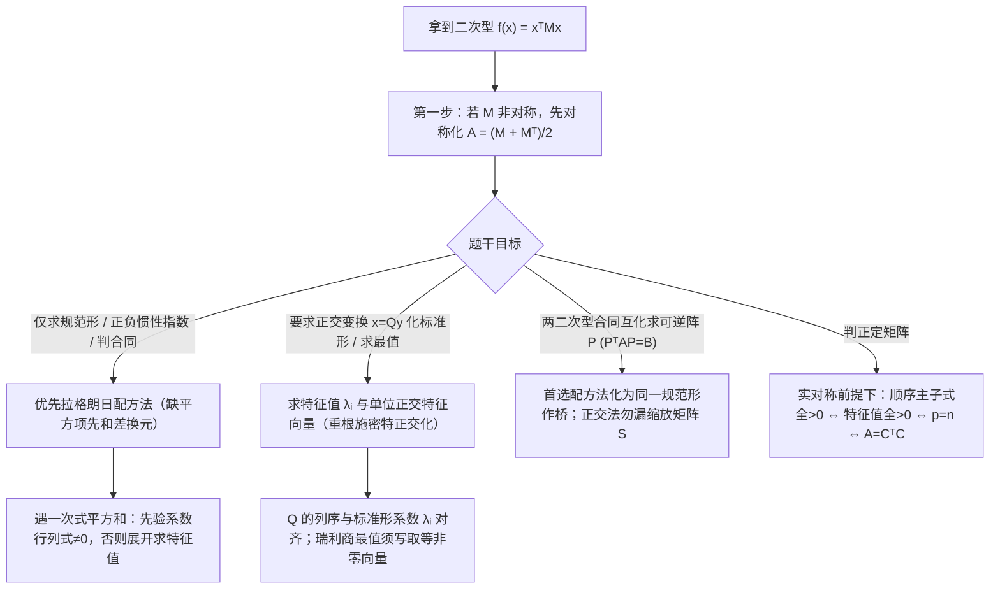

# 第9讲 二次型｜二轮强化复盘

> [!abstract] 资料与范围
> 强化讲义：[[第9讲_二次型.pdf]]（印刷第 93—109 页）；一轮笔记：[[考研数学/线性代数/知识点与考点整理/第6讲 二次型|第6讲 二次型]]。
> 题源：例题编号对应强化讲义；1000B：[[考研数学/强化/试题册_强化篇与综合篇/24_强化篇_线代_第9章_二次型.pdf|第9章试题]]、[[考研数学/强化/解析册_强化篇与综合篇/24_强化篇_线代_第9章_二次型.pdf|第9章解析]]。
> 数二范围：讲义例 9.5（二次曲面分类）标注仅数学一，不展开。

---

> [!important] 近 17 年数二线代真题雷达（2010—2026｜S+ 级核心大题模块）
> - **考频画像**：主考 **16 题**（其中 **8 道**为解答大题：`12-T23`、`13-T23`、`17-T23`、`18-T22`、`20-T22`、`22-T22`、`24-T22`、`25-T22`；近 6 年新大纲每年均有考查，22/24/25 三年居 T22 压轴），跨讲渗透 **4 次**。
> - **真题落点**：
>   - *2021—2026 新大纲*：`21-T8(选)`、`22-T22(解)`、`23-T9(选)`、`24-T22(解)`、`25-T22(解)`、`26-T16(填)`
>   - *2015—2020 经典*：`15-T8(选)`、`16-T8(选)`、`17-T23(解)`、`18-T22(解)`、`19-T8(选)`、`20-T22(解)`
>   - *2010—2014 早期补齐*：`11-T14(填)`、`12-T23(解)`、`13-T23(解)`、`14-T14(填)`
> - **跨大纲高频反套路与破题核心**：
>   1. **“线性相关一次式平方和”连考两次**：`21-T8` 与 `23-T9` 均给出 3 个线性相关一次式的平方和，**不能直接数正负项**，须先验系数行列式，若为 0 则展开求矩阵 $A$ 特征值或重新可逆配方（另记 `14-T14`：配方含临界等号定负惯性指数 $q=1$ 须检验端点闭区间 $[-2,2]$）。
>   2. **合同与正交相似同题考查（2025 压轴）与列序对齐**：**`25-T22`** 第 (1) 问考合同（$k>0$ 勿误答 $k\ne 0$），第 (2) 问考正交变换（$k=3$ 且 $Q$ 列序对齐 $(3,6,0)$）；`15-T8`（正交阵换列同步置换标准形次序，取负号 $-e_3$ 不改变平方项符号）；**`20-T22`**（两非正交合同二次型互化求 $P$ 优先配方法，正交法勿漏缩放矩阵 $S$）。
>   3. **瑞利商最值 + 秩 1 外积 + $r(AA^T)=r(A)$**：`22-T22`（证 $\min\frac{f(x)}{x^Tx}=2$ 须写出取等非零向量 $x=Q(0,0,1)^T$）；`24-T22`（同解包含定 $r(B)=1\Rightarrow BA=\alpha\alpha^T$，二重零根基向量须施密特正交化）；`12-T23` & `26-T16`（$r(AA^T)=r(A^TA)=r(A)$，两行成比例直接定参）；`13-T23`（正交单位向量外积和 $2\alpha\alpha^T+\beta\beta^T$）。
> - **每日复习聚焦**：第二部分开头的 Mermaid 决策树 + 非对称先对称化 + 线性相关平方和与端点等号 + 合同与正交相似边界 + 瑞利商取等规范 + $r(AA^T)=r(A)$。

---

## 第一部分｜知识点与核心结论

### 【第9讲：二次型】

**1. 二次型的定义、矩阵表示与外积显化**【🔥 必背｜停下来默背 1 遍】
- **定义与唯一对称阵对应**：
  $n$ 元实二次型为二次齐次多项式：
  $$f(x_1, \dots, x_n) = \sum_{i=1}^n \sum_{j=1}^n a_{ij} x_i x_j = x^T A x$$
  其中 $x = (x_1, \dots, x_n)^T$，$A$ 约定为**实对称矩阵**（$A^T = A$）。
  - **系数排布**：平方项 $x_i^2$ 系数填入主对角元 $a_{ii}$；交叉项 $c x_i x_j$（$i\ne j$）系数平分至对称位置 $a_{ij}=a_{ji}=\frac{1}{2}c$。
  - **一一对应**：实二次型与实对称矩阵唯一一一对应。
- **非对称矩阵的对称化法则**：
  - 遇任意实方阵 $M$ 构成的 $x^T M x$，其真正的二次型矩阵为对称化矩阵：
    $$A = \frac{M + M^T}{2}, \qquad x^T M x = x^T A x$$
  - **依据**：$M = \frac{M+M^T}{2} + \frac{M-M^T}{2}$，而实反对称部分的二次型恒为零（$x^T K x = (x^T K x)^T = -x^T K x \implies x^T K x = 0$）。
  - **避坑**：判定正定性、标准形或最值时必须先对 $M$ 对称化，切勿直接用非对称阵 $M$ 的特征值或顺序主子式。
- **向量内积平方和与外积矩阵显化**：
  - 遇 $f(x) = \sum_{k=1}^m (\alpha_k, x)^2$，由 $(\alpha_k, x) = x^T \alpha_k = \alpha_k^T x$ 直接显化对称阵：
    $$f(x) = x^T \left(\sum_{k=1}^m \alpha_k \alpha_k^T\right) x = x^T (P P^T) x, \qquad P = [\alpha_1, \dots, \alpha_m]$$
    - 若由正交单位向量外积和（如 $2\alpha\alpha^T+\beta\beta^T$）构造，可<mark>由正交单位向量外积和直读特征值</mark> `[真题·2013-T23]`；若正交变换含已知列向量，也可据此反求对称阵参数 `[真题·2010-T23 / 2017-T23]`。
  - **单外积特例**：$f(x) = (\alpha^T x)^2 = x^T (\alpha\alpha^T) x$（$\alpha \ne 0$）满足 $r(A)=1,\ p=1$，唯一非零特征值为 $\operatorname{tr}(A) = \|\alpha\|^2$（亦常<mark>由解集包含锁定秩一实对称外积矩阵</mark> `[真题·2024-T22]`）。
  - `【⚡ 真题补丁｜2026-T16】` $x^T(AA^T)x$ 规范形为 $y_1^2$（$p=1,q=0$），直接由惯性定理与实矩阵秩恒等式 $r(AA^T)=r(A)=1$ 得两行成比例定参，无需展开乘法算特征多项式。

**2. 线性变换、矩阵合同与三大矩阵关系全景**【🔥⚡ 必背+避坑｜停下来默背 1 遍 + 精读 1 分钟】
- **可逆线性变换的代换公式与方向**：
  - 设可逆线性变换 $x = C y$（$|C| \ne 0$），代入 $f(x) = x^T A x$ 得
    $$f = (Cy)^T A (Cy) = y^T (C^T A C) y = y^T B y, \qquad B = C^T A C$$
  - **方向核对**：标准方向是**旧变量由新变量表示**（$x = C y$）；若配方法先写出 $y = P x$，则变换矩阵为 $C = P^{-1}$，满足 $(P^{-1})^T A P^{-1} = B$。
- **矩阵合同的定义、等价性与不变量**：
  - **定义**：存在实可逆矩阵 $C$ 使 $C^T A C = B$，称 $A$ 与 $B$ **合同**（$A \simeq B$）。
  - **等价三性质（基础 30 讲）**：
    1. 自反性：$E^T A E = A \implies A \simeq A$；
    2. 对称性：$C^T A C = B \implies A = (C^{-1})^T B C^{-1} \implies B \simeq A$；
    3. 传递性：$C_1^T A C_1 = B$ 且 $C_2^T B C_2 = D \implies (C_1 C_2)^T A (C_1 C_2) = D \implies A \simeq D$。
  - **保持性质**：秩不变（$r(B) = r(A)$）；对称性保持（与对称阵合同的矩阵必对称）。
- **等价、相似、合同与正交相似横向对比表**：

  | 关系名称 | 严格数学定义 | 充要条件（实对称矩阵前提） | 保持的核心不变量 | 几何本质与避坑 |
  |---|---|---|---|---|
  | **等价**（$A \cong B$） | 存在可逆阵 $P, Q$ 使 $PAQ = B$ | 同阶且 $r(A) = r(B)$ | 矩阵的秩 $r(A)$ | 同维空间映射 |
  | **相似**（$A \sim B$） | 存在可逆阵 $P$ 使 $P^{-1} A P = B$ | 全部特征值相同且均可对角化 | 特征值、迹、行列式 $\lvert A \rvert$、秩 | <mark>特征值互异必可相似对角化</mark> `[真题易错·2022-T08]` |
  | **合同**（$A \simeq B$） | 存在可逆阵 $C$ 使 $C^T A C = B$ | <mark>实对称阵合同等价于正负惯性指数相同</mark> `[真题易错·2025-T22]` | 正/负惯性指数、秩、规范形 | 同一二次型在不同坐标下的度量 |
  | **正交相似**（$A \sim_Q B$） | 存在正交阵 $Q$ 使 $Q^T A Q = B$ | 全部特征值相同（$Q^T=Q^{-1}$ 既相似又合同） | 特征值、迹、行列式、内积、模长 | <mark>正交相似对角化必须保证原矩阵实对称</mark> `[真题易错·2022-T08 / 2025-T22]` |

- **合同判定与求合同变换矩阵（讲义第 100—102 页）**：
  - 同阶实对称阵 $A \simeq B \iff p_A = p_B$ 且 $q_A = q_B$。
  - **求 $C^T A C = \Lambda$**：配方并按目标对角元调系数，写出可逆换元 $y = Dx$，取 $C = D^{-1}$。
  - **求两矩阵互化**：分别将 $x^T A x$ 与 $y^T B y$ 配成**同一个**标准形，设 $z = D_1 x = D_2 y$：
    - 求 $A = D^T B D$（即 $y = Dx$）：取 $D = D_2^{-1} D_1$；
    - 求 $P^T A P = B$（即 $x = Py$）：取 $P = D_1^{-1} D_2$；
    - 平方项不足 $n$ 个时务必补足独立变量，保证换元可逆。
  - `【⚡ 真题补丁｜2025-T22】` 合同（保正负惯性指数 $k>0$，非 $k\ne 0$）与正交相似（既合同又相似，$k=3$ 且 $Q$ 列序对齐 $(3,6,0)$）同题考查，切勿混判条件。
  - `【⚡ 真题补丁｜2020-T22】` 两合同二次型互化求可逆 $P$ 首选配方法化同一规范形；改用正交对角化法时因非零特征值未必相等，须插入缩放矩阵 $S$ 拼成 $P=Q_A S Q_B^T$。

**3. 标准形、规范形与惯性定理**【🔥⚡ 必背+避坑｜停下来默背 1 遍 + 精读 1 分钟】
- **标准形与规范形**：
  - **标准形**：仅含平方项 $f = d_1 y_1^2 + \dots + d_n y_n^2$，对应对角阵 $\Lambda = \operatorname{diag}(d_1, \dots, d_n)$，**不唯一**（系数随所选可逆变换变化）。
  - **规范形**：<mark>规范形平方项系数仅取正一、负一与零</mark>（含多项式 $A^2+A=2E$ 或行和相等阵可由特征值符号直接锁定 `[真题·2016-T08 / 2019-T08]`）：
    $$f = z_1^2 + \dots + z_p^2 - z_{p+1}^2 - \dots - z_{p+q}^2$$
    对应 $\operatorname{diag}(E_p, -E_q, O)$，在实数域内**唯一确定**。
- **西尔维斯特（Sylvester）惯性定理与推论**：
  - **定理**：任一实二次型经任意实可逆变换化为标准形时，正平方项个数 $p$（正惯性指数）与负平方项个数 $q$（负惯性指数）**唯一确定**，仅由 $A$ 决定（配方法直接数平方项正负即得 $p, q$ `[真题·2011-T14]`）。
  - **四大推论**：
    1. 秩恒等式：$r(A) = p + q$；
    2. 零特征值重数：$n - r(A) = n - (p + q)$；
    3. <mark>实对称阵特征值正负个数即正负惯性指数</mark>（借分块对称阵特征值符号或 $A^2+A=O$ 速定标准形 `[真题·2010-T08 / 2025-T08]`）；
    4. 实对称合同判据：$A \simeq B \iff p_A = p_B$ 且 $q_A = q_B$。
  - `【⚡ 真题补丁｜2021-T08 / 2023-T09】` 遇“3个一次式平方和/差”求规范形，先验一次式系数行列式；若为零（线性相关）不能直接数正负项，须展开求特征值或代换后重新可逆配方。
  - `【⚡ 真题补丁｜2014-T14】` 由配方系数或特征值定负惯性指数（如 $q=1$）求参数范围时，须单独检验临界等号（如 $a=\pm 2$ 时该项归零或保符号），确认闭区间端点 $[-2,2]$。

**4. 化二次型为标准形的两大方法体系**【🔥 必背｜停下来默背 1 遍】
- **拉格朗日配方法（两大变式与变换矩阵提取）**：
  - **变式 1｜含平方项**：选含平方项的变量 $x_i$（优先选系数为 $\pm 1$ 者），集中全部含 $x_i$ 项配成 $a_{ii}(x_i + c_2 x_2 + \dots + c_n x_n)^2$，对余式递归配方；注意<mark>由惯性指数定参数范围须单独检验端点</mark> `[真题易错·2014-T14]`。
  - **变式 2｜缺平方项（纯交叉项）**：选非零交叉项 $2 a_{ij} x_i x_j$（$i \ne j$），作可逆和差换元：
    $$\begin{cases} x_i = y_i + y_j \\ x_j = y_i - y_j \\ x_k = y_k \ (k \ne i, j) \end{cases}$$
    由 $x_i x_j = y_i^2 - y_j^2$ 造出平方项，再转入变式 1。
  - **提取变换矩阵 $C$**：
    - 令 $y_k$ 等于各完全平方内的一次式得 $y = P x$；
    - 降秩（$r < n$）时须**补齐剩余 $n-r$ 个独立变量**（如 $y_{r+1} = x_{r+1}, \dots, y_n = x_n$）保证 $|P| \ne 0$；
    - 反解 $x = C y$（$C = P^{-1}$），即满足 $C^T A C = \Lambda$。
- **正交变换法（标准五步与保距性）**：
  1. **写出实对称阵 $A$**（遇 $r(A^TA)=r(A)$ 先借秩定参再求正交标准形 `[真题·2012-T23]`）；
  2. **求全部特征值** $\lambda_1, \dots, \lambda_n$；
  3. **求特征向量并正交化**：不同特征值的特征向量自动正交；<mark>重特征值的无关特征向量须先正交再单位化</mark> `[真题·2024-T22]`（若已正交则无需重复施密特正交化）；
  4. **单位化**得标准正交特征向量 $\eta_1, \dots, \eta_n$；
  5. **拼正交矩阵** $Q = [\eta_1, \dots, \eta_n]$（$Q^T = Q^{-1},\ |Q| = \pm 1$）；注意<mark>重排正交矩阵各列同步调换特征值次序</mark>，而某列取负号（如 $-e_3$）不改对应平方项系数符号 `[真题·2015-T08]`。
  - **核心特性**：正交变换 $x = Q y$ 化得的标准形系数**严格为特征值**（$f = \lambda_1 y_1^2 + \dots + \lambda_n y_n^2$），且保模长 $\|x\|^2 = \|y\|^2$。
- **施密特正交化公式速查**：
  对线性无关向量 $\alpha_1,\alpha_2,\alpha_3$：
  $$\beta_1=\alpha_1,\qquad
  \beta_2=\alpha_2-\frac{(\alpha_2,\beta_1)}{(\beta_1,\beta_1)}\beta_1,$$
  $$\beta_3=\alpha_3-\frac{(\alpha_3,\beta_1)}{(\beta_1,\beta_1)}\beta_1
  -\frac{(\alpha_3,\beta_2)}{(\beta_2,\beta_2)}\beta_2,\qquad
  \eta_i=\frac{\beta_i}{\|\beta_i\|}$$
- **正交变换的传递性（讲义第 99—100 页）**：
  若同阶实对称阵 $A, B$ 特征值相同，分别求 $Q_1^T A Q_1 = \Lambda,\ Q_2^T B Q_2 = \Lambda$（两 $\Lambda$ 特征值顺序一致），则 $Q = Q_1 Q_2^T$ 满足 $Q^T A Q = B$。
- **配方法 vs 正交变换法对比表**：

  | 比较维度 | 拉格朗日配方法 | 正交变换法 |
  |---|---|---|
  | **数学原理** | 代数恒等变形与消元 | 谱分解与实对称矩阵对角化 |
  | **变换矩阵** | 一般可逆矩阵（$\lvert C \rvert \ne 0$） | 正交矩阵（$Q^T Q = E,\ Q^{-1} = Q^T$） |
  | **标准形系数** | 不唯一，依赖配方顺序 | 唯一确定，**必为 $A$ 的特征值** |
  | **与原阵关系** | 仅合同（$C^T A C = \Lambda$） | **既合同又相似**（$Q^T A Q = Q^{-1} A Q = \Lambda$） |
  | **几何意义** | 坐标轴倾斜与非均匀拉伸 | 欧氏刚体旋转与反射（保距、保角） |
  | **适用优先场景** | 求惯性指数、规范形、合同变换（计算量小） | 题干指定“正交变换”或涉球面最值 |

**5. 正定二次型与定性判定全体系**【🔥 必背｜停下来默背 1 遍】
- **定义与几何直观**：
  - **正定**：$\forall x \ne 0,\ x^T A x > 0$（三维空间中 $x^T A x = 1$ 为封闭实椭球面）；
  - **半正定**：$\forall x \in \mathbb{R}^n,\ x^T A x \ge 0$；
  - **负定 / 半负定**：$-A$ 正定（半正定）。
- **四类定性充要条件全景对比表（实对称矩阵 $A$ 前提）**：

  | 定性类别 | 特征值判据 | 主子式判据 | 惯性指数与分解判据 |
  |---|---|---|---|
  | **正定** | 全部 $\lambda_i > 0$ | **各阶顺序主子式** $\Delta_1, \dots, \Delta_n$ 全 $> 0$（赫尔维茨定理） | $p=n,\ q=0$；规范形 $\sum y_i^2$；$A \simeq E$（$\exists$ 可逆 $C$ 使 $A = C^T C$ 或 $D^T A D = E$） |
  | **半正定** | 全部 $\lambda_i \ge 0$ | **全部各阶主子式**（含非顺序）均 $\ge 0$ | $p = r(A) \le n,\ q = 0$；存在实阵 $C$（不要求满秩）使 $A = C^T C$ |
  | **负定** | 全部 $\lambda_i < 0$ | 顺序主子式奇负偶正：$(-1)^k \Delta_k > 0$（$\Delta_1<0, \Delta_2>0, \dots$） | $p = 0,\ q = n$；$-A$ 正定 |
  | **半负定** | 全部 $\lambda_i \le 0$ | 全部奇数阶主子式 $\le 0$，全部偶数阶主子式 $\ge 0$ | $p = 0,\ q = r(A) \le n$；$-A$ 半正定 |

  - **半正定顺序主子式避坑**：**“顺序主子式全 $\ge 0$”推不出半正定**！
    - 反例：$A = \begin{pmatrix} 0 & 0 \\ 0 & -1 \end{pmatrix}$ 有 $\Delta_1 = 0,\ \Delta_2 = 0$，但 $a_{22} = -1 < 0$，特征值为 $0, -1$（$q=1$），非半正定。判定半正定须验全部特征值 $\ge 0$ 或全部主子式 $\ge 0$。
- **正定矩阵的 4 大必要条件（快速排错）**：
  1. 主对角元全正：$a_{ii} = e_i^T A e_i > 0$；
  2. 行列式全正：$|A| = \prod \lambda_i > 0$；
  3. 迹大于零：$\operatorname{tr}(A) = \sum a_{ii} > 0$；
  4. 全部 $2^n - 1$ 个各阶主子式均严格大于零。
- **正定矩阵的运算封闭性（讲义第 104 页）**：
  设 $A, B$ 为同阶实对称正定阵：
  1. $A^{-1}$、$A^*$、$A^m$（$m \in \mathbb{Z}^+$）、$kA$（$k>0$）、$C^T A C$（$C$ 可逆）均正定；
  2. $A+B$ 与分块对角阵 $\begin{pmatrix}A&O\\O&B\end{pmatrix}$ 均正定；
  3. $AB$ 正定 $\iff AB = BA$（正定阵定义须先对称）；
  4. **反推避坑**：不能由 $A^*$ 正定反推 $A$ 正定（反例：$A = -E_3$ 时 $A^* = E_3$ 正定，但 $A$ 负定）。
- **平方和型二次型与列满秩判据**：
  若 $f(x) = \sum_{k=1}^m (\beta_{k1} x_1 + \dots + \beta_{kn} x_n)^2 = \|Bx\|^2 = x^T (B^T B) x$（$B_{m\times n}$）：
  - **恒半正定**：$\|Bx\|^2 \ge 0$ 恒成立。
  - **正定充要条件**：$f(x)$ 正定 $\iff Bx = 0$ 仅有零解 $\iff$ <mark>实平方和为零等价于各一次式同时为零</mark>（即 $B$ 列满秩 $r(B) = n$；降秩则存在非零解且规范形项数减少 `[真题·2018-T22]`）。
  - **项数不足必不正定**：若 $m < n$，则 $r(B) \le m < n$，必不正定。
  - **秩与正惯性指数**：由 $r(B^T B) = r(B)$ 得<mark>平方和型正惯性指数等于系数矩阵的秩</mark> `[真题易错·2021-T08 / 2026-T16]`，切勿直接数平方项个数。
  - **推广**：若 $H_{m\times m}$ 正定对称、$B_{m\times n}$ 为实矩阵，则 $B^T H B$ 正定 $\iff r(B) = n$（长方阵写列满秩，不写 $|B|$）。
- **两一次式乘积与成对初等变换**：
  - **乘积化平方差（1000B 第 4 题）**：$f = (\alpha^T x)(\beta^T x)$，令 $u = \alpha^T x,\ v = \beta^T x$，用 $uv = \frac{1}{4}[(u+v)^2 - (u-v)^2]$；当 $\alpha, \beta$ 线性无关时 $p=q=1$。
  - **成对初等变换求合同阵**：对 $[A \mid E]$ 反复操作——左块先左乘初等阵 $P_i$、再右乘 $P_i^T$，右块仅同步左乘 $P_i$，终态得 $[B \mid C^T]$，即满足 $C^T A C = B$。

**6. 进阶核心考点：同时对角化、正定分解与瑞利商最值**【📌⚡ 扫一眼+避坑｜最值钱，必须精读 1 分钟】
- **两个二次型同时化标准形（双对角化定理）**：
  - **定理**：设 $A, B$ 为 $n$ 阶实对称阵，**若其中 $A$ 正定**，则存在实可逆矩阵 $P$ 同时满足 $P^T A P = E$ 与 $P^T B P = \Lambda = \operatorname{diag}(\lambda_1, \dots, \lambda_n)$。
  - **三步构造**：
    1. 由 $A$ 正定分解 $A = D^T D$（$D$ 可逆），令 $x = D^{-1} u$ 化 $x^T A x = u^T u$；
    2. 代入得 $x^T B x = u^T M u$（$M = (D^{-1})^T B D^{-1}$ 实对称），取正交阵 $Q$ 使 $Q^T M Q = \Lambda$；
    3. 合成 $P = D^{-1} Q$（可逆），即得 $P^T A P = Q^T E Q = E$ 且 $P^T B P = Q^T M Q = \Lambda$。
- **正定矩阵的合同分解与唯一正定平方根**：
  - **Cholesky 分解**：正定阵 $A$ 可唯一分解为 $A = L L^T$（$L$ 主对角元全正的下三角阵）或 $A = D^T D$（$D$ 主对角元全正的上三角阵）。
  - **唯一正定平方根 $A^{1/2}$**：设 $A = Q \operatorname{diag}(\lambda_1, \dots, \lambda_n) Q^T$（$\lambda_i > 0$），则存在唯一正定实对称阵 $C = A^{1/2} = Q \operatorname{diag}(\sqrt{\lambda_1}, \dots, \sqrt{\lambda_n}) Q^T$ 满足 $C^2 = A$。
  - **极分解小结论（1000B 第 24 题）**：若实方阵 $A, B$ 满足 $A^T A = B^2$ 且 $B$ 正定实对称，则 $C = A B^{-1}$ 为正交矩阵（$C^T C = E$），且 $A = C B$。
- **瑞利商（Rayleigh Quotient）与二次型最值**：
  - **定义与极值**：设 $A$ 实对称，对任意 $x \ne 0$，瑞利商 $R(x) = \dfrac{x^T A x}{x^T x} = \dfrac{x^T A x}{\|x\|^2}$ 满足
    $$\lambda_{\min}(A) \le \frac{x^T A x}{x^T x} \le \lambda_{\max}(A)$$
    - 最大值 $\lambda_{\max}(A)$ 在最大特征值对应特征向量处取得；
    - 最小值 $\lambda_{\min}(A)$ 在最小特征值对应特征向量处取得，<mark>瑞利商证最值须显式给出取等非零向量</mark> `[真题易错·2022-T22]`。
  - `【⚡ 真题补丁｜2022-T22】` 证 $\min_{x\ne 0}\frac{f(x)}{x^Tx}=\lambda_{\min}$ 时，由正交变换推得下界后须显式写出取等非零向量 $x=Qe_k$（最小特征值单位特征向量），以证下确界可达。
- **广义瑞利商 $\dfrac{x^T A x}{x^T B x}$（$B$ 正定实对称，$x \ne 0$）**：
  1. 分解 $B = D^T D$（$D$ 可逆），令 $z = D x \iff x = D^{-1} z$；
  2. 分式化为标准瑞利商 $\dfrac{z^T M z}{z^T z}$，其中 $M = (D^{-1})^T A D^{-1}$ 实对称；
  3. 最值即为 $M$ 的最大与最小特征值。

**7. 考纲范围控制（数学二）**【💤 可跳过｜冲刺期直接跳过不看】
- **二次曲面几何分类属数学一专属**：
  - 强化讲义例 9.5 中利用正交变换化简二次曲面方程并判定曲面类型（椭球面、双曲面、抛物面等）属**数学一空间解析几何**考点，**数学二大纲不包含**，复习中不作展开；
  - 其中涉及的实对称矩阵正交对角化计算、惯性指数与特征值分析仍属数二核心基础。

---

## 第二部分｜题型体系与典型例题

### 一、二次型矩阵表示、惯性指数与标准形

| 题干特征 | 优先方法 | 真题印证与避坑 |
|---|---|---|
| $x^T M x$ 中矩阵 $M$ 非对称 | 先求实对称矩阵 $A = \frac{M+M^T}{2}$，反对称部分对二次型无贡献 | 不能拿非对称矩阵 $M$ 直接算顺序主子式或特征值 |
| 向量内积平方和 $\sum (\alpha_k, x)^2$ 或 $x^T(AA^T)x$ | 展开为外积和阵 $P P^T$，用 $r(AA^T)=r(A)$ 与特征值求解 | 规范形 $y_1^2 \Rightarrow r(AA^T)=r(A)=1$，两行成比例定参 `[真题易错·2026-T16]` `[真题·2012-T23 / 2013-T23]` |
| 3 个一次式平方和/差求规范形 | **先验一次式系数行列式**；若为 0 则不可逆，须展开求特征值或重新可逆配方 | 线性相关平方和不能直接数正负项 `[真题易错·2021-T08 / 2023-T09]` `[真题·2011-T14]` |
| 矩阵合同 $A \simeq B$ 求参数与正负惯性指数 | 合同保秩与正负惯性指数（$p_A=p_B, q_A=q_B$）；用配方法或特征多项式判定 | 合同须 $k>0$ 而非 $k\ne 0$，正交相似 $k=3$ 且列序对齐 `[真题易错·2025-T22]` `[真题·2017-T23]` |
| 二次型全为交叉项、缺少平方项 | 作可逆和差代换 $x_i = y_i+y_j, x_j = y_i-y_j$ 造出 $y_i^2-y_j^2$，再配方 | 和差换元须确认变换矩阵可逆；换列不变号规则对齐 `[真题·2015-T08 / 2019-T08]` |
| 抽象实对称矩阵多项式求规范形 | 确定特征值取值范围；由 $n - r(\lambda E - A)$ 定代数重数（实对称阵 $g_i = k_i$） | 实对称阵可对角化，二重零根基向量须施密特正交化 `[真题·2010-T08 / 2016-T08 / 2024-T22 / 2025-T08]` |

> [!tip] 核心提醒
> 1. 二次型判据（特征值、正负惯性指数、顺序主子式、正交变换）均以**实对称矩阵**为前提，遇非对称矩阵须先对称化。
> 2. 正负惯性指数为可逆替换不变量。求规范形首选配方法；题目要求正交变换时再求特征值。

> [!example]- ⚡ 真题母题 2024-T22｜同解包含定秩 1 对称阵 $BA$ 与二重零根正交化
> - **【真题原题】**（2024 数二第 22 题·解答 12 分）：已知矩阵 $A = \begin{pmatrix} 1 & 0 & 1 \\ 0 & 1 & a \end{pmatrix}$，$B = \begin{pmatrix} 1 & 1 \\ 1 & 1 \\ b & 2 \end{pmatrix}$，二次型 $f(x_1, x_2, x_3) = x^T BA x$。若方程组 $Ax = 0$ 的解均是方程组 $B^T x = 0$ 的解，但两个方程组有不同的解。
>   （1）求 $a, b$ 的值；
>   （2）求正交变换 $x = Qy$，将 $f(x_1, x_2, x_3)$ 化为标准形。
> - **【完整解答（独立验算）】**：
>   1. **（1）由单向同解包含确定 $a, b$**：
>      由矩阵 $A = \begin{pmatrix} 1 & 0 & 1 \\ 0 & 1 & a \end{pmatrix}$ 已为行最简形且 $r(A) = 2$，得齐次方程组 $Ax = 0$ 的基础解系为 $\xi = (-1, -a, 1)^T$（或 $(1, a, -1)^T$）。
>      依题意 $\xi$ 必为 $B^T x = 0$ 的解，代入 $B^T = \begin{pmatrix} 1 & 1 & b \\ 1 & 1 & 2 \end{pmatrix}$ 得：
>      $$B^T \xi = \begin{pmatrix} -1 - a + b \\ -1 - a + 2 \end{pmatrix} = \begin{pmatrix} 0 \\ 0 \end{pmatrix} \implies a = 1,\; b = 2.$$
>      核验不同解条件：此时 $r(A) = 2$（解空间 1 维），而 $B^T = \begin{pmatrix} 1 & 1 & 2 \\ 1 & 1 & 2 \end{pmatrix}$ 满足 $r(B^T) = 1 \ne 2$（解空间 2 维），两个方程组确有不同的解，故 $a = 1,\; b = 2$。
>   2. **（2）计算 $BA$ 并求特征值与正交特征向量**：
>      $$BA = \begin{pmatrix} 1 & 1 \\ 1 & 1 \\ 2 & 2 \end{pmatrix} \begin{pmatrix} 1 & 0 & 1 \\ 0 & 1 & 1 \end{pmatrix} = \begin{pmatrix} 1 & 1 & 2 \\ 1 & 1 & 2 \\ 2 & 2 & 4 \end{pmatrix} = \begin{pmatrix} 1 \\ 1 \\ 2 \end{pmatrix} (1, 1, 2).$$
>      $BA$ 为 3 阶秩 1 实对称矩阵，故其特征值为 $\lambda_1 = \lambda_2 = 0$（二重），$\lambda_3 = \operatorname{tr}(BA) = 1 + 1 + 4 = 6$。
>      - 对 $\lambda_1 = \lambda_2 = 0$：解 $(0E - BA)x = 0 \iff x_1 + x_2 + 2x_3 = 0$，取线性无关基础解系 $\alpha_1 = (-1, 1, 0)^T$，$\alpha_2 = (-2, 0, 1)^T$。
>        作施密特正交化：
>        $$\xi_1 = \alpha_1 = (-1, 1, 0)^T,\qquad \xi_2 = \alpha_2 - \frac{(\alpha_2, \xi_1)}{(\xi_1, \xi_1)}\xi_1 = (-2, 0, 1)^T - \frac{2}{2}(-1, 1, 0)^T = (-1, -1, 1)^T.$$
>        单位化得 $\eta_1 = \frac{1}{\sqrt{2}}(-1, 1, 0)^T$，$\eta_2 = \frac{1}{\sqrt{3}}(-1, -1, 1)^T$。
>      - 对 $\lambda_3 = 6$：取特征向量 $\alpha_3 = (1, 1, 2)^T$，单位化得 $\eta_3 = \frac{1}{\sqrt{6}}(1, 1, 2)^T$。
>   3. **写出正交矩阵 $Q$ 与标准形**：
>      取 $Q = [\eta_1, \eta_2, \eta_3] = \begin{pmatrix} -\frac{1}{\sqrt{2}} & -\frac{1}{\sqrt{3}} & \frac{1}{\sqrt{6}} \\ \frac{1}{\sqrt{2}} & -\frac{1}{\sqrt{3}} & \frac{1}{\sqrt{6}} \\ 0 & \frac{1}{\sqrt{3}} & \frac{2}{\sqrt{6}} \end{pmatrix}$，正交变换 $x = Qy$ 将二次型化为标准形 $f = 6y_3^2$。
> - **【踩分要点】**：（1）解出 $a, b$ 后须验证 $r(B^T)=1 \ne r(A)=2$ 以说明“有不同解”；（2）二重特征值 $0$ 对应的两个特征向量 $\alpha_1, \alpha_2$ 默认不必然正交，必须显式做施密特正交化。

> [!example]- 例9.1｜先对称化再判规范形（强化例 9.1）
> - **【题目】**（[[第9讲_二次型.pdf]] 讲义印刷第 93—94 页）：已知三元二次型 $f(x)=x^T B x$，其中
>   $$B = \begin{pmatrix} 1 & 1 & 0 \\ 0 & 1 & 1 \\ 0 & 0 & 1 \end{pmatrix},$$
>   求 $f$ 的规范形。选项为：（A）$y_1^2-y_2^2+y_3^2$；（B）$y_1^2+y_2^2+y_3^2$；（C）$-y_1^2-y_2^2-y_3^2$；（D）$y_1^2-y_2^2-y_3^2$。
> - **【完整解答】**：
>   1. **对称化**：将非对称矩阵 $B$ 转化为实对称矩阵 $A$：
>      $$A = \frac{B+B^T}{2} = \begin{pmatrix} 1 & \frac{1}{2} & 0 \\ \frac{1}{2} & 1 & \frac{1}{2} \\ 0 & \frac{1}{2} & 1 \end{pmatrix}.$$
>   2. **顺序主子式检验**：
>      - 1 阶顺序主子式：$\Delta_1 = 1 > 0$；
>      - 2 阶顺序主子式：$\Delta_2 = \begin{vmatrix} 1 & \frac{1}{2} \\ \frac{1}{2} & 1 \end{vmatrix} = 1 - \frac{1}{4} = \frac{3}{4} > 0$；
>      - 3 阶顺序主子式：$\Delta_3 = |A| = 1 \cdot \left(1 - \frac{1}{4}\right) - \frac{1}{2} \cdot \left(\frac{1}{2} - 0\right) = \frac{3}{4} - \frac{1}{4} = \frac{1}{2} > 0$。
>   3. **结论判定**：实对称矩阵 $A$ 的各阶顺序主子式均严格大于零，由赫尔维茨定理可知 $A$ 为正定矩阵，其特征值全大于零，正惯性指数 $p = 3$，负惯性指数 $q = 0$。故 $f$ 的规范形为 $y_1^2+y_2^2+y_3^2$，正确选项为 **（B）**。
> - **【复盘提醒】**：非对称矩阵的顺序主子式与正定性无充要关系（反例：$\begin{pmatrix} 1 & 10 \\ 0 & 1 \end{pmatrix}$ 顺序主子式为 1, 1，对称化后 $\begin{pmatrix} 1 & 5 \\ 5 & 1 \end{pmatrix}$ 行列式为 $-24 < 0$，非正定）。二次型判据以实对称矩阵为前提。

> [!example]- 强化例9.2｜内积平方和与正定参数（讲义第94页）
> - **【题目】**：设 $\alpha_1=(1,2)^T$、$\alpha_2=(a,1)^T$，$x=(x_1,x_2)^T$，若 $f(x)=\sum_{i=1}^2(\alpha_i,x)^2$ 正定，求 $a$ 的取值范围。
> - **【完整解答】**：将内积平方和写成矩阵形式：
> $$
> f(x)=x^T(\alpha_1\alpha_1^T+\alpha_2\alpha_2^T)x,
> \quad A=\begin{pmatrix}1+a^2&2+a\\2+a&5\end{pmatrix}.
> $$
> 由于 $1+a^2>0$，正定当且仅当 $|A|=5(1+a^2)-(2+a)^2=(2a-1)^2>0$，即 $\boxed{a\ne\tfrac12}$。也可看系数向量 $\alpha_1,\alpha_2$ 是否线性无关；二者构成的方阵行列式为 $1-2a$。

> [!example]- 例9.3｜合同、惯性指数与正交变换（强化例 9.3）
> - **【题目】**（[[第9讲_二次型.pdf]] 讲义印刷第 95—96 页）：已知矩阵
>   $$A = \begin{pmatrix} 4 & 1 & -2 \\ 1 & 1 & 1 \\ -2 & 1 & a \end{pmatrix}, \qquad B = \begin{pmatrix} k & 0 & 0 \\ 0 & 6 & 0 \\ 0 & 0 & 0 \end{pmatrix}$$
>   合同。（1）求 $a$ 及 $k$ 的取值范围；（2）若存在正交矩阵 $Q$ 使 $Q^T A Q = B$，求 $k$ 及一个正交矩阵 $Q$。
> - **【完整解答】**：
>   1. **求 $a$ 及 $k$ 的范围**：
>      因 $A \simeq B$，必有 $r(A) = r(B)$。由于对角矩阵 $B$ 的第 3 行为全零行，知 $r(B) \le 2 < 3$，故 $|A| = 0$。
>      计算 $|A|$：
>      $$|A| = \begin{vmatrix} 4 & 1 & -2 \\ 1 & 1 & 1 \\ -2 & 1 & a \end{vmatrix} \xlongequal{r_1-4r_2,\ r_3+2r_2} \begin{vmatrix} 0 & -3 & -6 \\ 1 & 1 & 1 \\ 0 & 3 & a+2 \end{vmatrix} = -1 \cdot \begin{vmatrix} -3 & -6 \\ 3 & a+2 \end{vmatrix} = 3(a-4).$$
>      令 $|A| = 0$ 解得 $a = 4$。
>      将 $a=4$ 代入二次型 $f(x) = x^T A x$ 执行拉格朗日配方：
>      $$f = 4x_1^2 + x_2^2 + 4x_3^2 + 2x_1x_2 - 4x_1x_3 + 2x_2x_3 = \left(2x_1 + \frac{1}{2}x_2 - x_3\right)^2 + \frac{3}{4}(x_2 + 2x_3)^2.$$
>      补取 $y_3 = x_3$ 保证换元可逆。可见该二次型有两个正平方项、无负平方项，故正惯性指数 $p = 2$，负惯性指数 $q = 0$。
>      因 $A \simeq B$，$B$ 的正、负惯性指数必须与 $A$ 严格一致，已知 $B$ 中对角元为 $k, 6, 0$，故必须有两个正元，因此 $k > 0$。
>   2. **正交相似求 $k$ 与 $Q$**：
>      若存在正交矩阵 $Q$ 使 $Q^T A Q = B$，则 $Q^{-1} A Q = B$（正交相似），两矩阵特征值完全相同。
>      比较矩阵的迹：$\operatorname{tr}(A) = 4 + 1 + 4 = 9$，$\operatorname{tr}(B) = k + 6 + 0 = k + 6$。
>      由 $\operatorname{tr}(A) = \operatorname{tr}(B)$ 即得 $k + 6 = 9 \implies k = 3$。
>      因此 $B = \operatorname{diag}(3, 6, 0)$，其特征值依次为 $\lambda_1 = 3, \lambda_2 = 6, \lambda_3 = 0$。
>      求 $A$ 的特征向量：
>      - 对于 $\lambda_1 = 3$：解 $(3E - A)x = 0$，基础解系为 $\xi_1 = (1, 1, 1)^T$，单位化得 $\eta_1 = \frac{1}{\sqrt{3}}(1, 1, 1)^T$；
>      - 对于 $\lambda_2 = 6$：解 $(6E - A)x = 0$，基础解系为 $\xi_2 = (-1, 0, 1)^T$，单位化得 $\eta_2 = \frac{1}{\sqrt{2}}(-1, 0, 1)^T$；
>      - 对于 $\lambda_3 = 0$：解 $A x = 0$，由 $\xi_1, \xi_2$ 的外积或方程组解得 $\xi_3 = (1, -2, 1)^T$，单位化得 $\eta_3 = \frac{1}{\sqrt{6}}(1, -2, 1)^T$。
>      由于实对称矩阵属于不同特征值的特征向量天然正交，直接将单位正交特征向量按 $B$ 的对角元顺序排成列向量，构造正交矩阵：
>      $$Q = [\eta_1, \eta_2, \eta_3] = \begin{pmatrix} \frac{1}{\sqrt{3}} & -\frac{1}{\sqrt{2}} & \frac{1}{\sqrt{6}} \\ \frac{1}{\sqrt{3}} & 0 & -\frac{2}{\sqrt{6}} \\ \frac{1}{\sqrt{3}} & \frac{1}{\sqrt{2}} & \frac{1}{\sqrt{6}} \end{pmatrix}.$$
> - **1000B 第 1 题补充**：同一组矩阵要求“可逆变换可以、正交变换不可以”，故在 $k>0$ 的基础上排除 $k=3$。若将题中的 $k$ 记作 $b$，则 $a+b\in(4,7)\cup(7,+\infty)$；先由迹筛出候选值，还要验证完整特征值再排除。

> [!example]- 强化例9.4｜无平方项时先作和差换元（讲义第96—97页）
> **题目：** 求 $f=-2x_1x_2-2x_1x_3+6x_2x_3$ 的正惯性指数。选项为：（A）$3$；（B）$2$；（C）$1$；（D）$0$。
>
> **解：** 令 $x_1=y_1+y_2$、$x_2=y_1-y_2$、$x_3=y_3$，则
> $$
> f=-2y_1^2+2y_2^2+4y_1y_3-8y_2y_3
> =-2(y_1-y_3)^2+2(y_2-2y_3)^2-6y_3^2.
> $$
> 令 $z_1=y_1-y_3$、$z_2=y_2-2y_3$、$z_3=y_3$，变换可逆，故标准形 $-2z_1^2+2z_2^2-6z_3^2$ 有一个正平方项，正惯性指数为 $\boxed{1}$，选 **（C）**。

> [!abstract] 强化例9.5考纲说明｜空间二次曲面几何分类（仅数学一）
> - **讲义范围说明**：强化教材例 9.5（[[第9讲_二次型.pdf]] 印刷第 97—98 页）讨论 $x_1x_2+x_1x_3-3x_2x_3=1$ 所表示的二次曲面，标注为“仅数学一”。
> - **数学二边界锁定**：全国硕士研究生招生考试数学二大纲严格**不包含“空间解析几何与向量代数”**，空间几何曲面类型判别不属于数学二考查范围，本笔记严格排除并不作展开。数学二考生只需熟练掌握实对称矩阵正交相似对角化与惯性定理计算。

> [!example]- 例题补充｜矩阵多项式与特征子空间维数判定规范形（1000B 第 2 题）
> - **【题目】**：设三阶实对称矩阵 $A$ 满足矩阵方程 $A^2 + 2A = 3E$，且秩 $r(E - A) = 1$。求二次型 $f(x) = x^T A x$ 的规范形。
> - **【完整解答】**：
>   1. **特征多项式求根范围**：
>      由 $A^2 + 2A - 3E = O$ 得 $(A+3E)(A-E) = O$。
>      设 $\lambda$ 为 $A$ 的任一特征值，则 $\lambda^2 + 2\lambda - 3 = 0 \iff (\lambda+3)(\lambda-1) = 0$。
>      故 $A$ 的特征值只能从集合 $\{1, -3\}$ 中选取。
>   2. **特征子空间维数分析**：
>      三阶矩阵 $A$ 的齐次线性方程组 $(E - A)x = 0$ 的基础解系所含向量个数（即特征值 $\lambda = 1$ 的几何重数）为：
>      $$n - r(E - A) = 3 - 1 = 2.$$
>      由于 $A$ 是实对称矩阵，必可对角化，每个特征值的几何重数严格等于其代数重数。
>      因此特征值 $\lambda = 1$ 的重数必为 $2$，另一个特征值必为 $\lambda = -3$（重数为 1）。
>   3. **规范形确定**：
>      $A$ 的 3 个特征值分别为 $1, 1, -3$。
>      正惯性指数（正特征值个数）$p = 2$，负惯性指数（负特征值个数）$q = 1$。
>      故二次型 $f(x) = x^T A x$ 的规范形为 $y_1^2 + y_2^2 - y_3^2$。
> - **【复盘提醒】**：抽象实对称矩阵求规范形的核心是实对称阵可对角化，故代数重数等于 $n - r(\lambda E - A)$。

> [!example]- ⚡ 真题母题 2023-T9｜线性相关平方和不可逆陷阱求规范形
> - **【真题原题】**（2023 数二第 9 题·选择 5 分）：二次型 $f(x_1, x_2, x_3) = (x_1 + x_2)^2 + (x_1 + x_3)^2 - 4(x_2 - x_3)^2$ 的规范形为（ ）
>   (A) $y_1^2 + y_2^2$　　(B) $y_1^2 - y_2^2$　　(C) $y_1^2 + y_2^2 - 4y_3^2$　　(D) $y_1^2 + y_2^2 - y_3^2$
> - **【破题直觉】**：
>   - 见 3 个一次式的平方组合，**不能直接按正负号个数选 (D)**。
>   - 先检验 3 个一次式的系数矩阵 $T = \begin{pmatrix} 1 & 1 & 0 \\ 1 & 0 & 1 \\ 0 & 1 & -1 \end{pmatrix}$：第 1 行 $-$ 第 2 行 $=$ 第 3 行，故 $|T| = 0$。令 $y_1=x_1+x_2,\ y_2=x_1+x_3,\ y_3=x_2-x_3$ 是**不可逆变换**，惯性定理不适用。
> - **【完整解答（双解法核验）】**：
>   - **解法一：线性关系代换 + 可逆配方**
>     令 $u_1 = x_1 + x_2,\ u_2 = x_1 + x_3$，则 $x_2 - x_3 = u_1 - u_2$，代入原式：
>     $$f = u_1^2 + u_2^2 - 4(u_1 - u_2)^2 = -3u_1^2 + 8u_1u_2 - 3u_2^2 = -3\left(u_1 - \frac{4}{3}u_2\right)^2 + \frac{7}{3}u_2^2.$$
>     补取 $z_3 = x_3$，令可逆变换：
>     $$\begin{cases} z_1 = \sqrt{\frac{7}{3}}(x_1 + x_3), \\ z_2 = \sqrt{3}\left(-\frac{1}{3}x_1 + x_2 - \frac{4}{3}x_3\right), \\ z_3 = x_3, \end{cases}$$
>     其系数行列式非零（可逆），化为规范形 $z_1^2 - z_2^2$，即 $p = 1,\ q = 1$，选 **（B）**。
>   - **解法二：展开写实对称矩阵求特征值正负号**
>     展开原式得 $f = 2x_1^2 - 3x_2^2 - 3x_3^2 + 2x_1x_2 + 2x_1x_3 + 8x_2x_3$，对应实对称矩阵为：
>     $$A = \begin{pmatrix} 2 & 1 & 1 \\ 1 & -3 & 4 \\ 1 & 4 & -3 \end{pmatrix}.$$
>     易验 $A(1, -1, -1)^T = 0 \implies \lambda_1 = 0$；又 $\operatorname{tr}(A) = 2 - 3 - 3 = -4$，二阶主子式之和 $\operatorname{tr}(A^*) = (-6-1)+(-6-1)+(9-16) = -21$。
>     特征方程为 $\lambda(\lambda^2 + 4\lambda - 21) = \lambda(\lambda + 7)(\lambda - 3) = 0$，得特征值 $3,\ -7,\ 0$。
>     正惯性指数 $p = 1$，负惯性指数 $q = 1$，故规范形为 $y_1^2 - y_2^2$，选 **（B）**。
> - **【真题避坑复盘】**：`21-T8` 与 `23-T9` 连续考查线性相关平方和。见一次式平方和先算系数行列式，$|T|=0$ 即转代换配方或求矩阵特征值（同时可由规范形系数仅取 $\pm 1, 0$ 直接排除 (C)）。

---

### 二、平方和、伪配方法与正定二次型判定

| 题干特征 | 优先方法 | 真题印证与避坑 |
|---|---|---|
| 多个线性一次式的平方和（或 $x^T(AA^T)x$） | 联立一次式方程组 $B x = 0$；正定 $\iff B$ 列满秩（$r(B)=n$）；规范形看 $r(B)$ | $r(AA^T)=r(A)$，平方项个数未必等于正惯性指数 $p$ `[真题易错·2021-T08 / 2026-T16]` `[真题·2018-T22]` |
| 含参数具体实对称矩阵判正定 | 优先使用顺序主子式全正（Hurwitz 判据），或求出全部特征值 $\lambda_i > 0$ | 须确认实对称矩阵前提；遇 $A=(1-a)E+a\mathbf{1}\mathbf{1}^T$ 用特征值全正更快 `[真题易错·2014-T14]` |
| 行列式展开给出二次型 $f(x, y) = \lvert xA+yB \rvert$ | 先展开多项式，交叉项平分写出实对称矩阵，再用顺序主子式求参数范围 | 勿将未平分交叉项的矩阵当作二次型矩阵 |
| 判定半正定矩阵 | 须验全部特征值 $\lambda_i \ge 0$ 或所有主子式全 $\ge 0$；**不能仅看顺序主子式** | 反例：$\operatorname{diag}(0,-1)$ 顺序主子式全 $\ge 0$ 但非半正定，须查所有主子式 |

> [!tip] 核心提醒
> 1. 平方和形式满足 $f \ge 0$（半正定）；正定要求仅零向量使所有平方项同时为零。若平方项个数 $m < n$，零解不唯一，不可能正定。
> 2. 行列式形式给出的二次型展开后常含交叉项，须先将非对角元除以 2 构造实对称矩阵。

> [!example]- 强化例9.6｜平方和不一定正定（讲义第98页）
> **题目：** 若 $f=(x_1+x_2)^2+(x_2+x_3)^2+(ax_3+x_1)^2$ 正定，求 $a$ 的取值范围。
>
> **解：** 令三项同时为零，其系数矩阵为
> $$
> T=\begin{pmatrix}1&1&0\\0&1&1\\1&0&a\end{pmatrix},\qquad |T|=a+1.
> $$
> $f$ 是三个平方之和，正定当且仅当 $Tx=0$ 只有零解，即 $|T|\ne0$，所以 $\boxed{a\ne-1}$。当 $a=-1$ 时，$x=(1,-1,1)^T\ne0$ 却使 $f=0$，说明此端点确实不能取。

> [!example]- 强化例9.12｜行列式化为二次型后判正定（讲义第104—105页）
> **题目：** 设 $A=\begin{pmatrix}1&2\\-2&-a\end{pmatrix}$、$B=\begin{pmatrix}1&0\\1&a\end{pmatrix}$，若 $f(x,y)=|xA+yB|$ 是正定二次型，求 $a$ 的取值范围。选项为：（A）$(0,2-\sqrt3)$；（B）$(2-\sqrt3,2+\sqrt3)$；（C）$(2+\sqrt3,4)$；（D）$(0,4)$。
>
> **解：** 先展开行列式，不能把 $A,B$ 直接当成二次型矩阵：
> $$
> f(x,y)=\begin{vmatrix}x+y&2x\\-2x+y&-ax+ay\end{vmatrix}
> =(4-a)x^2-2xy+ay^2.
> $$
> 二次型对应矩阵为 $S=\begin{pmatrix}4-a&-1\\-1&a\end{pmatrix}$。由顺序主子式判据，$4-a>0$ 且 $a(4-a)-1>0$，解得
> $$
> \boxed{2-\sqrt3<a<2+\sqrt3}.
> $$
> 即选 **（B）**。

> [!example]- 例题补充｜含参数循环三元二次型正定充要条件（1000B 第 20 题）
> - **【题目】**：设二次型 $f(x_1, x_2, x_3) = \sum_{i=1}^3 x_i^2 + \sum_{1 \le i < j \le 3} 2a x_i x_j$，求 $f$ 为正定二次型的充要条件。
> - **【完整解答】**：
>   1. **矩阵表示**：
>      $$A = \begin{pmatrix} 1 & a & a \\ a & 1 & a \\ a & a & 1 \end{pmatrix}.$$
>   2. **顺序主子式法求解**：
>      - 1 阶顺序主子式：$\Delta_1 = 1 > 0$ 恒成立；
>      - 2 阶顺序主子式：$\Delta_2 = 1 - a^2 > 0 \implies -1 < a < 1$；
>      - 3 阶顺序主子式：
>        $$\Delta_3 = |A| = \begin{vmatrix} 1 & a & a \\ a & 1 & a \\ a & a & 1 \end{vmatrix} \xlongequal{\text{各行加到第1行}} \begin{vmatrix} 1+2a & 1+2a & 1+2a \\ a & 1 & a \\ a & a & 1 \end{vmatrix} = (1+2a) \begin{vmatrix} 1 & 1 & 1 \\ a & 1 & a \\ a & a & 1 \end{vmatrix} = (1+2a)(1-a)^2.$$
>        要求 $\Delta_3 > 0$，因 $a \in (-1, 1)$ 时 $(1-a)^2 > 0$，故只需 $1 + 2a > 0 \implies a > -\frac{1}{2}$。
>      综合得：$-\frac{1}{2} < a < 1$。
>   3. **特征值法验算**：
>      由于 $A = (1-a)E + a \mathbf{1}\mathbf{1}^T$，矩阵 $a \mathbf{1}\mathbf{1}^T$ 的特征值为 $3a, 0, 0$。
>      故 $A$ 的特征值为 $\lambda_1 = 1-a+3a = 1+2a$，$\lambda_2 = \lambda_3 = 1-a$。
>      $A$ 正定 $\iff$ 特征值全大于零：$\begin{cases} 1+2a > 0 \\ 1-a > 0 \end{cases} \iff -\frac{1}{2} < a < 1$。
> - **【复盘提醒】**：本题矩阵具有 $A=(1-a)E+a\mathbf1\mathbf1^T$ 的特殊结构，可直接求出特征值；一般行和相等的对称矩阵仅能直接得到全 1 向量对应的特征值。

> [!example]- ⚡ 真题母题 2026-T16｜$x^T(AA^T)x$ 规范形 $y_1^2$ 转化为 $r(A)=1$ 定参
> - **【真题原题】**（2026 数二第 16 题·填空 5 分）：设矩阵
>   $$A = \begin{pmatrix} 1 & b & -1 \\ a+2 & 3 & -3a \end{pmatrix},$$
>   若二次型 $f(x) = x^T A A^T x$ 的规范形为 $y_1^2$，求参数 $a, b$ 的值。
> - **【破题直觉】**：
>   - 无需硬乘 $AA^T$ 再算特征多项式，直接两步化归：
>     1. $x^T(AA^T)x = \|A^T x\|^2 \ge 0$ 半正定，规范形为 $y_1^2 \iff r(AA^T) = p = 1$；
>     2. 由实矩阵秩恒等式 $r(AA^T) = r(A)$ 得 $r(A) = 1$。
> - **【完整解答】**：
>   1. 二次型 $f(x) = x^T(AA^T)x$ 对应的实对称矩阵为 $M = AA^T$。因规范形为 $y_1^2$，故正惯性指数 $p = 1$，负惯性指数 $q = 0$，从而矩阵的秩为：
>      $$r(AA^T) = p + q = 1.$$
>   2. 因为 $A$ 为实矩阵，由实矩阵乘积秩恒等式得：
>      $$r(A) = r(AA^T) = 1.$$
>   3. $A$ 为 $2 \times 3$ 矩阵，第一行 $(1, b, -1)$ 非零，故 $r(A) = 1$ 当且仅当两行对应元素成比例：
>      $$\frac{a + 2}{1} = \frac{3}{b} = \frac{-3a}{-1} = 3a.$$
>   4. 解比例方程：
>      - 由 $a + 2 = 3a \implies 2a = 2 \implies a = 1$；
>      - 代入 $\frac{3}{b} = 3a = 3 \implies b = 1$。
>      故 $\boxed{a = 1,\ b = 1}$（若题求 $a+b$ 则为 $2$）。
> - **【真题避坑复盘】**：
>   1. 检验：$a=1,b=1$ 时 $A = \begin{pmatrix}1&1&-1\\3&3&-3\end{pmatrix}$，$AA^T = \begin{pmatrix}3&9\\9&27\end{pmatrix}$，秩为 1 且迹为 $30>0$，规范形确为 $y_1^2$；
>   2. 跨讲转化：见 $x^T(AA^T)x$ 或 $x^T(A^TA)x$ 的规范形/正定性，直接回归 $r(A)$（正定 $\iff$ 满秩；规范形有 $r$ 个正平方项 $\iff r(A)=r$）。

---

### 三、矩阵合同、相似与可逆变换矩阵求解

| 题干特征 | 优先方法 | 真题印证与避坑 |
|---|---|---|
| 正交变换联系两个二次型 $Q^T A Q = B$ | 正交变换既合同又相似，特征值须一致；以公共对角阵 $\Lambda$ 为中介，取 $Q = Q_1 Q_2^T$ | $Q_1,Q_2$ 特征向量列序须与 $\Lambda$ 对齐 `[真题易错·2025-T22]` `[真题·2010-T23 / 2017-T23]` |
| 求可逆矩阵 $C$ 满足 $C^T A C = \Lambda$ | 配方并凑出目标系数，得 $y = Px$，反解方程组求 $C = P^{-1}$ | 配方法得 $y=Px$ 而定义式为 $x=Cy$，故 $C=P^{-1}$ 勿混作 $P$ |
| 两个具体二次型通过可逆矩阵互化 $P^T A P = B$ | 分别配方至同一规范形 $z = D_1 x = D_2 y$，得 $P = D_1^{-1} D_2$（或 $D = D_2^{-1} D_1$） | 首选配方法，若用正交法须插入缩放矩阵 $S$ `[真题易错·2020-T22]` |
| 判定两实对称矩阵是否合同、是否相似 | 相似看特征值是否全相同；合同看正负惯性指数是否相同（$p_A=p_B, q_A=q_B$） | 合同不要求特征值相等，仅要求正负惯性指数相等 `[真题易错·2022-T08 / 2025-T22]` |
| 降秩二次型配方后平方项少于变量维数 | 分别补充独立一次式，使两边换元矩阵均可逆，再联立求变换 | 补齐独立变量后须验证 $\lvert D_1\rvert\ne 0,\ \lvert D_2\rvert\ne 0$ `[真题·2018-T22]` |
| 同一变换处理两个二次型（一正定一任意） | 先配方将正定二次型化为单位型，再对第二个二次型施加**正交变换**消交叉项 | 第二步用正交变换，以在消去交叉项时保持第一个单位平方和不变 |

> [!tip] 核心提醒
> 1. **换元方向**：二次型代换定义为 $x = Cy$，代入得 $C^T A C$。配方法直接得出 $y = Px$，故变换矩阵为 $C = P^{-1}$，勿将 $P$ 误作 $C$。
> 2. 合同弱于相似：正负惯性指数相同即合同；特征值（含重数）完全一致且均可对角化才相似。

> [!example]- ⚡ 真题母题 2025-T22｜合同范围 $k>0$ 与正交相似 $k=3$ 同题辨析
> - **【真题原题】**（2025 数二第 22 题·解答 12 分）：已知矩阵
>   $$A = \begin{pmatrix} 4 & 1 & -2 \\ 1 & 1 & 1 \\ -2 & 1 & a \end{pmatrix}, \qquad B = \begin{pmatrix} k & 0 & 0 \\ 0 & 6 & 0 \\ 0 & 0 & 0 \end{pmatrix}.$$
>   （1）若 $A$ 与 $B$ 合同，求 $a$ 的值及 $k$ 的取值范围；
>   （2）若存在正交矩阵 $Q$ 使得 $Q^T A Q = B$，求 $k$ 的值及正交矩阵 $Q$。
> - **【完整解答（独立验算）】**：
>   1. **（1）利用合同保秩与惯性指数求 $a$ 与 $k$**：
>      取 $A$ 的左上 2 阶子式 $\begin{vmatrix} 4 & 1 \\ 1 & 1 \end{vmatrix} = 3 \ne 0$，故 $r(A) \ge 2$；又合同保秩且 $B$ 含零行，故必有 $r(B) = r(A) = 2$（从而 $k \ne 0$ 且 $\lvert A \rvert = 0$）。
>      计算 $\lvert A \rvert = 4(a - 1) - (a + 2) - 2(1 + 2) = 3a - 12 = 0 \implies a = 4$。
>      代入 $a = 4$，计算 $A$ 的特征多项式：
>      $$\lvert \lambda E - A \rvert = \lambda^3 - 9\lambda^2 + 18\lambda = \lambda(\lambda - 3)(\lambda - 6) = 0.$$
>      解得 $A$ 的特征值为 $\lambda = 0, 3, 6$，其正负惯性指数为 $p_A = 2,\; q_A = 0$。
>      合同要求 $p_B = p_A = 2,\; q_B = q_A = 0$，因此 **$a = 4,\; k > 0$**（切忌误答 $k \ne 0$）。
>   2. **（2）正交相似定 $k$ 并按目标对角元排定 $Q$**：
>      由 $Q^T A Q = Q^{-1} A Q = B$ 知 $A \sim B$，故两者特征值集合完全一致，唯一确定 $k = 3$。
>      按 $B = \operatorname{diag}(3, 6, 0)$ 的对角元顺序依次求单位特征向量（互异特征值天然正交）：
>      - 对 $\lambda_1 = 3$：解 $(3E - A)x = 0 \implies \begin{pmatrix} -1 & -1 & 2 \\ -1 & 2 & -1 \\ 2 & -1 & -1 \end{pmatrix}x = 0$，取 $\alpha_1 = (1, 1, 1)^T$，单位化 $\eta_1 = \frac{1}{\sqrt{3}}(1, 1, 1)^T$；
>      - 对 $\lambda_2 = 6$：解 $(6E - A)x = 0 \implies \begin{pmatrix} 2 & -1 & 2 \\ -1 & 5 & -1 \\ 2 & -1 & 2 \end{pmatrix}x = 0$，取 $\alpha_2 = (-1, 0, 1)^T$，单位化 $\eta_2 = \frac{1}{\sqrt{2}}(-1, 0, 1)^T$；
>      - 对 $\lambda_3 = 0$：解 $(-A)x = 0$，取 $\alpha_3 = (1, -2, 1)^T$，单位化 $\eta_3 = \frac{1}{\sqrt{6}}(1, -2, 1)^T$。
>      拼装正交矩阵 $Q = [\eta_1, \eta_2, \eta_3] = \begin{pmatrix} \frac{1}{\sqrt{3}} & -\frac{1}{\sqrt{2}} & \frac{1}{\sqrt{6}} \\ \frac{1}{\sqrt{3}} & 0 & -\frac{2}{\sqrt{6}} \\ \frac{1}{\sqrt{3}} & \frac{1}{\sqrt{2}} & \frac{1}{\sqrt{6}} \end{pmatrix}$，满足 $Q^T A Q = \operatorname{diag}(3, 6, 0)$。
> - **【踩分要点】**：第 (1) 问是合同不是等价，由 $p_A=2$ 决定 $k>0$ 而非 $k\ne 0$；第 (2) 问 $Q$ 的列序必须严格按照 $(3, 6, 0)$ 排列。

> [!example]- 例9.7｜正交变换的传递性与中间对角阵联立（强化例 9.7／1000B 第 14 题）
> - **【题目】**（[[第9讲_二次型.pdf]] 讲义印刷第 99—100 页）：二次型 $f(x_1, x_2, x_3) = x_1^2 - x_2x_3$ 经正交变换 $x = Q y$ 化为二次型 $g(y_1, y_2, y_3) = y_1y_2 + ay_3^2$。求常数 $a$ 的值并求一个正交矩阵 $Q$。
> - **【完整解答】**：
>   1. **写出对称矩阵并求参数 $a$**：
>      $f$ 的实对称矩阵为 $A = \begin{pmatrix} 1 & 0 & 0 \\ 0 & 0 & -\frac{1}{2} \\ 0 & -\frac{1}{2} & 0 \end{pmatrix}$；$g$ 的实对称矩阵为 $B = \begin{pmatrix} 0 & \frac{1}{2} & 0 \\ \frac{1}{2} & 0 & 0 \\ 0 & 0 & a \end{pmatrix}$。
>      由于 $Q$ 正交，$B = Q^T A Q = Q^{-1} A Q \implies A \sim B$。
>      由相似矩阵迹相等：$\operatorname{tr}(A) = \operatorname{tr}(B) \implies 1 + 0 + 0 = 0 + 0 + a \implies a = 1$。
>   2. **求两矩阵共同特征值**：
>      $A$ 的特征多项式为 $|\lambda E - A| = (\lambda - 1)\left(\lambda^2 - \frac{1}{4}\right) = (\lambda-1)\left(\lambda-\frac{1}{2}\right)\left(\lambda+\frac{1}{2}\right)$。
>      两矩阵特征值均按相同顺序设定为：$\lambda_1 = 1, \lambda_2 = \frac{1}{2}, \lambda_3 = -\frac{1}{2}$。
>   3. **构造对角化正交矩阵**：
>      - 对矩阵 $A$：
>        $\lambda_1 = 1$ 的单位特征向量为 $\eta_1 = (1, 0, 0)^T$；
>        $\lambda_2 = \frac{1}{2}$ 的单位特征向量为 $\eta_2 = \left(0, -\frac{1}{\sqrt{2}}, \frac{1}{\sqrt{2}}\right)^T$；
>        $\lambda_3 = -\frac{1}{2}$ 的单位特征向量为 $\eta_3 = \left(0, \frac{1}{\sqrt{2}}, \frac{1}{\sqrt{2}}\right)^T$。
>        得 $Q_1 = [\eta_1, \eta_2, \eta_3] = \begin{pmatrix} 1 & 0 & 0 \\ 0 & -\frac{1}{\sqrt{2}} & \frac{1}{\sqrt{2}} \\ 0 & \frac{1}{\sqrt{2}} & \frac{1}{\sqrt{2}} \end{pmatrix}$，满足 $Q_1^T A Q_1 = \Lambda = \operatorname{diag}\left(1, \frac{1}{2}, -\frac{1}{2}\right)$。
>      - 对矩阵 $B$（$a=1$）：
>        $\lambda_1 = 1$ 的单位特征向量为 $\gamma_1 = (0, 0, 1)^T$；
>        $\lambda_2 = \frac{1}{2}$ 的单位特征向量为 $\gamma_2 = \left(\frac{1}{\sqrt{2}}, \frac{1}{\sqrt{2}}, 0\right)^T$；
>        $\lambda_3 = -\frac{1}{2}$ 的单位特征向量为 $\gamma_3 = \left(-\frac{1}{\sqrt{2}}, \frac{1}{\sqrt{2}}, 0\right)^T$。
>        得 $Q_2 = [\gamma_1, \gamma_2, \gamma_3] = \begin{pmatrix} 0 & \frac{1}{\sqrt{2}} & -\frac{1}{\sqrt{2}} \\ 0 & \frac{1}{\sqrt{2}} & \frac{1}{\sqrt{2}} \\ 1 & 0 & 0 \end{pmatrix}$，满足 $Q_2^T B Q_2 = \Lambda$。
>   4. **求解 $Q$ 并验算**：
>      由 $Q_1^T A Q_1 = \Lambda = Q_2^T B Q_2$，得 $B = Q_2 \Lambda Q_2^T = Q_2 (Q_1^T A Q_1) Q_2^T = (Q_1 Q_2^T)^T A (Q_1 Q_2^T)$。
>      比较 $B = Q^T A Q$，直接取 $Q = Q_1 Q_2^T$：
>      $$Q = \begin{pmatrix} 1 & 0 & 0 \\ 0 & -\frac{1}{\sqrt{2}} & \frac{1}{\sqrt{2}} \\ 0 & \frac{1}{\sqrt{2}} & \frac{1}{\sqrt{2}} \end{pmatrix} \begin{pmatrix} 0 & 0 & 1 \\ \frac{1}{\sqrt{2}} & \frac{1}{\sqrt{2}} & 0 \\ -\frac{1}{\sqrt{2}} & \frac{1}{\sqrt{2}} & 0 \end{pmatrix} = \begin{pmatrix} 0 & 0 & 1 \\ -1 & 0 & 0 \\ 0 & 1 & 0 \end{pmatrix}.$$
>      明显 $Q^T Q = E$，且对应代换为 $x_1 = y_3, x_2 = -y_1, x_3 = y_2$。代入 $f$ 得 $y_3^2 - (-y_1)(y_2) = y_1y_2 + y_3^2 = g$，验算完全契合。
> - **【复盘提醒】**：求将 $A$ 化为 $B$ 的正交矩阵，标准做法是以公共对角阵 $\Lambda$ 为中介，分别构造 $Q_1, Q_2$，再取 $Q = Q_1 Q_2^T$；注意 $Q_1, Q_2$ 的列序须与 $\Lambda$ 的特征值顺序一致。

> [!example]- 例9.8｜由配方求 $C^T A C = \Lambda$ 与换元方向（强化例 9.8）
> - **【题目】**（[[第9讲_二次型.pdf]] 讲义印刷第 100—101 页）：已知实对称矩阵 $A = \begin{pmatrix} 3 & 2 & 1 \\ 2 & 2 & 1 \\ 1 & 1 & 1 \end{pmatrix}$ 与对角矩阵 $\Lambda = \operatorname{diag}(2, 3, 1)$，求可逆矩阵 $C$ 使得 $C^T A C = \Lambda$。
> - **【完整解答】**：
>   1. **配方并重构为平方和**：
>      写出对应的二次型并观察主对角线与交叉项规律：
>      $$f = x^T A x = 3x_1^2 + 2x_2^2 + x_3^2 + 4x_1x_2 + 2x_1x_3 + 2x_2x_3.$$
>      观察可知：$(x_1 + x_2 + x_3)^2 = x_1^2 + x_2^2 + x_3^2 + 2x_1x_2 + 2x_1x_3 + 2x_2x_3$。
>      $$f - (x_1+x_2+x_3)^2 = 2x_1^2 + x_2^2 + 2x_1x_2 = x_1^2 + (x_1+x_2)^2.$$
>      由此得到三项独立完全平方和：
>      $$x^T A x = x_1^2 + (x_1+x_2)^2 + (x_1+x_2+x_3)^2.$$
>   2. **按目标系数对齐换元**：
>      目标标准形为 $2y_1^2 + 3y_2^2 + y_3^2$。将各平方项进行常数配平：
>      $$x^T A x = 2\left(\frac{x_1}{\sqrt{2}}\right)^2 + 3\left(\frac{x_1+x_2}{\sqrt{3}}\right)^2 + (x_1+x_2+x_3)^2.$$
>      令新变量为：
>      $$\begin{cases} y_1 = \frac{x_1}{\sqrt{2}} \\ y_2 = \frac{x_1+x_2}{\sqrt{3}} \\ y_3 = x_1+x_2+x_3 \end{cases} \iff y = P x, \quad \text{其中 } P = \begin{pmatrix} \frac{1}{\sqrt{2}} & 0 & 0 \\ \frac{1}{\sqrt{3}} & \frac{1}{\sqrt{3}} & 0 \\ 1 & 1 & 1 \end{pmatrix}.$$
>   3. **求解变换矩阵 $C = P^{-1}$**：
>      代换公式为 $x = C y$，由 $y = Px$ 知 $C = P^{-1}$。由方程组反解：
>      - $x_1 = \sqrt{2} y_1$；
>      - $x_2 = \sqrt{3} y_2 - x_1 = -\sqrt{2} y_1 + \sqrt{3} y_2$；
>      - $x_3 = y_3 - (x_1+x_2) = y_3 - \sqrt{3} y_2$。
>      写成矩阵形式即得：
>      $$C = \begin{pmatrix} \sqrt{2} & 0 & 0 \\ -\sqrt{2} & \sqrt{3} & 0 \\ 0 & -\sqrt{3} & 1 \end{pmatrix}.$$
>      验算 $|C| = \sqrt{6} \ne 0$ 可逆，且 $C^T A C = \operatorname{diag}(2, 3, 1) = \Lambda$。
> - **【复盘提醒】**：注意“换元方向”：配方法直接给出 $y = Px$，而二次型代换定义式为 $x = Cy$，故变换矩阵为 $C = P^{-1}$，勿将 $P$ 误作 $C$。

> [!example]- 例9.9｜两次配方到同一标准形求合同转移矩阵（强化例 9.9）
> - **【题目】**（[[第9讲_二次型.pdf]] 讲义印刷第 101—102 页）：设矩阵 $A = \begin{pmatrix} 2 & 2 \\ 2 & 1 \end{pmatrix}, B = \begin{pmatrix} 4 & 3 \\ 3 & 1 \end{pmatrix}$，求可逆矩阵 $D$ 使得 $A = D^T B D$。
> - **【完整解答】**：
>   1. **分别配方对齐公共标准形**：
>      - 对 $x^T A x = 2x_1^2 + 4x_1x_2 + x_2^2 = 2(x_1+x_2)^2 - x_2^2$；
>      - 对 $y^T B y = 4y_1^2 + 6y_1y_2 + y_2^2 = 4\left(y_1 + \frac{3}{4}y_2\right)^2 - \frac{5}{4}y_2^2$。
>      选定公共中转标准形为 $2z_1^2 - z_2^2$。
>   2. **建立两组变量与中转变量的联系**：
>      - 令 $z_1 = x_1+x_2, z_2 = x_2 \implies z = D_1 x$，其中 $D_1 = \begin{pmatrix} 1 & 1 \\ 0 & 1 \end{pmatrix}$；
>      - 对 $y$，需使 $2z_1^2 = 4\left(y_1+\frac{3}{4}y_2\right)^2 \implies z_1 = \sqrt{2}\left(y_1 + \frac{3}{4}y_2\right)$；$z_2^2 = \frac{5}{4}y_2^2 \implies z_2 = \frac{\sqrt{5}}{2}y_2$。
>        写成矩阵形式：$z = D_2 y$，其中 $D_2 = \begin{pmatrix} \sqrt{2} & \frac{3\sqrt{2}}{4} \\ 0 & \frac{\sqrt{5}}{2} \end{pmatrix}$。
>   3. **联立求解 $D$**：
>      由 $z = D_1 x = D_2 y$，得 $y = D_2^{-1} D_1 x$。
>      求 $D_2^{-1}$：
>      $$D_2^{-1} = \begin{pmatrix} \frac{1}{\sqrt{2}} & -\frac{3\sqrt{5}}{10} \\ 0 & \frac{2}{\sqrt{5}} \end{pmatrix}.$$
>      $$D = D_2^{-1} D_1 = \begin{pmatrix} \frac{1}{\sqrt{2}} & -\frac{3\sqrt{5}}{10} \\ 0 & \frac{2}{\sqrt{5}} \end{pmatrix} \begin{pmatrix} 1 & 1 \\ 0 & 1 \end{pmatrix} = \begin{pmatrix} \frac{1}{\sqrt{2}} & \frac{1}{\sqrt{2}} - \frac{3\sqrt{5}}{10} \\ 0 & \frac{2}{\sqrt{5}} \end{pmatrix}.$$
>      此时 $x^T A x = z^T \operatorname{diag}(2, -1) z = (Dx)^T B (Dx) = x^T (D^T B D) x$，故 $A = D^T B D$。
> - **【复盘提醒】**：核准目标式中 $D$ 的作用方向：$A = D^T B D$ 对应在 $y^TBy$ 中代入 $y = Dx$，由 $D_1 x = D_2 y$ 解得 $D = D_2^{-1} D_1$，勿乘反顺序。

> [!example]- 强化例9.10｜合同不必相似（讲义第102页）
> **题目：** 判断 $A=\begin{pmatrix}2&-1&-1\\-1&2&-1\\-1&-1&2\end{pmatrix}$ 与 $B=\operatorname{diag}(1,1,0)$ 是否合同、是否相似。选项为：（A）合同且相似；（B）合同但不相似；（C）不合同但相似；（D）既不合同也不相似。
>
> **解：** $A=3E-\mathbf1\mathbf1^T$，$|\lambda E-A|=\lambda(\lambda-3)^2$，故特征值为 $3,3,0$；$B$ 的特征值为 $1,1,0$，因此二者不相似。二者均为实对称矩阵，正、负惯性指数均为 $(2,0)$，所以合同。结论：**合同，但不相似**，选 **（B）**。

> [!example]- 例9.11｜可逆变换存在但正交变换不存在及补齐独立变量（强化例 9.11）
> - **【题目】**（[[第9讲_二次型.pdf]] 讲义印刷第 102—103 页）：设二次型
>   $$f = x_1^2 + 2x_2^2 + 2x_3^2 + 2x_1x_2 - 2x_1x_3, \qquad g = y_1^2 + y_2^2 + y_3^2 + 2y_2y_3.$$
>   （1）求一个可逆线性变换 $x = Py$ 将 $f$ 化为 $g$；（2）判断是否存在正交变换将 $f$ 化为 $g$。
> - **【完整解答】**：
>   1. **分别配方**：
>      - $f = (x_1+x_2-x_3)^2 - (x_2-x_3)^2 + 2x_2^2 + 2x_3^2 = (x_1+x_2-x_3)^2 + (x_2+x_3)^2$；
>      - $g = y_1^2 + (y_2+y_3)^2$。
>      两式均只有两个平方项，对应正惯性指数 $p=2$，秩为 2。
>   2. **补齐独立变量构造满秩变换**：
>      令中间变量为 $z = (z_1, z_2, z_3)^T$：
>      $$\begin{cases} z_1 = x_1+x_2-x_3 \\ z_2 = x_2+x_3 \\ z_3 = x_3 \end{cases} \iff z = D_1 x, \quad D_1 = \begin{pmatrix} 1 & 1 & -1 \\ 0 & 1 & 1 \\ 0 & 0 & 1 \end{pmatrix};$$
>      $$\begin{cases} z_1 = y_1 \\ z_2 = y_2+y_3 \\ z_3 = y_3 \end{cases} \iff z = D_2 y, \quad D_2 = \begin{pmatrix} 1 & 0 & 0 \\ 0 & 1 & 1 \\ 0 & 0 & 1 \end{pmatrix}.$$
>      此处补充 $z_3 = x_3 = y_3$ 保证 $|D_1| = 1 \ne 0, |D_2| = 1 \ne 0$。
>   3. **求解变换矩阵 $P$**：
>      由 $D_1 x = D_2 y$ 得 $x = D_1^{-1} D_2 y = P y$。
>      求 $D_1^{-1}$：由初等变换或伴随矩阵得 $D_1^{-1} = \begin{pmatrix} 1 & -1 & 2 \\ 0 & 1 & -1 \\ 0 & 0 & 1 \end{pmatrix}$。
>      $$P = D_1^{-1} D_2 = \begin{pmatrix} 1 & -1 & 2 \\ 0 & 1 & -1 \\ 0 & 0 & 1 \end{pmatrix} \begin{pmatrix} 1 & 0 & 0 \\ 0 & 1 & 1 \\ 0 & 0 & 1 \end{pmatrix} = \begin{pmatrix} 1 & -1 & 1 \\ 0 & 1 & 0 \\ 0 & 0 & 1 \end{pmatrix}.$$
>      明显 $|P| = 1 \ne 0$ 可逆，满足 $x = Py$ 将 $f$ 化为 $g$。
>   4. **正交变换存在性判断**：
>      写出两二次型的实对称矩阵：
>      $$A = \begin{pmatrix} 1 & 1 & -1 \\ 1 & 2 & 0 \\ -1 & 0 & 2 \end{pmatrix}, \qquad B = \begin{pmatrix} 1 & 0 & 0 \\ 0 & 1 & 1 \\ 0 & 1 & 1 \end{pmatrix}.$$
>      若存在正交矩阵 $Q$ 使 $x = Qy$ 将 $f$ 化为 $g$，则必有 $Q^T A Q = B \implies A \sim B$。
>      比较矩阵的迹：$\operatorname{tr}(A) = 1 + 2 + 2 = 5$，$\operatorname{tr}(B) = 1 + 1 + 1 = 3$。
>      因 $\operatorname{tr}(A) \ne \operatorname{tr}(B)$，两矩阵不可能相似，更不可能正交相似。故**不存在**正交变换将 $f$ 化为 $g$。
> - **【复盘提醒】**：本题可补 $z_3=x_3=y_3$；一般应分别补充独立变量，并检验两边换元矩阵均可逆。

> [!example]- 例题补充｜同一可逆变换使两个二次型同时化标准形（1000B 第 18 题）
> - **【题目】**：对二次型 $f = x_1^2 + 2x_1x_2 + 2x_2^2$ 与 $g = -x_1^2 + 2x_1x_2 + 2x_2^2$，求可逆变换 $x = Py$ 将 $f$ 化为 $y_1^2+y_2^2$，同时将 $g$ 化为 $k_1y_1^2 + k_2y_2^2$，求 $P$ 及系数 $k_1, k_2$。
> - **【完整解答】**：
>   1. **第一步：配方将 $f$ 化为单位二次型**：
>      $f = (x_1+x_2)^2 + x_2^2$。
>      令 $\begin{cases} u_1 = x_1+x_2 \\ u_2 = x_2 \end{cases} \iff \begin{cases} x_1 = u_1 - u_2 \\ x_2 = u_2 \end{cases}$，此时 $f = u_1^2 + u_2^2$。
>   2. **将换元代入 $g$**：
>      $$g = -(u_1-u_2)^2 + 2(u_1-u_2)u_2 + 2u_2^2 = -(u_1^2 - 2u_1u_2 + u_2^2) + 2u_1u_2 = -u_1^2 + 4u_1u_2 - u_2^2.$$
>      在变量 $(u_1, u_2)$ 下，$g$ 的实对称矩阵为 $M = \begin{pmatrix} -1 & 2 \\ 2 & -1 \end{pmatrix}$。
>   3. **第二步：用平面正交变换消去 $g$ 的交叉项**：
>      求 $M$ 的特征值：$|\lambda E - M| = (\lambda+1)^2 - 4 = 0 \implies \lambda_1 = -3, \lambda_2 = 1$。
>      - 对 $\lambda_1 = -3$：$(-3E - M)u = 0 \implies -2u_1 - 2u_2 = 0 \implies u_1 = -u_2$，单位特征向量为 $\eta_1 = \frac{1}{\sqrt{2}}(-1, 1)^T$；
>      - 对 $\lambda_2 = 1$：$(E - M)u = 0 \implies 2u_1 - 2u_2 = 0 \implies u_1 = u_2$，单位特征向量为 $\eta_2 = \frac{1}{\sqrt{2}}(1, 1)^T$。
>      取正交变换 $\begin{pmatrix} u_1 \\ u_2 \end{pmatrix} = Q \begin{pmatrix} y_1 \\ y_2 \end{pmatrix}$，其中 $Q = \begin{pmatrix} -\frac{1}{\sqrt{2}} & \frac{1}{\sqrt{2}} \\ \frac{1}{\sqrt{2}} & \frac{1}{\sqrt{2}} \end{pmatrix}$。
>      由于 $Q$ 正交，$u_1^2 + u_2^2 = y_1^2 + y_2^2$ 保持不变（即 $f = y_1^2+y_2^2$ 依然成立）；
>      而 $g = \lambda_1 y_1^2 + \lambda_2 y_2^2 = -3y_1^2 + y_2^2$。故 $k_1 = -3, k_2 = 1$。
>   4. **合成总变换矩阵 $P$**：
>      $$\begin{pmatrix} x_1 \\ x_2 \end{pmatrix} = \begin{pmatrix} 1 & -1 \\ 0 & 1 \end{pmatrix} \begin{pmatrix} u_1 \\ u_2 \end{pmatrix} = \begin{pmatrix} 1 & -1 \\ 0 & 1 \end{pmatrix} \begin{pmatrix} -\frac{1}{\sqrt{2}} & \frac{1}{\sqrt{2}} \\ \frac{1}{\sqrt{2}} & \frac{1}{\sqrt{2}} \end{pmatrix} \begin{pmatrix} y_1 \\ y_2 \end{pmatrix} = \begin{pmatrix} -\sqrt{2} & 0 \\ \frac{1}{\sqrt{2}} & \frac{1}{\sqrt{2}} \end{pmatrix} \begin{pmatrix} y_1 \\ y_2 \end{pmatrix}.$$
>      故 $x = Py$，其中 $P = \begin{pmatrix} -\sqrt{2} & 0 \\ \frac{1}{\sqrt{2}} & \frac{1}{\sqrt{2}} \end{pmatrix}$，$k_1 = -3, k_2 = 1$。
> - **【复盘提醒】**：“双二次型同时化简”两步法：先将正定二次型配为单位平方和，第二步用**正交变换**消去第二个二次型的交叉项，同时保持第一个二次型的单位模长 $y_1^2+y_2^2$ 不变。

---

### 四、正定矩阵分解、正定平方根与二次型最值/瑞利商

| 题干特征 | 优先方法 | 真题印证与避坑 |
|---|---|---|
| 求可逆矩阵 $D$ 使得 $D^T D = A$（$A$ 正定） | 配方法将 $x^T A x$ 配成完全平方和，将一次式系数按行排成上三角矩阵 $D$ | 方向核验 $y=Dx \implies y^Ty = x^T(D^TD)x$，按行排系数无需再求逆 |
| 求正定矩阵 $C$ 满足 $C^2 = M$（正定平方根） | 将正定矩阵 $M$ 正交对角化 $M = P \Lambda P^T$，取对角元正平方根 $C = P \Lambda^{1/2} P^T$ | 重根时用谱分解 $aE+b\eta\eta^T$，避免三矩阵连乘 |
| 二次型除以模长平方 $\frac{x^T B x}{x^T x}$ 求极值 | 先对称化 $S = \frac{B+B^T}{2}$，极值即为 $S$ 的最大、最小特征值（瑞利商定理） | 证最值结尾须显式写出取等非零向量 $x = Q e_k$ `[真题易错·2022-T22]` |
| 二次型之商 $\frac{x^T A x}{x^T B x}$（$B$ 正定）求最值 | 分母 Cholesky 分解 $B = D^T D$，令 $z = Dx$ 化为 $M = (D^{-1})^T A D^{-1}$ 的标准瑞利商 | 分子代回 $x=D^{-1}z$ 得 $M=(D^{-1})^TAD^{-1}$，求取等点须还原 $x=D^{-1}z$ |

> [!tip] 核心提醒
> 1. $D^T D = A$ 等价于将二次型写成平方和 $\|Dx\|^2$，配方所得一次式系数按行即组成上三角矩阵 $D$。
> 2. 矩阵平方根计算中，利用谱分解 $C = a E + b \eta \eta^T$ 可避免三矩阵连乘。
> 3. 两二次型之商求最值，先将正定分母经坐标变换化为 $z^Tz$，再求对应实对称矩阵的特征值。

> [!example]- ⚡ 真题母题 2022-T22｜正交变换化标准形与瑞利商最小值取等证明
> - **【真题原题】**（2022 数二第 22 题·解答 12 分）：已知二次型 $f(x_1, x_2, x_3) = 3x_1^2 + 4x_2^2 + 3x_3^2 + 2x_1x_3$。
>   （1）求正交变换 $x = Qy$，将 $f(x_1, x_2, x_3)$ 化为标准形；
>   （2）证明：$\min_{x \ne 0} \frac{f(x)}{x^T x} = 2$。
> - **【完整解答（独立验算）】**：
>   1. **（1）求特征值与正交矩阵 $Q$**：
>      二次型对应的实对称矩阵为 $A = \begin{pmatrix} 3 & 0 & 1 \\ 0 & 4 & 0 \\ 1 & 0 & 3 \end{pmatrix}$。
>      特征多项式为 $\lvert \lambda E - A \rvert = (\lambda - 4)\bigl[(\lambda - 3)^2 - 1\bigr] = (\lambda - 4)^2(\lambda - 2) = 0$，得特征值 $\lambda_1 = \lambda_2 = 4,\; \lambda_3 = 2$。
>      - 对 $\lambda_1 = \lambda_2 = 4$：解 $(4E - A)x = 0 \iff x_1 - x_3 = 0$，直接取天然正交的基础解系 $\alpha_1 = (0, 1, 0)^T,\; \alpha_2 = (1, 0, 1)^T$，单位化得 $\eta_1 = (0, 1, 0)^T,\; \eta_2 = \frac{1}{\sqrt{2}}(1, 0, 1)^T$；
>      - 对 $\lambda_3 = 2$：解 $(2E - A)x = 0 \iff x_2 = 0,\; x_1 + x_3 = 0$，取 $\alpha_3 = (-1, 0, 1)^T$，单位化得 $\eta_3 = \frac{1}{\sqrt{2}}(-1, 0, 1)^T$。
>      拼得正交矩阵 $Q = \begin{pmatrix} 0 & \frac{1}{\sqrt{2}} & -\frac{1}{\sqrt{2}} \\ 1 & 0 & 0 \\ 0 & \frac{1}{\sqrt{2}} & \frac{1}{\sqrt{2}} \end{pmatrix}$，正交变换 $x = Qy$ 将 $f$ 化为标准形 $f = 4y_1^2 + 4y_2^2 + 2y_3^2$。
>   2. **（2）证明瑞利商最小值与取等可达性**：
>      对任意非零向量 $x \ne 0$，作正交替换 $x = Qy$（$y = Q^T x \ne 0$），因正交变换保模长有 $x^T x = y^T y = y_1^2 + y_2^2 + y_3^2 > 0$，故
>      $$\frac{f(x)}{x^T x} = \frac{4y_1^2 + 4y_2^2 + 2y_3^2}{y_1^2 + y_2^2 + y_3^2} = 2 + \frac{2y_1^2 + 2y_2^2}{y_1^2 + y_2^2 + y_3^2} \ge 2.$$
>      进一步取 $y = (0, 0, 1)^T$，即存在非零向量 $x = Q(0, 0, 1)^T = \left(-\frac{1}{\sqrt{2}},\, 0,\, \frac{1}{\sqrt{2}}\right)^T \ne 0$ 使 $\frac{f(x)}{x^T x} = 2$，因此 $\min_{x \ne 0} \frac{f(x)}{x^T x} = 2$ 成立。
> - **【踩分要点】**：第 (2) 问若仅证出 $\frac{f(x)}{x^T x} \ge 2$ 而未显式写出取等非零向量 $x = Q(0,0,1)^T$，按考研评分标准会被扣取过程分。

> [!example]- 强化例9.13｜由平方和构造 $D^TD$（讲义第105—106页）
> **题目：** 求一个可逆矩阵 $D$，使
> $$
> D^TD=\begin{pmatrix}1&-1&1\\-1&2&-3\\1&-3&6\end{pmatrix}.
> $$
> **解：** 记右侧矩阵为 $A$，按照教材先写出二次型并配方：
> $$
> \begin{aligned}
> x^TAx&=x_1^2+2x_2^2+6x_3^2-2x_1x_2+2x_1x_3-6x_2x_3\\
> &=(x_1-x_2+x_3)^2+x_2^2-4x_2x_3+5x_3^2\\
> &=(x_1-x_2+x_3)^2+(x_2-2x_3)^2+x_3^2.
> \end{aligned}
> $$
> 把三个一次式的系数按行排列，即可取
> $$
> D=\begin{pmatrix}1&-1&1\\0&1&-2\\0&0&1\end{pmatrix},\qquad |D|=1,\quad D^TD=A.
> $$
> 教材的另一种理解是令 $y=Dx$、$x=Cy$，其中 $C=D^{-1}$。由 $C^TAC=E$ 得 $A=(C^{-1})^TC^{-1}=D^TD$。
> 所求 $D$ 不唯一；若 $U$ 正交，则 $UD$ 同样满足 $(UD)^T(UD)=A$。

> [!example]- 例9.14｜正交对角化、重根正交化与正定平方根构造（强化例 9.14）
> - **【题目】**（[[第9讲_二次型.pdf]] 讲义印刷第 106—107 页）：设矩阵 $A = \begin{pmatrix} a & 1 & -1 \\ 1 & a & -1 \\ -1 & -1 & a \end{pmatrix}$。（1）求正交矩阵 $P$ 使得 $P^T A P$ 为对角矩阵；（2）求正定矩阵 $C$ 使得 $C^2 = (a+3)E - A$。
> - **【完整解答】**：
>   1. **求矩阵 $A$ 的特征值**：
>      $$|\lambda E - A| = \begin{vmatrix} \lambda-a & -1 & 1 \\ -1 & \lambda-a & 1 \\ 1 & 1 & \lambda-a \end{vmatrix} \xlongequal{r_1-r_2} \begin{vmatrix} \lambda-a+1 & -(\lambda-a+1) & 0 \\ -1 & \lambda-a & 1 \\ 1 & 1 & \lambda-a \end{vmatrix}$$
>      $$= (\lambda-a+1) \begin{vmatrix} 1 & -1 & 0 \\ -1 & \lambda-a & 1 \\ 1 & 1 & \lambda-a \end{vmatrix} \xlongequal{c_2+c_1} (\lambda-a+1) \begin{vmatrix} 1 & 0 & 0 \\ -1 & \lambda-a-1 & 1 \\ 1 & 2 & \lambda-a \end{vmatrix} = (\lambda-a+1)^2 (\lambda-a-2).$$
>      解得特征值为二重根 $\lambda_1 = \lambda_2 = a-1$ 与单根 $\lambda_3 = a+2$。
>   2. **求特征向量并施密特正交化**：
>      - 对于二重根 $\lambda = a-1$：
>        解 $((a-1)E - A)x = 0$，系数矩阵为 $\begin{pmatrix} -1 & -1 & 1 \\ -1 & -1 & 1 \\ 1 & 1 & -1 \end{pmatrix}$，同解方程为 $x_1 + x_2 - x_3 = 0$。
>        取基础解系 $\xi_1 = (-1, 1, 0)^T, \xi_2 = (1, 0, 1)^T$。
>        施密特正交化：令 $u_1 = \xi_1 = (-1, 1, 0)^T$；
>        $$u_2 = \xi_2 - \frac{(\xi_2, u_1)}{\|u_1\|^2} u_1 = \begin{pmatrix} 1 \\ 0 \\ 1 \end{pmatrix} - \frac{-1}{2} \begin{pmatrix} -1 \\ 1 \\ 0 \end{pmatrix} = \begin{pmatrix} \frac{1}{2} \\ \frac{1}{2} \\ 1 \end{pmatrix}.$$
>        单位化得：$\eta_1 = \frac{1}{\sqrt{2}}(-1, 1, 0)^T$，$\eta_2 = \frac{1}{\sqrt{6}}(1, 1, 2)^T$。
>      - 对于单根 $\lambda = a+2$：
>        解 $((a+2)E - A)x = 0$，同解方程组得基础解系 $\xi_3 = (-1, -1, 1)^T$。
>        单位化得：$\eta_3 = \frac{1}{\sqrt{3}}(-1, -1, 1)^T$。
>      构造正交矩阵：
>      $$P = [\eta_1, \eta_2, \eta_3] = \begin{pmatrix} -\frac{1}{\sqrt{2}} & \frac{1}{\sqrt{6}} & -\frac{1}{\sqrt{3}} \\ \frac{1}{\sqrt{2}} & \frac{1}{\sqrt{6}} & -\frac{1}{\sqrt{3}} \\ 0 & \frac{2}{\sqrt{6}} & \frac{1}{\sqrt{3}} \end{pmatrix}.$$
>      满足 $P^T P = E$，且 $P^T A P = \operatorname{diag}(a-1, a-1, a+2)$。
>   3. **求正定矩阵 $C$**：
>      记 $M = (a+3)E - A$。利用 $P$ 对角化 $M$：
>      $$P^T M P = (a+3)E - P^T A P = \operatorname{diag}(4, 4, 1).$$
>      其对角元全正。取正平方根 $\Lambda_C = \operatorname{diag}(\sqrt{4}, \sqrt{4}, \sqrt{1}) = \operatorname{diag}(2, 2, 1)$。
>      $$C = P \operatorname{diag}(2, 2, 1) P^T = 2 P \operatorname{diag}(1, 1, 0) P^T + P \operatorname{diag}(0, 0, 1) P^T = 2(E - \eta_3 \eta_3^T) + \eta_3 \eta_3^T = 2E - \eta_3 \eta_3^T.$$
>      计算外积阵：$\eta_3 \eta_3^T = \frac{1}{3} \begin{pmatrix} -1 \\ -1 \\ 1 \end{pmatrix} \begin{pmatrix} -1 & -1 & 1 \end{pmatrix} = \frac{1}{3} \begin{pmatrix} 1 & 1 & -1 \\ 1 & 1 & -1 \\ -1 & -1 & 1 \end{pmatrix}$。
>      代入得：
>      $$C = \begin{pmatrix} 2 & 0 & 0 \\ 0 & 2 & 0 \\ 0 & 0 & 2 \end{pmatrix} - \frac{1}{3} \begin{pmatrix} 1 & 1 & -1 \\ 1 & 1 & -1 \\ -1 & -1 & 1 \end{pmatrix} = \frac{1}{3} \begin{pmatrix} 5 & -1 & 1 \\ -1 & 5 & 1 \\ 1 & 1 & 5 \end{pmatrix}.$$
>      $C$ 为实对称矩阵，特征值为 $2, 2, 1 > 0$，确为正定矩阵，且满足 $C^2 = (a+3)E - A$。
> - **【复盘提醒】**：求矩阵平方根时，利用谱分解 $C = 2E - \eta_3\eta_3^T$ 可避免 $3\times 3$ 三矩阵连乘，减少计算量与出错率。

> [!example]- 例题补充｜非对称方阵先对称化后求瑞利商最值（1000B 第 12 题）
> - **【题目】**：已知二次型 $f = x^T B x$，其中矩阵 $B = \begin{pmatrix} 1 & 0 & 6 \\ 4 & 4 & 4 \\ 0 & 8 & 9 \end{pmatrix}$。求一个正交变换将 $f$ 化为标准形，并求分式 $\frac{f(x_1, x_2, x_3)}{x_1^2+x_2^2+x_3^2}$ 的最大值及一个取得最大值的点。
> - **【完整解答】**：
>   1. **对称化矩阵**：
>      $$S = \frac{B+B^T}{2} = \begin{pmatrix} 1 & 2 & 3 \\ 2 & 4 & 6 \\ 3 & 6 & 9 \end{pmatrix} = \begin{pmatrix} 1 \\ 2 \\ 3 \end{pmatrix} \begin{pmatrix} 1 & 2 & 3 \end{pmatrix}.$$
>   2. **求特征值与正交变换**：
>      $S$ 为秩 1 矩阵，非零特征值为 $\lambda_1 = \operatorname{tr}(S) = 1 + 4 + 9 = 14$，二重零特征值 $\lambda_2 = \lambda_3 = 0$。
>      - 对 $\lambda_1 = 14$：特征向量为 $\xi_1 = (1, 2, 3)^T$，单位化得 $\eta_1 = \frac{1}{\sqrt{14}}(1, 2, 3)^T$；
>      - 对 $\lambda = 0$：解 $x_1 + 2x_2 + 3x_3 = 0$，正交单位特征向量可取 $\eta_2 = \frac{1}{\sqrt{5}}(2, -1, 0)^T, \eta_3 = \frac{1}{\sqrt{70}}(3, 6, -5)^T$。
>      令正交矩阵 $Q = [\eta_1, \eta_2, \eta_3]$，正交变换 $x = Qy$ 将 $f$ 化为标准形：
>      $$f = 14y_1^2 + 0y_2^2 + 0y_3^2 = 14y_1^2.$$
>   3. **瑞利商求极值**：
>      由瑞利商极值定理，对任意 $x \ne 0$：
>      $$\frac{f(x)}{x_1^2+x_2^2+x_3^2} = \frac{x^T S x}{x^T x} \le \lambda_{\max}(S) = 14.$$
>      当且仅当 $x$ 取最大特征值 $\lambda = 14$ 的特征向量（如 $x = (1, 2, 3)^T$）时，等号成立。
>      故最大值为 $14$，取得最大值的一个点为 $(1, 2, 3)^T$。
> - **【复盘提醒】**：非对称矩阵 $B$ 应先化为 $S=(B+B^T)/2$，再用 $S$ 的特征值求二次型最值。

> [!example]- 例9.15｜正定分母化为广义瑞利商（强化例 9.15／1000B 第 15 题）
> - **【题目】**（[[第9讲_二次型.pdf]] 讲义印刷第 107—109 页）：设二次型 $f(x_1, x_2) = x_1^2 - 4x_1x_2 + 4x_2^2$，二次型 $g(x_1, x_2)$ 的矩阵为 $B = \begin{pmatrix} 1 & -1 \\ -1 & 2 \end{pmatrix}$。（1）判断是否存在可逆矩阵 $D$ 使得 $B = D^T D$；（2）求分式 $\max_{x \ne 0} \frac{f(x)}{g(x)}$ 的最大值。
> - **【完整解答】**：
>   1. **分解存在性判定与求解**：
>      $B$ 为实对称矩阵，其顺序主子式为 $\Delta_1 = 1 > 0$，$\Delta_2 = |B| = 2 - 1 = 1 > 0$。
>      故 $B$ 为正定矩阵，必存在可逆矩阵 $D$ 使得 $B = D^T D$。
>      配方：$g(x) = x_1^2 - 2x_1x_2 + 2x_2^2 = (x_1 - x_2)^2 + x_2^2$。
>      令 $z_1 = x_1 - x_2, z_2 = x_2$，提取矩阵：
>      $$D = \begin{pmatrix} 1 & -1 \\ 0 & 1 \end{pmatrix}, \qquad |D| = 1 \ne 0, \quad D^T D = B.$$
>   2. **换元化为标准瑞利商**：
>      分子 $f(x) = (x_1 - 2x_2)^2 = x^T A x$，其中 $A = \begin{pmatrix} 1 & -2 \\ -2 & 4 \end{pmatrix}$。
>      令 $z = D x \iff x = D^{-1} z$。
>      求 $D^{-1}$：$D^{-1} = \begin{pmatrix} 1 & 1 \\ 0 & 1 \end{pmatrix}$。
>      分母 $g(x) = (Dx)^T (Dx) = z^T z$。
>      分子代入：$f(x) = (D^{-1} z)^T A (D^{-1} z) = z^T ((D^{-1})^T A D^{-1}) z$。
>      计算矩阵 $M = (D^{-1})^T A D^{-1}$：
>      $$A D^{-1} = \begin{pmatrix} 1 & -2 \\ -2 & 4 \end{pmatrix} \begin{pmatrix} 1 & 1 \\ 0 & 1 \end{pmatrix} = \begin{pmatrix} 1 & -1 \\ -2 & 2 \end{pmatrix}.$$
>      $$M = (D^{-1})^T (A D^{-1}) = \begin{pmatrix} 1 & 0 \\ 1 & 1 \end{pmatrix} \begin{pmatrix} 1 & -1 \\ -2 & 2 \end{pmatrix} = \begin{pmatrix} 1 & -1 \\ -1 & 1 \end{pmatrix}.$$
>   3. **求极值与取等条件**：
>      原式转化为：$\frac{f(x)}{g(x)} = \frac{z^T M z}{z^T z}$。
>      求实对称矩阵 $M$ 的特征值：$\operatorname{tr}(M) = 2, |M| = 0 \implies \lambda_1 = 2, \lambda_2 = 0$。
>      由瑞利商极值定理：
>      $$\max_{x \ne 0} \frac{f(x)}{g(x)} = \max_{z \ne 0} \frac{z^T M z}{z^T z} = \lambda_{\max}(M) = 2.$$
>      取等条件：当 $z$ 为 $M$ 对应 $\lambda = 2$ 的特征向量时取等，解 $(2E - M)z = 0 \implies z_1 + z_2 = 0$，可取 $z = (-1, 1)^T$。
>      对应原变量点为 $x = D^{-1} z = \begin{pmatrix} 1 & 1 \\ 0 & 1 \end{pmatrix} \begin{pmatrix} -1 \\ 1 \end{pmatrix} = \begin{pmatrix} 0 \\ 1 \end{pmatrix}$。
>      代入验算：$f(0, 1) = 4$，$g(0, 1) = 2$，$\frac{f(0, 1)}{g(0, 1)} = \frac{4}{2} = 2$，完全吻合。
> - **【个人易错点】**：换元 $z=Dx$ 后统一使用同一组 $z$，代回 $x=D^{-1}z$ 得 $M=(D^{-1})^TAD^{-1}$；若只求最值，求出 $M$ 的最大或最小特征值即可。
