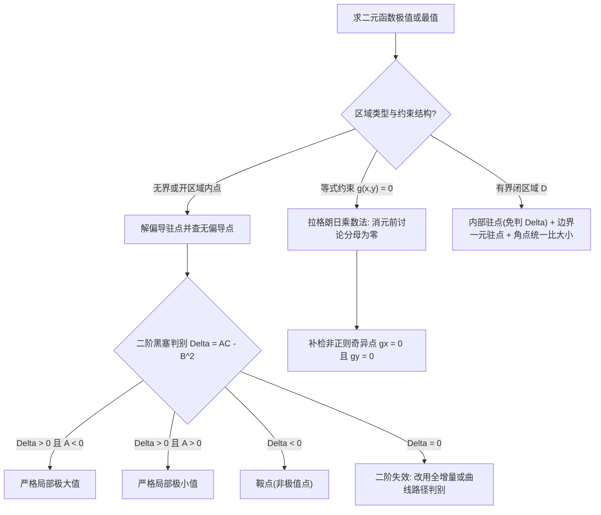

# 第13讲 多元函数微分学

基础补充对照：[[第13讲_讲义.pdf]]，第 1—34 页（第 29—34 页为习题及解答）。

本讲对应数二考纲，整合《基础30讲》《强化36讲》与《1000题》，已剔除数一专属考点（空间解析几何、方向导数与梯度、切平面与法线）及数三经济应用。主线为：**二重极限与连续可微逻辑链**、**多元复合与隐函数求导**、**变量代换与偏积分化简**、**极值与闭区域最值**。题号“例”指强化36讲，“B”指《1000题》强化篇第13章。

---

> [!important] 近 17 年数二真题雷达（2010—2026｜S+ 级全卷第一题量区）
> - **考频画像**：主考 **41 题（全高数最高）**（2010—2014 年 12 题、2015—2020 年 15 题、2021—2026 新大纲 **14 题，年均 2.3 题**），解答题 **2022—2026 连续五年考查**。
> - **真题落点**：
>   - *2021—2026 新大纲*：`21-T6(选)`、`21-T13(填)`、`22-T4(选)`、`22-T20(解)`、`23-T13(填)`、`23-T18(解)`、`24-T5(选)`、`24-T12(填)`、`24-T20(解)`、`25-T1(选)`、`25-T19(解)`、`26-T3(选)`、`26-T14(填)`、`26-T19(解)`
>   - *2015—2020 经典*：`15-T5(选)`、`15-T13(填)`、`15-T17(解)`、`16-T6(选)`、`16-T17(解)`、`17-T5(选)`、`17-T12(填)`、`17-T16(解)`、`18-T13(填)`、`18-T19(解)`、`19-T11(填)`、`19-T20(解)`、`20-T5(选)`、`20-T11(填)`、`20-T17(解)`
>   - *2010—2014 早期*：`10-T5(选)`、`10-T19(解)`、`11-T5(选)`、`11-T17(解)`、`12-T5(选)`、`12-T11(填)`、`12-T16(解)`、`13-T5(选)`、`13-T19(解)`、`14-T6(选)`、`14-T11(填)`、`14-T18(解)`
> - **新大纲高频命题点**：
>   1. **“偏导方程 / 全微分逆推原函数 + 极值”为解答题主线**：`22-T20`、`24-T20`、`25-T19`（同构小题 `17-T12`、`14-T18`）。关键点：偏积分任意项须写为另一变量的**任意函数 $C(y)$**，不可写成常数 $C$。
>   2. **无条件极值周期驻点与显式计算**：`23-T18`（$\sin y=0$ 须写出全部驻点 $y=k\pi$ 并按 $k$ 奇偶讨论）、`24-T12`（分清问“极值点”还是“极值”）、`26-T19`、早期 `11-T5 / 12-T16 / 13-T19 / 14-T6`。
>   3. **概念反例与复合/隐函数全微分**：`24-T5`（$(x^2+y^2)\sin\frac{1}{xy}$ 原点可微但偏导不连续）、`20-T5`（混合偏导须先查去心邻域一阶偏导）、`21-T6`、`22-T4`（识别 $G(x-y)$）、`25-T1`（变下限积分直接取全微分）、`23-T13`、`12-T5 / 17-T5`。
> - **每日复习聚焦**：优先巩固「四位一体逻辑链与四大反例 + 隐函数一二阶偏导/全微分 + 偏导方程变量代换与偏积分（$C(y)$）+ 无条件/条件极值」。

---

## 第一部分｜知识点与核心结论

### 一、多元函数极限与连续【📌 扫一眼｜确认“我还会”就过】

**1. 二重极限的概念与去心邻域** 【📌 扫一眼｜确认“我还会”就过】
- **定义**：设二元函数 $z = f(x,y)$ 在点 $P_0(x_0,y_0)$ 的去心邻域 $\mathring{U}(P_0,\delta)$ 内有定义。若存在常数 $A$，对任意给定的正数 $\varepsilon > 0$，总存在正数 $\delta > 0$，当平面上的点 $P(x,y)$ 满足 $0 < \sqrt{(x-x_0)^2+(y-y_0)^2} < \delta$ 且 $(x,y)\in D$ 时，恒有 $|f(x,y) - A| < \varepsilon$，则称常数 $A$ 为函数 $f(x,y)$ 当 $(x,y)\to(x_0,y_0)$ 时的二重极限，记为：
  $$
  \lim_{(x,y)\to(x_0,y_0)}f(x,y) = A,\qquad \lim_{\substack{x\to x_0 \\ y\to y_0}}f(x,y) = A.
  $$
- **要点**：二重极限要求点 $P(x,y)$ 在定义域内以**任意方式、沿任意路径**趋于 $P_0(x_0,y_0)$ 时，函数值都趋近于同一个常数 $A$，即极限值与路径无关。
- **极限与中心点值无关**：定义中的去心邻域挖掉了中心点 $P_0$，因此极限是否存在与 $f(x_0,y_0)$ 是否有定义、取何值没有任何必然关系。

**2. 特殊路径否定法（同阶路径与变阶路径）** 【📌 扫一眼｜确认“我还会”就过】
- **否定原理**：若能找到两条经过目标点的合法趋近路径，函数在这两条路径上的极限不相等；或者沿某一条具体路径趋近时极限根本不存在，即可直接断言该二重极限不存在。
- **同阶路径（射线族/直线族）**：适用于分子与分母各单项式关于自变量的最高次或最低次齐次的情形。
  - 令 $y - y_0 = k(x - x_0)$（$x\ne x_0$）。代入原式消去自变量后，若极限表达式显式依赖于斜率参数 $k$，则说明沿不同方向趋近极限值不同，二重极限必不存在。
- **变阶抵消路径（曲线族）**：适用于分母中存在符号相反项可能相互抵消、或单项式次数不齐的情形。
  - 例如分母含有 $x^2 + y$ 时，沿直线 $y = kx$ 分母中一次项占优；但若取抛物线路径 $y = -x^2 + x^3$，分母主项抵消升阶为 $x^3$，从而改变分母阶数，暴露出与直线路径不同的极限行为，从而否定二重极限。
- **逻辑边界**：
  - 沿两条路径极限不同 $\implies$ 二重极限不存在；
  - 沿某一条路径极限不存在 $\implies$ 二重极限不存在；
  - 沿有限条乃至**所有直线路径**极限相同，<mark>沿任意直线极限相同仍推不出二重极限存在</mark>。

**3. 二重极限的计算与存在性证明（四种通法）** 【📌 扫一眼｜确认“我还会”就过】
- **通法1：夹逼准则（绝对值放缩法）**：
  若能找到二元函数 $g(x,y)$ 满足 $|f(x,y) - A| \le g(x,y)$，且 $\lim_{(x,y)\to(x_0,y_0)}g(x,y) = 0$，则必有 $\lim_{(x,y)\to(x_0,y_0)}f(x,y) = A$。常用放缩不等式：
  $$
  |xy| \le \frac{1}{2}(x^2+y^2),\qquad |x| \le \sqrt{x^2+y^2},\qquad |y| \le \sqrt{x^2+y^2}.
  $$
- **通法2：极坐标代换法**：
  若趋于原点 $(0,0)$，令 $x = r\cos\theta, y = r\sin\theta$（$r > 0$），将函数改写为 $f(r\cos\theta, r\sin\theta)$。
  - 若能放缩出<mark>放缩上界须完全与角度无关</mark>（$|f(r\cos\theta, r\sin\theta) - A| \le h(r)$ 且 $\lim_{r\to 0^+}h(r) = 0$），则二重极限存在且为 $A$；
  - 若 $\lim_{r\to 0^+}f(r\cos\theta, r\sin\theta)$ 的结果显式含有 $\theta$，则二重极限必不存在。
- **通法3：无穷小量乘有界量**：
  将表达式拆项，分解为若干个因子的乘积，若其中一个因子一致趋于 0，而其余因子在去心邻域内有与路径无关的公共界，则整体极限为 0。
- **通法4：整体换元转化为一元极限**：
  若表达式能够整体表述为中间复合量 $t = g(x,y)$ 的函数 $\varphi(t)$，且当 $(x,y)\to(x_0,y_0)$ 时在全邻域内无条件满足 $t\to t_0$，则可直接转化为一元极限 $\lim_{t\to t_0}\varphi(t)$。

**4. 累次极限及其与二重极限的联系与区别** 【💤 可跳过｜冲刺期直接跳过不看】
- **定义**：先固定一个变量求内层极限，再对所得的一元函数求外层极限：
  $$
  L_{12} = \lim_{x\to x_0}\left[\lim_{y\to y_0}f(x,y)\right],\qquad L_{21} = \lim_{y\to y_0}\left[\lim_{x\to x_0}f(x,y)\right].
  $$
- **累次极限与二重极限的关系矩阵**：

| 条件与前提 | 结论 | 反例或典型模型 |
|---|---|---|
| 二重极限存在，且内层极限在去心邻域存在 | 相应累次极限必存在且等于二重极限 | 基础分析基本定理 |
| 两个累次极限均存在且不相等（$L_{12} \ne L_{21}$） | 二重极限必不存在 | $f(x,y) = \frac{x^2-y^2}{x^2+y^2}$ |
| 两个累次极限均存在且相等（$L_{12} = L_{21}$） | <mark>两累次极限相等不能反推二重极限存在</mark> | $f(x,y) = \frac{xy}{x^2+y^2}$，两累次极限均为 0，二重极限不存在 |
| 二重极限存在 | 累次极限**未必存在** | $f(x,y) = x\sin\frac{1}{y} + y\sin\frac{1}{x}$，二重极限为 0，两累次极限均不存在 |
| 两个累次极限均不存在 | 二重极限**可能存在** | 同上模型（分段象限内为 $xy$ 时累次极限亦可存在 `[真题·2020-T5]`） |

**5. 多元函数的连续性与分别连续** 【📌 扫一眼｜确认“我还会”就过】
- **联合连续（连续性）**：若点 $P_0(x_0,y_0)$ 为定义域内的点，且满足：
  $$
  \lim_{(x,y)\to(x_0,y_0)}f(x,y) = f(x_0,y_0),
  $$
  则称函数 $f(x,y)$ 在点 $P_0$ 处连续。
- **分别连续**：分别固定一个自变量，仅关于另一个自变量连续：
  $$
  \lim_{x\to x_0}f(x,y_0) = f(x_0,y_0),\qquad \lim_{y\to y_0}f(x_0,y) = f(x_0,y_0).
  $$
- **辨析要点**：联合连续可推出分别连续；<mark>分别连续推不出联合连续</mark>（前者仅控制平行于坐标轴的两条切片，无法控制倾斜或曲线路径）。

### 二、偏导数、全微分与可微性【🔥 必背｜停下来默背 1 遍 · 概念选填重镇】

**1. 偏导数的概念与几何意义** 【🔥 必背｜停下来默背 1 遍】
- **定义**：设函数 $z = f(x,y)$ 在点 $(x_0,y_0)$ 的某邻域内有定义。固定 $y = y_0$，考查一元函数 $f(x,y_0)$ 在 $x = x_0$ 处的导数：
  $$
  f_x(x_0,y_0) = \left.\frac{\partial z}{\partial x}\right|_{(x_0,y_0)} = \lim_{\Delta x\to 0}\frac{f(x_0+\Delta x, y_0) - f(x_0,y_0)}{\Delta x} = \lim_{x\to x_0}\frac{f(x,y_0)-f(x_0,y_0)}{x-x_0}.
  $$
  同理，固定 $x = x_0$，考查一元函数 $f(x_0,y)$ 在 $y = y_0$ 处的导数即为偏导数 $f_y(x_0,y_0)$。
- **单轴单调性应用（$f_x>0,\ f_y<0$）**：<mark>偏导符号定沿坐标轴单调，对角比较靠中间点串联</mark> `[真题·2012-T5]` `[真题·2017-T5]`。
  - **2012-T5 & 2017-T5 A/B/C/D 秒排验证**：由 $f_x>0,\ f_y<0$ 仅当 $x$ 增且 $y$ 减时（`12-T5` 为 $x_1<x_2,y_1>y_2$ 经 $(x_2,y_1)$ 串得 $f(x_1,y_1)<f(x_2,y_2)$ 选 D；`17-T5` 为 $f(0,1)<f(1,1)<f(1,0)$ 选 D）；其余逆向或单调冲突选项用线性函数 $f(x,y)=x-y$、$2x-y$、$x-2y$（如 `12-T5` $(2,0),(1,1)$ 排 A，$(3,2),(1,1)$ 排 B，$(1,1),(2,5)$ 排 C；`17-T5` $(0,0),(1,1)$ 排 A/B，$f(0,1)<f(1,0)$ 排 C）一秒否决。
- **求导边界**：
  - 非分段点或初等函数区域内部：视另一变量为常数，按一元公式求导；
  - 分段函数在分段点处：<mark>分段点偏导按差商极限定义计算</mark>，不能直接用非分段区导函数取极限代替；求原点混合偏导如 $f_{xy}(0,0)$ 须先核查去心邻域一阶偏导 $f_x(0,y)\ (y\ne 0)$ 是否存在 `[真题·2020-T5]`。
  - **2020-T5 A/B/C/D 选项逐条核验**（坐标轴为 $x$ 或 $y$，象限内为 $xy$）：① $f_x(0,0)=\lim_{x\to 0}\frac{x}{x}=1$ 存在；② $y\ne 0$ 时 $\lim_{x\to 0}\frac{xy-y}{x}$ 不存在，故混合偏导不存在；③ $\vert f\vert\le\vert xy\vert+\vert x\vert+\vert y\vert\to 0$ 二重极限 $=0$；④ 固定 $y\ne 0$ 得 $\lim_{x\to 0}xy=0$，两累次极限 $=0$。共 ①③④ 正确（3 个），故 B 对，A($4$)/C($2$)/D($1$) 均错。

**2. 高阶偏导数与混合偏导数可交换定理** 【📌 扫一眼｜确认“我还会”就过】
- **二阶偏导数记号**：$f_{xx} = \frac{\partial^2 f}{\partial x^2}$，$f_{yy} = \frac{\partial^2 f}{\partial y^2}$，$f_{xy} = (f_x)_y = \frac{\partial}{\partial y}\left(\frac{\partial f}{\partial x}\right)$，$f_{yx} = (f_y)_x = \frac{\partial}{\partial x}\left(\frac{\partial f}{\partial y}\right)$。
- **Schwarz 混合偏导数相等定理**：
  若 $f_{xy}$ 与 $f_{yx}$ 在点 $(x_0,y_0)$ 某邻域内存在，且在该点**连续**，则：
  $$
  f_{xy}(x_0,y_0) = f_{yx}(x_0,y_0).
  $$
- **边界提醒**：仅已知 $f_{xy}$ 与 $f_{yx}$ 存在而不连续时，两者未必相等（见例13.13）；<mark>未确认二阶偏导连续不可交换求导次序</mark>（或先选求导后不含未定高阶导的一侧，如对 $z=f(xy,yg(x))$ 且仅知 $g'(1)=0$ 先对 $x$ 再对 $y$ 求偏导免出现 $g''(1)$ `[真题·2011-T17]`）。

**3. 全微分与可微的定义与充要判定** 【🔥 必背｜停下来默背 1 遍】
- **定义**：设 $\rho = \sqrt{(\Delta x)^2+(\Delta y)^2}$。若函数 $z = f(x,y)$ 在点 $(x_0,y_0)$ 处的全增量 $\Delta z = f(x_0+\Delta x, y_0+\Delta y) - f(x_0,y_0)$ 可表示为：
  $$
  \Delta z = A\Delta x + B\Delta y + o(\rho),
  $$
  其中常数 $A, B$ 与自变量增量 $\Delta x, \Delta y$ 无关，仅依赖于点 $(x_0,y_0)$，则称函数 $f(x,y)$ 在点 $(x_0,y_0)$ 处**可微**。线性主部 $A\Delta x + B\Delta y$ 称为函数在该点的**全微分**，记为 $\mathrm{d}z$。
- **偏导数作为必要系数**：若函数在 $(x_0,y_0)$ 处可微，则各方向一阶偏导数必存在，且系数唯一确定为：
  $$
  A = f_x(x_0,y_0),\qquad B = f_y(x_0,y_0),\qquad \mathrm{d}z = f_x(x_0,y_0)\,\mathrm{d}x + f_y(x_0,y_0)\,\mathrm{d}y.
  $$
- **可微的充要判别极限式**：
  先求出两轴偏导数 $f_x(x_0,y_0)$ 与 $f_y(x_0,y_0)$。函数可微等价于下述二重极限严格为零：
  $$
  \lim_{(\Delta x,\Delta y)\to(0,0)}\frac{\Delta z - [f_x(x_0,y_0)\Delta x + f_y(x_0,y_0)\Delta y]}{\sqrt{(\Delta x)^2+(\Delta y)^2}} = 0.
  $$
- **高阶无穷小充要判法**：若已由题设条件得出 $\Delta z = A\Delta x + B\Delta y + R$，且满足 $\lim \frac{R}{\rho^2} = L$（有限极限），则 $R = O(\rho^2) = o(\rho)$，从而直接判定可微，且全微分必为 $\mathrm{d}z = A\,\mathrm{d}x + B\,\mathrm{d}y$。

**4. 连续、偏导存在、可微、偏导连续“四位一体”判定逻辑链** 【⚡ 避坑｜最值钱，必须精读 1 分钟】
- **单向逻辑大图景**：
  $$
  f_x, f_y \text{ 连续} \Longrightarrow f\text{ 可微} \Longrightarrow \begin{cases} f\text{ 连续},\\ f_x, f_y\text{ 存在}. \end{cases} \Longrightarrow f\text{ 分别连续}.
  $$
- **逻辑边界与反例对照表**：

| 命题组合 | 关系判定 | 经典反例与核心考点 |
|---|---|---|
| 偏导数存在 $\implies$ 函数连续 | 不成立 | $f(x,y) = \frac{xy}{x^2+y^2}$（非零点），$f(0,0)=0$。轴上恒零偏导存在，沿 $y=x$ 极限为 $1/2$，不连续 |
| 函数连续 $\implies$ 偏导数存在 | 不成立 | $g(x,y) = \sqrt{x^2+y^2}$。全平面连续，原点切片为 $\lvert x\rvert$，偏导不存在 |
| 函数连续 且 偏导数存在 $\implies$ 可微 | 不成立 | $f(x,y) = \frac{x^2y}{x^2+y^2}$（非零点），$f(0,0)=0$。连续且 $f_x=f_y=0$，余项比距离极限非零，不可微 |
| 可微 $\implies$ 偏导函数连续 | 不成立 | $f(x,y) = (x^2+y^2)\sin\frac{1}{x^2+y^2}$（非零点），$f(0,0)=0$。原点可微且 $\mathrm{d}f=0$，但偏导在原点振荡不连续 |
| 偏导函数不连续 $\implies$ 不可微 | 不成立 | 偏导不连续仅表示充分条件失效，不能否定可微性（上例即反例） |
| 函数不连续 或 偏导不存在 $\implies$ 不可微 | 成立（逆否命题） | 不连续或任一偏导不存在，直接判定不可微，无需算全微分极限 |

- `【⚡ 真题补丁｜2024-T5】` <mark>二元函数在一点可微不要求偏导数连续</mark>，不要因偏导分母含 $xy$ 就误判原点不可微。
  - **经典反例与 A/B/C/D 选项核验**（$f(x,y)=(x^2+y^2)\sin\frac{1}{xy}\ (xy\ne 0)$，$0\ (xy=0)$）：
    - **可微性检验**：原点偏导 $f_x(0,0)=f_y(0,0)=0$，全增量比距离 $\frac{\vert\Delta f\vert}{\rho}\le\rho\to 0$，故在 $(0,0)$ **可微**（排除判不可微的 A、B）；
    - **偏导连续检验**：非零点偏导 $f_x(x,y)=2x\sin\frac{1}{xy}-\frac{x^2+y^2}{x^2y}\cos\frac{1}{xy}$ 沿 $y=x$ 趋原点无界振荡极限不存在（$y$ 轴非原点处亦无偏导），故 $f_x$ **不连续**（排除误判偏导连续的 D，选 C）。

### 三、多元复合函数与隐函数求导法则【🔥 必背｜停下来默背 1 遍 · 年年必考】

**基础补充：偏导为零与定义域的关系** 【💤 可跳过｜冲刺期直接跳过不看】
- 若 $f_x=f_y=0$ 在连通开区域 $D$ 上处处成立，则 $f$ 在 $D$ 上为常数。可沿区域内折线分段应用一元中值定理证明。
- 若只有 $f_x=0$，只能先断定固定 $y$ 的每个连通水平截段上函数为常数。若每条非空水平截面均为区间，则可在整个区域写成 $f(x,y)=g(y)$；当某截面分为多段时，这一结论不一定成立，需要进一步检查各段上的值是否相同。
- 反例：令 $D=\mathbb R^2\setminus\{(0,y):y\ge0\}$，在 $x>0,y\ge0$ 时令 $f(x,y)=y^2$，其余 $D$ 中的点令 $f(x,y)=0$。此时 $D$ 连通且 $f_x=0$，但 $f(1,1)=1$、$f(-1,1)=0$，故无法全局写成单一的 $g(y)$。（基础讲义 PDF 第 20—21 页。）

**1. 多元复合函数链式求导法则（树状图相乘相加原则）** 【🔥 必背｜停下来默背 1 遍】
- **链式法则核心口诀**：明确最终自变量、中间变量与因变量的依赖关系；画出树状依赖图，<mark>沿同路径连乘而多条独立路径相加</mark>（如 $z=\frac{y}{x}f(xy)$ 求导选特值 $f=1, f=u$ 可双检排除 C/D/B 得 $2yf'(xy)$ `[真题·2013-T5]`；$z=\arctan[xy+\sin(x+y)]$ 在 $(0,\pi)$ 先写通式再代 $\cos\pi=-1$ `[真题易错·2020-T11]`）。
- **标准情形**：设 $z = f(u,v)$ 具有连续偏导数，$u = u(x,y), v = v(x,y)$ 可偏导，则：
  $$
  \frac{\partial z}{\partial x} = \frac{\partial z}{\partial u}\frac{\partial u}{\partial x} + \frac{\partial z}{\partial v}\frac{\partial v}{\partial x},\qquad
  \frac{\partial z}{\partial y} = \frac{\partial z}{\partial u}\frac{\partial u}{\partial y} + \frac{\partial z}{\partial v}\frac{\partial v}{\partial y}.
  $$
- **二阶链式求导规则**：求二阶偏导数时，$f_u(u,v)$ 与 $f_v(u,v)$ 仍是以 $u, v$ 为中间变量的复合函数，继续求导须再次使用链式法则与乘积法则：
  $$
  \frac{\partial}{\partial x}(f_u) = f_{uu}\frac{\partial u}{\partial x} + f_{uv}\frac{\partial v}{\partial x}.
  $$
- `【⚡ 真题补丁｜2021-T6】` 双路径复合求定点全微分，须<mark>分别代入各自对应的参数值锚定同一点</mark>后再联立 `[真题易错·2021-T6]`。
  - **锚点细节与避错**：对 $f(x+1,\mathrm{e}^x)$ 令 $x=0$、对 $f(x,x^2)$ 令 $x=1$，求导后再代各自参数锚定 $(1,1)$，不可先代值后求导或未锚点直接相减；联立得 $f'_1(1,1)=0,\ f'_2(1,1)=1 \implies \mathrm{d}f(1,1)=\mathrm{d}y$（选 C，排 ABD）。

**2. 含参变量变限积分求导法则（Leibniz 积分法则）** 【📌 扫一眼｜确认“我还会”就过】
- 设变上限积分函数 $F(x,y) = \int_{a(x,y)}^{b(x,y)} \phi(x,y,t)\,\mathrm{d}t$，其中积分上下限 $a, b$ 可导，被积函数 $\phi$ 及其偏导数 $\phi_x$ 连续，则：
  $$
  \frac{\partial F}{\partial x} = \phi(x,y,b(x,y))\cdot \frac{\partial b}{\partial x} - \phi(x,y,a(x,y))\cdot \frac{\partial a}{\partial x} + \int_{a(x,y)}^{b(x,y)} \frac{\partial \phi(x,y,t)}{\partial x}\,\mathrm{d}t.
  $$
- **计算优先策略**：若某变量仅出现在积分上限或下限中，而不出现在被积函数内部（即 $\phi_y \equiv 0$），则对该变量求偏导可直接利用微积分基本定理消去积分号，无需计算含参积分项。求混合偏导时应优先对该变量求导；遇形如 $F(x,y)=\int_0^{x-y}(x-y-t)f(t)\,\mathrm{d}t$ 拆项时<mark>严禁将积分变量提到积分号外</mark>，选填可设 $G(x-y)$ 链式 10 秒秒杀 `[真题易错·2022-T4]`。
  - **2022-T4 A/B/C/D 验证**：令 $f(t)\equiv 1$ 得特例 $F(x,y)=\frac{1}{2}(x-y)^2$，一阶偏导 $F_x=x-y=-F_y$（立排 A、B 的 $F_x=F_y$），二阶偏导 $F_{xx}=1=F_{yy}$（排 D 的 $F_{xx}=-F_{yy}$），选 C。

**3. 一阶全微分形式不变性** 【🔥 必背｜停下来默背 1 遍】
- **形式不变性定理**：设 $z = f(u,v)$ 具有连续偏导数。无论 $u, v$ 是独立的自变量，还是通过中间函数依赖于其他自变量的可微函数，函数 $z$ 的一阶全微分形式恒保持不变：
  $$
  \mathrm{d}z = \frac{\partial z}{\partial u}\,\mathrm{d}u + \frac{\partial z}{\partial v}\,\mathrm{d}v.
  $$
- **实战价值**：求解复杂隐函数或多元方程时，无需分别计算复杂的偏导分式，<mark>方程两端直接取全微分可免记负号</mark>，在指定点代入坐标即得线性关系（如求定点 $\mathrm{d}z$ 勿忘保留 $\mathrm{d}x,\ \mathrm{d}y$ 并核对单调唯一解 $z=0$ `[真题·2014-T11]` `[真题·2015-T13]`）。
- `【⚡ 真题补丁｜2025-T1 / 2026-T3】` 隐函数配变上下限积分求偏导组合，直接<mark>两端取全微分可防下限求导漏负号</mark> `[真题·2025-T1]` `[真题·2026-T3]`。
  - **2025-T1 选项排除**：$\mathrm{d}\int_y^x\mathrm{e}^{-t^2}\mathrm{d}t=\mathrm{e}^{-x^2}\mathrm{d}x-\mathrm{e}^{-y^2}\mathrm{d}y$，解得 $z_x+z_y=\frac{z}{z+1}(\mathrm{e}^{-x^2}-\mathrm{e}^{-y^2})$ 选 A；B 项对下限 $y$ 求导漏负号，C 项公式 $-F_x/F_z$ 整体写反，D 项双错；`26-T3` 由 $\mathrm{d}x-a\,\mathrm{d}z=\mathrm{e}^{y+az}(\mathrm{d}y+a\,\mathrm{d}z)$ 得 $z_x-z_y=\frac{1}{a}$ 选 A。

**4. 隐函数存在定理与求导通法** 【🔥 必背｜停下来默背 1 遍】
- **单个方程的情形**：设方程 $F(x,y,z) = 0$ 在点 $P_0(x_0,y_0,z_0)$ 附近有一阶连续偏导数，满足 $F(P_0) = 0$ 且 $F_z(P_0) \ne 0$，则方程在该点邻域内可唯一确定单值连续且有连续偏导数的隐函数 $z = z(x,y)$，偏导数公式为：
  $$
  \frac{\partial z}{\partial x} = -\frac{F_x}{F_z},\qquad \frac{\partial z}{\partial y} = -\frac{F_y}{F_z}.
  $$
- **非零条件是充分条件，不是必要条件**：例如 $F(x,y)=(y-x)^2=0$ 在原点有 $F_y(0,0)=0$，但仍唯一确定可微隐函数 $y=x$。此时<mark>不可直接套分母为零的求导公式</mark>。（基础讲义 PDF 第 18 页例 13.14。）
- **隐函数驻点二阶导数极简公式**：
  若在隐函数驻点处满足 $z_x = 0, z_y = 0$（即 $F_x = 0, F_y = 0$），则对偏导等式两边继续求导时，含有 $z_x, z_y$ 的乘积项全部归零，<mark>驻点二次求导直接置零一阶偏导简化</mark> `[真题·2016-T17]`：
  $$
  z_{xx} = -\frac{F_{xx}}{F_z},\qquad z_{xy} = -\frac{F_{xy}}{F_z},\qquad z_{yy} = -\frac{F_{yy}}{F_z}.
  $$
- **方程组的情形**：
  设方程组 $F(x,y,z) = 0, G(x,y,z) = 0$ 确定 $y = y(x), z = z(x)$。两端对自变量 $x$ 求导，将 $y', z'$ 视为未知数，联立一次线性方程组：
  $$
  \begin{cases}
  F_x + F_y y' + F_z z' = 0,\\
  G_x + G_y y' + G_z z' = 0.
  \end{cases}
  $$
  解出 $y'$ 与 $z'$。若在指定点求值，必须**先代入自变量求出因变量的具体数值**，再解线性方程组。

**5. 常用全微分凑微分公式库** 【📌 扫一眼｜确认“我还会”就过】
若 $P,Q$ 在单连通开区域上具有连续的一阶偏导数，则微分形式 $P\,\mathrm{d}x + Q\,\mathrm{d}y$ 存在势函数 $U$ 的充要条件为 $P_y = Q_x$。常用原函数对照如下表：

| 微分结构式 | 紧凑全微分形式 $\mathrm{d}U$ | 适用定义域与约束 |
|---|---|---|
| $x\,\mathrm{d}x + y\,\mathrm{d}y$ | $\mathrm{d}\left(\frac{1}{2}(x^2+y^2)\right)$ | 全平面 |
| $x\,\mathrm{d}x - y\,\mathrm{d}y$ | $\mathrm{d}\left(\frac{1}{2}(x^2-y^2)\right)$ | 全平面 |
| $y\,\mathrm{d}x + x\,\mathrm{d}y$ | $\mathrm{d}(xy)$ | 全平面 |
| $\frac{x\,\mathrm{d}y - y\,\mathrm{d}x}{x^2}$ | $\mathrm{d}\left(\frac{y}{x}\right)$ | $x \ne 0$ |
| $\frac{y\,\mathrm{d}x - x\,\mathrm{d}y}{y^2}$ | $\mathrm{d}\left(\frac{x}{y}\right)$ | $y \ne 0$ |
| $\frac{x\,\mathrm{d}x + y\,\mathrm{d}y}{x^2+y^2}$ | $\mathrm{d}\left(\frac{1}{2}\ln(x^2+y^2)\right)$ | $(x,y) \ne (0,0)$ |
| $\frac{x\,\mathrm{d}y - y\,\mathrm{d}x}{x^2+y^2}$ | $\mathrm{d}\left(\arctan\frac{y}{x}\right)$ | $x \ne 0$ |
| $\frac{y\,\mathrm{d}x - x\,\mathrm{d}y}{x^2+y^2}$ | $\mathrm{d}\left(\arctan\frac{x}{y}\right)$ | $y \ne 0$ |
| $\frac{x\,\mathrm{d}x + y\,\mathrm{d}y}{(x^2+y^2)^2}$ | $\mathrm{d}\left(-\frac{1}{2(x^2+y^2)}\right)$ | $(x,y) \ne (0,0)$ |
| $\frac{x\,\mathrm{d}x + y\,\mathrm{d}y}{1+(x^2+y^2)^2}$ | $\mathrm{d}\left(\frac{1}{2}\arctan(x^2+y^2)\right)$ | 全平面 |

**6. 齐次函数与 Euler 定理** 【💤 可跳过｜冲刺期直接跳过不看】
- **定义**：若函数 $f(x,y)$ 满足对任意正数 $t > 0$ 恒有 $f(tx,ty) = t^k f(x,y)$，则称 $f(x,y)$ 为 $k$ 次齐次函数。
- **Euler 齐次函数定理**：可微函数 $f(x,y)$ 为 $k$ 次齐次函数，当且仅当其满足偏微分方程：
  $$
  x\frac{\partial f}{\partial x} + y\frac{\partial f}{\partial y} = k f(x,y).
  $$
- **特例**：零次齐次函数（$k=0$）满足 $x f_x + y f_y = 0$，且在无零分母区域可写为单比值形式 $f(x,y) = \varphi(y/x)$（一次齐次式 $F(y/x,z/x)=0$ 满足 $x z_x+y z_y=z$ 选 B，取特例 $z=y$ 秒排 A/C/D `[真题·2010-T5]`）。

### 四、变量代换与偏微分方程化简【⚡ 避坑｜最值钱，必须精读 1 分钟 · 大题第一母题】

**1. 变量代换的核心原理与非退化条件** 【🔥 必背｜停下来默背 1 遍】
- **换元机制**：利用链式求导法则，将以原变量 $(x,y)$ 为自变量的偏导数转化为以新变量 $(u,v)$ 为自变量的偏导数，从而消除方程中的复杂耦合项或降阶。
- **非退化判定与雅可比行列式**：设代换关系为 $u = \varphi(x,y), v = \psi(x,y)$。由反函数存在定理，雅可比行列式非零是局部存在连续可微（光滑）逆变换的**充分条件**：
  $$
  J = \frac{\partial(u,v)}{\partial(x,y)} = \begin{vmatrix} \varphi_x & \varphi_y \\ \psi_x & \psi_y \end{vmatrix} = \varphi_x\psi_y - \varphi_y\psi_x \ne 0.
  $$
  需明确：连续逆映射的存在不要求 $J \ne 0$（如 $u = x^3, v = y$ 在原点局部有连续逆，但 $J(0,0)=0$）。在用光滑换元化简偏微分方程时，$J \ne 0$ 保证偏导数可双向唯一表达、代换不降维；<mark>雅可比行列式为零的退化参数须舍去</mark>（且化为 $u_{\xi\eta}=0$ 时还要核验交叉项系数非零 `[真题·2010-T19]`）。

**2. 直角坐标向极坐标变换的偏导数公式** 【💤 可跳过｜冲刺期直接跳过不看】
- 极坐标变换 $x = r\cos\theta, y = r\sin\theta$ 下的一阶偏导算子联系：
  $$
  \frac{\partial z}{\partial r} = \frac{\partial z}{\partial x}\cos\theta + \frac{\partial z}{\partial y}\sin\theta,\qquad
  \frac{\partial z}{\partial \theta} = -\frac{\partial z}{\partial x}r\sin\theta + \frac{\partial z}{\partial y}r\cos\theta.
  $$
- **Laplace 算子的极坐标标准形**：
  $$
  \Delta z = \frac{\partial^2 z}{\partial x^2} + \frac{\partial^2 z}{\partial y^2} = \frac{\partial^2 z}{\partial r^2} + \frac{1}{r}\frac{\partial z}{\partial r} + \frac{1}{r^2}\frac{\partial^2 z}{\partial \theta^2}.
  $$
- **径向对称与径向对数代换**：
  - 若函数仅依赖于径向距离 $r = \sqrt{x^2+y^2}$，即 $z = f(r)$，则：
    $$
    z_{xx} + z_{yy} = f''(r) + \frac{1}{r}f'(r) = \frac{1}{r}[r f'(r)]'.
    $$
  - 若令径向对数变量 $s = \ln\sqrt{x^2+y^2} = \ln r$，则 Laplace 算子具有极简形式：
    $$
    z_{xx} + z_{yy} = \frac{1}{x^2+y^2}f''(s) = \frac{1}{r^2}f''(s).
    $$

**3. 线性代换规范化二阶常系数偏微分方程** 【🔥 必背｜停下来默背 1 遍】
- 对二阶常系数线性方程 $A z_{xx} + B z_{xy} + C z_{yy} = 0$，令 $u = x + \alpha y, v = x + \beta y$：
  - 代入链式展开式后，纯二阶项 $z_{uu}$ 的系数为 $A + B\alpha + C\alpha^2$，$z_{vv}$ 的系数为 $A + B\beta + C\beta^2$；
  - 选取特征方程 $A + B\lambda + C\lambda^2 = 0$ 的相异实根作为参数 $\alpha, \beta$，即可精确消去纯二阶项，将方程化简为标准双曲型形式 $z_{uv} = 0$ 或 $z_{uv} = k z_u$（复合式 $z=f(\mathrm{e}^x\cos y)$ 化为常系数 ODE 求解初值 `[真题·2014-T18]`）。

**4. 单方向偏微分方程与偏积分求解规则** 【⚡ 避坑｜最值钱，必须精读 1 分钟】
- **偏积分产生任意函数**：
  若方程仅对某一个自变量求导（例如 $z_x(x,y) = g(x,y)$），对 $x$ 积分时<mark>偏积分任意项须写另一变量的任意函数</mark> $C(y)$：
  $$
  z(x,y) = \int g(x,y)\,\mathrm{d}x + C(y).
  $$
  同理，对二阶偏微分方程 $z_{uv} = 0$，先对 $u$ 积分得 $z_v = \phi(v)$，再对 $v$ 积分得通解 $z(u,v) = \int \phi(v)\,\mathrm{d}v + C(u) = \Phi(v) + C(u)$。
- **边界条件定解流程**：
  将边界切片条件（如 $z(0,v)$ 或 $z_v(0,v)$）代入通解，通过求解关于单一变量的常微分方程或代数方程，唯一确定这些未知函数。
- `【⚡ 真题补丁｜2022-T20 / 2024-T20 / 2025-T19】` 由偏导或全微分逆推原函数，<mark>对一变量偏积分任意项须写为另一变量函数</mark>，切勿错写常数 `[真题·2017-T12]`。
  - **实战策略**：定出 $C(y)$ 后代入另一偏导 $f_y$ 或边界切片（如 `25-T19` 选简项 $f_x=-2x\mathrm{e}^{-y}$ 先积，再对 $y$ 求偏导对比；`17-T12` 亦可直凑 $\mathrm{d}(xy\mathrm{e}^y)$）。

### 五、多元函数极值与最值【🔥 必背｜停下来默背 1 遍 · 22-26 解答五连全勤】

**1. 无条件极值的必要条件与二阶充分条件判别式** 【🔥 必背｜停下来默背 1 遍】
- **驻点必要条件**：设函数 $z = f(x,y)$ 在内点 $(x_0,y_0)$ 处取得极值，且偏导数 $f_x, f_y$ 存在，则必有：
  $$
  f_x(x_0,y_0) = 0,\qquad f_y(x_0,y_0) = 0.
  $$
  使得一阶偏导数同时为零的点称为**驻点**。偏导数不存在的点也可能是极值点。驻点未必是极值点。
- **二阶充分条件判别法**：
  设函数在驻点 $(x_0,y_0)$ 的邻域内具有二阶连续偏导数。记：
  $$
  A = f_{xx}(x_0,y_0),\qquad B = f_{xy}(x_0,y_0),\qquad C = f_{yy}(x_0,y_0),\qquad \Delta = AC - B^2.
  $$
  极值判定准则如下：
  1. 若 $\Delta = AC - B^2 > 0$：该点确为严格极值点；
     - 当 $A > 0$（或 $C > 0$）时，取得**严格局部极小值**；
     - 当 $A < 0$（或 $C < 0$）时，取得**严格局部极大值**。
  2. 若 $\Delta = AC - B^2 < 0$：该点<mark>黑塞行列式小于零必为鞍点非极值</mark>。
  3. 若 $\Delta = AC - B^2 = 0$：**二阶判别法失效**，必须通过增量分析、更高阶泰勒展开或特殊路径进一步判断。
  - **乘积型极值 A/B/C/D 选项判别（`2011-T5`：$f(0)>0,\ g(0)<0,\ f'(0)=g'(0)=0,\ z=f(x)g(y)$ 取极小充分条件）**：由 $A=f''(0)g(0),\ B=0,\ C=f(0)g''(0)$，取极小需 $A>0$ 且 $C>0$，因 $g(0)<0$ 使不等号反转得 **A 对**（$f''(0)<0,\ g''(0)>0$）；B 错（$A>0,C<0$ 鞍点）；C 错（$A<0,C>0$ 鞍点）；D 错（$A<0,C<0$ 极大值） `[真题·2011-T5]`。
- `【⚡ 真题补丁｜2023-T18 / 2024-T12】` 含三角项方程<mark>须写出无穷多周期驻点并按奇偶分类判别</mark>，填空题分清极值点与极值。
  - **分奇偶示例**：`23-T18` 由 $\sin y=0$ 得 $y=k\pi\ (k\in\mathbb{Z})$，代入 $\cos(k\pi)=(-1)^k$ 按 $k=2n$ 与 $k=2n+1$ 分别检 $AC-B^2$ 符号；`24-T12` 审题区分坐标（极值点）与函数值（极值）。

**2. 二阶判别法失效（$\Delta = 0$）时的解题策略** 【📌 扫一眼｜确认“我还会”就过】
- **全增量符号分析法**：考察全增量 $\Delta f = f(x_0+h, y_0+k) - f(x_0,y_0)$ 在去心邻域内的正负性。
  - 若在某去心邻域内恒有 $\Delta f \ge 0$，则为极小值；恒有 $\Delta f \le 0$，则为极大值；
  - 若在任意去心邻域内兼有正负，则不是极值点。
- **零曲线符号分区法**：令 $f(x,y) - f(x_0,y_0) = 0$，画出零值曲线，分析各分区内部符号。
- **常见误区（直线极小推不出二元极小）**：
  沿过原点的**每一条直线**在原点均取严格极小值，仍<mark>沿任意直线取极小推不出二元极小</mark>，需进一步检验穿过符号变化带的曲线路径（如抛物线，见例13.26）。

**3. 条件极值与拉格朗日乘数法（数学二严格标准）** 【🔥 必背｜停下来默背 1 遍】
- **单约束乘数法方程组**：
  求目标函数 $f(x,y)$ 在约束条件 $g(x,y) = 0$ 下的条件极值。构造辅助函数：
  $$
  L(x,y,\lambda) = f(x,y) + \lambda g(x,y).
  $$
  在约束曲线正则（$g_x, g_y$ 不同时为零）的条件下，极值候选点必满足偏导方程组：
  $$
  \begin{cases}
  L_x = f_x + \lambda g_x = 0,\\
  L_y = f_y + \lambda g_y = 0,\\
  L_\lambda = g(x,y) = 0.
  \end{cases}
  $$
- **消去乘数法（交叉相乘消元）**：
  从前两式消去拉格朗日乘数 $\lambda$，得到关于偏导数的交叉相乘代数方程：
  $$
  f_x g_y - f_y g_x = 0,\qquad g(x,y) = 0.
  $$
- **约束奇异点（非正则点）的排查防漏**：
  拉格朗日乘数法的推导以约束曲线（或曲面）在极值点处正则为前提，即偏导数不同时为零（$(g_x, g_y) \ne (0,0)$）。若约束条件 $g(x,y) = 0$ 上存在满足 $g_x = 0$ 且 $g_y = 0$ 的非正则奇异点（例如半立方抛物线 $y^2 = (x-1)^3$ 在点 $(1,0)$ 处），该点正则条件失效，不满足常规乘数方程的推导前提，不能依赖乘数方程排除该点，<mark>约束非正则奇异点须单独代入检验</mark>，防止遗漏全局最值（带区域限制如 $x\ge 0,y\ge 0$ 时还须补检端点边界点 $(0,1),(1,0)$ `[真题·2013-T19]`）。
- **目标可行区间法（柯西不等式降维）**：
  当约束条件直接给出变量的和与平方和（如 $X + Y = a(z), X^2 + Y^2 = b(z)$），由实数存在充要条件 $(X+Y)^2 \le 2(X^2+Y^2)$，可直接解出目标量 $z$ 的一元取值范围不等式，直接求出最值区间端点并验证等号成立的可达点，避开拉格朗日乘数法的繁复代数求解。

**4. 有界闭区域上连续函数最值求解通用四步法** 【🔥 必背｜停下来默背 1 遍】
连续函数在非空有界闭区域 $D$ 上必能取得最大值与最小值。规范解题步骤如下：
1. **第一步（求内部候选点）**：
   在区域内部 $D^\circ$ 求方程组 $f_x = 0, f_y = 0$ 的驻点，以及偏导数不存在的点。只保留落在区域严格内部的解，算出函数值（<mark>闭域内部驻点直接比值免判黑塞行列式</mark>；若内部恒有 $AC-B^2<0$ 如 $u_{xx}+u_{yy}=0$ 且 $u_{xy}\ne 0$，则最值必在边界取得 `[真题·2014-T6]`）。
   - **2014-T6 A/B/C/D 选项核验**：因 $AC-B^2=-u_{xx}^2-u_{xy}^2<0$ 内部不可能为极值点，故最值全在边界上取得（**A 对**）；反例 $u(x,y)=xy$ 在单位圆盘 $x^2+y^2\le 1$ 上最大 $\frac{1}{2}$、最小 $-\frac{1}{2}$ 均在边界取得、$(0,0)$ 为鞍点，一举否定 B/C/D。
2. **第二步（求各段边界候选点）**：
   将各段边界曲线方程参数化或消元，转化为关于单一自变量的一元函数。求该一元函数在给定参数闭区间内部的驻点、不可导点，算出函数值。
3. **第三步（补齐边界交点/角点）**：
   将区域边界的所有交点、折角点、端点算出函数值（角点往往容易成为全局最值点）。
4. **第四步（全体候选值汇总比较）**：
   将上述所有候选点的函数值统一比较，数值最大者即为最大值，数值最小者即为最小值。若题目求取值范围，由连通闭区域上连续函数的介值定理，值域为闭区间 $[m, M]$。

**5. 偏微分方程解的符号反证法（极小值必要条件）** 【💤 可跳过｜冲刺期直接跳过不看】
- **解题逻辑链**：
  已知偏微分方程连接二阶导数与函数值，且边界非负 $u|_{\partial D} \ge 0$，欲证区域内恒有 $u \ge 0$。
  1. 反设区域内存在负值，由有界闭区域连续函数性质，必在某点取得最小值 $m = \min_D u < 0$；
  2. 因边界上 $u \ge 0$，该最小值点必位于区域**内部**；
  3. 由多元函数取得极小的必要条件，在该内部点处必有 $u_{xx} \ge 0, u_{yy} \ge 0$；
  4. 将偏导数符号不等式代入偏微分方程左端，与右端关于 $m^2 > 0$ 的严格正性导出矛盾，从而反证命题成立。

## 第二部分｜题型体系与解题方法论

**多元函数极值与最值判别决策树**（原生 Mermaid）：

### 一、二重极限存在性判定与计算

| 题干特征 | 优先方法 | 真题印证与避坑 |
|---|---|---|
| 分子分母均为同次多项式齐次式（如 $\frac{x^2-y^2}{x^2+y^2}, \frac{xy}{x^2+y^2}$） | 选取同阶直线路径 $y = kx$（$x\ne 0$），若极限依赖于斜率 $k$ 则断定极限不存在 | 例13.1；沿所有直线极限相等仍推不出二重极限存在 |
| 分母出现同号或异号相消项（如 $\frac{x^3+y^3}{x^2+y}$） | 选取变阶抵消路径（如 $y = -x^2 + x^3$ 使分母抵消升阶），对比常规直线路径否定极限 | 例13.2；路径须保证在去心邻域内分母不为零且连续趋于原点 |
| 分母为正定二次型，变量趋向无穷大（如 $\frac{x+y}{x^2-xy+y^2}$） | 分母对称配方放缩出单变量平方项（$\ge \frac{3}{4}x^2$），拆项后夹逼趋于 0 | 例13.3；无穷远过程不可套原点极坐标，须保留独立变量平方项 |
| 多项式乘负指数衰减因子（如 $(x^2+y^2)\mathrm{e}^{-(x+y)}$，$x\to+\infty, y\to 1$） | 分解拆项为无穷小量与有界量的乘积 $\frac{x^2}{\mathrm{e}^x}\cdot\frac{1}{\mathrm{e}^y} \to 0$ | 例13.4；区分趋于无穷与趋于有限值的不同变量，切勿混为一谈 |
| 客观题考查二重极限与不同次序累次极限的关系 | 先固定内层变量计算一元极限再求外层；两累次极限不等必无二重极限 | `[真题·2020-T5]` 例13.5/13.6；两累次极限相等不能反推二重极限存在 |

> [!tip] 核心提醒
> 1. 否定二重极限只需找到两条路径极限不同，或某条路径极限不存在；<mark>证二重极限存在界函数须与角度无关</mark>，不能仅由若干特殊路径或累次极限推导。
> 2. 累次极限先固定内层变量求极限，外层求极限时内层变量已被消除；二者均存在时二重极限若存在必与其相等，两累次极限不等则二重极限必不存在。

> [!example]- 例13.1 / 基础例13.1｜同阶直线路径 $y=kx$ 否定二重极限
> - **【题目】**：求极限 $\lim_{(x,y)\to(0,0)}\frac{x^2-y^2}{x^2+y^2}$。
> - **【为什么这么想】**：观察分式结构，分子 $x^2-y^2$ 与分母 $x^2+y^2$ 均为二次齐次多项式，每一项关于 $x, y$ 的次数完全相同。当 $(x,y)\to(0,0)$ 时，尝试沿过原点的任意直线族 $y = kx$（$x\ne 0$）逼近原点。此时分子分母均为 $x^2$ 的同阶无穷小，约去公因式后极限将化为只依赖于斜率 $k$ 的表达式，由此判断极限是否与路径相关。
> - **【完整解答】**：
>   沿过原点的直线路径 $y = kx$（$x\ne 0$）趋近于原点 $(0,0)$，将 $y = kx$ 代入原表达式：
>   $$
>   \frac{x^2-y^2}{x^2+y^2} = \frac{x^2 - (kx)^2}{x^2 + (kx)^2} = \frac{x^2(1 - k^2)}{x^2(1 + k^2)} = \frac{1 - k^2}{1 + k^2}.
>   $$
>   取斜率 $k = 0$（即沿 $x$ 轴正向或负向趋近），极限值为：
>   $$
>   \lim_{x\to 0}\frac{1 - 0^2}{1 + 0^2} = 1.
>   $$
>   取斜率 $k = 1$（即沿直线 $y = x$ 趋近），极限值为：
>   $$
>   \lim_{x\to 0}\frac{1 - 1^2}{1 + 1^2} = 0.
>   $$
>   沿不同路径趋近原点得到不同的极限值，故原二重极限不存在。
> - **【复盘提醒】**：同阶分式在原点的二重极限首先尝试直线族 $y=kx$。必须说明两条不同直线极限不相等；注意沿所有直线极限相等并不能证明二重极限存在。

> [!example]- 例13.2 / 基础例13.2｜变阶抵消路径否定二重极限
> - **【题目】**：求极限 $\lim_{(x,y)\to(0,0)}\frac{x^3+y^3}{x^2+y}$。
> - **【为什么这么想】**：分子各项为三次，分母含有二次项 $x^2$ 与一次项 $y$。若走常规直线路径 $y = kx$，分母中一次项占优，比值约为 $x^3/x = x^2 \to 0$。但分母中 $x^2 + y$ 存在相互抵消的可能：若令 $y = -x^2 + x^3$，分母中的二次项被精确抵消，升阶为三次项 $x^3$，从而使分母与分子的阶数达到平衡，暴露出非零极限。
> - **【完整解答】**：
>   1. 选取第一条路径：沿直线 $y = x$ 趋近于原点，有：
>      $$
>      \lim_{x\to 0}\frac{x^3+x^3}{x^2+x} = \lim_{x\to 0}\frac{2x^3}{x(x+1)} = \lim_{x\to 0}\frac{2x^2}{x+1} = 0.
>      $$
>   2. 选取第二条路径：沿曲线 $y = -x^2 + x^3$（当 $x\to 0$ 时 $y\to 0$，该路径连续趋于原点且在去心邻域内分母 $x^2+y = x^3 \ne 0$ 合法）趋近于原点，此时分母为 $x^2 + (-x^2 + x^3) = x^3$，分子为：
>      $$
>      x^3 + y^3 = x^3 + (-x^2 + x^3)^3 = x^3 - x^6 + 3x^7 - 3x^8 + x^9 = x^3 + o(x^3).
>      $$
>      代入原式求极限：
>      $$
>      \lim_{x\to 0}\frac{x^3 + (-x^2+x^3)^3}{x^3} = \lim_{x\to 0}\left(1 - x^3(1-x)^3\right) = 1.
>      $$
>   3. 沿两条不同合法路径趋近原点得到不同的极限值（$0 \ne 1$），故原二重极限不存在。
> - **【复盘提醒】**：变阶抵消路径的核心在于洞察分母中异号项的抵消机制。构造曲线 $y = -x^2 + c x^k$，使分母的主项相消并升阶到与分子同阶，是构造非齐次分式极限不存在反例的核心方法。

> [!example]- 例13.3 / 基础例13.3｜分母配方与夹逼准则求无穷远二重极限
> - **【题目】**：求极限 $\lim_{\substack{x\to+\infty \\ y\to+\infty}}\frac{x+y}{x^2-xy+y^2}$。
> - **【为什么这么想】**：极限过程为 $x\to+\infty, y\to+\infty$，均为正向发散。分母是正定二次型 $x^2 - xy + y^2$，分子是一次式。直接放缩分母很难分离变量，但通过配方可得 $x^2 - xy + y^2 = \frac{3}{4}x^2 + (y - \frac{x}{2})^2 \ge \frac{3}{4}x^2$，同理对称地也有 $\ge \frac{3}{4}y^2$。由此可以将分子两项拆开分别放缩，利用夹逼定理求解。
> - **【完整解答】**：
>   对于分母的二次型，分别对 $y$ 与 $x$ 进行配方：
>   $$
>   x^2 - xy + y^2 = \frac{3}{4}x^2 + \left(y - \frac{x}{2}\right)^2 \ge \frac{3}{4}x^2,
>   $$
>   $$
>   x^2 - xy + y^2 = \frac{3}{4}y^2 + \left(x - \frac{y}{2}\right)^2 \ge \frac{3}{4}y^2.
>   $$
>   当 $x > 0, y > 0$ 时，分子各项均大于零，分式可拆开放缩：
>   $$
>   0 < \frac{x+y}{x^2-xy+y^2} = \frac{x}{x^2-xy+y^2} + \frac{y}{x^2-xy+y^2} \le \frac{x}{\frac{3}{4}x^2} + \frac{y}{\frac{3}{4}y^2} = \frac{4}{3x} + \frac{4}{3y}.
>   $$
>   由于：
>   $$
>   \lim_{\substack{x\to+\infty \\ y\to+\infty}}\left(\frac{4}{3x} + \frac{4}{3y}\right) = 0 + 0 = 0,
>   $$
>   由两边夹准则（夹逼定理），原极限存在且为：
>   $$
>   \lim_{\substack{x\to+\infty \\ y\to+\infty}}\frac{x+y}{x^2-xy+y^2} = 0.
>   $$
> - **【复盘提醒】**：无穷远多元极限不能套用原点极坐标公式，应利用正定二次型配方分离自变量的不等式进行夹逼；分母两端各保留 $\frac{3}{4}$ 独立平方项的拆分技巧极其高效。

> [!example]- 例13.4 / 基础例13.4｜无穷小量乘有界量求极限
> - **【题目】**：求极限 $\lim_{\substack{x\to+\infty \\ y\to 1}}(x^2+y^2)\mathrm{e}^{-(x+y)}$。
> - **【为什么这么想】**：变量的变化趋向不同：$x\to+\infty$ 是非紧无穷大过程，而 $y\to 1$ 是有限点过程。指数衰减因子 $\mathrm{e}^{-(x+y)} = \mathrm{e}^{-x}\mathrm{e}^{-y}$ 对 $x$ 的衰减速度远超多项式增长。将表达式展开拆分为关于 $x$ 与 $y$ 的独立因子乘积，利用“无穷小量乘有界量仍为无穷小量”的性质分别求极限。
> - **【完整解答】**：
>   将原表达式拆项整理为：
>   $$
>   (x^2+y^2)\mathrm{e}^{-(x+y)} = x^2 \mathrm{e}^{-x}\mathrm{e}^{-y} + y^2 \mathrm{e}^{-x}\mathrm{e}^{-y} = \left(\frac{x^2}{\mathrm{e}^x}\right)\left(\frac{1}{\mathrm{e}^y}\right) + \left(\frac{1}{\mathrm{e}^x}\right)\left(\frac{y^2}{\mathrm{e}^y}\right).
>   $$
>   考查各部分因子的极限行为：
>   1. 当 $x\to+\infty$ 时，由洛必达法则或增长阶比较，有 $\lim_{x\to+\infty}\frac{x^2}{\mathrm{e}^x} = 0$ 且 $\lim_{x\to+\infty}\frac{1}{\mathrm{e}^x} = 0$；
>   2. 当 $y\to 1$ 时，由初等函数的连续性，有 $\lim_{y\to 1}\frac{1}{\mathrm{e}^y} = \frac{1}{\mathrm{e}}$ 且 $\lim_{y\to 1}\frac{y^2}{\mathrm{e}^y} = \frac{1}{\mathrm{e}}$，两者均为有界常数。
>   由极限的四则运算法则：
>   $$
>   \lim_{\substack{x\to+\infty \\ y\to 1}}(x^2+y^2)\mathrm{e}^{-(x+y)} = 0 \cdot \frac{1}{\mathrm{e}} + 0 \cdot \frac{1}{\mathrm{e}} = 0.
>   $$
> - **【复盘提醒】**：多元极限若不同自变量趋向不同（一个趋于无穷、一个趋于有限值），应首选因式分解与项拆分，利用不同变量趋向的独立性，将多元问题降维为熟知的一元极限。

> [!example]- 例13.5 / 基础例13.5｜二重极限与累次极限存在性判定
> - **【题目】**：设 $f(x,y) = \frac{xy}{x^2+y^2}$，记 $I_1 = \lim_{(x,y)\to(0,0)}f(x,y)$，$I_2 = \lim_{y\to 0}\left[\lim_{x\to 0}f(x,y)\right]$。判断下述命题正确性：
>   (A) $I_1$ 与 $I_2$ 均存在
>   (B) 仅 $I_1$ 存在
>   (C) 仅 $I_2$ 存在
>   (D) 两者均不存在
> - **【为什么这么想】**：本题考查二重极限与累次极限概念的本质区别。二重极限 $I_1$ 是沿全平面任意路径趋向原点，取直线族 $y = kx$ 检验；累次极限 $I_2$ 先固定 $y\ne 0$，计算内层关于 $x\to 0$ 的一元极限，再对得到的结果求 $y\to 0$ 的外层极限。
> - **【完整解答】**：
>   1. 考查二重极限 $I_1$：
>      沿过原点的直线 $y = kx$（$x\ne 0$）趋向于原点，有：
>      $$
>      \lim_{x\to 0}\frac{x(kx)}{x^2+(kx)^2} = \lim_{x\to 0}\frac{k x^2}{(1+k^2)x^2} = \frac{k}{1+k^2}.
>      $$
>      极限值随斜率 $k$ 的改变而改变（如 $k=1$ 时为 $1/2$，$k=0$ 时为 $0$），故二重极限 $I_1$ 不存在。
>   2. 考查累次极限 $I_2$：
>      在计算内层极限时，将 $y$ 视为满足 $y\ne 0$ 的固定常数。此时分子为 $xy$，分母为 $x^2+y^2$，分子趋于 0 而分母趋于非零常数 $y^2$：
>      $$
>      \lim_{x\to 0}f(x,y) = \lim_{x\to 0}\frac{xy}{x^2+y^2} = \frac{0\cdot y}{0 + y^2} = 0.
>      $$
>      内层极限结果为常数函数 0，再对 $y$ 求外层极限：
>      $$
>      I_2 = \lim_{y\to 0} 0 = 0.
>      $$
>      故累次极限 $I_2$ 存在且值为 0。
>   综上所述，仅 $I_2$ 存在，正确选项为 (C)。
> - **【复盘提醒】**：累次极限算内层时外层变量为非零固定常数；累次极限存在推不出二重极限存在。

> [!example]- 例13.6 / 基础例13.6｜累次极限不等否定二重极限
> - **【题目】**：设 $f(x,y) = \frac{x^2-y^2}{x^2+y^2}$，记 $I_1 = \lim_{x\to 0}\lim_{y\to 0}f(x,y)$，$I_2 = \lim_{y\to 0}\lim_{x\to 0}f(x,y)$，$I_3 = \lim_{(x,y)\to(0,0)}f(x,y)$。判断下述命题正确性：
>   (A) $I_1, I_2$ 均存在，但 $I_3$ 不存在
>   (B) 三者均不存在
>   (C) 三者均存在
>   (D) $I_1, I_2$ 不存在，但 $I_3$ 存在
> - **【为什么这么想】**：累次极限与二重极限的核心定理指出：若二重极限存在，且两个累次极限也存在，则二者数值必须相等。若两个不同次序的累次极限均存在但不相等，则二重极限必定不存在。分别计算出 $I_1$ 与 $I_2$ 的数值即可直接得出判定。
> - **【完整解答】**：
>   1. 计算累次极限 $I_1$：
>      先固定 $x \ne 0$，令内层变量 $y\to 0$：
>      $$
>      \lim_{y\to 0}f(x,y) = \lim_{y\to 0}\frac{x^2-y^2}{x^2+y^2} = \frac{x^2-0}{x^2+0} = 1.
>      $$
>      再对 $x$ 求外层极限：
>      $$
>      I_1 = \lim_{x\to 0} 1 = 1.
>      $$
>   2. 计算累次极限 $I_2$：
>      先固定 $y \ne 0$，令内层变量 $x\to 0$：
>      $$
>      \lim_{x\to 0}f(x,y) = \lim_{x\to 0}\frac{x^2-y^2}{x^2+y^2} = \frac{0-y^2}{0+y^2} = -1.
>      $$
>      再对 $y$ 求外层极限：
>      $$
>      I_2 = \lim_{y\to 0} (-1) = -1.
>      $$
>   3. 判定二重极限 $I_3$：
>      两个累次极限均存在，但 $I_1 = 1 \ne -1 = I_2$。若二重极限存在且累次极限存在，则累次极限必等于二重极限，因此两累次极限不等必定导出二重极限 $I_3$ 不存在。
>   综上所述，正确选项为 (A)。
> - **【复盘提醒】**：“两累次极限不等必无二重极限”是客观题快速判定二重极限不存在性的核心依据；两累次极限相等无法推导二重极限存在。

### 二、连续、偏导、可微的概念辨析与真假命题

| 题干特征 | 优先方法 | 真题印证与避坑 |
|---|---|---|
| 分段函数在分段点（原点）判分别连续与联合连续 | 分别连续令 $y=0$ 或 $x=0$ 算一元极限；联合连续查二重极限是否等于点值 | `[真题·2012-T5]` `[真题·2017-T5]`（偏导定单调）；分别连续推不出联合连续 |
| 分段点（原点）判偏导数存在性 | 按单轴切片差商极限定义算 $\lim_{h\to 0}\frac{f(h,0)-f(0,0)}{h}$ | `[真题·2020-T5]` `[真题·2024-T5]`；不能用非零域导函数取极限代替定义 |
| 分段点（原点）判可微性 | 先按定义求偏导 $f_x, f_y$，再查 $\lim \frac{\Delta z - f_x \Delta x - f_y \Delta y}{\sqrt{\Delta x^2+\Delta y^2}} = 0$ | `[真题·2020-T5]` `[真题·2024-T5]`；同时兼顾分段界（如 $xy=0$）与非零域 |
| 分段点（原点）判偏导连续性 | 算原点偏导值与非零点导函数 $f_x(x,y)$，查二重极限是否等于原点偏导 | `[真题·2024-T5]`、例13.11/13.12；偏导不连续不能否定可微性 |
| 振荡因子乘距离平方（如 $(x^2+y^2)\sin\frac{1}{x^2+y^2}$ 或 $\sin\frac{1}{xy}$） | $\rho^2$ 压制余项故可微；求偏导后出现发散振荡项故偏导不连续 | `[真题·2024-T5]` 为 $(x^2+y^2)\sin\frac{1}{xy}$；勿因分母含 $xy$ 误判不可微 |
| 区域分段函数求原点混合偏导（如 $\lvert x\rvert \ge \lvert y\rvert$ 分段） | 按两层定义：先固定 $y\ne 0$ 求 $f_x(0,y)$，再对 $y$ 求导得 $f_{xy}(0,0)$ | 例13.13、`2020-T5`；二阶偏导不连续时 $f_{xy}$ 与 $f_{yx}$ 未必相等 |
| 微分式 $P\,\mathrm{d}x + Q\,\mathrm{d}y$ 为全微分求参数 | 单连通区域用 $P_y = Q_x$ 比较系数并核查定义域 | `[真题·2017-T12]` `[真题·2025-T19]`；核对 $\mathrm{d}x$ 与 $\mathrm{d}y$ 顺序，防 $P, Q$ 对调 |
| 已知高阶极限（如 $\lim \frac{f(x,y)-Ax-By-C}{(x-x_0)^2+(y-y_0)^2} = L$） | 由分母趋 $0$ 定点值，展开得余项 $o(\rho)$，直接读出可微与全微分 | 例B4/B7；分母须为 $\rho^2$ 或 $\rho$，低阶分母推不出可微 |

> [!tip] 核心提醒
> 1. 概念单向链：偏导连续 $\implies$ 可微 $\implies$ 连续且偏导存在；逆推均不成立。<mark>分段点偏导须按一元差商定义计算</mark>，不能套非零域导函数公式。
> 2. 可微即全增量余项为 $o(\rho)$；单点可微不要求偏导函数在该点连续。

> [!example]- ⚡ 真题母题 2024-T5｜$(x^2+y^2)\sin\frac{1}{xy}$ 原点可微但偏导不连续
> - **【题目】**：（2024 数二第 5 题，5 分）设函数
>   $$
>   f(x,y) = \begin{cases} (x^2+y^2)\sin\dfrac{1}{xy}, & xy \ne 0, \\[6pt] 0, & xy = 0, \end{cases}
>   $$
>   则在点 $(0, 0)$ 处（ ）
>   (A) $\frac{\partial f(x,y)}{\partial x}$ 连续，$f(x,y)$ 不可微
>   (B) $\frac{\partial f(x,y)}{\partial x}$ 不连续，$f(x,y)$ 不可微
>   (C) $\frac{\partial f(x,y)}{\partial x}$ 不连续，$f(x,y)$ 可微
>   (D) $\frac{\partial f(x,y)}{\partial x}$ 连续，$f(x,y)$ 可微
> - **【为什么这么想】**：本题将经典反例中的分母 $x^2+y^2$ 改为 $xy$。按可微定义检验 $\frac{\Delta f - f_x\Delta x - f_y\Delta y}{\rho}$ 的二重极限：无论 $xy=0$（直接为 $0$）还是 $xy\ne 0$（$\vert\sin\frac{1}{xy}\vert\le 1$），前置因子 $\rho^2$ 除以 $\rho$ 后仍剩 $\rho\to 0$，故原点可微；非零点求偏导后出现 $-\frac{x^2+y^2}{x^2y}\cos\frac{1}{xy}$，沿 $y=x$ 振幅发散，故偏导在原点不连续。
> - **【完整解答】**：
>   1. **用定义求原点偏导数**：
>      当 $y = 0$ 时 $xy = 0 \implies f(x, 0) \equiv 0$；当 $x = 0$ 时 $xy = 0 \implies f(0, y) \equiv 0$。故：
>      $$
>      f_x(0,0) = \lim_{x\to 0}\frac{f(x,0) - f(0,0)}{x} = \lim_{x\to 0}\frac{0 - 0}{x} = 0,
>      $$
>      同理 $f_y(0,0) = 0$。
>   2. **用充要定义判定原点可微性**：
>      记 $\rho = \sqrt{x^2+y^2} > 0$。对去心邻域内任意点 $(x,y)$：
>      - 当 $xy = 0$ 时，$\frac{\vert f(x,y) - f(0,0) - 0\cdot x - 0\cdot y\vert}{\sqrt{x^2+y^2}} = 0$；
>      - 当 $xy \ne 0$ 时，$\frac{\vert f(x,y) - 0\vert}{\sqrt{x^2+y^2}} = \sqrt{x^2+y^2}\left\vert\sin\frac{1}{xy}\right\vert \le \sqrt{x^2+y^2} = \rho$。
>      综上，在 $(0,0)$ 的整个去心邻域内恒有：
>      $$
>      0 \le \frac{\vert \Delta f - (f_x(0,0)x + f_y(0,0)y)\vert}{\sqrt{x^2+y^2}} \le \sqrt{x^2+y^2} \xrightarrow{(x,y)\to(0,0)} 0.
>      $$
>      由夹逼准则，极限严格为 $0$，故 **$f(x,y)$ 在 $(0,0)$ 处可微**（排除 A、B）。
>   3. **检验偏导函数 $\frac{\partial f}{\partial x}$ 在原点的连续性**：
>      在 $xy \ne 0$ 区域内，对 $x$ 求偏导：
>      $$
>      f_x(x,y) = 2x\sin\frac{1}{xy} + (x^2+y^2)\cos\frac{1}{xy}\cdot\left(-\frac{1}{x^2 y}\right) = 2x\sin\frac{1}{xy} - \frac{x^2+y^2}{x^2 y}\cos\frac{1}{xy}.
>      $$
>      沿直线 $y = x$（$x \ne 0$）趋于原点：
>      $$
>      f_x(x, x) = 2x\sin\frac{1}{x^2} - \frac{2}{x}\cos\frac{1}{x^2}.
>      $$
>      当 $x\to 0$ 时，第一项趋于 $0$，而第二项 $-\frac{2}{x}\cos\frac{1}{x^2}$ 振荡发散、极限不存在。因此 $\lim_{(x,y)\to(0,0)}f_x(x,y)$ 不存在，**$\frac{\partial f(x,y)}{\partial x}$ 在 $(0,0)$ 处不连续**。
>      故正确选项为（C）。
> - **【复盘提醒】**：
>   - 先由“偏导连续 $\implies$ 可微”直接排除（A）；
>   - 规律：只要全增量有 $\rho^2$ 包络压制有界振荡 $\vert\sin(\cdots)\vert\le 1$，原点即可微；但求偏导后链式法则拉高分母幂次，破坏偏导连续性。

> [!example]- 例13.7 / 基础例13.7｜分别连续与联合连续的反例辨析
> - **【题目】**：设函数 $f(x,y)$ 定义为：当 $xy = 0$ 时 $f(x,y) = 0$；当 $xy \ne 0$ 时 $f(x,y) = 1$。讨论函数在原点 $(0,0)$ 处的分别连续性与联合连续性。
> - **【为什么这么想】**：分别连续考查的是沿坐标轴切片的一元连续性，即固定 $y=0$ 考查关于 $x$ 的极限，以及固定 $x=0$ 考查关于 $y$ 的极限；而联合连续要求沿平面上任意路径趋向原点时极限值都必须等于点值 $f(0,0)$。
> - **【完整解答】**：
>   1. 考查分别连续性：
>      固定 $y = 0$，对任意 $x$，点 $(x,0)$ 均落在坐标轴上，满足 $xy = 0$，故：
>      $$
>      f(x,0) \equiv 0 \implies \lim_{x\to 0}f(x,0) = 0 = f(0,0).
>      $$
>      固定 $x = 0$，同理对任意 $y$，点 $(0,y)$ 均满足 $xy = 0$，故：
>      $$
>      f(0,y) \equiv 0 \implies \lim_{y\to 0}f(0,y) = 0 = f(0,0).
>      $$
>      因此函数在原点 $(0,0)$ 处分别关于 $x$ 和关于 $y$ 连续。
>   2. 考查联合连续性：
>      选取对角线路径 $y = x$（$x\ne 0$），此时 $xy = x^2 > 0 \ne 0$，函数值恒为 1：
>      $$
>      \lim_{x\to 0}f(x,x) = \lim_{x\to 0} 1 = 1.
>      $$
>      而原点处的函数值为 $f(0,0) = 0$。由于 $\lim_{x\to 0}f(x,x) = 1 \ne f(0,0) = 0$，二重极限不等于函数值（二重极限甚至不存在），故函数在原点处不连续（不联合连续）。
> - **【复盘提醒】**：坐标切片连续（分别连续）无法控制远离坐标轴的路径，推不出联合连续。

> [!example]- 例13.8 / 基础例13.8｜偏导数存在但函数不连续的反例
> - **【题目】**：设函数定义为：当 $(x,y)\ne(0,0)$ 时 $f(x,y) = \frac{xy}{x^2+y^2}$；当 $(x,y)=(0,0)$ 时 $f(0,0) = 0$。判断函数在原点处的连续性与偏导数存在性：
>   (A) 连续且偏导数存在
>   (B) 连续但偏导数不存在
>   (C) 不连续但偏导数存在
>   (D) 不连续且偏导数不存在
> - **【为什么这么想】**：偏导数只反映沿坐标轴方向的变化率，直接在坐标轴上用导数定义计算差商；而连续性需要二重极限等于 0。由例13.1可知该函数二重极限不存在，故只需核算两轴差商。
> - **【完整解答】**：
>   1. 连续性检验：
>      沿过原点的直线 $y = x$（$x\ne 0$）趋近原点，有：
>      $$
>      \lim_{x\to 0}f(x,x) = \lim_{x\to 0}\frac{x^2}{2x^2} = \frac{1}{2} \ne f(0,0) = 0.
>      $$
>      二重极限不存在，故函数在原点处不连续。
>   2. 偏导数存在性检验：
>      按偏导数定义计算 $x$ 方向的单轴差商极限：
>      $$
>      f_x(0,0) = \lim_{h\to 0}\frac{f(0+h, 0) - f(0,0)}{h} = \lim_{h\to 0}\frac{\frac{h\cdot 0}{h^2+0^2} - 0}{h} = \lim_{h\to 0}\frac{0}{h} = 0.
>      $$
>      同理按定义计算 $y$ 方向的偏导数：
>      $$
>      f_y(0,0) = \lim_{k\to 0}\frac{f(0, 0+k) - f(0,0)}{k} = \lim_{k\to 0}\frac{0}{k} = 0.
>      $$
>      两个偏导数均存在且均为 0。
>   综上所述，函数在原点不连续，但偏导数存在。正确选项为 (C)。
> - **【复盘提醒】**：一元微积分中“可导必连续”在多元中不成立；偏导存在仅反映坐标轴方向性态，推不出函数连续。

> [!example]- 例13.9 / 基础例13.9｜连续但偏导数不存在的反例（距离函数）
> - **【题目】**：设 $g(x,y) = \sqrt{x^2+y^2}$。判断函数在原点 $(0,0)$ 处的连续性与偏导数存在性：
>   (A) 连续且偏导数存在
>   (B) 连续但偏导数不存在
>   (C) 不连续但偏导数存在
>   (D) 不连续且偏导数不存在
> - **【为什么这么想】**：几何上该函数表示圆锥面，锥顶在原点。连续性由初等函数复合显然保证；但原点截线为绝对值函数 $|x|$，具有尖点，差商左右极限符号相反。
> - **【完整解答】**：
>   1. 连续性检验：
>      对于任意 $(x,y)$，有：
>      $$
>      \lim_{(x,y)\to(0,0)}g(x,y) = \lim_{(x,y)\to(0,0)}\sqrt{x^2+y^2} = 0 = g(0,0).
>      $$
>      二重极限存在且等于函数值，故函数在原点处连续。
>   2. 偏导数存在性检验：
>      按偏导数定义考查 $x$ 方向的单轴差商极限：
>      $$
>      g_x(0,0) = \lim_{h\to 0}\frac{g(h,0) - g(0,0)}{h} = \lim_{h\to 0}\frac{\sqrt{h^2+0^2} - 0}{h} = \lim_{h\to 0}\frac{|h|}{h}.
>      $$
>      考查单侧极限：
>      $$
>      \lim_{h\to 0^+}\frac{|h|}{h} = 1,\qquad \lim_{h\to 0^-}\frac{|h|}{h} = -1.
>      $$
>      由于左右极限不相等，极限不存在，故 $g_x(0,0)$ 不存在。同理 $g_y(0,0)$ 亦不存在。
>   综上所述，函数在原点连续但偏导数不存在。正确选项为 (B)。
> - **【复盘提醒】**：连续与偏导存在互不推；距离根式在原点不可导是考研极高频的经典模型。

> [!example]- 例13.10 / 基础例13.10｜连续且偏导存在但不可微的反例
> - **【题目】**：设函数定义为：当 $(x,y)\ne(0,0)$ 时 $f(x,y) = \frac{x^2y}{x^2+y^2}$；当 $(x,y)=(0,0)$ 时 $f(0,0) = 0$。判断函数在原点处：
>   (A) 连续且可微
>   (B) 连续但不可微
>   (C) 不连续且可微
>   (D) 不连续且不可微
> - **【为什么这么想】**：先用绝对值不等式放缩检验连续性；再按定义计算两轴偏导数；最后利用可微性充要条件，将候选线性主部减去后除以距离 $\rho = \sqrt{x^2+y^2}$，考查余项极限是否为 0。
> - **【完整解答】**：
>   1. 连续性检验：
>      利用不等式 $x^2 \le x^2+y^2$，当 $(x,y)\ne(0,0)$ 时：
>      $$
>      |f(x,y) - 0| = \frac{x^2|y|}{x^2+y^2} \le \frac{x^2+y^2}{x^2+y^2}|y| = |y|.
>      $$
>      当 $(x,y)\to(0,0)$ 时 $|y|\to 0$，由夹逼定理知 $\lim_{(x,y)\to(0,0)}f(x,y) = 0 = f(0,0)$，故函数在原点连续。
>   2. 偏导数检验：
>      $$
>      f_x(0,0) = \lim_{h\to 0}\frac{f(h,0) - f(0,0)}{h} = \lim_{h\to 0}\frac{0}{h} = 0,
>      $$
>      $$
>      f_y(0,0) = \lim_{k\to 0}\frac{f(0,k) - f(0,0)}{k} = \lim_{k\to 0}\frac{0}{k} = 0.
>      $$
>      两个偏导数均存在且 $f_x(0,0) = f_y(0,0) = 0$。
>   3. 可微性检验：
>      若函数在原点可微，则全增量减去线性主部除以距离 $\rho = \sqrt{x^2+y^2}$ 的极限必须为 0：
>      $$
>      \lim_{(x,y)\to(0,0)}\frac{f(x,y) - f(0,0) - [f_x(0,0)x + f_y(0,0)y]}{\sqrt{x^2+y^2}} = \lim_{(x,y)\to(0,0)}\frac{\frac{x^2y}{x^2+y^2}}{\sqrt{x^2+y^2}} = \lim_{(x,y)\to(0,0)}\frac{x^2y}{(x^2+y^2)^{3/2}}.
>      $$
>      选取直线路径 $y = x$（令 $x = y = t > 0$）：
>      $$
>      \lim_{t\to 0^+}\frac{t^2\cdot t}{(t^2+t^2)^{3/2}} = \lim_{t\to 0^+}\frac{t^3}{(2t^2)^{3/2}} = \lim_{t\to 0^+}\frac{t^3}{2\sqrt{2}t^3} = \frac{1}{2\sqrt{2}} \ne 0.
>      $$
>      由于该极限不为零，故函数在原点处不可微。
>   综上所述，函数在原点连续但不可微。正确选项为 (B)。
> - **【复盘提醒】**：可微要求余项比距离 $\rho$ 更高阶；连续且偏导存在无法保证可微。

> [!example]- 例13.11 / 基础例13.11｜不连续、不可微且偏导数不连续的构造判定
> - **【题目】**：设函数定义为：当 $y=0$ 时 $f(x,y) = x^2$；当 $x=0$ 时 $f(x,y) = y^2$；在其余所有点处 $f(x,y) = 1$。判断函数在原点 $(0,0)$ 处的偏导连续性与可微性：
>   (A) 偏导数均连续且可微
>   (B) 偏导数均连续但不可微
>   (C) 偏导数均不连续但可微
>   (D) 偏导数均不连续且不可微
> - **【为什么这么想】**：先看连续性：原点函数值为 0，但沿对角线非坐标轴区域函数值恒为 1，故函数在原点不连续，由逆否命题立刻否定可微性。再看偏导数连续性：偏导数连续要求在去心邻域内偏导函数存在，考查坐标轴上的邻近点偏导是否存在。
> - **【完整解答】**：
>   1. 考查连续性与可微性：
>      原点处 $f(0,0) = 0$。沿直线 $y = x$（$x\ne 0$）趋近于原点，因点不在坐标轴上，函数值恒为 1：
>      $$
>      \lim_{x\to 0}f(x,x) = \lim_{x\to 0} 1 = 1 \ne f(0,0) = 0.
>      $$
>      因此函数在原点处不连续。由“可微必连续”的逆否命题，函数在原点必不可微。
>   2. 考查原点偏导数：
>      $$
>      f_x(0,0) = \lim_{h\to 0}\frac{f(h,0) - f(0,0)}{h} = \lim_{h\to 0}\frac{h^2 - 0}{h} = 0,
>      $$
>      同理 $f_y(0,0) = 0$。原点处偏导数确实存在。
>   3. 考查偏导数连续性：
>      考查原点邻近点 $(0, y_0)$（其中 $y_0 \ne 0$ 且 $y_0^2 \ne 1$）处对 $x$ 的偏导数：
>      $$
>      f_x(0,y_0) = \lim_{h\to 0}\frac{f(h,y_0) - f(0,y_0)}{h}.
>      $$
>      当 $h\ne 0$ 时，点 $(h,y_0)$ 不在坐标轴上，故 $f(h,y_0) = 1$；而在点 $(0,y_0)$ 处 $f(0,y_0) = y_0^2$。故差商为：
>      $$
>      \frac{1 - y_0^2}{h}.
>      $$
>      当 $h\to 0$ 时，由于 $1 - y_0^2 \ne 0$，该差商发散，偏导数不存在；偏导函数在原点任意去心邻域内均无完整定义，故不可能在原点连续。同理 $f_y$ 在原点亦不连续。
>   综上所述，偏导数均不连续且函数不可微。正确选项为 (D)。
> - **【复盘提醒】**：偏导数连续是指偏导函数在去心邻域内有定义且极限等于该点偏导值，若邻近点偏导根本不存在，则偏导函数必定不连续。

> [!example]- 例13.12 / 基础例13.12｜可微但偏导数不连续的反例（平方压制振荡）
> - **【题目】**：设函数定义为：当 $(x,y)\ne(0,0)$ 时 $f(x,y) = (x^2+y^2)\sin\frac{1}{x^2+y^2}$；当 $(x,y)=(0,0)$ 时 $f(0,0) = 0$。判断函数在原点处：
>   (A) 可微且偏导数连续
>   (B) 可微但偏导数不连续
>   (C) 不可微但偏导数连续
>   (D) 不可微且偏导数不连续
> - **【为什么这么想】**：这是一元分析中经典反例 $x^2\sin(1/x)$ 的二元推广。前置因子 $x^2+y^2 = \rho^2$ 是距离平方，余项除以 $\rho$ 后仍带一次因式 $\rho$，足以将振荡函数压制为 0，从而保证原点可微；但对非零点直接用求导公式时，链式法则会产生反比因子导致导函数强烈振荡发散。
> - **【完整解答】**：
>   1. 计算原点偏导数：
>      $$
>      f_x(0,0) = \lim_{h\to 0}\frac{f(h,0) - f(0,0)}{h} = \lim_{h\to 0}\frac{h^2\sin(1/h^2)}{h} = \lim_{h\to 0} h\sin\frac{1}{h^2} = 0,
>      $$
>      同理由对称性 $f_y(0,0) = 0$。
>   2. 检验原点可微性：
>      记 $\rho = \sqrt{x^2+y^2}$。列出可微性判别极限：
>      $$
>      \lim_{(x,y)\to(0,0)}\frac{f(x,y) - f(0,0) - [f_x(0,0)x + f_y(0,0)y]}{\sqrt{x^2+y^2}} = \lim_{\rho\to 0^+}\frac{\rho^2\sin(1/\rho^2)}{\rho} = \lim_{\rho\to 0^+}\rho\sin\frac{1}{\rho^2}.
>      $$
>      由于 $|\rho\sin(1/\rho^2)| \le \rho \to 0$，该极限严格为 0。因此函数在原点处可微，且全微分 $\mathrm{d}f(0,0) = 0$。
>   3. 检验偏导函数在原点的连续性：
>      在非零点 $(x,y)\ne(0,0)$ 处，利用求导公式计算偏导函数：
>      $$
>      f_x(x,y) = \frac{\partial}{\partial x}\left[ (x^2+y^2)\sin\frac{1}{x^2+y^2} \right] = 2x\sin\frac{1}{x^2+y^2} - \frac{2x}{x^2+y^2}\cos\frac{1}{x^2+y^2}.
>      $$
>      考查当 $(x,y)\to(0,0)$ 时 $f_x(x,y)$ 的极限。沿 $x$ 轴正向取切片（$y = 0, x > 0$）：
>      $$
>      f_x(x,0) = 2x\sin\frac{1}{x^2} - \frac{2}{x}\cos\frac{1}{x^2}.
>      $$
>      当 $x\to 0^+$ 时，第一项 $2x\sin(1/x^2) \to 0$，而第二项 $-\frac{2}{x}\cos(1/x^2)$ 振荡无界，极限不存在。
>      由于 $\lim_{(x,y)\to(0,0)}f_x(x,y)$ 不存在，故偏导函数 $f_x$ 在原点不连续。同理 $f_y$ 亦不连续。
>   综上所述，函数在原点可微但偏导数不连续。正确选项为 (B)。
> - **【复盘提醒】**：可微不要求偏导数连续；单点可微是局部增量性态，偏导连续要求导函数在该点有极限且等于该点偏导值。

> [!example]- 例13.13 / 强化例13.13｜按两层定义计算分段函数的二阶混合偏导数
> - **【题目】**：设函数定义为：当 $|x| \ge |y|$ 时 $f(x,y) = xy$；当 $|x| < |y|$ 时 $f(x,y) = -xy$。求混合偏导数 $f_{xy}(0,0)$ 与 $f_{yx}(0,0)$ 的值：
>   (A) 1, 1
>   (B) 1, -1
>   (C) -1, 1
>   (D) -1, -1
> - **【为什么这么想】**：分段函数在原点二阶混合偏导数必须严格按两层定义计算：求 $f_{xy}(0,0)$ 时先固定 $y\ne 0$，计算 $f_x(0,y) = \lim_{x\to 0}\frac{f(x,y)-f(0,y)}{x}$，然后再对 $y$ 求导；求 $f_{yx}(0,0)$ 时先固定 $x\ne 0$ 求 $f_y(x,0)$。
> - **【完整解答】**：
>   1. 计算 $f_{xy}(0,0) = (f_x)_y(0,0)$：
>      - 第一步：求 $y$ 轴上的偏导函数值 $f_x(0,y)$。
>        固定 $y \ne 0$，考查 $x\to 0$ 时的极限。当 $x$ 充分接近 0 时，必然满足 $|x| < |y|$，故落入第二支：$f(x,y) = -xy$。
>        而在 $y$ 轴上点 $(0,y)$ 满足 $|0| \le |y|$，由定义 $f(0,y) = 0$。因此：
>        $$
>        f_x(0,y) = \lim_{x\to 0}\frac{f(x,y) - f(0,y)}{x} = \lim_{x\to 0}\frac{-xy - 0}{x} = -y\qquad (y\ne 0).
>        $$
>        当 $y = 0$ 时，在原点沿 $x$ 轴差商为 $f_x(0,0) = 0$。
>      - 第二步：按外层导数定义对 $y$ 求导：
>        $$
>        f_{xy}(0,0) = \lim_{y\to 0}\frac{f_x(0,y) - f_x(0,0)}{y} = \lim_{y\to 0}\frac{-y - 0}{y} = -1.
>        $$
>   2. 计算 $f_{yx}(0,0) = (f_y)_x(0,0)$：
>      - 第一步：求 $x$ 轴上的偏导函数值 $f_y(x,0)$。
>        固定 $x \ne 0$，考查 $y\to 0$ 时的极限。当 $y$ 充分接近 0 时，必然满足 $|x| > |y|$，故落入第一支：$f(x,y) = xy$。
>        在 $x$ 轴上点 $(x,0)$ 满足 $|x| \ge 0$，由定义 $f(x,0) = 0$。因此：
>        $$
>        f_y(x,0) = \lim_{y\to 0}\frac{f(x,y) - f(x,0)}{y} = \lim_{y\to 0}\frac{xy - 0}{y} = x\qquad (x\ne 0).
>        $$
>        当 $x = 0$ 时，由定义 $f_y(0,0) = 0$。
>      - 第二步：按外层导数定义对 $x$ 求导：
>        $$
>        f_{yx}(0,0) = \lim_{x\to 0}\frac{f_y(x,0) - f_y(0,0)}{x} = \lim_{x\to 0}\frac{x - 0}{x} = 1.
>        $$
>   综上可知，$f_{xy}(0,0) = -1$，$f_{yx}(0,0) = 1$。正确选项为 (C)。
> - **【复盘提醒】**：混合偏导数可交换的前提是二阶偏导数连续；本题不满足连续性前提，故 $f_{xy} \ne f_{yx}$。

> [!example]- 例13.14 / 强化例13.14｜利用交叉偏导相等 $P_y=Q_x$ 确定全微分参数
> - **【题目】**：设微分形式 $\frac{(x+ay)\,\mathrm{d}x + y\,\mathrm{d}y}{(x+y)^2}$ 是某二元函数在全平面除直线 $x+y=0$ 外的全微分，求常数 $a$。
> - **【为什么这么想】**：若微分表达式 $P(x,y)\,\mathrm{d}x + Q(x,y)\,\mathrm{d}y$ 是某函数的全微分，在其单连通定义域内具有连续一阶偏导数的充要条件是交叉偏导数恒等：$P_y = Q_x$。分别求出偏导数并建立恒等式即可解出待定参数 $a$。
> - **【完整解答】**：
>   设 $P(x,y) = \frac{x+ay}{(x+y)^2}$，$Q(x,y) = \frac{y}{(x+y)^2}$。
>   1. 计算交叉偏导数 $P_y$：
>      $$
>      P_y = \frac{\partial}{\partial y}\left[\frac{x+ay}{(x+y)^2}\right] = \frac{a(x+y)^2 - (x+ay)\cdot 2(x+y)}{(x+y)^4} = \frac{a(x+y) - 2(x+ay)}{(x+y)^3} = \frac{(a-2)x - ay}{(x+y)^3}.
>      $$
>   2. 计算交叉偏导数 $Q_x$：
>      $$
>      Q_x = \frac{\partial}{\partial x}\left[\frac{y}{(x+y)^2}\right] = -\frac{2y}{(x+y)^3}.
>      $$
>   3. 令 $P_y = Q_x$，两端分母相同，分子必须对任意满足 $x+y\ne 0$ 的点恒等：
>      $$
>      (a-2)x - ay = -2y \implies (a-2)x + (2-a)y = 0 \implies (a-2)(x-y) = 0.
>      $$
>      要使该式在全平面除 $x+y=0$ 外恒成立，必须系数为零，即 $a - 2 = 0 \implies a = 2$。
>   4. 检验原函数：
>      当 $a=2$ 时，$P\,\mathrm{d}x + Q\,\mathrm{d}y = \frac{(x+2y)\,\mathrm{d}x + y\,\mathrm{d}y}{(x+y)^2} = \frac{(x+y)\,\mathrm{d}x + y(\,\mathrm{d}x+\,\mathrm{d}y)}{(x+y)^2} = \frac{\mathrm{d}x}{x+y} + \frac{y\,\mathrm{d}(x+y)}{(x+y)^2} = \mathrm{d}\left[\ln|x+y| - \frac{y}{x+y}\right]$，确为全微分。故常数 $a = 2$。
> - **【复盘提醒】**：$P_y = Q_x$ 比较系数是求全微分参数的通法，注意对准求导变量（$P$ 对 $y$，$Q$ 对 $x$）。

> [!example]- B4 / 1000题B4｜由距离比值极限判定连续性、偏导数与可微性
> - **【题目】**：设函数 $f(x,y)$ 在原点 $(0,0)$ 的某邻域内有定义，$f(0,0)=0$，且满足极限：
>   $$
>   \lim_{(x,y)\to(0,0)}\frac{f(x,y) - \sqrt{x^2+y^2}}{\sqrt{x^2+y^2}} = a,
>   $$
>   其中 $a$ 为实常数。(1) 讨论函数在原点处的连续性；(2) 确定使函数在原点处可微的常数 $a$，并求此时的全微分 $\mathrm{d}f(0,0)$。
> - **【为什么这么想】**：记 $\rho = \sqrt{x^2+y^2}$，题设等价于 $f(x,y) = (a+1)\rho + o(\rho)$。由此可直接分析连续性；讨论可微性时，先利用坐标切片检验偏导数存在的必要条件，再验证可微充分性。
> - **【完整解答】**：
>   记 $\rho = \sqrt{x^2+y^2}$。由题设极限，存在佩亚诺余项使得：
>   $$
>   \frac{f(x,y) - \rho}{\rho} = a + \alpha(x,y)\qquad (\lim_{\rho\to 0}\alpha(x,y) = 0).
>   $$
>   由此得到全增量的等价展开式：
>   $$
>   f(x,y) = (a+1)\rho + o(\rho).
>   $$
>   1. 连续性讨论：
>      对任意实常数 $a$，当 $(x,y)\to(0,0)$ 即 $\rho\to 0$ 时：
>      $$
>      \lim_{(x,y)\to(0,0)}f(x,y) = \lim_{\rho\to 0}[(a+1)\rho + o(\rho)] = 0 = f(0,0).
>      $$
>      因此对任意常数 $a$，函数 $f(x,y)$ 在原点处均连续。
>   2. 可微性讨论：
>      - 必要性（通过偏导数存在性排查参数）：
>        若函数在原点可微，则偏导数 $f_x(0,0)$ 必存在。考查沿 $x$ 轴的差商（令 $y = 0$）：
>        $$
>        \frac{f(h,0) - f(0,0)}{h} = \frac{(a+1)|h| + o(|h|)}{h} = (a+1)\frac{|h|}{h} + o(1).
>        $$
>        考查单侧极限：
>        $$
>        \lim_{h\to 0^+}\frac{f(h,0)}{h} = a+1,\qquad \lim_{h\to 0^-}\frac{f(h,0)}{h} = -(a+1).
>        $$
>        极限存在必须左右极限相等，即 $a+1 = -(a+1) \implies a = -1$。
>      - 充分性（代回验证可微定义）：
>        当 $a = -1$ 时，原展开式化为 $f(x,y) = o(\rho)$。
>        此时由差商易知 $f_x(0,0) = 0, f_y(0,0) = 0$。考查可微性判别式：
>        $$
>        \lim_{(x,y)\to(0,0)}\frac{f(x,y) - f(0,0) - [f_x(0,0)x + f_y(0,0)y]}{\sqrt{x^2+y^2}} = \lim_{\rho\to 0}\frac{o(\rho)}{\rho} = 0.
>        $$
>        严格满足可微定义，故函数在原点可微，且全微分为 $\mathrm{d}f(0,0) = 0\,\mathrm{d}x + 0\,\mathrm{d}y = 0$。
>   综上所述，当且仅当 $a = -1$ 时函数在原点可微，且全微分为 $\mathrm{d}f(0,0) = 0$。
> - **【复盘提醒】**：证明可微充要条件分两步：必要性由坐标轴差商定参数，充分性回定义检全增量。

> [!example]- B7 / 1000题B7｜利用高阶无穷小极限反求点值与全微分
> - **【题目】**：设二元函数 $z = f(x,y)$ 在点 $(1,0)$ 的某邻域内连续，且满足极限：
>   $$
>   \lim_{(x,y)\to(1,0)}\frac{f(x,y) - 3x + y + 5}{(x-1)^2+y^2} = \frac{1}{4},
>   $$
>   求函数在点 $(1,0)$ 处的全微分 $\mathrm{d}f(1,0)$。
> - **【为什么这么想】**：极限分母为距离平方 $\rho^2 = (x-1)^2+y^2 \to 0$。极限结果为有限常数 $1/4$，分母趋于 0 则分子必须趋于 0，由连续性可定出基准点值 $f(1,0)$；再将极限写成全增量展开式，二次项除以 $\rho$ 必定趋于 0，从而直接读取线性主部系数得到全微分。
> - **【完整解答】**：
>   1. 确定基准点值 $f(1,0)$：
>      由于分母 $\lim_{(x,y)\to(1,0)}[(x-1)^2+y^2] = 0$，且分式极限存在，分子极限必为 0：
>      $$
>      \lim_{(x,y)\to(1,0)}[f(x,y) - 3x + y + 5] = 0.
>      $$
>      由已知函数 $f(x,y)$ 连续，可将点代入：
>      $$
>      f(1,0) - 3(1) + 0 + 5 = 0 \implies f(1,0) + 2 = 0 \implies f(1,0) = -2.
>      $$
>   2. 展开全增量并读出全微分：
>      令增量 $\Delta x = x - 1, \Delta y = y$。记 $\rho = \sqrt{(\Delta x)^2 + (\Delta y)^2}$。原式分母即为 $\rho^2$。由题设极限：
>      $$
>      f(x,y) - 3x + y + 5 = \left(\frac{1}{4} + o(1)\right)\rho^2 = \frac{1}{4}\rho^2 + o(\rho^2) = o(\rho).
>      $$
>      将 $x = 1 + \Delta x, y = \Delta y$ 代入分子左端：
>      $$
>      f(1+\Delta x, \Delta y) - 3(1+\Delta x) + \Delta y + 5 = f(1+\Delta x, \Delta y) - (-2) - 3\Delta x + \Delta y = \Delta f - (3\Delta x - \Delta y).
>      $$
>      因此全增量可严格表述为：
>      $$
>      \Delta f = 3\Delta x - \Delta y + o(\rho).
>      $$
>      对比全微分定义式 $\Delta f = A\Delta x + B\Delta y + o(\rho)$，立即得出函数在点 $(1,0)$ 处可微，偏导数为 $f_x(1,0) = 3, f_y(1,0) = -1$，全微分为：
>      $$
>      \mathrm{d}f(1,0) = 3\,\mathrm{d}x - \mathrm{d}y.
>      $$
> - **【复盘提醒】**：当已知高阶极限时，二次余项除以 $\rho$ 必定趋于 0，可直接识别线性主部，无需重新计算差商偏导。

> [!example]- B13 / 1000题B13｜全微分充要条件交叉偏导相等求待定参数
> - **【题目】**：已知微分表达式 $\frac{ay\,\mathrm{d}y + x\,\mathrm{d}x}{x^2+y^2-1}$（在单位圆内部 $x^2+y^2 < 1$ 上）是某二元函数的全微分，则常数 $a$ 的值为：
>   (A) 1
>   (B) -1
>   (C) 2
>   (D) -2
> - **【为什么这么想】**：先将微分形式改写为标准顺序 $P\,\mathrm{d}x + Q\,\mathrm{d}y$，认清 $P = \frac{x}{x^2+y^2-1}, Q = \frac{ay}{x^2+y^2-1}$，利用单连通区域全微分充要条件 $P_y = Q_x$ 求解参数。
> - **【完整解答】**：
>   1. 将微分式规整为按 $\mathrm{d}x, \mathrm{d}y$ 的标准顺序排列：
>      $$
>      P(x,y)\,\mathrm{d}x + Q(x,y)\,\mathrm{d}y = \frac{x}{x^2+y^2-1}\,\mathrm{d}x + \frac{ay}{x^2+y^2-1}\,\mathrm{d}y.
>      $$
>      其中系数为 $P(x,y) = \frac{x}{x^2+y^2-1}$，$Q(x,y) = \frac{ay}{x^2+y^2-1}$。
>   2. 在单位圆内部 $x^2+y^2 < 1$ 区域为单连通开区域，分母恒不为零。该式为某二元函数的全微分，充要条件是交叉偏导数恒等：$P_y = Q_x$。
>   3. 计算偏导数：
>      $$
>      P_y = \frac{\partial}{\partial y}\left[\frac{x}{x^2+y^2-1}\right] = -\frac{2xy}{(x^2+y^2-1)^2},
>      $$
>      $$
>      Q_x = \frac{\partial}{\partial x}\left[\frac{ay}{x^2+y^2-1}\right] = -\frac{2axy}{(x^2+y^2-1)^2}.
>      $$
>   4. 令 $P_y = Q_x$，两端对比分子系数：
>      $$
>      -2xy = -2axy \implies -2xy(1-a) = 0.
>      $$
>      要使该等式在单位圆内恒成立，必须 $1 - a = 0 \implies a = 1$。
>   5. 此时原微分形式为：
>      $$
>      \frac{x\,\mathrm{d}x + y\,\mathrm{d}y}{x^2+y^2-1} = \frac{\mathrm{d}\left(\frac{1}{2}(x^2+y^2-1)\right)}{x^2+y^2-1} = \mathrm{d}\left(\frac{1}{2}\ln|x^2+y^2-1|\right),
>      $$
>      确为全微分。正确选项为 (A)。
> - **【复盘提醒】**：注意题干将 $\mathrm{d}y$ 置于 $\mathrm{d}x$ 之前，先调整为 $P\,\mathrm{d}x + Q\,\mathrm{d}y$ 再核对系数。

### 三、复合函数与隐函数的偏导与全微分计算

| 题干特征 | 优先方法 | 真题印证与避坑 |
|---|---|---|
| 抽象复合函数求一阶、二阶偏导（树状图） | 标清中间变量，同路相乘、异路相加；求二阶导时 $f_1, f_2$ 仍按链式展开 | `[真题·2011-T17]` `[真题·2012-T11]` `[真题·2013-T5]` `[真题·2016-T6]` `[真题易错·2020-T11]` `[真题易错·2021-T6]` `[真题·2021-T13]` `[真题·2024-T20]`；双路径求全微分须各自代对应 $x$ 锚定同一点；`(x-y)'_y=-1` 注意负号 |
| 嵌套复合求混合偏导（如 $z = f[x+y, f(x,y)]$） | 区分内外层求值点，求导后再代入内层驻点 $f_x=f_y=0$ 消项 | 例13.16；驻点条件仅对内层 $(1,1)$ 生效，外层点 $(2,2)$ 不可代 $0$ |
| 单个隐函数方程 $F(x,y,z)=0$ 求 $\mathrm{d}z$ 或偏导 | 两端直接取全微分 $\mathrm{d}F=0$，合并解出 $\mathrm{d}z$ | `[真题·2014-T11]` `[真题·2015-T13]` `[真题·2025-T1]` `[真题·2026-T3]` `[真题·2026-T14]`；含变下限积分直接全微分防下限漏负号，填空勿漏 $\mathrm{d}x,\mathrm{d}y$ |
| 隐函数方程组求指定点导数 | 先代入自变量解出定点因变量坐标，再求导解线性方程组 | `[真题·2019-T11]`、例13.17；先定 $(y_0, z_0)$，不要尝试反解显式 |
| 隐函数方程求二阶偏导（如 $z+\mathrm{e}^z = xy$ 或 $f(z-x,z-y)=1$） | 保留一阶偏导整式方程再求导，避免分式反复通分 | `[真题·2018-T13]` `[真题·2023-T13]`；勿漏 $z_x, z_y$ 的乘积项 |
| 含参变限积分求偏导（如 $\int_0^{xy}\mathrm{e}^{xt^2}\,\mathrm{d}t$ 或 $\int_0^{x-y}(x-y-t)f(t)\,\mathrm{d}t$） | 优先对仅出现在积分限中的变量求偏导；仅依赖 $x-y$ 时记为 $G(x-y)$ | `[真题易错·2022-T4]`；直接识别 $F(x,y)=G(x-y)$ 链式秒杀，严禁将 $t$ 提到号外 |
| 偏导组合式含 $x f_x + y f_y$ | 验齐次阶数 $k$，用 Euler 定理 $x f_x + y f_y = k f$ | `[真题·2010-T5]`、例13.18；先核验 $f(tx,ty)=t^k f(x,y)$ 及伸缩区域 |
| 给出 $f(u,v) = \dots$ 还原函数并求全微分 | 令 $u = g(x,y), v = h(x,y)$ 反解还原 $f(u,v)$，再求微分 | `[真题·2015-T5]`（显式反解或链式方程组验算，$v\ne -1$）；回代后注明定义域 |

> [!tip] 核心提醒
> 1. 二阶复合求导时 $f_1, f_2$ 仍是复合函数，须继续用链式法则；合并混合偏导前确认二阶偏导连续。
> 2. <mark>隐函数求全微分优先两端直接微分</mark>，利用一阶微分形式不变性线性解出 $\mathrm{d}z$。

> [!example]- 例13.15 / 基础例13.15｜两端取全微分快速求解隐函数全微分
> - **【题目】**：设隐函数 $z = z(x,y)$ 由方程 $\frac{x}{z} = \ln\frac{z}{y}$ 确定，求全微分 $\mathrm{d}z$。
> - **【为什么这么想】**：隐函数求全微分，与其分别求两个偏导再组合，不如直接利用一阶微分形式不变性对原方程两端直接取微分，然后将 $\mathrm{d}z$ 视为未知量整理合并。
> - **【完整解答】**：
>   在满足 $\frac{z}{y} > 0$ 以及 $y \ne 0, z \ne 0$ 的局部区域内，对原方程两端同时求全微分：
>   $$
>   \mathrm{d}\left(\frac{x}{z}\right) = \mathrm{d}\left(\ln z - \ln y\right).
>   $$
>   利用商的微分法则和对数的微分公式：
>   $$
>   \frac{z\,\mathrm{d}x - x\,\mathrm{d}z}{z^2} = \frac{\mathrm{d}z}{z} - \frac{\mathrm{d}y}{y}.
>   $$
>   两端同乘 $z$ 以消除分母中的一次 $z$：
>   $$
>   \frac{\mathrm{d}x}{z} - \frac{x}{z^2}\,\mathrm{d}z = \frac{\mathrm{d}z}{z} - \frac{\mathrm{d}y}{y}.
>   $$
>   将含有未知微分 $\mathrm{d}z$ 的项归集移到等式一边，其余项移到另一边：
>   $$
>   \left(1 + \frac{x}{z}\right)\frac{\mathrm{d}z}{z} = \frac{\mathrm{d}x}{z} + \frac{\mathrm{d}y}{y}.
>   $$
>   通分整理：
>   $$
>   \frac{x+z}{z^2}\,\mathrm{d}z = \frac{y\,\mathrm{d}x + z\,\mathrm{d}y}{yz}.
>   $$
>   两边同乘 $z^2$，并在 $x+z \ne 0$ 时解出 $\mathrm{d}z$：
>   $$
>   \mathrm{d}z = \frac{z}{y(x+z)}(y\,\mathrm{d}x + z\,\mathrm{d}y).
>   $$
> - **【复盘提醒】**：全微分形式不变性是求解隐函数全微分的高效方法，能有效避免商导数公式繁复通分的代数运算。

> [!example]- 例13.16 / 基础例13.16｜嵌套复合函数求二阶混合偏导（严格区分内外层代入点）
> - **【题目】**：已知函数 $f(u,v)$ 具有二阶连续偏导数，$f(1,1)=2$ 是 $f(u,v)$ 的极值。设复合函数 $z = f[x+y, f(x,y)]$，求二阶混合偏导数 $z_{xy}(1,1)$。
> - **【为什么这么想】**：同一个函数名 $f$ 同时出现在外层与内层。必须明确外层变量输入点 $(u,v) = (x+y, f(x,y))$。当 $(x,y)=(1,1)$ 时，外层求值点为 $(1+1, f(1,1)) = (2,2)$。驻点条件只保证内层导数 $f_x(1,1)=f_y(1,1)=0$，而外层导数在 $(2,2)$ 处并不为 0。
> - **【完整解答】**：
>   1. 明确自变量与中间变量关系：
>      令外层中间变量为 $u = x+y$，$v = f(x,y)$，则 $z = f(u,v)$。
>   2. 对 $x$ 求一阶偏导数（链式法则）：
>      $$
>      z_x = \frac{\partial f}{\partial u}\frac{\partial u}{\partial x} + \frac{\partial f}{\partial v}\frac{\partial v}{\partial x} = f_1(u,v)\cdot 1 + f_2(u,v)\cdot f_x(x,y).
>      $$
>   3. 对 $y$ 继续求偏导数（乘积法则与链式法则结合）：
>      $$
>      \begin{aligned}
>      z_{xy} &= \frac{\partial}{\partial y}\left[ f_1(u,v) + f_2(u,v)f_x(x,y) \right] \\
>      &= \left( f_{11}\frac{\partial u}{\partial y} + f_{12}\frac{\partial v}{\partial y} \right) + \left( f_{21}\frac{\partial u}{\partial y} + f_{22}\frac{\partial v}{\partial y} \right)f_x(x,y) + f_2(u,v)\cdot f_{xy}(x,y) \\
>      &= f_{11} + f_{12}f_y(x,y) + \left[ f_{21} + f_{22}f_y(x,y) \right]f_x(x,y) + f_2(u,v)f_{xy}(x,y).
>      \end{aligned}
>      $$
>      其中外层偏导数 $f_1, f_2, f_{11}, f_{12}, f_{21}, f_{22}$ 均在点 $(u,v)$ 处取值。
>   4. 代入求值点 $(x,y) = (1,1)$：
>      - 内层求值点：$x = 1, y = 1$。已知 $f(1,1)=2$ 是极值点，由极值必要条件，内层一阶偏导数必为零：
>        $$
>        f_x(1,1) = 0,\qquad f_y(1,1) = 0.
>        $$
>      - 外层求值点：$u = 1+1 = 2$，$v = f(1,1) = 2$。外层偏导数均在 $(2,2)$ 取值。
>      将 $f_x(1,1)=0$ 和 $f_y(1,1)=0$ 代入 $z_{xy}$ 表达式，含有内层一阶偏导数的乘积项全部归零：
>      $$
>      z_{xy}(1,1) = f_{11}(2,2) + f_{12}(2,2)\cdot 0 + [f_{21}(2,2) + 0]\cdot 0 + f_2(2,2)\cdot f_{xy}(1,1).
>      $$
>      由于 $f(x,y)$ 具有二阶连续偏导数，内层混合偏导满足 $f_{xy}(1,1) = f_{12}(1,1)$。因此最终化简为：
>      $$
>      z_{xy}(1,1) = f_{11}(2,2) + f_2(2,2)f_{12}(1,1).
>      $$
> - **【复盘提醒】**：易错点是将外层偏导也误代为 $0$。极值条件只对内层求值点 $(1,1)$ 生效，外层求值点须单独代入计算。

> [!example]- 例13.17 / 基础例13.17｜隐函数方程组求指定点导数（先定坐标再解导数方程组）
> - **【题目】**：设函数 $y = y(x)$ 与 $z = z(x)$ 由方程组 $\mathrm{e}^z - xyz = 0$ 和 $xz^2 = \ln y$ 确定，求导数值 $z'(1/2)$。
> - **【为什么这么想】**：隐函数方程组求导经典流程：第一步先求出当 $x = 1/2$ 时对应的因变量具体数值 $y, z$；第二步对两个方程分别关于自变量 $x$ 求导，得到关于 $y', z'$ 的线性代数方程组，代入定点数值联立求解。
> - **【完整解答】**：
>   1. 确定定点对应坐标 $(x_0, y_0, z_0)$：
>      已知 $x = 1/2$。由于第二个方程含 $\ln y$，必须满足 $y > 0$。由 $xz^2 = \ln y$ 得：
>      $$
>      y = \mathrm{e}^{xz^2} = \mathrm{e}^{z^2/2}.
>      $$
>      将 $x = 1/2$ 及 $y = \mathrm{e}^{z^2/2}$ 代入第一个方程 $\mathrm{e}^z - xyz = 0$：
>      $$
>      \mathrm{e}^z - \frac{1}{2}\mathrm{e}^{z^2/2}z = 0 \implies \mathrm{e}^z = \frac{z}{2}\mathrm{e}^{z^2/2}.
>      $$
>      因指数恒正，必须 $z > 0$。两端取自然对数：
>      $$
>      z = \ln\left(\frac{z}{2}\right) + \frac{z^2}{2} \implies z - \frac{z^2}{2} - \ln\frac{z}{2} = 0.
>      $$
>      记辅助函数 $h(z) = z - \frac{z^2}{2} - \ln\frac{z}{2}$。其导数为 $h'(z) = 1 - z - \frac{1}{z}$。当 $z > 0$ 时，由基本不等式 $z + \frac{1}{z} \ge 2$，故 $h'(z) \le -1 < 0$ 恒成立，函数在 $(0,+\infty)$ 上严格单调递减，最多只有一个实根。
>      观察易知：当 $z = 2$ 时，$h(2) = 2 - 2 - \ln 1 = 0$。因此唯一解为 $z = 2$。
>      对应 $y = \mathrm{e}^{2^2/2} = \mathrm{e}^2$。因此定点坐标为 $(x,y,z) = (1/2, \mathrm{e}^2, 2)$。
>   2. 方程组两端关于 $x$ 求全导数：
>      - 对第一个方程 $\mathrm{e}^z - xyz = 0$ 求导：
>        $$
>        \mathrm{e}^z z' - (yz + x y' z + x y z') = 0 \implies (\mathrm{e}^z - xy)z' - xz y' = yz.
>        $$
>      - 对第二个方程 $xz^2 = \ln y$ 求导：
>        $$
>        z^2 + 2x z z' = \frac{y'}{y}.
>        $$
>   3. 代入点 $(x,y,z) = (1/2, \mathrm{e}^2, 2)$：
>      代入第一个导数方程：
>      $$
>      (\mathrm{e}^2 - \frac{1}{2}\mathrm{e}^2)z' - \frac{1}{2}(2)y' = \mathrm{e}^2(2) \implies \frac{\mathrm{e}^2}{2}z' - y' = 2\mathrm{e}^2 \implies \frac{1}{2}z' - \frac{y'}{\mathrm{e}^2} = 2.
>      $$
>      代入第二个导数方程：
>      $$
>      2^2 + 2\left(\frac{1}{2}\right)(2)z' = \frac{y'}{\mathrm{e}^2} \implies 4 + 2z' = \frac{y'}{\mathrm{e}^2}.
>      $$
>   4. 联立消去 $\frac{y'}{\mathrm{e}^2}$：
>      将第二式代入第一式：
>      $$
>      \frac{1}{2}z' - (4 + 2z') = 2 \implies -\frac{3}{2}z' = 6 \implies z' = -4.
>      $$
>      故所求导数值为 $z'(1/2) = -4$。
> - **【复盘提醒】**：隐函数方程组求导不必反解显式，先代定点算出因变量数值，再联立导数线性方程组。

> [!example]- 例13.18 / 基础例13.18｜欧拉齐次函数定理的充要性证明（射线伸缩导数法）
> - **【题目】**：设二元函数 $f(x,y)$ 在允许正比例伸缩的区域内具有一阶连续偏导数。证明：$f(x,y)$ 为 $k$ 次齐次函数（即对任意 $t > 0$ 恒有 $f(tx,ty) = t^k f(x,y)$），当且仅当满足偏微分方程：
>   $$
>   x\frac{\partial f}{\partial x} + y\frac{\partial f}{\partial y} = k f(x,y).
>   $$
> - **【为什么这么想】**：必要性：对齐次恒等式两端关于伸缩因子 $t$ 求导，令 $t=1$ 即可导出微分方程；充分性：构造辅助函数 $H(t) = t^{-k}f(tx,ty)$，对 $t$ 求导证明 $H'(t) \equiv 0$ 从而 $H(t) = H(1)$。
> - **【完整解答】**：
>   1. 必要性证明（$f(tx,ty) = t^k f(x,y) \implies x f_x + y f_y = k f$）：
>      固定 $(x,y)$，考虑恒等式两端关于参数 $t$（$t>0$）的导数。
>      对左端应用链式求导法则：
>      $$
>      \frac{\mathrm{d}}{\mathrm{d}t}[f(tx,ty)] = f_x(tx,ty)\cdot x + f_y(tx,ty)\cdot y.
>      $$
>      对右端求导：
>      $$
>      \frac{\mathrm{d}}{\mathrm{d}t}[t^k f(x,y)] = k t^{k-1} f(x,y).
>      $$
>      两端相等：
>      $$
>      x f_x(tx,ty) + y f_y(tx,ty) = k t^{k-1} f(x,y).
>      $$
>      令 $t = 1$，立即得到：
>      $$
>      x f_x(x,y) + y f_y(x,y) = k f(x,y).
>      $$
>      必要性证毕。
>   2. 充分性证明（$x f_x + y f_y = k f \implies f(tx,ty) = t^k f(x,y)$）：
>      固定 $(x,y)$，对 $t > 0$，构造一元辅助函数：
>      $$
>      H(t) = t^{-k}f(tx,ty).
>      $$
>      对 $t$ 求导：
>      $$
>      \begin{aligned}
>      H'(t) &= -k t^{-k-1}f(tx,ty) + t^{-k}[x f_x(tx,ty) + y f_y(tx,ty)] \\
>      &= t^{-k-1}\left[ -k f(tx,ty) + tx f_x(tx,ty) + ty f_y(tx,ty) \right].
>      \end{aligned}
>      $$
>      记新点为 $(X,Y) = (tx,ty)$。由于已知条件对定义域内所有点恒成立，故有：
>      $$
>      X f_x(X,Y) + Y f_y(X,Y) = k f(X,Y) \implies tx f_x(tx,ty) + ty f_y(tx,ty) - k f(tx,ty) = 0.
>      $$
>      因此方括号内恒等于 0，即 $H'(t) \equiv 0$。
>      由导数恒为零定理，$H(t)$ 为常数函数，即：
>      $$
>      H(t) = H(1) \implies t^{-k}f(tx,ty) = 1^{-k}f(x,y) = f(x,y).
>      $$
>      两端同乘 $t^k$，即得：
>      $$
>      f(tx,ty) = t^k f(x,y).
>      $$
>      充分性证毕。
> - **【复盘提醒】**：Euler 定理充分性的构造辅助函数法是微积分证明的重要经典方法。

> [!example]- 例13.19 / 强化例13.19｜零次齐次函数套用欧拉定理快速求偏导组合式
> - **【题目】**：设 $z(x,y) = \sqrt{\frac{x^2+y^2}{xy}}$（其中 $xy > 0$），求偏导数线性组合 $x z_x + y z_y$ 的值。
> - **【为什么这么想】**：分子分母同次，观察齐次性：$z(tx,ty) = \sqrt{\frac{t^2(x^2+y^2)}{t^2 xy}} = z(x,y) = t^0 z(x,y)$，为零次齐次函数。直接应用欧拉定理 $k=0$。
> - **【完整解答】**：
>   对于任意正数 $t > 0$，考查函数的伸缩性：
>   $$
>   z(tx,ty) = \sqrt{\frac{(tx)^2+(ty)^2}{(tx)(ty)}} = \sqrt{\frac{t^2(x^2+y^2)}{t^2(xy)}} = \sqrt{\frac{x^2+y^2}{xy}} = z(x,y) = t^0 z(x,y).
>   $$
>   因此函数 $z(x,y)$ 是次数为 $k = 0$ 的齐次函数。
>   由 Euler 齐次函数定理，其偏导数满足：
>   $$
>   x z_x + y z_y = 0 \cdot z(x,y) = 0.
>   $$
> - **【复盘提醒】**：遇 $x f_x + y f_y$ 先检验齐次阶数，直接用欧拉定理，不必逐项展开偏导。

> [!example]- 例13.20 / 强化例13.20｜利用齐次函数性质反求未知一元函数
> - **【题目】**：设函数 $z = xy f(y/x)$（其中 $x>0, y>0$），一元函数 $f$ 可导，且满足关系式 $x z_x + y z_y = y^2(\ln y - \ln x)$。则必有：
>   (A) $f(1)=1/2, f'(1)=0$
>   (B) $f(1)=0, f'(1)=1$
>   (C) $f(1)=1/2, f'(1)=1$
>   (D) $f(1)=0, f'(1)=1/2$
> - **【为什么这么想】**：$z$ 的形式表明 $z(tx,ty) = t^2 xy f(ty/tx) = t^2 z$，故 $z$ 是 2 次齐次函数。由欧拉定理左端直接等于 $2z$。由此直接得到 $2xy f(y/x) = y^2\ln(y/x)$，无需对 $f$ 逐项链式求导。
> - **【完整解答】**：
>   1. 识别齐次性：
>      对于任意 $t > 0$：
>      $$
>      z(tx,ty) = (tx)(ty)f\left(\frac{ty}{tx}\right) = t^2 xy f\left(\frac{y}{x}\right) = t^2 z(x,y).
>      $$
>      故 $z(x,y)$ 是关于 $x, y$ 的 2 次齐次函数（$k = 2$）。
>   2. 应用 Euler 定理化简左端：
>      由 Euler 定理，等式左端恒满足：
>      $$
>      x z_x + y z_y = 2z = 2xy f\left(\frac{y}{x}\right).
>      $$
>   3. 代入方程反求 $f$：
>      方程右端为 $y^2(\ln y - \ln x) = y^2\ln(y/x)$。代入得：
>      $$
>      2xy f\left(\frac{y}{x}\right) = y^2\ln\left(\frac{y}{x}\right).
>      $$
>      由于 $x > 0, y > 0$，两边同除以 $2xy$：
>      $$
>      f\left(\frac{y}{x}\right) = \frac{1}{2}\frac{y}{x}\ln\left(\frac{y}{x}\right).
>      $$
>      令新自变量 $u = y/x$（$u > 0$），得到一元函数的解析式：
>      $$
>      f(u) = \frac{1}{2}u\ln u.
>      $$
>   4. 计算导数值并代入检验：
>      $$
>      f(1) = \frac{1}{2}(1)\ln 1 = 0,
>      $$
>      $$
>      f'(u) = \frac{1}{2}\left(\ln u + u\cdot\frac{1}{u}\right) = \frac{1}{2}(\ln u + 1) \implies f'(1) = \frac{1}{2}(0 + 1) = \frac{1}{2}.
>      $$
>   综上所述，$f(1)=0, f'(1)=1/2$，正确选项为 (D)。
> - **【复盘提醒】**：利用齐次性降维是多元微分求导化简的高效途径。

> [!example]- B9 / 1000题B9｜换元还原二元抽象函数解析式再求全微分
> - **【题目】**：设二元函数 $z = f(x,y)$（$xy \ne 0$）满足恒等式 $f(xy, y/x) = y^2(x^2-1)$，求在 $xy > 0$ 区域内的全微分 $\mathrm{d}z$。
> - **【为什么这么想】**：题干给出复合函数关系式，右侧全是 $x,y$ 的多项式。令新变量 $u = xy, v = y/x$，尝试将右端全部用 $u, v$ 表达出来，还原出函数解析式 $f(u,v)$，再换回 $f(x,y)$ 求全微分。
> - **【完整解答】**：
>   1. 设中间变量还原解析式：
>      令 $u = xy$，$v = \frac{y}{x}$。
>      将两式相乘与相除：
>      $$
>      u\cdot v = xy\cdot\frac{y}{x} = y^2,\qquad \frac{u}{v} = \frac{xy}{y/x} = x^2.
>      $$
>      将 $y^2 = uv$ 与 $x^2 = \frac{u}{v}$ 代入右端表达式：
>      $$
>      y^2(x^2 - 1) = uv\left(\frac{u}{v} - 1\right) = u^2 - uv.
>      $$
>      因此在自变量满足 $uv = y^2 > 0$ 的区域上，函数 $f$ 的标准表达式为：
>      $$
>      f(u,v) = u^2 - uv.
>      $$
>   2. 换回原变量求全微分：
>      将自变量名称换为 $(x,y)$，即在 $xy > 0$ 时：
>      $$
>      z = f(x,y) = x^2 - xy.
>      $$
>   3. 计算偏导数与全微分：
>      $$
>      \frac{\partial z}{\partial x} = 2x - y,\qquad \frac{\partial z}{\partial y} = -x.
>      $$
>      因此全微分为：
>      $$
>      \mathrm{d}z = (2x - y)\,\mathrm{d}x - x\,\mathrm{d}y.
>      $$
> - **【复盘提醒】**：还原法远比设中间变量逐项求偏导再联立方程简捷，但必须注明新变量的取值范围（$uv = y^2 > 0$）。

> [!example]- B10 / 1000题B10｜含参变量变限积分的混合偏导计算（优选求导次序）
> - **【题目】**：设二元函数 $f(x,y) = \int_0^{xy}\mathrm{e}^{xt^2}\,\mathrm{d}t$，求二阶混合偏导数 $f_{xy}(1,3)$ 的值。
> - **【为什么这么想】**：$x$ 既出现在积分上限又出现在被积函数中，而 $y$ 仅出现在积分上限。由混合偏导可交换性，若先对 $x$ 求导会产生含参积分项；若优先对 $y$ 求偏导，积分号立即消失，运算极其简捷。
> - **【完整解答】**：
>   1. 观察求导变量在积分中的位置：
>      积分变量为 $t$。变量 $y$ 仅作为乘积因子出现在积分上限 $xy$ 中，被积函数 $\mathrm{e}^{xt^2}$ 内部完全不含 $y$。
>      根据 Leibniz 变限积分求导法则，优先对 $y$ 求偏导数：
>      $$
>      f_y(x,y) = \frac{\partial}{\partial y}\int_0^{xy}\mathrm{e}^{xt^2}\,\mathrm{d}t = \mathrm{e}^{x(xy)^2}\cdot\frac{\partial(xy)}{\partial y} = x\mathrm{e}^{x^3y^2}.
>      $$
>      积分号一次求导即消去。
>   2. 对 $x$ 继续求偏导数（乘积求导法则）：
>      $$
>      \begin{aligned}
>      f_{xy}(x,y) = \frac{\partial}{\partial x}[f_y(x,y)] &= \frac{\partial}{\partial x}\left[ x\mathrm{e}^{x^3y^2} \right] \\
>      &= 1\cdot\mathrm{e}^{x^3y^2} + x\cdot\left(\mathrm{e}^{x^3y^2}\cdot\frac{\partial}{\partial x}(x^3y^2)\right) \\
>      &= \mathrm{e}^{x^3y^2} + x\cdot \mathrm{e}^{x^3y^2}\cdot(3x^2y^2) \\
>      &= (1 + 3x^3y^2)\mathrm{e}^{x^3y^2}.
>      \end{aligned}
>      $$
>   3. 代入求值点 $(x,y) = (1,3)$：
>      $$
>      x^3 y^2 = 1^3 \cdot 3^2 = 9.
>      $$
>      代入得：
>      $$
>      f_{xy}(1,3) = (1 + 3\cdot 9)\mathrm{e}^9 = 28\mathrm{e}^9.
>      $$
> - **【复盘提醒】**：含参积分求混合偏导，优先对“仅出现在积分限、不进入被积函数”的变量求导，可一次消去积分号。

> [!example]- B11 / 1000题B11｜隐函数方程求二阶混合偏导数（利用一阶导代入化简）
> - **【题目】**：设隐函数 $z = z(x,y)$ 由方程 $z + \mathrm{e}^z = xy$ 确定，求在 $z = 0$ 处的二阶混合偏导数 $z_{xy}$ 的值。
> - **【为什么这么想】**：当 $z=0$ 时代入原方程得 $xy = 1$。先求出一阶偏导数整式，求二阶混合偏导数时不要通分，而是在微分后将已知的一阶导数与点值直接代入求值。
> - **【完整解答】**：
>   1. 确定求值点对应的坐标关系：
>      当 $z = 0$ 时，代入原方程 $z + \mathrm{e}^z = xy$：
>      $$
>      0 + \mathrm{e}^0 = xy \implies xy = 1.
>      $$
>   2. 求一阶偏导数：
>      方程两端对 $x$ 求偏导：
>      $$
>      z_x + \mathrm{e}^z z_x = y \implies (1+\mathrm{e}^z)z_x = y \implies z_x = \frac{y}{1+\mathrm{e}^z}.
>      $$
>      同理两端对 $y$ 求偏导：
>      $$
>      z_y + \mathrm{e}^z z_y = x \implies (1+\mathrm{e}^z)z_y = x \implies z_y = \frac{x}{1+\mathrm{e}^z}.
>      $$
>   3. 对 $z_x$ 关于 $y$ 求偏导（商法则与链式法则）：
>      $$
>      z_{xy} = \frac{\partial}{\partial y}\left[ \frac{y}{1+\mathrm{e}^z} \right] = \frac{1\cdot(1+\mathrm{e}^z) - y\cdot\mathrm{e}^z z_y}{(1+\mathrm{e}^z)^2}.
>      $$
>   4. 将定点条件 $z = 0, xy = 1$ 代入：
>      当 $z = 0$ 时，$\mathrm{e}^z = 1$。
>      代入一阶偏导数：
>      $$
>      z_y = \frac{x}{1 + 1} = \frac{x}{2}.
>      $$
>      代入 $z_{xy}$ 表达式：
>      $$
>      z_{xy} = \frac{(1+1) - y\cdot 1\cdot \left(\frac{x}{2}\right)}{(1+1)^2} = \frac{2 - \frac{xy}{2}}{4}.
>      $$
>      将 $xy = 1$ 代入：
>      $$
>      z_{xy} = \frac{2 - \frac{1}{2}}{4} = \frac{\frac{3}{2}}{4} = \frac{3}{8}.
>      $$
> - **【复盘提醒】**：隐函数定点求二阶偏导，求出一阶偏导后即代定点关系化简，避免对整式通分。

> [!example]- B20 / 1000题B20｜抽象隐函数二阶混合偏导计算与对称性约简
> - **【题目】**：设二元函数 $f(u,v)$ 具有二阶连续偏导数，$z = z(x,y)$ 是由方程 $f(z-x, z-y) = 1$ 确定的隐函数。设 $f_u + f_v \ne 0$，求二阶混合偏导数 $z_{xy}$。
> - **【为什么这么想】**：记中间变量 $u = z-x, v = z-y$，由链式法则先求一阶导数 $z_x, z_y$。求二阶混合导数时，若直接对分式求导极为繁重；应保留导数关系式 $f_u(z_x-1) + f_v z_x = 0$，再次对 $y$ 求导利用整式消元。
> - **【完整解答】**：
>   1. 设中间变量并求一阶偏导数：
>      令 $u = z - x$，$v = z - y$。记 $p = f_u(u,v)$，$q = f_v(u,v)$，$S = p + q = f_u + f_v \ne 0$。
>      方程两端对 $x$ 求偏导：
>      $$
>      f_u\cdot(z_x - 1) + f_v\cdot(z_x - 0) = 0 \implies p(z_x - 1) + q z_x = 0 \implies (p+q)z_x = p.
>      $$
>      解得一阶偏导数：
>      $$
>      z_x = \frac{p}{p+q} = \frac{p}{S}.
>      $$
>      同理由对称性，方程两端对 $y$ 求偏导：
>      $$
>      f_u\cdot(z_y - 0) + f_v\cdot(z_y - 1) = 0 \implies p z_y + q(z_y - 1) = 0 \implies (p+q)z_y = q.
>      $$
>      解得：
>      $$
>      z_y = \frac{q}{p+q} = \frac{q}{S}.
>      $$
>   2. 考查中间变量对自变量的偏导数：
>      $$
>      u_x = z_x - 1 = \frac{p}{S} - 1 = -\frac{q}{S},\qquad v_x = z_x = \frac{p}{S},
>      $$
>      $$
>      u_y = z_y = \frac{q}{S},\qquad v_y = z_y - 1 = \frac{q}{S} - 1 = -\frac{p}{S}.
>      $$
>   3. 对一阶导数方程求混合导数：
>      对恒等式 $(p+q)z_x - p = 0$ 两端关于 $y$ 求偏导：
>      $$
>      (p+q)z_{xy} + \frac{\partial(p+q)}{\partial y}z_x - \frac{\partial p}{\partial y} = 0 \implies S z_{xy} + \frac{\partial q}{\partial y}z_x + \frac{\partial p}{\partial y}(z_x - 1) = 0.
>      $$
>      代入 $z_x = \frac{p}{S}$ 与 $z_x - 1 = -\frac{q}{S}$：
>      $$
>      S z_{xy} + \frac{p}{S}\frac{\partial q}{\partial y} - \frac{q}{S}\frac{\partial p}{\partial y} = 0 \implies S^2 z_{xy} = q\frac{\partial p}{\partial y} - p\frac{\partial q}{\partial y}.
>      $$
>   4. 展开 $\frac{\partial p}{\partial y}$ 与 $\frac{\partial q}{\partial y}$：
>      $$
>      \frac{\partial p}{\partial y} = f_{uu}u_y + f_{uv}v_y = f_{uu}\left(\frac{q}{S}\right) + f_{uv}\left(-\frac{p}{S}\right) = \frac{q f_{uu} - p f_{uv}}{S},
>      $$
>      $$
>      \frac{\partial q}{\partial y} = f_{vu}u_y + f_{vv}v_y = f_{uv}\left(\frac{q}{S}\right) + f_{vv}\left(-\frac{p}{S}\right) = \frac{q f_{uv} - p f_{vv}}{S}.
>      $$
>   5. 代入合并分子：
>      $$
>      \begin{aligned}
>      S^3 z_{xy} &= q(q f_{uu} - p f_{uv}) - p(q f_{uv} - p f_{vv}) \\
>      &= q^2 f_{uu} - p q f_{uv} - p q f_{uv} + p^2 f_{vv} \\
>      &= q^2 f_{uu} - 2pq f_{uv} + p^2 f_{vv}.
>      \end{aligned}
>      $$
>      将 $p = f_u, q = f_v, S = f_u + f_v$ 还原，解得：
>      $$
>      z_{xy} = \frac{f_v^2 f_{uu} - 2f_u f_v f_{uv} + f_u^2 f_{vv}}{(f_u + f_v)^3}.
>      $$
> - **【复盘提醒】**：对称隐函数求二阶偏导，保留一阶偏导整式再求导可大幅减算。

### 四、变量代换与偏微分方程化简

| 题干特征 | 优先方法 | 真题印证与避坑 |
|---|---|---|
| 给定线性变换 $u = ax+by, v = cx+dy$ 化简二阶 PDE | 链式展开各阶偏导代入，合并同类项消去目标项 | `[真题·2014-T18]` `[真题·2022-T20]` `[真题·2024-T20]`；展开 $g_{xy}$ 核对符号与系数，合并 $f_{uv}=f_{vu}$ |
| 已知二阶 PDE，反求换元系数使其规范化 | 令待消导数项系数为 0，并检验雅可比行列式 $J \ne 0$ | `[真题·2010-T19]`、例13.22；使 $J=0$ 与交叉项为零的退化参数应舍去 |
| 未知函数仅依赖径向 $r = \sqrt{x^2+y^2}$ | 令 $s = \ln\sqrt{x^2+y^2}$ 或 $r$，化为常微分方程 | 例13.23；熟记 $u_{xx}+u_{yy}=\frac{f''(s)}{x^2+y^2}$ |
| 单方向偏微分方程或全微分逆推原函数 | 视另一变量为参数偏积分，任意项写为另一变量的任意函数 $C(y)$ | `[真题·2017-T12]` `[真题·2022-T20]` `[真题·2024-T20]` `[真题·2025-T19]`；任意项误写常数 $C$ 会漏解 |
| 全微分含复合一元函数（如 $P\,\mathrm{d}x + Q\,\mathrm{d}y = \mathrm{d}F$） | 由 $P_y = Q_x$ 列方程，设 $u = xy$ 辨认导数结构化为 ODE | 例13.32、B5；全微分逆推优先选较简偏导先偏积分 |
| 化为 $z_{uv} = c$ 或 $z_{uv} = k z_u$ 求原函数 | 依次对 $v, u$ 偏积分，代入边界切片定出 $\varphi_1(u), \varphi_2(v)$ | `[真题·2024-T20]`；核对第二次偏积分后的分部积分与常数项 |

> [!tip] 核心提醒
> 1. 偏积分产生的任意项须写成未参与积分变量的任意函数（如对 $x$ 积分记 $C(y)$），再由边界切片条件确定。
> 2. <mark>变量代换反求参数须验雅可比非零</mark>，排除使 $J=0$ 降维的退化变换。

> [!example]- ⚡ 真题母题 2024-T20｜抽象复合二阶偏导 + 两次偏积分还原原函数
> - **【题目】**：（2024 数二第 20 题，12 分）设函数 $f(u, v)$ 具有 2 阶连续偏导数，$g(x, y) = f(2x+y, 3x-y)$，且满足
>   $$
>   \frac{\partial^2 g}{\partial x^2} + \frac{\partial^2 g}{\partial x\partial y} - 6\frac{\partial^2 g}{\partial y^2} = 1.
>   $$
>   (1) 求 $\frac{\partial^2 f}{\partial u\partial v}$；
>   (2) 若 $\frac{\partial f(u, 0)}{\partial u} = u\mathrm{e}^{-u}$，$f(0, v) = \frac{v^2}{50} - 1$，求 $f(u, v)$。
> - **【为什么这么想】**：第 (1) 问令 $u=2x+y, v=3x-y$，链式展开 $g_{xx}, g_{xy}, g_{yy}$ 代入方程，纯二阶项 $f_{uu}, f_{vv}$ 抵消，余下常数倍的 $f_{uv}$。第 (2) 问作两次偏积分：由 $f_{uv} = \frac{1}{25}$ 先对 $v$ 偏积分（任意项写 $\varphi_1(u)$）并代 $v=0$ 定出 $\varphi_1(u)$，再对 $u$ 偏积分（任意项写 $\varphi_2(v)$）并代 $u=0$ 定出 $\varphi_2(v)$。
> - **【完整解答】**：
>   1. **第 (1) 问：链式法则求二阶偏导化简方程**
>      令 $u = 2x + y,\ v = 3x - y$，则 $u_x = 2, u_y = 1, v_x = 3, v_y = -1$。
>      由复合函数链式求导法则得一阶偏导数：
>      $$
>      g_x = 2f_u + 3f_v,\qquad g_y = f_u - f_v.
>      $$
>      因 $f(u, v)$ 具有二阶连续偏导数，故混合偏导满足 $f_{uv} = f_{vu}$。继续求二阶偏导数：
>      $$
>      g_{xx} = 2(2f_{uu} + 3f_{uv}) + 3(2f_{vu} + 3f_{vv}) = 4f_{uu} + 12f_{uv} + 9f_{vv},
>      $$
>      $$
>      g_{xy} = 2(f_{uu} - f_{uv}) + 3(f_{vu} - f_{vv}) = 2f_{uu} + f_{uv} - 3f_{vv},
>      $$
>      $$
>      g_{yy} = (f_{uu} - f_{uv}) - (f_{vu} - f_{vv}) = f_{uu} - 2f_{uv} + f_{vv}.
>      $$
>      代入已知偏微分方程左端并合并同类项：
>      $$
>      \begin{aligned}
>      g_{xx} + g_{xy} - 6g_{yy} &= (4 + 2 - 6)f_{uu} + (12 + 1 + 12)f_{uv} + (9 - 3 - 6)f_{vv} \\
>      &= 25f_{uv} = 1.
>      \end{aligned}
>      $$
>      解得：
>      $$
>      \frac{\partial^2 f}{\partial u\partial v} = \frac{1}{25}.
>      $$
>   2. **第 (2) 问：两次偏积分 + 边界切片还原 $f(u, v)$**
>      - **第一次偏积分（对 $v$ 积分，视 $u$ 为常数）**：
>        由 $\frac{\partial}{\partial v}\left(\frac{\partial f}{\partial u}\right) = \frac{1}{25}$，两端对 $v$ 偏积分，引入关于 $u$ 的任意可导函数 $\varphi_1(u)$：
>        $$
>        \frac{\partial f(u, v)}{\partial u} = \frac{v}{25} + \varphi_1(u).
>        $$
>        令 $v = 0$，代入题设边界条件 $\frac{\partial f(u, 0)}{\partial u} = u\mathrm{e}^{-u}$：
>        $$
>        \varphi_1(u) = u\mathrm{e}^{-u} \implies \frac{\partial f(u, v)}{\partial u} = \frac{v}{25} + u\mathrm{e}^{-u}.
>        $$
>      - **第二次偏积分（对 $u$ 积分，视 $v$ 为常数）**：
>        两端对 $u$ 偏积分，引入关于 $v$ 的任意函数 $\varphi_2(v)$：
>        $$
>        f(u, v) = \int \left(\frac{v}{25} + u\mathrm{e}^{-u}\right)\mathrm{d}u + \varphi_2(v) = \frac{uv}{25} - (1 + u)\mathrm{e}^{-u} + \varphi_2(v).
>        $$
>        （其中分部积分 $\int u\mathrm{e}^{-u}\,\mathrm{d}u = -u\mathrm{e}^{-u} + \int \mathrm{e}^{-u}\,\mathrm{d}u = -(1+u)\mathrm{e}^{-u}$）。
>      - **利用第二条边界确定 $\varphi_2(v)$**：
>        令 $u = 0$，代入题设 $f(0, v) = \frac{v^2}{50} - 1$：
>        $$
>        f(0, v) = 0 - 1 \cdot \mathrm{e}^0 + \varphi_2(v) = \varphi_2(v) - 1 = \frac{v^2}{50} - 1 \implies \varphi_2(v) = \frac{v^2}{50}.
>        $$
>      - **最终解析式**：
>        $$
>        f(u, v) = \frac{uv}{25} - (1 + u)\mathrm{e}^{-u} + \frac{v^2}{50}.
>        $$
> - **【复盘提醒】**：
>   1. **与 `22-T20`、`25-T19` 同型**：偏积分任意项应写为另一变量的任意函数（对 $v$ 积出 $\varphi_1(u)$，对 $u$ 积出 $\varphi_2(v)$），误写为常数 $C$ 将导致后半问失分；
>   2. **回代验算三处**：① $f_{uv} = \frac{1}{25}$；② $f_u(u,0) = u\mathrm{e}^{-u}$；③ $f(0,v) = -1 + \frac{v^2}{50}$。

> [!example]- 例13.21 / 强化例13.21｜线性换元化简二阶偏微分方程并利用边界条件定解
> - **【题目】**：设函数 $z = z(u,v)$ 具有二阶连续偏导数。变换 $u = x - 2y, v = x + 3y$ 将未知函数 $z(x,y)$ 满足的偏微分方程：
>   $$
>   6z_{xx} + z_{xy} - z_{yy} = 3z_x - z_y,
>   $$
>   化简。已知定解边界条件满足 $\frac{\mathrm{d}}{\mathrm{d}v}z(0,v) = \frac{1}{5}z(0,v) + \mathrm{e}^v$ 且 $z(u,0) = u^2$。(1) 证明方程化简为 $z_{uv} = \frac{1}{5}z_u$；(2) 求函数 $z(u,v)$ 的解析表达式。
> - **【为什么这么想】**：利用链式法则将原方程中的 $x, y$ 偏导转化为关于新变量 $u, v$ 的偏导，代入消去纯二阶项降为 $z_{uv} = \frac{1}{5}z_u$；然后对 $u$ 偏积分引入任意函数 $\phi(v)$，利用第一条边界定出 $\phi(v)$，再解常微分方程并用第二条边界定出 $C(u)$。
> - **【完整解答】**：
>   1. 证明偏微分方程化简结果：
>      由变换公式 $u = x - 2y, v = x + 3y$，链式法则求一阶偏导数：
>      $$
>      z_x = z_u u_x + z_v v_x = z_u + z_v,
>      $$
>      $$
>      z_y = z_u u_y + z_v v_y = -2z_u + 3z_v.
>      $$
>      继续求各二阶偏导数：
>      $$
>      z_{xx} = \frac{\partial}{\partial x}(z_u + z_v) = (z_{uu}u_x + z_{uv}v_x) + (z_{vu}u_x + z_{vv}v_x) = z_{uu} + 2z_{uv} + z_{vv},
>      $$
>      $$
>      z_{xy} = \frac{\partial}{\partial y}(z_u + z_v) = -2z_{uu} + 3z_{uv} - 2z_{vu} + 3z_{vv} = -2z_{uu} + z_{uv} + 3z_{vv},
>      $$
>      $$
>      z_{yy} = \frac{\partial}{\partial y}(-2z_u + 3z_v) = -2(-2z_{uu} + 3z_{uv}) + 3(-2z_{vu} + 3z_{vv}) = 4z_{uu} - 12z_{uv} + 9z_{vv}.
>      $$
>      代入原方程左端：
>      $$
>      \begin{aligned}
>      6z_{xx} + z_{xy} - z_{yy} &= 6(z_{uu} + 2z_{uv} + z_{vv}) + (-2z_{uu} + z_{uv} + 3z_{vv}) - (4z_{uu} - 12z_{uv} + 9z_{vv}) \\
>      &= (6 - 2 - 4)z_{uu} + (12 + 1 + 12)z_{uv} + (6 + 3 - 9)z_{vv} \\
>      &= 25z_{uv}.
>      \end{aligned}
>      $$
>      代入原方程右端：
>      $$
>      3z_x - z_y = 3(z_u + z_v) - (-2z_u + 3z_v) = 5z_u.
>      $$
>      因此原方程等价化为：
>      $$
>      25z_{uv} = 5z_u \implies z_{uv} = \frac{1}{5}z_u.
>      $$
>      第一问证毕。
>   2. 求解未知函数 $z(u,v)$：
>      - 对变量 $u$ 进行偏积分：
>        方程可写为 $\frac{\partial}{\partial u}\left(z_v - \frac{1}{5}z\right) = 0$。
>        两边对 $u$ 积分，积分“常数”为关于 $v$ 的任意可导函数 $\phi(v)$：
>        $$
>        z_v - \frac{1}{5}z = \phi(v).
>        $$
>      - 利用第一条边界条件确定 $\phi(v)$：
>        令 $u = 0$，上式成为 $z_v(0,v) - \frac{1}{5}z(0,v) = \phi(v)$。
>        已知条件给出 $\frac{\mathrm{d}}{\mathrm{d}v}z(0,v) = \frac{1}{5}z(0,v) + \mathrm{e}^v$，即 $z_v(0,v) - \frac{1}{5}z(0,v) = \mathrm{e}^v$。
>        对比可知：
>        $$
>        \phi(v) = \mathrm{e}^v.
>        $$
>        因此方程化为：
>        $$
>        z_v - \frac{1}{5}z = \mathrm{e}^v.
>        $$
>      - 解关于 $v$ 的一阶常系数线性微分方程：
>        乘以积分因子 $\mathrm{e}^{-v/5}$：
>        $$
>        \frac{\partial}{\partial v}\left[ z\mathrm{e}^{-v/5} \right] = \mathrm{e}^v \cdot \mathrm{e}^{-v/5} = \mathrm{e}^{4v/5}.
>        $$
>        两端对 $v$ 积分，积分常数写为关于 $u$ 的任意函数 $C(u)$：
>        $$
>        z\mathrm{e}^{-v/5} = \frac{5}{4}\mathrm{e}^{4v/5} + C(u) \implies z(u,v) = \frac{5}{4}\mathrm{e}^v + C(u)\mathrm{e}^{v/5}.
>        $$
>      - 利用第二条边界条件确定 $C(u)$：
>        代入 $v = 0$：
>        $$
>        z(u,0) = \frac{5}{4} + C(u).
>        $$
>        已知 $z(u,0) = u^2$，故：
>        $$
>        u^2 = \frac{5}{4} + C(u) \implies C(u) = u^2 - \frac{5}{4}.
>        $$
>      - 最终解出解析式：
>        $$
>        z(u,v) = \frac{5}{4}\mathrm{e}^v + \left(u^2 - \frac{5}{4}\right)\mathrm{e}^{v/5}.
>        $$
> - **【复盘提醒】**：二阶 PDE 降阶后的偏积分常数是未积分变量的任意函数；边界条件必须在对应的截面上还原为一元常微分方程求解。

> [!example]- 例13.22 / 强化例13.22｜反求换元参数规范化偏微分方程（核验非退化条件）
> - **【题目】**：设二元函数 $z = z(x,y)$ 具有二阶连续偏导数。尝试引入线性变量代换 $u = x - 2y, v = x + ay$（其中 $a$ 为常数），将偏微分方程：
>   $$
>   6z_{xx} + z_{xy} - z_{yy} = 0,
>   $$
>   化为标准形式 $z_{uv} = 0$。求常数 $a$ 的值。
> - **【为什么这么想】**：代入链式求导公式，整理得到关于 $z_{uu}, z_{uv}, z_{vv}$ 的系数。题目要求化为 $z_{uv}=0$，则必须令 $z_{uu}$ 和 $z_{vv}$ 的系数为 0，且 $z_{uv}$ 的系数不为 0；同时雅可比行列式不为 0（变换非退化）。
> - **【完整解答】**：
>   1. 链式求导展开各阶偏导数：
>      由 $u = x - 2y, v = x + ay$：
>      $$
>      z_x = z_u + z_v,\qquad z_y = -2z_u + a z_v.
>      $$
>      继续求二阶导数：
>      $$
>      z_{xx} = z_{uu} + 2z_{uv} + z_{vv},
>      $$
>      $$
>      z_{xy} = -2z_{uu} + (a - 2)z_{uv} + a z_{vv},
>      $$
>      $$
>      z_{yy} = 4z_{uu} - 4a z_{uv} + a^2 z_{vv}.
>      $$
>   2. 代入原方程并按新偏导数合并同类项：
>      $$
>      \begin{aligned}
>      6z_{xx} + z_{xy} - z_{yy} &= 6(z_{uu} + 2z_{uv} + z_{vv}) + [-2z_{uu} + (a-2)z_{uv} + a z_{vv}] - [4z_{uu} - 4a z_{uv} + a^2 z_{vv}] \\
>      &= (6 - 2 - 4)z_{uu} + [12 + (a-2) + 4a]z_{uv} + (6 + a - a^2)z_{vv} \\
>      &= 0\cdot z_{uu} + (10 + 5a)z_{uv} + (6 + a - a^2)z_{vv} = 0.
>      \end{aligned}
>      $$
>   3. 匹配目标形式 $z_{uv} = 0$：
>      要使方程等价于 $z_{uv} = 0$，必须满足两点：
>      - $z_{vv}$ 的系数严格为 0：$6 + a - a^2 = 0 \implies a^2 - a - 6 = 0 \implies (a - 3)(a + 2) = 0$。解得候选值 $a = 3$ 或 $a = -2$。
>      - $z_{uv}$ 的系数必须非零：$10 + 5a \ne 0 \implies a \ne -2$。
>   4. 严格核验雅可比行列式非退化条件：
>      变量代换必须保证可逆性，雅可比行列式为：
>      $$
>      J = \frac{\partial(u,v)}{\partial(x,y)} = \begin{vmatrix} 1 & -2 \\ 1 & a \end{vmatrix} = a - (-2) = a + 2 \ne 0.
>      $$
>      若 $a = -2$，则 $v = x - 2y = u$，新变量线性相关、变换退化（$J = 0$），且 $z_{uv}$ 系数 $10 + 5(-2) = 0$，故舍去 $a = -2$。
>      当 $a = 3$ 时，$J = 5 \ne 0$，原方程成为 $25z_{uv} = 0 \implies z_{uv} = 0$。
>   因此，常数 $a$ 的值唯一确定为 $a = 3$。
> - **【复盘提醒】**：反求换元参数必须严格检验非退化条件（两换元式线性无关），避免由于方程退化导致错误。

> [!example]- 例13.23 / 强化例13.23｜径向对数变量代换将偏微分方程化为常微分方程
> - **【题目】**：设未知函数可表示为 $u = f(\ln\sqrt{x^2+y^2})$，具有二阶连续偏导数，且满足偏微分方程：
>   $$
>   u_{xx} + u_{yy} = (x^2+y^2)^{3/2}.
>   $$
>   又已知极限条件 $\lim_{x\to 0}\frac{\int_0^1 f(xt)\,\mathrm{d}t}{x} = -1$。求一元函数 $f(x)$ 的解析式。
> - **【为什么这么想】**：拉普拉斯算子在径向对数变量 $s = \ln\sqrt{x^2+y^2}$ 下具有极简形式：$u_{xx} + u_{yy} = \frac{f''(s)}{x^2+y^2}$。由此将偏微分方程直接降为关于 $f(s)$ 的二阶常微分方程；再由积分上限极限条件定出初值 $f(0)$ 与 $f'(0)$。
> - **【完整解答】**：
>   1. 极坐标径向对数变量代换求 Laplace 算子：
>      记 $s = \ln\sqrt{x^2+y^2} = \frac{1}{2}\ln(x^2+y^2)$，则 $u(x,y) = f(s)$。
>      求偏导数：
>      $$
>      s_x = \frac{x}{x^2+y^2},\qquad s_y = \frac{y}{x^2+y^2}.
>      $$
>      $$
>      u_x = f'(s)s_x = f'(s)\frac{x}{x^2+y^2}.
>      $$
>      继续对 $x$ 求偏导：
>      $$
>      u_{xx} = f''(s)s_x \frac{x}{x^2+y^2} + f'(s)\frac{1\cdot(x^2+y^2) - x(2x)}{(x^2+y^2)^2} = f''(s)\frac{x^2}{(x^2+y^2)^2} + f'(s)\frac{y^2-x^2}{(x^2+y^2)^2}.
>      $$
>      同理由对称性：
>      $$
>      u_{yy} = f''(s)\frac{y^2}{(x^2+y^2)^2} + f'(s)\frac{x^2-y^2}{(x^2+y^2)^2}.
>      $$
>      两式相加：
>      $$
>      u_{xx} + u_{yy} = f''(s)\frac{x^2+y^2}{(x^2+y^2)^2} + f'(s)\cdot 0 = \frac{f''(s)}{x^2+y^2}.
>      $$
>   2. 求解常微分方程：
>      代入原方程：
>      $$
>      \frac{f''(s)}{x^2+y^2} = (x^2+y^2)^{3/2} \implies f''(s) = (x^2+y^2)^{5/2}.
>      $$
>      由 $s = \ln\sqrt{x^2+y^2} \implies \sqrt{x^2+y^2} = \mathrm{e}^s \implies x^2+y^2 = \mathrm{e}^{2s}$。代入得：
>      $$
>      f''(s) = (\mathrm{e}^{2s})^{5/2} = \mathrm{e}^{5s}.
>      $$
>      连续两次直接积分：
>      $$
>      f'(s) = \frac{1}{5}\mathrm{e}^{5s} + C_1,
>      $$
>      $$
>      f(s) = \frac{1}{25}\mathrm{e}^{5s} + C_1 s + C_2.
>      $$
>   3. 利用极限条件确定待定常数：
>      已知极限 $\lim_{x\to 0}\frac{\int_0^1 f(xt)\,\mathrm{d}t}{x} = -1$。
>      分母趋于 0 且极限为有限值，分子必定趋于 0：
>      $$
>      \lim_{x\to 0}\int_0^1 f(xt)\,\mathrm{d}t = \int_0^1 f(0)\,\mathrm{d}t = f(0) = 0.
>      $$
>      利用变限积分求导（L'Hôpital 法则），对分子关于 $x$ 求导：
>      $$
>      \frac{\mathrm{d}}{\mathrm{d}x}\int_0^1 f(xt)\,\mathrm{d}t = \int_0^1 f'(xt)\cdot t\,\mathrm{d}t.
>      $$
>      代入求极限：
>      $$
>      \lim_{x\to 0}\frac{\int_0^1 f(xt)\,\mathrm{d}t}{x} = \lim_{x\to 0}\int_0^1 t f'(xt)\,\mathrm{d}t = f'(0)\int_0^1 t\,\mathrm{d}t = \frac{1}{2}f'(0) = -1 \implies f'(0) = -2.
>      $$
>   4. 代入初值定常数：
>      $$
>      f(0) = \frac{1}{25} + C_2 = 0 \implies C_2 = -\frac{1}{25},
>      $$
>      $$
>      f'(0) = \frac{1}{5} + C_1 = -2 \implies C_1 = -2 - \frac{1}{5} = -\frac{11}{5}.
>      $$
>      因此一元函数解析式为：
>      $$
>      f(x) = \frac{1}{25}\mathrm{e}^{5x} - \frac{11}{5}x - \frac{1}{25}.
>      $$
> - **【复盘提醒】**：径向对数代换公式 $u_{xx}+u_{yy} = \frac{f''(s)}{r^2}$ 必须熟记；变限积分中利用洛必达法则求导定出未知函数的导数值。

> [!example]- 例13.24 / 强化例13.24｜单方向一阶偏微分方程求解与边界条件定参
> - **【题目】**：设二元函数 $f(x,y)$ 是一阶偏导数连续的正值函数，满足偏微分方程 $f_x(x,y) + f(x,y) = 0$，且满足边界条件 $f_y(0,y) = \tan y$ 及 $f(0,0) = 1$。求函数 $f(x,y)$ 的解析式。
> - **【为什么这么想】**：方程只含关于 $x$ 的偏导数，将 $y$ 视为参数，方程本质是关于 $x$ 的一阶常系数线性微分方程，通解中常数替换为关于 $y$ 的待定函数 $C(y)$；再由关于 $y$ 的偏导条件求解 $C(y)$。
> - **【完整解答】**：
>   1. 解单方向偏微分方程：
>      方程改写为 $f_x(x,y) = -f(x,y)$。
>      固定自变量 $y$（视其为参数），这是关于自变量 $x$ 的一阶齐次线性微分方程。两边分离变量或直接乘以积分因子 $\mathrm{e}^x$：
>      $$
>      \frac{\partial}{\partial x}\left[ f(x,y)\mathrm{e}^x \right] = 0.
>      $$
>      两端对 $x$ 进行偏积分，积分常数写为关于 $y$ 的任意待定函数 $C(y)$：
>      $$
>      f(x,y)\mathrm{e}^x = C(y) \implies f(x,y) = C(y)\mathrm{e}^{-x}.
>      $$
>   2. 利用边界偏导条件确定待定函数 $C(y)$：
>      对求出的 $f(x,y)$ 关于 $y$ 求偏导数：
>      $$
>      f_y(x,y) = C'(y)\mathrm{e}^{-x}.
>      $$
>      令 $x = 0$：
>      $$
>      f_y(0,y) = C'(y)\mathrm{e}^0 = C'(y).
>      $$
>      已知条件 $f_y(0,y) = \tan y$，故：
>      $$
>      C'(y) = \tan y.
>      $$
>      两端对 $y$ 积分：
>      $$
>      C(y) = \int \tan y\,\mathrm{d}y = -\ln|\cos y| + C_1.
>      $$
>   3. 利用初值点确定常数 $C_1$：
>      代入原点值 $f(0,0) = 1$：
>      $$
>      f(0,0) = C(0)\mathrm{e}^0 = C(0) = -\ln|\cos 0| + C_1 = 0 + C_1 = 1 \implies C_1 = 1.
>      $$
>      因此：
>      $$
>      C(y) = 1 - \ln|\cos y|.
>      $$
>   4. 最终写出函数表达式：
>      在满足 $\cos y > 0$ 且包含原点的连通区间内：
>      $$
>      f(x,y) = \mathrm{e}^{-x}\left(1 - \ln|\cos y|\right).
>      $$
> - **【复盘提醒】**：偏微分方程固定未求导变量即化为常微分方程，任意常数写成任意函数，再由沿截面的边界导数定出。

> [!example]- 例13.32 / 强化例13.32｜全微分充要条件结合整体换元求解常微分方程
> - **【题目】**：设一元函数 $f(u)$ 在 $(0,+\infty)$ 上具有三阶连续导数，且存在二元可微函数 $F(x,y)$，使得：
>   $$
>   \mathrm{d}F = \frac{f(xy)}{x^2y}\,\mathrm{d}x + \frac{f''(xy)}{xy^2}\,\mathrm{d}y\qquad (xy > 0).
>   $$
>   (1) 证明：存在实常数 $C$，使得 $\frac{f''(u)}{u} - \frac{f(u)}{u} = C$；
>   (2) 若已知初值条件 $f(1)=1, f'(1)=-1, f''(1)=0$，求函数 $f(u)$ 的解析式。
> - **【为什么这么想】**：全微分充要条件 $P_y = Q_x$，令整体 $u = xy$，利用复合求导展开偏导，观察两端可以凑成全导数形式，两端积分即得常数；然后解二阶非齐次常系数常微分方程。
> - **【完整解答】**：
>   1. 证明微分恒等式：
>      记系数为 $P(x,y) = \frac{f(xy)}{x^2y}$，$Q(x,y) = \frac{f''(xy)}{xy^2}$。
>      由于 $P\,\mathrm{d}x + Q\,\mathrm{d}y = \mathrm{d}F$ 是全微分，在 $xy>0$ 单连通区域内必有交叉偏导数相等：$P_y = Q_x$。
>      - 计算 $P_y$（注意 $f(xy)$ 对 $y$ 求偏导为 $f'(xy)\cdot x$）：
>        $$
>        P_y = \frac{\partial}{\partial y}\left[\frac{f(xy)}{x^2y}\right] = \frac{f'(xy)\cdot x\cdot (x^2y) - f(xy)\cdot x^2}{(x^2y)^2} = \frac{x^3 y f'(xy) - x^2 f(xy)}{x^4 y^2} = \frac{x y f'(xy) - f(xy)}{x^2 y^2}.
>        $$
>      - 计算 $Q_x$（注意 $f''(xy)$ 对 $x$ 求偏导为 $f^{(3)}(xy)\cdot y$）：
>        $$
>        Q_x = \frac{\partial}{\partial x}\left[\frac{f''(xy)}{xy^2}\right] = \frac{f^{(3)}(xy)\cdot y\cdot (xy^2) - f''(xy)\cdot y^2}{(xy^2)^2} = \frac{x y^3 f^{(3)}(xy) - y^2 f''(xy)}{x^2 y^4} = \frac{x y f^{(3)}(xy) - f''(xy)}{x^2 y^2}.
>        $$
>      - 令 $P_y = Q_x$，两端消去公分母 $x^2y^2$：
>        $$
>        xy f'(xy) - f(xy) = xy f^{(3)}(xy) - f''(xy).
>        $$
>      - 设中间变量 $u = xy > 0$，等式化为关于一元函数 $f(u)$ 的常微分方程：
>        $$
>        u f'(u) - f(u) = u f^{(3)}(u) - f''(u).
>        $$
>      - 两端同除以 $u^2$：
>        $$
>        \frac{u f'(u) - f(u)}{u^2} = \frac{u f^{(3)}(u) - f''(u)}{u^2}.
>        $$
>        左端恰好为商的导数 $\left(\frac{f(u)}{u}\right)'$，右端恰好为 $\left(\frac{f''(u)}{u}\right)'$：
>        $$
>        \left(\frac{f''(u)}{u}\right)' = \left(\frac{f(u)}{u}\right)'.
>        $$
>      - 两端同时对 $u$ 积分：
>        $$
>        \frac{f''(u)}{u} - \frac{f(u)}{u} = C,
>        $$
>        其中 $C$ 为任意实常数。第一问证毕。
>   2. 求解函数 $f(u)$：
>      - 确定常数 $C$：
>        代入初值 $u = 1$：$f(1) = 1, f''(1) = 0$。
>        $$
>        C = \frac{f''(1)}{1} - \frac{f(1)}{1} = 0 - 1 = -1.
>        $$
>      - 原方程化为二阶非齐次常系数线性微分方程：
>        $$
>        \frac{f''(u)}{u} - \frac{f(u)}{u} = -1 \implies f''(u) - f(u) = -u.
>        $$
>      - 求对应齐次方程 $f'' - f = 0$ 的通解：
>        特征方程为 $r^2 - 1 = 0 \implies r_1 = 1, r_2 = -1$。
>        齐次通解为 $Y(u) = C_1\mathrm{e}^u + C_2\mathrm{e}^{-u}$。
>      - 求非齐次方程的一个特解 $f^*(u)$：
>        自由项为 $-u$，设特解为 $f^*(u) = A u + B$。代入方程：
>        $$
>        0 - (A u + B) = -u \implies A = 1, B = 0 \implies f^*(u) = u.
>        $$
>      - 得非齐次通解：
>        $$
>        f(u) = C_1\mathrm{e}^u + C_2\mathrm{e}^{-u} + u.
>        $$
>        求一阶导数：
>        $$
>        f'(u) = C_1\mathrm{e}^u - C_2\mathrm{e}^{-u} + 1.
>        $$
>      - 代入初值 $f(1) = 1, f'(1) = -1$ 确定 $C_1, C_2$：
>        $$
>        \begin{cases}
>        C_1\mathrm{e} + C_2\mathrm{e}^{-1} + 1 = 1 \implies C_1\mathrm{e} + C_2\mathrm{e}^{-1} = 0,\\
>        C_1\mathrm{e} - C_2\mathrm{e}^{-1} + 1 = -1 \implies C_1\mathrm{e} - C_2\mathrm{e}^{-1} = -2.
>        \end{cases}
>        $$
>        两式相加：$2C_1\mathrm{e} = -2 \implies C_1 = -\frac{1}{\mathrm{e}} = -\mathrm{e}^{-1}$。
>        代入得：$C_2\mathrm{e}^{-1} = -C_1\mathrm{e} = 1 \implies C_2 = \mathrm{e}$。
>      - 写出最终解析式：
>        $$
>        f(u) = -\mathrm{e}^{-1}\mathrm{e}^u + \mathrm{e}\mathrm{e}^{-u} + u = -\mathrm{e}^{u-1} + \mathrm{e}^{1-u} + u.
>        $$
> - **【复盘提醒】**：全微分条件转化出的二阶方程，反认导数结构是降阶的关键。

> [!example]- B5 / 1000题B5｜由全微分条件导出高阶常系数微分方程并求解
> - **【题目】**：设微分表达式 $\mathrm{d}u = [\mathrm{e}^x + f'(x)]y\,\mathrm{d}x + f'(x)\,\mathrm{d}y$ 是某二元函数 $u(x,y)$ 的全微分，其中一元函数 $f(x)$ 在实数轴上具有二阶连续导数，且满足初值条件 $f(0)=4, f'(0)=3$。求函数 $f(x)$ 的解析式。
> - **【为什么这么想】**：利用全微分充要条件 $P_y = Q_x$，列出关于未知函数 $f(x)$ 的二阶常微分方程，再由初值条件求解。
> - **【完整解答】**：
>   1. 设 $P(x,y) = [\mathrm{e}^x + f'(x)]y$，$Q(x,y) = f'(x)$。
>   2. 由于微分式为全微分，在全平面上恒满足交叉偏导数相等：$P_y = Q_x$。
>      计算偏导数：
>      $$
>      P_y = \frac{\partial}{\partial y}\left\{ [\mathrm{e}^x + f'(x)]y \right\} = \mathrm{e}^x + f'(x),
>      $$
>      $$
>      Q_x = \frac{\partial}{\partial x}[f'(x)] = f''(x).
>      $$
>   3. 建立微分方程：
>      $$
>      f''(x) - f'(x) = \mathrm{e}^x.
>      $$
>   4. 降阶求解：
>      令未知函数 $g(x) = f'(x)$，则方程化为关于 $g(x)$ 的一阶线性微分方程：
>      $$
>      g'(x) - g(x) = \mathrm{e}^x.
>      $$
>      两端同乘积分因子 $\mathrm{e}^{-x}$：
>      $$
>      \frac{\mathrm{d}}{\mathrm{d}x}\left[ g(x)\mathrm{e}^{-x} \right] = \mathrm{e}^x \mathrm{e}^{-x} = 1.
>      $$
>      两端积分：
>      $$
>      g(x)\mathrm{e}^{-x} = x + C_1 \implies g(x) = f'(x) = \mathrm{e}^x(x + C_1).
>      $$
>   5. 代入初值 $f'(0) = 3$ 定常数 $C_1$：
>      $$
>      f'(0) = \mathrm{e}^0(0 + C_1) = C_1 = 3 \implies f'(x) = \mathrm{e}^x(x + 3).
>      $$
>   6. 再次积分求 $f(x)$：
>      利用分部积分法：
>      $$
>      f(x) = \int (x+3)\mathrm{e}^x\,\mathrm{d}x = \int (x+3)\,\mathrm{d}(\mathrm{e}^x) = (x+3)\mathrm{e}^x - \int \mathrm{e}^x\,\mathrm{d}x = (x+3)\mathrm{e}^x - \mathrm{e}^x + C_2 = (x+2)\mathrm{e}^x + C_2.
>      $$
>   7. 代入初值 $f(0) = 4$ 定常数 $C_2$：
>      $$
>      f(0) = (0+2)\mathrm{e}^0 + C_2 = 2 + C_2 = 4 \implies C_2 = 2.
>      $$
>      因此函数解析式为：
>      $$
>      f(x) = (x+2)\mathrm{e}^x + 2.
>      $$
> - **【复盘提醒】**：二阶缺 $y$ 微分方程通过降阶换元 $g = f'$ 化为一阶线性方程。

> [!example]- B40 / 1000题B40｜线性代换规范化偏微分方程并结合边界定解
> - **【题目】**：设函数 $z = z(u,v)$ 具有二阶连续偏导数。变量代换 $u = x - y, v = x + 2y$ 将二元函数 $z(x,y)$ 满足的偏微分方程：
>   $$
>   2z_{xx} + z_{xy} - z_{yy} = 2z_x - z_y,
>   $$
>   化简。已知定解条件为 $\frac{\mathrm{d}}{\mathrm{d}v}z(0,v) = \frac{1}{3}z(0,v) + \mathrm{e}^{v/3}$ 且 $z(u,0) = \sin u$。(1) 证明方程化简为 $z_{uv} = \frac{1}{3}z_u$；(2) 求函数 $z(u,v)$ 的解析表达式。
> - **【为什么这么想】**：与例13.21结构相通的经典双向代换题。链式法则展开原方程，消去纯二阶项降为 $z_{uv} = \frac{1}{3}z_u$，积分得一阶线性方程，代入边界条件确定解。
> - **【完整解答】**：
>   1. 证明偏微分方程化简结果：
>      由 $u = x - y, v = x + 2y$，计算一阶偏导数：
>      $$
>      z_x = z_u u_x + z_v v_x = z_u + z_v,
>      $$
>      $$
>      z_y = z_u u_y + z_v v_y = -z_u + 2z_v.
>      $$
>      继续计算各二阶偏导数：
>      $$
>      z_{xx} = z_{uu} + 2z_{uv} + z_{vv},
>      $$
>      $$
>      z_{xy} = -z_{uu} + 2z_{uv} - z_{vu} + 2z_{vv} = -z_{uu} + z_{uv} + 2z_{vv},
>      $$
>      $$
>      z_{yy} = z_{uu} - 2z_{uv} - 2z_{vu} + 4z_{vv} = z_{uu} - 4z_{uv} + 4z_{vv}.
>      $$
>      代入原方程左端：
>      $$
>      \begin{aligned}
>      2z_{xx} + z_{xy} - z_{yy} &= 2(z_{uu} + 2z_{uv} + z_{vv}) + (-z_{uu} + z_{uv} + 2z_{vv}) - (z_{uu} - 4z_{uv} + 4z_{vv}) \\
>      &= (2 - 1 - 1)z_{uu} + (4 + 1 + 4)z_{uv} + (2 + 2 - 4)z_{vv} \\
>      &= 9z_{uv}.
>      \end{aligned}
>      $$
>      代入原方程右端：
>      $$
>      2z_x - z_y = 2(z_u + z_v) - (-z_u + 2z_v) = 3z_u.
>      $$
>      因此原方程等价化简为：
>      $$
>      9z_{uv} = 3z_u \implies z_{uv} = \frac{1}{3}z_u.
>      $$
>      第一问证毕。
>   2. 求解未知函数 $z(u,v)$：
>      - 对变量 $u$ 偏积分：
>        方程改写为 $\frac{\partial}{\partial u}\left(z_v - \frac{1}{3}z\right) = 0$。
>        两边对 $u$ 积分，引入关于 $v$ 的任意函数 $\phi(v)$：
>        $$
>        z_v - \frac{1}{3}z = \phi(v).
>        $$
>      - 代入边界条件确定 $\phi(v)$：
>        已知条件 $\frac{\mathrm{d}}{\mathrm{d}v}z(0,v) = \frac{1}{3}z(0,v) + \mathrm{e}^{v/3}$，即：
>        $$
>        z_v(0,v) - \frac{1}{3}z(0,v) = \mathrm{e}^{v/3}.
>        $$
>        对比立即得出：
>        $$
>        \phi(v) = \mathrm{e}^{v/3}.
>        $$
>      - 解关于 $v$ 的一阶常微分方程：
>        $$
>        z_v - \frac{1}{3}z = \mathrm{e}^{v/3}.
>        $$
>        两边同乘积分因子 $\mathrm{e}^{-v/3}$：
>        $$
>        \frac{\partial}{\partial v}\left[ z\mathrm{e}^{-v/3} \right] = \mathrm{e}^{v/3}\mathrm{e}^{-v/3} = 1.
>        $$
>        两端对 $v$ 积分，引入关于 $u$ 的任意函数 $C(u)$：
>        $$
>        z\mathrm{e}^{-v/3} = v + C(u) \implies z(u,v) = (v + C(u))\mathrm{e}^{v/3}.
>        $$
>      - 利用第二条边界条件确定 $C(u)$：
>        令 $v = 0$：
>        $$
>        z(u,0) = (0 + C(u))\mathrm{e}^0 = C(u).
>        $$
>        已知 $z(u,0) = \sin u$，故：
>        $$
>        C(u) = \sin u.
>        $$
>      - 最终写出函数解析式：
>        $$
>        z(u,v) = (v + \sin u)\mathrm{e}^{v/3}.
>        $$
> - **【复盘提醒】**：两道经典大题（例13.21与B40）对比记忆：偏导展开消纯二阶项、一阶线性变易法、逐段边界定函数。

### 五、无条件极值、条件极值与闭区域最值

| 题干特征 | 优先方法 | 真题印证与避坑 |
|---|---|---|
| 多项式/指数/三角型二元函数求无条件极值 | 解 $f_x=0, f_y=0$ 得驻点，用 $A,B,C,\Delta=AC-B^2$ 判别 | `[真题·2012-T16]` `[真题·2023-T18]` `[真题·2024-T12]` `[真题·2025-T19]` `[真题·2026-T19]`；`23-T18` 周期驻点 $y=k\pi$ 分奇偶；`24-T12` 区分“极值点”与“极值” |
| 判别式 $\Delta = AC-B^2 = 0$ 的退化驻点 | 二阶判别法失效，沿曲线路径（如 $y=kx^2$）看增量符号或高阶展开 | 例13.26；沿所有直线极小推不出二元极小 |
| 内部驻点恒有 $\Delta < 0$ 的最值位置判定 | 内部无局部极值，由闭域连续函数最值定理得最值必在边界 | `[真题·2014-T6]`、例13.27；注明区域有界闭、函数连续以保证最值存在 |
| 乘积型 $z = f(x)g(y)$ 或 $f(x)f(y)$ 在原点极值 | 算 $z_{xx}=f''(0)g(0), z_{yy}=f(0)g''(0), z_{xy}=0$，按 $A,C$ 同号判定 | `[真题·2011-T5]`、例13.28；$g(0)<0$ 反转不等号方向，$A<0,C<0$ 为极大，$A>0,C>0$ 为极小 |
| 单等式约束或隐函数极值问题 | 拉格朗日乘数法，或消乘数联立 $f_x g_y - f_y g_x = 0$；隐函数驻点置 $z_x=z_y=0$ | `[真题·2013-T19]` `[真题·2015-T17]` `[真题·2016-T17]` `[真题·2017-T16]` `[真题·2020-T17]`；消元前讨论分母为零支，`13-T19` 补边界点 |
| 二次齐次约束下求到原点距离（如椭圆） | 目标平方去根号，借乘数与特征值关系求极值范围 | 例13.30；末尾记得开方还原距离 |
| 已知变量和与平方和求单变量最值 | 目标可行区间法：用 $(X+Y)^2 \le 2(X^2+Y^2)$ 定界并验证取等 | 1000题 B28；验证端点等号可达点存在 |
| 目标函数由定积分给出（平方误差型） | 换元化为参数二次函数，令偏导为零解正规方程组并验正定 | 1000题 B3；验证驻点为全局极小 |
| 非紧或含尖点约束求最值（如 $y^2 = (x-1)^3$） | 先由平方非负定可行域（$x\ge 1$），单调性分析并检端点 | 1000题 B22；尖点 $(1,0)$ 处 $g_x=g_y=0$ 非正则，拉格朗日法会漏解，须单独检验 |
| 有界闭区域（圆盘、多边形）上的最值与值域 | 四步法：内部驻点、边界参数化一元驻点、角点顶点统一比较 | `[真题·2018-T19]` `[真题·2019-T20]`、例13.31；内部驻点无需判 $\Delta$，角点交点勿漏 |
| 二阶 PDE 配合边界非负证区域非负 | 反证法：负最小值必在内部，用 $u_{xx}\ge 0, u_{yy}\ge 0$ 代入导矛盾 | 1000题 B38；**避坑**：先由边界非负排除最值落在边界 |

> [!tip] 核心提醒
> 1. 有界闭区域最值统一比较内部驻点、边界驻点与角点函数值，<mark>闭域内部驻点免判二阶且角点勿漏算</mark>，边界消元注意参数范围。
> 2. <mark>条件极值排查约束非正则点防漏解</mark>；已知和与平方和时，柯西不等式定界较乘数法更简捷。

> [!example]- 例13.25 / 基础例13.25｜二元函数无条件极值的驻点二阶判别法
> - **【题目】**：求函数 $f(x,y) = 3(x^2+y^2) - x^3$ 的局部极值。
> - **【为什么这么想】**：标准无条件极值求解流程：解方程组 $f_x=0, f_y=0$ 找出全部驻点，在每个驻点计算二阶偏导数 $A, B, C$，通过判别式 $\Delta = AC - B^2$ 判断极值性质。
> - **【完整解答】**：
>   1. 求一阶偏导数并解驻点：
>      $$
>      f_x = 6x - 3x^2 = 3x(2 - x),\qquad f_y = 6y.
>      $$
>      令 $f_x = 0$ 且 $f_y = 0$：
>      $$
>      \begin{cases}
>      3x(2 - x) = 0,\\
>      6y = 0.
>      \end{cases}
>      $$
>      由第二式必有 $y = 0$；代入第一式得 $x = 0$ 或 $x = 2$。
>      因此得到两个驻点：$P_1(0,0)$ 与 $P_2(2,0)$。
>   2. 计算二阶偏导数：
>      $$
>      A = f_{xx} = 6 - 6x,\qquad B = f_{xy} = 0,\qquad C = f_{yy} = 6.
>      $$
>   3. 逐个驻点判定判别式 $\Delta = AC - B^2$：
>      - 对驻点 $P_1(0,0)$：
>        $A = 6, B = 0, C = 6$。
>        $$
>        \Delta = AC - B^2 = 6\times 6 - 0^2 = 36 > 0.
>        $$
>        由于 $\Delta > 0$ 且 $A = 6 > 0$，故函数在点 $(0,0)$ 处取得严格局部极小值，极小值为：
>        $$
>        f(0,0) = 0.
>        $$
>      - 对驻点 $P_2(2,0)$：
>        $A = 6 - 6(2) = -6, B = 0, C = 6$。
>        $$
>        \Delta = AC - B^2 = (-6)\times 6 - 0^2 = -36 < 0.
>        $$
>        由于 $\Delta < 0$，点 $(2,0)$ 不是极值点（为鞍点）。
>   综上所述，函数仅在点 $(0,0)$ 处取得局部极小值，极小值为 0。
> - **【复盘提醒】**：必须求出所有驻点，二阶判别法只在驻点处计算代入。

> [!example]- 例13.26 / 强化例13.26｜二阶判别法失效时的曲线上增量变号分析（直线极小不能推二元极小）
> - **【题目】**：设函数 $f(x,y) = (y - x^2)(y - 2x^2) = y^2 - 3x^2y + 2x^4$。证明：沿经过原点的每一条直线，函数在原点均取得严格极小值；但原点 $(0,0)$ 并不是二元函数 $f(x,y)$ 的极值点。
> - **【为什么这么想】**：考查二阶展开失效（$\Delta = 0$）时的本质性态。沿过原点的任意直线 $y = kx$（或 $x=0$）代入，得到一元函数，其最低阶非零项符号恒正；但沿抛物线 $y = \frac{3}{2}x^2$（介于两根之间）趋近原点，乘积为负。
> - **【完整解答】**：
>   原点处函数值为 $f(0,0) = 0$。求偏导数：$f_x = -6xy + 8x^3, f_y = 2y - 3x^2$，在原点均满足 $f_x(0,0)=0, f_y(0,0)=0$，原点是驻点。二阶偏导数 $A = 0, B = 0, C = 2$，$\Delta = AC - B^2 = 0$，二阶充分条件判别法失效。
>   1. 证明沿经过原点的任意直线趋近时原点均为极小值：
>      - 沿斜直线 $y = kx$（$k \ne 0$）：
>        $$
>        f(x,kx) = (kx - x^2)(kx - 2x^2) = k^2 x^2 - 3k x^3 + 2x^4 = k^2 x^2 + o(x^2).
>        $$
>        由于首项系数 $k^2 > 0$，当 $x$ 充分接近 0 时，$k^2 x^2$ 占主导优势，恒有 $f(x,kx) > 0 = f(0,0)$。
>      - 沿水平直线 $y = 0$（$x \ne 0$）：
>        $$
>        f(x,0) = 2x^4 > 0 = f(0,0).
>        $$
>      - 沿垂直直线 $x = 0$（$y \ne 0$）：
>        $$
>        f(0,y) = y^2 > 0 = f(0,0).
>        $$
>      因此，沿经过原点的任意一条直线，函数在原点均取得一元严格极小值。
>   2. 证明原点不是二元函数的极值点：
>      考查函数在原点任意去心邻域内的函数值符号：
>      原函数由因式分解给出：$f(x,y) = (y - x^2)(y - 2x^2)$。
>      零曲线为两条抛物线 $y = x^2$ 与 $y = 2x^2$。
>      在两条抛物线之间选取曲线路径，例如取抛物线 $y = \frac{3}{2}x^2$（$x\ne 0$）：
>      $$
>      f\left(x, \frac{3}{2}x^2\right) = \left(\frac{3}{2}x^2 - x^2\right)\left(\frac{3}{2}x^2 - 2x^2\right) = \left(\frac{1}{2}x^2\right)\left(-\frac{1}{2}x^2\right) = -\frac{1}{4}x^4 < 0 = f(0,0).
>      $$
>      而沿直线 $y = 0$（$x\ne 0$）有 $f(x,0) = 2x^4 > 0$。
>      在原点的任意小去心邻域内，既存在使函数值为正的点，又存在使函数值为负的点，故原点不是二元函数 $f(x,y)$ 的极值点。
> - **【复盘提醒】**：沿过原点的所有直线均取极小，推不出二元函数在该点取极小。

> [!example]- 例13.27 / 强化例13.27｜内部驻点二阶判别式恒负推导最值必在边界取得
> - **【题目】**：设二元函数 $u(x,y)$ 在平面有界闭区域 $D$ 上具有二阶连续偏导数，且满足偏微分恒等式 $u_{xx} = 0, u_{yy} = 0$，同时在区域内处处有 $u_{xy} \ne 0$。判断函数 $u(x,y)$ 在 $D$ 上的最大值点与最小值点的位置：
>   (A) 都在内部
>   (B) 都在边界
>   (C) 最大值点在内部，最小值点在边界
>   (D) 最小值点在内部，最大值点在边界
> - **【为什么这么想】**：有界闭区域上的连续函数必有最大值与最小值。若最值在内部取得，该点必为驻点；利用二阶判别式 $\Delta = u_{xx}u_{yy} - u_{xy}^2 = -u_{xy}^2 < 0$，得出内部任何驻点都绝不可能是极值点，从而导出矛盾。
> - **【完整解答】**：
>   1. 由闭区域连续函数的最值定理，由于 $D$ 是平面有界闭区域且 $u(x,y)$ 在 $D$ 上连续，函数必在 $D$ 上取得最大值与最小值。
>   2. 考查内部点取得最值的可能性：
>      反设函数在 $D$ 的内部某点 $P_0(x_0,y_0) \in D^\circ$ 处取得全局最大值（或最小值）。
>      因为内部极值点处的偏导数存在，由可微函数极值的必要条件，$P_0$ 必定是一阶偏导数为零的驻点：$u_x(P_0) = 0, u_y(P_0) = 0$。
>   3. 检验内部驻点的二阶判别式：
>      在驻点 $P_0$ 处，二阶偏导数满足：
>      $$
>      A = u_{xx}(P_0) = 0,\qquad B = u_{xy}(P_0),\qquad C = u_{yy}(P_0) = 0.
>      $$
>      计算二阶判别式 $\Delta$：
>      $$
>      \Delta = AC - B^2 = 0\times 0 - [u_{xy}(P_0)]^2 = -[u_{xy}(P_0)]^2.
>      $$
>      已知在区域内处处有 $u_{xy} \ne 0$，因此：
>      $$
>      \Delta = -[u_{xy}(P_0)]^2 < 0.
>      $$
>      根据二阶充分条件判别法，当 $\Delta < 0$ 时，点 $P_0$ 绝不是局部极值点（为鞍点）。
>   4. 导出矛盾：
>      全局最大值点必为局部极大值点，然而内部任意驻点都不能成为局部极值点，故假设不成立。
>      因此，函数在内部不可能取得最大值，也不可能取得最小值。全局最大值点与最小值点必定都位于区域 $D$ 的边界 $\partial D$ 上。
>   综上所述，正确选项为 (B)。
> - **【复盘提醒】**：判别式 $\Delta < 0$ 说明驻点处是鞍点，非极值点；内部无极值则全局最值必然被挤到边界。

> [!example]- 例13.28 / 强化例13.28｜积形式函数在驻点处取得极值的二阶充分条件
> - **【题目】**：设一元函数 $f(t)$ 二阶可导，$t = 0$ 为 $f(t)$ 的驻点。给出使二元函数 $z = f(x)f(y)$ 在原点 $(0,0)$ 处取得极大值的一个充分条件：
>   (A) $f(0) < 0,\ f''(0) > 0$
>   (B) $f(0) < 0,\ f''(0) < 0$
>   (C) $f(0) > 0,\ f''(0) > 0$
>   (D) $f(0) = 0,\ f''(0) \ne 0$
> - **【为什么这么想】**：计算 $z$ 在原点的二阶偏导数 $A = f(0)f''(0), B = f'(0)^2 = 0, C = f(0)f''(0)$。判别式 $\Delta = AC - B^2 = [f(0)f''(0)]^2$。要取得严格极大值，必须 $\Delta > 0$ 且 $A < 0$，即 $f(0)f''(0) < 0$。
> - **【完整解答】**：
>   1. 计算一阶偏导数与驻点：
>      已知 $f'(0) = 0$。求偏导数：
>      $$
>      z_x = f'(x)f(y),\qquad z_y = f(x)f'(y).
>      $$
>      在原点处：
>      $$
>      z_x(0,0) = f'(0)f(0) = 0,\qquad z_y(0,0) = f(0)f'(0) = 0.
>      $$
>      因此无论 $f(0)$ 取何值，原点 $(0,0)$ 恒为 $z$ 的驻点。
>   2. 计算二阶偏导数：
>      $$
>      z_{xx} = f''(x)f(y) \implies A = z_{xx}(0,0) = f''(0)f(0),
>      $$
>      $$
>      z_{xy} = f'(x)f'(y) \implies B = z_{xy}(0,0) = f'(0)f'(0) = 0,
>      $$
>      $$
>      z_{yy} = f(x)f''(y) \implies C = z_{yy}(0,0) = f(0)f''(0).
>      $$
>   3. 二阶充分条件判别：
>      计算判别式：
>      $$
>      \Delta = AC - B^2 = [f(0)f''(0)]^2 - 0 = [f(0)f''(0)]^2.
>      $$
>      二元函数取得严格极大值的充分条件为：$\Delta > 0$ 且 $A < 0$。
>      即在数学上要求：
>      $$
>      [f(0)f''(0)]^2 > 0,\qquad f(0)f''(0) < 0.
>      $$
>      这等价于 $f(0)$ 与 $f''(0)$ 严格异号。
>   4. 分析选项：
>      - 选项 (A)：$f(0) < 0, f''(0) > 0$，乘积 $f(0)f''(0) < 0$ 异号，故 $A < 0$ 且 $\Delta > 0$，确为严格极大值；
>      - 选项 (B)：$f(0) < 0, f''(0) < 0$，乘积为正，取得极小值；
>      - 选项 (C)：同号乘积为正，取得极小值；
>      - 选项 (D)：乘积为 0，$\Delta = 0$ 失效。
>   综上所述，正确选项为 (A)。
> - **【复盘提醒】**：二元极值二阶充分条件中，$\Delta > 0$ 且 $A < 0$ 为极大值。

> [!example]- 例13.29 / 强化例13.29｜条件极值点消去拉格朗日乘数后的偏导相关性分析
> - **【题目】**：设二元函数 $f(x,y)$ 与 $g(x,y)$ 均具有一阶连续偏导数，且在定义域内处处满足 $g_y(x,y) \ne 0$。已知点 $(x_0,y_0)$ 是函数 $f(x,y)$ 在约束条件 $g(x,y) = 0$ 下的一个条件极值点。判断下述命题正确性（偏导数均在 $(x_0,y_0)$ 处取值）：
>   (A) 若 $f_x = 0$，则必有 $f_y = 0$
>   (B) 若 $f_x = 0$，则必有 $f_y \ne 0$
>   (C) 若 $f_x \ne 0$，则必有 $f_y = 0$
>   (D) 若 $f_x \ne 0$，则必有 $f_y \ne 0$
> - **【为什么这么想】**：约束 $g(x,y)=0$ 满足 $g_y \ne 0$，可解出隐函数 $y = y(x)$ 且 $y' = -g_x/g_y$。条件极值点处复合一元函数导数必为 0：$f_x + f_y y' = f_x - f_y\frac{g_x}{g_y} = 0 \implies f_x g_y = f_y g_x$。由此判定逻辑关系。
> - **【完整解答】**：
>   1. 建立条件极值的必要条件等式：
>      已知在极值点处 $g_y(x_0,y_0) \ne 0$。由隐函数存在定理，约束方程 $g(x,y) = 0$ 在点 $(x_0,y_0)$ 邻近可唯一确定单值连续可微的隐函数 $y = y(x)$，且导数为：
>      $$
>      y'(x_0) = -\frac{g_x(x_0,y_0)}{g_y(x_0,y_0)}.
>      $$
>      将 $y = y(x)$ 代入目标函数，得到一元复合函数 $h(x) = f(x, y(x))$。
>      由于 $(x_0,y_0)$ 是条件极值点，$x_0$ 必定是一元函数 $h(x)$ 的无条件极值点。由 Fermat 引理，必有 $h'(x_0) = 0$：
>      $$
>      h'(x_0) = f_x(x_0,y_0) + f_y(x_0,y_0)y'(x_0) = f_x(x_0,y_0) - f_y(x_0,y_0)\frac{g_x(x_0,y_0)}{g_y(x_0,y_0)} = 0.
>      $$
>      两端同乘非零数 $g_y(x_0,y_0)$，得到核心恒等式：
>      $$
>      f_x(x_0,y_0)g_y(x_0,y_0) = f_y(x_0,y_0)g_x(x_0,y_0).
>      $$
>   2. 逻辑推导判定：
>      - 假设 $f_x \ne 0$：
>        因为已知 $g_y \ne 0$，所以等式左端 $f_x g_y \ne 0$ 严格非零。
>        等式左端非零，则等式右端 $f_y g_x$ 也必须严格非零，这必然要求 $f_y \ne 0$（且 $g_x \ne 0$）。因此“若 $f_x \ne 0$，则必有 $f_y \ne 0$”成立。
>      - 考查若 $f_x = 0$ 的情形：
>        若 $f_x = 0$，等式左端为 0，推出 $f_y g_x = 0$。若此时 $g_x = 0$，则 $f_y$ 可以取任意非零实数，未必有 $f_y = 0$；亦可能有 $f_y = 0$。因此 (A) 和 (B) 均不成立。
>   综上所述，正确选项为 (D)。
> - **【复盘提醒】**：消去乘数后的等式 $f_x g_y - f_y g_x = 0$ 是条件极值的核心必要条件，深刻理解两边乘积的非零因果。

> [!example]- 例13.30 / 强化例13.30｜目标平方化与二次型特征值求解距离极值
> - **【题目】**：求目标函数 $u = \sqrt{x^2+y^2}$ 在椭圆约束条件 $5x^2 + 4xy + 2y^2 = 1$ 下的最大值与最小值。
> - **【为什么这么想】**：直接求距离带根号不易处理，转化为求目标平方 $q = x^2+y^2$ 的最值。拉格朗日乘子法方程化为齐次线性方程组，其非零解的存在性等价于矩阵特征值问题；或者直接由对称矩阵 Rayleigh 商判定取值范围。
> - **【完整解答】**：
>   1. 目标函数等价化简：
>      由于 $u = \sqrt{x^2+y^2} \ge 0$，开方是严格单调增函数，求 $u$ 的最值等价于求平方目标 $q = x^2+y^2$ 在约束 $g(x,y) = 5x^2 + 4xy + 2y^2 = 1$ 下的最值，最后开方即可。
>   2. 方法一：拉格朗日乘数法与特征值联系：
>      构造拉格朗日函数：
>      $$
>      L(x,y,\lambda) = x^2 + y^2 - \lambda(5x^2 + 4xy + 2y^2 - 1).
>      $$
>      求偏导数令其为 0：
>      $$
>      \begin{cases}
>      L_x = 2x - \lambda(10x + 4y) = 0 \implies (5\lambda - 1)x + 2\lambda y = 0,\\
>      L_y = 2y - \lambda(4x + 4y) = 0 \implies 2\lambda x + (2\lambda - 1)y = 0.
>      \end{cases}
>      $$
>      分别同乘 $x$ 与 $y$ 并相加：
>      $$
>      2(x^2+y^2) - 2\lambda(5x^2 + 4xy + 2y^2) = 0 \implies 2q - 2\lambda(1) = 0 \implies q = \lambda.
>      $$
>      目标值恰好等于乘数 $\lambda$。
>      由于点 $(x,y)$ 满足约束条件 $5x^2+4xy+2y^2=1$，点不可能为原点 $(0,0)$，方程组存在非零解等价于系数行列式为零：
>      $$
>      \begin{vmatrix} 5\lambda - 1 & 2\lambda \\ 2\lambda & 2\lambda - 1 \end{vmatrix} = 0.
>      $$
>      展开行列式：
>      $$
>      (5\lambda - 1)(2\lambda - 1) - 4\lambda^2 = 0 \implies 10\lambda^2 - 7\lambda + 1 - 4\lambda^2 = 0 \implies 6\lambda^2 - 7\lambda + 1 = 0.
>      $$
>      因式分解：
>      $$
>      (6\lambda - 1)(\lambda - 1) = 0 \implies \lambda_1 = 1,\qquad \lambda_2 = \frac{1}{6}.
>      $$
>   3. 确定距离的最值：
>      因为约束图形 $5x^2+4xy+2y^2=1$ 是平面上的有界闭椭圆（判别式 $4^2 - 4\times 5\times 2 = 16 - 40 = -24 < 0$），连续目标函数必能取得最大值与最小值。
>      因此目标平方的最大值为 $q_{\max} = 1$，最小值为 $q_{\min} = \frac{1}{6}$。
>      开方得到原距离函数 $u$ 的最值：
>      $$
>      u_{\max} = \sqrt{1} = 1,\qquad u_{\min} = \frac{1}{\sqrt{6}} = \frac{\sqrt{6}}{6}.
>      $$
> - **【复盘提醒】**：目标与约束均为二次型时，二次型特征值法是求解条件极值的规范有效方法。

> [!example]- 例13.31 / 基础例13.31｜圆盘有界闭区域上的连续函数最值求解
> - **【题目】**：求函数 $f(x,y) = 3(x^2+y^2) - x^3$ 在闭圆盘区域 $D = \{(x,y): x^2+y^2 \le 16\}$ 上的最大值和最小值。
> - **【为什么这么想】**：标准四步法：第一步找内部驻点（例13.25已求得 $(0,0)$ 与 $(2,0)$）；第二步分析边界 $x^2+y^2=16$，将约束代入原函数化为关于 $x$ 的一元函数，在区间 $[-4, 4]$ 上求最值；第三步统一比较函数值。
> - **【完整解答】**：
>   区域 $D$ 为有界闭区域，函数 $f(x,y)$ 连续，最值必在内部驻点或边界上取得。
>   1. 第一步：求区域内部 $x^2+y^2 < 16$ 的驻点候选值：
>      由例13.25，方程组 $f_x = 6x - 3x^2 = 0, f_y = 6y = 0$ 的驻点为：
>      $$
>      P_1(0,0),\qquad P_2(2,0).
>      $$
>      两点均满足 $x^2+y^2 < 16$，落在区域严格内部。算出对应函数值：
>      $$
>      f(0,0) = 0,
>      $$
>      $$
>      f(2,0) = 3(4 + 0) - 2^3 = 12 - 8 = 4.
>      $$
>   2. 第二步：求边界 $x^2+y^2 = 16$ 上的候选值：
>      在圆周边界上，代入 $x^2+y^2 = 16$，函数化为关于 $x$ 的一元函数：
>      $$
>      g(x) = 3(16) - x^3 = 48 - x^3.
>      $$
>      自变量 $x$ 的取值区间受圆盘约束为 $x \in [-4, 4]$。
>      求导：
>      $$
>      g'(x) = -3x^2 \le 0.
>      $$
>      函数 $g(x)$ 在 $[-4, 4]$ 上单调递减，因此边界最值必在端点处取得：
>      - 当 $x = -4$ 时（此时 $y = 0$），取得边界最大值：
>        $$
>        f(-4,0) = 48 - (-4)^3 = 48 - (-64) = 112.
>        $$
>      - 当 $x = 4$ 时（此时 $y = 0$），取得边界最小值：
>        $$
>        f(4,0) = 48 - 4^3 = 48 - 64 = -16.
>        $$
>   3. 第三步：全体候选点数值统一汇总比较：
>      汇总全部内部驻点与边界端点处的函数值：
>      $$
>      f(0,0) = 0,\qquad f(2,0) = 4,\qquad f(-4,0) = 112,\qquad f(4,0) = -16.
>      $$
>      比较大小：$-16 < 0 < 4 < 112$。
>      因此，函数在闭圆盘 $D$ 上的最大值为 112（在边界点 $(-4,0)$ 取得），最小值为 $-16$（在边界点 $(4,0)$ 取得）。
> - **【复盘提醒】**：边界代入消元时切记自变量的投影区间（$x\in[-4,4]$）；内部驻点求最值时无需做二阶判别，直接算函数值参与比较。

> [!example]- B3 / 1000题B3｜积分型目标函数的最值求解（偏导正规方程与正定二次型）
> - **【题目】**：已知函数 $F(a,b) = \int_0^{\pi/2}(a\sin x - \sin^2 x + b)^2\cos x\,\mathrm{d}x$。求使函数 $F(a,b)$ 取得最小值的参数对 $(a,b)$ 的取值：
>   (A) $1, 1/6$
>   (B) $1, -1/6$
>   (C) -1, 1/6
>   (D) -1, -1/6
> - **【为什么这么想】**：被积函数含 $\cos x\,\mathrm{d}x = \mathrm{d}(\sin x)$，换元 $t = \sin x$，积分化为二次多项式平方在 $[0,1]$ 上的定积分。对参数 $a, b$ 求一阶偏导令其为 0，解线性正规方程组，并验证严格凸（二阶偏导正定）。
> - **【完整解答】**：
>   1. 变量换元化简定积分：
>      令 $t = \sin x$，则 $\mathrm{d}t = \cos x\,\mathrm{d}x$。当 $x$ 从 $0$ 变到 $\pi/2$ 时，$t$ 从 $0$ 变到 $1$。
>      函数可改写为多项式平方在 $[0,1]$ 上的积分：
>      $$
>      F(a,b) = \int_0^1 (at - t^2 + b)^2\,\mathrm{d}t.
>      $$
>   2. 对参数 $a, b$ 求一阶偏导数（积分号下求导）：
>      $$
>      \frac{\partial F}{\partial a} = \int_0^1 2(at - t^2 + b)\cdot t\,\mathrm{d}t = 2\int_0^1 (at^2 - t^3 + bt)\,\mathrm{d}t = 2\left[ \frac{a}{3} - \frac{1}{4} + \frac{b}{2} \right],
>      $$
>      $$
>      \frac{\partial F}{\partial b} = \int_0^1 2(at - t^2 + b)\cdot 1\,\mathrm{d}t = 2\int_0^1 (at - t^2 + b)\,\mathrm{d}t = 2\left[ \frac{a}{2} - \frac{1}{3} + b \right].
>      $$
>   3. 令偏导数为零建立线性正规方程组：
>      $$
>      \begin{cases}
>      \frac{a}{3} + \frac{b}{2} = \frac{1}{4} \implies 4a + 6b = 3,\\
>      \frac{a}{2} + b = \frac{1}{3} \implies 3a + 6b = 2.
>      \end{cases}
>      $$
>      两式直接相减：
>      $$
>      (4a + 6b) - (3a + 6b) = 3 - 2 \implies a = 1.
>      $$
>      代入第二式：
>      $$
>      3(1) + 6b = 2 \implies 6b = -1 \implies b = -\frac{1}{6}.
>      $$
>   4. 检验最小值充分性：
>      对任意增量 $(h,k) \ne (0,0)$，考查增量：
>      $$
>      F(1+h, -1/6+k) - F(1, -1/6) = \int_0^1 \left[ (t - t^2 - 1/6) + (ht + k) \right]^2\mathrm{d}t - \int_0^1 (t - t^2 - 1/6)^2\mathrm{d}t.
>      $$
>      展开平方后交叉项为：
>      $$
>      2\int_0^1 (t - t^2 - 1/6)(ht + k)\,\mathrm{d}t = h\cdot 0 + k\cdot 0 = 0.
>      $$
>      因此严格满足：
>      $$
>      F(1+h, -1/6+k) - F(1, -1/6) = \int_0^1 (ht + k)^2\,\mathrm{d}t > 0.
>      $$
>      此增量恒严格大于零，故 $(1, -1/6)$ 确为全平面唯一的全局严格最小值点。
>   正确选项为 (B)。
> - **【复盘提醒】**：积分型极值题换元后本质是最小二乘正规方程，运算一定要细心。

> [!example]- B22 / 1000题B22｜代数消元法求条件极值（先定自变量可行域再判单调性）
> - **【题目】**：求函数 $f(x,y) = x^2 + y^2$ 在约束条件 $(x-1)^3 = y^2$ 下的最值情况：
>   (A) 有最大值无最小值
>   (B) 无最大值有最小值
>   (C) 有最大值有最小值
>   (D) 无最大值无最小值
> - **【为什么这么想】**：约束中有 $y^2 = (x-1)^3 \ge 0$，由此先确定自变量可行域 $x\ge 1$，再将 $y^2$ 代入目标函数化为 $x\ge 1$ 上的一元单调函数。
> - **【完整解答】**：
>   1. 确定约束隐含的定义域：
>      约束方程为 $y^2 = (x-1)^3$。
>      由于在实数范围内平方项恒非负，即 $y^2 \ge 0$，必须满足：
>      $$
>      (x-1)^3 \ge 0 \implies x - 1 \ge 0 \implies x \ge 1.
>      $$
>      且对任意 $x \ge 1$，均存在实数 $y = \pm\sqrt{(x-1)^3}$ 满足约束。
>   2. 消元降维为一元函数：
>      将 $y^2 = (x-1)^3$ 直接代入目标函数：
>      $$
>      g(x) = x^2 + y^2 = x^2 + (x-1)^3\qquad (x \ge 1).
>      $$
>   3. 导数符号判定单调性：
>      求导：
>      $$
>      g'(x) = 2x + 3(x-1)^2.
>      $$
>      当 $x \ge 1$ 时，显然 $2x \ge 2 > 0$ 且 $3(x-1)^2 \ge 0$，故对任意 $x \ge 1$ 恒有：
>      $$
>      g'(x) > 0.
>      $$
>      因此一元函数 $g(x)$ 在 $[1, +\infty)$ 上严格单调递增。
>   4. 判定最值：
>      - 在左端点 $x = 1$ 处取得唯一的全局最小值：
>        当 $x = 1$ 时，$y^2 = 0 \implies y = 0$，最小值为：
>        $$
>        f_{\min} = g(1) = 1^2 + (1-1)^3 = 1.
>        $$
>      - 当 $x \to +\infty$ 时，显然 $g(x) \to +\infty$，函数没有上界，故无最大值。
>   综上所述，函数无最大值，但有最小值。正确选项为 (B)。
> - **【复盘提醒】**：消元法求最值应先写明隐含定义域（如 $y^2\ge 0 \Rightarrow x\ge 1$）；忽略该范围直接求导会漏掉边界最值点 $(1,0)$。

> [!example]- B28 / 1000题B28｜目标可行区间法（柯西不等式求解三元两约束最值）
> - **【题目】**：求目标函数 $u = |z|$ 在三元双约束条件 $x^2 + 9y^2 - 2z^2 = 0$ 与 $x + 3y + 3z = 5$ 下的最大值与最小值。
> - **【为什么这么想】**：要求 $|z|$ 的最值，约束给出了 $x, y$ 的线性组合与加权平方和。令 $X = x, Y = 3y$，约束化为 $X+Y = 5-3z$ 与 $X^2+Y^2 = 2z^2$。利用柯西不等式 $(X+Y)^2 \le 2(X^2+Y^2)$ 直接建立关于 $z$ 的一元不等式，确定取值范围。
> - **【完整解答】**：
>   1. 观察对称性并换元规整：
>      令新变量 $X = x, Y = 3y$。
>      原两约束方程等价化简为：
>      $$
>      \begin{cases}
>      X + Y = 5 - 3z,\\
>      X^2 + Y^2 = 2z^2.
>      \end{cases}
>      $$
>   2. 利用柯西不等式建立关于 $z$ 的不等式：
>      由 Cauchy-Schwarz 不等式（或二次方程实根判别式法），对任意实数 $X, Y$ 恒有：
>      $$
>      (X + Y)^2 = (1\cdot X + 1\cdot Y)^2 \le (1^2 + 1^2)(X^2 + Y^2) = 2(X^2 + Y^2).
>      $$
>      且等号成立当且仅当 $X = Y$。
>      将两约束等式代入该不等式：
>      $$
>      (5 - 3z)^2 \le 2(2z^2) = 4z^2.
>      $$
>   3. 求解一元二次不等式：
>      $$
>      (5 - 3z)^2 - 4z^2 \le 0 \implies [(5 - 3z) - 2z][(5 - 3z) + 2z] \le 0 \implies (5 - 5z)(5 - z) \le 0.
>      $$
>      两端同除以 5：
>      $$
>      (1 - z)(5 - z) \le 0 \implies (z - 1)(z - 5) \le 0.
>      $$
>      解得可行区间为：
>      $$
>      1 \le z \le 5.
>      $$
>   4. 验证端点可达性并得出目标最值：
>      - 当 $z = 1$ 时：$X + Y = 5 - 3(1) = 2$ 且 $X^2 + Y^2 = 2(1)^2 = 2$。此时 $X = Y = 1$，对应 $x = 1, y = 1/3$，解存在可达；此时 $|z| = 1$；
>      - 当 $z = 5$ 时：$X + Y = 5 - 3(5) = -10$ 且 $X^2 + Y^2 = 2(5)^2 = 50$。此时 $X = Y = -5$，对应 $x = -5, y = -5/3$，解存在可达；此时 $|z| = 5$。
>      由于 $z \in [1,5] > 0$，故目标函数 $u = |z| = z$。
>      因此目标函数的最小值为 1，最大值为 5。
> - **【复盘提醒】**：目标可行区间法是解对称约束最值的有效方法，避免构造繁复的拉格朗日乘子方程组。

> [!example]- B38 / 1000题B38｜有界闭区域连续函数极小值必要条件反证偏微分方程解的符号
> - **【题目】**：设二元函数 $u(x,y)$ 在平面闭区域 $D = \{(x,y): 2x^2+3y^2 \le 4\}$ 上连续，在内部 $D^\circ$ 具有二阶连续偏导数，且满足偏微分方程：
>   $$
>   -2u_{xx} - 3u_{yy} = u^2.
>   $$
>   已知在边界 $2x^2+3y^2 = 4$ 上恒有 $u(x,y) \ge 0$。证明：在整个闭区域 $D$ 上恒有 $u(x,y) \ge 0$。
> - **【为什么这么想】**：反证法：假设区域内存在负值，由闭区域连续函数最值定理，必存在严格最小值 $m < 0$；由边界非负条件，该最小值点必位于区域内部；在内部极小值点处，二阶偏导必满足必要条件 $u_{xx}\ge 0, u_{yy}\ge 0$，代入 PDE 导出严格不等号与非负的矛盾。
> - **【完整解答】**：
>   采用反证法。
>   1. 提出反设：
>      假设结论不成立，即在区域 $D$ 上存在点使得 $u(x,y) < 0$。
>   2. 升级为内部负最小值点：
>      因为区域 $D = \{(x,y): 2x^2+3y^2 \le 4\}$ 是平面上的有界闭椭圆区域，且函数 $u(x,y)$ 在 $D$ 上连续，由 Weierstrass 最值定理，函数 $u(x,y)$ 在 $D$ 上必能取得全局最小值，记为：
>      $$
>      m = \min_{(x,y)\in D} u(x,y).
>      $$
>      由反设，必有 $m < 0$。
>      设取得最小值的点为 $P_0(x_0,y_0) \in D$，即 $u(x_0,y_0) = m < 0$。
>      又由已知条件，在边界 $\partial D = \{(x,y): 2x^2+3y^2 = 4\}$ 上恒有 $u \ge 0$。
>      因此取得严格负最小值的点 $P_0(x_0,y_0)$ 绝不可能落在边界上，必须严格落在区域的**内部**：
>      $$
>      P_0(x_0,y_0) \in D^\circ.
>      $$
>   3. 应用二阶导数极小值必要条件：
>      由于 $P_0$ 是内部点且在该点取得函数的极小值，沿过该点分别平行于坐标轴的切片一元函数 $u(x,y_0)$ 与 $u(x_0,y)$ 在 $x_0$ 与 $y_0$ 处均取得一元极小值。
>      由一元可导函数二阶极小值必要条件，在 $P_0$ 处的二阶纯偏导数必须非负：
>      $$
>      u_{xx}(x_0,y_0) \ge 0,\qquad u_{yy}(x_0,y_0) \ge 0.
>      $$
>   4. 代入方程导出符号矛盾：
>      将点 $P_0(x_0,y_0)$ 代入原偏微分方程左端：
>      $$
>      -2u_{xx}(x_0,y_0) - 3u_{yy}(x_0,y_0) \le -2(0) - 3(0) = 0.
>      $$
>      即方程左端小于等于 0。
>      而方程右端为：
>      $$
>      [u(x_0,y_0)]^2 = m^2.
>      $$
>      由于 $m < 0$，其平方必为严格正数：
>      $$
>      m^2 > 0.
>      $$
>      于是得到：
>      $$
>      0 \ge -2u_{xx}(P_0) - 3u_{yy}(P_0) = m^2 > 0 \implies 0 > 0.
>      $$
>      导出矛盾。
>      故反设不成立，在闭区域 $D$ 上恒有 $u(x,y) \ge 0$。
> - **【复盘提醒】**：偏微分方程符号定性反证的四步逻辑闭环：闭域连续保证最值点存在 $\to$ 边界非负迫使最值点在内部 $\to$ 内部极小必要条件控制偏导符号 $\to$ 与方程非零右端导出矛盾。
