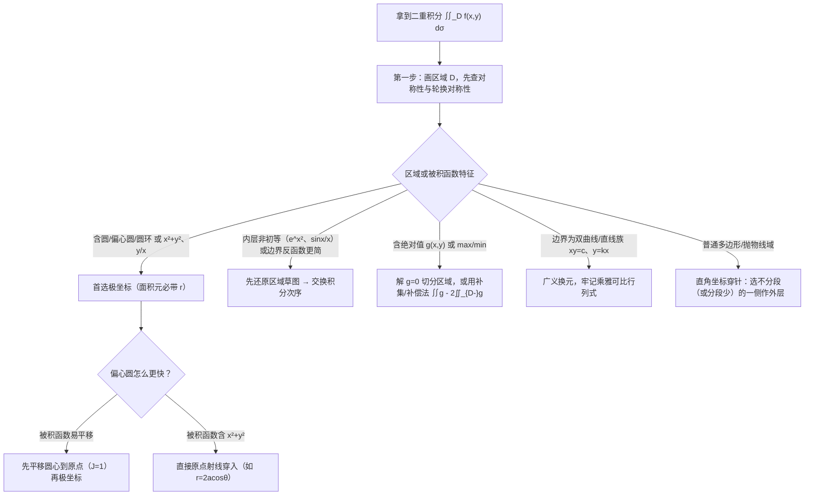

# 第14讲 二重积分

基础补充对照：[[第14讲_讲义.pdf]]，第 1—39 页（第 23—34 页为积分区域图示，第 34—39 页为习题及解答）。

本讲对应数二考纲，整合《基础30讲》《强化36讲》与《1000题》，已剔除数一专属内容（三重积分、曲线曲面积分、三大公式与场论）及数三经济应用。主线为：**概念与几何物理意义**、**直角穿针换序与极坐标偏心圆**、**对称轮换与雅可比和式极限**。题号“例”指强化36讲，“B”指《1000题》强化篇第14章。

---

> [!important] 近 17 年数二真题雷达（2010—2026｜S+ 级解答题 17 年全勤区）
> - **考频画像**：主考 32 题（2021—2026 新大纲 11 题，2015—2020 经典 12 题，2010—2014 早期 9 题），**解答题 2010—2026 连续 17 年全勤**，稳定保持「选填考换序或性质 + 解答考综合计算」。
> - **真题落点**：
>   - *2021—2026 新大纲*：`21-T14(填)`、`21-T21(解)`、`22-T2(选)`、`22-T19(解)`、`23-T20(解)`、`24-T6(选)`、`24-T17(解)`、`25-T5(选)`、`25-T20(解)`、`26-T7(选)`、`26-T17(解)`
>   - *2015—2020 经典*：`15-T6(选)`、`15-T18(解)`、`16-T18(解)`、`17-T13(填)`、`17-T20(解)`、`18-T6(选)`、`18-T17(解)`、`19-T5(选)`、`19-T13(填)`、`19-T18(解)`、`20-T10(填)`、`20-T19(解)`
>   - *2010—2014 早期*：`10-T6(选)`、`10-T20(解)`、`11-T13(填)`、`11-T21(解)`、`12-T6(选)`、`12-T18(解)`、`13-T6(选)`、`13-T17(解)`、`14-T17(解)`
> - **核心高频命题点**：
>   1. **选填高频考交换次序与性质估值**：`17-T13`/`19-T13`/`20-T10`/`21-T14`/`22-T2`/`24-T6`（$y$ 下限 $\frac{1}{2}$ 勿写 $0$）、`25-T5`（抛物线外侧左右两段）；`12-T6`/`13-T6`/`19-T5` 考对称消项与保号比较。
>   2. **解答题主攻对称轮换与极坐标硬计算**：`10-T20`（极坐标反化直角）、`11-T21`（混合偏导两次分部）、`13-T17`/`14-T17`/`15-T18`（对称与轮换消项）、`21-T21`/`22-T19`/`23-T20`/`24-T17`/`25-T20`/`26-T17`（斜椭圆环解耦、双圆交集取小弧 $r=4\sin\theta$）。
>   3. **二重和式极限回归**：`10-T6`（独立指标正方形 $[0,1]^2$）与 `26-T7`（伸缩雅可比 $\times 4$ 与对称轴 $y=x$ 辨析）。
> - **每日复习聚焦**：先过第二部分 Mermaid 决策树，再刷「对称轮换消项 + 偏心圆/双圆交集定限 + 画图换序 + 二重和式缩放因子」。

---

## 第一部分｜知识点与核心结论

### 一、二重积分基本概念与几何/物理意义【📌 扫一眼｜确认“我还会”就过 · 26-T7 重磅回归】

**1. 二重积分的黎曼和定义与可积性** 【⚡ 避坑｜最值钱，必须精读 1 分钟】
- **黎曼和定义**：设闭区域 $D \subset \mathbb{R}^2$ 是有界闭区域，$f(x, y)$ 是定义在 $D$ 上的有界函数。将 $D$ 任意分割为 $n$ 个小区域 $\Delta \sigma_1, \Delta \sigma_2, \dots, \Delta \sigma_n$（其面积亦记为 $\Delta \sigma_i$），小区域的直径最大值记为 $\lambda$。在每个小区域 $\Delta \sigma_i$ 内任意取一点 $(\xi_i, \eta_i)$，若极限
  $$
  \lim_{\lambda \to 0} \sum_{i=1}^n f(\xi_i, \eta_i)\Delta \sigma_i
  $$
  存在且与区域的分割方法及点的取法无关，则称该极限为函数 $f(x, y)$ 在闭区域 $D$ 上的**二重积分**，记作：
  $$
  \iint_D f(x, y)\,\mathrm{d}\sigma = \lim_{\lambda \to 0}\sum_{i=1}^n f(\xi_i, \eta_i)\Delta \sigma_i.
  $$
- **可积充分条件**：
  1. 若 $f(x, y)$ 在有界闭区域 $D$ 上**连续**，则 $f(x, y)$ 在 $D$ 上必可积；
  2. 若 $f(x, y)$ 在有界闭区域 $D$ 上**有界**，且间断点均落在有限条光滑（或分段光滑）曲线上，则 $f(x, y)$ 在 $D$ 上仍可积。
- **和式极限逆向识别（二重黎曼和）**：
  若离散双重和式中<mark>提净二维面积元真实缩放因子</mark> $\frac{1}{n^2}$（或节点分母为 $2n$ 时的 $\frac{1}{4n^2}$），且通项完全依赖于比值 $\frac{i}{n}, \frac{j}{n}$，再按<mark>独立与耦合求和下标定积分域</mark>（`1\le j\le n` 为正方形，`1\le j\le i` 为主对角线下方三角）。 `[真题·2010-T6]` `[真题·2026-T7]`
  $$
  \lim_{n\to\infty} \frac{1}{n^2} \sum_{i=1}^n \sum_{j=1}^n g\left(\frac{i}{n}, \frac{j}{n}\right) = \int_0^1 \mathrm{d}x \int_0^1 g(x, y)\,\mathrm{d}y.
  $$
  - `10-T6` A/B/C/D 选项辨析：求 $\lim\limits_{n\to\infty}\sum_{i=1}^n\sum_{j=1}^n\frac{n}{(n+i)(n^2+j^2)}$。指标 $1\le i,j\le n$ 彼此独立对应 $[0,1]^2$ 而非三角形（排除 A、B）；分母 $n^2+j^2$ 提 $n^2$ 得 $1+y^2$ 而非 $1+y$（排除 B、C），选 D $\int_0^1\mathrm{d}x\int_0^1\frac{1}{(1+x)(1+y^2)}\mathrm{d}y$。 `[真题·2010-T6]`
- `【⚡ 真题补丁｜2026-T7】`：节点分母为 $2n$ 时真实面积元为 $\frac{1}{4n^2}$（雅可比 $4$）；$f(x,y)=f(y,x)$ 仅关于主对角线 $y=x$（$j\le i$）对称，非 $x+y=1$。 `[真题·2026-T7]`
  1. **步长与雅可比系数 $\times 4$**：自变量为 $\frac{i}{2n}, \frac{j}{2n}$ 时，面积微元为 $\frac{1}{(2n)^2} = \frac{1}{4n^2}$，故外层 $\frac{1}{n^2} = 4 \cdot \frac{1}{(2n)^2}$（等价于伸缩换元 $x=2\xi, y=2\eta$，$|J|=4$）。
  2. **区分对称轴 $y=x$ 与 $x+y=1$**：$f(x,y)=f(y,x)$ 仅说明关于主对角线 $y=x$ 对称（指标 $1\le j\le i$），不关于副对角线 $x+y=1$（指标 $j=n+1-i$ 或 $2n+1-i$）对称。

**2. 几何意义与代数体积** 【📌 扫一眼｜确认“我还会”就过】
- 当被积函数 $f(x, y) \ge 0$ 时，$\iint_D f(x, y)\,\mathrm{d}\sigma$ 的几何意义是以闭区域 $D$ 为底、以曲面 $z = f(x, y)$ 为顶的**曲顶柱体的体积**。
- 当 $f(x, y)$ 在 $D$ 上变号时，二重积分表示曲顶柱体的**代数体积**（$xOy$ 平面上方的柱体体积取正，平面下方的柱体体积取负）。
- **特殊基准**：当 $f(x, y) \equiv 1$ 时，曲顶高度恒为 $1$，柱体体积数值上等于底面闭区域 $D$ 的面积 $S_D$：
  $$
  \iint_D \mathrm{d}\sigma = S_D.
  $$

**3. 数学二核心物理应用（质量、质心与转动惯量）** 【📌 扫一眼｜确认“我还会”就过】
- **平面薄板质量**：设平面闭区域 $D$ 上的薄板面密度分布为 $\rho(x, y)$（$\rho$ 连续），则薄板总质量为：
  $$
  M = \iint_D \rho(x, y)\,\mathrm{d}\sigma.
  $$
- **平面薄板质心坐标 $(\bar{x}, \bar{y})$**：
  - 对 $y$ 轴的静矩：$M_y = \iint_D x \rho(x, y)\,\mathrm{d}\sigma$；
  - 对 $x$ 轴的静矩：$M_x = \iint_D y \rho(x, y)\,\mathrm{d}\sigma$；
  - 质心坐标公式：
    $$
    \bar{x} = \frac{M_y}{M} = \frac{\iint_D x \rho(x, y)\,\mathrm{d}\sigma}{\iint_D \rho(x, y)\,\mathrm{d}\sigma},\qquad
    \bar{y} = \frac{M_x}{M} = \frac{\iint_D y \rho(x, y)\,\mathrm{d}\sigma}{\iint_D \rho(x, y)\,\mathrm{d}\sigma}.
    $$
  - **均匀薄板（形心坐标）**：若面密度 $\rho(x, y) \equiv \rho_0$（常数），质心即几何形心：<mark>已知形心与面积可免去切片积分</mark>直接写出一次多项式二重积分：
    $$
    \bar{x} = \frac{1}{S_D}\iint_D x\,\mathrm{d}\sigma,\qquad
    \bar{y} = \frac{1}{S_D}\iint_D y\,\mathrm{d}\sigma \implies \iint_D x\,\mathrm{d}\sigma = \bar{x} S_D,\quad \iint_D y\,\mathrm{d}\sigma = \bar{y} S_D.
    $$
- **平面薄板转动惯量**：<mark>绕某轴转动惯量乘垂直距离平方</mark>（绕 $x$ 轴乘 $y^2$，绕 $y$ 轴乘 $x^2$）：
  - 绕 $x$ 轴的转动惯量（微元到 $x$ 轴的垂直距离为 $|y|$）：
    $$
    I_x = \iint_D y^2 \rho(x, y)\,\mathrm{d}\sigma;
    $$
  - 绕 $y$ 轴的转动惯量（微元到 $y$ 轴的垂直距离为 $|x|$）：
    $$
    I_y = \iint_D x^2 \rho(x, y)\,\mathrm{d}\sigma;
    $$
  - 绕原点（垂直轴）的极转动惯量：
    $$
    I_0 = \iint_D (x^2 + y^2)\rho(x, y)\,\mathrm{d}\sigma = I_x + I_y.
    $$

**4. 二重积分的基本性质与中值定理** 【📌 扫一眼｜确认“我还会”就过】
- **线性性质**：$\iint_D [\alpha f(x, y) + \beta g(x, y)]\,\mathrm{d}\sigma = \alpha \iint_D f(x, y)\,\mathrm{d}\sigma + \beta \iint_D g(x, y)\,\mathrm{d}\sigma$。
- **区域可加性**：若 $D = D_1 \cup D_2$，且 $D_1$ 与 $D_2$ 的公共部分至多为有限条曲线（面积为零），则：
  $$
  \iint_D f(x, y)\,\mathrm{d}\sigma = \iint_{D_1} f(x, y)\,\mathrm{d}\sigma + \iint_{D_2} f(x, y)\,\mathrm{d}\sigma.
  $$
- **保号性与保序性**：
  - 若在 $D$ 上 $f(x, y) \ge 0$，则 $\iint_D f(x, y)\,\mathrm{d}\sigma \ge 0$；
  - 若在 $D$ 上 $f(x, y) \le g(x, y)$，则 $\iint_D f(x, y)\,\mathrm{d}\sigma \le \iint_D g(x, y)\,\mathrm{d}\sigma$；
  - **严格正性**：若 $f(x, y)$ 在闭区域 $D$ 上连续且 $f(x, y) \ge 0$（内点不恒为零），则<mark>严格正性可不硬算直接锁定符号</mark>；同域比较大小<mark>先将二维距离嵌套为一维比较</mark>。 `[真题·2013-T6]` `[真题·2019-T5]`
  - `19-T5` A/B/C/D 选项辨析（菱形 $|x|+|y|\le\frac{\pi}{2}$ 上比较 $I_1,I_2,I_3$）：由 $r=\sqrt{x^2+y^2}\le |x|+|y|\le\frac{\pi}{2}$，在 $r\in(0,\frac{\pi}{2})$ 上恒有 $1-\cos r < \sin r < r$（因 $\sin r-(1-\cos r)=\sqrt{2}\sin(r+\frac{\pi}{4})-1>0$），故 $I_3<I_2<I_1$，选 A 排除逆序 B/C/D。 `[真题·2019-T5]`
- **绝对值估值不等式**：
  $$
  \left|\iint_D f(x, y)\,\mathrm{d}\sigma\right| \le \iint_D |f(x, y)|\,\mathrm{d}\sigma.
  $$
- **积分估值定理**：设 $m, M$ 分别为 $f(x, y)$ 在有界闭区域 $D$ 上的最小值和最大值，则：
  $$
  m S_D \le \iint_D f(x, y)\,\mathrm{d}\sigma \le M S_D.
  $$
- **积分第一中值定理**：设 $f(x, y)$ 在有界闭区域 $D$ 上连续，则在 $D$ 上至少存在一点 $(\xi, \eta) \in D$，使得：
  $$
  \iint_D f(x, y)\,\mathrm{d}\sigma = f(\xi, \eta) S_D.
  $$
- **广义积分中值定理**：设 $f(x, y), g(x, y)$ 在闭区域 $D$ 上连续，且 $g(x, y)$ 在 $D$ 上不变号（恒非负或恒非正），则在 $D$ 上至少存在一点 $(\xi, \eta) \in D$，使得：
  $$
  \iint_D f(x, y)g(x, y)\,\mathrm{d}\sigma = f(\xi, \eta) \iint_D g(x, y)\,\mathrm{d}\sigma.
  $$

---

### 二、核心计算法（直角坐标切片法与极坐标）【🔥 必背｜停下来默背 1 遍 · 12 年解答全勤】

**1. 直角坐标系下的切片计算法（穿针引线法）** 【🔥 必背｜停下来默背 1 遍】
- **$X$ 型区域（先积 $y$，后积 $x$）**：
  若区域表示为 $D = \{(x, y) \mid a \le x \le b,\; \varphi_1(x) \le y \le \varphi_2(x)\}$：
  $$
  \iint_D f(x, y)\,\mathrm{d}x\mathrm{d}y = \int_a^b \mathrm{d}x \int_{\varphi_1(x)}^{\varphi_2(x)} f(x, y)\,\mathrm{d}y.
  $$
  - **穿针口诀**：画一条平行于 $y$ 轴向上穿过的射线，穿入区域的曲线方程为内层积分下限 $y = \varphi_1(x)$，穿出区域的曲线方程为内层积分上限 $y = \varphi_2(x)$；外层 $x$ 取区域在 $x$ 轴投影的最大跨度 $[a, b]$。
- **$Y$ 型区域（先积 $x$，后积 $y$）**：
  若区域表示为 $D = \{(x, y) \mid c \le y \le d,\; \psi_1(y) \le x \le \psi_2(y)\}$：
  $$
  \iint_D f(x, y)\,\mathrm{d}x\mathrm{d}y = \int_c^d \mathrm{d}y \int_{\psi_1(y)}^{\psi_2(y)} f(x, y)\,\mathrm{d}x.
  $$
  - **穿针口诀**：画一条平行于 $x$ 轴向右穿过的水平射线，从左侧穿入曲线为下限 $x = \psi_1(y)$，从右侧穿出曲线为上限 $x = \psi_2(y)$；外层 $y$ 取区域在 $y$ 轴投影的最大跨度 $[c, d]$。
- **多条件切片与分段法则**：
  当区域由多个不等式共同限定时，切片内层下限取最大、上限取最小：
  $$
  L = \max\{L_1, L_2, \dots\},\qquad U = \min\{U_1, U_2, \dots\},\qquad L \le U.
  $$
  不等式 $L \le U$ 不仅是切片存在的充要条件，更能够反推出外层自变量的合法积分区间。凡是穿入或穿出的边界曲线解析式发生改变之处，必须分段计算。

**2. 二次积分次序的交换（换序化简）** 【🔥 必背｜停下来默背 1 遍】
- **换序三步标准流程**：
  1. **还原区域不等式**：由原累次积分上下限提取区域边界约束；
  2. **作图确定几何域**：精确画出平面积分区域草图，标明所有边界曲线及关键交点坐标；
  3. **改变切片方向重写上下限**：将原 $X$ 型改为 $Y$ 型（或反之），若新方向的穿入或穿出边界分段，则将积分拆为多个累次积分之和。
- **换序的核心实战动机**：
  1. **内层非初等函数**：形如 $\frac{\sin x}{x}, \frac{\cos x}{x}, \frac{\tan x}{x}, \mathrm{e}^{\pm x^2}, \frac{1}{\sqrt{1+x^3}}$ 时，<mark>换序后切片宽度消分母或凑导数</mark>（如 `17-T13` $\int_0^1\mathrm{d}y\int_y^1\frac{\tan x}{x}\mathrm{d}x=-\ln(\cos 1)$，切记正切原函数带负号；`19-T13` 含变限积分之定积分先换序积分得 $\frac{1}{4}(\cos 1-1)$；`20-T10` 换序先积 $y$ 得 $x^2\sqrt{x^3+1}$ 后凑微分得 $\frac{2}{9}(2\sqrt{2}-1)$）。 `[真题·2017-T13]` `[真题·2019-T13]` `[真题·2020-T10]`
  2. **双分部与混合偏导降阶**：若被积函数含 $f_{xy}''(x,y)$ 且边界给定 $f(1,y)=0, f(x,1)=0$，需<mark>一次分部后立即换序再分部</mark>并利用二阶连续偏导 $f_{xy}''=f_{yx}''$ 消去边界项化回原二重积分（`11-T21`）；若遇第二象限 $y=\sin x$ 反解下限，切记用 $\pi-x$ 拉回反三角主值区间并取 $y=\frac{1}{2}$ 验算符号。 `[真题·2011-T21]` `[真题易错·2007-T8]`
  3. **几何面积化简与反向限规整**：内层 $\int_0^{x^2}\sqrt{x^4-y^2}\,\mathrm{d}y$ 直接按四分之一圆面积计算；遇 $\int_1^x(\dots)\,\mathrm{d}y$（$0\le x\le 1$）先提负号化正向再作图换序。
- `【⚡ 真题补丁｜2025-T5/2024-T6】`：`25-T5` 抛物线外侧水平穿针分左右两段；`24-T6` 换序 $y$ 下限取 $\frac{1}{2}$ 非 $0$。 `[真题·2025-T5]` `[真题·2024-T6]`
  - `25-T5` 换序区间须写成 $[-2,-\sqrt{4-y}]$ 与 $[\sqrt{4-y},2]$（切勿错写成抛物线内侧 $[-\sqrt{4-y},\sqrt{4-y}]$）；含变限求导与根式换序均须先画交点草图（如 `21-T14`、`22-T2`）。 `[真题·2021-T14]` `[真题·2022-T2]`

**3. 极坐标系下的切片计算（射线穿入法）** 【🔥 必背｜停下来默背 1 遍】
- **坐标变换与面积元**：
  $$
  x = r\cos\theta,\quad y = r\sin\theta \implies \mathrm{d}\sigma = \mathrm{d}x\mathrm{d}y = r\,\mathrm{d}r\mathrm{d}\theta.
  $$
  极坐标下的面积元<mark>必须包含极径雅可比因子</mark> $r$，二次边界方程解出 $r$ 时<mark>切勿忘记对平方项开方</mark>；若被积函数或边界反解回直角坐标更简（如 $r\sec\theta=1$ 或 $r^2\cos 2\theta=x^2-y^2$），应果断<mark>极坐标反化直角坐标</mark>（`10-T20` 即 $0\le y\le x\le 1$ 上计算）。 `[真题·2010-T20]` `[真题·2015-T6]`
  - `15-T6` A/B/C/D 选项辨析（$2xy=1,4xy=1,y=x,y=\sqrt{3}x$ 第一象限转极坐标）：$\theta\in[\frac{\pi}{4},\frac{\pi}{3}]$，由 $r^2\sin 2\theta\in[\frac{1}{2},1]$ 得 $r\in\left[\frac{1}{\sqrt{2\sin 2\theta}},\frac{1}{\sqrt{\sin 2\theta}}\right]$ 并乘因子 $r$。A 未开方（错）；B 开方且含 $r$（对）；C 未开方且漏 $r$（错）；D 开方正确但漏 $r$（错）。 `[真题·2015-T6]`
- **极坐标适用信号**：
  1. 积分区域由圆、圆弧、偏心圆、心形线 $r=1+\cos\theta$ 或高次对称线 $(x^2+y^2)^3\le y^4$ 围成（`11-T13` 偏心圆 $x^2+y^2=2y$ 与 $y=x$；`12-T18` 上半心形线换元 $u=\cos\theta$；`19-T18` $|x|\le y$ 配合 $r\le\sin^2\theta$ 得 $\frac{43\sqrt{2}}{120}$）。 `[真题·2011-T13]` `[真题·2012-T18]` `[真题·2019-T18]`
  2. 被积函数显式包含 $x^2+y^2$、$\sqrt{x^2+y^2}$、$\frac{y}{x}$、$\frac{x}{y}$ 等二次齐次或比值结构。
- **射线穿入法标准步骤**：
  1. 从极点（原点）出发引一条射线向外射出；
  2. 极角 $\theta$ 的范围由能与区域相交的所有射线的起始角与终止角确定：$\alpha \le \theta \le \beta$（跨度 $\beta - \alpha \le 2\pi$）；
  3. 射线穿入区域边界的极径为内层下限 $r = r_1(\theta)$，穿出区域边界的极径为内层上限 $r = r_2(\theta)$：
     $$
     \iint_D f(x, y)\,\mathrm{d}\sigma = \int_\alpha^\beta \mathrm{d}\theta \int_{r_1(\theta)}^{r_2(\theta)} f(r\cos\theta, r\sin\theta)r\,\mathrm{d}r.
     $$
- `【⚡ 真题补丁｜2023-T20】`：斜椭圆环极径比常数，先积 $r$ 得 $\ln\frac{r_2}{r_1}$ 解耦，外层同除 $\cos^2\theta$ 凑 $\mathrm{d}(\tan\theta)$。 `[真题·2023-T20]`

**4. 极坐标常见区域方程与偏心圆上下限速查** 【⚡ 避坑｜最值钱，必须精读 1 分钟】

| 几何图形与空间位置 | 直角坐标方程 | 极坐标方程与切片范围 |
|---|---|---|
| 圆心在原点的圆盘 | $x^2+y^2 \le R^2$ | $\theta \in [0, 2\pi],\ r \in [0, R]$ |
| 圆心在 $(a, 0)$ 的右切偏心圆 | $(x-a)^2+y^2 \le a^2$ | $\theta \in \left[-\frac{\pi}{2}, \frac{\pi}{2}\right],\ r \in [0, 2a\cos\theta]$ |
| 圆心在 $(0, b)$ 的上切偏心圆 | $x^2+(y-b)^2 \le b^2$ | $\theta \in [0, \pi],\ r \in [0, 2b\sin\theta]$ |
| 右侧铅垂直线 | $x = c$ ($c > 0$) | $r = c\sec\theta$ |
| 上方水平直线 | $y = c$ ($c > 0$) | $r = c\csc\theta$ |
| 偏心圆与直线相交截面 | 直线截圆或两圆相交 | 联立求交点角度分段，各段径向上限取边界较小值 $\min\{r_1(\theta), r_2(\theta)\}$ |

- `【⚡ 真题补丁｜2025-T20】`：双圆交集在 $[0,\frac{\pi}{4}]$ 内 $\sin\theta\le\cos\theta$，径向上界取 $r=4\sin\theta$ 非 $4\cos\theta$。 `[真题·2025-T20]`

---

### 三、对称性与轮换对称性【🔥 必背｜停下来默背 1 遍 · 解答提速第一招】

**基础补充：形心与旋转体体积（古鲁金第二定理）** 【💤 可跳过｜冲刺期直接跳过不看】
- 设平面区域 $D$ 面积为 $S$，整体位于同平面旋转轴的一侧，绕轴一周所成旋转体体积为 $V=2\pi dS$，其中 $d$ 是区域形心到旋转轴的距离。此法把体积计算转化为面积与形心计算，也可由已知体积反求形心。
- 旋转轴为 $ax+by+c=0$ 时，$d=\frac{\vert a\bar x+b\bar y+c\vert}{\sqrt{a^2+b^2}}$。使用前要核查区域整体位于轴的同一侧；若区域跨轴，旋转形成的部分可能重叠，不能直接把各面积元扫过的体积相加。见基础讲义 PDF 第 21—22 页。

**1. 普通几何对称性（奇零偶倍）** 【🔥 必背｜停下来默背 1 遍】
- **对称性先决条件**：区域关于对称轴（或对称点）自身重合，即变换 $T$ 满足 $T(D) = D$；即使区域仅表面不对称，常可<mark>利用分段合域或对称线割补</mark>还原奇偶消项（如 `18-T6` 先合并两段二次积分再消奇项；`12-T6` 用 $y=-\sin x$ 分割出对称两块或内层积分奇函数消去 $xy^5$）。 `[真题·2012-T6]` `[真题·2015-T18]` `[真题·2018-T6]`
  - `12-T6` A/B/C/D 选项辨析（$y=\sin x, x=\pm\frac{\pi}{2}, y=1$ 上求 $\iint_D(xy^5-1)\mathrm{d}x\mathrm{d}y$）：先对 $y$ 积分得 $\int_{-\pi/2}^{\pi/2}[\frac{1}{6}x(1-\sin^6 x)-(1-\sin x)]\mathrm{d}x=-\pi$；A 符号取反得 $\pi$，B/C 误将区域面积算作 $2$，D $-\pi$ 正确。 `[真题·2012-T6]`
  - `18-T6` A/B/C/D 选项辨析（合并分段二次积分）：合并后区域 $D=\{-1\le x\le 1, |x|\le y\le 2-x^2\}$ 关于 $y$ 轴对称，被积项 $-xy$ 奇函数积零，$1$ 偶倍得 $2\int_0^1(2-x^2-x)\mathrm{d}x=\frac{7}{3}$（选 C）；D $\frac{7}{6}$ 漏乘加倍因子 $2$，A $\frac{5}{3}$ 与 B $\frac{5}{6}$ 计算错误。 `[真题·2018-T6]`
  - **15-T18 抛物线切分圆提醒**：算 $D=\{x^2+y^2\le 2, y\ge x^2\}$ 上 $\iint_D x(x+y)\mathrm{d}x\mathrm{d}y$ 先利用 $y$ 轴对称消 $xy$，余下若用 $x=\sqrt{2}\sin t$ 换元注意 $x=1$ 对应上限 $\frac{\pi}{4}$ 而非 $\frac{\pi}{2}$，或极坐标按 $\theta=\frac{\pi}{4}$ 分两块得 $\frac{\pi}{4}-\frac{2}{5}$；参数曲线（摆线）面积分则需先查对称轴 $x=\pi$ 的一阶矩。 `[真题·2015-T18]` `[真题易错·2018-T17]`
- **关于 $y$ 轴对称（代换 $x \to -x$）**：
  若 $D$ 关于 $y$ 轴对称，记 $D$ 在 $x \ge 0$ 的一半为 $D_1$：
  $$
  \iint_D f(x, y)\,\mathrm{d}\sigma = \begin{cases} 0, & f(-x, y) = -f(x, y) \\[6pt] 2\iint_{D_1} f(x, y)\,\mathrm{d}\sigma, & f(-x, y) = f(x, y) \end{cases}
  $$
  被积函数关于自变量 $x$ 为奇函数时积分为零，为偶函数时等于半域积分的 2 倍。
- **关于 $x$ 轴对称（代换 $y \to -y$）**：
  若 $D$ 关于 $x$ 轴对称，记 $D$ 在 $y \ge 0$ 的一半为 $D_1$：
  $$
  \iint_D f(x, y)\,\mathrm{d}\sigma = \begin{cases} 0, & f(x, -y) = -f(x, y) \\[6pt] 2\iint_{D_1} f(x, y)\,\mathrm{d}\sigma, & f(x, -y) = f(x, y) \end{cases}
  $$
  被积函数关于自变量 $y$ 为奇函数时积分为零，为偶函数时等于半域积分的 2 倍。
- **关于原点对称（代换 $(x, y) \to (-x, -y)$）**：
  若 $f(-x, -y) = -f(x, y)$，则积分为零；若 $f(-x, -y) = f(x, y)$，则等于半个区域积分乘 $2$。
  - **边界提醒**：<mark>原点对称不能直接取第一象限乘四</mark>（须同时关于 $x, y$ 轴对称才可乘 4）。
- **关于任意直线 $x=a$ 或 $y=b$ 对称**：
  - 关于 $x=a$ 对称：代换 $x \to 2a-x$；
  - 关于 $y=b$ 对称：代换 $y \to 2b-y$。

**2. 轮换对称性（变量对调）** 【🔥 必背｜停下来默背 1 遍】
- **定义与定理**：若闭区域 $D$ 关于直线 $y = x$ 对称（即对任意 $(x, y) \in D$，必有 $(y, x) \in D$），则在二重积分中<mark>仅区域关于主对角线对称可对调</mark>变量符号，积分值不变： `[真题·2013-T6]` `[真题·2013-T17]` `[真题·2014-T17]`
  $$
  \iint_D f(x, y)\,\mathrm{d}\sigma = \iint_D f(y, x)\,\mathrm{d}\sigma = \frac{1}{2}\iint_D [f(x, y) + f(y, x)]\,\mathrm{d}\sigma.
  $$
  - `13-T6` A/B/C/D 选项辨析（单位圆各象限 $I_k=\iint_{D_k}(y-x)\mathrm{d}x\mathrm{d}y$）：A（$I_1>0$ 错）与 C（$I_3>0$ 错）因一、三象限扇形关于 $y=x$ 对称，轮换得 $I_1=I_3=0$；B（$I_2>0$ 正确）因第二象限 $x<0<y\implies y-x>0$；D（$I_4>0$ 错）因第四象限 $y-x<0$ 故 $I_4<0$。 `[真题·2013-T6]`
- **三类高频典型题型**：
  1. **互补型结构**：被积函数满足 $f(x, y) + f(y, x) = c$（常数），则直接得出：
     $$
     \iint_D f(x, y)\,\mathrm{d}\sigma = \frac{1}{2}\iint_D c\,\mathrm{d}\sigma = \frac{c}{2} S_D;
     $$
  2. **分式对称结构**：形如 $\iint_D \frac{g(x)}{g(x) + g(y)}\,\mathrm{d}\sigma = \frac{1}{2}S_D$（`14-T17` 令分子 $x$ 轮换化简分母 $x+y$ 后转极坐标分部得 $-\frac{3}{4}$）； `[真题·2014-T17]`
  3. **反对称消项与平方对称化**：若 $f(y, x) = -f(x, y)$（如 $x - y$），积分直接为零；算 $x^2$ 可轮换化为 $\frac{1}{2}(x^2+y^2)=\frac{1}{2}r^2$（如 `13-T17` 三角形域得 $\frac{416}{3}$）。 `[真题·2013-T17]` `[真题·2024-T17]`

**3. 对称性运用的四条边界** 【⚡ 避坑｜最值钱，必须精读 1 分钟】
- **边界一（区域作差不继承对称性）**：<mark>大区域挖去偏心子域不再对称</mark>，应分别对全域与被挖域独立核查对称性后再作差。 `[真题·2022-T19]`
- **边界二（绝对值改变奇偶性）**：$x$ 为奇函数，$|x|$ 为偶函数；$x-|y|$ 关于 $x$ 非奇非偶，关于 $y$ 为偶函数，须分清所对变量。
- **边界三（半域不可直接轮换）**：区域为 $0 \le y \le x \le 1$ 时，对调 $x, y$ 后变为 $0 \le x \le y \le 1$，两区域不重合，不能直接轮换消项。
- **边界四（不等轴椭圆不可轮换）**：椭圆 $\frac{x^2}{a^2} + \frac{y^2}{b^2} \le 1$ 在 $a \ne b$ 时不关于 $y = x$ 对称，不可对调 $x, y$。

---

### 四、区域分割、补集法与整体换元【📌 扫一眼｜确认“我还会”就过】

**1. 区域分割与绝对值分块法则** 【📌 扫一眼｜确认“我还会”就过】
- **零点曲线分割法**：当被积函数含有绝对值 $|g(x, y)|$ 或最大最小值 $\max\{f(x, y), h(x, y)\}$ 时，<mark>先由零点曲线分界再去绝对值</mark>： `[真题·2016-T18]` `[真题·2017-T20]`
  1. 解方程 $g(x, y) = 0$ 或 $f(x, y) - h(x, y) = 0$ 得到平面分界曲线；
  2. 分界曲线将区域 $D$ 分割为两个子区域 $D_1$（对应 $g \ge 0$）与 $D_2$（对应 $g < 0$）；
  3. 在子区域内脱去绝对值符号或确定显式函数表达式，分块积分后相加。
- **代数补偿技巧**：若负值子区域 $D_-$（即 $g < 0$ 区域）几何形状非常规整（如完整偏心圆盘），可<mark>用全大域减两倍负域免月牙切片</mark>：
  $$
  |g| = g - 2\min(g, 0) \implies \iint_D |g|\,\mathrm{d}\sigma = \iint_D g\,\mathrm{d}\sigma - 2\iint_{D_-} g\,\mathrm{d}\sigma.
  $$

**2. 补集法（大规整区域减去缺口区域）** 【📌 扫一眼｜确认“我还会”就过】
- **基本公式**：若待求区域 $D$ 形状不规整，但可视为一个简单大区域 $D_A$（如大矩形、大同心圆盘）挖去一个简单几何子区域 $D_B$（如偏心小半圆）所余：
  $$
  \iint_D f(x, y)\,\mathrm{d}\sigma = \iint_{D_A} f(x, y)\,\mathrm{d}\sigma - \iint_{D_B} f(x, y)\,\mathrm{d}\sigma.
  $$
- **各自坐标系独立选择**：补集法最大的威力在于：<mark>补集两域可各自独立选最简坐标系</mark>分别计算，互不干扰。 `[真题·2022-T19]`
- **积分最大值区域判定准则**：若要求确定闭区域 $D$ 使得积分 $\iint_D f(x, y)\,\mathrm{d}\sigma$ 达到最大值，由保号性可知：必须将所有 $f(x, y) > 0$ 的点全部纳入，舍去所有 $f(x, y) < 0$ 的点。故最佳区域为闭区域：
  $$
  D = \{(x, y) \mid f(x, y) \ge 0\}.
  $$

**3. 坐标换元定理与雅可比行列式对照表** 【📌 扫一眼｜确认“我还会”就过】
- **二重积分换元定理**：设变换 $x = x(u, v), y = y(u, v)$ 将 $uOv$ 平面上的闭区域 $D'$ 一对一地映射到 $xOy$ 平面上的闭区域 $D$，且偏导数连续，雅可比行列式 $J \ne 0$，则：
  $$
  \iint_D f(x, y)\,\mathrm{d}x\mathrm{d}y = \iint_{D'} f(x(u, v), y(u, v)) |J|\,\mathrm{d}u\mathrm{d}v.
  $$
- **雅可比行列式计算与互逆公式**：
  $$
  J = \frac{\partial(x, y)}{\partial(u, v)} = \begin{vmatrix} \frac{\partial x}{\partial u} & \frac{\partial x}{\partial v} \\[6pt] \frac{\partial y}{\partial u} & \frac{\partial y}{\partial v} \end{vmatrix},\qquad
  |J| = \frac{1}{\left|\dfrac{\partial(u, v)}{\partial(x, y)}\right|}.
  $$
- **高频坐标换元雅可比对照表**：

| 换元类型 | 变换关系 | 雅可比行列式绝对值 $\lvert J \rvert$ | 面积元 $\mathrm{d}\sigma$ | 核心适用特征 |
|---|---|---|---|---|
| 普通极坐标 | $x=r\cos\theta,\ y=r\sin\theta$ | $r$ | $r\,\mathrm{d}r\mathrm{d}\theta$ | 圆、扇形、圆环，含 $x^2+y^2$ |
| 广义/椭圆极坐标 | $x=ar\cos\theta,\ y=br\sin\theta$ | $abr$ | $abr\,\mathrm{d}r\mathrm{d}\theta$ | 椭圆区域 $\frac{x^2}{a^2}+\frac{y^2}{b^2} \le 1$ |
| 坐标平移变换 | $x=x_0+u,\ y=y_0+v$ | $1$ | $\mathrm{d}u\mathrm{d}v$ | 偏心圆盘，平移后圆心对齐原点 |
| 双曲线换元 | $u=xy,\ v=y/x$ | $\frac{1}{2\vert v\vert}$ | $\frac{1}{2\vert v\vert}\,\mathrm{d}u\mathrm{d}v$ | 边界 $xy=c_1, c_2$ 与 $y=k_1 x, k_2 x$ |
| 仿射双曲线换元 | $u=x+y,\ v=y/\sqrt{x}$ | $\dfrac{2x^{3/2}}{\vert 2x+y\vert}$ | $\dfrac{2x^{3/2}}{\vert 2x+y\vert}\,\mathrm{d}u\mathrm{d}v$ | 边界 $x+y=c$ 与 $y^2=2px$ |

---

### 五、高频积分计算工具箱（三角/指数循环与点火公式）【🔥 必背｜停下来默背 1 遍 · 计算提速】

**1. 华里士公式（点火公式）与对称区间扩展** 【🔥 必背｜停下来默背 1 遍】
- **区间 $[0, \pi/2]$ 上的点火公式**：
  $$
  I_n = \int_0^{\pi/2}\sin^n t\,\mathrm{d}t = \int_0^{\pi/2}\cos^n t\,\mathrm{d}t = \begin{cases} \dfrac{n-1}{n}\cdot\dfrac{n-3}{n-2}\cdots\dfrac{1}{2}\cdot\dfrac{\pi}{2}, & n = 2k \\[8pt] \dfrac{n-1}{n}\cdot\dfrac{n-3}{n-2}\cdots\dfrac{2}{3}\cdot 1, & n = 2k+1 \end{cases}
  $$
  其中 $k \in \mathbb{N}^+$。
- **对称区间扩展倍增规则**：
  - 在 $[0, \pi]$ 上：$\int_0^\pi \sin^n t\,\mathrm{d}t = 2\int_0^{\pi/2}\sin^n t\,\mathrm{d}t$；而当 $n$ 为正奇数时 $\int_0^\pi \cos^n t\,\mathrm{d}t = 0$，当 $n$ 为正偶数时 $\int_0^\pi \cos^n t\,\mathrm{d}t = 2\int_0^{\pi/2}\cos^n t\,\mathrm{d}t$（`10-T20` 出现 $\int_0^{\pi/2}\cos^4 t\,\mathrm{d}t=\frac{3\pi}{16}$ 直接套点火公式）。 `[真题·2010-T20]`
  - 在 $[0, 2\pi]$ 上：若被积函数为偶数幂 $\sin^{2k}t$ 或 $\cos^{2k}t$，积分为 $4\int_0^{\pi/2}\sin^{2k}t\,\mathrm{d}t$；奇数幂在全周期积分为零。
- `【⚡ 真题补丁｜2021-T21】`：遇 $\sin\theta\cos\theta\cos^2 2\theta$ 改 $\frac{1}{2}\sin 2\theta$ 凑 $\mathrm{d}(\cos 2\theta)$，忌硬算六次幂。 `[真题·2021-T21]`

**2. 割割工具箱（$\cot, \csc$ 积分导数关系）** 【💤 可跳过｜冲刺期直接跳过不看】
- **三角基本恒等式**：$1 + \cot^2 t = \csc^2 t$。
- **基本导数与微分公式**：
  $$
  (\cot t)' = -\csc^2 t \implies \mathrm{d}(\cot t) = -\csc^2 t\,\mathrm{d}t,\qquad
  (\csc t)' = -\csc t\cot t \implies \mathrm{d}(\csc t) = -\csc t\cot t\,\mathrm{d}t.
  $$
- **一次幂积分（对数分子法）**：<mark>正割配正切取加余割配余切取减</mark>，记不清符号时务必对原函数求导验算。 `[真题易错·2007-T22]`
  $$
  \int \csc t\,\mathrm{d}t = \int \frac{\csc t(\csc t - \cot t)}{\csc t - \cot t}\,\mathrm{d}t = \ln|\csc t - \cot t| + C = -\ln|\csc t + \cot t| + C.
  $$
- **三次幂循环分部积分（强化必备推导）**：
  令 $J = \int \csc^3 t\,\mathrm{d}t$。拆项执行分部积分：
  $$
  \begin{aligned}
  J &= \int \csc t \cdot \csc^2 t\,\mathrm{d}t = -\csc t\cot t - \int (-\csc t\cot t)(-\cot t)\,\mathrm{d}t \\
  &= -\csc t\cot t - \int \csc t(\csc^2 t - 1)\,\mathrm{d}t = -\csc t\cot t - J + \int \csc t\,\mathrm{d}t.
  \end{aligned}
  $$
  移项整理得标准公式：
  $$
  \int \csc^3 t\,\mathrm{d}t = -\frac{1}{2}\csc t\cot t + \frac{1}{2}\ln|\csc t - \cot t| + C.
  $$
- **四次幂凑微分积分**：
  $$
  \int \csc^4 t\,\mathrm{d}t = \int (1 + \cot^2 t)\csc^2 t\,\mathrm{d}t = -\int (1 + u^2)\,\mathrm{d}u = -\cot t - \frac{1}{3}\cot^3 t + C.
  $$

**3. 指数三角循环分部积分公式** 【📌 扫一眼｜确认“我还会”就过】
- **标准循环结论**：
  $$
  \begin{aligned}
  \int \mathrm{e}^{at}\sin bt\,\mathrm{d}t &= \frac{\mathrm{e}^{at}}{a^2 + b^2}(a\sin bt - b\cos bt) + C, \\[6pt]
  \int \mathrm{e}^{at}\cos bt\,\mathrm{d}t &= \frac{\mathrm{e}^{at}}{a^2 + b^2}(a\cos bt + b\sin bt) + C.
  \end{aligned}
  $$
  特例（$a=1, b=1$）：
  $$
  \int \mathrm{e}^t \sin t\,\mathrm{d}t = \frac{\mathrm{e}^t}{2}(\sin t - \cos t) + C,\qquad
  \int \mathrm{e}^t \cos t\,\mathrm{d}t = \frac{\mathrm{e}^t}{2}(\sin t + \cos t) + C.
  $$
- **多项式嵌套乘积处理法则**：
  遇形如 $\int t \mathrm{e}^t \sin t\,\mathrm{d}t$ 时，先将 $\mathrm{e}^t \sin t$ 的原函数记为 $F(t) = \frac{\mathrm{e}^t}{2}(\sin t - \cos t)$，再对多项式 $t$ 执行一次分部积分降次：
  $$
  \int t \mathrm{e}^t \sin t\,\mathrm{d}t = t F(t) - \int F(t)\,\mathrm{d}t = \frac{t\mathrm{e}^t}{2}(\sin t - \cos t) + \frac{\mathrm{e}^t}{2}\cos t + C.
  $$

**4. 根式与绝对值开方符号准则** 【📌 扫一眼｜确认“我还会”就过】
- 偶次根式开方保留绝对值：$\sqrt{x^2} = |x|$，$(x^2)^{3/2} = |x|^3$，$\sqrt{x^2y^2} = |xy|$。
- 未确定变量符号前不能直接去绝对值。
- 三角代换须写明主值区间：令 $t = \sin u$ 时取 $u \in [-\pi/2, \pi/2]$，保证 $\cos u = \sqrt{1 - t^2} \ge 0$；累次积分内层算完须化为外层变量的显式函数。

---

## 第二部分｜题型体系与解题方法论

### 一、区域几何性态、对称性与补集法

| 题干特征 | 优先方法 | 真题印证与避坑 |
|---|---|---|
| 区域关于坐标轴对称，被积函数含对应变量奇偶项 | 奇零偶倍：奇项置零，偶项取半域乘 2 | `12-T6`、`15-T18`、`18-T6`、`21-T21`；**避坑**：原点对称不可直接乘 4；`18-T6` 合并区间勿漏乘 2 `[真题·2018-T6]` `[真题·2026-T17]` |
| 区域关于 $y=x$ 对称，对调变量后易简化 | 轮换对称：反对称项置零，对称项化为 $\frac{1}{2}\iint_D [f(x,y)+f(y,x)]$ | `13-T6`、`13-T17`、`14-T17`、`24-T17`、`26-T7`；**避坑**：`25-T20` 展开后 $-2xy$ 在第一象限恒负，不可消 |
| 区域含偏心圆且被积函数易平移 | 平移坐标将圆心移至原点（$\lvert J\rvert=1$），再转极坐标 | **`20-T19`**、例14.8；**避坑**：直线边界方程随平移同步改写 `[真题·2020-T19]` |
| 区域由两圆交集等多不等式限定 | 先求交点分段，内层上下限取 $\max$ 与 $\min$ | **`25-T20(解)`**、B33；**避坑**：`25-T20` 双圆交集在 $[0,\frac{\pi}{4}]$ 上界为较小的 $r=4\sin\theta$，非 $4\cos\theta$ |
| 规则大区域挖去偏心小区域 | 补集法：分别算全域与被挖域后作差 | **`22-T19(解)`**、B24；**避坑**：挖去偏心区域后对称性失效，两域须各自独立核查对称性 |
| 求使二重积分最大的区域 $D$ | 取被积函数非负的闭区域 $D = \{(x, y) \mid f(x, y) \ge 0\}$ | 例14.4；**避坑**：直接由保号性定域，无需对积分求偏导 |

> [!tip] 核心提醒
> 1. 区域作差后须按全部约束重新检验对称性，<mark>被挖去偏心子域后对称性失效</mark>；摆线或参数曲线积分需先核对称轴再展开计算。 `[真题·2022-T19]` `[真题易错·2018-T17]`
> 2. 轮换对称仅要求区域关于 $y=x$ 对称；若区域仅为下半三角 $y \le x$，对调后落入另一半，不可直接轮换消项。 `[真题·2013-T6]`

> [!example]- ⚡ 真题母题 2025-T20｜双圆交集轮换对称与 $[0,\frac{\pi}{4}]$ 上界 $r=4\sin\theta$
> - **【题目】**：（2025 数二第 20 题，12 分）已知平面有界区域 $D = \{(x, y) \mid x^2 + y^2 \le 4x,\ x^2 + y^2 \le 4y\}$，计算二重积分
>   $$
>   \iint_D (x - y)^2\,\mathrm{d}x\mathrm{d}y.
>   $$
> - **【为什么这么想】**：区域 $D$ 是右偏心圆 $(x-2)^2+y^2\le 4$ 与上偏心圆 $x^2+(y-2)^2\le 4$ 在第一象限的交集，关于 $y = x$ 对称；被积函数 $(x-y)^2$ 满足 $f(y,x)=f(x,y)$，故取下半域 $D_1$（$0 \le \theta \le \frac{\pi}{4}$）积分乘 $2$。两圆交集要求同时满足 $r \le 4\cos\theta$ 与 $r \le 4\sin\theta$，在 $[0, \frac{\pi}{4}]$ 上 $\sin\theta \le \cos\theta$，故内侧边界为较小的 $r = 4\sin\theta$，而非 $4\cos\theta$。
> - **【完整解答】**：
>   1. **画图确认区域与轮换对称减半**：
>      两圆 $x^2+y^2 = 4x$（圆心 $(2,0)$，半径 $2$）与 $x^2+y^2 = 4y$（圆心 $(0,2)$，半径 $2$）交于 $(0,0)$ 与 $(2,2)$，公共交集 $D$ 位于第一象限且关于直线 $y = x$ 对称。
>      又被积函数 $f(x, y) = (x - y)^2$ 满足 $f(y, x) = (y - x)^2 = f(x, y)$，故取下半部分区域 $D_1 = \{(x,y)\in D \mid y \le x\}$，有：
>      $$
>      I = \iint_D (x - y)^2\,\mathrm{d}x\mathrm{d}y = 2\iint_{D_1} (x - y)^2\,\mathrm{d}x\mathrm{d}y.
>      $$
>   2. **极坐标定限（取 $\min\{4\cos\theta, 4\sin\theta\}$）**：
>      在极坐标下，两圆约束分别为 $r \le 4\cos\theta$ 与 $r \le 4\sin\theta$。
>      在下半域 $D_1$ 中，$0 \le \theta \le \frac{\pi}{4}$，此时 $0 \le \sin\theta \le \cos\theta$，故径向上限必须取较小者：
>      $$
>      0 \le \theta \le \frac{\pi}{4},\qquad 0 \le r \le 4\sin\theta.
>      $$
>      被积函数 $(x - y)^2 = r^2(\cos\theta - \sin\theta)^2 = r^2(1 - 2\sin\theta\cos\theta)$，面积元为 $r\,\mathrm{d}r\mathrm{d}\theta$：
>      $$
>      I = 2\int_0^{\pi/4} (1 - 2\sin\theta\cos\theta)\,\mathrm{d}\theta \int_0^{4\sin\theta} r^3\,\mathrm{d}r.
>      $$
>   3. **先积径向 $r$，再分两项积角向 $\theta$**：
>      内层径向积分：
>      $$
>      \int_0^{4\sin\theta} r^3\,\mathrm{d}r = \left[\frac{r^4}{4}\right]_0^{4\sin\theta} = \frac{256\sin^4\theta}{4} = 64\sin^4\theta.
>      $$
>      代回外层得：
>      $$
>      I = 128\int_0^{\pi/4} (\sin^4\theta - 2\sin^5\theta\cos\theta)\,\mathrm{d}\theta.
>      $$
>      - **第一项（降幂公式）**：
>        $$
>        \sin^4\theta = \left(\frac{1-\cos 2\theta}{2}\right)^2 = \frac{1 - 2\cos 2\theta + \frac{1+\cos 4\theta}{2}}{4} = \frac{3}{8} - \frac{1}{2}\cos 2\theta + \frac{1}{8}\cos 4\theta,
>        $$
>        $$
>        \int_0^{\pi/4}\sin^4\theta\,\mathrm{d}\theta = \left[\frac{3}{8}\theta - \frac{1}{4}\sin 2\theta + \frac{1}{32}\sin 4\theta\right]_0^{\pi/4} = \frac{3\pi}{32} - \frac{1}{4} + 0 = \frac{3\pi}{32} - \frac{1}{4}.
>        $$
>      - **第二项（直接凑微分 $\mathrm{d}(\sin\theta)$）**：
>        $$
>        \int_0^{\pi/4} 2\sin^5\theta\cos\theta\,\mathrm{d}\theta = \left[\frac{1}{3}\sin^6\theta\right]_0^{\pi/4} = \frac{1}{3}\left(\frac{\sqrt{2}}{2}\right)^6 = \frac{1}{3}\cdot\frac{1}{8} = \frac{1}{24}.
>        $$
>   4. **合并化简**：
>      $$
>      I = 128\left(\frac{3\pi}{32} - \frac{1}{4} - \frac{1}{24}\right) = 128\left(\frac{3\pi}{32} - \frac{7}{24}\right) = 12\pi - \frac{112}{3}.
>      $$
> - **【复盘提醒】**：
>   1. **两处易错点**：① 交集在 $[0,\frac{\pi}{4}]$ 上界为 $r = 4\sin\theta$（较小值），勿误作 $4\cos\theta$；② 展开 $(x-y)^2 = x^2+y^2-2xy$ 后，区域位于第一象限，$-2xy \le 0$，不能按奇函数消去。
>   2. **量级核验**：$12\pi \approx 37.699$，$\frac{112}{3} \approx 37.333$，差值 $I \approx 0.366 > 0$，与叶形域紧贴 $y=x$ 处 $(x-y)^2$ 为小正量相符。

> [!example]- 例14.4｜保留正贡献，舍去负贡献
> - **【题目】**：确定平面闭区域 $D$，使得二重积分
>   $$
>   I = \iint_D \left(1 - x^2 - \frac{y^2}{2}\right)\mathrm{d}x\mathrm{d}y
>   $$
>   达到最大值。
> - **【为什么这么想】**：本题考查二重积分的保号性与几何意义。积分值是由区域内各点被积函数的取值累加而成的。若被积函数在某点为正，该点对积分产生正贡献；若为负，则产生负贡献。要使总积分最大，必须且只需将全平面上被积函数大于零的所有点完全纳入区域，同时坚决剔除所有使被积函数小于零的点。
> - **【完整解答】**：
>   设被积函数为 $f(x, y) = 1 - x^2 - \frac{y^2}{2}$。
>   考察函数值符号分布：
>   1. 当 $1 - x^2 - \frac{y^2}{2} > 0$，即 $x^2 + \frac{y^2}{2} < 1$ 时，$f(x, y) > 0$，函数值产生正贡献；
>   2. 当 $1 - x^2 - \frac{y^2}{2} < 0$，即 $x^2 + \frac{y^2}{2} > 1$ 时，$f(x, y) < 0$，函数值产生负贡献；
>   3. 当 $1 - x^2 - \frac{y^2}{2} = 0$，即椭圆边界曲线 $x^2 + \frac{y^2}{2} = 1$ 上，$f(x, y) = 0$。
>   由二重积分的区域可加性，若区域 $D$ 包含任何使 $f(x, y) < 0$ 的子区域，去掉该子区域必使积分值增大；若 $D$ 漏掉任何使 $f(x, y) > 0$ 的子区域，添入该子区域必使积分值增大。
>   边界上 $f(x, y) \equiv 0$，边界线面积为零，添入或去掉边界曲线不改变积分值。通常选取闭区域：
>   $$
>   D = \left\{(x, y) \;\middle|\; x^2 + \frac{y^2}{2} \le 1\right\}.
>   $$
>   在该闭区域上，二重积分 $I$ 取得最大值。
> - **【复盘提醒】**：求解“使积分最大的积分区域”，本质就是求被积函数 $f \ge 0$ 所确定的区域。该结论对于一重积分、二重积分均成立，切忌去求变上限积分的偏导数盲目求极值。

> [!example]- 例14.5 / B34｜把积分整体记为常数，再利用轮换对称
> - **【题目】**：设函数 $f(x, y)$ 在闭区域 $D = \{(x, y) \mid x^2+y^2 \le 1\}$ 上连续，且满足方程：
>   $$
>   f(x, y) = \mathrm{e}^{x^2+y^2} - \iint_D \frac{2x^2+1}{x^2+y^2+1}f(x, y)\,\mathrm{d}x\mathrm{d}y.
>   $$
>   求二重积分 $\iint_D f(x, y)\,\mathrm{d}\sigma$ 的值。
> - **【为什么这么想】**：方程右端二重积分是常数，记为 $A$ 得 $f(x, y) = \mathrm{e}^{x^2+y^2} - A$。区域 $x^2+y^2 \le 1$ 与 $f(x,y)$ 均关于 $y=x$ 对称，对 $A$ 用轮换对称性相加消去分母，即得 $A$ 与目标积分的线性关系。
> - **【完整解答】**：
>   1. **设积分常数**：
>      令常数
>      $$
>      A = \iint_D \frac{2x^2+1}{x^2+y^2+1}f(x, y)\,\mathrm{d}\sigma.
>      $$
>      则原积分方程可写为：
>      $$
>      f(x, y) = \mathrm{e}^{x^2+y^2} - A.
>      $$
>   2. **利用轮换对称性建立联系**：
>      因为区域 $D = \{x^2+y^2 \le 1\}$ 关于直线 $y = x$ 对称，且被积函数中的 $f(x, y) = \mathrm{e}^{x^2+y^2} - A$ 满足 $f(y, x) = f(x, y)$，分母 $x^2+y^2+1$ 亦关于 $x, y$ 对称。
>      对调积分变量 $x, y$，积分值不变：
>      $$
>      A = \iint_D \frac{2y^2+1}{x^2+y^2+1}f(x, y)\,\mathrm{d}\sigma.
>      $$
>      将两式相加：
>      $$
>      2A = \iint_D \frac{(2x^2+1) + (2y^2+1)}{x^2+y^2+1}f(x, y)\,\mathrm{d}\sigma = \iint_D \frac{2(x^2+y^2+1)}{x^2+y^2+1}f(x, y)\,\mathrm{d}\sigma = 2\iint_D f(x, y)\,\mathrm{d}\sigma.
>      $$
>      两边同除以 $2$，得到极简恒等式：
>      $$
>      A = \iint_D f(x, y)\,\mathrm{d}\sigma.
>      $$
>   3. **积分求解常数 $A$**：
>      将 $f(x, y) = \mathrm{e}^{x^2+y^2} - A$ 代入上式两端积分：
>      $$
>      A = \iint_D (\mathrm{e}^{x^2+y^2} - A)\,\mathrm{d}\sigma = \iint_D \mathrm{e}^{x^2+y^2}\,\mathrm{d}\sigma - A \iint_D 1\,\mathrm{d}\sigma.
>      $$
>      转极坐标计算：
>      $$
>      \iint_D \mathrm{e}^{x^2+y^2}\,\mathrm{d}\sigma = \int_0^{2\pi}\mathrm{d}\theta \int_0^1 \mathrm{e}^{r^2}r\,\mathrm{d}r = 2\pi \cdot \left[\frac{1}{2}\mathrm{e}^{r^2}\right]_0^1 = \pi(\mathrm{e} - 1).
>      $$
>      区域面积 $S_D = \pi \cdot 1^2 = \pi$。代入得：
>      $$
>      A = \pi(\mathrm{e} - 1) - \pi A \implies A(1 + \pi) = \pi(\mathrm{e} - 1) \implies A = \frac{\pi(\mathrm{e}-1)}{\pi + 1}.
>      $$
>      因此所求积分为：
>      $$
>      \iint_D f(x, y)\,\mathrm{d}\sigma = \frac{\pi(\mathrm{e}-1)}{\pi + 1}.
>      $$
> - **【复盘提醒】**：本题与《1000题》B34 相同。两步处理：设常积分 $A$ 写出 $f(x,y)$ 显式，再用轮换对称性相加消去分母。

> [!example]- 例14.8｜把圆心平移到原点，得到半圆
> - **【题目】**：设平面区域 $D = \{(x, y) \mid (x-1)^2 + (y-1)^2 \le 2,\; y \ge x\}$，计算二重积分：
>   $$
>   I = \iint_D (x - y)\,\mathrm{d}x\mathrm{d}y.
>   $$
> - **【为什么这么想】**：区域是一个圆心位于 $(1, 1)$、半径为 $\sqrt{2}$ 的圆盘被直线 $y = x$ 截取的上半部分。如果直接在直角坐标系下切片，或者直接用偏心极坐标，上下限极其繁琐。注意到圆心偏离原点，最自然的想法是进行**平移坐标变换**，把圆心平移到新坐标原点。在新坐标系下，圆盘化为以原点为中心的标准圆盘，直线 $y = x$ 化为新对角线 $v = u$，直接用标准极坐标即可轻松求解。
> - **【完整解答】**：
>   1. **坐标平移换元**：
>      令 $u = x - 1, v = y - 1$。
>      反解得 $x = u + 1, y = v + 1$。
>      雅可比行列式：
>      $$
>      J = \frac{\partial(x, y)}{\partial(u, v)} = \begin{vmatrix} 1 & 0 \\ 0 & 1 \end{vmatrix} = 1 \implies \mathrm{d}x\mathrm{d}y = \mathrm{d}u\mathrm{d}v.
>      $$
>      被积函数变换：
>      $$
>      x - y = (u + 1) - (v + 1) = u - v.
>      $$
>      区域不等式变换：
>      $(x-1)^2 + (y-1)^2 \le 2 \implies u^2 + v^2 \le 2$；
>      $y \ge x \implies v + 1 \ge u + 1 \implies v \ge u$。
>      因此在新平面 $uOv$ 上，区域 $D'$ 是以原点为圆心、半径为 $\sqrt{2}$、且位于直线 $v = u$ 左上方的半圆盘。
>   2. **极坐标切片计算**：
>      在新平面引入极坐标：$u = r\cos\theta, v = r\sin\theta$。
>      直线 $v = u$ 对应射线 $\theta = \frac{\pi}{4}$ 与 $\theta = \frac{5\pi}{4}$。
>      半圆盘 $v \ge u$ 对应的极角范围为 $\frac{\pi}{4} \le \theta \le \frac{5\pi}{4}$；极径范围为 $0 \le r \le \sqrt{2}$。
>      面积元为 $r\,\mathrm{d}r\mathrm{d}\theta$。代入得：
>      $$
>      I = \iint_{D'} (u - v)\,\mathrm{d}u\mathrm{d}v = \int_{\pi/4}^{5\pi/4} (\cos\theta - \sin\theta)\,\mathrm{d}\theta \int_0^{\sqrt{2}} r^2\,\mathrm{d}r.
>      $$
>   3. **分步执行单积分**：
>      内层径向积分：
>      $$
>      \int_0^{\sqrt{2}} r^2\,\mathrm{d}r = \left[\frac{r^3}{3}\right]_0^{\sqrt{2}} = \frac{2\sqrt{2}}{3}.
>      $$
>      外层角向积分：
>      $$
>      \int_{\pi/4}^{5\pi/4} (\cos\theta - \sin\theta)\,\mathrm{d}\theta = [\sin\theta + \cos\theta]_{\pi/4}^{5\pi/4}.
>      $$
>      代入上下限：
>      $$
>      \sin\frac{5\pi}{4} + \cos\frac{5\pi}{4} = -\frac{\sqrt{2}}{2} - \frac{\sqrt{2}}{2} = -\sqrt{2},
>      $$
>      $$
>      \sin\frac{\pi}{4} + \cos\frac{\pi}{4} = \frac{\sqrt{2}}{2} + \frac{\sqrt{2}}{2} = \sqrt{2}.
>      $$
>      因此角向积分值为 $-\sqrt{2} - \sqrt{2} = -2\sqrt{2}$。
>      两积分相乘：
>      $$
>      I = (-2\sqrt{2}) \cdot \frac{2\sqrt{2}}{3} = -\frac{8}{3}.
>      $$
> - **【复盘提醒】**：偏心圆处理的最高效法则是平移化为中心圆。平移变换的雅可比行列式恒为 1，面积元不变。本题若不平移而硬代入偏心圆极坐标，下限与上限的表达式均包含复杂的三角函数，极易产生计算失误。

> [!example]- B7｜区域不是交换对称，先积角变量凑指数微分
> - **【题目】**：设区域 $D$ 为由圆 $x^2+y^2=1$、直线 $y=x$ 及 $x$ 轴围成的第一象限区域，计算二重积分：
>   $$
>   I = \iint_D \mathrm{e}^{(x+y)^2}(x^2 - y^2)\,\mathrm{d}x\mathrm{d}y.
>   $$
> - **【为什么这么想】**：看到 $x^2+y^2=1$ 应当想到极坐标。在极坐标下，$x^2-y^2 = r^2\cos 2\theta$，而指数内部 $(x+y)^2 = r^2(1+\sin 2\theta)$。此时观察角变量 $\theta$ 的结构：指数对 $\theta$ 的导数恰好是 $2r^2\cos 2\theta$，外面乘积项正好是 $r^2\cos 2\theta$，两者完全满足凑微分条件，因此不应按照习惯先积 $r$，而应当**优先对角变量 $\theta$ 积分**，利用凑微分直接消去指数复合函数。另外必须警惕：区域 $0 \le y \le x$ 并不是对调 $x, y$ 不变的区域，不可盲目认为积分为零。
> - **【完整解答】**：
>   1. **转极坐标表示区域与被积函数**：
>      区域由圆弧 $r = 1$、射线 $y=0$（$\theta = 0$）与射线 $y=x$（$\theta = \frac{\pi}{4}$）围成，故极坐标范围为：
>      $$
>      0 \le r \le 1,\qquad 0 \le \theta \le \frac{\pi}{4}.
>      $$
>      被积表达式转化：
>      $$
>      (x+y)^2 = r^2(\cos\theta + \sin\theta)^2 = r^2(1 + 2\sin\theta\cos\theta) = r^2(1 + \sin 2\theta),
>      $$
>      $$
>      x^2 - y^2 = r^2(\cos^2\theta - \sin^2\theta) = r^2\cos 2\theta.
>      $$
>      面积元为 $\mathrm{d}x\mathrm{d}y = r\,\mathrm{d}r\mathrm{d}\theta$。
>      代入积分式：
>      $$
>      I = \int_0^1 r\,\mathrm{d}r \int_0^{\pi/4} \mathrm{e}^{r^2(1+\sin 2\theta)} \cdot r^2\cos 2\theta\,\mathrm{d}\theta = \int_0^1 r^3\,\mathrm{d}r \int_0^{\pi/4} \mathrm{e}^{r^2(1+\sin 2\theta)}\cos 2\theta\,\mathrm{d}\theta.
>      $$
>   2. **优先对角变量 $\theta$ 凑微分积分**：
>      注意到：
>      $$
>      \frac{\partial}{\partial\theta}\left[r^2(1 + \sin 2\theta)\right] = 2r^2\cos 2\theta.
>      $$
>      故内层对 $\theta$ 的积分为：
>      $$
>      \int_0^{\pi/4} \mathrm{e}^{r^2(1+\sin 2\theta)}\cos 2\theta\,\mathrm{d}\theta = \frac{1}{2r^2}\int_0^{\pi/4} \mathrm{e}^{r^2(1+\sin 2\theta)}\,\mathrm{d}\left[r^2(1+\sin 2\theta)\right] = \frac{1}{2r^2}\left[\mathrm{e}^{r^2(1+\sin 2\theta)}\right]_0^{\pi/4}.
>      $$
>      代入 $\theta$ 的上下限：
>      - 上限 $\theta = \frac{\pi}{4}$ 时，$\sin\frac{\pi}{2} = 1$，值为 $\mathrm{e}^{2r^2}$；
>      - 下限 $\theta = 0$ 时，$\sin 0 = 0$，值为 $\mathrm{e}^{r^2}$。
>      因此内层积分为：
>      $$
>      \frac{1}{2r^2}(\mathrm{e}^{2r^2} - \mathrm{e}^{r^2}).
>      $$
>   3. **执行外层径向积分**：
>      将内层结果代入外层：
>      $$
>      I = \int_0^1 r^3 \cdot \frac{1}{2r^2}(\mathrm{e}^{2r^2} - \mathrm{e}^{r^2})\,\mathrm{d}r = \frac{1}{2}\int_0^1 r(\mathrm{e}^{2r^2} - \mathrm{e}^{r^2})\,\mathrm{d}r.
>      $$
>      令换元 $t = r^2$，则 $\mathrm{d}t = 2r\,\mathrm{d}r \implies r\,\mathrm{d}r = \frac{1}{2}\mathrm{d}t$，当 $r \in [0, 1]$ 时 $t \in [0, 1]$：
>      $$
>      I = \frac{1}{4}\int_0^1 (\mathrm{e}^{2t} - \mathrm{e}^t)\,\mathrm{d}t = \frac{1}{4}\left[\frac{1}{2}\mathrm{e}^{2t} - \mathrm{e}^t\right]_0^1.
>      $$
>      代入上下限：
>      $$
>      I = \frac{1}{4}\left[\left(\frac{1}{2}\mathrm{e}^2 - \mathrm{e}\right) - \left(\frac{1}{2} - 1\right)\right] = \frac{1}{4}\left(\frac{\mathrm{e}^2}{2} - \mathrm{e} + \frac{1}{2}\right) = \frac{\mathrm{e}^2 - 2\mathrm{e} + 1}{8} = \frac{(\mathrm{e}-1)^2}{8}.
>      $$
> - **【复盘提醒】**：极坐标不必固定先积 $r$；当角变量恰好能凑微分时，先积 $\theta$ 可直接消去复合指数。此外区域为 $y \le x$，对调 $x, y$ 区域改变，不可误判积分为 $0$。

> [!example]- B16｜先验所有区域边界，再按绝对值变号处分段
> - **【题目】**：计算二重积分 $\iint_D |x - |y||\,\mathrm{d}\sigma$，其中区域 $D = \{(x, y) \mid x^2+y^2 \le 2x,\; x \le 1\}$。
> - **【为什么这么想】**：区域 $D$ 是圆 $(x-1)^2+y^2 \le 1$ 位于直线 $x \le 1$ 左侧的半圆盘，关于 $x$ 轴对称。被积函数中的 $y$ 带有绝对值，关于 $y$ 具有偶对称性（$|x - |-y|| = |x - |y||$）。因此可以立即取上半平面部分积分乘 2，从而脱掉内层绝对值变为 $|x - y|$。而在上半平面上，直线 $y = x$ 是外层绝对值的变号分界线，结合圆边界 $y = \sqrt{2x-x^2}$，在 $x \in [0, 1]$ 上恒有 $x \le \sqrt{2x-x^2}$，从而分段界限完全明确。
> - **【完整解答】**：
>   1. **利用关于 $x$ 轴的偶对称性降维**：
>      区域 $D$ 满足 $(x, y) \in D \iff (x, -y) \in D$，关于 $x$ 轴对称；
>      被积函数 $f(x, -y) = |x - |-y|| = |x - |y|| = f(x, y)$，为关于 $y$ 的偶函数。
>      记上半部分区域为 $D_1 = \{(x, y) \mid x^2+y^2 \le 2x,\; x \le 1,\; y \ge 0\}$，则：
>      $$
>      I = 2\iint_{D_1} |x - y|\,\mathrm{d}x\mathrm{d}y.
>      $$
>   2. **确定分界线与分段切片**：
>      在 $D_1$ 中，$y \ge 0$，圆方程解得 $y = \sqrt{2x-x^2}$。
>      对任意 $x \in (0, 1)$，比较 $x$ 与 $\sqrt{2x-x^2}$：
>      $$
>      (2x - x^2) - x^2 = 2x(1 - x) > 0 \implies x < \sqrt{2x-x^2}.
>      $$
>      分界线 $y = x$ 完整穿过区域内部。按 $y = x$ 将内层 $y$ 的积分分为两段：
>      - 当 $0 \le y \le x$ 时，$|x - y| = x - y$；
>      - 当 $x \le y \le \sqrt{2x-x^2}$ 时，$|x - y| = y - x$。
>      因此内层积分为：
>      $$
>      \int_0^x (x - y)\,\mathrm{d}y + \int_x^{\sqrt{2x-x^2}} (y - x)\,\mathrm{d}y.
>      $$
>   3. **计算内层积分**：
>      第一段：
>      $$
>      \int_0^x (x - y)\,\mathrm{d}y = \left[xy - \frac{y^2}{2}\right]_0^x = \frac{x^2}{2}.
>      $$
>      第二段：
>      $$
>      \int_x^{\sqrt{2x-x^2}} (y - x)\,\mathrm{d}y = \left[\frac{(y-x)^2}{2}\right]_x^{\sqrt{2x-x^2}} = \frac{1}{2}\left(\sqrt{2x-x^2} - x\right)^2.
>      $$
>      展开平方：
>      $$
>      \frac{1}{2}\left[(2x - x^2) - 2x\sqrt{2x-x^2} + x^2\right] = x - x\sqrt{2x-x^2}.
>      $$
>      内层两段求和：
>      $$
>      \frac{x^2}{2} + x - x\sqrt{2x-x^2}.
>      $$
>   4. **计算外层积分**：
>      $$
>      I = 2\int_0^1 \left(\frac{x^2}{2} + x - x\sqrt{2x-x^2}\right)\mathrm{d}x = 2\int_0^1 \left(\frac{x^2}{2} + x\right)\mathrm{d}x - 2\int_0^1 x\sqrt{2x-x^2}\,\mathrm{d}x.
>      $$
>      第一部分多项式积分：
>      $$
>      2\left[\frac{x^3}{6} + \frac{x^2}{2}\right]_0^1 = 2\left(\frac{1}{6} + \frac{1}{2}\right) = 2 \cdot \frac{2}{3} = \frac{4}{3}.
>      $$
>      第二部分根式积分，利用配方平移换元：令 $u = x - 1$，则 $x = u + 1$，当 $x \in [0, 1]$ 时 $u \in [-1, 0]$，且 $\sqrt{2x-x^2} = \sqrt{1 - u^2}$：
>      $$
>      \int_0^1 x\sqrt{2x-x^2}\,\mathrm{d}x = \int_{-1}^0 (u + 1)\sqrt{1 - u^2}\,\mathrm{d}u = \int_{-1}^0 u\sqrt{1-u^2}\,\mathrm{d}u + \int_{-1}^0 \sqrt{1-u^2}\,\mathrm{d}u.
>      $$
>      其中奇项部分：
>      $$
>      \int_{-1}^0 u\sqrt{1-u^2}\,\mathrm{d}u = \left[-\frac{1}{3}(1-u^2)^{3/2}\right]_{-1}^0 = -\frac{1}{3}.
>      $$
>      偶项部分为四分之一圆面积：
>      $$
>      \int_{-1}^0 \sqrt{1-u^2}\,\mathrm{d}u = \frac{\pi}{4}.
>      $$
>      故第二部分定积分为 $\frac{\pi}{4} - \frac{1}{3}$。
>      代回总式：
>      $$
>      I = \frac{4}{3} - 2\left(\frac{\pi}{4} - \frac{1}{3}\right) = \frac{4}{3} - \frac{\pi}{2} + \frac{2}{3} = 2 - \frac{\pi}{2}.
>      $$
> - **【复盘提醒】**：本题常见错因是盲目转极坐标而忽视径向上限的双重约束：圆给出 $r \le 2\cos\theta$，直线给出 $r \le \sec\theta$，上限应取较小值 $\min\{2\cos\theta, \sec\theta\}$，若全用圆上限会错将 $(2, 0)$ 等非法区域纳入。采用直角坐标切片并配合对称性，流程更加稳健。

> [!example]- B24｜大上半圆减小上半圆，分别检查各自对称性
> - **【题目】**：设区域 $D = \{(x, y) \mid x^2+y^2 \le 4,\; (x-1)^2+y^2 \ge 1,\; y \ge 0\}$，计算二重积分：
>   $$
>   I = \iint_D (xy + y^2)\,\mathrm{d}\sigma.
>   $$
> - **【为什么这么想】**：区域 $D$ 为原点半径 2 的上半圆盘 $D_A$ 挖去圆心 $(1,0)$、半径 1 的小上半圆盘 $D_B$。用补集法拆为两个规则半圆之差，并在两域上各自独立核查对称性，不能把大圆的对称性直接套用到残缺区域。
> - **【完整解答】**：
>   1. **补集分解与积分拆分**：
>      设全集大半圆盘为 $D_A = \{x^2+y^2 \le 4,\; y \ge 0\}$；
>      被减去的小半圆盘为 $D_B = \{(x-1)^2+y^2 \le 1,\; y \ge 0\}$。
>      则 $D = D_A \setminus D_B$。由区域可加性：
>      $$
>      I = \iint_{D_A}(xy + y^2)\,\mathrm{d}\sigma - \iint_{D_B}(xy + y^2)\,\mathrm{d}\sigma.
>      $$
>   2. **在大半圆盘 $D_A$ 上计算**：
>      $D_A$ 关于 $y$ 轴对称（即关于 $x = 0$ 对称）。
>      被积函数中的 $xy$ 关于 $x$ 为奇函数，积分为零：
>      $$
>      \iint_{D_A} xy\,\mathrm{d}\sigma = 0.
>      $$
>      对于 $y^2$，转极坐标计算（$0 \le \theta \le \pi, 0 \le r \le 2$）：
>      $$
>      \iint_{D_A} y^2\,\mathrm{d}\sigma = \int_0^\pi \sin^2\theta\,\mathrm{d}\theta \int_0^2 r^3\,\mathrm{d}r = \frac{\pi}{2} \cdot \left[\frac{r^4}{4}\right]_0^2 = \frac{\pi}{2} \cdot 4 = 2\pi.
>      $$
>      故大半圆盘积分为 $2\pi$。
>   3. **在被挖去的小半圆盘 $D_B$ 上计算**：
>      平移坐标将小圆心移到原点：令 $u = x - 1, v = y$。
>      小圆盘变为以原点为圆心的标准上半圆 $D_B' = \{u^2+v^2 \le 1,\; v \ge 0\}$。雅可比 $J=1$。
>      被积函数代入平移关系：
>      $$
>      xy + y^2 = (u + 1)v + v^2 = uv + v + v^2.
>      $$
>      区域 $D_B'$ 关于 $v$ 轴（即 $u = 0$）对称：
>      - $uv$ 关于 $u$ 为奇函数，积分为零：$\iint_{D_B'} uv\,\mathrm{d}u\mathrm{d}v = 0$；
>      - $v$ 与 $v^2$ 分别保留。
>      转极坐标计算（$0 \le \theta \le \pi, 0 \le r \le 1$）：
>      $$
>      \iint_{D_B'} (v + v^2)\,\mathrm{d}u\mathrm{d}v = \int_0^\pi \mathrm{d}\theta \int_0^1 (r\sin\theta + r^2\sin^2\theta)r\,\mathrm{d}r = \int_0^\pi \sin\theta\,\mathrm{d}\theta \int_0^1 r^2\,\mathrm{d}r + \int_0^\pi \sin^2\theta\,\mathrm{d}\theta \int_0^1 r^3\,\mathrm{d}r.
>      $$
>      分别求值：
>      $$
>      \int_0^\pi \sin\theta\,\mathrm{d}\theta \int_0^1 r^2\,\mathrm{d}r = 2 \cdot \frac{1}{3} = \frac{2}{3},
>      $$
>      $$
>      \int_0^\pi \sin^2\theta\,\mathrm{d}\theta \int_0^1 r^3\,\mathrm{d}r = \frac{\pi}{2} \cdot \frac{1}{4} = \frac{\pi}{8}.
>      $$
>      故小半圆盘积分为 $\frac{2}{3} + \frac{\pi}{8}$。
>   4. **两部分作差**：
>      $$
>      I = 2\pi - \left(\frac{2}{3} + \frac{\pi}{8}\right) = \frac{15\pi}{8} - \frac{2}{3}.
>      $$
> - **【复盘提醒】**：挖去偏心小圆后原 $y$ 轴对称性失效，不能误判 $xy$ 积分仍为 $0$；全域与被挖域须分别核查对称性。

> [!example]- B33｜先核对原积分微元，再画两个圆的公共上半域
> - **【题目】**：设极坐标区域 $D = \{(r, \theta) \mid r \le 1,\; r \le 2\cos\theta,\; \sin\theta \ge 0\}$，计算二重积分：
>   $$
>   I = \iint_D r\left(\cos\theta + \frac{r}{2}\sin 2\theta\right)\mathrm{d}r\mathrm{d}\theta.
>   $$
> - **【为什么这么想】**：注意积分微元写为 $\mathrm{d}r\mathrm{d}\theta$ 而非 $r\,\mathrm{d}r\mathrm{d}\theta$，外侧的 $r$ 恰好补足面积元 $\mathrm{d}\sigma = r\,\mathrm{d}r\mathrm{d}\theta$。若把括号内再折算回直角坐标，需核对幂次（本题按 $x+xy$ 还原见下），在两圆公共上半域作 $Y$ 型水平切片较简便。
> - **【完整解答】**：
>   1. **微元辨析与直角坐标还原**：
>      原积分写为：
>      $$
>      I = \iint_D \left(\cos\theta + \frac{r}{2}\sin 2\theta\right) r\,\mathrm{d}r\mathrm{d}\theta.
>      $$
>      注意到标准面积元为 $\mathrm{d}\sigma = r\,\mathrm{d}r\mathrm{d}\theta$。括号内两项分别乘以 $r$：
>      $$
>      r\cos\theta = x,\qquad r \cdot \frac{r}{2}\sin 2\theta = r^2\sin\theta\cos\theta = (r\cos\theta)(r\sin\theta) = xy.
>      $$
>      故被积函数在直角坐标系下为 $x + xy = x(1 + y)$。原积分等价于：
>      $$
>      I = \iint_D x(1 + y)\,\mathrm{d}x\mathrm{d}y.
>      $$
>   2. **直角坐标区域边界与交点**：
>      - $r \le 1 \iff x^2+y^2 \le 1$（以原点为圆心、半径为 1 的圆）；
>      - $r \le 2\cos\theta \iff r^2 \le 2r\cos\theta \iff x^2+y^2 \le 2x \iff (x-1)^2+y^2 \le 1$（以 $(1, 0)$ 为圆心、半径为 1 的圆）；
>      - $\sin\theta \ge 0 \iff y \ge 0$。
>      求两圆在上半平面的交点：
>      $$
>      x^2 + y^2 = (x-1)^2 + y^2 \implies x^2 = x^2 - 2x + 1 \implies x = \frac{1}{2}.
>      $$
>      代入圆方程得 $y = \sqrt{1 - (1/2)^2} = \frac{\sqrt{3}}{2}$。
>   3. **采用 $Y$ 型切片（水平切片）**：
>      $y$ 的取值范围由底部 $y = 0$ 到两圆交点高度 $y = \frac{\sqrt{3}}{2}$：
>      $$
>      0 \le y \le \frac{\sqrt{3}}{2}.
>      $$
>      对给定的 $y$，切片从左侧圆 $(x-1)^2+y^2=1$ 的右半支穿入，从右侧圆 $x^2+y^2=1$ 的右半支穿出：
>      - 左边界（穿入）：$x = 1 - \sqrt{1-y^2}$；
>      - 右边界（穿出）：$x = \sqrt{1-y^2}$。
>      内层对 $x$ 积分：
>      $$
>      \int_{1-\sqrt{1-y^2}}^{\sqrt{1-y^2}} x(1 + y)\,\mathrm{d}x = (1 + y) \left[\frac{x^2}{2}\right]_{1-\sqrt{1-y^2}}^{\sqrt{1-y^2}} = \frac{1+y}{2}\left[(1 - y^2) - (1 - \sqrt{1-y^2})^2\right].
>      $$
>      化简方括号内的代数式：
>      $$
>      (1 - y^2) - \left[1 - 2\sqrt{1-y^2} + (1 - y^2)\right] = 2\sqrt{1-y^2} - 1.
>      $$
>      因此内层积分为：
>      $$
>      \frac{1+y}{2}(2\sqrt{1-y^2} - 1) = (1 + y)\left(\sqrt{1-y^2} - \frac{1}{2}\right).
>      $$
>   4. **外层对 $y$ 积分**：
>      $$
>      I = \int_0^{\sqrt{3}/2} (1 + y)\left(\sqrt{1-y^2} - \frac{1}{2}\right)\mathrm{d}y = \int_0^{\sqrt{3}/2} \left(\sqrt{1-y^2} + y\sqrt{1-y^2} - \frac{1}{2} - \frac{1}{2}y\right)\mathrm{d}y.
>      $$
>      分别计算这四项定积分：
>      - 第一项 $\int_0^{\sqrt{3}/2} \sqrt{1-y^2}\,\mathrm{d}y$：令 $y = \sin t, t \in [0, \pi/3]$，原函数为 $\frac{t}{2} + \frac{\sin 2t}{4}$：
>        $$
>        \left[\frac{t}{2} + \frac{\sin 2t}{4}\right]_0^{\pi/3} = \frac{\pi}{6} + \frac{\sqrt{3}}{8};
>        $$
>      - 第二项 $\int_0^{\sqrt{3}/2} y\sqrt{1-y^2}\,\mathrm{d}y$：
>        $$
>        \left[-\frac{1}{3}(1-y^2)^{3/2}\right]_0^{\sqrt{3}/2} = -\frac{1}{3}\left[\left(1 - \frac{3}{4}\right)^{3/2} - 1\right] = -\frac{1}{3}\left(\frac{1}{8} - 1\right) = \frac{7}{24};
>        $$
>      - 第三项 $\int_0^{\sqrt{3}/2} \left(-\frac{1}{2}\right)\mathrm{d}y = -\frac{\sqrt{3}}{4}$；
>      - 第四项 $\int_0^{\sqrt{3}/2} \left(-\frac{1}{2}y\right)\mathrm{d}y = -\frac{1}{4}\left[\frac{3}{4}\right] = -\frac{3}{16}$。
>      合并求和：
>      $$
>      I = \left(\frac{\pi}{6} + \frac{\sqrt{3}}{8}\right) + \frac{7}{24} - \frac{\sqrt{3}}{4} - \frac{3}{16} = \frac{\pi}{6} + \left(\frac{\sqrt{3}}{8} - \frac{2\sqrt{3}}{8}\right) + \left(\frac{14}{48} - \frac{9}{48}\right) = \frac{\pi}{6} - \frac{\sqrt{3}}{8} + \frac{5}{48}.
>      $$
> - **【复盘提醒】**：两处要点：核清微元为 $r\,\mathrm{d}r\mathrm{d}\theta$ 还是 $\mathrm{d}r\mathrm{d}\theta$；两圆交集的外层上限取交点纵坐标 $\frac{\sqrt{3}}{2}$，而非单圆最高点 $1$。

---

### 二、绝对值、分段函数与最大最小切片

| 题干特征 | 优先方法 | 真题印证与避坑 |
|---|---|---|
| 被积函数含绝对值 $\lvert g(x, y)\rvert$ | 解 $g(x, y)=0$ 分割区域，去绝对值分块积分 | **`16-T18(解)`**、**`17-T20(解)`**、B16；**避坑**：先用对称性脱内层绝对值，再按分界线切块 `[真题·2016-T18]` `[真题·2017-T20]` |
| 被积函数含 $\lvert g(x, y)\rvert$ 且负值区规则 | 补偿法：$\lvert g\rvert = g - 2\min(g, 0)$，全域减两倍负域 | 1000题 B17；**避坑**：先核验负值小圆是否完全内嵌于大区域内 |
| 被积函数含 $\max\{x^2, y^2\}$ 或 $\min\{x^2, y^2\}$ | 沿 $y=x$ 分为对称两块，化为单变量后乘 2 | **`18-T6(选)`**、B21；**避坑**：比较最内层 $x^2, y^2$，勿盲比非单调外层函数值 |
| 被积函数含 $\max\{\sqrt{x^2+y^2}, 1\}$ 与三角形域 | 以单位圆 $r=1$ 分圆内外两段，极坐标分块积分 | 1000题 B31；**避坑**：备好 $\int\csc^3\theta\,\mathrm{d}\theta$ 循环分部公式 |

> [!tip] 核心提醒
> 1. 遇 $\max\{f, g\}$ <mark>先比最内层表达式忌比非单调外层</mark>（如 $\sin x^2$ 在 $[0, \pi]$ 非单调）。
> 2. 负值区为完整内嵌规则域时，<mark>用补偿法减两倍负域可免月牙切片</mark>（$\iint_D |g| = \iint_D g - 2\iint_{g<0} g$）。

> [!example]- B17｜负值区是完整小圆，利用补偿法
> - **【题目】**：计算二重积分
>   $$
>   I = \iint_D \left|x^2 + y^2 - \sqrt{2}(x + y)\right|\mathrm{d}x\mathrm{d}y,
>   $$
>   其中闭区域 $D = \{(x, y) \mid x^2+y^2 \le 4\}$。
> - **【为什么这么想】**：令 $g(x, y) = (x - \frac{1}{\sqrt{2}})^2 + (y - \frac{1}{\sqrt{2}})^2 - 1$，负值区 $D_-$ 是圆心 $(\frac{1}{\sqrt{2}}, \frac{1}{\sqrt{2}})$、半径 1 的小圆盘，圆心距原点 1，完整内切于大圆 $x^2+y^2 \le 4$。用补偿法 $|g| = g - 2\min(g, 0)$ 转为全大圆减两倍小圆积分，分别利用圆对称性计算即可。
> - **【完整解答】**：
>   1. **配方分析符号分布**：
>      设 $g(x, y) = x^2+y^2 - \sqrt{2}(x+y)$。配方得：
>      $$
>      g(x, y) = \left(x - \frac{1}{\sqrt{2}}\right)^2 + \left(y - \frac{1}{\sqrt{2}}\right)^2 - 1.
>      $$
>      记小圆盘区域为：
>      $$
>      D_- = \left\{(x, y) \;\middle|\; \left(x - \frac{1}{\sqrt{2}}\right)^2 + \left(y - \frac{1}{\sqrt{2}}\right)^2 \le 1\right\}.
>      $$
>      在此小圆盘内部 $g(x, y) \le 0$；在小圆盘外部 $g(x, y) \ge 0$。
>      小圆盘中心为 $C\left(\frac{1}{\sqrt{2}}, \frac{1}{\sqrt{2}}\right)$，中心到原点距离为 $d = \sqrt{(1/\sqrt{2})^2 + (1/\sqrt{2})^2} = 1$。
>      小圆盘上任意点到原点的距离满足 $r \le d + R = 1 + 1 = 2$。
>      这说明小圆盘 $D_-$ 完全内切于大圆盘 $D = \{x^2+y^2 \le 4\}$，没有溢出大圆边界。
>   2. **代数补偿恒等式**：
>      由实数绝对值恒等式 $|a| = a - 2\min(a, 0)$，在区域 $D$ 上有：
>      $$
>      |g(x, y)| = \begin{cases} g(x, y), & (x, y) \in D \setminus D_- \\[6pt] -g(x, y), & (x, y) \in D_- \end{cases} \implies |g(x, y)| = g(x, y) - 2\tilde{g}(x, y),
>      $$
>      其中 $\tilde{g}$ 在 $D_-$ 上等于 $g$，在其余区域等于 $0$。因此：
>      $$
>      I = \iint_D g(x, y)\,\mathrm{d}\sigma - 2\iint_{D_-} g(x, y)\,\mathrm{d}\sigma.
>      $$
>   3. **计算大圆盘上的积分 $\iint_D g\,\mathrm{d}\sigma$**：
>      大圆盘 $D = \{x^2+y^2 \le 4\}$ 关于两坐标轴均对称。
>      一次项 $\sqrt{2}(x + y)$ 为奇函数，积分为零：
>      $$
>      \iint_D \sqrt{2}(x+y)\,\mathrm{d}\sigma = 0.
>      $$
>      转极坐标计算二次项：
>      $$
>      \iint_D (x^2+y^2)\,\mathrm{d}\sigma = \int_0^{2\pi}\mathrm{d}\theta \int_0^2 r^2 \cdot r\,\mathrm{d}r = 2\pi \cdot \left[\frac{r^4}{4}\right]_0^2 = 2\pi \cdot 4 = 8\pi.
>      $$
>      故 $\iint_D g(x, y)\,\mathrm{d}\sigma = 8\pi$。
>   4. **计算小圆盘上的积分 $\iint_{D_-} g\,\mathrm{d}\sigma$**：
>      在小圆盘 $D_-$ 上平移坐标：令 $u = x - \frac{1}{\sqrt{2}}, v = y - \frac{1}{\sqrt{2}}$。
>      则区域变为以原点为中心的单位圆盘 $u^2+v^2 \le 1$，被积函数变为 $g = u^2+v^2 - 1$。
>      引入极坐标 $u = \rho\cos\varphi, v = \rho\sin\varphi$（$0 \le \varphi \le 2\pi, 0 \le \rho \le 1$）：
>      $$
>      \iint_{D_-} g\,\mathrm{d}\sigma = \int_0^{2\pi}\mathrm{d}\varphi \int_0^1 (\rho^2 - 1)\rho\,\mathrm{d}\rho = 2\pi \left[\frac{\rho^4}{4} - \frac{\rho^2}{2}\right]_0^1 = 2\pi\left(\frac{1}{4} - \frac{1}{2}\right) = -\frac{\pi}{2}.
>      $$
>   5. **合并计算总结果**：
>      $$
>      I = 8\pi - 2\left(-\frac{\pi}{2}\right) = 8\pi + \pi = 9\pi.
>      $$
> - **【复盘提醒】**：负值区为完整内嵌圆盘时，用“全域减两倍负域”补偿法可避免在月牙形边界上分段切片。

> [!example]- B21｜按比较平方的边界分成对称两块
> - **【题目】**：设平面区域 $D = \{(x, y) \mid 0 \le x \le \sqrt{\pi},\; 0 \le y \le \sqrt{\pi}\}$，计算二重积分：
>   $$
>   I = \iint_D \sin(\max\{x^2, y^2\})\,\mathrm{d}\sigma.
>   $$
> - **【为什么这么想】**：正方形 $D$ 关于 $y = x$ 对称。第一象限内 $x^2 \ge y^2 \iff x \ge y$，直线 $y = x$ 将 $D$ 分为两块对称三角，积分相等，取下半块乘 2 后先积 $y$ 得因子 $x$，直接凑 $\mathrm{d}(x^2)$。
> - **【完整解答】**：
>   1. **区域分割与轮换对称性分析**：
>      正方形区域 $D$ 关于直线 $y = x$ 对称。
>      分界线 $y = x$ 将 $D$ 分割为对称的两部分：
>      - 下半三角区域 $D_1 = \{(x, y) \mid 0 \le x \le \sqrt{\pi},\; 0 \le y \le x\}$；
>      - 上半三角区域 $D_2 = \{(x, y) \mid 0 \le y \le \sqrt{\pi},\; 0 \le x \le y\}$。
>      在 $D_1$ 上，由于 $0 \le y \le x$，故 $x^2 \ge y^2$，从而 $\max\{x^2, y^2\} = x^2$；
>      在 $D_2$ 上，由于 $0 \le x \le y$，故 $y^2 \ge x^2$，从而 $\max\{x^2, y^2\} = y^2$。
>      由对调 $x, y$ 的轮换对称性，两块积分值完全相等：
>      $$
>      I = 2\iint_{D_1} \sin(x^2)\,\mathrm{d}x\mathrm{d}y.
>      $$
>   2. **直角坐标切片计算**：
>      在 $D_1$ 上采用 $X$ 型切片（先积 $y$，后积 $x$）：
>      $$
>      I = 2\int_0^{\sqrt{\pi}}\mathrm{d}x \int_0^x \sin(x^2)\,\mathrm{d}y.
>      $$
>      内层被积函数 $\sin(x^2)$ 与 $y$ 无关，内层积分即切片长度乘以被积函数：
>      $$
>      \int_0^x \sin(x^2)\,\mathrm{d}y = x\sin(x^2).
>      $$
>   3. **凑微分求外层积分**：
>      代入外层：
>      $$
>      I = 2\int_0^{\sqrt{\pi}} x\sin(x^2)\,\mathrm{d}x = \int_0^{\sqrt{\pi}} \sin(x^2)\,\mathrm{d}(x^2).
>      $$
>      令换元 $u = x^2$，当 $x \in [0, \sqrt{\pi}]$ 时 $u \in [0, \pi]$：
>      $$
>      I = \int_0^\pi \sin u\,\mathrm{d}u = [-\cos u]_0^\pi = -(-1) - (-1) = 2.
>      $$
> - **【复盘提醒】**：注意 $\max\{x^2, y^2\}$ 比较的是 $x^2$ 与 $y^2$，不是比较 $\sin(x^2)$ 与 $\sin(y^2)$（$\sin u$ 在 $[0, \pi]$ 上非单调）。

> [!example]- B31｜先按圆内外分界，再用极坐标计算
> - **【题目】**：设函数 $f(x, y) = \max\{\sqrt{x^2+y^2}, 1\}$，平面区域 $D = \{(x, y) \mid |x| \le y \le 1\}$，求二重积分：
>   $$
>   I = \iint_D f(x, y)\,\mathrm{d}\sigma.
>   $$
> - **【为什么这么想】**：区域由射线 $y = |x|$ 与直线 $y = 1$ 围成，被积函数为 $\max\{r, 1\}$，单位圆 $r = 1$ 将其分为圆内（$f=1$）与圆外（$f=r$）两块，极坐标切片直接对应 $\int \csc^3\theta\,\mathrm{d}\theta$ 循环分部积分。
> - **【完整解答】**：
>   1. **转极坐标确定区域与分块**：
>      由 $|x| \le y$ 可知区域位于第一和第二象限，极角范围由射线 $y = x$ 到射线 $y = -x$：
>      $$
>      \frac{\pi}{4} \le \theta \le \frac{3\pi}{4}.
>      $$
>      三角形的上边界为水平直线 $y = 1$，化为极坐标：$r\sin\theta = 1 \implies r = \csc\theta$。
>      对任意 $\theta \in [\pi/4, 3\pi/4]$，由于 $\sin\theta \le 1$，故 $\csc\theta \ge 1$。
>      比较径向极径 $r$ 与 $1$：
>      - 当 $0 \le r \le 1$ 时，$f(x, y) = 1$；
>      - 当 $1 \le r \le \csc\theta$ 时，$f(x, y) = r$。
>   2. **列出极坐标累次积分**：
>      面积元为 $\mathrm{d}\sigma = r\,\mathrm{d}r\mathrm{d}\theta$。
>      $$
>      I = \int_{\pi/4}^{3\pi/4}\mathrm{d}\theta \left[\int_0^1 1 \cdot r\,\mathrm{d}r + \int_1^{\csc\theta} r \cdot r\,\mathrm{d}r\right].
>      $$
>      计算括号内的径向积分：
>      $$
>      \int_0^1 r\,\mathrm{d}r = \frac{1}{2},
>      $$
>      $$
>      \int_1^{\csc\theta} r^2\,\mathrm{d}r = \left[\frac{r^3}{3}\right]_1^{\csc\theta} = \frac{\csc^3\theta - 1}{3}.
>      $$
>      两项合并：
>      $$
>      \frac{1}{2} + \frac{\csc^3\theta - 1}{3} = \frac{1}{6} + \frac{1}{3}\csc^3\theta.
>      $$
>   3. **角向积分与 $\csc^3\theta$ 循环分部调用**：
>      $$
>      I = \int_{\pi/4}^{3\pi/4} \left(\frac{1}{6} + \frac{1}{3}\csc^3\theta\right)\mathrm{d}\theta = \frac{1}{6}\left(\frac{3\pi}{4} - \frac{\pi}{4}\right) + \frac{1}{3}\int_{\pi/4}^{3\pi/4}\csc^3\theta\,\mathrm{d}\theta = \frac{\pi}{12} + \frac{1}{3}\int_{\pi/4}^{3\pi/4}\csc^3\theta\,\mathrm{d}\theta.
>      $$
>      调用三次余割原函数公式：
>      $$
>      \int \csc^3\theta\,\mathrm{d}\theta = -\frac{1}{2}\csc\theta\cot\theta + \frac{1}{2}\ln|\csc\theta - \cot\theta| + C.
>      $$
>      代入上限 $\theta = \frac{3\pi}{4}$：$\csc\frac{3\pi}{4} = \sqrt{2}, \cot\frac{3\pi}{4} = -1$：
>      $$
>      -\frac{1}{2}(\sqrt{2})(-1) + \frac{1}{2}\ln(\sqrt{2} - (-1)) = \frac{\sqrt{2}}{2} + \frac{1}{2}\ln(\sqrt{2} + 1).
>      $$
>      代入下限 $\theta = \frac{\pi}{4}$：$\csc\frac{\pi}{4} = \sqrt{2}, \cot\frac{\pi}{4} = 1$：
>      $$
>      -\frac{1}{2}(\sqrt{2})(1) + \frac{1}{2}\ln(\sqrt{2} - 1) = -\frac{\sqrt{2}}{2} + \frac{1}{2}\ln(\sqrt{2} - 1).
>      $$
>      求差：
>      $$
>      \left[\frac{\sqrt{2}}{2} - \left(-\frac{\sqrt{2}}{2}\right)\right] + \frac{1}{2}\left[\ln(\sqrt{2}+1) - \ln(\sqrt{2}-1)\right] = \sqrt{2} + \frac{1}{2}\ln\frac{\sqrt{2}+1}{\sqrt{2}-1}.
>      $$
>      注意：$\frac{\sqrt{2}+1}{\sqrt{2}-1} = (\sqrt{2}+1)^2$，故 $\frac{1}{2}\ln[(\sqrt{2}+1)^2] = \ln(\sqrt{2}+1)$。
>      因此：
>      $$
>      \int_{\pi/4}^{3\pi/4}\csc^3\theta\,\mathrm{d}\theta = \sqrt{2} + \ln(\sqrt{2} + 1).
>      $$
>   4. **得出最终解**：
>      $$
>      I = \frac{\pi}{12} + \frac{\sqrt{2} + \ln(1 + \sqrt{2})}{3}.
>      $$
> - **【复盘提醒】**：本题难点在角向积分 $\int \csc^3\theta\,\mathrm{d}\theta$ 的循环分部推导，可对照第一部分割割工具箱。

---

### 三、坐标系优选、整体换元与凑微分法

| 题干特征 | 优先方法 | 真题印证与避坑 |
|---|---|---|
| 边界含圆弧、扇形、心形线、双纽线或含 $x^2+y^2$ | 转极坐标，面积元乘 $r$（或极坐标反化直角） | `10-T20`、`11-T13`、`12-T18`、`15-T6`、`18-T17`、`19-T18`、`21-T21`、`22-T19`、`26-T17`；**避坑**：`10-T20` 反化直角更简；`15-T6` 二次边界须开方并保留因子 $r$ |
| 边界由两族曲线 $u(x, y)=c_1, c_2$ 与 $v(x, y)=k_1, k_2$ 围成 | 令新变量等于边界函数，乘 $\lvert J\rvert$ 化为矩形域 | 1000题 B35；**避坑**：求逆雅可比 $\frac{\partial(u,v)}{\partial(x,y)}$ 取倒数并验证单射性 |
| 边界由双曲线 $xy=c$ 与直线 $y=kx$ 围成 | 换元 $u=xy, v=y/x$，面积元 $\frac{1}{2v}\,\mathrm{d}u\mathrm{d}v$（或先轮换对称再分段） | **`24-T17(解)`**、B39；**避坑**：`24-T17` 先用轮换对称消去 $x-y$，余项转为面积 |
| 极坐标下两边界极径比为常数（斜椭圆环） | 先积 $r$ 得常数 $\ln\frac{r_2}{r_1}$，外层同除 $\cos^2\theta$ 凑 $\mathrm{d}(\tan\theta)$ | **`23-T20(解)`**、例14.7；**避坑**：先积 $r$ 解耦，外层注意把 $1$ 化为 $\sec^2\theta-\tan^2\theta$ |
| 极坐标下角变量微分因子与被积函数匹配 | 先积 $\theta$ 凑微分化简 | 1000题 B7/B38；**避坑**：极坐标不必固定先积 $r$，按凑微分便利选次序 |

> [!tip] 核心提醒
> 1. 坐标换元须乘雅可比行列式绝对值 $|J|$；<mark>反解繁琐时先求逆雅可比再取倒数</mark>（$\lvert J\rvert = \lvert \partial(u,v)/\partial(x,y)\rvert^{-1}$）。
> 2. <mark>极坐标可先对角变量凑微分化简</mark>，当极径比值为常数时优先先积 $r$ 与 $\theta$ 解耦。 `[真题·2023-T20]`

> [!example]- 例14.7｜两条曲线的极径之比是常数，先积径向
> - **【题目】**：有界平面区域 $D$ 位于第一象限，由曲线 $x^2+y^2-xy=1$、$x^2+y^2-xy=2$ 和直线 $y = \sqrt{3}x$、$y = 0$ 围成，计算二重积分：
>   $$
>   I = \iint_D \frac{\mathrm{d}x\mathrm{d}y}{3x^2+y^2}.
>   $$
> - **【为什么这么想】**：边界与被积函数均为二次齐次式配射线，转极坐标后两边界极径之比恒为常数 $\frac{r_2(\theta)}{r_1(\theta)} = \sqrt{2}$。面积元 $r\,\mathrm{d}r$ 与分母 $r^2$ 约出 $\frac{\mathrm{d}r}{r}$，先积 $r$ 得常数 $\frac{1}{2}\ln 2$ 与 $\theta$ 解耦，外层化为标准三角有理积分。
> - **【完整解答】**：
>   1. **转极坐标表示边界与函数**：
>      引入极坐标：$x = r\cos\theta, y = r\sin\theta$。
>      直线边界：
>      - $y = 0 \implies \theta = 0$；
>      - $y = \sqrt{3}x \implies \tan\theta = \sqrt{3} \implies \theta = \frac{\pi}{3}$。
>      曲线边界：
>      $$
>      x^2+y^2-xy = r^2(1 - \sin\theta\cos\theta).
>      $$
>      故：
>      - 内曲线 $r_1(\theta) = \frac{1}{\sqrt{1 - \sin\theta\cos\theta}}$；
>      - 外曲线 $r_2(\theta) = \frac{\sqrt{2}}{\sqrt{1 - \sin\theta\cos\theta}}$。
>      注意极径比满足 $\frac{r_2(\theta)}{r_1(\theta)} = \sqrt{2}$，恒为常数。
>      被积函数与面积元：
>      $$
>      3x^2+y^2 = r^2(3\cos^2\theta + \sin^2\theta) = r^2(2\cos^2\theta + 1),
>      $$
>      $$
>      \mathrm{d}x\mathrm{d}y = r\,\mathrm{d}r\mathrm{d}\theta.
>      $$
>      因此原积分化为：
>      $$
>      I = \int_0^{\pi/3}\mathrm{d}\theta \int_{r_1(\theta)}^{r_2(\theta)} \frac{r\,\mathrm{d}r}{r^2(2\cos^2\theta + 1)} = \int_0^{\pi/3} \frac{\mathrm{d}\theta}{2\cos^2\theta + 1} \int_{r_1(\theta)}^{r_2(\theta)} \frac{\mathrm{d}r}{r}.
>      $$
>   2. **优先对径向 $r$ 积分**：
>      $$
>      \int_{r_1(\theta)}^{r_2(\theta)} \frac{\mathrm{d}r}{r} = \ln\frac{r_2(\theta)}{r_1(\theta)} = \ln\sqrt{2} = \frac{1}{2}\ln 2.
>      $$
>      径向积分直接成为常数，提取到外层积分前面：
>      $$
>      I = \frac{1}{2}\ln 2 \int_0^{\pi/3} \frac{\mathrm{d}\theta}{2\cos^2\theta + 1}.
>      $$
>   3. **计算角向三角有理积分**：
>      分子分母同除以 $\cos^2\theta$：
>      $$
>      \int_0^{\pi/3} \frac{\mathrm{d}\theta}{2\cos^2\theta + 1} = \int_0^{\pi/3} \frac{\sec^2\theta\,\mathrm{d}\theta}{2 + \sec^2\theta} = \int_0^{\pi/3} \frac{\sec^2\theta\,\mathrm{d}\theta}{2 + (1 + \tan^2\theta)} = \int_0^{\pi/3} \frac{\mathrm{d}(\tan\theta)}{\tan^2\theta + 3}.
>      $$
>      令 $t = \tan\theta$，当 $\theta \in [0, \pi/3]$ 时 $t \in [0, \sqrt{3}]$：
>      $$
>      \int_0^{\sqrt{3}} \frac{\mathrm{d}t}{t^2 + 3} = \left[\frac{1}{\sqrt{3}}\arctan\frac{t}{\sqrt{3}}\right]_0^{\sqrt{3}} = \frac{1}{\sqrt{3}}\left(\arctan 1 - 0\right) = \frac{1}{\sqrt{3}} \cdot \frac{\pi}{4} = \frac{\sqrt{3}\pi}{12}.
>      $$
>   4. **两部分相乘**：
>      $$
>      I = \frac{1}{2}\ln 2 \cdot \frac{\sqrt{3}\pi}{12} = \frac{\sqrt{3}\pi\ln 2}{24}.
>      $$
> - **【复盘提醒】**：两曲线极径之比为常数时，先积 $r$ 直接得常数 $\ln\sqrt{2}$ 并与 $\theta$ 解耦，比直接处理角变量简捷得多。

> [!example]- B35｜用两组边界分别构造新变量
> - **【题目】**：计算二重积分
>   $$
>   I = \iint_D \frac{2x+y}{x^{3/2}}\,\mathrm{d}x\mathrm{d}y,
>   $$
>   其中区域 $D$ 由直线 $x+y=4$、$x+y=12$ 与抛物线 $y^2=2x$ 围成。
> - **【为什么这么想】**：两组边界分别形如 $x+y=c$ 与 $\frac{y}{\sqrt{x}} = \pm\sqrt{2}$。按边界令 $u = x+y, v = \frac{y}{\sqrt{x}}$，既将区域化为矩形 $[4, 12] \times [-\sqrt{2}, \sqrt{2}]$，又使逆雅可比行列式与被积函数 $\frac{2x+y}{x^{3/2}}$ 恰好成比例抵消。
> - **【完整解答】**：
>   1. **依据边界构造换元**：
>      令新变量为：
>      $$
>      u = x + y,\qquad v = \frac{y}{\sqrt{x}}.
>      $$
>      新变量的取值范围直接由边界给出：
>      - 由 $x+y=4$ 和 $x+y=12$ 得 $4 \le u \le 12$；
>      - 由 $y^2 = 2x \implies y = \pm\sqrt{2x} \implies \frac{y}{\sqrt{x}} = \pm\sqrt{2}$ 得 $-\sqrt{2} \le v \le \sqrt{2}$。
>      新区域 $D'$ 是 $uOv$ 平面上的矩形域：$[4, 12] \times [-\sqrt{2}, \sqrt{2}]$。
>   2. **计算雅可比行列式**：
>      计算从 $(x, y)$ 到 $(u, v)$ 的偏导数矩阵行列式：
>      $$
>      \frac{\partial(u, v)}{\partial(x, y)} = \begin{vmatrix} \frac{\partial u}{\partial x} & \frac{\partial u}{\partial y} \\[6pt] \frac{\partial v}{\partial x} & \frac{\partial v}{\partial y} \end{vmatrix} = \begin{vmatrix} 1 & 1 \\[6pt] -\frac{y}{2x^{3/2}} & \frac{1}{\sqrt{x}} \end{vmatrix} = \frac{1}{\sqrt{x}} - \left(-\frac{y}{2x^{3/2}}\right) = \frac{2x + y}{2x^{3/2}}.
>      $$
>      由雅可比互逆定理，面积元满足：
>      $$
>      \mathrm{d}u\mathrm{d}v = \left|\frac{\partial(u, v)}{\partial(x, y)}\right|\mathrm{d}x\mathrm{d}y = \frac{2x+y}{2x^{3/2}}\,\mathrm{d}x\mathrm{d}y.
>      $$
>      变形可得：
>      $$
>      \frac{2x+y}{x^{3/2}}\,\mathrm{d}x\mathrm{d}y = 2\,\mathrm{d}u\mathrm{d}v.
>      $$
>      被积函数与微分元合并后化为常数 $2\,\mathrm{d}u\mathrm{d}v$。
>   3. **核验映射的单射性（一一对应）**：
>      令 $s = \sqrt{x} > 0$，则 $x = s^2, y = vs$。代入 $u = x+y$ 得方程：
>      $$
>      s^2 + vs - u = 0.
>      $$
>      判别式 $\Delta = v^2 + 4u$。因为 $u \in [4, 12]$，故 $\Delta > 0$，方程两根一正一负。因此存在唯一的正根 $s = \frac{-v + \sqrt{v^2+4u}}{2} > 0$，进而唯一确定 $x = s^2, y = vs$。变换在区域内部严格一一对应。
>   4. **计算矩形域上的常数积分**：
>      $$
>      I = \iint_{D'} 2\,\mathrm{d}u\mathrm{d}v = 2 \int_4^{12}\mathrm{d}u \int_{-\sqrt{2}}^{\sqrt{2}}\mathrm{d}v = 2 \cdot (12 - 4) \cdot (\sqrt{2} - (-\sqrt{2})) = 2 \cdot 8 \cdot 2\sqrt{2} = 32\sqrt{2}.
>      $$
> - **【复盘提醒】**：边界给变量、雅可比消函数。将围成区域的两族曲线设为 $(u,v)$，先求逆雅可比往往直接与被积函数约去。

> [!example]- B36｜先用轴对称消去奇项，再用极坐标描述边界
> - **【题目】**：设平面区域 $D = \{(x, y) \mid |x| \le y,\; x^2+y^2 \le \sqrt{x^2+y^2} + y/2\}$，计算二重积分：
>   $$
>   I = \iint_D \frac{x+y}{\sqrt{x^2+y^2}}\,\mathrm{d}x\mathrm{d}y.
>   $$
> - **【为什么这么想】**：观察区域条件：$x$ 仅以 $|x|$ 和 $x^2$ 的形式出现，说明区域关于 $y$ 轴对称。将被积函数拆为两项：第一项 $\frac{x}{\sqrt{x^2+y^2}}$ 关于 $x$ 是奇函数，在关于 $y$ 轴对称的区域上积分必定为零；第二项 $\frac{y}{\sqrt{x^2+y^2}}$ 是偶函数。消去奇项后，区域条件含有 $\sqrt{x^2+y^2}$ 与 $x^2+y^2$，极其适合采用极坐标。在极坐标下边界化简为 $r \le 1 + \frac{1}{2}\sin\theta$，径向积分直接完成，角向积分展开后用常规三角积分即可。
> - **【完整解答】**：
>   1. **利用 $y$ 轴对称性消奇项**：
>      区域 $D$ 满足 $(x, y) \in D \iff (-x, y) \in D$，关于 $y$ 轴对称。
>      拆分被积函数：
>      $$
>      \iint_D \frac{x}{\sqrt{x^2+y^2}}\,\mathrm{d}\sigma = 0.
>      $$
>      根据关于 $x$ 的奇偶性，奇函数积分为零。故原积分简化为：
>      $$
>      I = \iint_D \frac{y}{\sqrt{x^2+y^2}}\,\mathrm{d}\sigma.
>      $$
>   2. **转极坐标表示**：
>      引入极坐标：$x = r\cos\theta, y = r\sin\theta$。
>      - 由 $|x| \le y$ 得极角范围：$\frac{\pi}{4} \le \theta \le \frac{3\pi}{4}$；
>      - 曲线边界：$r^2 \le r + \frac{1}{2}r\sin\theta \implies 0 \le r \le 1 + \frac{1}{2}\sin\theta$；
>      - 被积函数：$\frac{y}{r} = \sin\theta$；
>      - 面积元：$r\,\mathrm{d}r\mathrm{d}\theta$。
>      代入积分：
>      $$
>      I = \int_{\pi/4}^{3\pi/4}\sin\theta\,\mathrm{d}\theta \int_0^{1+\frac{1}{2}\sin\theta} r\,\mathrm{d}r = \int_{\pi/4}^{3\pi/4}\sin\theta \cdot \frac{1}{2}\left(1 + \frac{1}{2}\sin\theta\right)^2\mathrm{d}\theta.
>      $$
>   3. **展开并执行三角定积分**：
>      展开被积函数：
>      $$
>      \frac{1}{2}\sin\theta\left(1 + \sin\theta + \frac{1}{4}\sin^2\theta\right) = \frac{1}{2}\left(\sin\theta + \sin^2\theta + \frac{1}{4}\sin^3\theta\right).
>      $$
>      分别计算在区间 $[\pi/4, 3\pi/4]$ 上的三个积分：
>      - 第一项：
>        $$
>        \int_{\pi/4}^{3\pi/4}\sin\theta\,\mathrm{d}\theta = [-\cos\theta]_{\pi/4}^{3\pi/4} = -\left(-\frac{\sqrt{2}}{2}\right) - \left(-\frac{\sqrt{2}}{2}\right) = \sqrt{2};
>        $$
>      - 第二项（降幂）：
>        $$
>        \int_{\pi/4}^{3\pi/4}\sin^2\theta\,\mathrm{d}\theta = \int_{\pi/4}^{3\pi/4}\frac{1-\cos 2\theta}{2}\,\mathrm{d}\theta = \frac{1}{2}\left(\frac{3\pi}{4} - \frac{\pi}{4}\right) - \frac{1}{4}[\sin 2\theta]_{\pi/4}^{3\pi/4} = \frac{\pi}{4} - \frac{1}{4}(-1 - 1) = \frac{\pi}{4} + \frac{1}{2};
>        $$
>      - 第三项（凑微分）：
>        $$
>        \int_{\pi/4}^{3\pi/4}\sin^3\theta\,\mathrm{d}\theta = \int_{\pi/4}^{3\pi/4}(1-\cos^2\theta)\,\mathrm{d}(-\cos\theta) = \left[-\cos\theta + \frac{1}{3}\cos^3\theta\right]_{\pi/4}^{3\pi/4}.
>        $$
>        代入上限 $\frac{3\pi}{4}$：$\cos\frac{3\pi}{4} = -\frac{\sqrt{2}}{2}$，值为 $\frac{\sqrt{2}}{2} - \frac{\sqrt{2}}{12} = \frac{5\sqrt{2}}{12}$；
>        代入下限 $\frac{\pi}{4}$：$\cos\frac{\pi}{4} = \frac{\sqrt{2}}{2}$，值为 $-\frac{\sqrt{2}}{2} + \frac{\sqrt{2}}{12} = -\frac{5\sqrt{2}}{12}$；
>        相减得 $\frac{5\sqrt{2}}{12} - \left(-\frac{5\sqrt{2}}{12}\right) = \frac{5\sqrt{2}}{6}$。
>   4. **各项代回化简**：
>      $$
>      I = \frac{1}{2}\left[\sqrt{2} + \left(\frac{\pi}{4} + \frac{1}{2}\right) + \frac{1}{4}\cdot\frac{5\sqrt{2}}{6}\right] = \frac{1}{2}\left(\frac{1}{2} + \frac{\pi}{4} + \sqrt{2} + \frac{5\sqrt{2}}{24}\right) = \frac{1}{2}\left(\frac{1}{2} + \frac{\pi}{4} + \frac{29\sqrt{2}}{24}\right) = \frac{1}{4} + \frac{\pi}{8} + \frac{29\sqrt{2}}{48}.
>      $$
> - **【复盘提醒】**：必须先观察对称性消去 $x$ 的奇项，否则若带着 $x$ 一同代入极坐标展开，计算量直接翻倍且极易算错。化简后再转极坐标是二重积分运算的不二法门。

> [!example]- B37｜把区域补成矩形，再减平移后的左半圆
> - **【题目】**：计算二重积分 $\iint_D x^2y^2\,\mathrm{d}x\mathrm{d}y$，其中区域 $D$ 由直线 $y=2$、$y=0$、$x=-2$ 与曲线 $x = -\sqrt{2y-y^2}$ 围成。
> - **【为什么这么想】**：$x = -\sqrt{2y-y^2}$ 对应圆 $x^2+(y-1)^2=1$ 的左半圆盘，故 $D$ 是矩形 $[-2, 0] \times [0, 2]$ 挖去左半圆盘。用补集法作差，并对左半圆盘平移圆心至原点，利用对称性消奇项即可。
> - **【完整解答】**：
>   1. **几何图形识别与补集划分**：
>      曲线方程 $x = -\sqrt{2y-y^2}$ 对应圆方程：
>      $$
>      x^2 + (y-1)^2 = 1 \quad (x \le 0,\; 0 \le y \le 2).
>      $$
>      这是以 $(0, 1)$ 为圆心、半径为 1 的圆的左半圆盘，记为 $D_B$。
>      外围矩形区域为 $D_A = [-2, 0] \times [0, 2]$。
>      原区域 $D = D_A \setminus D_B$。由补集法：
>      $$
>      I = \iint_{D_A} x^2y^2\,\mathrm{d}x\mathrm{d}y - \iint_{D_B} x^2y^2\,\mathrm{d}x\mathrm{d}y.
>      $$
>   2. **计算矩形域积分**：
>      矩形域变量完全解耦，直接拆为两个独立定积分：
>      $$
>      \iint_{D_A} x^2y^2\,\mathrm{d}x\mathrm{d}y = \left(\int_{-2}^0 x^2\,\mathrm{d}x\right)\left(\int_0^2 y^2\,\mathrm{d}y\right) = \left[\frac{x^3}{3}\right]_{-2}^0 \cdot \left[\frac{y^3}{3}\right]_0^2 = \frac{8}{3} \cdot \frac{8}{3} = \frac{64}{9}.
>      $$
>   3. **计算左半圆盘积分（平移化简）**：
>      对左半圆盘 $D_B$ 进行坐标平移：令 $u = x, v = y - 1$。
>      则新区域为标准左半单位圆盘 $D_B' = \{u^2+v^2 \le 1,\; u \le 0\}$。雅可比 $J=1$。
>      被积函数代换：
>      $$
>      x^2y^2 = u^2(v + 1)^2 = u^2(v^2 + 2v + 1) = u^2v^2 + 2u^2v + u^2.
>      $$
>      由于 $D_B'$ 关于 $u$ 轴（即 $v = 0$）对称，项 $2u^2v$ 关于 $v$ 为奇函数，积分为零：
>      $$
>      \iint_{D_B'} 2u^2v\,\mathrm{d}u\mathrm{d}v = 0.
>      $$
>      剩余两项在左半圆盘上转极坐标计算（$\frac{\pi}{2} \le \theta \le \frac{3\pi}{2}, 0 \le r \le 1$）：
>      - 对于 $u^2v^2$：
>        $$
>        \iint_{D_B'} u^2v^2\,\mathrm{d}u\mathrm{d}v = \int_{\pi/2}^{3\pi/2} \cos^2\theta\sin^2\theta\,\mathrm{d}\theta \int_0^1 r^5\,\mathrm{d}r = \frac{1}{4}\int_{\pi/2}^{3\pi/2}\sin^2 2\theta\,\mathrm{d}\theta \cdot \frac{1}{6} = \frac{1}{24} \cdot \frac{\pi}{2} = \frac{\pi}{48};
>        $$
>      - 对于 $u^2$：
>        $$
>        \iint_{D_B'} u^2\,\mathrm{d}u\mathrm{d}v = \int_{\pi/2}^{3\pi/2} \cos^2\theta\,\mathrm{d}\theta \int_0^1 r^3\,\mathrm{d}r = \frac{\pi}{2} \cdot \frac{1}{4} = \frac{\pi}{8}.
>        $$
>      两项之和：
>      $$
>      \iint_{D_B} x^2y^2\,\mathrm{d}\sigma = \frac{\pi}{48} + \frac{\pi}{8} = \frac{7\pi}{48}.
>      $$
>   4. **两部分作差**：
>      $$
>      I = \frac{64}{9} - \frac{7\pi}{48}.
>      $$
> - **【复盘提醒】**：遇根式边界 $x = -\sqrt{2y-y^2}$ 先平方识别圆弧，再用补集法与平移消奇项化简。

> [!example]- B38｜先保留绝对值，利用四个对称扇形
> - **【题目】**：设区域 $D = \{(x, y) \mid x^2+y^2 \le 1,\; |y| \le |x|\}$，计算二重积分：
>   $$
>   I = \iint_D \frac{\sqrt{x^2y^2}}{\sqrt{x^2+y^2} + x^2 - y^2}\,\mathrm{d}\sigma.
>   $$
> - **【为什么这么想】**：开方须保留绝对值 $\sqrt{x^2y^2} = |xy|$。区域与被积函数均关于两坐标轴偶对称，取第一象限扇形（$0 \le \theta \le \frac{\pi}{4}$）积分乘 4，绝对值化为 $xy$；极坐标下分子含 $\sin\theta\cos\theta$、分母含 $r\cos 2\theta$，优先对 $\theta$ 凑微分得对数函数。
> - **【完整解答】**：
>   1. **对称性分析与绝对值脱落**：
>      分子开方须保留绝对值：$\sqrt{x^2y^2} = |xy|$。
>      区域 $D$ 是以原点为圆心、半径为 1 的圆盘内满足 $|y| \le |x|$ 的部分，由四个全等的圆心角为 $\frac{\pi}{2}$ 的对称扇形构成。
>      被积函数 $f(-x, y) = f(x, -y) = f(x, y)$，关于两坐标轴均为偶函数。
>      因此可取第一象限扇形 $D_1 = \{(x, y) \in D \mid x \ge 0, y \ge 0\}$ 的积分乘以 4：
>      $$
>      I = 4\iint_{D_1} \frac{xy}{\sqrt{x^2+y^2} + x^2 - y^2}\,\mathrm{d}\sigma.
>      $$
>   2. **转极坐标表示**：
>      在第一象限中，$0 \le y \le x \implies 0 \le \theta \le \frac{\pi}{4}, 0 \le r \le 1$。
>      被积函数分子：$xy = r^2\sin\theta\cos\theta$；
>      被积函数分母：$r + r^2(\cos^2\theta - \sin^2\theta) = r + r^2\cos 2\theta = r(1 + r\cos 2\theta)$；
>      面积元：$r\,\mathrm{d}r\mathrm{d}\theta$。
>      代入积分式：
>      $$
>      I = 4\int_0^1\mathrm{d}r \int_0^{\pi/4} \frac{r^2\sin\theta\cos\theta}{r(1 + r\cos 2\theta)} \cdot r\,\mathrm{d}\theta = 4\int_0^1 r^2\,\mathrm{d}r \int_0^{\pi/4} \frac{\sin\theta\cos\theta}{1 + r\cos 2\theta}\,\mathrm{d}\theta.
>      $$
>   3. **优先对角变量 $\theta$ 凑微分**：
>      注意到分子 $\sin\theta\cos\theta\,\mathrm{d}\theta = \frac{1}{2}\sin 2\theta\,\mathrm{d}\theta = -\frac{1}{4}\mathrm{d}(\cos 2\theta)$。
>      令 $u = \cos 2\theta$，当 $\theta = 0$ 时 $u = 1$；当 $\theta = \frac{\pi}{4}$ 时 $u = 0$：
>      $$
>      \int_0^{\pi/4} \frac{\sin\theta\cos\theta}{1 + r\cos 2\theta}\,\mathrm{d}\theta = \frac{1}{4}\int_0^1 \frac{\mathrm{d}u}{1 + ru} = \frac{1}{4r}\left[\ln(1 + ru)\right]_0^1 = \frac{\ln(1+r)}{4r}.
>      $$
>   4. **计算外层径向积分（分部积分）**：
>      将内层结果代入：
>      $$
>      I = 4\int_0^1 r^2 \cdot \frac{\ln(1+r)}{4r}\,\mathrm{d}r = \int_0^1 r\ln(1+r)\,\mathrm{d}r.
>      $$
>      执行分部积分：
>      $$
>      \int_0^1 \ln(1+r)\,\mathrm{d}\left(\frac{r^2}{2}\right) = \left[\frac{r^2}{2}\ln(1+r)\right]_0^1 - \frac{1}{2}\int_0^1 \frac{r^2}{1+r}\,\mathrm{d}r = \frac{1}{2}\ln 2 - \frac{1}{2}\int_0^1 \left(r - 1 + \frac{1}{1+r}\right)\mathrm{d}r.
>      $$
>      计算第二项定积分：
>      $$
>      \int_0^1 \left(r - 1 + \frac{1}{1+r}\right)\mathrm{d}r = \left[\frac{r^2}{2} - r + \ln(1+r)\right]_0^1 = \frac{1}{2} - 1 + \ln 2 = \ln 2 - \frac{1}{2}.
>      $$
>      代回相减：
>      $$
>      I = \frac{1}{2}\ln 2 - \frac{1}{2}\left(\ln 2 - \frac{1}{2}\right) = \frac{1}{4}.
>      $$
> - **【复盘提醒】**：本题三大得分要点：第一，牢记 $\sqrt{x^2y^2} = |xy|$，绝不能擅自丢掉绝对值；第二，利用全偶对称性将四个扇形归结为第一象限乘以 4；第三，优先对 $\theta$ 积分产生对数，外层再用分部积分化简。步步严密，方得全分。

> [!example]- B39｜乘积和比值各设一个变量，区域化为矩形
> - **【题目】**：计算二重积分
>   $$
>   I = \iint_D \ln(xy)\,\mathrm{d}x\mathrm{d}y,
>   $$
>   其中区域 $D = \{(x, y) \mid 1 \le xy \le 2,\; x \le y \le 4x,\; x > 0\}$。
> - **【为什么这么想】**：区域由双曲线 $xy = 1, 2$ 与射线 $y/x = 1, 4$ 围成，令 $u = xy, v = y/x$ 将区域化为矩形 $[1, 2] \times [1, 4]$，再由逆雅可比得面积元，变量分离后直接相乘积分。
> - **【完整解答】**：
>   1. **乘积与比值变量代换**：
>      令新变量：
>      $$
>      u = xy,\qquad v = \frac{y}{x}.
>      $$
>      新区域 $D'$ 为矩形区域：
>      $$
>      1 \le u \le 2,\qquad 1 \le v \le 4.
>      $$
>      在第一象限（$x > 0, y > 0$）内，两式相乘与相除可反解出：
>      $$
>      uv = (xy)\left(\frac{y}{x}\right) = y^2 \implies y = \sqrt{uv},
>      $$
>      $$
>      \frac{u}{v} = \frac{xy}{y/x} = x^2 \implies x = \sqrt{\frac{u}{v}}.
>      $$
>      映射在正象限内严格一一对应。
>   2. **计算雅可比行列式**：
>      直接求 $(u, v)$ 对 $(x, y)$ 的偏导数：
>      $$
>      \frac{\partial(u, v)}{\partial(x, y)} = \begin{vmatrix} \frac{\partial u}{\partial x} & \frac{\partial u}{\partial y} \\[6pt] \frac{\partial v}{\partial x} & \frac{\partial v}{\partial y} \end{vmatrix} = \begin{vmatrix} y & x \\[6pt] -\frac{y}{x^2} & \frac{1}{x} \end{vmatrix} = y \cdot \frac{1}{x} - x\left(-\frac{y}{x^2}\right) = \frac{y}{x} + \frac{y}{x} = 2\frac{y}{x} = 2v.
>      $$
>      由雅可比互逆定理：
>      $$
>      J = \frac{\partial(x, y)}{\partial(u, v)} = \frac{1}{\dfrac{\partial(u, v)}{\partial(x, y)}} = \frac{1}{2v}.
>      $$
>      因为 $v \in [1, 4] > 0$，故 $|J| = \frac{1}{2v}$。
>      面积元满足：
>      $$
>      \mathrm{d}x\mathrm{d}y = \frac{1}{2v}\,\mathrm{d}u\mathrm{d}v.
>      $$
>   3. **执行矩形域分离变量积分**：
>      被积函数 $\ln(xy) = \ln u$。代入得：
>      $$
>      I = \iint_{D'} \ln u \cdot \frac{1}{2v}\,\mathrm{d}u\mathrm{d}v = \left(\int_1^2 \ln u\,\mathrm{d}u\right)\left(\int_1^4 \frac{\mathrm{d}v}{2v}\right).
>      $$
>      分别求两定积分：
>      - 对 $u$ 的积分：
>        $$
>        \int_1^2 \ln u\,\mathrm{d}u = [u\ln u - u]_1^2 = (2\ln 2 - 2) - (0 - 1) = 2\ln 2 - 1;
>        $$
>      - 对 $v$ 的积分：
>        $$
>        \int_1^4 \frac{\mathrm{d}v}{2v} = \frac{1}{2}[\ln v]_1^4 = \frac{1}{2}\ln 4 = \frac{1}{2}(2\ln 2) = \ln 2.
>        $$
>      相乘得最终结果：
>      $$
>      I = (2\ln 2 - 1)\ln 2.
>      $$
> - **【复盘提醒】**：乘积与比值换元优先先算 $\frac{\partial(u, v)}{\partial(x, y)}$ 再取倒数，比反解根式求导更简捷不易出错。

---

### 四、和式极限识别与交换二次积分次序

| 题干特征 | 优先方法 | 真题印证与避坑 |
|---|---|---|
| 双重和式含 $\frac{1}{n^2}$ 与 $\frac{i}{n}, \frac{j}{n}$ 或 $\frac{i}{2n}, \frac{j}{2n}$ | 提净真实步长面积元（如 $\frac{1}{n^2}=4\cdot\frac{1}{(2n)^2}$），按指标范围画图并核查对称轴 | **`10-T6(选)`**、**`26-T7(选)`**、例14.1；避坑：`10-T6` 独立指标为正方形；`26-T7` 缩放乘 $4$ 且仅关于 $y=x$ 对称 |
| 内层非初等（$\frac{\sin x}{x}, \frac{\cos x}{x}, \frac{\tan x}{x}, \mathrm{e}^{\pm x^2}, \frac{1}{\sqrt{1+x^3}}$）或混合偏导双分部 | 画图后交换积分次序；抛物线外侧水平穿针分左右两段 | **`11-T21`**、**`17-T13`**、**`19-T13`**、**`20-T10`**、`21-T14`、`22-T2`、`24-T6`、`25-T5`；避坑：`25-T5` 外侧分两段；`24-T6` $y$ 下限为 $\frac{1}{2}$；`07-T8` 反解用 $\pi-x$ |
| 内层上下限反向（如 $\int_1^x$，$0 \le x \le 1$） | 先提负号化为正向 $-\int_x^1$，再画图换序 | 1000题 B32；**避坑**：换序前须保证上下限正序（上限 $\ge$ 下限） |
| 换序后内层含 $\int_0^{x^2} \sqrt{x^4-y^2}\,\mathrm{d}y$ 等 | 直接识别为四分之一圆面积，免三角换元 | 例14.6；**避坑**：极坐标 $r\le\sec\theta$ 即直角直线 $x\le 1$ |
| 题给高斯积分常量 $a = \int_0^1 \mathrm{e}^{-t^2}\,\mathrm{d}t$ | 换序后分段拆项，凑出已知常量代换 | 1000题 B40；**避坑**：无需试求原函数，分段化回已知常量 |

> [!tip] 核心提醒
> 1. 交换积分次序<mark>须先画草图并标明交点再改限</mark>，遇变限积分外层再积分或边界给全零条件的二阶混合偏导，优先一次分部后换序再分部。 `[真题·2011-T21]` `[真题·2019-T13]`
> 2. 双重和式求极限<mark>先核步长对应的二维面积微元</mark>（$\frac{1}{n^2}$ 或 $\frac{1}{4n^2}$），再按指标不等式定积分区域与对称轴。 `[真题·2010-T6]` `[真题·2026-T7]`

> [!example]- ⚡ 真题母题 2026-T7｜二重积分和式极限 + 伸缩雅可比 $\times 4$ + 轮换对称轴辨析
> - **【题目】**：（2026 数二第 7 题，5 分）设函数 $f(x, y)$ 在区域 $D = \{(x, y) \mid 0 \le x \le 1,\ 0 \le y \le 1\}$ 上连续，且 $f(x, y) = f(y, x)$，则 $\iint_D f(x, y)\,\mathrm{d}x\mathrm{d}y =$（ ）
>   (A) $2\lim_{n\to\infty}\sum_{i=1}^n\sum_{j=n+1-i}^n f\left(\frac{i}{n},\frac{j}{n}\right)\frac{1}{n^2}$
>   (B) $\frac{1}{2}\lim_{n\to\infty}\sum_{i=1}^n\sum_{j=1}^n f\left(\frac{i}{n},\frac{j}{n}\right)\frac{1}{n^2}$
>   (C) $2\lim_{n\to\infty}\sum_{i=1}^{2n}\sum_{j=1}^{2n+1-i} f\left(\frac{i}{2n},\frac{j}{2n}\right)\frac{1}{n^2}$
>   (D) $\frac{1}{2}\lim_{n\to\infty}\sum_{i=1}^{2n}\sum_{j=1}^i f\left(\frac{i}{2n},\frac{j}{2n}\right)\frac{1}{n^2}$
> - **【为什么这么想】**：本题综合考查二重黎曼和定义、步长缩放因子与轮换对称轴。
>   - 对称轴：$f(x,y) = f(y,x)$ 仅说明关于**主对角线 $y = x$** 对称，全正方形积分等于下三角 $\{0\le y\le x\le 1\}$ 积分的 $2$ 倍，不关于副对角线 $x+y=1$ 对称（选项 A、C 的指标对应 $x+y=1$）。
>   - 步长微元：选项 D 节点为 $\left(\frac{i}{2n}, \frac{j}{2n}\right)$，两向步长均为 $\frac{1}{2n}$，网格面积微元为 $\frac{1}{(2n)^2} = \frac{1}{4n^2}$；改写 $\frac{1}{n^2} = 4\cdot\frac{1}{(2n)^2}$（或伸缩换元 $|J|=4$），前系数 $\frac{1}{2}\times 4 = 2$。
> - **【完整解答】**：
>   逐项将四个选项的二重黎曼和还原为二重积分：
>   1. **检验选项 (A)**：
>      求和指标为 $1\le i\le n,\ n+1-i\le j\le n$，即 $0 < \frac{i}{n}\le 1,\ 1-\frac{i-1}{n}\le \frac{j}{n}\le 1$，面积微元为 $\frac{1}{n^2}$。对应积分区域为副对角线上方三角形 $D_A = \{0\le x\le 1,\ 1-x\le y\le 1\}$，故原式 $= 2\iint_{D_A} f(x,y)\,\mathrm{d}x\mathrm{d}y$。
>      由于题设仅知 $f(x,y)=f(y,x)$（关于 $y=x$ 对称），并未给出关于 $x+y=1$ 对称（例如取 $f(x,y)=x+y$ 满足 $f(x,y)=f(y,x)$，但上半三角均值大于下半三角，故 $2\iint_{D_A}(x+y)\ne \iint_D(x+y)$），因此 **(A) 错误**。
>   2. **检验选项 (B)**：
>      指标 $1\le i\le n,\ 1\le j\le n$ 覆盖整个正方形 $D=[0,1]^2$，极限为 $\frac{1}{2}\iint_D f(x,y)\,\mathrm{d}x\mathrm{d}y$，少了一半，**(B) 错误**。
>   3. **检验选项 (C)**：
>      指标为 $1\le i\le 2n,\ 1\le j\le 2n+1-i$，将 $\frac{1}{n^2} = 4\cdot\frac{1}{(2n)^2}$ 凑出网格微元（令 $x=\frac{i}{2n}, y=\frac{j}{2n}$），区域为副对角线下方三角形 $D_C = \{0\le x\le 1,\ 0\le y\le 1-x\}$，原式 $= 8\iint_{D_C} f(x,y)\,\mathrm{d}x\mathrm{d}y$，不仅系数错且对称轴亦错，**(C) 错误**。
>   4. **检验选项 (D)**：
>      - **法一（直接配齐步长微元 $\frac{1}{(2n)^2}$）**：
>        指标满足 $1\le i\le 2n,\ 1\le j\le i$，令 $\xi_i = \frac{i}{2n},\ \eta_j = \frac{j}{2n}$，则 $0 < \eta_j \le \xi_i \le 1$，步长 $\Delta\xi = \Delta\eta = \frac{1}{2n}$，面积元 $\Delta\sigma = \frac{1}{4n^2}$。改写原式：
>        $$
>        \frac{1}{2}\lim_{n\to\infty}\sum_{i=1}^{2n}\sum_{j=1}^i f\left(\frac{i}{2n},\frac{j}{2n}\right)\cdot 4\cdot\frac{1}{(2n)^2} = 2\iint_{0\le \eta\le \xi\le 1} f(\xi,\eta)\,\mathrm{d}\xi\mathrm{d}\eta.
>        $$
>      - **法二（先按 $\frac{1}{n}$ 还原再伸缩换元）**：
>        视 $x=\frac{i}{n}\in[0,2],\ y=\frac{j}{n}\in[0,x]$，面积元 $\frac{1}{n^2}$，原式 $= \frac{1}{2}\iint_{0\le y\le x\le 2} f\left(\frac{x}{2},\frac{y}{2}\right)\mathrm{d}x\mathrm{d}y$。作伸缩换元 $x = 2\xi,\ y = 2\eta$，雅可比行列式 $|J| = \left|\frac{\partial(x,y)}{\partial(\xi,\eta)}\right| = 4$，故原式 $= \frac{1}{2}\cdot 4\iint_{0\le \eta\le \xi\le 1} f(\xi,\eta)\,\mathrm{d}\xi\mathrm{d}\eta = 2\iint_{0\le \eta\le \xi\le 1} f(\xi,\eta)\,\mathrm{d}\xi\mathrm{d}\eta$。
>      最后利用题设 $f(\xi,\eta) = f(\eta,\xi)$ 关于主对角线 $\eta = \xi$ 的轮换对称性，下三角与上三角积分严格相等，故：
>      $$
>      2\iint_{0\le \eta\le \xi\le 1} f(\xi,\eta)\,\mathrm{d}\xi\mathrm{d}\eta = \iint_{[0,1]^2} f(\xi,\eta)\,\mathrm{d}\xi\mathrm{d}\eta = \iint_D f(x,y)\,\mathrm{d}x\mathrm{d}y.
>      $$
>      故正确选项为（D）。
> - **【复盘提醒】**：
>   - 两点核查：① 分母为 $2n$ 时二维面积元缩小 $4$ 倍（$\frac{1}{n^2}=4\cdot\frac{1}{(2n)^2}$），勿误作 $2$ 倍；② $f(x,y)=f(y,x)$ 仅对应对称轴 $y=x$（指标 $j\le i$），可用特例 $f(x,y)=1$ 与 $f(x,y)=x+y$ 快速验算选项。

> [!example]- 例14.1｜拆出面积元，把双重和认成单位方形上的积分
> - **【题目】**：计算极限：
>   $$
>   \lim_{n\to\infty}\sum_{i=1}^n\sum_{j=1}^n \frac{i}{(n+i)(n^2+j^2)}.
>   $$
> - **【为什么这么想】**：双重求和指标上界均为 $n$，提取二维面积元因子 $\frac{1}{n^2}$，其余化为 $\frac{i}{n}$ 与 $\frac{j}{n}$ 的函数，即转为单位正方形 $[0, 1]^2$ 上的二重积分。
> - **【完整解答】**：
>   1. **提净面积微元因子并构造比值**：
>      观察求和通项：
>      $$
>      \frac{i}{(n+i)(n^2+j^2)} = \frac{i}{n(1 + i/n) \cdot n^2[1 + (j/n)^2]} = \frac{1}{n^2} \cdot \frac{i/n}{(1 + i/n)[1 + (j/n)^2]}.
>      $$
>      公因子 $\frac{1}{n^2}$ 恰好作为面积微元 $\Delta \sigma_{ij} = \frac{1}{n} \cdot \frac{1}{n}$。
>   2. **识别二重积分定义**：
>      设函数
>      $$
>      f(x, y) = \frac{x}{(1+x)(1+y^2)},
>      $$
>      积分区域为单位正方形 $D = [0, 1] \times [0, 1]$。将 $[0, 1]$ 分别沿 $x$ 轴和 $y$ 轴作 $n$ 等分，每个小正方形面积为 $\frac{1}{n^2}$，取节点右端点 $\left(\frac{i}{n}, \frac{j}{n}\right)$。
>      由二重积分的定义，该双重和式正是连续函数 $f(x, y)$ 在 $D$ 上的黎曼和：
>      $$
>      \lim_{n\to\infty}\sum_{i=1}^n\sum_{j=1}^n \frac{i}{(n+i)(n^2+j^2)} = \iint_D \frac{x}{(1+x)(1+y^2)}\,\mathrm{d}x\mathrm{d}y.
>      $$
>   3. **分离变量执行定积分**：
>      积分区域是矩形，且被积函数变量完全可分离：
>      $$
>      \iint_D \frac{x}{(1+x)(1+y^2)}\,\mathrm{d}x\mathrm{d}y = \left(\int_0^1 \frac{x}{1+x}\,\mathrm{d}x\right)\left(\int_0^1 \frac{\mathrm{d}y}{1+y^2}\right).
>      $$
>      分别求两单定积分：
>      - 对 $x$ 的积分：
>        $$
>        \int_0^1 \frac{x}{1+x}\,\mathrm{d}x = \int_0^1 \left(1 - \frac{1}{1+x}\right)\mathrm{d}x = [x - \ln(1+x)]_0^1 = 1 - \ln 2;
>        $$
>      - 对 $y$ 的积分：
>        $$
>        \int_0^1 \frac{\mathrm{d}y}{1+y^2} = [\arctan y]_0^1 = \frac{\pi}{4}.
>        $$
>      两积分相乘：
>      $$
>      \lim_{n\to\infty}\sum_{i=1}^n\sum_{j=1}^n \frac{i}{(n+i)(n^2+j^2)} = \frac{\pi}{4}(1 - \ln 2).
>      $$
> - **【复盘提醒】**：双重求和求极限时，很多考生由于习惯了一维的 $\frac{1}{n}$ 而对分母中的 $n^3$ 感到茫然。务必熟记二重黎曼和的微元面积必定是二维的 $\frac{1}{n^2}$。提净 $\frac{1}{n^2}$ 之后，剩下的代数式自然水落石出。

> [!example]- 例14.2｜换序后积分宽度抵消分母
> - **【题目】**：计算累次积分：
>   $$
>   I = \int_0^{\pi/6}\mathrm{d}y \int_y^{\pi/6} \frac{\cos x}{x}\,\mathrm{d}x.
>   $$
> - **【为什么这么想】**：内层 $\int \frac{\cos x}{x}\,\mathrm{d}x$ 无初等原函数，画出积分区域并交换次序改为先积 $y$，切片长度 $x$ 恰好与分母 $x$ 约去。
> - **【完整解答】**：
>   1. **还原区域不等式并作图**：
>      由原累次积分的上下限提取区域约束：
>      $$
>      0 \le y \le \frac{\pi}{6},\qquad y \le x \le \frac{\pi}{6}.
>      $$
>      结合两式，区域 $D$ 是由直线 $y = 0$、$y = x$ 以及铅垂直线 $x = \frac{\pi}{6}$ 所围成的三角形闭区域。
>   2. **交换二次积分次序（改为先积 $y$）**：
>      若先对 $y$ 积分，外层自变量 $x$ 的投影范围为 $0 \le x \le \frac{\pi}{6}$。
>      对给定的 $x$，铅垂切片从下边界 $y = 0$ 穿入，到上边界 $y = x$ 穿出：
>      $$
>      0 \le y \le x.
>      $$
>      因此换序后的累次积分为：
>      $$
>      I = \int_0^{\pi/6}\mathrm{d}x \int_0^x \frac{\cos x}{x}\,\mathrm{d}y.
>      $$
>   3. **执行计算**：
>      内层对 $y$ 积分：
>      $$
>      \int_0^x \frac{\cos x}{x}\,\mathrm{d}y = \frac{\cos x}{x}\int_0^x \mathrm{d}y = \frac{\cos x}{x} \cdot x = \cos x.
>      $$
>      外层对 $x$ 积分：
>      $$
>      I = \int_0^{\pi/6}\cos x\,\mathrm{d}x = [\sin x]_0^{\pi/6} = \sin\frac{\pi}{6} - 0 = \frac{1}{2}.
>      $$
> - **【复盘提醒】**：看到 $\frac{\cos x}{x}, \frac{\sin x}{x}, \mathrm{e}^{x^2}$ 等非初等积函数处于内层，100% 必须交换二次积分次序。换序的核心是切片长度抵消分母。

> [!example]- 例14.3｜换序先积 $y$，凑出 $x^3$ 的导数
> - **【题目】**：计算累次积分：
>   $$
>   I = \int_0^2 \mathrm{d}y \int_y^2 \frac{y}{\sqrt{1+x^3}}\,\mathrm{d}x.
>   $$
> - **【为什么这么想】**：内层 $\frac{1}{\sqrt{1+x^3}}$ 无初等原函数。换序先积 $y$ 得 $\int_0^x y\,\mathrm{d}y = \frac{1}{2}x^2$，恰好为 $1+x^3$ 的导数倍数，可直接凑微分。
> - **【完整解答】**：
>   1. **确定积分区域**：
>      原积分给出的区域为：
>      $$
>      0 \le y \le 2,\qquad y \le x \le 2.
>      $$
>      即直角坐标系下由 $y = 0, y = x, x = 2$ 围成的三角形闭区域。
>   2. **交换二次积分次序**：
>      外层 $x$ 的范围为 $0 \le x \le 2$；
>      对固定的 $x$，内层 $y$ 的范围从下边界 $y = 0$ 到上边界 $y = x$：
>      $$
>      I = \int_0^2 \frac{\mathrm{d}x}{\sqrt{1+x^3}} \int_0^x y\,\mathrm{d}y.
>      $$
>   3. **执行计算与凑微分**：
>      内层对 $y$ 积分：
>      $$
>      \int_0^x y\,\mathrm{d}y = \left[\frac{y^2}{2}\right]_0^x = \frac{x^2}{2}.
>      $$
>      代入外层：
>      $$
>      I = \int_0^2 \frac{\frac{1}{2}x^2}{\sqrt{1+x^3}}\,\mathrm{d}x = \frac{1}{2} \cdot \frac{1}{3}\int_0^2 (1+x^3)^{-1/2}\,\mathrm{d}(1+x^3).
>      $$
>      求出原函数：
>      $$
>      I = \frac{1}{6} \cdot \left[2\sqrt{1+x^3}\right]_0^2 = \frac{1}{3}\left(\sqrt{1 + 2^3} - \sqrt{1 + 0}\right) = \frac{1}{3}(\sqrt{9} - 1) = \frac{1}{3}(3 - 1) = \frac{2}{3}.
>      $$
> - **【复盘提醒】**：本题与例14.2相映成趣：例14.2换序是为“消去分母”，例14.3换序是为“补出导数”。两种动机涵盖了考研换序题型的大半江山。

> [!example]- 例14.6｜先把区域变回直角坐标，再换序消去嵌套
> - **【题目】**：设极坐标区域 $D = \{(r, \theta) \mid 0 \le \theta \le \pi/4,\; 0 \le r \le \sec\theta\}$，求二重积分：
>   $$
>   I = \iint_D \sqrt{1 - (x-y)^2}\,\mathrm{d}\sigma.
>   $$
> - **【为什么这么想】**：由 $r \le \sec\theta \iff x \le 1$ 及 $0\le\theta\le\frac{\pi}{4}$，区域为三角形 $0 \le y \le x \le 1$。在直角坐标下对内层作 $t = x - y$，再交换 $x, t$ 次序，外层切片长度直接消去嵌套，第一项即为四分之一圆面积。
> - **【完整解答】**：
>   1. **还原直角坐标区域**：
>      由 $r \le \sec\theta \implies r\cos\theta \le 1 \implies x \le 1$。
>      极角 $\theta \in [0, \pi/4]$ 对应第一象限内 $0 \le y \le x$。
>      因此区域在直角坐标系下表示为三角形：
>      $$
>      D = \{(x, y) \mid 0 \le x \le 1,\; 0 \le y \le x\}.
>      $$
>   2. **直角坐标切片与变量代换**：
>      采用 $X$ 型切片表示二重积分：
>      $$
>      I = \int_0^1\mathrm{d}x \int_0^x \sqrt{1 - (x-y)^2}\,\mathrm{d}y.
>      $$
>      对内层积分做换元：令 $t = x - y$，则 $\mathrm{d}y = -\mathrm{d}t$。
>      当 $y = 0$ 时 $t = x$；当 $y = x$ 时 $t = 0$：
>      $$
>      \int_0^x \sqrt{1 - (x-y)^2}\,\mathrm{d}y = \int_0^x \sqrt{1 - t^2}\,\mathrm{d}t.
>      $$
>      原二重积分转化为关于 $x, t$ 的累次积分：
>      $$
>      I = \int_0^1\mathrm{d}x \int_0^x \sqrt{1 - t^2}\,\mathrm{d}t.
>      $$
>   3. **交换 $x$ 与 $t$ 的累次积分次序**：
>      在 $tOx$ 平面上，积分区域由 $0 \le x \le 1, 0 \le t \le x$ 限定。
>      交换积分次序，先积 $x$，后积 $t$：
>      $t$ 的取值范围为 $0 \le t \le 1$；
>      对固定的 $t$，$x$ 从 $t$ 到 $1$：
>      $$
>      I = \int_0^1\mathrm{d}t \int_t^1 \sqrt{1 - t^2}\,\mathrm{d}x = \int_0^1 \sqrt{1 - t^2}\left(\int_t^1 \mathrm{d}x\right)\mathrm{d}t = \int_0^1 (1 - t)\sqrt{1 - t^2}\,\mathrm{d}t.
>      $$
>   4. **拆项求定积分**：
>      将积分拆为两项：
>      $$
>      I = \int_0^1 \sqrt{1 - t^2}\,\mathrm{d}t - \int_0^1 t\sqrt{1 - t^2}\,\mathrm{d}t.
>      $$
>      - 第一项 $\int_0^1 \sqrt{1 - t^2}\,\mathrm{d}t$ 的几何意义是半径为 1 的圆盘在第一象限的面积：
>        $$
>        \int_0^1 \sqrt{1 - t^2}\,\mathrm{d}t = \frac{\pi \cdot 1^2}{4} = \frac{\pi}{4};
>        $$
>      - 第二项凑微分：
>        $$
>        \int_0^1 t\sqrt{1 - t^2}\,\mathrm{d}t = \left[-\frac{1}{3}(1 - t^2)^{3/2}\right]_0^1 = -\frac{1}{3}(0 - 1) = \frac{1}{3}.
>        $$
>      两项相减得：
>      $$
>      I = \frac{\pi}{4} - \frac{1}{3}.
>      $$
> - **【复盘提醒】**：题目用什么坐标给出，绝不等于必须用什么坐标计算。看到 $r \le \sec\theta$ 要有极强的条件反射认出是直角坐标直线 $x \le 1$。换序后遇 $\sqrt{1-t^2}$ 直接用圆面积求解，免去三角换元。

> [!example]- B32｜先处理反向上下限，换序后分别计算
> - **【题目】**：计算累次积分：
>   $$
>   I = \int_0^1\mathrm{d}x \int_1^x (\mathrm{e}^{-y^2} + \mathrm{e}^y\sin y)\,\mathrm{d}y.
>   $$
> - **【为什么这么想】**：当 $x\in[0,1]$ 时内层 $\int_1^x$ 为反向限，先提负号化为正向 $-\int_x^1$。再针对非初等项 $\mathrm{e}^{-y^2}$ 换序先积 $x$，产生因子 $y$ 后分别用凑微分与指数三角循环分部求解。
> - **【完整解答】**：
>   1. **反向限提取负号与区域确认**：
>      由于 $0 \le x \le 1$，上下限反向，先提取负号：
>      $$
>      I = -\int_0^1\mathrm{d}x \int_x^1 (\mathrm{e}^{-y^2} + \mathrm{e}^y\sin y)\,\mathrm{d}y.
>      $$
>      区域不等式为正向切片：
>      $$
>      0 \le x \le 1,\qquad x \le y \le 1.
>      $$
>      这是由 $x = 0, y = 1$ 以及 $y = x$ 围成的三角形闭区域。
>   2. **交换二次积分次序（先积 $x$）**：
>      改写为 $Y$ 型切片：外层 $y \in [0, 1]$；对固定的 $y$，横向切片从 $x = 0$ 穿入，到 $x = y$ 穿出：
>      $$
>      0 \le x \le y.
>      $$
>      因此换序得：
>      $$
>      I = -\int_0^1 (\mathrm{e}^{-y^2} + \mathrm{e}^y\sin y)\left(\int_0^y \mathrm{d}x\right)\mathrm{d}y = -\int_0^1 y(\mathrm{e}^{-y^2} + \mathrm{e}^y\sin y)\,\mathrm{d}y.
>      $$
>   3. **拆分为两个一元定积分分别计算**：
>      第一项：
>      $$
>      \int_0^1 y\mathrm{e}^{-y^2}\,\mathrm{d}y = \left[-\frac{1}{2}\mathrm{e}^{-y^2}\right]_0^1 = -\frac{1}{2}\left(\mathrm{e}^{-1} - 1\right) = \frac{1 - \mathrm{e}^{-1}}{2}.
>      $$
>      第二项：求 $\int_0^1 y\mathrm{e}^y\sin y\,\mathrm{d}y$。
>      首先由指数三角循环分部公式知：
>      $$
>      \int \mathrm{e}^y\sin y\,\mathrm{d}y = \frac{\mathrm{e}^y}{2}(\sin y - \cos y).
>      $$
>      对多项式 $y$ 执行分部积分：
>      $$
>      \begin{aligned}
>      \int_0^1 y\mathrm{e}^y\sin y\,\mathrm{d}y &= \int_0^1 y\,\mathrm{d}\left[\frac{\mathrm{e}^y}{2}(\sin y - \cos y)\right] \\
>      &= \left[\frac{y\mathrm{e}^y}{2}(\sin y - \cos y)\right]_0^1 - \frac{1}{2}\int_0^1 \mathrm{e}^y(\sin y - \cos y)\,\mathrm{d}y.
>      \end{aligned}
>      $$
>      注意到：
>      $$
>      \frac{\mathrm{d}}{\mathrm{d}y}\left[\mathrm{e}^y\cos y\right] = \mathrm{e}^y\cos y - \mathrm{e}^y\sin y = -\mathrm{e}^y(\sin y - \cos y).
>      $$
>      故：
>      $$
>      \int_0^1 \mathrm{e}^y(\sin y - \cos y)\,\mathrm{d}y = \left[-\mathrm{e}^y\cos y\right]_0^1 = -(\mathrm{e}\cos 1 - 1) = 1 - \mathrm{e}\cos 1.
>      $$
>      代入求得第二项定积分：
>      $$
>      \frac{\mathrm{e}}{2}(\sin 1 - \cos 1) - \frac{1}{2}(1 - \mathrm{e}\cos 1) = \frac{\mathrm{e}\sin 1 - \mathrm{e}\cos 1 - 1 + \mathrm{e}\cos 1}{2} = \frac{\mathrm{e}\sin 1 - 1}{2}.
>      $$
>   4. **两项合并求总积分**：
>      $$
>      I = -\left(\frac{1 - \mathrm{e}^{-1}}{2} + \frac{\mathrm{e}\sin 1 - 1}{2}\right) = -\frac{\mathrm{e}\sin 1 - \mathrm{e}^{-1}}{2} = \frac{\mathrm{e}^{-1} - \mathrm{e}\sin 1}{2}.
>      $$
> - **【复盘提醒】**：本题综合考查两大基本功：第一，遇反向限先提负号画正规区域；第二，拆开两项后分别选用换元法与循环分部法。两步只要有一步粗心就会导致前功尽弃。

> [!example]- B40｜换序后保留题目给出的高斯积分
> - **【题目】**：设已知定积分常数 $a = \int_0^1 \mathrm{e}^{-t^2}\,\mathrm{d}t$，$b = \int_0^{1/2}\mathrm{e}^{-t^2}\,\mathrm{d}t$。求整数 $m, n$，使得等式
>   $$
>   2\int_{1/2}^1 \mathrm{d}x \int_0^x \mathrm{e}^{-y^2}\,\mathrm{d}y = ma - nb + \mathrm{e}^{-1} - \mathrm{e}^{-1/4}
>   $$
>   成立。
> - **【为什么这么想】**：$\mathrm{e}^{-t^2}$ 无初等原函数，题给常量 $a, b$ 即提示通过换序与分段将其化回 $a, b$。换序后在 $y = \frac{1}{2}$ 处分段，分别凑出 $a, b$ 与可凑微分的 $y\mathrm{e}^{-y^2}$。
> - **【完整解答】**：
>   1. **区域分析与换序分段**：
>      原积分给出的区域为：
>      $$
>      D = \left\{(x, y) \;\middle|\; \frac{1}{2} \le x \le 1,\; 0 \le y \le x\right\}.
>      $$
>      画出平面梯形区域：当交换次序先对 $x$ 积分时，由于左边界在 $x = 1/2$ 与 $x = y$ 之间切换，必须以 $y = \frac{1}{2}$ 为界将 $y$ 分为两段：
>      - 当 $0 \le y \le \frac{1}{2}$ 时，水平切片从 $x = \frac{1}{2}$ 到 $x = 1$（切片长度为 $1 - \frac{1}{2} = \frac{1}{2}$）；
>      - 当 $\frac{1}{2} \le y \le 1$ 时，水平切片从 $x = y$ 到 $x = 1$（切片长度为 $1 - y$）。
>   2. **换序列出两段积分**：
>      $$
>      2\iint_D \mathrm{e}^{-y^2}\,\mathrm{d}x\mathrm{d}y = 2\left[\int_0^{1/2} \mathrm{e}^{-y^2}\left(\int_{1/2}^1 \mathrm{d}x\right)\mathrm{d}y + \int_{1/2}^1 \mathrm{e}^{-y^2}\left(\int_y^1 \mathrm{d}x\right)\mathrm{d}y\right].
>      $$
>      代入切片长度：
>      $$
>      I = 2\left[\frac{1}{2}\int_0^{1/2}\mathrm{e}^{-y^2}\,\mathrm{d}y + \int_{1/2}^1 (1-y)\mathrm{e}^{-y^2}\,\mathrm{d}y\right] = \int_0^{1/2}\mathrm{e}^{-y^2}\,\mathrm{d}y + 2\int_{1/2}^1 (1-y)\mathrm{e}^{-y^2}\,\mathrm{d}y.
>      $$
>   3. **代入已知常数 $a, b$ 并凑微分**：
>      第一项正是题设给出的常数：
>      $$
>      \int_0^{1/2}\mathrm{e}^{-y^2}\,\mathrm{d}y = b.
>      $$
>      第二项拆开为两部分：
>      $$
>      2\int_{1/2}^1 (1-y)\mathrm{e}^{-y^2}\,\mathrm{d}y = 2\int_{1/2}^1 \mathrm{e}^{-y^2}\,\mathrm{d}y - 2\int_{1/2}^1 y\mathrm{e}^{-y^2}\,\mathrm{d}y.
>      $$
>      其中第一部分利用定积分区间可加性：
>      $$
>      \int_{1/2}^1 \mathrm{e}^{-y^2}\,\mathrm{d}y = \int_0^1 \mathrm{e}^{-y^2}\,\mathrm{d}y - \int_0^{1/2}\mathrm{e}^{-y^2}\,\mathrm{d}y = a - b.
>      $$
>      第二部分直接凑微分积分：
>      $$
>      -2\int_{1/2}^1 y\mathrm{e}^{-y^2}\,\mathrm{d}y = \int_{1/2}^1 \mathrm{e}^{-y^2}\,\mathrm{d}(-y^2) = \left[\mathrm{e}^{-y^2}\right]_{1/2}^1 = \mathrm{e}^{-1} - \mathrm{e}^{-(1/2)^2} = \mathrm{e}^{-1} - \mathrm{e}^{-1/4}.
>      $$
>   4. **合并所有项并比对系数**：
>      $$
>      I = b + 2(a - b) + \mathrm{e}^{-1} - \mathrm{e}^{-1/4} = 2a - b + \mathrm{e}^{-1} - \mathrm{e}^{-1/4}.
>      $$
>      与题目右端待定系数式对比：
>      $$
>      2a - b + \mathrm{e}^{-1} - \mathrm{e}^{-1/4} = ma - nb + \mathrm{e}^{-1} - \mathrm{e}^{-1/4}.
>      $$
>      对照系数可得：
>      $$
>      m = 2,\qquad n = 1.
>      $$
> - **【复盘提醒】**：遇不可积的高斯函数或给定抽象积分常量，换序分段后用区间可加性凑回题设常量即可，不必试求原函数。

---

### 五、二重积分估值与中值定理存在性

| 题干特征 | 优先方法 | 真题印证与避坑 |
|---|---|---|
| 已知加权积分 $\iint_D f(x, y)w(x, y)\,\mathrm{d}\sigma = a > 0$，证存在点最值下界 | 先算权总量 $W = \iint_D w\,\mathrm{d}\sigma$，再用闭域连续最值可达定理 | 1000题 B41；**避坑**：先验分母在闭域无奇点，用闭域最值可达条件更宽松 |
| 含抽象连续函数，证介值存在或比较积分大小 | 用保号性、估值不等式或积分第一中值定理 | **`13-T6`**、**`15-T6`**、**`19-T5`**；**避坑**：`19-T5` 同域比大小化为一维 $r\in(0,\frac{\pi}{2})$ 比被积函数；`13-T6` 先判对称零项与象限符号 |

> [!tip] 核心提醒
> 1. 存在性估计中，<mark>用闭域连续最值可达估值比中值定理更直接</mark>（由 $|a| \le M \cdot W$ 得 $M \ge |a|/W$）。
> 2. 算权总量前须<mark>先确认分母在闭域上无零点</mark>，保证权函数连续有界；同区域比大小则<mark>先比较被积函数在域内逐点大小</mark>。 `[真题·2019-T5]`

> [!example]- B41｜先算权重总量，再利用闭域上最大值
> - **【题目】**：设平面闭区域 $D = \{(x, y) \mid 2x^2+y^2 \le 2\sqrt{x^2+y^2},\; y \ge x \ge 0\}$，函数 $f(x, y)$ 在 $D$ 上连续，且满足
>   $$
>   \iint_D \frac{f(x, y)}{\sqrt{1-x^2}}\,\mathrm{d}\sigma = a > 0.
>   $$
>   （1）计算加权积分总量 $W = \iint_D \frac{1}{\sqrt{1-x^2}}\,\mathrm{d}\sigma$；
>   （2）证明：在 $D$ 上至少存在一点 $(\xi, \eta) \in D$，使得 $|f(\xi, \eta)| \ge \frac{\sqrt{2}}{\pi}a$。
> - **【为什么这么想】**：
>   （1）区域含 $2x^2+y^2$ 与 $\sqrt{x^2+y^2}$，转极坐标得 $r \le \frac{2}{1+\cos^2\theta}$。先验区域内 $x \le \frac{2\sqrt{2}}{3} < 1$ 以排除分母奇点，再先积 $r$ 化简根式，角向用正切代换。
>   （2）闭域连续函数必取最大值 $M$，由绝对值估值 $a \le M \cdot W$ 得 $M \ge \frac{a}{W}$；只需验证 $W < \frac{\pi}{\sqrt{2}}$，在最大值点处即满足不等式。
> - **【完整解答】**：
>   1. **区域分析与权函数连续性验证**：
>      在平面极坐标系下：$x = r\cos\theta, y = r\sin\theta$。
>      - 由 $y \ge x \ge 0$ 可知：$\frac{\pi}{4} \le \theta \le \frac{\pi}{2}$；
>      - 曲线边界：$2x^2+y^2 = r^2(2\cos^2\theta + \sin^2\theta) = r^2(1 + \cos^2\theta)$。
>        不等式 $2x^2+y^2 \le 2\sqrt{x^2+y^2}$ 变为：
>        $$
>        r^2(1 + \cos^2\theta) \le 2r \implies 0 \le r \le \frac{2}{1 + \cos^2\theta}.
>        $$
>      - 核验分母无奇点：
>        区域内横坐标 $x = r\cos\theta \le \frac{2\cos\theta}{1 + \cos^2\theta}$。
>        记 $c = \cos\theta \in \left[0, \frac{\sqrt{2}}{2}\right]$，函数 $g(c) = \frac{2c}{1 + c^2}$。
>        求导可知 $g'(c) = \frac{2(1-c^2)}{(1+c^2)^2} > 0$，故 $g(c)$ 单调递增，其最大值为：
>        $$
>        g\left(\frac{\sqrt{2}}{2}\right) = \frac{\sqrt{2}}{1 + 1/2} = \frac{2\sqrt{2}}{3} < 1.
>        $$
>        因此在闭区域 $D$ 上恒有 $x \le \frac{2\sqrt{2}}{3} < 1$，权函数 $w(x, y) = \frac{1}{\sqrt{1-x^2}}$ 在 $D$ 上正、连续且有界，无奇点。
>   2. **第（1）问：计算权重总量 $W$**：
>      转极坐标（面积元为 $r\,\mathrm{d}r\mathrm{d}\theta$）：
>      $$
>      W = \int_{\pi/4}^{\pi/2}\mathrm{d}\theta \int_0^{\frac{2}{1+\cos^2\theta}} \frac{r\,\mathrm{d}r}{\sqrt{1 - r^2\cos^2\theta}}.
>      $$
>      内层对 $r$ 积分：
>      $$
>      \int \frac{r\,\mathrm{d}r}{\sqrt{1 - r^2\cos^2\theta}} = -\frac{1}{2\cos^2\theta} \int (1 - r^2\cos^2\theta)^{-1/2}\,\mathrm{d}(1 - r^2\cos^2\theta) = -\frac{1}{\cos^2\theta}\sqrt{1 - r^2\cos^2\theta}.
>      $$
>      代入上限 $r = \frac{2}{1+\cos^2\theta}$：
>      $$
>      1 - r^2\cos^2\theta = 1 - \frac{4\cos^2\theta}{(1+\cos^2\theta)^2} = \frac{(1+\cos^2\theta)^2 - 4\cos^2\theta}{(1+\cos^2\theta)^2} = \frac{(1 - \cos^2\theta)^2}{(1+\cos^2\theta)^2}.
>      $$
>      因为 $\theta \in [\pi/4, \pi/2]$，$\cos^2\theta \le \frac{1}{2} < 1$，故开方取正：
>      $$
>      \sqrt{1 - r^2\cos^2\theta} = \frac{1 - \cos^2\theta}{1 + \cos^2\theta}.
>      $$
>      代入下限 $r = 0$ 时值为 $1$。内层积分上下限之差为：
>      $$
>      -\frac{1}{\cos^2\theta}\left(\frac{1 - \cos^2\theta}{1 + \cos^2\theta} - 1\right) = -\frac{1}{\cos^2\theta}\left(\frac{-2\cos^2\theta}{1 + \cos^2\theta}\right) = \frac{2}{1 + \cos^2\theta}.
>      $$
>      代回外层角向积分：
>      $$
>      W = \int_{\pi/4}^{\pi/2} \frac{2}{1 + \cos^2\theta}\,\mathrm{d}\theta.
>      $$
>      分子分母同除以 $\cos^2\theta$：
>      $$
>      W = \int_{\pi/4}^{\pi/2} \frac{2\sec^2\theta}{\sec^2\theta + 1}\,\mathrm{d}\theta = \int_{\pi/4}^{\pi/2} \frac{2\sec^2\theta}{(1 + \tan^2\theta) + 1}\,\mathrm{d}\theta = \int_{\pi/4}^{\pi/2}\frac{2\,\mathrm{d}(\tan\theta)}{\tan^2\theta + 2}.
>      $$
>      令换元 $t = \tan\theta$，当 $\theta \in [\pi/4, \pi/2)$ 时 $t \in [1, +\infty)$：
>      $$
>      W = \int_1^{+\infty} \frac{2\,\mathrm{d}t}{t^2 + 2} = \left[\frac{2}{\sqrt{2}}\arctan\frac{t}{\sqrt{2}}\right]_1^{+\infty} = \sqrt{2}\left(\frac{\pi}{2} - \arctan\frac{1}{\sqrt{2}}\right).
>      $$
>      利用反三角恒等式 $\frac{\pi}{2} - \arctan\frac{1}{\sqrt{2}} = \arctan\sqrt{2}$：
>      $$
>      W = \sqrt{2}\arctan\sqrt{2}.
>      $$
>   3. **第（2）问：最值估计与可达点存在性证明**：
>      因为闭区域 $D$ 是有界闭集，函数 $f(x, y)$ 在 $D$ 上连续，由闭域上多元连续函数的最大值最小值定理：
>      $|f(x, y)|$ 在 $D$ 上必定能取得最大值，记为：
>      $$
>      M = \max_{(x, y)\in D} |f(x, y)|.
>      $$
>      且必存在一点 $(\xi, \eta) \in D$，使得 $|f(\xi, \eta)| = M$。
>      由题设条件与二重积分绝对值估值不等式：
>      $$
>      a = \left|\iint_D \frac{f(x, y)}{\sqrt{1-x^2}}\,\mathrm{d}\sigma\right| \le \iint_D \frac{|f(x, y)|}{\sqrt{1-x^2}}\,\mathrm{d}\sigma \le M \iint_D \frac{1}{\sqrt{1-x^2}}\,\mathrm{d}\sigma = M \cdot W.
>      $$
>      因为 $W > 0$，两边同除以 $W$ 得：
>      $$
>      |f(\xi, \eta)| = M \ge \frac{a}{W}.
>      $$
>      下面估计 $W$ 的上界：
>      由第（1）问求得 $W = \sqrt{2}\arctan\sqrt{2}$。
>      因为对任意实数 $x$，恒有 $\arctan x < \frac{\pi}{2}$，特别地 $\arctan\sqrt{2} < \frac{\pi}{2}$。
>      因此：
>      $$
>      W = \sqrt{2}\arctan\sqrt{2} < \sqrt{2} \cdot \frac{\pi}{2} = \frac{\pi}{\sqrt{2}}.
>      $$
>      倒数反向放大：
>      $$
>      \frac{1}{W} > \frac{\sqrt{2}}{\pi}.
>      $$
>      结合 $a > 0$，立即得出：
>      $$
>      |f(\xi, \eta)| = M \ge \frac{a}{W} > \frac{\sqrt{2}}{\pi}a.
>      $$
>      命题得证。
> - **【复盘提醒】**：第（1）问核心在极坐标内层根式配方化简；第（2）问用闭域连续最值可达配合 $W < \frac{\pi}{\sqrt{2}}$ 证出严格不等式，比强套中值定理更直接。

---

### 附：本讲例题与《1000题》题号速查归属

- **区域几何性态、对称性与补集法**：真题母题 2025-T20；例14.4、例14.5／B34、例14.8；B7、B16、B24、B33。
- **绝对值、分段函数与最大最小切片**：B17、B21、B31。
- **坐标系优选、整体换元与凑微分法**：例14.7；B35、B36、B37、B38、B39。
- **和式极限识别与交换二次积分次序**：真题母题 2026-T7；例14.1、例14.2、例14.3、例14.6；B32、B40。
- **二重积分估值与中值定理存在性**：B41。
- **题目总量核查**：全讲共收录 **25 道例题**（讲义 8 道 + 1000题强化篇 15 道 + 真题母题 2 道）。
