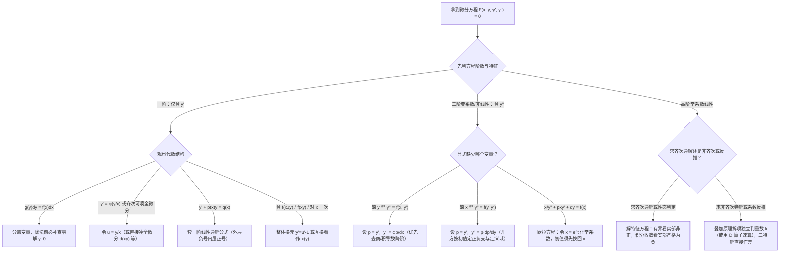

# 第15讲 微分方程

基础补充对照：[[第15讲_讲义.pdf]]，第 1—32 页（第 25—27 页为数三差分方程，数二不考；第 27—32 页为习题及解答）。

> [!important] 近 17 年数二真题雷达（2010—2026｜S+ 级年均两题核心区）
> - **考频画像**：主考 33 题（2021—2026 新大纲 12 题，2015—2020 经典 11 题，2010—2014 早期 10 题，年均 15～17 分）。
> - **真题落点**：
>   - *2021—2026 新大纲*：`21-T15(填)`、`21-T20(解)`、`22-T14(填)`、`22-T18(解)`、`23-T4(选)`、`23-T17(解)`、`24-T13(填)`、`24-T18(解)`、`25-T3(选)`、`25-T15(填)`、`26-T2(选)`、`26-T21(解)`
>   - *2015—2020 经典*：`15-T12(填)`、`15-T20(解)`、`16-T11(填)`、`16-T19(解)`、`17-T4(选)`、`17-T21(解)`、`18-T16(解)`、`19-T4(选)`、`19-T17(解)`、`20-T13(填)`、`20-T21(解)`
>   - *2010—2014 早期*：`10-T2(选)`、`10-T9(填)`、`10-T17(解)`、`11-T4(选)`、`11-T10(填)`、`11-T18(解)`、`12-T12(填)`、`12-T19(解)`、`13-T13(填)`、`14-T16(解)`
> - **核心高频命题点**：
>   1. **高阶常系数与线性结构（选填核心）**：`10-T2`/`26-T2`（非齐次系数和 $=1$、齐次系数和 $=0$）、`11-T4`/`17-T4`/`19-T4`（叠加特解独立设系数与逆推）、`10-T9`/`21-T15`/`22-T14`（高阶分解与零根）、`23-T4`/`25-T3`（全轴有界 vs 半轴积分收敛）。
>   2. **一阶方程、二阶降阶与变限方程（解答主线）**：`10-T17`（参数二阶导建方程）、`11-T18`/`17-T21`/`21-T20`/`22-T18`/`23-T17`（倾角/曲率/法线切线与弧长）、`15-T20`/`20-T21`（卷积核/乘积变元变限方程）、`26-T21`（缺 $y$ 凑商导数 $(\frac{y'}{x^2})'$ 速降阶）。
>   3. **2024 考纲新动向**：`24-T18` 指定代换 $x=\mathrm{e}^t$ 考查欧拉方程 $x^2y''+xy'-9y=0$，须先换回 $x$ 再代导数初值 $y'(x_0)$。
> - **每日复习聚焦**：先过第二部分 Mermaid 决策树，重点巩固「一阶换元/互换变量 + 缺 $x$/缺 $y$ 降阶 + 常系数有界/收敛性态 + 欧拉换元 + 几何微元建模」。

---

## 第一部分｜知识点与核心结论

### 一、微分方程基本概念与解的判定【🔥 必背｜停下来默背 1 遍 · 解的结构选填常客】

**1. 微分方程基本概念与阶数** 【💤 可跳过｜冲刺期直接跳过不看】
- **常微分方程**：联系自变量 $x$、未知函数 $y(x)$ 及其各阶导数（或微分）的方程，一般隐式形式记为 $F(x, y, y', \dots, y^{(n)}) = 0$。
- **微分方程的阶**：方程中所包含的未知函数**最高阶导数的阶数**，与该导数的方幂无关。例如 $(y'')^3 + (y')^5 + y = 0$ 属于二阶微分方程；$y'' + \sin(y') = 0$ 属于二阶微分方程。

**2. 线性与非线性判据（三条标准）** 【💤 可跳过｜冲刺期直接跳过不看】
- **$n$ 阶线性微分方程标准形式**：
  $$
  a_n(x)y^{(n)} + a_{n-1}(x)y^{(n-1)} + \dots + a_1(x)y' + a_0(x)y = f(x),\qquad a_n(x) \ne 0.
  $$
- **线性判定三条件**：
  1. $y$ 及其各阶导数 $y', \dots, y^{(n)}$ 均以一次形式出现（不含 $y^2, \sqrt{y}, \sin y, \mathrm{e}^y$ 等非线性项）；
  2. $y$ 与各阶导数之间彼此不相乘（不含 $yy', (y')^2, y y''$ 等交叉乘积）；
  3. 系数 $a_k(x)$ 仅依赖自变量 $x$ 或为常数，不含 $y$ 及其导数。
- **常系数与变系数**：若系数 $a_n(x), \dots, a_0(x)$ 全为实常数，则称为常系数线性微分方程；若至少有一个系数依赖于 $x$，则为变系数线性微分方程。
- **齐次与非齐次**：自由项 $f(x) \equiv 0$ 为齐次线性微分方程；$f(x) \not\equiv 0$ 为非齐次线性微分方程。
- **常见类型判据对照**：

| 方程形式 | 是否线性 | 判据分析 |
|---|---|---|
| $y' + xy = x^2$ | 线性 | 未知函数 $y$ 与导数 $y'$ 均为一次，系数 $x$ 仅依赖于自变量 $x$ |
| $y' + y^2 = 0$ | 非线性 | 未知函数以二次幂 $y^2$ 形式出现 |
| $yy'' + (y')^2 = 0$ | 非线性 | 未知函数与二阶导数相乘，且一阶导数出现平方项 |
| $y'' + \cos x \cdot y = \mathrm{e}^x$ | 线性 | 变系数二阶线性非齐次微分方程 |

- **易混概念辨析**：**齐次型一阶微分方程**（形如 $y' = \varphi(y/x)$）与**齐次线性微分方程**（右端自由项恒为零 $f(x) \equiv 0$ 的线性方程）名称相似，但属于完全不同的数学概念，审题时必须严格区分。

**3. 解、通解、特解与独立任意常数** 【📌 扫一眼｜确认“我还会”就过】
- **通解**：含有与方程阶数相同个数的**相互独立任意常数**的解。
  - **独立性检验**：常数之间不能合并化简。例如表达式 $y = C_1 \mathrm{e}^x + C_2 \mathrm{e}^x = (C_1 + C_2)\mathrm{e}^x = C \mathrm{e}^x$ 表面上有两个常数，但实际合并后只有一个独立常数，因此不能作为二阶方程的通解。
- **特解**：满足方程的一个具体解。可通过初始条件从通解中确定，也可由代入等方法直接找到；初始条件不一定保证解存在或唯一。
- **奇解与除法遗漏常数解**：在分离变量或代数变形中，<mark>同除含未知函数因式必查零解</mark>，回代验证使该因式为零的常数函数 $y \equiv y_0$ 是否为方程的解；并注意<mark>开方正负分支须由初值定号</mark>。
- **通解中常数的取值范围约束**：通解中的常数并不总是在全实数域 $(-\infty, +\infty)$ 内任意取值，往往受到开方非负性、对数真数严格为正或初值条件的严格限制（如 $(1+x^2)(1+y^2)=Cx^2$ 中常数必须满足 $C > 1$）。

**4. 线性微分方程解的结构定理与 $\sum c_i = 1$ 法则** 【🔥 必背｜停下来默背 1 遍】
设线性微分算子为 $L[y] = y'' + p(x)y' + q(x)y$：
- **齐次解的线性叠加原理**：若 $y_1(x), y_2(x)$ 为齐次方程 $L[y]=0$ 的两个解，则其线性组合 $C_1 y_1(x) + C_2 y_2(x)$ 仍为齐次方程的解；若 $y_1, y_2$ 线性无关（即比值 $\frac{y_1(x)}{y_2(x)} \ne \mathrm{const}$），则 $y = C_1 y_1(x) + C_2 y_2(x)$ 构成齐次方程的通解。
- **非齐次解之差必为齐次解**：若 $y_1(x), y_2(x)$ 为同一非齐次方程 $L[y]=f(x)$ 的解，则两解之差 $y_1(x) - y_2(x)$ 必满足齐次方程 $L[y_1 - y_2] = f(x) - f(x) = 0$。
- **通解结构定理**：非齐次线性方程的通解等于其对应齐次方程的通解 $y_h$ 加上非齐次方程的任意一个特解 $y^*$：
  $$
  y = y_h + y^* = C_1 y_1(x) + C_2 y_2(x) + y^*(x).
  $$
- **$\sum c_i = 1$ 线性组合法则（客观题快速判定）**：
  若 $y_1(x), y_2(x), \dots, y_m(x)$ 均为同一非齐次方程 $L[y]=f(x)$ 的特解，对其作线性组合 $Y(x) = \sum_{i=1}^m c_i y_i(x)$：
  $$
  L[Y] = L\left[\sum_{i=1}^m c_i y_i\right] = \sum_{i=1}^m c_i L[y_i] = \sum_{i=1}^m c_i f(x) = \left(\sum_{i=1}^m c_i\right) f(x).
  $$
  - 当且仅当<mark>特解线性组合系数和为壹仍特解</mark>（$\sum_{i=1}^m c_i = 1$）；当且仅当<mark>特解线性组合系数和为零是齐次解</mark>（$\sum_{i=1}^m c_i = 0$）。 `[真题·2010-T2]` `[真题·2026-T2]`
  - `10-T2` A/B/C/D 选项辨析（$\lambda y_1+\mu y_2$ 为非齐次解，$\lambda y_1-\mu y_2$ 为齐次解）：联立 $\lambda+\mu=1$ 与 $\lambda-\mu=0$ 得 $\lambda=\mu=\frac{1}{2}$（A 对）；B（$-1/2,-1/2$）和为 $-1$（错）；C（$2/3,1/3$）差不为 $0$（错）；D（$2/3,2/3$）和为 $\frac{4}{3}$（错）。 `[真题·2010-T2]`
  - `26-T2` A/B/C/D 选项辨析（$2\lambda y_1+\mu y_2$ 为非齐次解，$\lambda y_1-2\mu y_2$ 为齐次解）：联立 $2\lambda+\mu=1$ 与 $\lambda-2\mu=0$ 得 $\lambda=\frac{2}{5},\mu=\frac{1}{5}$（B 对）；A 把 $\lambda,\mu$ 解反（错）；C 仅满足和为 $1$（错）；D 仅满足齐次和为 $0$（错）。 `[真题·2026-T2]`
- **三特解直接写出非齐次通解**：
  若已知二阶非齐次方程的三个特解 $y_1, y_2, y_3$（其中 $y_1-y_3$ 与 $y_2-y_3$ 线性无关），<mark>已知三特解相减直接写通解</mark>，无需反求方程系数： `[真题·2013-T13]`
  $$
  y = C_1(y_1 - y_3) + C_2(y_2 - y_3) + y_3.
  $$

---

### 二、一阶微分方程四大标准型与求解方法【🔥 必背｜停下来默背 1 遍 · 年均 1～2 题】

**1. 可分离变量型方程** 【🔥 必背｜停下来默背 1 遍】
- **标准形式**：$\frac{\mathrm{d}y}{\mathrm{d}x} = f(x)g(y)$ 或 $M(x)N(y)\mathrm{d}x + P(x)Q(y)\mathrm{d}y = 0$。
- **求解通法**：在 $g(y) \ne 0$ 的区间上分离变量并积分：
  $$
  \frac{\mathrm{d}y}{g(y)} = f(x)\mathrm{d}x \implies \int \frac{\mathrm{d}y}{g(y)} = \int f(x)\mathrm{d}x + C.
  $$
- **补查常数零解**：若实数 $y_0$ 使得 $g(y_0) = 0$，则常数函数 $y \equiv y_0$ 满足方程，必须检验其是否已被包含在通解中；求解隐式通解后若结合极值点（$y'=0$ 定驻点 $x=\pm 1$），常可利用<mark>隐式左侧单调性唯一锁定极值</mark>（`14-T16` 得极大 $y(1)=1$、极小 $y(-1)=0$）。 `[真题·2014-T16]`

**2. 齐次型与仿射比值型方程（三分支）** 【🔥 必背｜停下来默背 1 遍】
- **标准齐次型**：$\frac{\mathrm{d}y}{\mathrm{d}x} = \varphi\left(\frac{y}{x}\right)$。
  - **换元法**：令 $u = \frac{y}{x}$，即 $y = xu, \frac{\mathrm{d}y}{\mathrm{d}x} = u + x\frac{\mathrm{d}u}{\mathrm{d}x}$，代入方程得：
    $$
    u + x\frac{\mathrm{d}u}{\mathrm{d}x} = \varphi(u) \implies \frac{\mathrm{d}u}{\varphi(u) - u} = \frac{\mathrm{d}x}{x}.
    $$
    两端积分求出 $u(x)$ 后回代 $u = \frac{y}{x}$ 即可。开方提出自变量时严格遵循 $\sqrt{x^2} = \vert x\vert$。
- **仿射比值型 $\frac{\mathrm{d}y}{\mathrm{d}x} = f\left(\frac{ax + by + c}{a_1x + b_1y + c_1}\right)$（三分支处理）**：
  1. **常数项全为零（$c^2 + c_1^2 = 0$）**：分子分母同除以 $x$，直接化为标准齐次型 $\frac{\mathrm{d}y}{\mathrm{d}x} = g(y/x)$；
  2. **成比例平行（$c^2 + c_1^2 \ne 0$ 且 $\frac{a}{a_1} = \frac{b}{b_1} = k$）**：令整体变量 $u = ax + by$，两端求导得 $u' = a + by' = a + bf\left(\frac{u+c}{\frac{1}{k}u+c_1}\right)$，转化为可分离变量方程；
  3. **不平行相交（$c^2 + c_1^2 \ne 0$ 且 $\frac{a}{a_1} \ne \frac{b}{b_1}$）**：联立代数方程组 $\begin{cases} ax + by + c = 0 \\ a_1x + b_1y + c_1 = 0 \end{cases}$ 解得交点 $(x_0, y_0)$。令平移坐标 $x = X + x_0, y = Y + y_0$（$\mathrm{d}x = \mathrm{d}X, \mathrm{d}y = \mathrm{d}Y$），消去常数项化为关于 $Y/X$ 的齐次方程 $\frac{\mathrm{d}Y}{\mathrm{d}X} = f\left(\frac{aX+bY}{a_1X+b_1Y}\right)$。
- `【⚡ 真题补丁｜2025-T15】`：一次齐次方程既可令 $y=xu$ 分离，也可直接整理凑全微分 $\mathrm{d}(xy)$ 等，后者更稳捷。 `[真题·2020-T13]` `[真题·2025-T15]`

**3. 一阶线性微分方程（通解公式与常数变易法）** 【🔥 必背｜停下来默背 1 遍】
- **标准形式**：$y' + p(x)y = q(x)$。
- **通解公式**：
  $$
  y(x) = \mathrm{e}^{-\int p(x)\mathrm{d}x} \left[ \int q(x)\mathrm{e}^{\int p(x)\mathrm{d}x}\mathrm{d}x + C \right].
  $$
  记忆核心：<mark>外层取负积分因子内层取正</mark>；若方程为 $xy'-6y=-6$ 类形式，可先<mark>一眼看穿常数特解快速写通解</mark> $y=Cx^6+1$，避免内层指数遗漏负号。 `[真题·2011-T10]` `[真题易错·2021-T20]`
- **常数变易法推导机制**：
  1. 先求对应齐次方程 $y' + p(x)y = 0$ 的通解：分离变量得 $y_h = C \mathrm{e}^{-\int p(x)\mathrm{d}x}$；
  2. 将任意常数 $C$“变易”为待定函数 $u(x)$，设非齐次方程的解为 $y = u(x)\mathrm{e}^{-\int p(x)\mathrm{d}x}$；
  3. 代入非齐次方程求导：$u'(x)\mathrm{e}^{-\int p\mathrm{d}x} - u(x)p(x)\mathrm{e}^{-\int p\mathrm{d}x} + p(x)u(x)\mathrm{e}^{-\int p\mathrm{d}x} = q(x)$；
  4. 互消非导数项后得：$u'(x) = q(x)\mathrm{e}^{\int p(x)\mathrm{d}x} \implies u(x) = \int q(x)\mathrm{e}^{\int p(x)\mathrm{d}x}\mathrm{d}x + C$。
- **定积分形式（理论分析与保号性专用）**：
  $$
  y(x) = \mathrm{e}^{-\int_{x_0}^x p(t)\mathrm{d}t} \left[ y(x_0) + \int_{x_0}^x q(t)\mathrm{e}^{\int_{x_0}^t p(s)\mathrm{d}s} \mathrm{d}t \right].
  $$
  齐次形式为 $y(x) = y(x_0)\mathrm{e}^{-\int_{x_0}^x p(t)\mathrm{d}t}$。因实指数恒正，若 $y(x_0) > 0$，则在连续区间内恒有 $y(x) > 0$，不穿过零轴。

**补充：一阶线性方程解的有界性** 【📌 扫一眼｜确认“我还会”就过】
- 若 $a>0$，$f$ 在 $[0,+\infty)$ 连续且 $|f(x)|\le M$，则 $y'+ay=f(x)$ 的任意解都在 $[0,+\infty)$ 有界。由积分因子得
  $$
  y(x)=\mathrm e^{-ax}y(0)+\int_0^x\mathrm e^{-a(x-t)}f(t)\,\mathrm dt,
  \qquad |y(x)|\le |y(0)|+\frac M a.
  $$
  $a>0$ 是此估计的关键：当 $a=0$、$f(x)=1$ 时，解 $y=x+C$ 无界。（基础讲义 PDF 第 9 页例 15.10。）

**4. 伯努利方程（基础讲义标注为数学一内容）** 【💤 可跳过｜冲刺期直接跳过不看】
- **标准形式**：
  $$
  y' + p(x)y = q(x)y^n\qquad (n \ne 0,\ 1).
  $$
- **数二考纲提示**：传统属数学一考点；此处保留代换推导供拓展查阅，不作为数二核心必考专题。
- **变量代换转化法**：
  1. 方程两端同除以 $y^n$：
     $$
     y^{-n}\frac{\mathrm{d}y}{\mathrm{d}x} + p(x)y^{1-n} = q(x).
     $$
  2. 观察到导数关系 $\frac{\mathrm{d}}{\mathrm{d}x}(y^{1-n}) = (1-n)y^{-n}\frac{\mathrm{d}y}{\mathrm{d}x}$，故令新未知函数：
     $$
     z = y^{1-n} \implies \frac{\mathrm{d}z}{\mathrm{d}x} = (1-n)y^{-n}\frac{\mathrm{d}y}{\mathrm{d}x}.
     $$
  3. 代入方程转化为关于 $z$ 的一阶线性微分方程：
     $$
     \frac{1}{1-n}\frac{\mathrm{d}z}{\mathrm{d}x} + p(x)z = q(x) \iff \frac{\mathrm{d}z}{\mathrm{d}x} + (1-n)p(x)z = (1-n)q(x).
     $$
  4. 利用一阶线性公式求出 $z(x)$ 后，回代 $y = z^{\frac{1}{1-n}}$ 即可。

**5. 整体换元四大结构与自变量因变量互换** 【🔥 必背｜停下来默背 1 遍】
- **常见代数结构整体换元**：
  1. 含 $f(x \pm y)$，令 $u = x \pm y$；
  2. 含 $f(xy)$，令 $u = xy \implies u' = y + xy'$；
  3. 含 $f(x^2 \pm y^2)$，令 $u = x^2 \pm y^2$；
- **导数乘积逆用换元**：
  1. 见到 $f'[g(x)]g'(x)$，联想复合导数，令 $u = f[g(x)]$；
  2. 见到 $f'(x)g(x) + f(x)g'(x)$，联想乘积导数，令 $u = f(x)g(x)$；
  3. 出现 $\mathrm{e}^{-y}$ 或 $\mathrm{e}^y y'$，两边同乘 $\mathrm{e}^y$ 并设 $u = \mathrm{e}^y > 0$，化为一阶线性方程；
  4. 根式 $\sqrt{y + x^2}$ 且移项后出现 $y' + 2x$，令 $u = y + x^2$，化为 $u' = \sqrt{u}$。
- **自变量与因变量互换（反函数法）**：
  当方程关于未知函数 $y(x)$ 呈现高度非线性，但<mark>自变量仅以一次形式出现应换作</mark> $x(y)$ 求解，由 $\frac{\mathrm{d}y}{\mathrm{d}x} = \frac{1}{\mathrm{d}x/\mathrm{d}y}$ 化为一阶线性方程 $\frac{\mathrm{d}x}{\mathrm{d}y} + P(y)x = Q(y)$；求出隐式解后<mark>按初值符号决定开方正负支</mark>（`12-T12` 由 $y(1)=1>0$ 舍 $-\sqrt{x}$ 得 $y=\sqrt{x}$）。 `[真题·2012-T12]` `[真题·2019-T17]`
- `【⚡ 真题补丁｜2024-T13】`：遇 $f(x+y)$ 整体换元 $u=x+y$，务必写清 $y'=u'-1$ 勿漏减 $1$，回代初值后求导验算。 `[真题·2024-T13]`

---

### 三、二阶可降阶微分方程通法（数学二高频重点）【🔥 必背｜停下来默背 1 遍 · 26-T21 压轴落地】

**1. 缺 $y$ 型与缺 $x$ 型降阶模板** 【🔥 必背｜停下来默背 1 遍】
审题首先观察方程显式**缺少哪一个变量**，对应选用代换（若降阶后对 $p$ 非线性而对 $x$ 线性，可<mark>互换变量写作自变量对动量求导</mark>）： `[真题易错·2007-T19]`

| 方程结构 | 换元设定 | 二阶导数代换式 | 求解步骤与还原 |
|---|---|---|---|
| **缺 $y$**：$y'' = f(x, y')$ | 设 $p = p(x) = y'$ | $y'' = \frac{\mathrm{d}p}{\mathrm{d}x} = p'$ | 先解一阶方程 $p' = f(x, p)$ 求出 $p(x)$；再积分 $y = \int p(x)\mathrm{d}x + C_2$ |
| **缺 $x$**：$y'' = f(y, y')$ | 设 $p = p(y) = y'$ | $y'' = \frac{\mathrm{d}p}{\mathrm{d}y}\frac{\mathrm{d}y}{\mathrm{d}x} = p\frac{\mathrm{d}p}{\mathrm{d}y}$ | 先解关于 $p(y)$ 的一阶方程 $p\frac{\mathrm{d}p}{\mathrm{d}y} = f(y, p)$；求出 $p(y)$ 后再分离变量 $\frac{\mathrm{d}y}{p(y)} = \mathrm{d}x$ |

**2. 降阶求解两处易错点** 【🔥 必背｜停下来默背 1 遍】
- **易错点一（缺 $y$ 降阶除以 $p$ 补查零解）**：
  解 $p' = f(x, p)$ 若同除以 $p$，须单独验证 $p(x) \equiv 0$（即 $y \equiv C$）是否为解；当初值 $y'(x_0)=0$ 时，常数函数 $y \equiv y(x_0)$ 往往就是特解。 `[真题·2018-T16]`
- **易错点二（缺 $x$ 降阶链式乘数 $p$ 勿漏）**：
  $y'' = \frac{\mathrm{d} p(y)}{\mathrm{d}y}\frac{\mathrm{d}y}{\mathrm{d}x} = p \frac{\mathrm{d}p}{\mathrm{d}y}$。<mark>缺自变量降阶严禁遗漏外层乘数</mark> $p$，开方分离变量时按初值 $y'(x_0)$ 符号定正负支，并写明最大存在区间。 `[真题·2016-T19]`

**3. 全微分法快捷降阶** 【⚡ 避坑｜最值钱，必须精读 1 分钟】
1. $yy'' + (y')^2 = (yy')' \implies yy' = C_1 \implies y^2 = 2C_1 x + C_2$；
2. $x y y'' + x(y')^2 - y y' = x(yy')' - yy' = 0 \implies \left(\frac{yy'}{x}\right)' = 0 \implies \frac{yy'}{x} = C_1 \implies y^2 = C_1 x^2 + C_2$。
- `【⚡ 真题补丁｜2026-T21】`：遇 $x^2y''\mp 2xy'$ 同除 $x^4$ 凑商导 $\left(\frac{y'}{x^2}\right)'$ 或积导 $(x^2y')'$ 速降阶，保定义域 $x>2$。 `[真题·2026-T21]`
  - `26-T21` $x^2 y'' - 2xy' - (y')^2 = 0\ (x>2)$ 除以 $x^4$ 得 $\left(\frac{y'}{x^2}\right)' = \left(\frac{y'}{x^2}\right)^2$，令 $u=\frac{y'}{x^2}$ 解 $u'=u^2$ 得 $y'=-\frac{x^2}{x-2}$，同理储备 $x^2 y'' + 2xy' = (x^2 y')'$。

---

### 四、高阶常系数线性微分方程与欧拉方程转化【🔥 必背｜停下来默背 1 遍 · 21-26 选填大题全覆盖】

**1. 二阶常系数齐次线性方程通解表** 【🔥 必背｜停下来默背 1 遍】
标准形式：$y'' + py' + qy = 0$（$p, q$ 为实常数）。
特征方程：$r^2 + pr + q = 0$，特征判别式 $\Delta = p^2 - 4q$。

| 特征根情况 | 对应齐次通解形式 $y_h$ | 结构记忆要点 |
|---|---|---|
| **两不相等实根** $r_1 \ne r_2$ | $y = C_1 \mathrm{e}^{r_1 x} + C_2 \mathrm{e}^{r_2 x}$ | 两个独立的实指数衰减或增长项 |
| **二重实根** $r_1 = r_2 = r$ | $y = (C_1 + C_2 x)\mathrm{e}^{rx}$ | 第二个线性无关解必须**补乘自变量 $x$** |
| **一对共轭复根** $r_{1,2} = \alpha \pm i\beta$（$\beta > 0$） | $y = \mathrm{e}^{\alpha x}(C_1 \cos\beta x + C_2 \sin\beta x)$ | 实部 $\alpha$ 进指数，虚部 $\beta$ 进三角；<mark>高阶切勿漏零根常数或错分解</mark> `[真题·2010-T9]` `[真题·2012-T19]` `[真题·2021-T15]` `[真题·2022-T14]` |

- `【⚡ 真题补丁｜2023-T4】`：全轴 $(-\infty,+\infty)$ 有界须仅含单纯虚根（$a=0, b>0$），严格区分半轴 $[0,+\infty)$ 有界。 `[真题·2023-T4]`
  - `23-T4` A/B/C/D 选项辨析：A（$a<0,b>0$）$x\to+\infty$ 无界；B（$a>0,b>0$）仅在 $[0,+\infty)$ 有界而 $x\to-\infty$ 无界；C（$a=0,b>0$）纯虚单根全轴有界（对）；D（$a=0,b<0$）非零实根两端均无界。
- `【⚡ 真题补丁｜2025-T3】`：任一解在 $[0,+\infty)$ 积分收敛当且仅当全部特征根实部全负（即 $p>0, q>0$）。 `[真题·2025-T3]`
  - `25-T3` A/B/C/D 选项辨析：由 $-2a>0$ 且 $a+2>0$ 得 $(-2,0)$（C 对）；A（$(-2,-1]$）漏复根区间 $(-1,0)$；B（$(-\infty,-1]$）兼含零正根又漏复根；D（$(-\infty,0)$）误纳入 $a\le -2$ 导致零根发散。
  - **兼顾复根与零根**：$\Delta < 0$ 时 $\mathrm{e}^{\alpha x}\cos\beta x$ 只要实部 $\alpha < 0$ 积分即收敛；$q = 0$ 时含零根常数解发散。

**2. 二阶常系数非齐次线性方程与待定系数法** 【🔥 必背｜停下来默背 1 遍】
标准形式：$y'' + py' + qy = f(x)$。非齐次通解为 $y = y_h + y^*$。

- **类型一：$f(x) = \mathrm{e}^{\alpha x} P_m(x)$（指数乘多项式）**
  $$
  y^* = x^k \mathrm{e}^{\alpha x} Q_m(x).
  $$
  其中 $Q_m(x)$ 为与 $P_m(x)$ 同阶数的待定多项式；$k$ 为实数 $\alpha$ 作为特征方程根的重数：<mark>自由项按叠加原理独立定重数并分别设系数</mark>。 `[真题·2011-T4]` `[真题·2015-T12]` `[真题·2016-T11]` `[真题·2017-T4]`
  - 若 $\alpha$ 不是特征根，取 $k = 0$；单根取 $k = 1$；二重根取 $k = 2$（常数自由项对应 $\alpha = 0$）。
  - `11-T4` A/B/C/D 选项辨析（$y''-\lambda^2 y=\mathrm{e}^{\lambda x}+\mathrm{e}^{-\lambda x},\ \lambda>0$）：$\pm\lambda$ 均为特征单根，两指数项须分别设独立系数得 $x(a\mathrm{e}^{\lambda x}+b\mathrm{e}^{-\lambda x})$（C 对）；A 漏乘 $x$，B 强制两系数相等无法匹配符号，D 误作二重根乘 $x^2$。 `[真题·2011-T4]`
  - `17-T4` A/B/C/D 选项辨析（$y''-4y'+8y=\mathrm{e}^{2x}(1+\cos 2x)$）：特征根 $2\pm 2i$，故 $\alpha_1=2$ 不是特征根（设 $A\mathrm{e}^{2x}$），$\alpha_2=2+2i$ 是单根（设 $x\mathrm{e}^{2x}(B\cos 2x+C\sin 2x)$），选 C；A 漏乘 $x$，B 弄反两项，D 对 $\mathrm{e}^{2x}$ 多乘 $x$。 `[真题·2017-T4]`
- **类型二：$f(x) = \mathrm{e}^{\alpha x} [P_m(x)\cos\beta x + P_n(x)\sin\beta x]$（指数乘三角，$\beta > 0$）**
  $$
  y^* = x^k \mathrm{e}^{\alpha x} [Q_l(x)\cos\beta x + R_l(x)\sin\beta x],\qquad l = \max(m, n).
  $$
  其中 $Q_l(x), R_l(x)$ 为两个独立的 $l$ 次待定多项式，正弦与余弦两项需同时设立；$k$ 由复数 $\alpha + i\beta$ 是否为特征根决定（非根取 $k=0$，单根取 $k=1$）。
- **和差自由项独立定 $k$ 准则**：
  自由项为和式（如 $\sin^2 x = \frac{1}{2} - \frac{1}{2}\cos 2x$）时，<mark>拆项各自判别特征根重数切忌共用</mark>，分别求特解后叠加。

**3. 特征多项式反推“至少”准则** 【📌 扫一眼｜确认“我还会”就过】
已知微分方程的特解，反推具有实常数系数的最低阶线性齐次微分方程（通解反求方程系数时，<mark>齐次部分定系数特解代回原式定右端</mark>）： `[真题·2019-T4]`
- 特解中含 $x^{m-1}\mathrm{e}^{rx} \implies r$ **至少是特征方程的 $m$ 重实根**；
- 特解中含 $x^{m-1}\mathrm{e}^{\alpha x}\cos\beta x$ 或 $x^{m-1}\mathrm{e}^{\alpha x}\sin\beta x \implies \alpha \pm i\beta$ **至少各为特征方程的 $m$ 重复根**；
- 特解中含独立的一次项 $x \implies 0$ **至少是特征方程的二重根**（因 $x = x^{2-1}\mathrm{e}^{0x}$）。
- `19-T4` A/B/C/D 选项辨析（通解 $(C_1+C_2x)\mathrm{e}^{-x}+\mathrm{e}^x$ 反推 $y''+ay'+by=c\mathrm{e}^x$）：二重根 $-1$ 得 $(r+1)^2=0\Rightarrow a=2,b=1$，将 $y^*=\mathrm{e}^x$ 代入左边得 $1+2+1=c=4$（D 对）；A/B 错写特征根为 $0,-1$；C 误算 $c=3$。 `[真题·2019-T4]`

**4. 欧拉方程转化为常系数方程（基础讲义标注为数学一内容）** 【⚡ 避坑｜最值钱，必须精读 1 分钟】
- **标准形式**：
  $$
  x^2 \frac{\mathrm{d}^2y}{\mathrm{d}x^2} + p x \frac{\mathrm{d}y}{\mathrm{d}x} + q y = f(x)\qquad (x > 0).
  $$
- `【⚡ 真题补丁｜2024-T18】`：欧拉方程令 $x=\mathrm{e}^t$ 化常系数解出后，须先换回原变量 $x$ 再对 $x$ 求导代入初值 $y'(x_0)$。 `[真题·2024-T18]`
- **自变量代换规范推导**：
  令 $x = \mathrm{e}^t$（即 $t = \ln x$），记 $y = y(t)$。由复合函数链式求导：
  $$
  \frac{\mathrm{d}y}{\mathrm{d}x} = \frac{\mathrm{d}y}{\mathrm{d}t}\frac{\mathrm{d}t}{\mathrm{d}x} = \frac{1}{x}\frac{\mathrm{d}y}{\mathrm{d}t} \implies x\frac{\mathrm{d}y}{\mathrm{d}x} = \frac{\mathrm{d}y}{\mathrm{d}t}.
  $$
  对二阶导数继续求导：
  $$
  \frac{\mathrm{d}^2y}{\mathrm{d}x^2} = \frac{\mathrm{d}}{\mathrm{d}x}\left(\frac{1}{x}\frac{\mathrm{d}y}{\mathrm{d}t}\right) = -\frac{1}{x^2}\frac{\mathrm{d}y}{\mathrm{d}t} + \frac{1}{x}\frac{\mathrm{d}}{\mathrm{d}t}\left(\frac{\mathrm{d}y}{\mathrm{d}t}\right)\frac{\mathrm{d}t}{\mathrm{d}x} = \frac{1}{x^2}\left(\frac{\mathrm{d}^2y}{\mathrm{d}t^2} - \frac{\mathrm{d}y}{\mathrm{d}t}\right).
  $$
  将 $x\frac{\mathrm{d}y}{\mathrm{d}x}$ 与 $x^2\frac{\mathrm{d}^2y}{\mathrm{d}x^2}$ 代入原方程，得关于 $t$ 的常系数线性微分方程：
  $$
  \frac{\mathrm{d}^2y}{\mathrm{d}t^2} + (p - 1)\frac{\mathrm{d}y}{\mathrm{d}t} + q y = f(\mathrm{e}^t).
  $$
  求出关于 $t$ 的解后，回代 $t = \ln x$ 即得原方程的解。

---

### 五、宇哥特色解题方法：微分算子法（$D$ 算子四类速查表）【📌 扫一眼｜确认“我还会”就过 · 客观题提速】

**1. 微分算子与逆算子基本概念** 【📌 扫一眼｜确认“我还会”就过】
记微分算子 $D = \frac{\mathrm{d}}{\mathrm{d}x}$，$F(D) = D^2 + pD + q$，常系数线性微分方程写为 $F(D)y = f(x)$。其特解可形式化表示为逆算子作用：
$$
y^* = \frac{1}{F(D)}f(x).
$$

**2. 算子法四类标准规则速查表** 【📌 扫一眼｜确认“我还会”就过】

| 自由项类型 $f(x)$ | 算子计算核心公式 | 使用规则与要点 |
|---|---|---|
| **一、纯指数型** $f(x) = A\mathrm{e}^{\alpha x}$ | $y^* = \begin{cases} \dfrac{A}{F(\alpha)}\mathrm{e}^{\alpha x}, & F(\alpha) \ne 0 \\[8pt] \dfrac{A x}{F'(\alpha)}\mathrm{e}^{\alpha x}, & F(\alpha)=0,\ F'(\alpha)\ne 0 \\[8pt] \dfrac{A x^2}{F''(\alpha)}\mathrm{e}^{\alpha x}, & F(\alpha)=F'(\alpha)=0 \end{cases}$ | 将算子 $D$ 直接代换为实数 $\alpha$； 若分母为零，分母对 $D$ 求导，分子补乘自变量 $x$； 若一阶导数仍为零，分母二阶求导，分子补乘 $x^2$。 |
| **二、正弦余弦型** $A\cos\beta x + B\sin\beta x$ | $D^2$ 直接代换为 $-\beta^2$： $\dfrac{1}{F(D)}\cos\beta x = \dfrac{1}{q - \beta^2 + pD}\cos\beta x$ | 仅代换 $D^2 \to -\beta^2$，不能替换一次项 $D$； 分母含一次项 $pD+d$ 时，分子分母同乘共轭算子 $d-pD$； 共振情形（分母为零）： $\dfrac{1}{D^2+\beta^2}\cos\beta x = \dfrac{x}{2\beta}\sin\beta x$； $\dfrac{1}{D^2+\beta^2}\sin\beta x = -\dfrac{x}{2\beta}\cos\beta x$。 |
| **三、多项式型** $f(x) = P_m(x)$ | 将 $\dfrac{1}{F(D)}$ 在 $D=0$ 处作麦克劳林展开至 $D^m$ 项： $\dfrac{1}{1 - u} = 1 + u + u^2 + \dots$ | 高于 $m$ 次的导数项 $D^k P_m(x) = 0$（$k > m$）自动清零； 若分母提取出因式 $D^s$，展开后最后依次执行 $s$ 次不定积分。 |
| **四、指数平移定理** $\mathrm{e}^{\alpha x} v(x)$ 乘积结构 | $\dfrac{1}{F(D)}\left[\mathrm{e}^{\alpha x}v(x)\right] = \mathrm{e}^{\alpha x}\dfrac{1}{F(D + \alpha)}v(x)$ | **将 $\mathrm{e}^{\alpha x}$ 提至算子左侧，同时将算子中所有 $D$ 统一平移代换为 $D + \alpha$**，将乘积结构降维求解。 |

---

### 六、数学二特色几何与物理建模模型库【🔥 必背｜停下来默背 1 遍 · 21-23 大题三连】

**1. 平面几何核心微元与表达** 【🔥 必背｜停下来默背 1 遍】
设平面光滑曲线为 $y = y(x)$，切点坐标为 $(x, y)$，切线上动点坐标记为 $(X, Y)$：
- **切线与法线方程**：切线 $Y - y = y'(X - x)$，法线斜率为 $-\frac{1}{y'}$。<mark>先审清题意要求切线还是法线</mark>，勿直接套用切线截距公式。 `[真题·2021-T20]` `[真题易错·2021-T20]` `[真题·2023-T17]`
- **截距表达**：
  - 切线纵截距（与 $y$ 轴交点）：令 $X = 0 \implies Y = y - x y'$；
  - 切线横截距（与 $x$ 轴交点）：令 $Y = 0 \implies X = x - \frac{y}{y'}$。
- **切线倾角 $\theta$ 与参数二阶导数**：<mark>参数方程二阶导勿漏除参数一阶导三次方</mark>（`10-T17` 漏写 $x'=2(1+t)$ 致一阶线性方程少因式）。 `[真题·2010-T17]` `[真题·2011-T18]`
  $$
  \tan\theta = y' \implies \sec^2\theta \cdot \frac{\mathrm{d}\theta}{\mathrm{d}x} = y'' \implies \frac{\mathrm{d}\theta}{\mathrm{d}x} = \frac{y''}{1 + (y')^2},\qquad
  \frac{\mathrm{d}^2 y}{\mathrm{d}x^2} = \frac{\psi''x' - x''\psi'}{(x')^3}.
  $$
- **平面曲线弧长微元（数学二高频核心）**：
  直角坐标系下：<mark>被积号下须配成完全平方再去根号</mark>，写出开方正负号依据。 `[真题·2022-T18]`
  $$
  \mathrm{d}s = \sqrt{1 + (y')^2}\mathrm{d}x,\qquad s = \int_a^b \sqrt{1 + (y')^2}\mathrm{d}x.
  $$
  极坐标系下：$\mathrm{d}s = \sqrt{r^2 + (r')^2}\mathrm{d}\theta$；
- **旋转曲面侧面积（数学二高频核心）**：
  - 绕 $x$ 轴旋转：$S_x = 2\pi \int_a^b \vert y(x)\vert\sqrt{1 + (y')^2}\mathrm{d}x$；
  - 绕 $y$ 轴旋转：$S_y = 2\pi \int_a^b \vert x\vert\sqrt{1 + (y')^2}\mathrm{d}x$；
- **曲率与曲率半径（数学二高频核心）**：<mark>先判凹凸性再定曲率分子二阶导正负号</mark>（凹 $y''>0$，凸 $y''<0$）。 `[真题·2017-T21]`
  $$
  k = \frac{\vert y''\vert}{[1 + (y')^2]^{3/2}},\qquad R = \frac{1}{k} = \frac{[1 + (y')^2]^{3/2}}{\vert y''\vert}.
  $$
- **追踪追击问题几何条件**：追踪动点 $Q(x, y)$ 的轨迹切线方向时刻指向目标点 $P(X_P, Y_P)$：
  $$
  y' = \frac{y - Y_P}{x - X_P}.
  $$

**2. 经典力学变加速阻力模型** 【💤 可跳过｜冲刺期直接跳过不看】
设运动质点质量为 $m$，运动位移为 $s(t)$，速度为 $v(t)$，加速度为 $a(t)$：
- **加速度双通道转化法则**：
  - 探究速度与时间 $t$ 的函数关系时选用：$a = \frac{\mathrm{d}v}{\mathrm{d}t}$；
  - 探究速度与位移 $s$ 的函数关系时必须选用：$a = \frac{\mathrm{d}v}{\mathrm{d}t} = \frac{\mathrm{d}v}{\mathrm{d}s}\frac{\mathrm{d}s}{\mathrm{d}t} = v\frac{\mathrm{d}v}{\mathrm{d}s}$。
- **牛顿第二定律列方程**：
  根据合外力列方程 $m a = \sum F$。例如质点受与速度成正比的阻力 $f = -kv$ 时，位移-速度方程为 $m v\frac{\mathrm{d}v}{\mathrm{d}s} = -kv$。

**3. 牛顿冷却定律模型** 【💤 可跳过｜冲刺期直接跳过不看】
- **微分方程建立**：物体在介质中的冷却速率与物体即时温度和介质温度的温差成正比：
  $$
  \frac{\mathrm{d}T}{\mathrm{d}t} = -k(T - T_a),\qquad (k > 0).
  $$
  （其中 $T(t)$ 为物体的即时温度，$T_a$ 为恒温介质的温度，$k$ 为冷却传热系数）。
- **通解形式**：
  $$
  T(t) = T_a + [T(0) - T_a]\mathrm{e}^{-kt}.
  $$
  当时间 $t \to +\infty$ 时，衰减因子 $\mathrm{e}^{-kt} \to 0$，物体温度单调逼近介质恒温 $T_a$。

---

## 第二部分｜题型体系与解题方法论

### 一、局部性态与一阶方程常规求解

| 题干特征 | 优先方法 | 真题印证与避坑 |
|---|---|---|
| 已知微分方程，求某点极值或凹凸性 | 先将该点代入原方程求导数值，不求通解 | 例15.1；**避坑**：切忌浪费时间解特征方程求通解 |
| 已知初值条件，求含未知函数的未定式极限 | 代入初值定各阶导数值，写出麦克劳林展开式主项代入求极限 | 例15.2；**避坑**：展开至首个非零主项阶数即可 |
| 显式两变量乘积 $f(x)g(y)$ | 分离变量 $\frac{\mathrm{d}y}{g(y)} = f(x)\mathrm{d}x$，补查 $g(y)=0$ 常数解 | `14-T16`、例15.3；**避坑**：隐式方程结合单调性唯一定极值 `[真题·2014-T16]` |
| 和差仿射整体 $f(ax+by+c)$ | 设整体 $u = ax+by+c$，化为可分离变量方程 | `24-T13(填)`、例15.4；**避坑**：`24-T13` 令 $u=x+y$ 后勿漏 $y'=u'-1$ `[真题·2024-T13]` |
| 对 $y(x)$ 非线性，但 $x$ 仅以一次形式出现 | 交换变量，看作 $x(y)$，化为关于 $x(y)$ 的一阶线性方程 | `12-T12`、`19-T17`、例15.5；**避坑**：`12-T12` 开方按初值定正负支 `[真题·2012-T12]` `[真题·2019-T17]` |
| 分子分母同次齐次，或只含比值 $y/x$ | 齐次方程令 $y = xu$，或直接凑全微分 | `25-T15(填)`、`20-T13`、例15.6；**避坑**：`25-T15` 既可 $y=xu$ 也可直接凑全微分 `[真题·2020-T13]` `[真题·2025-T15]` |
| 仿射比值 $\varphi\left(\frac{ax+by+c}{a_1x+b_1y+c_1}\right)$ | 平行设 $u=ax+by$；相交平移坐标 $X=x-x_0, Y=y-y_0$ 消常数化齐次 | 例15.7；**避坑**：平移求解后须逐层回代原变量 $(x,y)$ |
| 出现 $\mathrm{e}^{-y}$，同时含 $y'$ | 同乘 $\mathrm{e}^y$，令 $u = \mathrm{e}^y > 0$，化为一阶线性方程 | 例15.8；**避坑**：最后取对数须核查真数大于零的区间 |
| 出现根式 $\sqrt{y+x^2}$ 且移项后含 $y'+2x$ | 设整体 $u = y+x^2$，利用 $u' = y'+2x$ 化为 $u' = \sqrt{u}$ | 例15.9；**避坑**：平方去根号前务必检查非负性与区间限制 |

> [!tip] 核心提醒
> 1. 客观题考查某点性态时，微分方程本质是各阶导数的恒等式，<mark>直接代入点值求导数值最快</mark>，不必盲目求通解。
> 2. 分离变量除以含因变量的因式时，<mark>必须单独回代验证常数零解</mark>；两边积分后通解常数受对数真数或平方和约束，存在严格取值范围（如 $C > 1$）。 `[真题·2014-T16]`

> [!example]- 例15.1 / 基础例15.1｜代入驻点判二阶导数符号定极值
> - **【题目】**：设函数 $f(x)$ 连续可导，满足微分方程 $f''(x) - 2f'(x) + 4f(x) = 0$。若在某点 $x_0$ 处满足 $f(x_0) > 0, f'(x_0) = 0$，判定 $f(x_0)$ 是否为极值？若是极值，指出是极大值还是极小值。
> - **【为什么这么想】**：题目只关心 $x_0$ 单点处的极值性态，已知 $f'(x_0)=0$ 为驻点。要求极值性质，最直接的方法是考查二阶导数 $f''(x_0)$ 的符号，直接将点代入方程即可。
> - **【完整解答】**：
>   将 $x = x_0$ 直接代入原微分方程：
>   $$
>   f''(x_0) - 2f'(x_0) + 4f(x_0) = 0.
>   $$
>   代入 $f'(x_0) = 0$：
>   $$
>   f''(x_0) + 4f(x_0) = 0 \implies f''(x_0) = -4f(x_0).
>   $$
>   已知 $f(x_0) > 0$，因此：
>   $$
>   f''(x_0) = -4f(x_0) < 0.
>   $$
>   由二阶导数判定极值的充分条件，驻点处的二阶导数严格小于零，故 $f(x_0)$ 必为函数的严格极大值。
> - **【复盘提醒】**：考场上切忌解特征方程求通解，直接利用方程恒等式代入求高阶导数是客观题标准做法。

> [!example]- 例15.2 / 基础例15.2｜代入初值求二阶导结合泰勒展开求解极限
> - **【题目】**：设二阶可导函数 $y = y(x)$ 满足微分方程 $y'' + py' + qy = \mathrm{e}^{3x}$，且满足初始条件 $y(0) = 0, y'(0) = 0$。求极限：
>   $$
>   \lim_{x\to 0}\frac{\ln(1 + x^2)}{y(x)}.
>   $$
> - **【为什么这么想】**：分子 $\ln(1+x^2) \sim x^2$ 为二阶无穷小；分母 $y(0)=0$，极限为未定式。题目未给出常数 $p, q$，说明极限值与通解无关，直接代入初值确定 $y(x)$ 在 $x=0$ 处的二阶麦克劳林展开即可。
> - **【完整解答】**：
>   1. 将初值 $x=0, y(0)=0, y'(0)=0$ 代入原方程：
>      $$
>      y''(0) + p \cdot y'(0) + q \cdot y(0) = \mathrm{e}^0 \implies y''(0) = 1.
>      $$
>   2. 由泰勒公式，在 $x=0$ 处的展开式为：
>      $$
>      y(x) = y(0) + y'(0)x + \frac{y''(0)}{2!}x^2 + o(x^2) = \frac{1}{2}x^2 + o(x^2).
>      $$
>   3. 代入所求极限，利用等价无穷小替换：
>      $$
>      \lim_{x\to 0}\frac{\ln(1 + x^2)}{y(x)} = \lim_{x\to 0}\frac{x^2}{\frac{1}{2}x^2} = 2.
>      $$
> - **【复盘提醒】**：本题的关键是看到未定式极限与微分方程初值的结合，展开到使首个非零项出现的阶数即可。

> [!example]- 例15.3 / 基础例15.4｜可分离变量与通解常数取值范围
> - **【题目】**：求微分方程 $\frac{y\,\mathrm{d}y}{1 + y^2} = \frac{\mathrm{d}x}{x(1 + x^2)}$（亦可写作 $x(1+x^2)y y' = 1+y^2$）的通解，并确定通解中任意常数 $C$ 的取值范围。
> - **【为什么这么想】**：方程两端已完全分离变量，两边分别进行有理分式积分。对数合并后，需依据因变量与自变量平方项的自然取值范围确定常数 $C$ 的边界。
> - **【完整解答】**：
>   1. 两边直接积分：
>      $$
>      \int \frac{y\,\mathrm{d}y}{1 + y^2} = \int \left(\frac{1}{x} - \frac{x}{1 + x^2}\right)\mathrm{d}x.
>      $$
>   2. 逐项积出：
>      $$
>      \frac{1}{2}\ln(1 + y^2) = \ln|x| - \frac{1}{2}\ln(1 + x^2) + \ln C_1\qquad (C_1 > 0).
>      $$
>   3. 两边同乘 2 并利用对数运算法则合并：
>      $$
>      \ln(1 + y^2) + \ln(1 + x^2) = \ln(x^2) + 2\ln C_1 \implies \ln[(1 + x^2)(1 + y^2)] = \ln(C x^2)\qquad (C = C_1^2 > 0).
>      $$
>      去掉对数符号得通解：
>      $$
>      (1 + x^2)(1 + y^2) = C x^2.
>      $$
>   4. 确定常数 $C$ 的取值范围：
>      因为对任意实数 $x \ne 0$ 和 $y$ 恒有 $1 + y^2 \ge 1$，故：
>      $$
>      C = \frac{(1 + x^2)(1 + y^2)}{x^2} = \left(1 + \frac{1}{x^2}\right)(1 + y^2) > 1 \cdot 1 = 1.
>      $$
>      因此常数 $C$ 必须满足 $C > 1$。
> - **【复盘提醒】**：原复盘笔记曾在此题错误混入不相容初值 $y(1)=0$，导致方程两边在初始点矛盾。通解中的任意常数未必能取遍全体实数，受平方和与定义域约束其范围为 $C > 1$。

> [!example]- 例15.4 / 基础例15.5｜仿射和差整体换元 $u = x+y+100$
> - **【题目】**：求微分方程 $\mathrm{d}y = \sin(x + y + 100)\mathrm{d}x$ 的通解。
> - **【为什么这么想】**：右端正弦函数内部为 $x, y$ 的一次仿射和式，无法直接分离变量。令 $u = x + y + 100$ 即可解耦。
> - **【完整解答】**：
>   1. 原方程改写为 $y' = \sin(x + y + 100)$。
>      令 $u = x + y + 100$，两边对 $x$ 求导：
>      $$
>      u' = 1 + y' = 1 + \sin u.
>      $$
>   2. 分离变量：
>      $$
>      \frac{\mathrm{d}u}{1 + \sin u} = \mathrm{d}x.
>      $$
>   3. 分子分母同乘 $1 - \sin u$ 积分：
>      $$
>      \int \frac{1 - \sin u}{\cos^2 u}\mathrm{d}u = \int (\sec^2 u - \sec u\tan u)\mathrm{d}u = \tan u - \sec u.
>      $$
>      积分得：
>      $$
>      \tan u - \sec u = x + C.
>      $$
>   4. 回代 $u = x + y + 100$ 得通解：
>      $$
>      \tan(x + y + 100) - \sec(x + y + 100) = x + C.
>      $$
>   5. 补充验证常数解：由 $1 + \sin u = 0$ 得 $u = 2k\pi - \frac{\pi}{2}$，直线族 $y = 2k\pi - \frac{\pi}{2} - x - 100$ 亦为方程的解。
> - **【复盘提醒】**：遇到 $f(ax+by+c)$ 结构，第一时间整体换元设 $u = ax+by+c$。

> [!example]- 例15.5 / 基础例15.8 & B9｜交换自变量与因变量化为一阶线性
> - **【题目】**：
>   (1)（1000题 B9 原题）求微分方程 $(x + y)\mathrm{d}y + (y + 1)\mathrm{d}x = 0$ 满足条件 $y|_{x=1} = 2$ 的特解。
>   (2)（基础30讲 例15.8）求微分方程 $y\,\mathrm{d}x + (x - 3y^2)\mathrm{d}y = 0$ 满足条件 $y|_{x=1} = 1$ 的特解。
> - **【为什么这么想】**：两题中若将 $y$ 视为因变量，$y'$ 的分母均出现和差式导致非线性；但 $x$ 仅以一次形式出现，交换变量视作 $x(y)$，即化为标准一阶线性微分方程。
> - **【完整解答】**：
>   **解答 (1)（1000题 B9）**：
>   1. 两边同除以 $(y+1)\mathrm{d}y$（在 $y \ne -1$ 区间）：
>      $$
>      \frac{\mathrm{d}x}{\mathrm{d}y} + \frac{x + y}{y + 1} = 0 \implies \frac{\mathrm{d}x}{\mathrm{d}y} + \frac{1}{y + 1}x = -\frac{y}{y + 1}.
>      $$
>   2. 此为关于 $x(y)$ 的一阶线性微分方程，套用通解公式：
>      $$
>      x(y) = \mathrm{e}^{-\int \frac{1}{y+1}\mathrm{d}y}\left[\int \left(-\frac{y}{y+1}\right)\mathrm{e}^{\int \frac{1}{y+1}\mathrm{d}y}\mathrm{d}y + C\right].
>      $$
>      在包含初值 $y=2$ 的区间 $y > -1$ 内：
>      $$
>      x(y) = \frac{1}{y + 1}\left[\int (y + 1)\left(-\frac{y}{y+1}\right)\mathrm{d}y + C\right] = \frac{1}{y + 1}\left(C - \frac{1}{2}y^2\right).
>      $$
>   3. 代入初始条件 $x=1, y=2$：
>      $$
>      1 = \frac{C - \frac{1}{2}(4)}{2 + 1} = \frac{C - 2}{3} \implies C = 5.
>      $$
>   4. 故特解为：
>      $$
>      x = \frac{10 - y^2}{2(y + 1)}\qquad (2x(y + 1) + y^2 = 10).
>      $$
>      在初值点处检验导数：$\frac{\mathrm{d}x}{\mathrm{d}y}\big|_{y=2} = -1 \ne 0 \implies y'(1) = -1$，严格满足处处连续可导性。
>   **解答 (2)（基础例15.8）**：
>   1. 改写为 $\frac{\mathrm{d}x}{\mathrm{d}y} + \frac{x}{y} = 3y$。
>   2. 通解为：
>      $$
>      x(y) = \mathrm{e}^{-\int \frac{1}{y}\mathrm{d}y}\left[\int 3y \cdot \mathrm{e}^{\int \frac{1}{y}\mathrm{d}y}\mathrm{d}y + C\right] = \frac{1}{y}\left(\int 3y^2 \mathrm{d}y + C\right) = y^2 + \frac{C}{y}.
>      $$
>   3. 代入 $x=1, y=1 \implies 1 = 1 + C \implies C = 0$。
>      得 $x = y^2 \implies y = \pm\sqrt{x}$。由初值 $y|_{x=1}=1>0$，舍去负支得特解 $y = \sqrt{x}$。
> - **【复盘提醒】**：原复盘笔记曾在此题误写初值 $y(0)=0$，导致初始点处 $\frac{\mathrm{d}x}{\mathrm{d}y}\big|_{y=0} = 0$，产生切线垂直、导数不存在的数学矛盾。1000题 B9 的真实初值必须是 $y|_{x=1}=2$。

> [!example]- 例15.6 / 强化例15.1 & B1｜标准齐次方程令 $y=xu$ 求解
> - **【题目】**：求微分方程 $x + y y' = y - x y'$ 的通解。
> - **【为什么这么想】**：整理为导数表达式 $y' = \frac{y - x}{x + y}$，分子分母均为一次齐次式，属于标准齐次方程，令 $u = y/x$ 求解。
> - **【完整解答】**：
>   1. 整理方程：
>      $$
>      (x + y)y' = y - x \implies y' = \frac{\frac{y}{x} - 1}{1 + \frac{y}{x}}.
>      $$
>   2. 令 $u = \frac{y}{x}$，则 $y' = u + x u'$：
>      $$
>      u + x\frac{\mathrm{d}u}{\mathrm{d}x} = \frac{u - 1}{u + 1} \implies x\frac{\mathrm{d}u}{\mathrm{d}x} = \frac{u - 1}{u + 1} - u = -\frac{u^2 + 1}{u + 1}.
>      $$
>   3. 分离变量并积分：
>      $$
>      \frac{u + 1}{u^2 + 1}\mathrm{d}u = -\frac{\mathrm{d}x}{x} \implies \frac{1}{2}\ln(u^2 + 1) + \arctan u = -\ln|x| + C.
>      $$
>   4. 将 $\ln|x|$ 移至左端合并：
>      $$
>      \ln\left(|x|\sqrt{\frac{y^2}{x^2} + 1}\right) + \arctan\frac{y}{x} = C \implies \frac{1}{2}\ln(x^2 + y^2) + \arctan\frac{y}{x} = C.
>      $$
> - **【复盘提醒】**：最后一步 $\ln|x| + \frac{1}{2}\ln(u^2+1) = \frac{1}{2}\ln(x^2(u^2+1)) = \frac{1}{2}\ln(x^2+y^2)$ 是化为极坐标形式的经典对数化简技巧。

> [!example]- 例15.7 / 强化例15.2｜仿射比值平移坐标消常数化齐次
> - **【题目】**：求微分方程 $y' = \frac{2x - 5y + 3}{2x + 4y - 6}$ 满足初始条件 $y(0) = 2$ 的特解。
> - **【为什么这么想】**：分子分母含常数项且系数行列式 $2 \times 4 - (-5) \times 2 = 18 \ne 0$，对应两直线相交。联立交点坐标，通过坐标平移消去常数项化为齐次方程。
> - **【完整解答】**：
>   1. 解代数方程组：
>      $$
>      \begin{cases} 2x - 5y + 3 = 0 \\ 2x + 4y - 6 = 0 \end{cases} \implies x_0 = 1,\ y_0 = 1.
>      $$
>   2. 平移变换：令 $X = x - 1, Y = y - 1$，则 $\mathrm{d}X = \mathrm{d}x, \mathrm{d}Y = \mathrm{d}y$，原方程化为：
>      $$
>      \frac{\mathrm{d}Y}{\mathrm{d}X} = \frac{2X - 5Y}{2X + 4Y}.
>      $$
>   3. 令 $U = \frac{Y}{X}$，则 $\frac{\mathrm{d}Y}{\mathrm{d}X} = U + X\frac{\mathrm{d}U}{\mathrm{d}X}$：
>      $$
>      U + X\frac{\mathrm{d}U}{\mathrm{d}X} = \frac{2 - 5U}{2 + 4U} \implies X\frac{\mathrm{d}U}{\mathrm{d}X} = -\frac{(4U - 1)(U + 2)}{2 + 4U}.
>      $$
>   4. 分离变量并拆分分式：
>      $$
>      \frac{2 + 4U}{(4U - 1)(U + 2)}\mathrm{d}U = -\frac{\mathrm{d}X}{X} \implies \left[\frac{4}{3(4U - 1)} + \frac{2}{3(U + 2)}\right]\mathrm{d}U = -\frac{\mathrm{d}X}{X}.
>      $$
>      积分得：
>      $$
>      \ln|4U - 1| + 2\ln|U + 2| = -3\ln|X| + \ln C_1 \implies |4U - 1|(U + 2)^2 |X|^3 = C_1.
>      $$
>   5. 回代 $U = Y/X$ 及 $X = x - 1, Y = y - 1$：
>      $$
>      |4(y - 1) - (x - 1)|\cdot [(y - 1) + 2(x - 1)]^2 = C_1 \implies |4y - x - 3|(y + 2x - 3)^2 = C_1.
>      $$
>      代入初值 $x=0, y=2$ 得 $C_1 = 5$，去绝对值取分支：
>      $$
>      (4y - x - 3)(y + 2x - 3)^2 = 5.
>      $$
> - **【复盘提醒】**：坐标平移消去常数项后，自变量与因变量是 $X, Y$，最后必须逐层准确回代至原变量 $x, y$。

> [!example]- 例15.8 / 强化例15.11 & B23｜同乘指数整体设 $u = \mathrm{e}^y$
> - **【题目】**：求微分方程 $y' + 1 = \mathrm{e}^{-y}\sin x$ 的通解。
> - **【为什么这么想】**：看到负指数 $\mathrm{e}^{-y}$ 与导数 $y'$ 并存，两边同乘 $\mathrm{e}^y$ 出现 $(\mathrm{e}^y)' = \mathrm{e}^y y'$，直接令整体 $u = \mathrm{e}^y > 0$ 降维为一阶线性方程。
> - **【完整解答】**：
>   1. 两边同乘 $\mathrm{e}^y$：
>      $$
>      \mathrm{e}^y y' + \mathrm{e}^y = \sin x.
>      $$
>   2. 令 $u = \mathrm{e}^y > 0$，则 $u' = \mathrm{e}^y y'$，原方程化为：
>      $$
>      u' + u = \sin x.
>      $$
>   3. 套用一阶线性通解公式：
>      $$
>      u(x) = \mathrm{e}^{-x}\left[\int \mathrm{e}^x \sin x\,\mathrm{d}x + C\right] = C\mathrm{e}^{-x} + \frac{1}{2}(\sin x - \cos x).
>      $$
>   4. 由 $u = \mathrm{e}^y > 0$，两端取自然对数：
>      $$
>      y = \ln\left[C\mathrm{e}^{-x} + \frac{1}{2}(\sin x - \cos x)\right].
>      $$
> - **【复盘提醒】**：解出 $u$ 后务必检查取对数合法性，解定义在使真数大于零的开区间内。

> [!example]- 例15.9 / 强化例15.12 & B22｜根式移项识别内层导数换元 $u = y+x^2$
> - **【题目】**：设 $x \ge -2$，求微分方程 $y' - \sqrt{y + x^2} = -2x$ 满足初始条件 $y(0) = 1$ 的特解。
> - **【为什么这么想】**：移项得 $y' + 2x = \sqrt{y + x^2}$，左端恰为根号内表达式的导数 $(y + x^2)'$，令 $u = y + x^2$ 即化为可分离变量方程。
> - **【完整解答】**：
>   1. 移项整理：
>      $$
>      y' + 2x = \sqrt{y + x^2}.
>      $$
>   2. 令 $u = y + x^2 \ge 0$，则 $u' = y' + 2x$，初值为 $u(0) = 1 + 0 = 1$。
>      方程化为：
>      $$
>      u' = \sqrt{u} \implies \frac{\mathrm{d}u}{\sqrt{u}} = \mathrm{d}x \implies 2\sqrt{u} = x + C.
>      $$
>   3. 代入初值 $x=0, u=1$ 得 $C = 2$：
>      $$
>      2\sqrt{u} = x + 2 \implies \sqrt{u} = 1 + \frac{x}{2}.
>      $$
>      由 $x \ge -2$ 保证 $1 + \frac{x}{2} \ge 0$。两端平方：
>      $$
>      u = \left(1 + \frac{x}{2}\right)^2 = 1 + x + \frac{x^2}{4}.
>      $$
>   4. 回代 $u = y + x^2$：
>      $$
>      y = -\frac{3}{4}x^2 + x + 1\qquad (x \ge -2).
>      $$
> - **【复盘提醒】**：识别整体导数是换元核心，平方前必须检查开方非负性与题目给出的定义区间约束。

### 二、一阶线性理论性态与二阶降阶防漏

| 题干特征 | 优先方法 | 真题印证与避坑 |
|---|---|---|
| 一阶齐次方程 $y'+p(x)y=0$ 且 $p(x)$ 以 $T$ 为周期 | 非零解以 $T$ 为周期的充要条件为 $\int_0^T p(x)\mathrm{d}x = 0$ | 例15.10；**避坑**：结论针对**非零解**，零解 $y\equiv 0$ 恒具任意周期 |
| $y'+ay=f(x)$（$a>0$），$f(x)$ 有水平渐近线 $b \ne 0$ | 写定积分通解，瞬态项衰减为零，非齐次项用洛必达法则求极限 | 例15.11；**避坑**：须先验分子趋无穷大或改用分母趋无穷的广义洛必达 |
| 初值点为正，求定义区间内的最值 | 写出指数通解严格论证全区间 $y(x)>0$，再由原方程分析导数符号 | `11-T10`、例15.12；**避坑**：勿凭直觉去绝对值，须用指数因子严密保号 `[真题·2011-T10]` |
| $y'' = f(x, y')$，缺 $y$ | 令 $p(x) = y', y'' = p'$；遇 $x^2 y'' \mp 2xy'$ 凑商/积导数 $\left(\frac{y'}{x^2}\right)'$ 或 $(x^2 y')'$ | `26-T21`、`18-T16`、例15.13/15.14；**避坑**：若降阶后对 $x$ 线性宜互换为 $\frac{\mathrm{d}x}{\mathrm{d}p}$ `[真题·2018-T16]` `[真题·2026-T21]` `[真题易错·2007-T19]` |
| $y'' = f(y, y')$，缺 $x$ | 令 $p(y) = y', y'' = p\frac{\mathrm{d}p}{\mathrm{d}y}$，开方注意正负分支与定义域 | `16-T19`、例15.15/15.17；**避坑**：链式乘数 $p$ 不可漏，开方符号由初值斜率确定并写明最大定义域 `[真题·2016-T19]` |
| 出现 $yy'' + (y')^2$ 或 $xyy'' + x(y')^2 - yy'$ | 识别全微分 $(yy')'$ 或 $\left(\frac{yy'}{x}\right)'=0$，直接积分降阶 | `26-T21` 同源思维、例15.16；**避坑**：除以 $x^2$ 或 $x^4$ 时须注明 $x\ne 0$（如 $x>2$） |

> [!tip] 核心提醒
> 1. 解缺 $y$ 方程除以 $p$ 时，若初值恰好给出 $y'(x_0) = 0$，<mark>水平直线零解往往就是最终特解</mark>。 `[真题·2018-T16]`
> 2. 解缺 $x$ 方程积分开方时，<mark>开方符号须由初值斜率正负决定</mark>，且须同步写出根式分母收敛的最大存在区间。 `[真题·2016-T19]`

> [!example]- ⚡ 真题母题 2026-T21｜缺 $y$ 降阶凑商导数 $\left(\frac{y'}{x^2}\right)'$ 速降阶（双法对照）
> - **【题目】**：（2026 数二第 21 题，12 分）求微分方程
>   $$
>   x^2 y'' - 2x y' - (y')^2 = 0 \qquad (x > 2)
>   $$
>   满足条件 $y\big|_{x=3} = \frac{1}{2},\ y'\big|_{x=3} = -9$ 的解。
> - **【为什么这么想】**：方程不显含未知函数 $y$，属**缺 $y$ 型可降阶二阶方程**。常规做法令 $p = y'$ 化为关于 $\frac{p}{x}$ 的齐次方程也能算出（见法二），但拆分分式易在符号与绝对值处失误；若注意到 $x^2 y'' - 2x y' = (y')' x^2 - y' (x^2)'$ 恰为商导数 $\left(\frac{y'}{x^2}\right)'$ 的分子，两端同除以 $x^4$，右端 $\frac{(y')^2}{x^4}$ 恰为 $\left(\frac{y'}{x^2}\right)^2$，直接降为可分离方程 $u' = u^2$。
> - **【完整解答】**：
>   **方法一（凑商导数 $\left(\frac{y'}{x^2}\right)'$ 极速降阶｜推荐首选）**
>   1. **两边同除以 $x^4$ 凑商导数**：
>      因为 $x > 2 > 0$，将原方程改写为 $x^2 y'' - 2x y' = (y')^2$，两端同除以 $x^4$：
>      $$
>      \frac{x^2 y'' - 2x y'}{x^4} = \frac{(y')^2}{x^4} \implies \left(\frac{y'}{x^2}\right)' = \left(\frac{y'}{x^2}\right)^2.
>      $$
>   2. **整体换元极速解出 $y'$**：
>      令 $u = \frac{y'}{x^2}$，方程化为 $u' = u^2$。由初值 $y'(3) = -9 \ne 0$ 知 $u(3) = -1 \ne 0$，在初值邻域 $u \ne 0$，分离变量（或直接识出 $-\left(\frac{1}{u}\right)' = 1$）：
>      $$
>      \left(\frac{1}{u}\right)' = -\frac{u'}{u^2} = -1 \implies \frac{1}{u} = -x + C_1 \implies \frac{x^2}{y'} = -x + C_1.
>      $$
>      代入初值 $x = 3,\ y'(3) = -9$：
>      $$
>      \frac{3^2}{-9} = -3 + C_1 \implies -1 = -3 + C_1 \implies C_1 = 2.
>      $$
>      故得一阶导数表达式：
>      $$
>      \frac{x^2}{y'} = 2 - x \implies y' = -\frac{x^2}{x - 2} = -\frac{(x^2 - 4) + 4}{x - 2} = -(x + 2) - \frac{4}{x - 2} \qquad (x > 2).
>      $$
>   3. **直接积分并用初值定常数**：
>      因 $x > 2$，故 $x - 2 > 0$，对 $x$ 积分：
>      $$
>      y(x) = \int \left[-(x + 2) - \frac{4}{x - 2}\right]\mathrm{d}x = -\frac{1}{2}x^2 - 2x - 4\ln(x - 2) + C_2.
>      $$
>      代入初值 $y(3) = \frac{1}{2}$：
>      $$
>      -\frac{9}{2} - 6 - 4\ln 1 + C_2 = \frac{1}{2} \implies -\frac{21}{2} + C_2 = \frac{1}{2} \implies C_2 = 11.
>      $$
>      故所求特解为（亦可写为 $-\frac{1}{2}(x+2)^2 - 4\ln(x-2) + 13$）：
>      $$
>      y(x) = -\frac{1}{2}x^2 - 2x - 4\ln(x - 2) + 11 \qquad (x > 2).
>      $$
>   **方法二（常规缺 $y$ 降阶 + 齐次化｜稳健兜底）**
>   令 $p = y'$，则 $x^2 p' - 2xp - p^2 = 0 \implies p' = 2\left(\frac{p}{x}\right) + \left(\frac{p}{x}\right)^2$。再令 $v = \frac{p}{x}$（$p' = v + xv'$），得 $x\frac{\mathrm{d}v}{\mathrm{d}x} = v^2 + v \implies \left(\frac{1}{v} - \frac{1}{v+1}\right)\mathrm{d}v = \frac{\mathrm{d}x}{x} \implies \frac{v}{v+1} = C x \implies \frac{p}{p+x} = Cx \implies p = \frac{Cx^2}{1-Cx}$。代入 $x=3, p=-9$ 得 $C = \frac{1}{2}$，同样得 $y' = \frac{x^2}{2-x}$，积分后与法一完全一致。
> - **【复盘提醒】**：
>   1. **商/积导数降阶结构**：
>      - 见 $x^2 y'' - 2x y'$ $\longrightarrow$ 同除 $x^4$ 凑 $\left(\frac{y'}{x^2}\right)'$；
>      - 见 $x^2 y'' + 2x y'$ $\longrightarrow$ 直接识为 $(x^2 y')'$。
>   2. **假分式拆项与定义域**：解出 $y' = -\frac{x^2}{x-2}$ 后用平方差 $x^2 = (x^2-4)+4$ 拆分；题设 $x > 2$ 保证 $x-2>0$ 可直接去绝对值写 $\ln(x-2)$，结尾补写定义域 $(x > 2)$。

> [!example]- 例15.10 / 强化例15.3 & B18｜一阶齐次方程周期解充要条件
> - **【题目】**：设 $p(x)$ 是以 $T$ 为周期的连续函数。证明：一阶齐次线性方程 $y' + p(x)y = 0$ 的非零解以 $T$ 为周期的充要条件是：
>   $$
>   \int_0^T p(x)\mathrm{d}x = 0.
>   $$
> - **【为什么这么想】**：非零解的形式为指数积分，考查周期性只需比较相隔一个周期后的比值 $\frac{y(x+T)}{y(x)}$ 是否恒等于 1，转化为周期函数定积分的区间平移性质。
> - **【完整解答】**：
>   1. 原方程非零解表达式为：
>      $$
>      y(x) = C\mathrm{e}^{-\int_0^x p(t)\mathrm{d}t}\qquad (C \ne 0).
>      $$
>   2. 计算相隔周期 $T$ 后的函数比值：
>      $$
>      \frac{y(x + T)}{y(x)} = \frac{C\mathrm{e}^{-\int_0^{x+T} p(t)\mathrm{d}t}}{C\mathrm{e}^{-\int_0^x p(t)\mathrm{d}t}} = \mathrm{e}^{-\left(\int_0^{x+T} p(t)\mathrm{d}t - \int_0^x p(t)\mathrm{d}t\right)} = \mathrm{e}^{-\int_x^{x+T} p(t)\mathrm{d}t}.
>      $$
>   3. 由于 $p(t)$ 是以 $T$ 为周期的连续函数，周期函数在任意长度为 $T$ 的区间上的积分均相等：
>      $$
>      \int_x^{x+T} p(t)\mathrm{d}t = \int_0^T p(t)\mathrm{d}t.
>      $$
>      故比值为常数：
>      $$
>      \frac{y(x + T)}{y(x)} = \mathrm{e}^{-\int_0^T p(t)\mathrm{d}t}.
>      $$
>   4. 结论证明：
>      非零解以 $T$ 为周期 $\iff y(x+T) = y(x) \iff \frac{y(x+T)}{y(x)} = 1 \iff \mathrm{e}^{-\int_0^T p(t)\mathrm{d}t} = 1 \iff \int_0^T p(t)\mathrm{d}t = 0$。证毕。
> - **【复盘提醒】**：必须指明非零解（$C \ne 0$），零解 $y \equiv 0$ 显然恒以任意正数为周期。

> [!example]- 例15.11 / B4｜水平渐近线 $b \ne 0$ 与洛必达法则条件
> - **【题目】**：设常数 $a > 0$，函数 $f(x)$ 在 $[0, +\infty)$ 上连续且有水平渐近线 $y = b \ne 0$（即 $\lim_{x\to+\infty}f(x) = b \ne 0$）。证明：微分方程 $y' + ay = f(x)$ 的任意解 $y(x)$ 均满足：
>   $$
>   \lim_{x\to+\infty}y(x) = \frac{b}{a}.
>   $$
> - **【为什么这么想】**：写出一阶线性带初值的定积分通解，齐次项在 $a > 0$ 下指数衰减趋于零。非齐次积分项在 $b \ne 0$ 条件下分子必然趋于无穷大，严格满足洛必达法则的 $\frac{\infty}{\infty}$ 型条件。
> - **【完整解答】**：
>   1. 设任意解满足初始条件 $y(0) = y_0$，写出通解表达式：
>      $$
>      y(x) = \mathrm{e}^{-ax}\left[y_0 + \int_0^x \mathrm{e}^{at}f(t)\mathrm{d}t\right] = y_0 \mathrm{e}^{-ax} + \frac{\int_0^x \mathrm{e}^{at}f(t)\mathrm{d}t}{\mathrm{e}^{ax}}.
>      $$
>   2. 考察当 $x \to +\infty$ 时的各项极限：
>      - 第一项（齐次瞬态解）：因为 $a > 0$，$\lim_{x\to+\infty} y_0 \mathrm{e}^{-ax} = 0$；
>      - 第二项：分母 $\lim_{x\to+\infty}\mathrm{e}^{ax} = +\infty$。
>        对于分子，已知 $\lim_{t\to+\infty}f(t) = b \ne 0$，由无穷小量性质，存在充分大的 $X$，当 $t > X$ 时 $f(t)$ 与 $b$ 同号且 $|f(t)| > \frac{|b|}{2}$，故 $\int_0^x \mathrm{e}^{at}f(t)\mathrm{d}t$ 当 $x \to +\infty$ 时必然趋于无穷大。
>   3. 严格满足 $\frac{\infty}{\infty}$ 型未定式条件，应用洛必达法则求导：
>      $$
>      \lim_{x\to+\infty}\frac{\int_0^x \mathrm{e}^{at}f(t)\mathrm{d}t}{\mathrm{e}^{ax}} = \lim_{x\to+\infty}\frac{\mathrm{e}^{ax}f(x)}{a\mathrm{e}^{ax}} = \lim_{x\to+\infty}\frac{f(x)}{a} = \frac{b}{a}.
>      $$
>   4. 两项极限相加，故原命题得证：
>      $$
>      \lim_{x\to+\infty}y(x) = 0 + \frac{b}{a} = \frac{b}{a}.
>      $$
> - **【复盘提醒】**：题册原题给出 $b \ne 0$ 是保证分子趋于无穷、严格满足经典洛必达法则的关键。若 $b = 0$，需使用广义洛必达法则（仅分母趋于无穷大即成立）或利用 $\varepsilon\text{-}X$ 定义直接夹逼证明。

> [!example]- 例15.12 / B17｜通解指数全区间锁死正号求最值
> - **【题目】**：设函数 $y(x)$ 满足微分方程 $y' + 2(\ln x + 1)y = 0$ 且满足 $y(1) = 1$。求函数 $y(x)$ 在区间 $(0, 1]$ 上的最大值。
> - **【为什么这么想】**：一阶齐次线性方程的通解含有指数因子，初值 $y(1)=1>0$ 能够严格证明解在整个开区间内恒为正数。利用该恒正性可直接通过原微分方程判断导数符号与单调性。
> - **【完整解答】**：
>   1. 写出满足初值 $y(1)=1$ 的定积分通解：
>      $$
>      y(x) = y(1)\mathrm{e}^{-\int_1^x 2(\ln t + 1)\mathrm{d}t}.
>      $$
>      计算不定积分：$\int (\ln t + 1)\mathrm{d}t = t\ln t$。
>      代入上下限：
>      $$
>      \int_1^x 2(\ln t + 1)\mathrm{d}t = 2[t\ln t]_1^x = 2x\ln x.
>      $$
>      故特解解析式为：
>      $$
>      y(x) = \mathrm{e}^{-2x\ln x}.
>      $$
>      实指数函数值恒严格大于零，彻底证明了在区间 $(0, 1]$ 内恒有 $y(x) > 0$。
>   2. 导数符号与单调性判定：
>      回代原微分方程：
>      $$
>      y'(x) = -2(\ln x + 1)y(x).
>      $$
>      因为 $y(x) > 0$ 恒成立，$y'(x)$ 的正负完全取决于 $-(\ln x + 1)$：
>      - 当 $0 < x < \frac{1}{\mathrm{e}}$ 时，$\ln x + 1 < 0 \implies y'(x) > 0$，函数单调递增；
>      - 当 $\frac{1}{\mathrm{e}} < x \le 1$ 时，$\ln x + 1 > 0 \implies y'(x) < 0$，函数单调递减。
>   3. 计算最大值：
>      驻点 $x = \frac{1}{\mathrm{e}}$ 为唯一的极大值点，亦为区间 $(0, 1]$ 上的最大值点：
>      $$
>      y_{\max} = y\left(\frac{1}{\mathrm{e}}\right) = \mathrm{e}^{-2\left(\frac{1}{\mathrm{e}}\ln\frac{1}{\mathrm{e}}\right)} = \mathrm{e}^{-2\left(-\frac{1}{\mathrm{e}}\right)} = \mathrm{e}^{\frac{2}{\mathrm{e}}}.
>      $$
> - **【复盘提醒】**：严谨答题中不能仅由“初值为正”想当然扔掉绝对值，必须利用指数形式说明函数值在全区间不穿过零点。导数符号直接从原微分方程观察，无需对复杂的 $\mathrm{e}^{-2x\ln x}$ 硬求导。

> [!example]- 例15.13 / 基础例15.12｜缺 $y$ 型二阶可降阶标准求解
> - **【题目】**：求微分方程 $x y'' - 2y' = x^3$ 满足 $y(1) = 0, y'(1) = 0$ 的特解。
> - **【为什么这么想】**：方程不显含未知函数 $y$，属于标准缺 $y$ 型方程，令 $p = y'$ 降阶为关于 $p(x)$ 的一阶线性微分方程。
> - **【完整解答】**：
>   1. 令 $p = y'$，则 $y'' = p'$，代入原方程：
>      $$
>      x p' - 2p = x^3 \implies p' - \frac{2}{x}p = x^2\qquad (x > 0).
>      $$
>   2. 套用一阶线性通解公式：
>      $$
>      p(x) = \mathrm{e}^{\int \frac{2}{x}\mathrm{d}x}\left[\int x^2 \mathrm{e}^{-\int \frac{2}{x}\mathrm{d}x}\mathrm{d}x + C_1\right] = x^2\left(\int x^2 \cdot x^{-2}\mathrm{d}x + C_1\right) = x^3 + C_1 x^2.
>      $$
>   3. 代入初值 $p(1) = y'(1) = 0$：
>      $$
>      0 = 1^3 + C_1(1)^2 \implies C_1 = -1 \implies p(x) = x^3 - x^2.
>      $$
>   4. 积分还原 $y(x)$：
>      $$
>      y(x) = \int (x^3 - x^2)\mathrm{d}x = \frac{1}{4}x^4 - \frac{1}{3}x^3 + C_2.
>      $$
>      代入初值 $y(1) = 0$：
>      $$
>      0 = \frac{1}{4} - \frac{1}{3} + C_2 \implies C_2 = \frac{1}{12}.
>      $$
>      故特解为：
>      $$
>      y = \frac{1}{4}x^4 - \frac{1}{3}x^3 + \frac{1}{12}.
>      $$
> - **【复盘提醒】**：缺 $y$ 降阶就是连续两次求解一阶问题，每次求出一阶导数后先代入初值定常数，可大幅简化下一次积分。

> [!example]- 例15.14 / 强化例15.5｜缺 $y$ 降阶除以 $p$ 必补常数零解 $p \equiv 0$
> - **【题目】**：求微分方程初值问题 $y'' + 2x(y')^2 = 0$ 满足条件 $y(0) = 1, y'(0) = 0$ 的解。
> - **【为什么这么想】**：方程缺 $y$，令 $p = y'$ 得 $p' + 2x p^2 = 0$。分离变量 $\frac{\mathrm{d}p}{p^2} = -2x\mathrm{d}x$ 排除了 $p = 0$；但初始条件恰好给出 $y'(0) = p(0) = 0$，解必然落在常数零解分支上。
> - **【完整解答】**：
>   1. 令 $p = y'$，则 $y'' = p'$，原方程化为：
>      $$
>      p' + 2x p^2 = 0.
>      $$
>   2. 检验常数零解：
>      函数 $p(x) \equiv 0$ 恒满足微分方程 $0 + 2x(0)^2 = 0$。
>      代入初值 $p(0) = 0$，与初值 $y'(0) = 0$ 吻合。
>   3. 检验非零解分支：
>      若 $p \ne 0$，分离变量积分得 $-\frac{1}{p} = -x^2 + C \implies p = \frac{1}{x^2 - C}$。
>      此时 $p(0) = -\frac{1}{C} \ne 0$，无论常数 $C$ 取何值均无法取到零，与初值矛盾。
>   4. 还原特解：
>      唯一满足初值的解为零解分支：
>      $$
>      p(x) = y'(x) \equiv 0 \implies y(x) \equiv C_1.
>      $$
>      代入 $y(0) = 1$，唯一确定特解为常数函数：
>      $$
>      y(x) \equiv 1.
>      $$
> - **【复盘提醒】**：张宇强化原题经典陷阱题，若分离变量盲目解出 $p = \frac{1}{x^2-C}$ 将导致常数无解，除法前必须先查零解。

> [!example]- 例15.15 / 强化例15.6｜缺 $x$ 降阶链式法则与正负分支选取
> - **【题目】**：求微分方程 $2y^2 y'' = [1 + (y')^2]^2$ 满足初始条件 $y(3) = 2, y'(3) = 1$ 的特解。
> - **【为什么这么想】**：方程不显含自变量 $x$，令 $p = p(y) = y'$，利用链式法则 $y'' = p\frac{\mathrm{d}p}{\mathrm{d}y}$ 降阶求解。
> - **【完整解答】**：
>   1. 令 $p = y'$，则 $y'' = p\frac{\mathrm{d}p}{\mathrm{d}y}$，代入方程：
>      $$
>      2y^2 p\frac{\mathrm{d}p}{\mathrm{d}y} = (1 + p^2)^2.
>      $$
>   2. 分离变量积分：
>      $$
>      \frac{2p}{(1 + p^2)^2}\mathrm{d}p = \frac{\mathrm{d}y}{y^2} \implies -\frac{1}{1 + p^2} = -\frac{1}{y} + C_1.
>      $$
>   3. 代入初值 $y=2, p=1$：
>      $$
>      -\frac{1}{1 + 1} = -\frac{1}{2} + C_1 \implies C_1 = 0.
>      $$
>      得到：
>      $$
>      \frac{1}{1 + p^2} = \frac{1}{y} \implies 1 + p^2 = y \implies p^2 = y - 1.
>      $$
>   4. 选取符号开方：
>      由初值斜率 $y'(3) = 1 > 0$，取正平方根分支：
>      $$
>      p = y' = \sqrt{y - 1}\qquad (y \ge 1).
>      $$
>   5. 再次分离变量积分：
>      $$
>      \frac{\mathrm{d}y}{\sqrt{y - 1}} = \mathrm{d}x \implies 2\sqrt{y - 1} = x + C_2.
>      $$
>      代入初值 $x=3, y=2$：
>      $$
>      2\sqrt{1} = 3 + C_2 \implies C_2 = -1.
>      $$
>      故特解为：
>      $$
>      2\sqrt{y - 1} = x - 1 \implies y = 1 + \frac{1}{4}(x - 1)^2\qquad (x \ge 1).
>      $$
> - **【复盘提醒】**：缺 $x$ 降阶的核心是外层链式乘数 $p$ 绝不能漏；开方取符号必须对照初值点斜率正负。

> [!example]- 例15.16 / 强化例15.7｜全微分法识别 $(yy')'$ 极速降阶
> - **【题目】**：求微分方程 $x y y'' + x(y')^2 - y y' = 0$ 的通解（$x \ne 0$）。
> - **【为什么这么想】**：观察前两项提取 $x$ 后为 $x[y y'' + (y')^2] = x(yy')'$，与后一项结合出现商导数结构 $\left(\frac{yy'}{x}\right)' = 0$。
> - **【完整解答】**：
>   1. 将方程重新分组：
>      $$
>      x[y y'' + (y')^2] - y y' = 0.
>      $$
>      注意到 $(yy')' = y y'' + (y')^2$，方程化为：
>      $$
>      x(yy')' - (yy') = 0.
>      $$
>   2. 两边同除以 $x^2$（$x \ne 0$）：
>      $$
>      \frac{x(yy')' - (yy')}{x^2} = 0 \implies \left(\frac{y y'}{x}\right)' = 0.
>      $$
>   3. 积分一次得：
>      $$
>      \frac{y y'}{x} = C_1 \implies y y' = C_1 x.
>      $$
>   4. 再次两边积分：
>      $$
>      \int y\,\mathrm{d}y = C_1 \int x\,\mathrm{d}x \implies \frac{1}{2}y^2 = \frac{1}{2}C_1 x^2 + C_2 \implies y^2 = C_1 x^2 + C_3\qquad (C_3 = 2C_2).
>      $$
> - **【复盘提醒】**：识别全微分是化繁为简的利器，$yy''+(y')^2=(yy')'$ 在高数强化题中出现频率极高。

> [!example]- 例15.17 / B38｜缺 $x$ 降阶与开方最大解区间 $(-\infty, 0)$
> - **【题目】**：求微分方程 $2y'' = 3y^2$ 满足初始条件 $y(-2) = 1, y'(-2) = 1$ 的特解，并指出其最大存在区间。
> - **【为什么这么想】**：方程缺 $x$，令 $p = y'$ 降阶。本题核心难点在于积分还原过程中的负号，以及开方导致的定义域收缩。
> - **【完整解答】**：
>   1. 令 $p = y'$，则 $y'' = p\frac{\mathrm{d}p}{\mathrm{d}y}$：
>      $$
>      2p\frac{\mathrm{d}p}{\mathrm{d}y} = 3y^2 \implies \int 2p\,\mathrm{d}p = \int 3y^2\,\mathrm{d}y \implies p^2 = y^3 + C_1.
>      $$
>   2. 代入初值 $y(-2)=1, p(-2)=1$：
>      $$
>      1^2 = 1^3 + C_1 \implies C_1 = 0 \implies p^2 = y^3.
>      $$
>   3. 由初值斜率 $p(-2) = 1 > 0$，取正分支 $p = y^{3/2}$（$y > 0$）：
>      $$
>      \frac{\mathrm{d}y}{\mathrm{d}x} = y^{3/2} \implies y^{-3/2}\mathrm{d}y = \mathrm{d}x \implies -2y^{-1/2} = x + C_2.
>      $$
>   4. 代入初值 $x=-2, y=1$：
>      $$
>      -2(1)^{-1/2} = -2 + C_2 \implies -2 = -2 + C_2 \implies C_2 = 0.
>      $$
>      整理得：
>      $$
>      -\frac{2}{\sqrt{y}} = x \implies \sqrt{y} = -\frac{2}{x}.
>      $$
>   5. 分析解的最大存在区间：
>      左端算术平方根 $\sqrt{y} > 0$，因此等式右端必须满足 $-\frac{2}{x} > 0 \implies x < 0$。
>      两端平方得特解：
>      $$
>      y = \frac{4}{x^2}\qquad (x < 0).
>      $$
>      初始点 $x=-2$ 位于 $(-\infty, 0)$ 内，故该特解的最大解区间严格为 $(-\infty, 0)$。
> - **【复盘提醒】**：平方前等式两边符号必须严格一致，由 $\sqrt{y} > 0$ 导出 $x < 0$ 是考研定解区间的核心考点，切勿漏写定义区间。

### 三、高阶常系数线性微分方程与特解确定

| 题干特征 | 优先方法 | 真题印证与避坑 |
|---|---|---|
| 已知非齐次方程的多个特解 $y_1, y_2, y_3$ 或其线性组合 | 非齐次解系数和 $=1$、齐次解系数和 $=0$；三特解通解 $C_1(y_1-y_3)+C_2(y_2-y_3)+y_3$ | `10-T2`、`13-T13`、`17-T4`、`26-T2`、例15.18；**避坑**：`26-T2` 联立 $2\lambda+\mu=1, \lambda-2\mu=0$ 求解 `[真题·2010-T2]` `[真题·2013-T13]` `[真题·2017-T4]` `[真题·2026-T2]` |
| 二阶方程任一解在 $[0, +\infty)$ 上积分收敛，或在 $(-\infty,+\infty)$ 上有界 | 半轴积分收敛 $\iff$ 全部特征根实部严格 $<0$（$p>0, q>0$）；全轴有界 $\iff a=0, b>0$ | `23-T4`、`25-T3`；**避坑**：`25-T3` 勿漏复根区间与零根排除；`23-T4` 看清是全轴还是半轴 `[真题·2023-T4]` `[真题·2025-T3]` |
| 已知特解反推最低阶常系数微分方程，或高阶齐次求通解 | 按“至少”准则构造特征多项式；高阶注意因式分解与零根常数项 | `10-T9`、`12-T19`、`19-T4`、`21-T15`、`22-T14`；**避坑**：`21-T15` 忌混 $r^3-1$ 与 $r^3-r$；`22-T14` 勿漏零根 `[真题·2010-T9]` `[真题·2012-T19]` `[真题·2019-T4]` `[真题·2021-T15]` `[真题·2022-T14]` |
| 高阶方程通解且给定无穷小等价关系 $y(x) \sim x^m$ | 将通解泰勒展开，令低次项系数全为零消去伪自由度，匹配最高项 | 例15.21；**避坑**：按幂次整理系数建立线性方程组，切勿漏掉 $x^0$ 常数项 |
| 自由项为 $P_m(x)\mathrm{e}^{\alpha x}$ | 待定系数设 $x^k \mathrm{e}^{\alpha x} Q_m(x)$，或用指数平移定理 | `11-T4`、`15-T12`、`16-T11`、例15.22；**避坑**：先求特征根定重数 $k$，多自由项独立设系数 `[真题·2011-T4]` `[真题·2015-T12]` `[真题·2016-T11]` |
| 自由项为三角平方或和差式（如 $\sin^2 x$） | 先降幂化为常数项与倍角余弦和式，各自独立判断重数 $k$ 分别求特解 | 例15.23；**避坑**：常数项对应 $\alpha=0$，绝不能与三角项共用重数 $k$ |
| 常系数非齐次求特解（客观题速算） | 微分算子法：纯指数代入、正弦余弦代换 $D^2 \to -\beta^2$、多项式逆展开 | 例15.24；**避坑**：只代换 $D^2 \to -\beta^2$，绝不可替换一次项 $D$ |

> [!tip] 核心提醒
> 1. 解的结构定理核心是减法：<mark>两非齐次特解之差必为齐次解</mark>；系数和为 $1$ 或 $0$ 直接秒杀线性组合题；求含不可积项拐点时（`12-T19`）应<mark>直接分析二阶导数符号忌强求原函数</mark>。 `[真题·2010-T2]` `[真题·2012-T19]` `[真题·2026-T2]`
> 2. 微分算子法处理三角函数时，<mark>只代换二阶算子切勿替换一次项</mark>（$D^2 \to -\beta^2$）；自由项为乘积形式时用指数平移定理移出指数。

> [!example]- ⚡ 真题母题 2025-T3｜二阶常系数任一解反常积分收敛与特征根实部全负
> - **【题目】**：（2025 数二第 3 题，5 分）如果对微分方程
>   $$
>   y'' - 2ay' + (a + 2)y = 0
>   $$
>   的任一解 $y(x)$，反常积分 $\int_0^{+\infty} y(x)\,\mathrm{d}x$ 均收敛，那么 $a$ 的取值范围是（ ）
>   (A) $(-2, -1]$
>   (B) $(-\infty, -1]$
>   (C) $(-2, 0)$
>   (D) $(-\infty, 0)$
> - **【为什么这么想】**：本题有两处易漏边界：
>   1. **漏掉复根区间（误选 (A)）**：当 $\Delta < 0$ 时通解为 $\mathrm{e}^{\alpha x}(C_1\cos\beta x + C_2\sin\beta x)$，只要**实部 $\alpha < 0$**，指数衰减 $\mathrm{e}^{\alpha x}$ 即可控制三角振荡，反常积分 $\int_0^{+\infty}\mathrm{e}^{\alpha x}\cos\beta x\,\mathrm{d}x = \frac{-\alpha}{\alpha^2+\beta^2}$ 收敛；
>   2. **漏查零根与正根（误选 (D)）**：当 $a \le -2$ 时，$a+2 \le 0$，两特征根之积 $\le 0$，必存在非负实根 $r_1 \ge 0$（$a=-2$ 时有零根给出常数解 $C_1$，积分发散；$a<-2$ 时有正根给出 $\mathrm{e}^{r_1 x}$，亦发散）。
> - **【完整解答】**：
>   **方法一（特征根实部严格全负充要条件｜根本通法）**
>   1. 写出特征方程：$r^2 - 2ar + (a + 2) = 0$，判别式 $\Delta = 4a^2 - 4(a + 2) = 4(a - 2)(a + 1)$。
>   2. 逐类检验基础解系在 $[0, +\infty)$ 上的反常积分收敛性：
>      - **两异实根（$\Delta > 0$，即 $a < -1$ 或 $a > 2$）**：通解 $y = C_1\mathrm{e}^{r_1 x} + C_2\mathrm{e}^{r_2 x}$。任一解积分收敛 $\iff r_1 < 0$ 且 $r_2 < 0$。由韦达定理 $\begin{cases} r_1+r_2 = 2a < 0 \\ r_1 r_2 = a+2 > 0 \end{cases} \implies -2 < a < 0$，与 $\Delta > 0$ 取交集得 **$-2 < a < -1$**。
>      - **二重实根（$\Delta = 0$，即 $a = -1$ 或 $a = 2$）**：
>        - $a = -1$ 时，$r_{1,2} = -1 < 0$，通解 $y = (C_1 + C_2 x)\mathrm{e}^{-x}$，由 $\int_0^{+\infty} x\mathrm{e}^{-x}\,\mathrm{d}x = 1$ 收敛，故 **$a = -1$ 符合**；
>        - $a = 2$ 时，$r_{1,2} = 2 > 0$，积分发散，舍去。
>      - **共轭复根（$\Delta < 0$，即 $-1 < a < 2$）**：特征根为 $r_{1,2} = a \pm i\sqrt{a+2-a^2}$，通解 $y = \mathrm{e}^{ax}(C_1\cos\beta x + C_2\sin\beta x)$（$\beta > 0$）。当且仅当实部 $a < 0$ 时，$\vert y(x)\vert \le (|C_1|+|C_2|)\mathrm{e}^{ax}$ 控制积分绝对收敛（$a=0$ 时纯三角振荡积分发散；$a>0$ 时振幅发散）。与 $\Delta < 0$ 取交集得 **$-1 < a < 0$**。
>   3. 取三类并集：$(-2, -1) \cup \{-1\} \cup (-1, 0) = (-2, 0)$。
>   **方法二（二阶系数全正判据 + 特值排错）**
>   - **快速判据**：对实系数方程 $y'' + py' + qy = 0$，全部特征根实部严格 $< 0 \iff p > 0$ 且 $q > 0$（无需分 $\Delta$ 讨论）。代入 $p = -2a > 0,\ q = a+2 > 0 \implies -2 < a < 0$，选 (C)。
>   - **特值检验**：取 $a = -2$ 得 $r=0, -4$，解含常数 $C_1$ 发散，排除 (B)(D)；取 $a = -\frac{1}{2}$ 得 $r = -\frac{1}{2}\pm i\frac{\sqrt{5}}{2}$，实部 $-\frac{1}{2}<0$ 收敛，排除 (A)，确定 (C)。
> - **【复盘提醒】**：
>   - **双年性态对照（`23-T4` vs `25-T3`）**：
>     1. **全轴 $(-\infty,+\infty)$ 有界**（`23-T4`）$\iff$ 特征根为纯虚根（不可有实部非零项）$\iff p = 0,\ q > 0$；
>     2. **半轴 $[0,+\infty)$ 有界** $\iff$ 全部特征根实部 $\le 0$，且实部为 $0$ 的根至多为单根；
>     3. **半轴 $[0,+\infty)$ 积分收敛 / $x\to+\infty$ 趋于 $0$**（`25-T3`）$\iff$ 全部特征根实部严格 $< 0 \iff p > 0,\ q > 0$。

> [!example]- 例15.18 / 基础习题15.2｜三特解直接写非齐次通解
> - **【题目】**：已知函数 $y_1 = \mathrm{e}^{3x} - x\mathrm{e}^{2x}$，$y_2 = \mathrm{e}^x - x\mathrm{e}^{2x}$，$y_3 = -x\mathrm{e}^{2x}$ 是某二阶常系数非齐次线性微分方程的三个特解，求该方程满足初始条件 $y(0) = 0, y'(0) = 1$ 的特解。
> - **【为什么这么想】**：非齐次方程两个特解之差必为对应齐次方程的解。直接两两作差求出两个线性无关的齐次解，通解一步写出，完全无需反求方程系数。
> - **【完整解答】**：
>   1. 作差求齐次解基底：
>      $$
>      Y_1 = y_1 - y_3 = (\mathrm{e}^{3x} - x\mathrm{e}^{2x}) - (-x\mathrm{e}^{2x}) = \mathrm{e}^{3x},
>      $$
>      $$
>      Y_2 = y_2 - y_3 = (\mathrm{e}^x - x\mathrm{e}^{2x}) - (-x\mathrm{e}^{2x}) = \mathrm{e}^x.
>      $$
>      比值 $\frac{Y_1}{Y_2} = \mathrm{e}^{2x}$ 非常数，故 $Y_1, Y_2$ 线性无关，构成对应齐次方程的基础解系。
>   2. 直接写出非齐次方程通解：
>      $$
>      y(x) = C_1 Y_1 + C_2 Y_2 + y_3 = C_1 \mathrm{e}^{3x} + C_2 \mathrm{e}^x - x\mathrm{e}^{2x}.
>      $$
>   3. 代入初始条件定常数：
>      求导：$y'(x) = 3C_1 \mathrm{e}^{3x} + C_2 \mathrm{e}^x - (\mathrm{e}^{2x} + 2x\mathrm{e}^{2x})$。
>      代入 $y(0) = 0, y'(0) = 1$：
>      $$
>      \begin{cases} C_1 + C_2 = 0 \\ 3C_1 + C_2 - 1 = 1 \end{cases} \implies \begin{cases} C_1 + C_2 = 0 \\ 3C_1 + C_2 = 2 \end{cases} \implies C_1 = 1,\ C_2 = -1.
>      $$
>   4. 故所求特解为：
>      $$
>      y = \mathrm{e}^{3x} - \mathrm{e}^x - x\mathrm{e}^{2x}.
>      $$
> - **【复盘提醒】**：解的结构定理是考研客观题和常规解答题的送分点，看到已知多个解，第一反应必是相减求齐次解。

> [!example]- 例15.19 / 强化例15.8 & B6｜任意解反常积分收敛与特征根实部全负
> - **【题目】**：若二阶常系数齐次线性微分方程 $y'' - 2ay' + (a + 2)y = 0$ 的任一解 $y(x)$ 均使反常积分 $\int_0^{+\infty} y(x)\mathrm{d}x$ 收敛，求实常数 $a$ 的取值范围。
> - **【为什么这么想】**：解的基础解系形式由特征方程的根决定。在无穷区间 $[0, +\infty)$ 上，指数因子 $\mathrm{e}^{rx}$ 积分收敛当且仅当其实部严格小于零；纯虚数产生的振荡项三角函数积分不收敛。故等价于特征方程的两个特征根实部全为负数。
> - **【完整解答】**：
>   1. 特征方程为：
>      $$
>      r^2 - 2ar + (a + 2) = 0.
>      $$
>   2. 根的实部严格为负的充要条件：
>      对于实系数二次方程 $r^2 + pr + q = 0$，两根实部均小于零 $\iff p > 0$ 且 $q > 0$。
>      本题中 $p = -2a, q = a + 2$：
>      $$
>      \begin{cases} -2a > 0 \\ a + 2 > 0 \end{cases} \implies \begin{cases} a < 0 \\ a > -2 \end{cases} \implies -2 < a < 0.
>      $$
>   3. 检验端点排除情况：
>      - 若 $a = 0$，特征根为 $r = \pm \sqrt{2}i$，通解含 $\cos\sqrt{2}x$，反常积分振荡发散；
>      - 若 $a = -2$，特征根为 $r_1 = 0, r_2 = -4$，通解含常数非零解 $y \equiv C$，反常积分发散。
>      综上，实数 $a$ 的取值范围为 $(-2, 0)$。
> - **【复盘提醒】**：二次方程两实根实部严格全负的韦达判据（各项系数同号且大于零）需熟练掌握，避免逐个讨论判别式正负造成繁复计算。

> [!example]- 例15.20 / 强化例15.10 & 基础例15.19｜特解反推最低阶常系数微分方程
> - **【题目】**：以 $y_1 = x\mathrm{e}^x$ 与 $y_2 = \sin 2x$ 为特解的阶数最低的实常系数齐次线性微分方程为：
>   (A) $y^{(4)} - 2y''' + 5y'' - 8y' + 4y = 0$
>   (B) $y^{(4)} - 2y''' + 5y'' + 8y' + 4y = 0$
>   (C) $y^{(4)} + 2y''' + 5y'' - 8y' + 4y = 0$
>   (D) $y^{(4)} - 2y''' - 5y'' - 8y' + 4y = 0$
> - **【为什么这么想】**：根据特征根反推“至少”准则，$x\mathrm{e}^x$ 意味着 $r=1$ 至少是二重根；$\sin 2x$ 意味着 $r=\pm 2i$ 至少是一对单虚根。最低阶即恰为四阶方程。
> - **【完整解答】**：
>   1. 由特解形式反推特征根：
>      - $y_1 = x\mathrm{e}^{1x} = x^{2-1}\mathrm{e}^x \implies r_{1,2} = 1$ 为二重根；
>      - $y_2 = \sin 2x \implies r_{3,4} = \pm 2i$ 为一对共轭纯虚根。
>   2. 构造最低阶特征多项式：
>      $$
>      P(r) = (r - 1)^2 (r^2 + 2^2) = (r^2 - 2r + 1)(r^2 + 4).
>      $$
>   3. 展开多项式：
>      $$
>      P(r) = r^2(r^2 + 4) - 2r(r^2 + 4) + 1(r^2 + 4) = r^4 - 2r^3 + 5r^2 - 8r + 4.
>      $$
>   4. 将特征多项式中的 $r^k$ 替换为对应阶导数 $y^{(k)}$，得到微分方程：
>      $$
>      y^{(4)} - 2y''' + 5y'' - 8y' + 4y = 0.
>      $$
>      对应选项 (A)。
> - **【复盘提醒】**：特征多项式展开时必须仔细检查乘积符号，虚根必成对出现。

> [!example]- 例15.21 / B28｜通解麦克劳林展开消低次项定常数
> - **【题目】**：设函数 $y(x)$ 满足微分方程 $y^{(4)} - y'' = 0$，且当 $x \to 0$ 时有等价无穷小关系 $y(x) \sim x^3$。求 $y(x)$ 的表达式。
> - **【为什么这么想】**：先求出四阶齐次方程含四个任意常数的通解。边界条件 $y(x) \sim x^3$ 给出了极强的代数约束：常数项、一次项、二次项展开系数必须全为 0，且三次项系数严格等于 1。
> - **【完整解答】**：
>   1. 特征方程：$r^4 - r^2 = 0 \implies r^2(r^2 - 1) = 0 \implies r_{1,2} = 0,\ r_3 = 1,\ r_4 = -1$。
>   2. 写出通解：
>      $$
>      y(x) = C_1 + C_2 x + C_3 \mathrm{e}^x + C_4 \mathrm{e}^{-x}.
>      $$
>   3. 将 $\mathrm{e}^x$ 与 $\mathrm{e}^{-x}$ 展开至 3 阶：
>      $$
>      \mathrm{e}^x = 1 + x + \frac{x^2}{2} + \frac{x^3}{6} + o(x^3),\qquad \mathrm{e}^{-x} = 1 - x + \frac{x^2}{2} - \frac{x^3}{6} + o(x^3).
>      $$
>   4. 代入通解按幂次合并：
>      $$
>      y(x) = (C_1 + C_3 + C_4) + (C_2 + C_3 - C_4)x + \left(\frac{C_3 + C_4}{2}\right)x^2 + \left(\frac{C_3 - C_4}{6}\right)x^3 + o(x^3).
>      $$
>   5. 由 $y(x) \sim x^3$，列出线性方程组：
>      $$
>      \begin{cases} C_1 + C_3 + C_4 = 0 \\ C_2 + C_3 - C_4 = 0 \\ \frac{C_3 + C_4}{2} = 0 \\ \frac{C_3 - C_4}{6} = 1 \end{cases} \implies \begin{cases} C_3 + C_4 = 0 \\ C_3 - C_4 = 6 \\ C_1 = 0 \\ C_2 = -6 \end{cases} \implies \begin{cases} C_3 = 3 \\ C_4 = -3 \\ C_1 = 0 \\ C_2 = -6 \end{cases}.
>      $$
>   6. 得到特解：
>      $$
>      y(x) = 3\mathrm{e}^x - 3\mathrm{e}^{-x} - 6x.
>      $$
> - **【复盘提醒】**：将微分方程通解与高数第一章的泰勒展开、等价无穷小结合，是近几年考研高频压轴考法。

> [!example]- 例15.22 / B26｜一次式乘单根指数待定系数法
> - **【题目】**：求微分方程 $y'' - 3y' + 2y = x\mathrm{e}^x$ 的通解。
> - **【为什么这么想】**：特征根为 $r_1 = 1, r_2 = 2$。自由项中的指数 $\alpha = 1$ 是单特征根，重数 $k = 1$；多项式为一次式，故特解设为 $x^1 \mathrm{e}^x (Ax + B)$。
> - **【完整解答】**：
>   1. 齐次通解为 $y_h = C_1 \mathrm{e}^x + C_2 \mathrm{e}^{2x}$。
>   2. 设非齐次特解为：
>      $$
>      y^* = x(Ax + B)\mathrm{e}^x = (Ax^2 + Bx)\mathrm{e}^x.
>      $$
>   3. 逐阶求导（提取公因式 $\mathrm{e}^x$）：
>      $$
>      (y^*)' = [Ax^2 + (2A + B)x + B]\mathrm{e}^x,
>      $$
>      $$
>      (y^*)'' = [Ax^2 + (4A + B)x + 2A + 2B]\mathrm{e}^x.
>      $$
>   4. 代入原方程 $(y^*)'' - 3(y^*)' + 2y^* = x\mathrm{e}^x$，两边约去 $\mathrm{e}^x$：
>      $$
>      [Ax^2 + (4A + B)x + 2A + 2B] - 3[Ax^2 + (2A + B)x + B] + 2[Ax^2 + Bx] = x.
>      $$
>      整理各次幂系数：
>      - 二次项：$A - 3A + 2A = 0$（恒等抵消，验证了 $k=1$ 的正确性）；
>      - 一次项：$(4A + B) - 3(2A + B) + 2B = -2A$；
>      - 常数项：$(2A + 2B) - 3B = 2A - B$。
>      比较系数：
>      $$
>      \begin{cases} -2A = 1 \\ 2A - B = 0 \end{cases} \implies A = -\frac{1}{2},\quad B = -1.
>      $$
>   5. 得到特解 $y^* = -\left(\frac{1}{2}x^2 + x\right)\mathrm{e}^x$。
>      原方程通解为：
>      $$
>      y = C_1 \mathrm{e}^x + C_2 \mathrm{e}^{2x} - \left(\frac{1}{2}x^2 + x\right)\mathrm{e}^x.
>      $$
> - **【复盘提醒】**：待定系数法求导时，先统一提取指数因子再求导，能大幅减少因乘法分配律导致的计算出错。

> [!example]- 例15.23 / B25｜三角降幂和差项独立定 $k$ 叠加
> - **【题目】**：微分方程 $y'' + 4y = \sin^2 x$ 的一个特解形式应设为：
>   (A) $A\sin^2 x$
>   (B) $A\cos^2 x$
>   (C) $x(A + B\cos 2x + C\sin 2x)$
>   (D) $A + x(B\cos 2x + C\sin 2x)$
> - **【为什么这么想】**：待定系数法不能直接处理复合三角平方项，必须先降幂为 $\sin^2 x = \frac{1}{2} - \frac{1}{2}\cos 2x$。和式中常数项与倍角三角项必须各自独立考查特征根重数 $k$，绝不能合并乘 $x$。
> - **【完整解答】**：
>   1. 降幂变形方程：
>      $$
>      y'' + 4y = \frac{1}{2} - \frac{1}{2}\cos 2x.
>      $$
>      特征方程为 $r^2 + 4 = 0 \implies r = \pm 2i$。
>   2. 考察第一项 $f_1(x) = \frac{1}{2}\mathrm{e}^{0x}$：
>      $\alpha = 0$ 不是特征根，重数 $k_1 = 0$。对应特解设为常数 $A$。
>   3. 考察第二项 $f_2(x) = -\frac{1}{2}\cos 2x$：
>      $\alpha = 0, \beta = 2$，复数 $\alpha + i\beta = 2i$ 是特征方程的单特征根，重数 $k_2 = 1$。
>      对应特解必须乘 $x^1$，设为 $x(B\cos 2x + C\sin 2x)$。
>   4. 根据解的叠加原理，总特解设为两特解之和：
>      $$
>      y^* = A + x(B\cos 2x + C\sin 2x).
>      $$
>      对应选项 (D)。
> - **【复盘提醒】**：常数项对应的 $\alpha = 0$ 往往最容易被考生遗忘，误判为与三角项共用重数 $k$ 而错选 (C)。

> [!example]- 例15.24 / 基础核心注例｜微分算子法四大经典题型解析
> - **【题目】**：分别求下列方程的一个特解：
>   (1) $y'' + y' - 2y = \mathrm{e}^x$；
>   (2) $y'' - 2y' + y = \mathrm{e}^x$；
>   (3) $y'' - 3y' + 2y = -\frac{1}{2}\cos 2x$；
>   (4) $y'' - 3y' + 2y = 2x\mathrm{e}^x$。
> - **【为什么这么想】**：客观题中若用待定系数法求导列方程耗时极长，微分算子法针对四类经典自由项均有直接代数套算公式。
> - **【完整解答】**：
>   - **算例 (1)（纯指数单根共振）**：
>     算子 $F(D) = D^2 + D - 2$。代入 $\alpha = 1$ 得 $F(1) = 0$。
>     分母求导：$F'(D) = 2D + 1 \implies F'(1) = 3$。分子补乘 $x$：
>     $$
>     y^* = \frac{1}{F'(1)}x\mathrm{e}^x = \frac{1}{3}x\mathrm{e}^x.
>     $$
>   - **算例 (2)（纯指数二重根共振）**：
>     算子 $F(D) = (D - 1)^2$。$F(1) = 0, F'(1) = 0$。
>     分母二阶求导：$F''(D) = 2$。分子补乘 $x^2$：
>     $$
>     y^* = \frac{1}{F''(1)}x^2\mathrm{e}^x = \frac{1}{2}x^2\mathrm{e}^x.
>     $$
>   - **算例 (3)（三角代换 $D^2 \to -\beta^2$）**：
>     算子 $F(D) = D^2 - 3D + 2$。频率 $\beta = 2$，直接将 $D^2$ 替换为 $-2^2 = -4$：
>     $$
>     y^* = \frac{1}{-4 - 3D + 2}\left(-\frac{1}{2}\cos 2x\right) = \frac{1}{2}\frac{1}{3D + 2}\cos 2x.
>     $$
>     同乘共轭算子 $3D - 2$：
>     $$
>     y^* = \frac{1}{2}\frac{3D - 2}{9D^2 - 4}\cos 2x.
>     $$
>     再次代入 $D^2 \to -4$，分母为 $9(-4) - 4 = -40$：
>     $$
>     y^* = \frac{1}{2}\frac{3(-2\sin 2x) - 2\cos 2x}{-40} = \frac{1}{40}(3\sin 2x + \cos 2x).
>     $$
>   - **算例 (4)（指数平移定理）**：
>     算子 $F(D) = (D - 1)(D - 2)$。将 $\mathrm{e}^x$ 提至左端，$D$ 平移替换为 $D + 1$：
>     $$
>     y^* = \frac{1}{(D - 1)(D - 2)}[2x\mathrm{e}^x] = \mathrm{e}^x \frac{1}{D(D - 1)}[2x].
>     $$
>     展开 $\frac{1}{D - 1} = -(1 + D + \dots)$：
>     $$
>     y^* = -\mathrm{e}^x \frac{1}{D}[(1 + D)(2x)] = -\mathrm{e}^x \frac{1}{D}[2x + 2] = -(x^2 + 2x)\mathrm{e}^x.
>     $$
> - **【复盘提醒】**：三角函数代换务必熟记是 $D^2 \to -\beta^2$，指数平移后算子降为多项式展开，是快速确定非齐次特解的有效方法。

### 四、高等变换与变限积分方程

| 题干特征 | 优先方法 | 真题印证与避坑 |
|---|---|---|
| 方程含二阶导与 $(y')^3$ | 反函数导数变换 $y_x = \frac{1}{x_y}, y_{xx} = -\frac{x_{yy}}{(x_y)^3}$，化为常系数线性方程 | 例15.25；**避坑**：除以 $(y')^3$ 时勿忘补查常数零解 $y\equiv C$ |
| 欧拉方程 $x^2 y''+pxy'+qy=f(x)$ 或含倒数自变量 $f'(x)=f(2/x)$ | 令 $x = \mathrm{e}^t$ 化为常系数方程，求出 $y(t)$ 后回代 $t=\ln x$ | `24-T18(解)`、例15.26；**避坑**：`24-T18` 初值 $y'(1)$ 须先换回 $x$ 再求导代入 `[真题·2024-T18]` |
| 偏微分方程含 $u_{xx}, u_{yy}$ 且解设为 $u = f(x)+g(y)$ | 代入偏导分离为只含 $x$ 与只含 $y$ 的两端，恒等令各等于常数 $a$ | 例15.27；**避坑**：由 $f''(x)\ne 0$ 排除 $a=0$ 退化支 |
| 双变量抽象函数关系式 $f(xy) = yf(x) + xf(y)$ | 视 $y$ 为常数对 $x$ 偏求导，代入特殊值 $x=1$ 建立微分方程求解 | 例15.28；**避坑**：先令 $x=y=1$ 求出隐含初值 $f(1)=0$ |
| 二元函数沿对角线复合 $g(x) = f(x, x)$ | 全微分复合求导 $g'(x) = f_1'(x, x) + f_2'(x, x)$，化为一阶线性方程 | 例15.29；**避坑**：链式求导两项勿漏任一偏导路径 |
| 变限积分被积函数含卷积核 $(x-t)$ | 拆开积分号把外部变量 $x$ 提到外面再求导消核 | `15-T20`、例15.30；**避坑**：不能带着积分号内 $x$ 直接对上限求导；遇 $2ff'=(f^2)'$ 优先直接积分 `[真题·2015-T20]` |
| 变限积分内部含乘积变元 $\int_0^1 f(tx)\mathrm{d}t$ | 换元令 $u = tx$ 转化为 $\frac{1}{x}\int_0^x f(u)\mathrm{d}u$，先论证可导再求导 | `20-T21`、例15.31；**避坑**：大题仅给连续时，求导前须先写出变限积分可导论证步 `[真题·2020-T21]` |

> [!tip] 核心提醒
> 1. 反函数导数变换中，因变量自变量互换会导致 $(y')^3$ 自动与分母相消，<mark>换元欧拉方程须先回代原变量求导</mark>后再代入 $y'(x_0)$ 初值。 `[真题·2024-T18]`
> 2. 积分号内部含自变量 $x$ 或乘积变元 $tx$ 时，<mark>先拆核或换元把自变量移出积分号</mark>再求导，含连续性条件须先证可导。 `[真题·2015-T20]` `[真题·2020-T21]`

> [!example]- 例15.25 / B30｜因变量自变量互换二阶导消去 $(y')^3$
> - **【题目】**：将以 $y = y(x)$ 为未知函数的微分方程 $y'' + (x + \mathrm{e}^y + \sin y)(y')^3 = 0$ 变换为以 $x = x(y)$ 为未知函数的微分方程，并求其通解。
> - **【为什么这么想】**：方程含有 $(y')^3$ 与二阶导数 $y''$，直接联想反函数的二阶导数转换公式 $y'' = -\frac{x''}{(x')^3}$，代入后分母的三次方刚好与 $(y')^3$ 约去。
> - **【完整解答】**：
>   1. 反函数一阶导与二阶导变换关系：
>      设 $x = x(y)$，根据反函数求导法则：
>      $$
>      y' = \frac{\mathrm{d}y}{\mathrm{d}x} = \frac{1}{x'},
>      $$
>      $$
>      y'' = \frac{\mathrm{d}^2y}{\mathrm{d}x^2} = \frac{\mathrm{d}}{\mathrm{d}y}\left(\frac{1}{x'}\right)\frac{\mathrm{d}y}{\mathrm{d}x} = \left(-\frac{x''}{(x')^2}\right)\frac{1}{x'} = -\frac{x''}{(x')^3}.
>      $$
>      （式中撇号均代表对因变量 $y$ 的求导）。
>   2. 代入原微分方程：
>      $$
>      -\frac{x''}{(x')^3} + (x + \mathrm{e}^y + \sin y)\frac{1}{(x')^3} = 0.
>      $$
>      两端同乘 $(x')^3$ 整理得：
>      $$
>      x'' - x = \mathrm{e}^y + \sin y.
>      $$
>      方程化为以 $y$ 为自变量、以 $x$ 为未知函数的二阶常系数非齐次线性微分方程。
>   3. 求解常系数方程：
>      特征方程为 $r^2 - 1 = 0 \implies r = \pm 1$，齐次通解为 $x_h = C_1 \mathrm{e}^y + C_2 \mathrm{e}^{-y}$。
>   4. 待定系数或算子法求特解：
>      - 对 $\mathrm{e}^y$：$r = 1$ 为单根，特解为 $x_1^* = \frac{1}{2}y\mathrm{e}^y$；
>      - 对 $\sin y$：代入 $D^2 \to -1$，特解为 $x_2^* = -\frac{1}{2}\sin y$。
>      总特解为 $x^* = \frac{1}{2}y\mathrm{e}^y - \frac{1}{2}\sin y$。
>   5. 得到通解：
>      $$
>      x(y) = C_1 \mathrm{e}^y + C_2 \mathrm{e}^{-y} + \frac{1}{2}y\mathrm{e}^y - \frac{1}{2}\sin y.
>      $$
> - **【复盘提醒】**：除以 $(y')^3$ 时排除了水平直线解 $y \equiv C$，该常数解亦为原方程的解。

> [!example]- 例15.26 / B31 & B32｜自变量代换与三角函数相位正确处理
> - **【题目】**：
>   (1)（1000题 B32）设函数 $f(x)$ 满足 $f'(x) = f\left(\frac{2}{x}\right)$（$x > 0$）。
>   ① 证明：$x^2 f''(x) + 2f(x) = 0$；
>   ② 令 $x = \mathrm{e}^t$，化上述方程为常系数线性微分方程，并求满足原关系式的解 $f(x)$。
>   (2)（1000题 B31）设 $y = y(x)$ 满足关系式 $\mathrm{e}^{2x}(y'' + y') + y = \mathrm{e}^{-x}$，且 $x = -\ln t$（$t > 0$），$y\left(\ln\frac{2}{\pi}\right) = \frac{\pi}{2}$。求 $y(x)$。
> - **【为什么这么想】**：
>   第 (1) 题对倒数关系求导消除变元，再通过自变量换元 $x = \mathrm{e}^t$ 将欧拉型方程化为常系数线性方程；回代原方程时需注意三角函数的周期与相位约束。
>   第 (2) 题利用自变量代换直接换元，在初值点处由三角函数在特殊点（如 $\frac{\pi}{2}$）的值直接定常数。
> - **【完整解答】**：
>   **解答 (1)（1000题 B32）**：
>   1. 证明第一问：
>      对 $f'(x) = f(2/x)$ 两边对 $x$ 求导：
>      $$
>      f''(x) = f'\left(\frac{2}{x}\right)\cdot\left(-\frac{2}{x^2}\right) = -\frac{2}{x^2}f'\left(\frac{2}{x}\right).
>      $$
>      将原式中的 $x$ 替换为 $\frac{2}{x}$，知 $f'\left(\frac{2}{x}\right) = f\left(\frac{2}{2/x}\right) = f(x)$，代入得：
>      $$
>      f''(x) = -\frac{2}{x^2}f(x) \implies x^2 f''(x) + 2f(x) = 0.
>      $$
>   2. 第二问自变量代换：
>      令 $x = \mathrm{e}^t$（即 $t = \ln x$），记 $y = f(\mathrm{e}^t)$。由复合函数链式求导：
>      $$
>      f'(x) = \mathrm{e}^{-t}\frac{\mathrm{d}y}{\mathrm{d}t},\qquad f''(x) = \mathrm{e}^{-2t}\frac{\mathrm{d}^2y}{\mathrm{d}t^2} - \mathrm{e}^{-2t}\frac{\mathrm{d}y}{\mathrm{d}t}.
>      $$
>      代入已证方程，两边约去 $\mathrm{e}^{2t} \cdot \mathrm{e}^{-2t} = 1$：
>      $$
>      \frac{\mathrm{d}^2y}{\mathrm{d}t^2} - \frac{\mathrm{d}y}{\mathrm{d}t} + 2y = 0.
>      $$
>   3. 求解常系数方程：
>      特征方程为 $r^2 - r + 2 = 0 \implies r = \frac{1}{2} \pm i\frac{\sqrt{7}}{2}$。
>      通解为：
>      $$
>      y(t) = \mathrm{e}^{\frac{1}{2}t}\left[C_1 \cos\left(\frac{\sqrt{7}}{2}t\right) + C_2 \sin\left(\frac{\sqrt{7}}{2}t\right)\right].
>      $$
>      回代 $t = \ln x$：
>      $$
>      f(x) = \sqrt{x}\left[C_1 \cos\left(\frac{\sqrt{7}}{2}\ln x\right) + C_2 \sin\left(\frac{\sqrt{7}}{2}\ln x\right)\right]\qquad (x > 0).
>      $$
>      （注：官方解析在此处即给出解形式；若进一步代回原泛函方程 $f'(x) = f(2/x)$，利用三角函数和差化积可得出两常数受相位角 $\phi = \frac{\sqrt{7}}{2}\ln 2$ 约束的一个确定线性关系）。
>   **解答 (2)（1000题 B31）**：
>   1. 由 $x = -\ln t \implies t = \mathrm{e}^{-x}$，求导代换得：
>      $$
>      \frac{\mathrm{d}y}{\mathrm{d}x} = -t\frac{\mathrm{d}y}{\mathrm{d}t},\qquad \frac{\mathrm{d}^2y}{\mathrm{d}x^2} = t\frac{\mathrm{d}y}{\mathrm{d}t} + t^2\frac{\mathrm{d}^2y}{\mathrm{d}t^2}.
>      $$
>   2. 代入原关系式整理化简得：
>      $$
>      \frac{\mathrm{d}^2y}{\mathrm{d}t^2} + y = t.
>      $$
>   3. 解得通解：$y(t) = C_1 \cos t + C_2 \sin t + t$。
>      当 $x = \ln\frac{2}{\pi}$ 时，$t = \mathrm{e}^{-x} = \frac{\pi}{2}$，代入初值 $y\left(\frac{\pi}{2}\right) = \frac{\pi}{2}$：
>      $$
>      C_1 \cos\frac{\pi}{2} + C_2 \sin\frac{\pi}{2} + \frac{\pi}{2} = \frac{\pi}{2} \implies 0 + C_2 + \frac{\pi}{2} = \frac{\pi}{2} \implies C_2 = 0.
>      $$
>   4. 回代 $t = \mathrm{e}^{-x}$，得特解：
>      $$
>      y(x) = C \cos\mathrm{e}^{-x} + \mathrm{e}^{-x}.
>      $$
> - **【复盘提醒】**：原复盘笔记曾在此处直接令 $x=\sqrt{2}$ 定常数，因误设相位为零导致常数关系出错。求导放大解空间后回代检验须保留三角函数的完整相位。

> [!example]- 例15.27 / B33｜独立变量分离恒等式各为常数
> - **【题目】**：设二元函数 $u(x, y) = f(x) + g(y)$，其中 $f, g$ 二阶连续可导且 $f''(x) \ne 0$。若 $u$ 满足偏微分方程：
>   $$
>   [1 + u_y^2]u_{xx} - 2u_x u_y u_{xy} + [1 + u_x^2]u_{yy} = 0,
>   $$
>   求函数 $u(x, y)$ 的表达式。
> - **【为什么这么想】**：$u = f(x) + g(y)$ 的交叉偏导 $u_{xy} = 0$。代入方程后可将含 $x$ 与含 $y$ 的式子分列在等式两边，各自独立变化的自变量恒等，两端必等于同一常数。
> - **【完整解答】**：
>   1. 计算各阶偏导数：
>      $$
>      u_x = f'(x),\quad u_y = g'(y),\quad u_{xx} = f''(x),\quad u_{yy} = g''(y),\quad u_{xy} = 0.
>      $$
>   2. 代入原偏微分方程：
>      $$
>      [1 + (g')^2]f'' + [1 + (f')^2]g'' = 0.
>      $$
>      分离变量：
>      $$
>      \frac{f''(x)}{1 + [f'(x)]^2} = -\frac{g''(y)}{1 + [g'(y)]^2}.
>      $$
>   3. 等式左端仅含自变量 $x$，右端仅含自变量 $y$。因为 $x, y$ 相互独立，两者相等只能恒等于实常数 $a$。
>      由题设 $f''(x) \ne 0$，设常数 $a \ne 0$：
>      $$
>      \frac{f''(x)}{1 + [f'(x)]^2} = a,\qquad \frac{g''(y)}{1 + [g'(y)]^2} = -a.
>      $$
>   4. 分别积分求解：
>      左端识别反正切导数：$[\arctan f'(x)]' = a \implies \arctan f'(x) = ax + b$。
>      故 $f'(x) = \tan(ax + b)$，再次积分：
>      $$
>      f(x) = -\frac{1}{a}\ln|\cos(ax + b)| + d_1.
>      $$
>      同理积出 $g(y)$：
>      $$
>      g(y) = \frac{1}{a}\ln|\cos(-ay + c)| + d_2.
>      $$
>   5. 叠加合并 $u(x, y) = f(x) + g(y)$（令常数 $d = d_1 + d_2$）：
>      $$
>      u(x, y) = \frac{1}{a}\ln\left|\frac{\cos(-ay + c)}{\cos(ax + b)}\right| + d\qquad (a \ne 0).
>      $$
> - **【复盘提醒】**：双变量独立分离等于常数是偏微分降为常微分的标准理论思维。

> [!example]- 例15.28 / 强化例15.13 & B34｜双参数恒等式偏求导与初值定参
> - **【题目】**：已知函数 $f(x)$ 在 $(0, +\infty)$ 内可导，且对任意正实数 $x, y > 0$ 恒满足函数方程 $f(xy) = y f(x) + x f(y)$。已知 $f'(1) = \mathrm{e}$。求 $f(x)$ 的解析式，并求函数在定义域内的极值。
> - **【为什么这么想】**：双自变量恒等式求导通法：先将一个变量视作常数，对另一个变量求导；再代入特殊对称点建立一阶微分方程。
> - **【完整解答】**：
>   1. 令 $x = 1, y = 1$：$f(1) = 1 \cdot f(1) + 1 \cdot f(1) \implies f(1) = 0$。
>   2. 视 $y$ 为常数，两端对自变量 $x$ 求导：
>      $$
>      f'(xy) \cdot y = y f'(x) + f(y).
>      $$
>   3. 代入特殊值 $x = 1$，并将变量记号 $y$ 改写为 $x$：
>      $$
>      f'(x) \cdot x = x f'(1) + f(x).
>      $$
>      已知 $f'(1) = \mathrm{e}$，整理得：
>      $$
>      x f'(x) - f(x) = \mathrm{e} x.
>      $$
>   4. 两边同除以 $x^2$（识别商导数）：
>      $$
>      \left(\frac{f(x)}{x}\right)' = \frac{\mathrm{e}}{x} \implies \frac{f(x)}{x} = \mathrm{e}\ln x + C.
>      $$
>      代入初值 $f(1) = 0 \implies C = 0$，故解析式为：
>      $$
>      f(x) = \mathrm{e} x\ln x\qquad (x > 0).
>      $$
>   5. 求极值：
>      求导得 $f'(x) = \mathrm{e}(\ln x + 1) = 0 \implies x = \frac{1}{\mathrm{e}}$。
>      二阶导数 $f''(x) = \frac{\mathrm{e}}{x} > 0$，故在 $x = \frac{1}{\mathrm{e}}$ 处取得严格极小值：
>      $$
>      f_{\min} = f\left(\frac{1}{\mathrm{e}}\right) = \mathrm{e}\left(\frac{1}{\mathrm{e}}\right)\ln\left(\frac{1}{\mathrm{e}}\right) = -1.
>      $$
> - **【复盘提醒】**：抽象函数方程求导定方程，初值代入消去一个变元是常规操作。

> [!example]- 例15.29 / B3｜多路径复合函数求导与一阶线性
> - **【题目】**：设二元函数 $f(u, v)$ 具有连续一阶偏导数，满足 $\frac{\partial f}{\partial u} + \frac{\partial f}{\partial v} = uv$。记单变量函数 $g(x) = f(x, x)$，函数 $y(x) = \mathrm{e}^{-2x}g(x)$ 满足 $y(0) = 1$。求 $y(x)$。
> - **【为什么这么想】**：$g(x) = f(x, x)$ 是对角线复合，由全微分链式法则求导后结合已知条件建立 $y(x)$ 的一阶线性微分方程。
> - **【完整解答】**：
>   1. 复合函数求导：
>      $$
>      g'(x) = \frac{\mathrm{d}}{\mathrm{d}x}f(x, x) = f_1'(x, x) + f_2'(x, x).
>      $$
>      已知偏导数和满足恒等式，令 $u = x, v = x$ 得：
>      $$
>      g'(x) = x \cdot x = x^2.
>      $$
>   2. 建立关于 $y(x)$ 的微分方程：
>      对 $y(x) = \mathrm{e}^{-2x}g(x)$ 求导：
>      $$
>      y'(x) = -2\mathrm{e}^{-2x}g(x) + \mathrm{e}^{-2x}g'(x) = -2y(x) + x^2\mathrm{e}^{-2x}.
>      $$
>      整理为标准一阶线性微分方程：
>      $$
>      y' + 2y = x^2\mathrm{e}^{-2x}.
>      $$
>   3. 求解一阶线性方程：
>      $$
>      y(x) = \mathrm{e}^{-2x}\left[\int \mathrm{e}^{2x}(x^2\mathrm{e}^{-2x})\mathrm{d}x + C\right] = \mathrm{e}^{-2x}\left(\frac{1}{3}x^3 + C\right).
>      $$
>      代入初值 $y(0) = 1 \implies C = 1$。
>      故所求函数为：
>      $$
>      y(x) = \left(\frac{1}{3}x^3 + 1\right)\mathrm{e}^{-2x}.
>      $$
> - **【复盘提醒】**：多元微分与常微分方程的交叉综合，关键是厘清复合求导路径。

> [!example]- 例15.30 / B11｜卷积核变限积分消核求导
> - **【题目】**：设函数 $f(x)$ 在 $[0, +\infty)$ 上一阶连续可导（即 $f \in C^1[0, +\infty)$），满足积分方程：
>   $$
>   f(x) = x - 1 + 2\int_0^x (x - t)f(t)f'(t)\mathrm{d}t\qquad (x \ge 0),
>   $$
>   且 $f(0) = -1$。求函数 $f(x)$ 的解析式。
> - **【为什么这么想】**：
>   1. **可导性条件严密性**：被积函数内部含有导数项 $f'(t)$，原题题设必须具备 $f \in C^1[0, +\infty)$ 前提，以确保被积表达式 $(x-t)f(t)f'(t)$ 在积分区间 $[0, x]$ 上关于 $t$ 连续，从而为后续应用变上限积分对参数求导法则（或拆核后应用莱布尼茨求导法则）提供严格的数学理论支撑。
>   2. **卷积核消核**：变限积分中包含 $(x-t)$ 卷积核，外部自变量 $x$ 既存在于积分上限又出现在被积函数中，通过乘法分配律拆开积分项，将自变量 $x$ 移出积分号后两端对 $x$ 求导消核。
>   3. **凑微分直接积分化简**：求导消核后，注意到被积函数满足 $2f(t)f'(t) = [f^2(t)]'$，应用牛顿-莱布尼茨公式一步积出，无需对积分方程进行繁复的二次求导，直接降阶化为一阶可分离变量方程。
> - **【完整解答】**：
>   1. 拆开卷积核提自变量：
>      因 $f \in C^1[0, +\infty)$，由定积分性质将积分项拆分展开：
>      $$
>      f(x) = x - 1 + 2x\int_0^x f(t)f'(t)\mathrm{d}t - 2\int_0^x t f(t)f'(t)\mathrm{d}t.
>      $$
>   2. 两端对 $x$ 求导（消核）：
>      被积函数连续，应用变上限积分求导法则：
>      $$
>      \begin{aligned}
>      f'(x) &= 1 + 2\int_0^x f(t)f'(t)\mathrm{d}t + 2x\cdot f(x)f'(x) - 2x f(x)f'(x) \\
>      &= 1 + 2\int_0^x f(t)f'(t)\mathrm{d}t.
>      \end{aligned}
>      $$
>   3. 凑微分直接定积分计算：
>      注意到 $2f(t)f'(t) = [f^2(t)]'$，直接利用微积分基本定理积出：
>      $$
>      2\int_0^x f(t)f'(t)\mathrm{d}t = \int_0^x \mathrm{d}[f^2(t)] = f^2(x) - f^2(0).
>      $$
>      代入初值 $f(0) = -1 \implies f^2(0) = (-1)^2 = 1$：
>      $$
>      f'(x) = 1 + [f^2(x) - 1] = f^2(x).
>      $$
>   4. 分离变量求解：
>      $$
>      \frac{\mathrm{d}f}{f^2} = \mathrm{d}x.
>      $$
>      两端积分：
>      $$
>      -\frac{1}{f(x)} = x + C.
>      $$
>      代入初始条件 $f(0) = -1$：
>      $$
>      -\frac{1}{-1} = 0 + C \implies C = 1.
>      $$
>      解得函数解析式为：
>      $$
>      f(x) = -\frac{1}{x + 1}\qquad (x \ge 0).
>      $$
> - **【复盘提醒】**：
>   1. **可导性前置条件审视**：在变上限积分内部出现未知函数导数项 $f'(t)$ 时，被积函数必须连续，即 $f(x)$ 必须具备一阶连续可导性（$f \in C^1$）。若题设仅给“$f(x)$ 连续”，则被积函数未定义或导数不可积，逻辑存在严密性漏洞。本题在题设中明确补足 $f \in C^1[0, +\infty)$ 是变上限积分求导合法性的基石。
>   2. **直接积分 vs 二次求导**：许多考生求导至 $f'(x) = 1 + 2\int_0^x f(t)f'(t)\mathrm{d}t$ 后习惯性再次对 $x$ 求导得到二阶非线性方程 $f''(x) = 2f(x)f'(x)$。虽然降阶亦能解出，但优先观察被积式 $2f f' = (f^2)'$ 直接积分一步化简，能大幅简化计算量并规避二阶初值确定的繁琐。

> [!example]- 例15.31 / B12 & B13｜乘积型变上限积分换元与可微性前置证明
> - **【题目】**：设 $f(x)$ 在 $[0, +\infty)$ 上连续，$f(1) = 0$，且满足 $3x\int_0^1 f(tx)\mathrm{d}t = x f(x) + x^4$（$x > 0$）。求 $f(x)$ 的表达式。
> - **【为什么这么想】**：变元在内部乘积 $tx$ 中，令 $u = tx$ 换元将 $x$ 移至积分上限；对连续函数的变上限积分必然可导，据此证明可导后求导求解。
> - **【完整解答】**：
>   1. 积分内部换元：
>      令 $u = tx$，则 $t = \frac{u}{x}, \mathrm{d}t = \frac{\mathrm{d}u}{x}$。代入得：
>      $$
>      \int_0^1 f(tx)\mathrm{d}t = \frac{1}{x}\int_0^x f(u)\mathrm{d}u.
>      $$
>   2. 代入原等式：
>      $$
>      3x\left(\frac{1}{x}\int_0^x f(u)\mathrm{d}u\right) = x f(x) + x^4 \implies 3\int_0^x f(u)\mathrm{d}u = x f(x) + x^4.
>      $$
>   3. 证明可微性与求导：
>      因为 $f(u)$ 连续，变上限积分 $\int_0^x f(u)\mathrm{d}u$ 连续可导，故右端 $x f(x) + x^4$ 可导，进而推得 $f(x)$ 在 $x > 0$ 上连续可导。
>      两边求导：
>      $$
>      3f(x) = f(x) + x f'(x) + 4x^3 \implies x f'(x) - 2f(x) = -4x^3.
>      $$
>   4. 求解一阶微分方程：
>      两端同除以 $x^3$：
>      $$
>      \frac{x f'(x) - 2f(x)}{x^3} = -4 \implies \left(\frac{f(x)}{x^2}\right)' = -4.
>      $$
>      积分得 $\frac{f(x)}{x^2} = -4x + C \implies f(x) = Cx^2 - 4x^3$。
>      代入初值 $f(1) = 0 \implies C = 4$。
>      故特解为：
>      $$
>      f(x) = 4x^2 - 4x^3\qquad (x > 0).
>      $$
> - **【复盘提醒】**：大题中若题设仅给连续，求导前需先依据变上限积分性质证明可微性，方可保证解答逻辑严密。

### 五、数学二几何与物理建模综合

| 题干特征 | 优先方法 | 真题印证与避坑 |
|---|---|---|
| 切线/法线与坐标轴截距、距离几何条件 | 列切线/法线方程求截距，切线纵截距 $y - x y'$、横截距 $x - \frac{y}{y'}$ | `21-T20`、`23-T17`、例15.32；**避坑**：`21-T20` 是法线截距（斜率 $-\frac{1}{y'}$），切勿与切线混用 `[真题·2021-T20]` `[真题·2023-T17]` |
| 一阶方程与弧长计算综合（数二高频） | 先求特解得 $y(x)$，将 $1+(y')^2$ 配方为完全平方式开方积分 | `22-T18(解)`、例15.33；**避坑**：答题卡务必写出 $1+(y')^2$ 配完全平方那一步并说明去绝对值依据 `[真题·2022-T18]` |
| 给定曲率 $k$ 与切线倾角 $\alpha$（数二压轴） | 凹曲线 $y''>0$，由 $\cos\alpha = \frac{1}{\sqrt{1+(y')^2}}$ 与曲率公式联立缺 $x$ 降阶方程 | `10-T17`、`11-T18`、`17-T21`、例15.34；**避坑**：看清凹（$y''>0$）与凸（$y''<0$）决定曲率分子绝对值 `[真题·2010-T17]` `[真题·2011-T18]` `[真题·2017-T21]` |
| 切线倾角变化率 $\frac{\mathrm{d}\theta}{\mathrm{d}x}$ 几何条件 | 由 $\tan\theta = y'$ 得 $\frac{\mathrm{d}\theta}{\mathrm{d}x} = \frac{y''}{1+(y')^2}$ 联立，降阶注意开方定义域收缩 | `11-T18`、例15.35；**避坑**：出现根式分母（如 $\sqrt{2-\mathrm{e}^{2x}}$）须同步标明定义域收缩边界 `[真题·2011-T18]` |
| 极坐标面积与弧长积分等式 | 统一极角 $\theta$ 上限求导得微分方程，开方时正负两支均需保留 | 例15.36；**避坑**：极坐标面积微元为 $\frac{1}{2}r^2\mathrm{d}\theta$，开方正负双支均合乎题意不可漏解 |
| 动点 $Q$ 始终指向动点 $P$（追踪曲线） | 斜率等于两点连线斜率，等距用代数消参（曳物线），等速求导消时间 $t$ 降阶 | 例15.37；**避坑**：等速追击注意运动方向（向左运动 $\frac{\mathrm{d}x}{\mathrm{d}t}<0$） |
| 变力阻力运动求速度与位移关系 | 加速度选用 $a = v\frac{\mathrm{d}v}{\mathrm{d}s}$ 建立一阶方程，切勿盲目用 $\frac{\mathrm{d}v}{\mathrm{d}t}$ | 例15.38；**避坑**：求 $v(t)$ 用 $\frac{\mathrm{d}v}{\mathrm{d}t}$，求 $v(s)$ 用 $v\frac{\mathrm{d}v}{\mathrm{d}s}$ |
| 物体在恒温介质中降温冷却 | 牛顿冷却定律 $\frac{\mathrm{d}T}{\mathrm{d}t} = -k(T-T_a)$，通解 $T(t) = T_a + [T(0)-T_a]\mathrm{e}^{-kt}$ | 例15.39；**避坑**：温差是 $(T-T_a)$ 而非绝对温度 $T$ |

> [!tip] 核心提醒
> 1. 数学二几何大题核心是<mark>将几何微元与微分方程结合</mark>（弧长、侧面积、曲率、参数二阶导），<mark>弧长开方与曲率去绝对值须验符号</mark>；法线斜率 $-\frac{1}{y'}$ 勿混为切线。 `[真题·2017-T21]` `[真题·2022-T18]` `[真题易错·2021-T20]`
> 2. 物理应用中，<mark>求速度与位移关系必须写为</mark> $a = v\frac{\mathrm{d}v}{\mathrm{d}s}$ 以消去时间变量 $t$。

> [!example]- 例15.32 / 强化例15.14｜切线截距建模与三角形面积最值
> - **【题目】**：设曲线 $L: y = y(x)$（$x > \mathrm{e}$）经过点 $(\mathrm{e}^2, 0)$。曲线上任一点 $P(x, y)$ 到 $y$ 轴的距离等于该点处切线在 $y$ 轴上的截距。
>   (1) 求曲线 $y(x)$ 的解析式；
>   (2) 在 $L$ 上求一点，使该点处的切线与两坐标轴所围三角形面积最小，并求此最小面积。
> - **【为什么这么想】**：点到 $y$ 轴距离为 $x$（$x > \mathrm{e} > 0$），切线纵截距为 $y - xy'$。两者相等建立一阶线性微分方程；求出解析式后写出切线三角形面积函数，求导求最值。
> - **【完整解答】**：
>   1. 建立微分方程：
>      $$
>      y - x y' = x \implies x y' - y = -x.
>      $$
>      两端同除以 $x^2$（识别商导数）：
>      $$
>      \left(\frac{y}{x}\right)' = -\frac{1}{x} \implies \frac{y}{x} = -\ln x + C \implies y = x(C - \ln x).
>      $$
>      代入初值 $y(\mathrm{e}^2) = 0 \implies C = \ln\mathrm{e}^2 = 2$。
>      故曲线方程为：
>      $$
>      y = x(2 - \ln x)\qquad (x > \mathrm{e}).
>      $$
>   2. 切线三角形面积函数：
>      纵截距 $Y_0 = x > 0$；导数 $y' = 1 - \ln x$。
>      横截距（令切线方程 $Y=0$）：
>      $$
>      X_0 = x - \frac{y}{y'} = -\frac{y - xy'}{y'} = \frac{x}{\ln x - 1} > 0\qquad (x > \mathrm{e}).
>      $$
>      三角形面积为：
>      $$
>      S(x) = \frac{1}{2} X_0 Y_0 = \frac{x^2}{2(\ln x - 1)}.
>      $$
>   3. 求导求极值：
>      $$
>      S'(x) = \frac{x(2\ln x - 3)}{2(\ln x - 1)^2} = 0 \implies \ln x = \frac{3}{2} \implies x = \mathrm{e}^{3/2}.
>      $$
>      当 $x < \mathrm{e}^{3/2}$ 时 $S'(x) < 0$；当 $x > \mathrm{e}^{3/2}$ 时 $S'(x) > 0$。
>      故在 $x = \mathrm{e}^{3/2}$ 处取得唯一定理极小值，亦为绝对最小值。
>      对应切点坐标为：
>      $$
>      \left(\mathrm{e}^{3/2},\ \frac{1}{2}\mathrm{e}^{3/2}\right).
>      $$
>      最小面积为：
>      $$
>      S_{\min} = \frac{(\mathrm{e}^{3/2})^2}{2\left(\frac{3}{2} - 1\right)} = \mathrm{e}^3.
>      $$
> - **【复盘提醒】**：由几何题干写出截距代数式后，两边同除以 $x^2$ 识别商导数是快速求解的关键。

> [!example]- 例15.33 / 强化例15.4｜一阶线性方程与弧长微元配方计算
> - **【题目】**：设函数 $y(x)$ 是微分方程 $2x y' - 4y = 2\ln x - 1$ 满足条件 $y(1) = \frac{1}{4}$ 的解。求曲线 $y = y(x)$ 在区间 $1 \le x \le \mathrm{e}$ 上的弧长。
> - **【为什么这么想】**：先将方程化为一阶线性标准形求特解；再代入平面曲线弧长公式 $\int \sqrt{1+(y')^2}\mathrm{d}x$，利用二次平方完成根号内部的精妙配方。
> - **【完整解答】**：
>   1. 解微分方程：
>      原方程化为：
>      $$
>      y' - \frac{2}{x}y = \frac{2\ln x - 1}{2x}\qquad (x \ge 1).
>      $$
>      代入一阶线性通解公式：
>      $$
>      y(x) = \mathrm{e}^{\int \frac{2}{x}\mathrm{d}x}\left[\int \frac{2\ln x - 1}{2x}\mathrm{e}^{-\int \frac{2}{x}\mathrm{d}x}\mathrm{d}x + C\right] = x^2\left[\int \frac{2\ln x - 1}{2x^3}\mathrm{d}x + C\right].
>      $$
>      分部积分计算内部积分：
>      $$
>      \int \frac{2\ln x - 1}{2x^3}\mathrm{d}x = -\frac{\ln x}{2x^2}.
>      $$
>      故通解为 $y = -\frac{1}{2}\ln x + Cx^2$。代入 $y(1) = \frac{1}{4} \implies C = \frac{1}{4}$。
>      得到特解：
>      $$
>      y(x) = -\frac{1}{2}\ln x + \frac{1}{4}x^2.
>      $$
>   2. 计算弧长微元并配方：
>      求导：$y' = -\frac{1}{2x} + \frac{1}{2}x = \frac{1}{2}\left(x - \frac{1}{x}\right)$。
>      代入根式内部：
>      $$
>      1 + (y')^2 = 1 + \frac{1}{4}\left(x - \frac{1}{x}\right)^2 = 1 + \left(\frac{x^2}{4} - \frac{1}{2} + \frac{1}{4x^2}\right) = \frac{x^2}{4} + \frac{1}{2} + \frac{1}{4x^2} = \left[\frac{1}{2}\left(x + \frac{1}{x}\right)\right]^2.
>      $$
>      由于在 $[1, \mathrm{e}]$ 上 $x + \frac{1}{x} > 0$，安全开方：
>      $$
>      \sqrt{1 + (y')^2} = \frac{1}{2}\left(x + \frac{1}{x}\right).
>      $$
>   3. 定积分计算弧长：
>      $$
>      s = \int_1^\mathrm{e} \sqrt{1 + (y')^2}\mathrm{d}x = \frac{1}{2}\int_1^\mathrm{e}\left(x + \frac{1}{x}\right)\mathrm{d}x = \frac{1}{2}\left[\frac{1}{2}x^2 + \ln x\right]_1^\mathrm{e} = \frac{1}{4}\mathrm{e}^2 + \frac{1}{4}.
>      $$
> - **【复盘提醒】**：数学二高频压轴题型，$1+\frac{1}{4}(x-\frac{1}{x})^2 = [\frac{1}{2}(x+\frac{1}{x})]^2$ 是弧长计算中最经典的配方结构。

> [!example]- 例15.34 / 强化例15.15｜曲率与倾角建模回接二阶降阶大题
> - **【题目】**：求一条凹曲线 $y = y(x)$（$x \ge 1$）的表达式，已知其上任一点处的曲率 $k = \frac{1}{2y^2 \cos\alpha}$，其中 $\alpha$ 为曲线在该点处切线的倾角，$\cos\alpha > 0$，并设曲线在点 $(3, 2)$ 处的切线倾角为 $45^\circ$。
> - **【为什么这么想】**：
>   倾角与斜率关系为 $\tan\alpha = y'$，由 $\cos\alpha > 0$ 可知 $\cos\alpha = \frac{1}{\sqrt{1+(y')^2}}$；
>   凹曲线意味着开口向上凸向下方，即 $y'' > 0$，曲率公式化为 $k = \frac{y''}{[1+(y')^2]^{3/2}}$；
>   两式联立即得到缺 $x$ 的二阶可降阶微分方程。
> - **【完整解答】**：
>   1. 建立微分方程：
>      由切线倾角关系 $\tan\alpha = y'$，因 $\cos\alpha > 0$：
>      $$
>      \cos\alpha = \frac{1}{\sqrt{1 + \tan^2\alpha}} = \frac{1}{\sqrt{1 + (y')^2}}.
>      $$
>      题设为凹曲线，故 $y'' > 0$，曲率展开为：
>      $$
>      k = \frac{|y''|}{[1 + (y')^2]^{3/2}} = \frac{y''}{[1 + (y')^2]^{3/2}}.
>      $$
>      代入已知曲率公式：
>      $$
>      \frac{y''}{[1 + (y')^2]^{3/2}} = \frac{\sqrt{1 + (y')^2}}{2y^2} \implies 2y^2 y'' = [1 + (y')^2]^2.
>      $$
>   2. 提取初始条件：
>      曲线过点 $(3, 2) \implies y(3) = 2$；在点 $(3, 2)$ 处倾角为 $45^\circ \implies y'(3) = \tan 45^\circ = 1$。
>   3. 求解缺 $x$ 降阶方程：
>      令 $p = p(y) = y'$，则 $y'' = p\frac{\mathrm{d}p}{\mathrm{d}y}$：
>      $$
>      2y^2 p\frac{\mathrm{d}p}{\mathrm{d}y} = (1 + p^2)^2 \implies \frac{2p}{(1 + p^2)^2}\mathrm{d}p = \frac{\mathrm{d}y}{y^2} \implies -\frac{1}{1 + p^2} = -\frac{1}{y} + C_1.
>      $$
>      代入 $y=2, p=1$ 得 $C_1 = 0$，故 $1 + p^2 = y \implies p^2 = y - 1$。
>      由初值斜率 $y'(3) = 1 > 0$，取正平方根分支：
>      $$
>      p = y' = \sqrt{y - 1}\qquad (y \ge 1).
>      $$
>   4. 还原曲线方程：
>      $$
>      \frac{\mathrm{d}y}{\sqrt{y - 1}} = \mathrm{d}x \implies 2\sqrt{y - 1} = x + C_2.
>      $$
>      代入 $x=3, y=2 \implies C_2 = -1$。
>      故所求凹曲线表达式为：
>      $$
>      y = \frac{1}{4}(x - 1)^2 + 1\qquad (x \ge 1).
>      $$
> - **【复盘提醒】**：数学二独有的高分压轴考点，将曲率定义、倾角三角代换与缺 $x$ 降阶微分方程结合在一起。

> [!example]- 例15.35 / B35｜倾角变化率建模与开方定义域收缩边界
> - **【题目】**：设曲线 $y = y(x)$ 二阶可导，在原点与直线 $y = x$ 相切，且其切线倾角 $\theta$ 关于自变量 $x$ 的导数等于切线斜率。求曲线方程。
> - **【为什么这么想】**：切线倾角满足 $\tan\theta = y'$，对 $x$ 求导得 $\sec^2\theta \cdot \theta' = y'' \implies \theta' = \frac{y''}{1+(y')^2}$。由题设 $\theta' = y'$ 建立微分方程；解方程开方时必须锁定定义域。
> - **【完整解答】**：
>   1. 建立微分方程与初值：
>      $$
>      \frac{y''}{1 + (y')^2} = y' \implies y'' = y'[1 + (y')^2].
>      $$
>      原点相切给出初值：$y(0) = 0, y'(0) = 1$。
>   2. 缺 $y$ 降阶求解：
>      令 $p = y'$，初值 $p(0) = 1$：
>      $$
>      \frac{\mathrm{d}p}{\mathrm{d}x} = p(1 + p^2) \implies \left(\frac{1}{p} - \frac{p}{1 + p^2}\right)\mathrm{d}p = \mathrm{d}x.
>      $$
>      积分得 $\ln\frac{|p|}{\sqrt{1 + p^2}} = x + C_1$。代入 $p(0) = 1 \implies C_1 = -\frac{1}{2}\ln 2$。
>      $$
>      \frac{|p|}{\sqrt{1 + p^2}} = \frac{\mathrm{e}^x}{\sqrt{2}}.
>      $$
>   3. 符号与定义域分析：
>      由初值 $p(0) = 1 > 0$ 保证全区间 $p > 0$，可安全去绝对值。
>      两端平方解出 $p$：
>      $$
>      \frac{p^2}{1 + p^2} = \frac{\mathrm{e}^{2x}}{2} \implies p = \frac{\mathrm{e}^x}{\sqrt{2 - \mathrm{e}^{2x}}}.
>      $$
>      分母根式必须严格大于零：$2 - \mathrm{e}^{2x} > 0 \implies x < \frac{1}{2}\ln 2$。
>   4. 积分还原曲线：
>      $$
>      y = \int \frac{\mathrm{d}(\mathrm{e}^x)}{\sqrt{2 - (\mathrm{e}^x)^2}} = \arcsin\left(\frac{\mathrm{e}^x}{\sqrt{2}}\right) + C_2.
>      $$
>      代入 $y(0) = 0 \implies 0 = \arcsin\frac{1}{\sqrt{2}} + C_2 \implies C_2 = -\frac{\pi}{4}$。
>      故曲线方程为：
>      $$
>      y = \arcsin\left(\frac{\mathrm{e}^x}{\sqrt{2}}\right) - \frac{\pi}{4}\qquad \left(x < \frac{1}{2}\ln 2\right).
>      $$
> - **【复盘提醒】**：反求 $p$ 时出现的根号分母 $2-\mathrm{e}^{2x}$ 导致了自变量定义域的主动收缩，遗漏 $x < \frac{1}{2}\ln 2$ 会扣除结论分。

> [!example]- 例15.36 / B37｜极坐标面积弧长在同一参数下求导与两支解
> - **【题目】**：设极坐标系下曲线 $L: r = r(\theta)$ 经过点 $P_0(2, 0)$。曲线上任一点 $P(r, \theta)$ 与极点及 $P_0$ 围成的扇形面积等于弧段 $P_0 P$ 长度的一半。求曲线方程。
> - **【为什么这么想】**：极坐标下面积微元 $\frac{1}{2}r^2\mathrm{d}\theta$ 与弧长微元 $\sqrt{r^2+(r')^2}\mathrm{d}\theta$ 必须在统一的极角变元 $\theta$ 下建立变限积分等式，两端求导化为微分方程；开方时正负两支均满足条件。
> - **【完整解答】**：
>   1. 建立积分方程：
>      $$
>      \frac{1}{2}\int_0^\theta r^2(t)\mathrm{d}t = \frac{1}{2}\int_0^\theta \sqrt{r^2(t) + [r'(t)]^2}\mathrm{d}t.
>      $$
>      初始条件为 $r(0) = 2$。
>   2. 两端求导化简：
>      $$
>      r^2 = \sqrt{r^2 + (r')^2} \implies r^4 = r^2 + (r')^2 \implies (r')^2 = r^2(r^2 - 1).
>      $$
>   3. 开方保留正负双支：
>      $$
>      r' = \frac{\mathrm{d}r}{\mathrm{d}\theta} = \pm r\sqrt{r^2 - 1}.
>      $$
>   4. 倒代换分离变量积分：
>      $$
>      \frac{\mathrm{d}r}{r\sqrt{r^2 - 1}} = \pm \mathrm{d}\theta \implies \arccos\left(\frac{1}{r}\right) = \pm\theta + C.
>      $$
>      代入初值 $\theta = 0, r = 2$ 得 $C = \arccos\frac{1}{2} = \frac{\pi}{3}$。
>   5. 得到双支特解：
>      $$
>      \frac{1}{r} = \cos\left(\frac{\pi}{3} \pm \theta\right) \implies r\cos\left(\frac{\pi}{3} \pm \theta\right) = 1.
>      $$
> - **【复盘提醒】**：开方出现 $\pm$ 时，必须结合题设检验是否两支均合乎物理/几何要求，本题两支对称均合法，不可漏解。

> [!example]- 例15.37 / 强化例15.18 & 基础例15.21｜追踪问题两类模型（经典曳物线与等速追击）
> - **【题目】**：
>   (1)（强化36讲 例15.18 经典曳物线）在 $xOy$ 平面上，设线段 $|PQ| = 1$。初始时 $P(0, 0), Q(1, 0)$。点 $P$ 沿 $y$ 轴正向向上移动，点 $Q$ 的运动方向始终指向点 $P$。求点 $Q$ 的轨迹方程。
>   (2)（基础30讲 例15.21 等速追击曲线）质点 $P$ 从原点以恒速 $v_0$ 沿 $y$ 轴正向移动；质点 $Q$ 从 $(a, 0)$ 出发，以相同速率 $v_0$ 始终对准 $P$ 运动。求质点 $Q$ 的轨迹方程。
> - **【为什么这么想】**：两题的核心几何条件均为追踪切线方向时刻指向被追点：$y' = \frac{y - Y_P}{x}$。定长牵引（曳物线）利用距离公式直接代数消去时间 $t$ 降为一阶；等速追击则利用弧长速度关系对切线方程求导消去时间 $t$ 降阶为二阶方程。
> - **【完整解答】**：
>   **解答 (1)（经典曳物线）**：
>   1. 设 $Q(x, y), P(0, Y_P)$。由定长 $|PQ| = 1$：
>      $$
>      x^2 + (y - Y_P)^2 = 1 \implies y - Y_P = -\sqrt{1 - x^2}\qquad (y < Y_P).
>      $$
>   2. 切线方向满足：
>      $$
>      \frac{\mathrm{d}y}{\mathrm{d}x} = \frac{y - Y_P}{x} = -\frac{\sqrt{1 - x^2}}{x}\qquad (0 < x \le 1).
>      $$
>   3. 三角换元积分（令 $x = \cos t$）：
>      $$
>      y = -\int \frac{\sqrt{1 - x^2}}{x}\mathrm{d}x = \ln\left(\frac{1 + \sqrt{1 - x^2}}{x}\right) - \sqrt{1 - x^2} + C.
>      $$
>      代入初值 $x=1, y=0 \implies C = 0$。
>      故经典曳物线方程为：
>      $$
>      y = \ln\left(\frac{1 + \sqrt{1 - x^2}}{x}\right) - \sqrt{1 - x^2}\qquad (0 < x \le 1).
>      $$
>   **解答 (2)（等速追击曲线）**：
>   1. 切线方程：$y' = \frac{y - v_0 t}{x} \implies x y' - y = -v_0 t$。
>   2. 对 $x$ 求导消去时间参量：
>      $$
>      (x y' - y)' = x y'' = -v_0 \frac{\mathrm{d}t}{\mathrm{d}x} = -v_0 \frac{1}{\frac{\mathrm{d}x}{\mathrm{d}t}}.
>      $$
>      因点 $Q$ 速率为 $v_0$ 且向左运动（$x$ 递减）：$\frac{\mathrm{d}x}{\mathrm{d}t} = -\frac{v_0}{\sqrt{1 + (y')^2}}$。
>      代入得：
>      $$
>      x y'' = \sqrt{1 + (y')^2}.
>      $$
>   3. 缺 $y$ 降阶求解：令 $p = y'$，初值 $p(a) = 0$。
>      积分得 $p + \sqrt{1 + p^2} = \frac{x}{a} \implies y' = \frac{1}{2}\left(\frac{x}{a} - \frac{a}{x}\right)$。
>   4. 再次积分还原，代入初值 $y(a) = 0$：
>      $$
>      y = \frac{x^2 - a^2}{4a} - \frac{a}{2}\ln\left(\frac{x}{a}\right)\qquad (0 < x \le a).
>      $$
> - **【复盘提醒】**：追踪问题的两条主线清晰区分：定长牵引用一阶可分离变量；等速追击对切线求导用二阶可降阶。

> [!example]- 例15.38 / 强化例15.17 & 基础例15.22｜飞机滑行阻力模型与加速度转化
> - **【题目】**：一质量为 $m$ 的飞机，着陆时的水平速度为 $v(0) = v_0$。减速伞打开后，飞机受到的空气总阻力与飞机的速度成正比，比例系数为 $k > 0$。从飞机接触跑道开始计时，设滑行距离为 $x$，速度为 $v$。
>   (1) 求飞机滑行速度 $v$ 与滑行距离 $x$ 之间的函数关系式；
>   (2) 求飞机在滑行至总停止距离的一半时的速度大小。
> - **【为什么这么想】**：题目研究速度 $v$ 与位移 $x$ 的关系，此时加速度必须转化为 $a = v\frac{\mathrm{d}v}{\mathrm{d}x}$，直接消去时间变元建立一阶可分离方程。
> - **【完整解答】**：
>   1. 建立微分方程：
>      由牛顿第二定律，合阻力 $F = -kv$：
>      $$
>      m a = -kv \implies m v\frac{\mathrm{d}v}{\mathrm{d}x} = -kv.
>      $$
>   2. 分离变量求解：
>      在飞机停稳前速度 $v > 0$，两端约去 $v$：
>      $$
>      m \frac{\mathrm{d}v}{\mathrm{d}x} = -k \implies \frac{\mathrm{d}v}{\mathrm{d}x} = -\frac{k}{m}.
>      $$
>      两边积分得 $v(x) = -\frac{k}{m}x + C$。代入初值 $x = 0$ 时 $v = v_0 \implies C = v_0$。
>      得到速度与位移的解析式：
>      $$
>      v(x) = v_0 - \frac{k}{m}x.
>      $$
>   3. 计算半位移速度：
>      当速度降为零时飞机停稳，求出总滑行距离：
>      $$
>      0 = v_0 - \frac{k}{m}x_{\mathrm{total}} \implies x_{\mathrm{total}} = \frac{m v_0}{k}.
>      $$
>      当滑行距离为一半，即 $x_1 = \frac{1}{2}x_{\mathrm{total}} = \frac{m v_0}{2k}$ 时，速度为：
>      $$
>      v(x_1) = v_0 - \frac{k}{m}\left(\frac{m v_0}{2k}\right) = v_0 - \frac{1}{2}v_0 = \frac{1}{2}v_0.
>      $$
> - **【复盘提醒】**：物理建模务必分清通道：求 $v(t)$ 用 $a = \frac{\mathrm{d}v}{\mathrm{d}t}$；求 $v(x)$ 用 $a = v\frac{\mathrm{d}v}{\mathrm{d}x}$。

> [!example]- 例15.39 / 基础例15.23｜牛顿冷却定律建立方程与温差衰减
> - **【题目】**：将一块温度为 $100^\circ\mathrm{C}$ 的铁块置于温度恒为 $20^\circ\mathrm{C}$ 的水池中冷却。经过 10 分钟后，测得铁块温度降为 $60^\circ\mathrm{C}$。
>   (1) 建立铁块温度 $T(t)$ 随时间 $t$（分钟）变化的微分方程并求解；
>   (2) 求铁块温度降至 $30^\circ\mathrm{C}$ 所需的总时间。
> - **【为什么这么想】**：牛顿冷却定律指出降温速率与温差成正比 $\frac{\mathrm{d}T}{\mathrm{d}t} = -k(T - T_a)$。利用两个给定时刻的温度定出积分常数与物理参数。
> - **【完整解答】**：
>   1. 建立微分方程并求解：
>      $$
>      \frac{\mathrm{d}T}{\mathrm{d}t} = -k(T - 20)\qquad (k > 0).
>      $$
>      分离变量积分得：
>      $$
>      \frac{\mathrm{d}T}{T - 20} = -k\mathrm{d}t \implies T(t) = 20 + C\mathrm{e}^{-kt}.
>      $$
>   2. 代入初值与测定点：
>      - $t = 0$ 时 $T(0) = 100 \implies 100 = 20 + C \implies C = 80$。
>      - $t = 10$ 时 $T(10) = 60 \implies 60 = 20 + 80\mathrm{e}^{-10k} \implies \mathrm{e}^{-10k} = \frac{1}{2} \implies k = \frac{\ln 2}{10}$。
>      故铁块温度表达式为：
>      $$
>      T(t) = 20 + 80\left(\frac{1}{2}\right)^{t/10}.
>      $$
>   3. 计算降至 $30^\circ\mathrm{C}$ 的时间：
>      令 $T(t) = 30$：
>      $$
>      30 = 20 + 80\left(\frac{1}{2}\right)^{t/10} \implies \left(\frac{1}{2}\right)^{t/10} = \frac{1}{8} = \left(\frac{1}{2}\right)^3.
>      $$
>      得到：
>      $$
>      \frac{t}{10} = 3 \implies t = 30.
>      $$
>      即共需要 30 分钟。
> - **【复盘提醒】**：将指数底数直接化为 $\frac{1}{2}$ 的半衰期形式计算最简便，无需频繁取对数。
