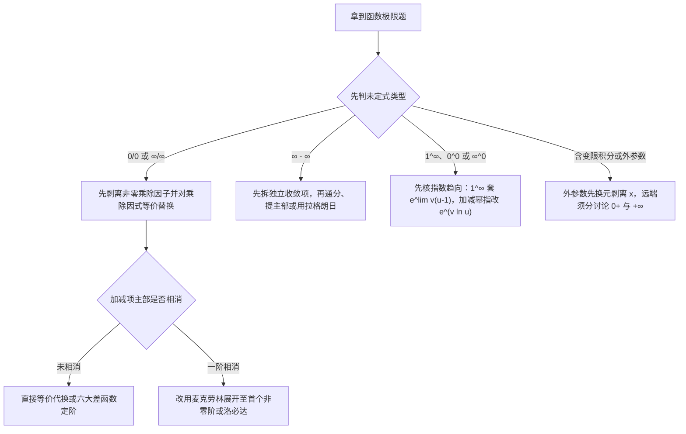

# 第1讲 函数极限与连续

> [!abstract] 核心复习定位
> 数学二高数第一讲，整合《基础30讲》《强化36讲》与《1000题》内容，聚焦函数极限概念与保号性、无穷小定阶与等价代换、连续与间断点分类、闭区间连续函数性质及七大未定式化归。题号“例”指张宇强化讲义，“B”指《1000题》强化篇第1章。

---

> [!important] 近 17 年数二真题雷达（2010—2026｜S 级必考基石）
> - **考频画像**：近 17 年主考 **34 题**（2010—2014 共 11 题，2015—2026 共 23 题，近 6 年新大纲 **10 题**，解答题 9 次），跨讲渗透 **23 次**。
> - **真题落点**：
>   - *2021—2026 新大纲（10 题）*：`21-T1(选)`、`21-T17(解)`、`22-T1(选)`、`22-T11(填)`、`23-T11(填)`、`24-T1(选)`、`25-T4(选)`、`25-T18(解)`、`26-T1(选)`、`26-T12(填)`
>   - *2015—2020 经典（13 题）*：`15-T2(选)`、`15-T15(解)`、`16-T1(选)`、`16-T15(解)`、`17-T1(选)`、`17-T15(解)`、`18-T1(选)`、`18-T3(选)`、`18-T9(填)`、`19-T1(选)`、`19-T9(填)`、`20-T1(选)`、`20-T2(选)`
>   - *2010—2014 经典（11 题）*：`10-T1(选)`、`11-T1(选)`、`11-T9(填)`、`11-T15(解)`、`12-T15(解)`、`13-T1(选)`、`13-T9(填)`、`13-T15(解)`、`14-T1(选)`、`14-T5(选)`、`14-T15(解)`
> - **核心命题规律与高频防坑**：
>   1. **变限积分定阶、远端收敛与泰勒反求参数**：`21-T1`（阶数为 $n(m+1)$，非 $mn+1$）、`23-T11`、`26-T1`（先消一次项再比二阶）；`11-T15` 与 `14-T15` 须先排除 $\alpha\le 0$ 再在远端用洛必达或倒代换；`14-T5` 中 $f''(0)=0$ 致 $\zeta^2/x^2\to 1/3$。
>   2. **$\infty-\infty$ 先拆项后通分，严禁心算抹项**：`21-T17`（先剥离独立收敛积分项，勿漏 $\lim$）、`12-T15` 与 `26-T12`（通分后展开至首个非零阶）；`22-T11` 答案框误印为 $\mathrm{e}^2$，真值为 $\mathrm{e}^{1/2}$。
>   3. **间断点、等价代换前提与无穷小概念反例**：`24-T1`（$x\to 0$ 指数 $\frac{-\infty}{-2}=+\infty$ 为第二类）、`10-T1`（根号化简必带 $|x|$）；`22-T1`（反例 $\beta=-\alpha$）；`25-T4`（无需 $g\to 0$ 仍有 $f=o(\mathrm{e}^g-1)$）；`13-T1`（必用 $|\alpha|<\pi/2$ 保 $\alpha\to 0$）；`25-T18`（须先由连续性写明 $f(0)=2$）。
> - **每日复习聚焦**：六大差函数与泰勒逐阶消参、减法相消边界、变限积分定阶及远端讨论、幂指/分段间断点单侧极限；$\varepsilon-\delta$ 定义快速过目即可。

---

## 第一部分｜知识点与核心结论

### 一、函数极限的概念、性质与存在性准则 【📌 扫一眼｜确认“我还会”就过】

**0. 基础回顾与易错点：反三角函数主值脱帽与双曲/反双曲函数** 【📌 扫一眼｜确认“我还会”就过】
- **反三角函数主值脱帽法则**：
  - **核心规则**：反三角函数的值域受主值区间约束。自变量 $x$ 超出主值区间时，不能直接消去内外函数写为 $x$，须先用诱导公式（平移或翻折）将角化归至主值区间内，再脱帽：<mark>角超主值区间须保持三角值不变再拉回</mark>。 `[真题易错·2007-T8]`
  - **快速核验**：反解脱帽结果后，可代入区间内特值核对正负号与象限。
- **三大函数分段脱帽公式与波形表**：

| 复合函数 | 主值区间 | 分段脱帽解析式 | 周期与几何性态 | 易错点 |
|---|---|---|---|---|
| **$y = \arcsin(\sin x)$** | $\left[-\frac{\pi}{2}, \frac{\pi}{2}\right]$ | $x \in \left[-\frac{\pi}{2}, \frac{\pi}{2}\right]$ 时为 $x$；$x \in \left[\frac{\pi}{2}, \frac{3\pi}{2}\right]$ 时为 $\pi - x$ | 周期 $2\pi$ 的锯齿波 | $x = \frac{\pi}{2} + k\pi$ 处为尖角，左右导数为 $+1, -1$，**连续但不可导** |
| **$y = \arccos(\cos x)$** | $[0, \pi]$ | $x \in [0, \pi]$ 时为 $x$；$x \in [\pi, 2\pi]$ 时为 $2\pi - x$ | 周期 $2\pi$ 的折线波 | $x = k\pi$ 处不可导；恒有 $0 \le \arccos(\cos x) \le \pi$ |
| **$y = \arctan(\tan x)$** | $\left(-\frac{\pi}{2}, \frac{\pi}{2}\right)$ | $x \in \left(k\pi - \frac{\pi}{2}, k\pi + \frac{\pi}{2}\right)$ 时为 $x - k\pi$ | 周期 $\pi$ 的锯齿波 | $x = \frac{\pi}{2} + k\pi$ 处为**第一类跳跃间断点**（左极限 $\frac{\pi}{2}$，右极限 $-\frac{\pi}{2}$） |

- **恒等式对照（内反外正）**：$\sin(\arcsin x) = x\ (x \in [-1, 1])$，$\cos(\arccos x) = x\ (x \in [-1, 1])$，$\tan(\arctan x) = x\ (x \in \mathbb{R})$。
- **反双曲正弦与双曲函数（《基础30讲》例1.3）**：
  - **定义域恒正性**：$y = \ln(x + \sqrt{x^2+1}) = \operatorname{arsh} x$。由 $\sqrt{x^2+1} > \lvert x\rvert \ge -x$ 得 $x + \sqrt{x^2+1} > 0$，定义域为 $(-\infty, +\infty)$。
  - **反函数求法（倒数有理化相减）**：由 $\mathrm{e}^y = \sqrt{x^2+1} + x$ 取倒数并有理化得 $\mathrm{e}^{-y} = \sqrt{x^2+1} - x$，两式相减消去根式得 $x = \frac{\mathrm{e}^y - \mathrm{e}^{-y}}{2}$。故反函数为 $y = \frac{\mathrm{e}^x - \mathrm{e}^{-x}}{2} = \sinh x$，定义域 $(-\infty, +\infty)$。
  - **奇偶性与双曲余弦**：$\ln(x+\sqrt{x^2+1})$ 与 $\sinh x$ 均为**奇函数**；$\cosh x = \frac{\mathrm{e}^x + \mathrm{e}^{-x}}{2}$ 为**偶函数**，<mark>偶函数在全轴不单调故无整体反函数</mark>。

**1. 函数极限的定义与去心邻域性质** 【💤 可跳过｜冲刺期直接跳过不看】
- **自变量趋于有限点 $x \to x_0$（$\varepsilon-\delta$ 定义）**：
  设 $f(x)$ 在去心邻域 $\mathring{U}(x_0, \delta_0)$ 内有定义。若存在常数 $A$，对任意 $\varepsilon > 0$，存在 $\delta\ (0 < \delta < \delta_0)$，当 $0 < \lvert x - x_0\rvert < \delta$ 时恒有：
  $$
  \lvert f(x) - A\rvert < \varepsilon,
  $$
  则称 $\lim_{x\to x_0} f(x) = A$。
- **与中心点无关**：$\lim_{x\to x_0} f(x) = A$ 仅取决于 $f$ 在去心邻域 $\mathring{U}(x_0, \delta)$ 内的取值，与 $f(x_0)$ 是否有定义及取何值**无关**（<mark>极限仅由去心邻域决定，与该点取值无关</mark>）。
- **自变量趋向无穷大 $x \to \infty$（$\varepsilon-X$ 定义）**：
  设 $f(x)$ 在 $\lvert x\rvert > X_0$ 时有定义。若对任意 $\varepsilon > 0$，存在 $X > X_0$，当 $\lvert x\rvert > X$ 时恒有 $\lvert f(x) - A\rvert < \varepsilon$，则 $\lim_{x\to \infty} f(x) = A$。单侧趋向：$x \to +\infty$ 对应 $x > X$；$x \to -\infty$ 对应 $x < -X$。
- **双侧与单侧极限充要条件**：
  $$
  \lim_{x\to x_0} f(x) = A \iff \lim_{x\to x_0^+} f(x) = \lim_{x\to x_0^-} f(x) = A.
  $$
  须分左右极限的三类常见情形（<mark>遇到分段、绝对值或单侧异向项必分左右极限</mark>）：
  1. 分段函数在分界点处两侧解析式不同；
  2. 含绝对值项（如 $x\to 0$ 时的 $\frac{\lvert x\rvert}{x}$）；
  3. 左右趋向不同的基本函数，如 $\mathrm{e}^{1/x}$（$0^+$ 趋 $+\infty$，$0^-$ 趋 $0$）或 $\arctan\frac{1}{x}$（$0^+$ 趋 $\frac{\pi}{2}$，$0^-$ 趋 $-\frac{\pi}{2}$）。

**2. 函数极限的三大性质（局部保号性与脱帽/戴帽法则）** 【🔥 必背｜停下来默背 1 遍】
- **唯一性**：若 $\lim_{x\to x_0} f(x)$ 存在，则极限值唯一。
- **局部有界性**：
  - 若 $\lim_{x\to x_0} f(x) = A$，则存在 $\delta > 0, M > 0$，在 $0 < \lvert x - x_0\rvert < \delta$ 内有 $\lvert f(x)\rvert \le M$；若 $f(x_0)$ 有定义，则在闭邻域 $U(x_0, \delta)$ 上也有界（界取 $\max\{M, \lvert f(x_0)\rvert\}$）。
  - **逆命题不成立**：<mark>去心邻域有界推不出极限存在</mark>（反例：$f(x) = \sin\frac{1}{x}$ 在 $\mathring{U}(0, \delta)$ 内有界 $\lvert f(x)\rvert \le 1$，但极限振荡不存在）。
- **局部保号性（强保号性 vs 弱保序性）**：

| 法则类型 | 条件前提 | 核心结论 | 应用与边界 |
|---|---|---|---|
| 强保号性（脱帽法则） | $\lim_{x\to x_0} f(x) = A > 0$（或 $<0$） | 存在 $\delta > 0, c > 0$，在 $0 < \lvert x - x_0\rvert < \delta$ 内恒有 $f(x) > c > 0$（或 $< -c < 0$） | <mark>脱帽保号严格同号且存在非零常数界</mark> |
| 差式推论（强保序） | $\lim_{x\to x_0} f(x) > \lim_{x\to x_0} g(x)$ | 存在 $\delta > 0$，在 $0 < \lvert x - x_0\rvert < \delta$ 内恒有 $f(x) > g(x)$ | 用于局部不等式与极值第一充分条件判定 |
| 弱保序性（戴帽法则） | 去心邻域内 $f(x) \ge 0$（或 $f(x) > 0$）且极限存在 | $\lim_{x\to x_0} f(x) = A \ge 0$ | <mark>戴帽取极限后严格不等号会退化为弱不等号</mark>（反例：$f(x) = x^2 > 0$ 但极限为 $0$） |

**3. 极限存在性准则与海涅定理（归结原则）** 【📌 扫一眼｜确认“我还会”就过】
- **夹逼准则**：在 $\mathring{U}(x_0, \delta)$ 内 $g(x) \le f(x) \le h(x)$，且 $\lim_{x\to x_0} g(x) = \lim_{x\to x_0} h(x) = A$，则 $\lim_{x\to x_0} f(x) = A$。
- **单调有界准则**：单调递增有上界、单调递减有下界的函数必有极限。
- **海涅定理（归结原则）**：
  $$
  \lim_{x\to x_0} f(x) = A \iff \forall \{x_n\}\ (x_n \in \mathring{U}(x_0),\ x_n \ne x_0,\ x_n \to x_0),\quad \lim_{n\to\infty} f(x_n) = A.
  $$
  - **典型用途**：证明函数极限不存在。<mark>构造两趋近数列函数极限不等即可证不存在</mark>（如证 $\lim_{x\to 0}\sin\frac{1}{x}$ 不存在，取 $x_n = \frac{1}{2n\pi}$ 与 $x_n' = \frac{1}{2n\pi + \frac{\pi}{2}}$）。

---

### 二、无穷小量比较与等价代换法则 【🔥 必背｜停下来默背 1 遍】

**1. 无穷小量阶的比较与“带头大哥”法则** 【⚡ 避坑｜最值钱，必须精读 1 分钟】
- **定义**：同一极限过程中 $\alpha(x) \to 0, \beta(x) \to 0$ 且 $\beta(x) \ne 0$：
  - 高阶：$\lim \frac{\alpha}{\beta} = 0$，记 $\alpha = o(\beta)$；低阶：$\lim \frac{\alpha}{\beta} = \infty$；
  - 同阶：$\lim \frac{\alpha}{\beta} = C \ne 0$；等价：$\lim \frac{\alpha}{\beta} = 1$，记 $\alpha \sim \beta$；
  - $k$ 阶：$\lim \frac{\alpha}{\beta^k} = C \ne 0\ (k > 0)$。
- **“带头大哥”法则（低阶主导）**：若 $\alpha = o(\beta)$（$\beta$ 阶数更低），<mark>加减法保留低阶项且局部符号由低阶决定</mark>： `[真题·2014-T1 / 2025-T4]`
  1. **加减取低阶**：$\alpha + \beta \sim \beta$，$\beta - \alpha \sim \beta$；
  2. **符号随低阶**：充分小去心邻域内，$\alpha + \beta$ 与 $\beta$ 同号；
  3. **乘积**：$\alpha \cdot \beta = o(\beta^2)$。
- **等价无穷小的和差**：若 $\alpha \sim \beta$，则<mark>两无穷小等价当且仅当其差为更高阶无穷小</mark>： `[真题·2022-T1]`
  $$
  \alpha - \beta = o(\alpha) = o(\beta),\qquad \alpha + \beta \sim 2\alpha \sim 2\beta.
  $$
- `【⚡ 真题补丁｜2022-T1】` <mark>偶次幂等价会消去正负号差异</mark>，$\alpha^2\sim\beta^2$ 推不出 $\alpha\sim\beta$（反例 $\beta = -\alpha$）。
  - **四命题核验**（选 C，①③④ 正确）：
    - ① $\alpha\sim\beta\Rightarrow\alpha^2\sim\beta^2$ 成立；
    - ② 逆命题不成立，反例 $\beta=-\alpha$（满足 $\lim\frac{\alpha^2}{\beta^2}=1$，但 $\lim\frac{\alpha}{\beta}=-1$）；
    - ③④ $\alpha\sim\beta\iff\alpha-\beta=o(\alpha)$ 双向均成立。
- `【⚡ 真题补丁｜2025-T4】` 未给 $g\to 0$ 时，分 $\lvert g\rvert\le\frac{1}{2}$ 与 $\lvert g\rvert>\frac{1}{2}$ 两段放缩仍可证 $f=o(\mathrm{e}^g-1)$。
  1. $\lvert g(x)\rvert \le \frac{1}{2}$ 时，由拉格朗日中值定理 $\lvert\mathrm{e}^{g(x)}-1\rvert \ge \mathrm{e}^{-1/2}\lvert g(x)\rvert$，故 $\left\lvert\frac{f}{\mathrm{e}^g-1}\right\rvert \le \mathrm{e}^{1/2}\left\lvert\frac{f}{g}\right\rvert \to 0$；
  2. $\lvert g(x)\rvert > \frac{1}{2}$ 时，$\lvert\mathrm{e}^{g(x)}-1\rvert > 1-\mathrm{e}^{-1/2}$，故 $\left\lvert\frac{f}{\mathrm{e}^g-1}\right\rvert \le \frac{\lvert f\rvert}{1-\mathrm{e}^{-1/2}} \to 0$；
  3. **选项核验**（选 C）：A 错在 $\frac{f+g}{g}\to 1$（同阶非高阶）；B 错在 $\frac{fg}{f^2}=\frac{g}{f}\to\infty$；D 取反例 $f=x^3,g=x^2$ 导致 $\frac{f}{g^2}\to\infty$。

**2. 常用等价无穷小与六大差函数** 【🔥 必背｜停下来默背 1 遍】
- **一、二阶基本等价（$x\to 0$，对任意 $\square \to 0$ 广义成立）**：
  $$
  \begin{aligned}
  &\sin x \sim \tan x \sim \arcsin x \sim \arctan x \sim x,\\
  &\mathrm{e}^x - 1 \sim \ln(1+x) \sim \ln\left(x + \sqrt{1+x^2}\right) \sim x,\qquad a^x - 1 \sim x\ln a\quad(a>0,\ a\ne 1),\\
  &1 - \cos x \sim \frac{1}{2}x^2,\qquad 1 - \cos^\alpha x \sim \frac{\alpha}{2}x^2\quad(\alpha \ne 0),\\
  &(1+x)^\alpha - 1 \sim \alpha x\quad(\alpha \ne 0),\qquad (1+x)^x - 1 = \mathrm{e}^{x\ln(1+x)} - 1 \sim x^2.
  \end{aligned}
  $$
  - **常用特例**：$\alpha = \frac{1}{2}$ 得 $1 - \sqrt{\cos x} \sim \frac{1}{4}x^2$；$\alpha = -1$ 得 $1 - \sec x \sim -\frac{1}{2}x^2$。
- **六大差函数**：
  $$
  \begin{aligned}
  &x - \sin x \sim \frac{1}{6}x^3,\qquad x - \arcsin x \sim -\frac{1}{6}x^3,\\
  &\tan x - x \sim \frac{1}{3}x^3,\qquad x - \arctan x \sim \frac{1}{3}x^3,\\
  &x - \ln(1+x) \sim \frac{1}{2}x^2,\qquad \mathrm{e}^x - 1 - x \sim \frac{1}{2}x^2.
  \end{aligned}
  $$
  - **派生差式**：$\tan x - \sin x = \tan x(1 - \cos x) \sim \frac{1}{2}x^3$。
  - **插项凑差**：复杂差式可插入中介项（如 $x$ 或 $\tan x$）拆为已知差函数，再取低阶项为主部：
    $$
    x - \ln(1+\tan x) = (x - \tan x) + [\tan x - \ln(1+\tan x)] \sim -\frac{1}{3}x^3 + \frac{1}{2}x^2 \sim \frac{1}{2}x^2.
    $$

**3. 等价代换的乘除法则与减法相消边界** 【🔥 必背｜停下来默背 1 遍】
- **乘除因式代换**：若 $\alpha \sim \alpha_1, \beta \sim \beta_1$ 且 $\lim \frac{\alpha_1}{\beta_1}$ 存在（或为无穷大），则
  $$
  \lim \frac{\alpha}{\beta} = \lim \frac{\alpha_1}{\beta_1}.
  $$
- **减法代换的充分条件（主项未相消）**：
  设 $\alpha \sim \alpha_1, \beta \sim \beta_1$。若
  $$
  \lim \frac{\alpha_1}{\beta_1} = c \ne 1\quad(c \ne \infty),
  $$
  则 $\alpha - \beta \sim \alpha_1 - \beta_1$ 成立（<mark>比值极限不为 1 时减法等价代换成立</mark>）。
  - **原理**：主部未抵消，$\alpha_1 - \beta_1$ 仍与 $\beta_1$ 同阶，被略去的高阶项 $o(\alpha_1), o(\beta_1)$ 仍为次要项。
  - **边界**：$\lim \frac{\alpha_1}{\beta_1} \ne 1$ 只是充分条件，非必要条件。
- **主项相消与泰勒展开**：
  - **失效情形**：若 $\lim \frac{\alpha_1}{\beta_1} = 1$（主部抵消，$\alpha_1 - \beta_1 = o(\alpha_1)$），高阶余项升为主导项，一阶代换不再可靠（如 $\tan x - \sin x$ 若代换为 $x - x = 0$ 会丢失主部）。
  - **处理策略**：须<mark>展开至相减后首个非零阶项再定阶</mark>。 `[真题·2011-T1 / 2012-T15 / 2013-T15 / 2015-T15 / 2019-T1 / 2023-T11 / 2026-T1]`

**4. 复合函数与变限积分定阶法则** 【🔥 必背｜停下来默背 1 遍】
- **复合函数逐层套主项**：$x\to 0$ 时，内层 $u = g(x) \sim bx^n \to 0$，外层 $f(u) \sim au^m$，则
  $$
  f[g(x)] \sim a(bx^n)^m = ab^m x^{mn}.
  $$
  - **注意**：幂次为分数时须保证内层取值落在定义域内；<mark>复合等价须确认内层确实趋零</mark> `[真题·2019-T1 / 2020-T1]`。
- `【⚡ 真题补丁｜2013-T1】` 见 $\cos x-1=x\sin\alpha(x)$ 不能直接等价代换，<mark>先由取值范围确认内层趋零再作等价代换</mark>。
  - 由 $\lvert\alpha(x)\rvert<\frac{\pi}{2}$ 得 $\alpha(x)=\arcsin(\sin\alpha(x))\to 0$，方得 $\alpha(x)\sim\sin\alpha(x)\sim-\frac{1}{2}x$（选 C）；若无范围限制，则 $\alpha(x)=\pi+\arcsin\frac{1-\cos x}{x}\to\pi$，并非无穷小。
- **变上限积分定阶**：
  1. **被积函数趋于 $0$（积分升一阶）**：$t\to 0$ 时 $f(t) \sim at^m$，$g(x) \sim bx^n \to 0$，则
     $$
     \int_0^{g(x)} f(t)\,\mathrm{d}t \sim \int_0^{bx^n} at^m\,\mathrm{d}t = \frac{a}{m+1}(bx^n)^{m+1}.
     $$
  2. **被积函数趋于非零常数 $A$**：$\lim_{t\to 0} f(t) = A \ne 0$，$h(x) \to 0$，则
     $$
     \int_0^{h(x)} f(t)\,\mathrm{d}t \sim A \cdot h(x).
     $$
  3. **积分号内含外部变量 $x$**：如 $\int_0^x (\mathrm{e}^{(t-x)^2}-1)\sin t\,\mathrm{d}t$，<mark>被积函数含积分外变量时须先换元剥离</mark>，不可直接等价替换。
- `【⚡ 真题补丁｜2021-T1】` 变限积分复合定阶为 $n(m+1)$，<mark>先对被积函数积分升阶再代入上限</mark>，切勿误算为 $mn+1$。
  - 若 $f(t)\sim at^m,\ g(x)\sim bx^n$，则 $\int_0^{bx^n}at^m\,\mathrm{d}t = \frac{ab^{m+1}}{m+1}x^{n(m+1)}$；如 `2021-T1` 中 $\int_0^{x^2}(\mathrm{e}^{t^3}-1)\,\mathrm{d}t$（$m=3, n=2$）为 $2\times(3+1)=8$ 阶，误算 $2\times 3 + 1 = 7$ 即落坑。

---

### 三、连续性定义与四类间断点分类矩阵 【🔥 必背｜停下来默背 1 遍】

**1. 连续性定义与充要条件** 【⚡ 避坑｜最值钱，必须精读 1 分钟】
- **三要素**：$f(x)$ 在 $x_0$ 连续 $\iff$ (1) $f(x_0)$ 有定义；(2) $\lim_{x\to x_0} f(x)$ 存在；(3) $\lim_{x\to x_0} f(x) = f(x_0)$。
- **充要判据**：左连续且右连续：
  $$
  \lim_{x\to x_0^-} f(x) = \lim_{x\to x_0^+} f(x) = f(x_0).
  $$
- **增量形式**：$\lim_{\Delta x\to 0}[f(x_0 + \Delta x) - f(x_0)] = 0$。
- `【⚡ 真题补丁｜2025-T18】` 极限反推单点可导，<mark>解答题须显式写出由连续性得出中心点函数值</mark>，否则扣过程分。
  - 由分母趋零且极限存在仅能推出去心极限 $\lim_{x\to 0}f(x)=2$，须显式写明“因 $f(x)$ 在 $x=0$ 连续，故 $f(0)=\lim_{x\to 0}f(x)=2$”，再将 $\frac{f(x)-2}{x}$ 转化为导数定义式；且在未证可导前禁用洛必达法则。

**2. 四类间断点分类对照表** 【🔥 必背｜停下来默背 1 遍】

| 大类划分 | 间断点类型 | 数学判据 | 典型模型 |
|---|---|---|---|
| 第一类（左右极限均存在且有限） | 可去间断点 | $\lim_{x\to x_0^-} f(x) = \lim_{x\to x_0^+} f(x) = A \ne f(x_0)$（或无定义） | $\frac{\sin x}{x}$ 在 $x=0$；补充 $f(x_0)=A$ 即连续 |
| 第一类（左右极限均存在且有限） | 跳跃间断点 | $\lim_{x\to x_0^-} f(x) \ne \lim_{x\to x_0^+} f(x)$（均有限但不等） | $\mathrm{sgn}(x)$ 在 $x=0$；$[x]$ 在整数点 |
| 第二类（至少一侧极限不存在） | 无穷间断点 | 至少一侧极限趋于 $\infty$（$+\infty$ 或 $-\infty$） | $\frac{1}{x}$ 在 $x=0$；$\mathrm{e}^{1/x}$ 在 $x=0^+$ |
| 第二类（至少一侧极限不存在） | 振荡间断点 | $x\to x_0$ 时函数值无限次振荡无极限 | $\sin\frac{1}{x}$、$\cos\frac{1}{x^2}$ 在 $x=0$ |

- **邻域表述区分**：
  - “在 $x_0$ 的某邻域内有定义”：含中心点，$f(x_0)$ 存在；
  - “在 $x_0$ 的某去心邻域内有定义”：不含中心点，$f(x_0)$ 可能无定义；
  - **连续性不可省**：仅知 $\lim_{x\to x_0} f(x) = 0$ 而未给“连续”或“$f(x_0) = 0$”，<mark>仅知去心极限推不出该点连续或可导</mark>（仍可能为可去间断点）。 `[真题·2015-T2 / 2017-T1 / 2025-T18]`
- `【⚡ 真题补丁｜2024-T1】` 幂指间断点一律指数化，$x\to 0$ 时负负得正极限为 $+\infty$，属第二类间断点。
  - 将 $f(x)=\lvert x\rvert^{\frac{1}{(x-1)(2-x)}}=\mathrm{e}^{\frac{\ln\lvert x\rvert}{(x-1)(2-x)}}$ 写出无定义点 $0,1,2$ 逐点检验（选 C）：
    - $x\to 0$：指数趋于 $\frac{-\infty}{-2}=+\infty$，属第二类无穷间断点；
    - $x\to 2^-$：指数趋于 $+\infty$，属第二类无穷间断点；
    - $x\to 1$：极限为 $\mathrm{e}$，属第一类可去间断点。
- `【⚡ 真题补丁｜2010-T1】` 含 $\sqrt{1+\frac{1}{x^2}}$ 化简开方时，<mark>偶次根式移出分母时必须保留绝对值</mark>，切忌直接写成 $/x$。
  - 先约去 $(x-1)$ 得 $x=1$ 为可去间断点，再化简为 $\frac{x\sqrt{x^2+1}}{\lvert x\rvert(x+1)}$，验出 $x=0$（左右极限 $\pm\infty$）与 $x=-1$（极限无穷）共 2 个无穷间断点（选 B）。

**3. 间断点候选疑点扫描（八类）** 【🔥 必背｜停下来默背 1 遍】
1. 分式分母零点；
2. 自然定义域边界/无定义点（如对数真数非正）；
3. 幂指函数底数零点（如 $\lvert x\rvert^{g(x)}$ 的 $x=0$）；
4. 指数分母零点（如 $\mathrm{e}^{1/x}, \mathrm{e}^{1/(1-x)}$）；
5. 三角函数自身无定义点（如 $\tan u$ 中 $u = k\pi + \frac{\pi}{2}$）；
6. 变限积分作分母的零点（注意奇函数在对称区间的积分零点）；
7. 取整函数 $[x]$ 的整数点；
8. 分段函数的分界点。

---

### 四、闭区间连续函数四大定理与七大未定式速查 【🔥 必背｜停下来默背 1 遍】

**1. 闭区间连续函数四大定理与开区间有界性** 【📌 扫一眼｜确认“我还会”就过】
- **有界性定理**：$f(x) \in C[a,b] \implies f(x)$ 在 $[a,b]$ 上有界。
- **最值定理**：$f(x) \in C[a,b] \implies f(x)$ 在 $[a,b]$ 上取到最大值 $M$ 与最小值 $m$。
- **介值定理**：$f(x) \in C[a,b]$，对任意 $\mu \in [m, M]$，存在 $\xi \in [a,b]$ 使 $f(\xi) = \mu$（推论：$f([a,b]) = [m, M]$）。
- **零点定理**：$f(x) \in C[a,b]$ 且 $f(a)f(b) < 0 \implies \exists \xi \in (a,b)$ 使 $f(\xi) = 0$。
- **开区间 $(a,b)$ 全局有界性定理**：
  - **结论**：设 $f(x) \in C(a,b)$。<mark>开区间连续且两端极限存在则有界</mark>。
  - **证明思路**：由局部有界性，$f$ 在 $(a, a+\delta_1]$ 与 $[b-\delta_2, b)$ 上有界；由闭区间连续性，$f$ 在 $[a+\delta_1, b-\delta_2]$ 上有界；三段取界的最大值即得全局有界。
  - **逆命题不成立**：反例 $f(x) = \sin\frac{1}{x}$ 在 $(0, 1)$ 上连续有界，但 $x\to 0^+$ 时极限不存在。

**2. 七大未定式化归速查表** 【🔥 必背｜停下来默背 1 遍】

| 未定式类型 | 化简思路 | 常用手段 |
|---|---|---|
| $\frac{0}{0}$ | 主项定阶或求导 | 先提非零因子、等价代换、泰勒展开、洛必达法则 |
| $\frac{\infty}{\infty}$ | 抓最高阶主部 | 同除最高阶项、洛必达法则、对数差变形 |
| $0 \cdot \infty$ | 倒数下放化商式 | 化为 $\frac{0}{1/\infty}$ 或 $\frac{\infty}{1/0}$，复杂项留分子 |
| $\infty - \infty$ | 化差为积或通分 | 剥离收敛项、通分、指数差提公因式、拉格朗日中值、提主部后倒代换 $t=\frac{1}{x}$ |
| $1^\infty$ | 幂指化归公式 | $\lim u^v = \mathrm{e}^{\lim v(u-1)}$，<mark>加减运算中的幂指项禁用整体化归公式</mark> `[真题·2019-T9]` |
| $0^0$ | 取对数化乘积 | $u^v = \mathrm{e}^{v\ln u}$，指数化为 $0 \cdot (-\infty)$ 型 |
| $\infty^0$ | 取对数化乘积 | $u^v = \mathrm{e}^{v\ln u}$，指数化为 $0 \cdot (+\infty)$ 型 |

**3. 无穷大增长阶梯（“对幂指阶”）与 5 个含参极限** 【📌 扫一眼｜确认“我还会”就过】
- **增长阶梯**（$p > 0, q > 0, a > 1$）：
  $$
  \ln^p x \ll x^q \ll a^x \ll x^x\quad(x\to+\infty),\qquad
  \ln^p n \ll n^q \ll a^n \ll n! \ll n^n\quad(n\to\infty).
  $$
  低阶除以高阶极限为 $0$：$\lim_{x\to+\infty}\frac{\ln^p x}{x^q} = 0$，$\lim_{n\to\infty}\frac{n^q}{a^n} = 0$，$\lim_{n\to\infty}\frac{a^n}{n!} = 0$。
- **5 个常用含参极限**：

| 序号 | 极限表达式 | 参数讨论结果 |
|---|---|---|
| 1 | $\lim_{n\to\infty}\lvert x\rvert^n$ | $\lvert x\rvert < 1$ 为 $0$；$\lvert x\rvert = 1$ 为 $1$；$\lvert x\rvert > 1$ 为 $+\infty$ |
| 2 | $\lim_{n\to\infty}nx^{2n}$ | $\lvert x\rvert < 1$ 为 $0$（指数主导幂函数）；$\lvert x\rvert \ge 1$ 为 $+\infty$ |
| 3 | $\lim_{n\to\infty}\mathrm{e}^{nx}$ | $x < 0$ 为 $0$；$x = 0$ 为 $1$；$x > 0$ 为 $+\infty$ |
| 4 | $\lim_{n\to\infty}n^x$ | $x < 0$ 为 $0$；$x = 0$ 为 $1$；$x > 0$ 为 $+\infty$ |
| 5 | $\lim_{x\to 0^+}x^a$ | $a > 0$ 为 $0$；$a = 0$ 为 $1$；$a < 0$ 为 $+\infty$ |

---

## 第二部分｜题型体系与解题方法论



### 一、$\frac{0}{0}$ 型与 $\frac{\infty}{\infty}$ 型基础未定式极限

| 题干特征 | 优先方法 | 真题印证与避坑 |
|---|---|---|
| 复合函数 $f[g(x)]$ 无穷小定阶与定系数 | <mark>先确认内层趋零再由内向外套主项</mark> $f[g(x)]\sim ab^m x^{mn}$ | `[真题·2014-T1 / 2016-T1 / 2019-T1 / 2020-T1]`；内层不趋零禁用零邻域等价 |
| 高阶无穷小关系 $f(x)=o(g(x))$ 辨析 | 用“带头大哥”法则：加减取低阶，符号随低阶，乘积阶数相加 | `[真题·2025-T4]`（无 $g\to 0$ 仍有 $f=o(\mathrm{e}^g-1)$）；<mark>高阶无穷小边界须开区间排除同阶</mark> `[真题·2014-T1]` |
| $\alpha \sim \beta$ 的和差阶数判定 | 用 $\alpha-\beta=o(\alpha)$、$\alpha+\beta\sim 2\alpha$，不把等价误作相等 | `[真题·2022-T1]`（$\alpha^2\sim\beta^2\nRightarrow\alpha\sim\beta$，反例 $\beta=-\alpha$） |
| 差式含反三角/对数且一阶相消 | 忘高阶系数时，先求导做二项式展开，再逐项积分回推 | `[真题·2011-T1 / 2013-T15 / 2015-T15 / 2023-T11 / 2026-T1]`；展至首个非零阶 |
| 隐含中值点 $\zeta$ 或界定区间等价代换 | 用区间界定确认趋零；$f''(0)=0$ 时改三阶泰勒消元 | `[真题·2013-T1 / 2014-T5]`（$\arctan x$ 奇函数得 $\frac{\zeta^2}{x^2}\to\frac{1}{3}$） |
| 无导数条件下的对数比值 $\lim \frac{\ln f(x)}{\ln g(x)}$ | 不用洛必达，拆写 $\ln\bigl(g\cdot\frac{f}{g}\bigr)=\ln g+\ln\frac{f}{g}$ | 强化母型；无导数条件时不能用洛必达 |

> [!tip] 核心提醒
> 1. 计算 $\frac{0}{0}$、$\frac{\infty}{\infty}$ 型时先化简：先提非零乘除因子，内层趋零处优先等价代换。
> 2. <mark>加减主项抵消立刻改用泰勒逐阶展开</mark>；若遗忘高阶系数，用“求导—展开—积分”现场回推。

> [!example]- 例1.4｜复合函数由内向外套主项
> - **【题目】**：当 $x\to 0$ 时，$\cos\left(\mathrm{e}^{\frac{x^2}{2}}-1\right)-1\sim cx^k$，求待定常数乘积 $ck$。
> - **【为什么这么想】**：
>   $x\to 0$ 时内层 $u = \mathrm{e}^{\frac{x^2}{2}}-1 \to 0$，外层 $\cos u - 1 \sim -\frac{1}{2}u^2$，由内向外逐层代换主项比求导简洁。
> - **【完整解答】**：
>   当 $x\to 0$ 时，内层变量的等价无穷小主项为：
>   $$
>   u = \mathrm{e}^{\frac{x^2}{2}} - 1 \sim \frac{x^2}{2}.
>   $$
>   外层函数具有基本等价形式 $\cos u - 1 \sim -\frac{1}{2}u^2$。将内层等价主项代入外层：
>   $$
>   \cos\left(\mathrm{e}^{\frac{x^2}{2}}-1\right)-1 \sim -\frac{1}{2}u^2 \sim -\frac{1}{2}\left(\frac{x^2}{2}\right)^2 = -\frac{1}{8}x^4.
>   $$
>   对照题设 $\sim cx^k$，可得：
>   $$
>   c = -\frac{1}{8},\quad k = 4 \implies ck = \left(-\frac{1}{8}\right) \times 4 = -\frac{1}{2}.
>   $$
> - **【复盘提醒】**：
>   由内向外逐层套用等价无穷小的严格前提是**内层必须趋向于零**；若内层趋向于非零常数，外层不能直接套用零邻域的等价无穷小公式。

> [!example]- 例1.5 & B24｜“带头大哥”与等价无穷小辨析
> - **【题目】**：
>   1.（例1.5）设 $f(x),g(x)$ 在 $x=0$ 的某去心邻域内恒不为 $0$，当 $x\to 0$ 时 $f(x)=o(g(x))$，则下列命题正确的是（ ）。
>   (A) $f+g=o(g)$ \quad (B) $fg=o(f^2)$ \quad (C) $f=o(\mathrm{e}^{g(x)}-1)$ \quad (D) $f=o(g^2)$
>   2.（B24）若当 $x\to 0$ 时，$\alpha(x)\sim\beta(x)$，分析 $\alpha(x)-\beta(x)$ 与 $\alpha(x)+\beta(x)$ 的无穷小阶数。
> - **【为什么这么想】**：
>   - 第1题：$f=o(g)$ 表明 $g$ 为低阶主项（“带头大哥”），用定义与反例 $g(x)=x, f(x)=x^2$ 逐项排除。
>   - 第2题：等价 $\alpha\sim\beta$ 仅指比值趋于 $1$，相减为高阶无穷小，并非为零。
> - **【完整解答】**：
>   1. 对例1.5逐项判定：
>      - 选项 (A) 错误：因为 $f=o(g)$，加减看低阶老大，所以 $f(x)+g(x) \sim g(x)$，极限 $\lim_{x\to 0}\frac{f+g}{g} = 1 \ne 0$，不是 $o(g)$。
>      - 选项 (B) 错误：两边同乘 $g$ 只能得到 $fg=o(g^2)$。取具体反例检验：令 $g(x)=x, f(x)=x^2$，显然 $f=o(g)$；此时 $fg = x^3, f^2 = x^4$，$\lim_{x\to 0}\frac{fg}{f^2} = \lim_{x\to 0}\frac{1}{x} = \infty$，$fg$ 阶数低于 $f^2$，绝非 $o(f^2)$。
>      - 选项 (C) 正确：当 $x\to 0$ 时，$g(x)\to 0$，由基本等价无穷小有 $\mathrm{e}^{g(x)}-1 \sim g(x)$。故 $\lim_{x\to 0}\frac{f(x)}{\mathrm{e}^{g(x)}-1} = \lim_{x\to 0}\frac{f(x)}{g(x)} = 0$，即 $f(x)=o(\mathrm{e}^{g(x)}-1)$。
>      - 选项 (D) 错误：同样取反例 $g(x)=x, f(x)=x^2$，则 $f = g^2$，二者同阶，并非 $o(g^2)$。故第1题选 (C)。
>   2. 对 B24 的推导：
>      由 $\alpha(x)\sim\beta(x)$ 知 $\lim \frac{\beta(x)}{\alpha(x)} = 1$。
>      考查差式比值：
>      $$
>      \lim \frac{\alpha(x)-\beta(x)}{\alpha(x)} = 1 - \lim\frac{\beta(x)}{\alpha(x)} = 1 - 1 = 0 \implies \alpha(x)-\beta(x) = o(\alpha(x)) = o(\beta(x)).
>      $$
>      考查和式比值：
>      $$
>      \lim \frac{\alpha(x)+\beta(x)}{\alpha(x)} = 1 + \lim\frac{\beta(x)}{\alpha(x)} = 1 + 1 = 2 \implies \alpha(x)+\beta(x) \sim 2\alpha(x) \sim 2\beta(x).
>      $$
> - **【复盘提醒】**：
>   不要把等价 $\alpha\sim\beta$ 当作代数相等 $\alpha=\beta$：相减得高阶无穷小 $\alpha-\beta=o(\alpha)$ 而非 $0$，相加得 $\alpha+\beta\sim 2\alpha$。

> [!example]- B28 & B30｜现场求导积分反推三阶泰勒展开
> - **【题目】**：
>   1.（B28）当 $x\to 0$ 时，$\frac{1}{2}\ln\frac{1+x}{1-x}-\arctan x\sim ax^b$，求实数乘积 $ab$。
>   2.（B30）求当 $x\to 0$ 时，函数差式 $x-\ln\bigl(x+\sqrt{1+x^2}\bigr)$ 的等价主项。
> - **【为什么这么想】**：
>   两题一阶项相减均抵消，需展开至三阶。此类对数、反三角函数的导数都是简单有理式或根式，用“求导—二项式展开—逐项积分”可直接推出三阶展开，不必死记系数。
> - **【完整解答】**：
>   1. 针对 B28：
>      记 $f(x) = \frac{1}{2}\ln\frac{1+x}{1-x} = \frac{1}{2}[\ln(1+x)-\ln(1-x)]$。
>      求导得：
>      $$
>      f'(x) = \frac{1}{2}\left(\frac{1}{1+x} + \frac{1}{1-x}\right) = \frac{1}{1-x^2} = 1 + x^2 + o(x^2).
>      $$
>      由于 $f(0) = 0$，两边从 $0$ 到 $x$ 逐项积分：
>      $$
>      f(x) = \int_0^x (1 + t^2 + o(t^2))\,\mathrm{d}t = x + \frac{1}{3}x^3 + o(x^3).
>      $$
>      类似地，对 $g(x) = \arctan x$ 求导：
>      $$
>      g'(x) = \frac{1}{1+x^2} = 1 - x^2 + o(x^2).
>      $$
>      由于 $g(0) = 0$，逐项积分得：
>      $$
>      g(x) = \int_0^x (1 - t^2 + o(t^2))\,\mathrm{d}t = x - \frac{1}{3}x^3 + o(x^3).
>      $$
>      两式相减：
>      $$
>      f(x) - g(x) = \left(x + \frac{1}{3}x^3\right) - \left(x - \frac{1}{3}x^3\right) + o(x^3) = \frac{2}{3}x^3 + o(x^3).
>      $$
>      故 $a = \frac{2}{3}, b = 3 \implies ab = \frac{2}{3}\times 3 = 2$。
>   2. 针对 B30：
>      记 $L(x) = \ln\bigl(x+\sqrt{1+x^2}\bigr)$。求导得：
>      $$
>      L'(x) = \frac{1 + \frac{x}{\sqrt{1+x^2}}}{x + \sqrt{1+x^2}} = \frac{1}{\sqrt{1+x^2}} = (1+x^2)^{-\frac{1}{2}}.
>      $$
>      利用广义二项式定理展开至二阶项：
>      $$
>      (1+x^2)^{-\frac{1}{2}} = 1 - \frac{1}{2}x^2 + o(x^2).
>      $$
>      因为 $L(0) = \ln 1 = 0$，积分得：
>      $$
>      L(x) = \int_0^x \left(1 - \frac{1}{2}t^2 + o(t^2)\right)\mathrm{d}t = x - \frac{1}{6}x^3 + o(x^3).
>      $$
>      因此：
>      $$
>      x - L(x) = x - \left(x - \frac{1}{6}x^3 + o(x^3)\right) = \frac{1}{6}x^3 + o(x^3) \sim \frac{1}{6}x^3.
>      $$
> - **【复盘提醒】**：
>   利用导数逆推泰勒展开的关键保证是原函数在展开中心的值为零（$f(0)=0$），故积分常数为零。考研中反三角函数 $\arcsin x$ 亦满足 $(\arcsin x)' = (1-x^2)^{-1/2} = 1 + \frac{1}{2}x^2 + o(x^2) \implies \arcsin x = x + \frac{1}{6}x^3 + o(x^3)$，两者系数异号需准确区分。

> [!example]- B21｜无导数条件下求 $\lim\frac{\ln f(x)}{\ln g(x)}$
> - **【题目】**：已知当自变量趋于某过程时，$f(x)\to+\infty, g(x)\to+\infty$，且 $\lim\frac{f(x)}{g(x)} = a > 0$，求极限 $\lim\frac{\ln f(x)}{\ln g(x)}$。
> - **【为什么这么想】**：
>   题干未给可导条件，不能用洛必达法则。将 $f(x)$ 拆写为 $g(x)\cdot\frac{f(x)}{g(x)}$，利用对数运算法则分离出已知比值即可。
> - **【完整解答】**：
>   对分子的真数进行恒等配凑：
>   $$
>   f(x) = g(x) \cdot \frac{f(x)}{g(x)}.
>   $$
>   代入对数中化为和式：
>   $$
>   \ln f(x) = \ln\left[g(x)\cdot\frac{f(x)}{g(x)}\right] = \ln g(x) + \ln\left(\frac{f(x)}{g(x)}\right).
>   $$
>   于是所求极限可改写为：
>   $$
>   \lim\frac{\ln f(x)}{\ln g(x)} = \lim\frac{\ln g(x) + \ln\left(\frac{f(x)}{g(x)}\right)}{\ln g(x)} = \lim\left[1 + \frac{\ln\left(\frac{f(x)}{g(x)}\right)}{\ln g(x)}\right].
>   $$
>   由于已知 $\lim\frac{f(x)}{g(x)} = a > 0$，由复合函数连续性知 $\lim \ln\left(\frac{f(x)}{g(x)}\right) = \ln a$（有限常数）；
>   而分母 $\lim g(x) = +\infty \implies \lim \ln g(x) = +\infty$。
>   根据“有界量（常数）除以无穷大为零”：
>   $$
>   \lim \frac{\ln\left(\frac{f(x)}{g(x)}\right)}{\ln g(x)} = 0.
>   $$
>   因此：
>   $$
>   \lim\frac{\ln f(x)}{\ln g(x)} = 1 + 0 = 1.
>   $$
> - **【复盘提醒】**：
>   无导数条件下的抽象未定式不能直接洛必达（写出 $\frac{f'/f}{g'/g}$ 既无依据也无法继续），对数比值优先用对数性质恒等拆项。

---


> [!example]- 例1.28｜反三角函数主值区间脱帽与反双曲正弦反函数求解
> - **【题目】**：
>   (1) 求函数 $f(x) = \arcsin(\sin x)$ 在区间 $[0, 2\pi]$ 上的分段解析式，并指出其在 $[0, 2\pi]$ 内的不可导点；
>   (2) 求函数 $y = \ln\left(x + \sqrt{x^2+1}\right)$ 的反函数及其定义域。
> - **【为什么这么想】**：
>   (1) $\arcsin$ 的主值区间仅为 $[-\frac{\pi}{2}, \frac{\pi}{2}]$，自变量越界时不能直接脱帽，须先用诱导公式将角归入主值区间；折点处左右导数为 $\pm 1$，不可导。
>   (2) 脱对数后取倒数有理化，两式相减即可消去根式得 $\sinh y$。
> - **【完整解答】**：
>   (1) 对于 $f(x) = \arcsin(\sin x)$：
>   - 当 $x \in [0, \frac{\pi}{2}]$ 时，$x$ 落在主值区间 $[-\frac{\pi}{2}, \frac{\pi}{2}]$ 内，直接脱帽：$f(x) = x$；
>   - 当 $x \in (\frac{\pi}{2}, \frac{3\pi}{2}]$ 时，$x$ 超出主值区间，利用诱导公式 $\sin x = \sin(\pi - x)$，此时 $\pi - x \in [-\frac{\pi}{2}, \frac{\pi}{2})$，脱帽得：$f(x) = \pi - x$；
>   - 当 $x \in (\frac{3\pi}{2}, 2\pi]$ 时，利用 $\sin x = \sin(x - 2\pi)$，此时 $x - 2\pi \in [-\frac{\pi}{2}, 0]$，脱帽得：$f(x) = x - 2\pi$。
>   综上，$f(x)$ 在 $[0, 2\pi]$ 上的分段解析式为：
>   $$
>   f(x) = \begin{cases} x, & x \in \left[0, \frac{\pi}{2}\right], \\[6pt] \pi - x, & x \in \left(\frac{\pi}{2}, \frac{3\pi}{2}\right], \\[6pt] x - 2\pi, & x \in \left(\frac{3\pi}{2}, 2\pi\right]. \end{cases}
>   $$
>   在分界点 $x = \frac{\pi}{2}$ 处：$f'_-( \frac{\pi}{2}) = 1$，$f'_+( \frac{\pi}{2}) = -1$，左右导数不相等；同理在 $x = \frac{3\pi}{2}$ 处 $f'_-( \frac{3\pi}{2}) = -1$，$f'_+( \frac{3\pi}{2}) = 1$。故在 $(0, 2\pi)$ 内不可导点为 $x = \frac{\pi}{2}$ 与 $x = \frac{3\pi}{2}$。
>   (2) 对于 $y = \ln(x + \sqrt{x^2+1})$：
>   因 $\sqrt{x^2+1} > \vert x\vert \ge -x$，真数 $x + \sqrt{x^2+1} > 0$ 恒成立，函数值域为 $(-\infty, +\infty)$。
>   脱去对数得：$\mathrm{e}^y = \sqrt{x^2+1} + x$ ①。
>   两边取倒数并有理化：$\mathrm{e}^{-y} = \frac{1}{\sqrt{x^2+1}+x} = \sqrt{x^2+1} - x$ ②。
>   ① 式减 ② 式消去根式：$\mathrm{e}^y - \mathrm{e}^{-y} = 2x \implies x = \frac{\mathrm{e}^y - \mathrm{e}^{-y}}{2}$。
>   交换变量得反函数为：$y = \frac{\mathrm{e}^x - \mathrm{e}^{-x}}{2} = \sinh x$，定义域为 $(-\infty, +\infty)$。
> - **【复盘提醒】**：
>   熟记三类脱帽波形：$\arcsin(\sin x)$（锯齿波）、$\arccos(\cos x)$（折线波）、$\arctan(\tan x)$（周期 $\pi$ 跳跃波）。遇反三角复合求导、积分或极限，先核对自变量是否在主值区间内，越界则先诱导脱帽。

### 二、$\infty - \infty$ 型与 $0\cdot\infty$ 型极限变形化简

| 题干特征 | 优先方法 | 真题印证与避坑 |
|---|---|---|
| 分式差式混有可独立收敛的积分或乘积项 | <mark>先剥离独立收敛项剩余部分再通分</mark> | `[真题易错·2021-T17]`、`[真题·2012-T15 / 2026-T12]`；不漏 $\lim$ 也不心算抹项 |
| 同名函数之差 $f(b)-f(a)$（指数、根式、三角/反三角） | 拉格朗日中值定理 $f(b)-f(a)=f'(\xi)(b-a)$ 化差为积 | `[真题·2016-T15]`；须写明 $\xi$ 范围及夹逼趋向 |
| 指数或幂指之差 $\mathrm{e}^A - \mathrm{e}^B$、$a^A - a^B$ | 提公因式化为 $\mathrm{e}^B(\mathrm{e}^{A-B}-1) \sim \mathrm{e}^B(A-B)$ | `[真题·2017-T15 / 2022-T11]`；防两项分别一阶等价后主部抵消 |
| 无穷远多项式与根式/对数差 $\lim_{x\to\infty}[f(x)-ax]$ | 提公因式 $x$，用 $1=\ln\mathrm{e}$ 合并对数差或指数差 | `23-T1`（斜渐近线）；$x\to-\infty$ 时注意 $\sqrt{x^2}=-x$ |
| $x\to\infty$ 且反复出现 $\frac{1}{x}$ | 提主部后倒代换 $t = \frac{1}{x} \to 0$，括号外 $x$ 同步换为 $\frac{1}{t}$ | `[真题·2018-T9 / 2026-T12]`；防漏换括号外系数 $x$ |

> [!tip] 核心提醒
> 1. $\infty - \infty$ 型重在化差为积或通分归一；<mark>严禁不加说明心算直接抹去非零项</mark>（`21-T17` 勿漏 $\lim$）。 `[真题易错·2021-T17]`
> 2. 差式不各自一阶等价；指数差先提公因式，自变量相近的同名差优先拉格朗日中值定理（`12-T15` 通分三阶展开得 $a=1,k=1$）。

> [!example]- 例1.2｜先拆走积分“干扰项”，再通分求极限
> - **【题目】**：计算极限 $I = \lim_{x\to 0}\left[\frac{1+\int_0^x\frac{\sin t}{t}\,\mathrm{d}t}{x}-\frac{1}{\ln(1+x)}\right]$。
> - **【为什么这么想】**：
>   若直接通分，分子会混入变限积分与对数的乘积。将第一项拆为 $\frac{1}{x} + \frac{\int_0^x\frac{\sin t}{t}\mathrm{d}t}{x}$，后项极限有限可先行剥离，剩余 $\frac{1}{x}-\frac{1}{\ln(1+x)}$ 再通分。
> - **【完整解答】**：
>   将原式拆项：
>   $$
>   I = \lim_{x\to 0}\left[\frac{1}{x} - \frac{1}{\ln(1+x)} + \frac{\int_0^x\frac{\sin t}{t}\,\mathrm{d}t}{x}\right].
>   $$
>   先单独考察积分项的极限：
>   由于 $\lim_{t\to 0}\frac{\sin t}{t} = 1 \ne 0$，根据变上限积分等价性质（或洛必达法则）：
>   $$
>   \lim_{x\to 0}\frac{\int_0^x\frac{\sin t}{t}\,\mathrm{d}t}{x} = \lim_{x\to 0}\frac{\sin x}{x} = 1.
>   $$
>   因为此项极限独立存在且为有限常数，可直接移出极限符号：
>   $$
>   I = 1 + \lim_{x\to 0}\left[\frac{1}{x} - \frac{1}{\ln(1+x)}\right].
>   $$
>   对括号内的分式差进行通分，并应用差函数公式 $\ln(1+x) - x \sim -\frac{1}{2}x^2$ 以及分母等价代换 $x\ln(1+x) \sim x^2$：
>   $$
>   \lim_{x\to 0}\left[\frac{1}{x} - \frac{1}{\ln(1+x)}\right] = \lim_{x\to 0}\frac{\ln(1+x) - x}{x\ln(1+x)} = \lim_{x\to 0}\frac{-\frac{1}{2}x^2}{x^2} = -\frac{1}{2}.
>   $$
>   于是：
>   $$
>   I = 1 + \left(-\frac{1}{2}\right) = \frac{1}{2}.
>   $$
> - **【复盘提醒】**：
>   $\lim(A + B) = \lim A + \lim B$ 要求 $\lim A, \lim B$ 各自存在且有限。面对 $\infty-\infty$ 差式，先识别并剥离独立收敛项再通分。

> [!example]- 例1.7 & 例1.8｜同名指数差：拉格朗日中值定理 vs 提公因式
> - **【题目】**：
>   1.（例1.7）计算数列极限 $I = \lim_{n\to\infty}n^2\left(\sqrt[n]{2}-\sqrt[n+1]{2}\right)$。
>   2.（例1.8）计算函数极限 $I = \lim_{x\to+\infty}x^2\left(3^{\frac{1}{x}}-3^{\frac{1}{x+1}}\right)$。
> - **【为什么这么想】**：
>   两题均为同底指数之差且自变量趋零。
>   - 例1.7 具 $f(b)-f(a) = 2^{1/n} - 2^{1/(n+1)}$ 结构，用拉格朗日中值定理化差为积；
>   - 例1.8 提出 $3^{\frac{1}{x+1}}$ 构造 $a^\Delta - 1 \sim \Delta\ln a$，步骤更简。
> - **【完整解答】**：
>   1. 对例1.7使用拉格朗日中值定理：
>      构造辅助函数 $f(t) = 2^t$，其在实轴上处处可导且 $f'(t) = 2^t\ln 2$。
>      在区间 $\left[\frac{1}{n+1}, \frac{1}{n}\right]$ 上应用拉格朗日中值定理：
>      $$
>      2^{\frac{1}{n}} - 2^{\frac{1}{n+1}} = f'\left(\xi_n\right)\left(\frac{1}{n} - \frac{1}{n+1}\right) = 2^{\xi_n}\ln 2 \cdot \frac{1}{n(n+1)},
>      $$
>      其中介值满足 $\frac{1}{n+1} < \xi_n < \frac{1}{n}$。
>      当 $n\to\infty$ 时，由夹逼定理知 $\xi_n \to 0$，从而连续函数值 $\lim_{n\to\infty} 2^{\xi_n} = 2^0 = 1$。
>      代回原极限式：
>      $$
>      I = \lim_{n\to\infty} n^2 \cdot \left(2^{\xi_n}\ln 2 \cdot \frac{1}{n(n+1)}\right) = \ln 2 \cdot \lim_{n\to\infty} 2^{\xi_n} \cdot \lim_{n\to\infty}\frac{n^2}{n(n+1)} = \ln 2 \cdot 1 \cdot 1 = \ln 2.
>      $$
>   2. 对例1.8使用提公因式法：
>      提出后一项 $3^{\frac{1}{x+1}}$ 作为公因子：
>      $$
>      3^{\frac{1}{x}} - 3^{\frac{1}{x+1}} = 3^{\frac{1}{x+1}}\left(3^{\frac{1}{x} - \frac{1}{x+1}} - 1\right) = 3^{\frac{1}{x+1}}\left(3^{\frac{1}{x(x+1)}} - 1\right).
>      $$
>      当 $x\to+\infty$ 时，$\frac{1}{x+1} \to 0 \implies \lim_{x\to+\infty} 3^{\frac{1}{x+1}} = 3^0 = 1$（非零因子直接移出）。
>      而指数部分 $\Delta = \frac{1}{x(x+1)} \to 0$，利用等价无穷小 $a^\Delta - 1 \sim \Delta\ln a$：
>      $$
>      3^{\frac{1}{x(x+1)}} - 1 \sim \frac{\ln 3}{x(x+1)}.
>      $$
>      代入原式：
>      $$
>      I = \lim_{x\to+\infty} x^2 \cdot 1 \cdot \frac{\ln 3}{x(x+1)} = \ln 3 \cdot \lim_{x\to+\infty}\frac{x^2}{x^2+x} = \ln 3.
>      $$
> - **【复盘提醒】**：
>   指数差不宜分别等价代换，提公因式化减为乘后用 $a^\Delta - 1 \sim \Delta\ln a$ 更稳；若用拉格朗日中值定理，须交代 $\xi$ 的区间与趋向。

> [!example]- 例1.9｜$\lim[f(x)-ax]$：提 $x$ 合体 + $1=\ln\mathrm{e}$
> - **【题目】**：计算极限 $I = \lim_{x\to\infty}\left[x\ln\left(\mathrm{e}+\frac{1}{x-1}\right)-x\right]$。
> - **【为什么这么想】**：
>   两项含公因子 $x$，先提 $x$ 得 $\ln(\dots) - 1$，再用 $1 = \ln\mathrm{e}$ 合并为 $\ln(1+\Delta)$，即可等价代换。
> - **【完整解答】**：
>   提出公因子 $x$：
>   $$
>   I = \lim_{x\to\infty} x\left[\ln\left(\mathrm{e}+\frac{1}{x-1}\right) - 1\right].
>   $$
>   将常数 $1$ 恒等改写为 $\ln\mathrm{e}$：
>   $$
>   \ln\left(\mathrm{e}+\frac{1}{x-1}\right) - \ln\mathrm{e} = \ln\left[\frac{\mathrm{e} + \frac{1}{x-1}}{\mathrm{e}}\right] = \ln\left[1 + \frac{1}{\mathrm{e}(x-1)}\right].
>   $$
>   当 $x\to\infty$ 时，$\frac{1}{\mathrm{e}(x-1)} \to 0$，套用基本等价无穷小 $\ln(1+\Delta) \sim \Delta$：
>   $$
>   \ln\left[1 + \frac{1}{\mathrm{e}(x-1)}\right] \sim \frac{1}{\mathrm{e}(x-1)}.
>   $$
>   代回极限式：
>   $$
>   I = \lim_{x\to\infty} x \cdot \frac{1}{\mathrm{e}(x-1)} = \frac{1}{\mathrm{e}}\lim_{x\to\infty}\frac{x}{x-1} = \frac{1}{\mathrm{e}}.
>   $$
>   （注：无论 $x\to+\infty$ 还是 $x\to-\infty$，$\frac{x}{x-1}\to 1$，因此双侧极限均存在且相等，极限为 $\frac{1}{\mathrm{e}}$）。
> - **【复盘提醒】**：
>   遇 $\ln(\mathrm{e} + \square) - 1$ 结构，直接用 $1 = \ln\mathrm{e}$ 合并真数相除，最省变形步骤。

> [!example]- 例1.10 / B14｜提主部 $\frac{x}{\mathrm{e}}$ + 倒代换 $t=\frac{1}{x}$（个人曾卡壳）
> - **【题目】**：计算极限 $I = \lim_{x\to+\infty}\left[\frac{x^{1+x}}{(1+x)^x}-\frac{x}{\mathrm{e}}\right]$。
> - **【为什么这么想】**：
>   前项即 $x\left(1+\frac{1}{x}\right)^{-x}$，在 $x\to+\infty$ 时主部恰为 $\frac{x}{\mathrm{e}}$，与后项相减主部抵消。先提公共主部 $\frac{x}{\mathrm{e}}$，再作倒代换 $t = \frac{1}{x} \to 0^+$，回到零邻域用差函数处理。
> - **【完整解答】**：
>   首先重写前一项：
>   $$
>   \frac{x^{1+x}}{(1+x)^x} = x \left(\frac{x}{1+x}\right)^x = x \left(1 + \frac{1}{x}\right)^{-x}.
>   $$
>   提取公共主部 $\frac{x}{\mathrm{e}}$：
>   $$
>   I = \lim_{x\to+\infty}\frac{x}{\mathrm{e}}\left[\mathrm{e}\left(1+\frac{1}{x}\right)^{-x} - 1\right] = \frac{1}{\mathrm{e}}\lim_{x\to+\infty} x\left[\mathrm{e}^{1 - x\ln\left(1+\frac{1}{x}\right)} - 1\right].
>   $$
>   令倒代换 $t = \frac{1}{x}$，当 $x\to+\infty$ 时 $t\to 0^+$，括号外的系数 $x$ 同步变为 $\frac{1}{t}$：
>   $$
>   I = \frac{1}{\mathrm{e}}\lim_{t\to 0^+} \frac{1}{t}\left[\mathrm{e}^{1 - \frac{\ln(1+t)}{t}} - 1\right] = \frac{1}{\mathrm{e}}\lim_{t\to 0^+} \frac{1}{t}\left[\mathrm{e}^{\frac{t - \ln(1+t)}{t}} - 1\right].
>   $$
>   考查指数部分：由核心差函数公式 $t - \ln(1+t) \sim \frac{1}{2}t^2$，可知当 $t\to 0^+$ 时：
>   $$
>   \frac{t - \ln(1+t)}{t} \sim \frac{\frac{1}{2}t^2}{t} = \frac{1}{2}t \longrightarrow 0.
>   $$
>   因为指数趋于零，利用等价无穷小 $\mathrm{e}^\Delta - 1 \sim \Delta$：
>   $$
>   \mathrm{e}^{\frac{t - \ln(1+t)}{t}} - 1 \sim \frac{t - \ln(1+t)}{t}.
>   $$
>   代入极限式：
>   $$
>   I = \frac{1}{\mathrm{e}}\lim_{t\to 0^+} \frac{1}{t} \cdot \frac{t - \ln(1+t)}{t} = \frac{1}{\mathrm{e}}\lim_{t\to 0^+} \frac{t - \ln(1+t)}{t^2}.
>   $$
>   再次应用 $t - \ln(1+t) \sim \frac{1}{2}t^2$：
>   $$
>   I = \frac{1}{\mathrm{e}} \cdot \lim_{t\to 0^+} \frac{\frac{1}{2}t^2}{t^2} = \frac{1}{2\mathrm{e}}.
>   $$
> - **【复盘提醒】**：
>   解题关键有二：① 看出前项主部为 $\frac{x}{\mathrm{e}}$ 并提出公因子；② 作倒代换 $t = \frac{1}{x}$ 时，括号外系数 $x$ 须同步换为 $\frac{1}{t}$。

> [!example]- B13 与 B23 核心结论｜经典差式 $\mathrm{e}-\left(1+\frac{1}{n}\right)^n\sim\frac{\mathrm{e}}{2n}$
> - **【题目】**：
>   1.（B23）求当 $n\to\infty$ 时，差式 $\mathrm{e}-\left(1+\frac{1}{n}\right)^n$ 的等价无穷小主项。
>   2.（B13 题册原题结论对比）指出 $\left(1+\frac{1}{n}\right)^n - \mathrm{e}$ 的等价无穷小表达式及易错符号。
> - **【为什么这么想】**：
>   $\lim_{n\to\infty}\left(1+\frac{1}{n}\right)^n = \mathrm{e}$，求逼近误差即求次级主部。提取 $\mathrm{e}$ 化为 $\mathrm{e}(1 - \mathrm{e}^\Delta)$，再用 $\ln(1+t)$ 的二阶展开定阶。
> - **【完整解答】**：
>   1. 针对 B23：
>      提出公常数 $\mathrm{e}$：
>      $$
>      \mathrm{e} - \left(1+\frac{1}{n}\right)^n = \mathrm{e}\left[1 - \frac{1}{\mathrm{e}}\left(1+\frac{1}{n}\right)^n\right] = \mathrm{e}\left[1 - \mathrm{e}^{n\ln\left(1+\frac{1}{n}\right) - 1}\right].
>      $$
>      令 $t = \frac{1}{n} \to 0$，考查指数项：
>      $$
>      n\ln\left(1+\frac{1}{n}\right) - 1 = \frac{\ln(1+t) - t}{t}.
>      $$
>      由二阶泰勒展开式 $\ln(1+t) = t - \frac{1}{2}t^2 + o(t^2)$，可知：
>      $$
>      \frac{\ln(1+t) - t}{t} = \frac{-\frac{1}{2}t^2 + o(t^2)}{t} = -\frac{1}{2}t + o(t) \longrightarrow 0.
>      $$
>      利用 $\mathrm{e}^\Delta - 1 \sim \Delta$（即 $1 - \mathrm{e}^\Delta \sim -\Delta$）：
>      $$
>      1 - \mathrm{e}^{\frac{\ln(1+t) - t}{t}} \sim -\left(-\frac{1}{2}t\right) = \frac{1}{2}t = \frac{1}{2n}.
>      $$
>      乘回外面的 $\mathrm{e}$，即得等价无穷小：
>      $$
>      \mathrm{e} - \left(1+\frac{1}{n}\right)^n \sim \frac{\mathrm{e}}{2n}.
>      $$
>   2. 针对 B13 题册原题：
>      原题考查相反减法顺序：
>      $$
>      \left(1+\frac{1}{n}\right)^n - \mathrm{e} = -\left[\mathrm{e} - \left(1+\frac{1}{n}\right)^n\right] \sim -\frac{\mathrm{e}}{2n}.
>      $$
> - **【复盘提醒】**：
>   选填题可直接作为常用结论使用。注意符号：递增数列 $\left(1+\frac{1}{n}\right)^n < \mathrm{e}$ 恒成立，故 $\mathrm{e}-\left(1+\frac{1}{n}\right)^n \sim +\frac{\mathrm{e}}{2n}$，反序为 $-\frac{\mathrm{e}}{2n}$。

---
### 三、幂指函数 $1^\infty, 0^0, \infty^0$ 型未定式

| 题干特征 | 优先方法 | 真题印证与避坑 |
|---|---|---|
| 幂指函数出现在加减法中（如 $x^x - 1$ 或 $(1+x)^x - 1$） | 恒等改写为 $\mathrm{e}^{v\ln u} - 1 \sim v\ln u$，不套 $1^\infty$ 公式 | `[真题·2019-T9]`；加减式中不能套 $1^\infty$ 公式 |
| 标准 $1^\infty$ 型乘方极限 $\lim u(x)^{v(x)}$ | <mark>先提外层非零常数因子再算指数极限</mark> | `[真题·2011-T9 / 2013-T9 / 2017-T15 / 2018-T1 / 2018-T9 / 2022-T11]` |
| $0^0$ 型或 $\infty^0$ 型幂指未定式 | 改写为 $\mathrm{e}^{\lim v\ln u}$，化为乘积型后等价化简 | 强化母型；底数趋零时注意 $\ln u\to-\infty$ 的符号 |
| 底数趋于 $1$ 但指数有界振荡（如 $(-1)^n, \sin n$） | 取对数用“有界量乘无穷小为无穷小”得 $v\ln u \to 0 \implies u^v \to 1$ | 强化母型；须先确认指数趋于 $\infty$ 才属 $1^\infty$ 型 |

> [!tip] 核心提醒
> 1. $\lim u^v = \mathrm{e}^{\lim v(u-1)}$ 仅适用于独立的 $1^\infty$ 整体极限；幂指函数参与加减或位于分子分母中时，须改写为 $\mathrm{e}^{v\ln u}$。
> 2. <mark>独立趋 1 乘法因子先剥离免徒增求导</mark> `[真题易错·2017-T15]`。
> - `【⚡ 真题补丁｜2013-T9 / 2022-T11】` $1^\infty$ 指数减法禁用一阶等价；`2022-T11` 答案框误印 $\mathrm{e}^2$，真值 $\mathrm{e}^{1/2}$。
>   - `2013-T9` 对 $x-\ln(1+x)$ 展至二阶得 $\sqrt{\mathrm{e}}$；`2011-T9` 注意底分母 $2$ 得 $\sqrt{2}$；`2018-T1` 指数消一次项求参数 $a,b$（选 B）。

> [!example]- 例1.1｜含 $x^x-1$ 的幂指分式化简
> - **【题目】**：求极限 $I = \lim_{x\to 0^+}\frac{x^x-1}{\ln x \cdot \ln(1-x)}$。
> - **【为什么这么想】**：
>   分子 $x^x - 1$ 处于减法中，不能套 $1^\infty$ 公式。改写为 $\mathrm{e}^{x\ln x} - 1$，由 $x\ln x \to 0$ 等价为 $x\ln x$；分母 $\ln(1-x) \sim -x$，上下 $\ln x$ 直接约去。
> - **【完整解答】**：
>   当 $x\to 0^+$ 时，利用自然对数底恒等改写分子：
>   $$
>   x^x - 1 = \mathrm{e}^{x\ln x} - 1.
>   $$
>   根据经典基本极限，当 $x\to 0^+$ 时 $x\ln x \to 0$，故等价无穷小代换成立：
>   $$
>   \mathrm{e}^{x\ln x} - 1 \sim x\ln x.
>   $$
>   考查分母乘积项：
>   由于 $\ln(1-x) \sim -x$，分母整体等价于：
>   $$
>   \ln x \cdot \ln(1-x) \sim \ln x \cdot (-x) = -x\ln x.
>   $$
>   将分子分母等价无穷小代回原式：
>   $$
>   I = \lim_{x\to 0^+}\frac{x\ln x}{-x\ln x} = \lim_{x\to 0^+}(-1) = -1.
>   $$
> - **【复盘提醒】**：
>   直接对 $x^x-1$ 用洛必达会引入 $x^x(1+\ln x)$ 使算式膨胀；化为 $\mathrm{e}^{v\ln u}$ 后作等价代换最简。

> [!example]- B3 原题与复盘变式｜$0^0$ 型原题 vs $1^\infty$ 型变式
> - **【题目】**：
>   1.（B3 题册原题）计算极限 $\lim_{x\to+\infty}\left(x^{\frac{2}{x}}-1\right)^{\frac{2}{\ln x}}$。
>   2.（复盘独立变式）计算极限 $\lim_{x\to+\infty}\left(\frac{\mathrm{e}^x-\ln x}{\mathrm{e}^x-1}\right)^{\frac{2\mathrm{e}^x}{\ln x}}$。
> - **【为什么这么想】**：
>   - 第1题为 $0^0$ 型：取对数写为 $\mathrm{e}^{v\ln u}$，将真数等价代换后拆项。
>   - 第2题为 $1^\infty$ 型：套用 $\mathrm{e}^{\lim v(u-1)}$ 后，先剥离极限为 $1$ 的乘积因子 $\frac{\mathrm{e}^x}{\mathrm{e}^x-1}$。
> - **【完整解答】**：
>   1. 针对 B3 原题（$0^0$ 型）：
>      当 $x\to+\infty$ 时，指数 $\frac{2\ln x}{x} \to 0$，底数：
>      $$
>      u(x) = x^{\frac{2}{x}} - 1 = \mathrm{e}^{\frac{2\ln x}{x}} - 1 \sim \frac{2\ln x}{x} \longrightarrow 0^+.
>      $$
>      指数 $v(x) = \frac{2}{\ln x} \to 0$。改写为以 $\mathrm{e}$ 为底的形式：
>      $$
>      \left(x^{\frac{2}{x}}-1\right)^{\frac{2}{\ln x}} = \mathrm{e}^{\frac{2}{\ln x}\ln\left(x^{2/x}-1\right)}.
>      $$
>      单独考查指数的极限 $J$：
>      $$
>      J = \lim_{x\to+\infty}\frac{2}{\ln x}\ln\left(\frac{2\ln x}{x}\right) = \lim_{x\to+\infty}\frac{2}{\ln x}\left(\ln 2 + \ln\ln x - \ln x\right).
>      $$
>      逐项展开计算：
>      $$
>      J = 2\lim_{x\to+\infty}\left(\frac{\ln 2}{\ln x} + \frac{\ln\ln x}{\ln x} - 1\right).
>      $$
>      由于 $x\to+\infty$ 时，$\frac{\ln 2}{\ln x} \to 0$，且令 $t = \ln x \to +\infty$，有 $\frac{\ln t}{t} \to 0$。因此：
>      $$
>      J = 2(0 + 0 - 1) = -2.
>      $$
>      于是原极限为 $\mathrm{e}^J = \mathrm{e}^{-2}$。
>   2. 针对独立变式（$1^\infty$ 型）：
>      底数 $u = \frac{\mathrm{e}^x-\ln x}{\mathrm{e}^x-1} = 1 - \frac{\ln x - 1}{\mathrm{e}^x-1} \to 1$，指数 $v = \frac{2\mathrm{e}^x}{\ln x} \to +\infty$。
>      直接套用 $1^\infty$ 标准化归公式，考查指数极限 $K$：
>      $$
>      K = \lim_{x\to+\infty} v(x)[u(x) - 1] = \lim_{x\to+\infty} \frac{2\mathrm{e}^x}{\ln x} \left(\frac{\mathrm{e}^x-\ln x}{\mathrm{e}^x-1} - 1\right) = \lim_{x\to+\infty} \frac{2\mathrm{e}^x}{\ln x} \cdot \frac{1-\ln x}{\mathrm{e}^x-1}.
>      $$
>      观察到式中含有极限非零的乘积因子 $\frac{\mathrm{e}^x}{\mathrm{e}^x-1}$，当 $x\to+\infty$ 时其极限为 $1$。**将其单独剥离先行计算**：
>      $$
>      K = 2 \left(\lim_{x\to+\infty}\frac{\mathrm{e}^x}{\mathrm{e}^x-1}\right) \cdot \lim_{x\to+\infty}\frac{1-\ln x}{\ln x} = 2 \times 1 \times (-1) = -2.
>      $$
>      故变式极限亦为 $\mathrm{e}^K = \mathrm{e}^{-2}$。
> - **【复盘提醒】**：
>   变式中若不先提走非零因子 $\frac{\mathrm{e}^x}{\mathrm{e}^x-1} \to 1$ 而直接求导，分母将含 $\mathrm{e}^x\ln x$ 导致计算失控；求极限优先剥离非零乘除因子。

> [!example]- 讲义变式｜含有界振荡因子的幂指极限
> - **【题目】**：求数列极限 $\lim_{n\to\infty}\left(\frac{n+1}{n}\right)^{(-1)^n}$。
> - **【为什么这么想】**：
>   底数趋于 $1$，但指数 $(-1)^n$ 有界振荡而非趋于 $\infty$，不属于 $1^\infty$ 型。改写为 $\mathrm{e}^{(-1)^n\ln(1+1/n)}$，由“有界量乘无穷小为无穷小”得指数趋于 $0$。
> - **【完整解答】**：
>   将原式改写为以自然常数 $\mathrm{e}$ 为底的指数形式：
>   $$
>   \left(\frac{n+1}{n}\right)^{(-1)^n} = \mathrm{e}^{(-1)^n \ln\left(1 + \frac{1}{n}\right)}.
>   $$
>   考查指数部分：
>   由于当 $n\to\infty$ 时，$\frac{1}{n} \to 0$，根据等价无穷小有 $\ln\left(1 + \frac{1}{n}\right) \sim \frac{1}{n} \to 0$。
>   而前项因子 $(-1)^n$ 满足 $\vert(-1)^n\vert = 1$，为**有界变量**。
>   根据“有界变量与无穷小量的乘积仍为无穷小量”的基本定理：
>   $$
>   \lim_{n\to\infty} (-1)^n \ln\left(1 + \frac{1}{n}\right) = 0.
>   $$
>   由指数函数的连续性：
>   $$
>   \lim_{n\to\infty}\left(\frac{n+1}{n}\right)^{(-1)^n} = \mathrm{e}^{\lim_{n\to\infty} (-1)^n \ln\left(1 + \frac{1}{n}\right)} = \mathrm{e}^0 = 1.
>   $$
>   （另解：亦可改写为 $\left[\left(1+\frac{1}{n}\right)^n\right]^{\frac{(-1)^n}{n}}$，内层趋于 $\mathrm{e}$，外层指数 $\left\vert\frac{(-1)^n}{n}\right\vert = \frac{1}{n} \to 0$，极限为 $\mathrm{e}^0 = 1$）。
> - **【复盘提醒】**：
>   先判未定式类型再套公式：$1^\infty$ 要求指数趋于 $\infty$；若指数有界，则极限为 $1$。

---

### 四、含变限积分、微分方程或未知参数的极限逆问题

| 题干特征 | 优先方法 | 真题印证与避坑 |
|---|---|---|
| 变限积分被积函数为差式（如 $\int_0^x (\mathrm{e}^{t\cos t^2} - \mathrm{e}^t)\mathrm{d}t$） | 先对被积函数提公因式定阶为 $c t^m$，积分升一阶得 $\frac{c}{m+1}x^{m+1}$ | `[真题·2020-T1 / 2021-T1]`（阶数 $n(m+1)$，非 $mn+1$） |
| 被积函数含外部变量 $x$（如 $\int_0^x f(t-x)g(t)\mathrm{d}t$） | <mark>被积含外参数先换元剥离再求导定阶</mark> | `26-T18`（换元 $u=xt$）；不可在积分号内直接代换 |
| 二重嵌套变限积分 $\int_a^x t\left(\int_t^a f(s)\mathrm{d}s\right)\mathrm{d}t$ | 由内向外逐层算等价主项（注意 $\int_t^a=-\int_a^t$） | 强化母型；防漏反向积分限负号 |
| 仅给单点导数 $f(0)=0, f'(0)\ne 0$ 的变限积分比值 | 由导数定义写 $f(t)\sim f'(0)t$，代入上下限积分升阶 | `22-T17`、`[真题·2025-T18]`；单点可导不能连续洛必达 |
| 变限积分分式在 $(0,+\infty)$ 上有界或两端极限求参 | 分别考察 $x\to 0^+$（无穷小定阶）与 $x\to+\infty$（无穷大比阶）取交集 | `[真题·2011-T15 / 2014-T15 / 2016-T1 / 2018-T1]`；防漏检远端发散边界 |

> [!tip] 核心提醒
> 1. 被积函数混入外部变量 $x$ 时，须先换元剥离 $x$ 再求导或定阶，不能在积分号内直接等价替换。
> 2. 抽象函数仅在单点可导时，邻域内 $f'(x)$ 未必存在，不能连续洛必达，应由导数定义写主项。
> - `【⚡ 真题补丁｜2011-T15 / 2014-T15】` 变限积分远端极限：<mark>先排除非正指数或验发散再洛必达</mark>。
>   - `2011-T15` 须先逐一排除 $\alpha\le 0$ 方可对 $\alpha>0$ 用 $\frac{\infty}{\infty}$ 洛必达，结合 $0^+$ 定阶得 $1<\alpha<3$；`2014-T15` 先等价分母 $\sim x$ 并确认分子发散至 $+\infty$ 再洛必达配倒代换 $u=\frac{1}{x}\to 0^+$ 得 $\frac{1}{2}$。

> [!example]- B9｜被积函数提公因式消差 + 积分升一阶
> - **【题目】**：当 $x\to 0$ 时，变上限积分 $\int_0^x\left(\mathrm{e}^{t\cos t^2}-\mathrm{e}^t\right)\mathrm{d}t\sim ax^b$，求待定系数与阶数常数对 $(a,b)$。
> - **【为什么这么想】**：
>   先对内部被积函数提 $\mathrm{e}^t$ 消差定阶为 $ct^m$，再由变限积分升一阶得 $\frac{c}{m+1}x^{m+1}$。
> - **【完整解答】**：
>   考察被积函数 $f(t) = \mathrm{e}^{t\cos t^2} - \mathrm{e}^t$。
>   提出公共指数项 $\mathrm{e}^t$：
>   $$
>   f(t) = \mathrm{e}^t \left(\mathrm{e}^{t(\cos t^2 - 1)} - 1\right).
>   $$
>   当 $t\to 0$ 时，$\mathrm{e}^t \to 1$。
>   考察指数部分：令 $u = t^2 \to 0$，根据 $1 - \cos u \sim \frac{1}{2}u^2$：
>   $$
>   t(\cos t^2 - 1) = -t(1 - \cos t^2) \sim -t \cdot \frac{1}{2}(t^2)^2 = -\frac{1}{2}t^5.
>   $$
>   由于此指数趋于零，利用等价无穷小 $\mathrm{e}^\Delta - 1 \sim \Delta$：
>   $$
>   f(t) \sim 1 \cdot \left(-\frac{1}{2}t^5\right) = -\frac{1}{2}t^5.
>   $$
>   由变限积分主项定理，将被积函数等价主项直接积分：
>   $$
>   \int_0^x\left(\mathrm{e}^{t\cos t^2}-\mathrm{e}^t\right)\mathrm{d}t \sim \int_0^x \left(-\frac{1}{2}t^5\right)\mathrm{d}t = \left[-\frac{1}{12}t^6\right]_0^x = -\frac{1}{12}x^6.
>   $$
>   对照题设 $\sim ax^b$，得到：
>   $$
>   a = -\frac{1}{12},\quad b = 6 \implies (a,b) = \left(-\frac{1}{12}, 6\right).
>   $$
> - **【复盘提醒】**：
>   指数差提 $\mathrm{e}^t$ 凑 $\mathrm{e}^\Delta - 1$ 比直接泰勒展开更简洁；积分升一阶后不要漏系数 $\frac{1}{m+1}$。

> [!example]- B4｜被积函数含参：换元分离 $x$ + 积分中值定理
> - **【题目】**：计算极限 $I=\lim_{x\to 0}\frac{\int_0^x\left(\mathrm{e}^{(t-x)^2}-1\right)\sin t\,\mathrm{d}t}{x^2(\mathrm{e}^{x^2}-1)}$。
> - **【为什么这么想】**：
>   被积函数含外部变量 $x$，不能在积分号内直接将 $\mathrm{e}^{(t-x)^2}-1$ 等价替换为 $(t-x)^2$。先令 $u = x-t$ 换元，再用和差角公式将含 $x$ 因子提到积分号外。
> - **【完整解答】**：
>   1. 分母等价化简：
>      当 $x\to 0$ 时，$\mathrm{e}^{x^2}-1 \sim x^2$，故分母为：
>      $$
>      D(x) = x^2(\mathrm{e}^{x^2}-1) \sim x^4.
>      $$
>   2. 分子积分换元：
>      令 $u = x - t$，则 $t = x - u, \mathrm{d}t = -\mathrm{d}u$。
>      当下限 $t = 0$ 时 $u = x$；当上限 $t = x$ 时 $u = 0$。利用积分区间翻转负号抵消：
>      $$
>      N(x) = \int_0^x \left(\mathrm{e}^{u^2}-1\right)\sin(x-u)\,\mathrm{d}u.
>      $$
>      应用三角展开公式 $\sin(x-u) = \sin x\cos u - \cos x\sin u$：
>      $$
>      N(x) = \sin x \int_0^x\left(\mathrm{e}^{u^2}-1\right)\cos u\,\mathrm{d}u - \cos x \int_0^x\left(\mathrm{e}^{u^2}-1\right)\sin u\,\mathrm{d}u.
>      $$
>   3. 确定分子各项主项阶数：
>      - 考察第一项：被积函数当 $u\to 0$ 时，$(\mathrm{e}^{u^2}-1)\cos u \sim u^2 \cdot 1 = u^2$。
>        故积分项 $\int_0^x\left(\mathrm{e}^{u^2}-1\right)\cos u\,\mathrm{d}u \sim \int_0^x u^2\,\mathrm{d}u = \frac{1}{3}x^3$。
>        外部乘上 $\sin x \sim x$，第一项等价于 $x \cdot \frac{1}{3}x^3 = \frac{1}{3}x^4$。
>      - 考察第二项：被积函数当 $u\to 0$ 时，$(\mathrm{e}^{u^2}-1)\sin u \sim u^2 \cdot u = u^3$。
>        故积分项 $\int_0^x\left(\mathrm{e}^{u^2}-1\right)\sin u\,\mathrm{d}u \sim \int_0^x u^3\,\mathrm{d}u = \frac{1}{4}x^4$。
>        外部乘上 $\cos x \to 1$，第二项等价于 $1 \cdot \frac{1}{4}x^4 = \frac{1}{4}x^4$。
>   4. 分子合并相减：
>      两项均为 $x^4$ 同阶无穷小，做差：
>      $$
>      N(x) \sim \frac{1}{3}x^4 - \frac{1}{4}x^4 = \frac{1}{12}x^4.
>      $$
>   5. 代回原极限式：
>      $$
>      I = \lim_{x\to 0}\frac{\frac{1}{12}x^4}{x^4} = \frac{1}{12}.
>      $$
> - **【复盘提醒】**：
>   被积函数含参的标准两步：① 令 $u = x-t$ 换元；② 展开并将纯含 $x$ 因子移出积分号，之后定阶或求导均可直接进行。

> [!example]- B6 原题与复盘误抄版｜二重变限积分求导与主项法
> - **【题目】**：
>   1.（B6 题册原题）设 $f(x)$ 在 $x=3$ 的某邻域内可微，且 $\lim_{x\to 3}f(x)=0$，$\lim_{x\to 3}f'(x)=4016$，计算极限
>   $$
>   \lim_{x\to 3^-}\frac{\displaystyle\int_3^x t\left(\int_t^3 f(s)\,\mathrm{d}s\right)\mathrm{d}t}{(3-x)^3}.
>   $$
>   2.（复盘误抄版警示）若分母写为 $(x-3)^3$，分析符号差异及二重变限积分逐层定阶要点。
> - **【为什么这么想】**：
>   由题设知 $f(3)=0, f'(3)=4016$，即 $s\to 3$ 时 $f(s)\sim 4016(s-3)$。由内向外逐层积分定阶，比二次洛必达更不易出错。
> - **【完整解答】**：
>   1. 逐层主项法定阶推导：
>      由题设可微性与极限值，知 $f(3) = 0, f'(3) = 4016$。
>      因此当 $s\to 3$ 时，局部一阶展开主项为：
>      $$
>      f(s) \sim 4016(s-3).
>      $$
>      第一步：计算内层变限积分（注意上限为 $3$，下限为 $t$）：
>      $$
>      \int_t^3 f(s)\,\mathrm{d}s = -\int_3^t f(s)\,\mathrm{d}s \sim -\int_3^t 4016(s-3)\,\mathrm{d}s = -\left[2008(s-3)^2\right]_3^t = -2008(t-3)^2.
>      $$
>      第二步：计算外层积分被积函数（$t\to 3$ 时乘上外部系数 $t$）：
>      $$
>      t \left(\int_t^3 f(s)\,\mathrm{d}s\right) \sim 3 \cdot \left[-2008(t-3)^2\right] = -6024(t-3)^2.
>      $$
>      第三步：对外层积分从 $3$ 到 $x$ 积分：
>      $$
>      \int_3^x t\left(\int_t^3 f(s)\,\mathrm{d}s\right)\mathrm{d}t \sim \int_3^x \left[-6024(t-3)^2\right]\mathrm{d}t = \left[-2008(t-3)^3\right]_3^x = -2008(x-3)^3.
>      $$
>      第四步：与分母相比求极限：
>      分母为 $(3-x)^3 = -(x-3)^3$。
>      代入相除：
>      $$
>      \lim_{x\to 3^-}\frac{-2008(x-3)^3}{-(x-3)^3} = \frac{-2008}{-1} = 2008.
>      $$
>   2. 误抄版对照（若分母写为 $(x-3)^3$）：
>      若分母写为 $(x-3)^3$，则结果为 $-2008$。原解析册答案为 $2008$，正是因为原题分母为 $(3-x)^3$，负号相互抵消。
> - **【复盘提醒】**：
>   两处易错负号：① 内层积分反向 $\int_t^3 = -\int_3^t$；② 分母 $(3-x)^3 = -(x-3)^3$。逐层主项法能避免链式求导中的变量漏换并保持符号清晰。

> [!example]- B20 原题与复盘变式｜$f(0)=0,\ f'(0)\ne 0$ 时的主项代换
> - **【题目】**：
>   1.（B20 题册原题）设 $f(0)=0, f'(0)\ne 0$，计算极限 $\lim_{x\to 0}\frac{\int_0^{x^2}f(t)\,\mathrm{d}t}{x^2\int_0^x f(t)\,\mathrm{d}t}$。
>   2.（复盘独立变式）在同样条件下，计算极限 $\lim_{x\to 0}\frac{x\int_0^{x^2}f(t)\,\mathrm{d}t+x^2\int_0^x f(t)\,\mathrm{d}t}{\left(\int_0^x f(t)\,\mathrm{d}t\right)^2}$。
> - **【为什么这么想】**：
>   题干只给单点导数 $f'(0)$，未给邻域可导性，不能连续洛必达。由导数定义直接写 $f(t) \sim f'(0)t$，代入变限积分升阶比阶即可。
> - **【完整解答】**：
>   1. 针对 B20 原题：
>      由 $f(0)=0$ 及导数定义，当 $t\to 0$ 时：
>      $$
>      f(t) \sim f'(0)t.
>      $$
>      对分子变限积分代入主项（上限为 $x^2$）：
>      $$
>      \int_0^{x^2} f(t)\,\mathrm{d}t \sim \int_0^{x^2} f'(0)t\,\mathrm{d}t = \frac{1}{2}f'(0)\left(x^2\right)^2 = \frac{1}{2}f'(0)x^4.
>      $$
>      对分母积分项代入主项（上限为 $x$）：
>      $$
>      \int_0^x f(t)\,\mathrm{d}t \sim \int_0^x f'(0)t\,\mathrm{d}t = \frac{1}{2}f'(0)x^2.
>      $$
>      分母整体为：
>      $$
>      x^2 \int_0^x f(t)\,\mathrm{d}t \sim x^2 \cdot \left(\frac{1}{2}f'(0)x^2\right) = \frac{1}{2}f'(0)x^4.
>      $$
>      上下相除：
>      $$
>      \lim_{x\to 0}\frac{\int_0^{x^2}f(t)\,\mathrm{d}t}{x^2\int_0^x f(t)\,\mathrm{d}t} = \lim_{x\to 0}\frac{\frac{1}{2}f'(0)x^4}{\frac{1}{2}f'(0)x^4} = 1.
>      $$
>   2. 针对复盘独立变式：
>      - 分子第一项：$x \int_0^{x^2} f(t)\,\mathrm{d}t \sim x \cdot \frac{1}{2}f'(0)x^4 = \frac{1}{2}f'(0)x^5$（为 $x^5$ 阶，阶数高于 $x^4$）。
>      - 分子第二项：$x^2 \int_0^x f(t)\,\mathrm{d}t \sim x^2 \cdot \frac{1}{2}f'(0)x^2 = \frac{1}{2}f'(0)x^4$（为 $x^4$ 阶低阶项，主导分子）。
>      根据“带头大哥”法则，分子主项为 $\frac{1}{2}f'(0)x^4$。
>      - 分母为平方项：
>      $$
>      \left(\int_0^x f(t)\,\mathrm{d}t\right)^2 \sim \left(\frac{1}{2}f'(0)x^2\right)^2 = \frac{1}{4}[f'(0)]^2 x^4.
>      $$
>      上下相除：
>      $$
>      \lim_{x\to 0}\frac{\frac{1}{2}f'(0)x^4}{\frac{1}{4}[f'(0)]^2 x^4} = \frac{\frac{1}{2}f'(0)}{\frac{1}{4}[f'(0)]^2} = \frac{2}{f'(0)}.
>      $$
> - **【复盘提醒】**：
>   仅给单点可导的变限积分不宜洛必达，直接写 $f(t)\sim f'(0)t$ 代入积分定阶即可。

> [!example]- 例1.6｜开区间有界求参数范围（个人易漏 $\alpha>1$）
> - **【题目】**：已知函数 $f(x)=\frac{\int_0^x\ln(1+t^2)\,\mathrm{d}t}{x^\alpha}$ 在开区间 $(0,+\infty)$ 上有界，求参数 $\alpha$ 的取值范围。
> - **【为什么这么想】**：
>   $f(x)\in C(0,+\infty)$ 有界 $\iff$ 在 $x\to 0^+$ 与 $x\to+\infty$ 两端均有界。左端用无穷小定阶得上界，右端用无穷大比阶得下界，两者取交集。
> - **【完整解答】**：
>   函数 $f(x)$ 在开区间 $(0,+\infty)$ 内处处连续。故 $f(x)$ 在 $(0,+\infty)$ 上有界 $\iff \lim_{x\to 0^+}f(x)$ 存在或有界，且 $\lim_{x\to+\infty}f(x)$ 存在或有界。
>   1. 考察左端点 $x\to 0^+$（无穷小定阶）：
>      当 $t\to 0$ 时，$\ln(1+t^2) \sim t^2$。
>      分子变限积分等价于：
>      $$
>      \int_0^x \ln(1+t^2)\,\mathrm{d}t \sim \int_0^x t^2\,\mathrm{d}t = \frac{1}{3}x^3.
>      $$
>      因此当 $x\to 0^+$ 时：
>      $$
>      f(x) \sim \frac{\frac{1}{3}x^3}{x^\alpha} = \frac{1}{3}x^{3-\alpha}.
>      $$
>      要使 $f(x)$ 在 $x\to 0^+$ 时不发散到无穷，幂指数必须非负：
>      $$
>      3 - \alpha \ge 0 \implies \alpha \le 3.
>      $$
>   2. 考察右端点 $x\to+\infty$（无穷大比阶，个人高频错因点）：
>      当 $x\to+\infty$ 时，被积函数 $\ln(1+t^2) \to +\infty$，分子积分必趋于 $+\infty$。
>      若 $\alpha \le 0$，则分母 $x^\alpha$ 有界或趋于零，显然 $f(x) \to +\infty$ 发散无界。
>      故必须有 $\alpha > 0$。此时分子分母均为无穷大，属于 $\frac{\infty}{\infty}$ 型，应用洛必达法则：
>      $$
>      \lim_{x\to+\infty}\frac{\int_0^x\ln(1+t^2)\,\mathrm{d}t}{x^\alpha} = \lim_{x\to+\infty}\frac{\ln(1+x^2)}{\alpha x^{\alpha-1}}.
>      $$
>      由于分子的对数函数增长速度慢于任何正幂次函数 $x^p\ (p>0)$，分母必须保留正幂次方能压制分子收敛于零。因此分母幂次必须满足：
>      $$
>      \alpha - 1 > 0 \implies \alpha > 1.
>      $$
>      若 $\alpha = 1$，$\lim_{x\to+\infty}\frac{\ln(1+x^2)}{1} = +\infty$ 仍发散无界；
>      若 $\alpha > 1$，则 $\lim_{x\to+\infty}\frac{\ln(1+x^2)}{\alpha x^{\alpha-1}} = 0$ 极限存在有限。
>   3. 综合两端取交集：
>      $$
>      \begin{cases} \alpha \le 3, \\ \alpha > 1 \end{cases} \implies 1 < \alpha \le 3.
>      $$
>      故参数取值范围为 $(1, 3]$。
> - **【复盘提醒】**：
>   易遗漏 $x\to+\infty$ 的收敛条件，或误以为只要 $\alpha>0$ 即可。对数增长慢于任意正幂次函数，须满足 $\alpha-1>0$（即 $\alpha>1$）才能使远端有界。

---
### 五、函数连续性、间断点分类与零点介值定理综合证明

| 题干特征 | 优先方法 | 真题印证与避坑 |
|---|---|---|
| 分式、指数或三角复合函数间断点扫描 | <mark>列出无定义候选点后逐点验左右极限</mark> | `[真题易错·2007-T2]`、`[真题·2010-T1 / 2015-T2 / 2018-T3 / 2020-T2]`（$\mathrm{e}^{1/x}$ 必分 $0^+/0^-$） |
| 幂指函数 $f(x)=u(x)^{v(x)}$ 间断点分类 | 找出所有无定义点后，改写为 $\mathrm{e}^{v\ln u}$ 逐点算左右极限 | `[真题·2024-T1]`（$x\to 0$ 时 $\frac{-\infty}{-2}=+\infty$，为第二类） |
| 内层含极限定义的函数 $f(x)=\lim_{n\to\infty} F(x,n)$ | 固定 $x$ 先求内层极限写出分段解析式，再判分段点连续性 | `[真题·2017-T1]`；分清内层极限变量与外层自变量 |
| 仅给去心邻域极限，问 $x=0$ 连续性或可导性 | 去心极限与点值隔离：未给 $f(0)=0$ 或连续时仍可能为可去间断点 | `[真题·2025-T18]`（解答题须写清“由连续性得 $f(0)=2$”再对接导数定义） |
| 含绝对值分式 $\lim_{x\to 0}\frac{\vert f(x)\vert}{x}$ 存在性判定 | 由左右分母异号保号性推得极限必为 $0$ | `25-T7`；防漏写左右保号推 $A=0$ |
| 已知远端极限与一点值，证存在 $\eta$ 满足导数不等式 | 由极限定义按目标取 $\varepsilon$ 得 $\xi$，再在 $[x_0,\xi]$ 上用拉格朗日中值定理（点武器） | 强化母型；按目标主动选取 $\varepsilon$ |
| 单调函数加无穷远极限为 $0$，证 $f(x)\ge 0$ | 固定 $x$，由单调性写 $f(x)\ge f(x+t)$，令 $t\to+\infty$ 戴帽保序 | 强化母型；不写无定义的 $f(+\infty)=0$ |
| 已知 $\lim_{x\to+\infty}f'(x)=a$，求 $\lim_{x\to+\infty}\frac{f(x)}{x}$ | 任取 $\varepsilon$ 固定左端点 $X$，在 $[X,x]$ 上用拉格朗日把 $\xi$ 锁在远端 | 强化母型；不能直接在 $[0,x]$ 上用拉格朗日 |
| 分段周期函数求无穷远积分平均极限 | 画周期草图，用整周期 $[2n,2n+2]$ 积分夹逼 | 强化母型；证周期性时补证多余边界项 |
| 导数满足一阶微分方程，证远端极限存在及上界 | 先由 $f'$ 符号定单调，再用牛顿—莱布尼茨积分放缩（面武器）求全局上界 | 强化母型；用拉格朗日会引入位置未知的 $\xi$ 无法消去 |

> [!tip] 核心提醒
> 1. 间断点先看左右极限是否均存在且有限：<mark>左右极限均有限才属于第一类间断点</mark>（相等可去，不等跳跃）。
> 2. 区分“点武器”与“面武器”：证局部存在某点导数性态用中值定理（点武器）；证全局有界或确界须用定积分放缩（面武器）。

> [!example]- 讲义 8 类常见备选点扫描（重点看 ②⑤⑦⑧）
> - **【题目】**：全面梳理考研数学中寻找函数可能间断点的 8 类典型备选疑点，重点剖析变限积分分母零点、正切函数间断点与取整函数分段点的判别。
> - **【为什么这么想】**：
>   间断点判别须先找全候选点。除显式无定义点外，还须留意变限积分奇偶对称零点与三角函数自身奇点。
> - **【完整解答】**：
>   1. 反常指数项底数零点：如 $\mathrm{e}^{1/x}$ 的 $x=0$。考察左右极限：$x\to 0^+$ 时 $\mathrm{e}^{1/x}\to+\infty$（无穷间断点），$x\to 0^-$ 时 $\mathrm{e}^{1/x}\to 0$。
>   2. 变限积分作分母的对称零点（重点 ②）：
>      如 $f(x) = \frac{1}{\int_1^x t|\sin t|\,\mathrm{d}t}$。
>      令分母为零：$x=1$ 显然为零点；
>      被积函数 $g(t) = t|\sin t|$ 满足 $g(-t) = (-t)|\sin(-t)| = -t|\sin t| = -g(t)$，为**奇函数**。
>      根据对称区间定积分性质，$\int_1^{-1} g(t)\,\mathrm{d}t = -\int_{-1}^1 g(t)\,\mathrm{d}t = 0$。
>      因此 **$x=-1$ 也是分母零点**；且当 $t>0$ 时 $g(t)\ge 0$，分母单调递增，故间断点恰为 $x=\pm 1$。
>   3. 三角函数分母零点：如 $\frac{1}{\sin x} \implies x = k\pi\ (k\in\mathbb{Z})$。
>   4. 反三角极限分母零点：如 $\frac{1}{\arctan x} \implies x=0$。
>   5. 正切函数双重无定义点（重点 ⑤）：
>      如 $f(x) = \frac{1}{\tan\left(x-\frac{\pi}{4}\right)}$ 在 $(0, 2\pi)$ 内：
>      - 自身分母为零：$\tan\left(x-\frac{\pi}{4}\right) = 0 \implies x - \frac{\pi}{4} = 0, \pi \implies x = \frac{\pi}{4}, \frac{5\pi}{4}$；
>      - 正切自身无定义点：$x - \frac{\pi}{4} = \frac{\pi}{2}, \frac{3\pi}{2} \implies x = \frac{3\pi}{4}, \frac{7\pi}{4}$。
>      共有 4 个间断点，遗漏正切自身无定义点是高频失分点。
>   6. 绝对值分母零点：如 $\frac{1}{|x|(x^2-1)} \implies x=0, \pm 1$。
>   7. 取整函数分界点（重点 ⑦）：如 $[x]$，所有整数点 $x=n\ (n\in\mathbb{Z})$ 均为候选点，满足左极限 $\lim_{x\to n^-}[x] = n-1$，右极限 $\lim_{x\to n^+}[x] = n$。
>   8. 符号函数分界点（重点 ⑧）：如 $\mathrm{sgn}(x)$ 在 $x=0$ 处产生跳跃。
> - **【复盘提醒】**：
>   变限积分作分母时，检查被积函数奇偶性：若为奇函数，与下限对称的相反数点同样是分母零点。

> [!example]- 例1.11｜幂指函数的间断点分类
> - **【题目】**：求函数 $f(x)=|x|^{\frac{1}{(1-x)(x-2)}}$ 的第一类间断点个数。
> - **【为什么这么想】**：
>   幂指函数间断点首先找自然无定义点：底数绝对值底数为零点（$x=0$）以及指数分母为零点（$x=1, x=2$）。然后逐点化为以 $\mathrm{e}$ 为底的指数形式，分别计算左右极限，依据极限是否存在判定属于第一类（可去、跳跃）还是第二类（无穷、振荡）。
> - **【完整解答】**：
>   1. 寻找候选间断点：
>      底数绝对值需满足 $|x|>0 \implies x=0$ 无定义；
>      指数分母不能为零 $\implies (1-x)(x-2)=0 \implies x=1, x=2$。
>      候选间断点为 $x=0, 1, 2$。
>   2. 改写为指数形式考查各点极限：
>      $$
>      f(x) = \mathrm{e}^{\frac{\ln|x|}{(1-x)(x-2)}}.
>      $$
>      - 考查 $x=0$：
>        当 $x\to 0$ 时，$\ln|x| \to -\infty$；分母 $(1-x)(x-2) \to (1)(-2) = -2$。
>        因此指数 $\frac{\ln|x|}{(1-x)(x-2)} \to \frac{-\infty}{-2} = +\infty$。
>        从而 $\lim_{x\to 0}f(x) = \mathrm{e}^{+\infty} = +\infty$。
>        左右极限均为无穷大，故 $x=0$ 为**第二类（无穷）间断点**。
>      - 考查 $x=1$：
>        当 $x\to 1$ 时，$\ln|x| = \ln[1+(x-1)] \sim x-1$。
>        指数极限为：
>        $$
>        \lim_{x\to 1}\frac{\ln|x|}{(1-x)(x-2)} = \lim_{x\to 1}\frac{x-1}{-(x-1)(x-2)} = \lim_{x\to 1}\frac{-1}{x-2} = \frac{-1}{1-2} = 1.
>        $$
>        因此 $\lim_{x\to 1}f(x) = \mathrm{e}^1 = \mathrm{e}$。
>        左右极限均存在且相等，但 $f(1)$ 无定义，故 $x=1$ 为**第一类（可去）间断点**。
>      - 考查 $x=2$：
>        当 $x\to 2$ 时，分子 $\ln|x| \to \ln 2 > 0$。
>        分母 $(1-x)(x-2) \to -(x-2)$。
>        当 $x\to 2^+$ 时，分母为负无穷小，指数 $\to -\infty \implies f(x) \to \mathrm{e}^{-\infty} = 0$；
>        当 $x\to 2^-$ 时，分母为正无穷小，指数 $\to +\infty \implies f(x) \to \mathrm{e}^{+\infty} = +\infty$。
>        存在一侧趋于无穷，故 $x=2$ 为**第二类（无穷）间断点**。
>   3. 统计第一类间断点个数：
>      仅有 $x=1$ 为第一类间断点，个数为 $1$。
> - **【复盘提醒】**：
>   幂指函数间断点须通过指数极限 $\frac{\ln u(x)}{v(x)}$ 判定，不可凭指数分母为零就直觉判为无穷（如 $x=1$ 处因 $\ln|x|\sim x-1$ 消零，极限为 $\mathrm{e}$）。

> [!example]- ⚡ 真题母题 2024-T1｜幂指函数间断点负负得正反套路
> - **【题目】**：设函数 $f(x)=\lvert x\rvert^{\frac{1}{(x-1)(2-x)}}$，分析其全部间断点类型，并指出 $x=0,1,2$ 分别属于哪一类间断点（2024 数二 T1 改编精析）。
> - **【为什么这么想】**：
>   $x\to 0$ 时底数 $\lvert x\rvert\to 0$，但指数并非正数。改写为 $\mathrm{e}^{\frac{\ln\lvert x\rvert}{(x-1)(2-x)}}$ 后核对分子分母符号：$\ln\lvert x\rvert\to -\infty$，$(x-1)(2-x)\to -2<0$，故指数趋于 $+\infty$。
> - **【完整解答】**：
>   1. **锁定候选间断点**：底数 $\lvert x\rvert>0\implies x=0$ 无定义；指数分母 $(x-1)(2-x)=0\implies x=1,2$ 无定义。故全部间断点候选为 $x=0,1,2$。改写为自然指数：
>      $$
>      f(x)=\mathrm{e}^{\frac{\ln\lvert x\rvert}{(x-1)(2-x)}}.
>      $$
>   2. **逐点求单侧极限**：
>      - **$x=0$（高频易错点）**：当 $x\to 0$ 时，$\ln\lvert x\rvert\to-\infty$，$(x-1)(2-x)\to(-1)\cdot 2=-2$，因此
>        $$
>        \lim_{x\to 0}\frac{\ln\lvert x\rvert}{(x-1)(2-x)}=\frac{-\infty}{-2}=+\infty \implies \lim_{x\to 0}f(x)=\mathrm{e}^{+\infty}=+\infty.
>        $$
>        故 $x=0$ 为**第二类（无穷）间断点**。
>      - **$x=1$**：当 $x\to 1$ 时，$\ln\lvert x\rvert=\ln[1+(x-1)]\sim x-1$，故
>        $$
>        \lim_{x\to 1}\frac{\ln\lvert x\rvert}{(x-1)(2-x)}=\lim_{x\to 1}\frac{x-1}{(x-1)(2-x)}=\lim_{x\to 1}\frac{1}{2-x}=1 \implies \lim_{x\to 1}f(x)=\mathrm{e}.
>        $$
>        左右极限存在且相等但无定义，故 $x=1$ 为**第一类（可去）间断点**。
>      - **$x=2$**：当 $x\to 2$ 时，$\ln\lvert x\rvert\to\ln 2>0$，$(x-1)\to 1>0$，符号完全取决于 $(2-x)$：
>        - $x\to 2^+$ 时，$2-x\to 0^-$，指数 $\to-\infty\implies\lim_{x\to 2^+}f(x)=\mathrm{e}^{-\infty}=0$；
>        - $x\to 2^-$ 时，$2-x\to 0^+$，指数 $\to+\infty\implies\lim_{x\to 2^-}f(x)=\mathrm{e}^{+\infty}=+\infty$。
>        存在一侧趋于无穷大，故 $x=2$ 为**第二类（无穷）间断点**。
>   3. **汇总结论**：$x=1$ 为第一类（可去）间断点；$x=0$ 与 $x=2$ 均为第二类（无穷）间断点。
> - **【复盘提醒】**：
>   1. 底数趋零 $0^c$ 取决于指数 $c$ 的符号：$c>0$ 时为 $0$，$c<0$ 时为 $+\infty$。此处 $c=-\frac{1}{2}<0$，等价于 $\lvert x\rvert^{-1/2}\to+\infty$。
>   2. 幂指函数统一改写为 $\mathrm{e}^{v\ln u}$ 核对符号，避免直觉误判。

> [!example]- 例1.3 & B13｜先算内层极限写出 $f(x)$，再判间断点
> - **【题目】**：
>   1.（例1.3）设函数 $f(x)=\begin{cases}\lim_{t\to x}\left(\frac{x-1}{t-1}\right)^{\frac{t}{x-t}}, & x\ne 1,\\ 0, & x=1,\end{cases}$ 求 $f(x)$ 的第二类间断点个数。
>   2.（B13）设 $f(x)=\lim_{n\to\infty}n^x\left[\left(1+\frac{1}{n}\right)^n-\mathrm{e}\right]$，分析函数解析式并指出其在 $x=1$ 处的性态。
> - **【为什么这么想】**：
>   两题均属于“由极限式定义的函数”。破题准则是“先内后外”：把外层自变量 $x$ 视为常数固定住，先对内层极限变量（$t$ 或 $n$）求极限，完全写出 $f(x)$ 的分段表达式后，再对分段点或疑点分析间断性。
> - **【完整解答】**：
>   1. 针对例1.3：
>      第一步：固定 $x\ne 1$，求关于 $t\to x$ 的极限：
>      底数 $\lim_{t\to x}\frac{x-1}{t-1} = 1$，指数 $\lim_{t\to x}\frac{t}{x-t} = \infty$，属于 $1^\infty$ 型未定式。
>      套用标准化归公式计算指数极限：
>      $$
>      \lim_{t\to x}\frac{t}{x-t}\left(\frac{x-1}{t-1}-1\right) = \lim_{t\to x}\frac{t}{x-t} \cdot \frac{x-t}{t-1} = \lim_{t\to x}\frac{t}{t-1} = \frac{x}{x-1}.
>      $$
>      因此当 $x\ne 1$ 时：
>      $$
>      f(x) = \mathrm{e}^{\frac{x}{x-1}}.
>      $$
>      第二步：结合定义写出完整解析式：
>      $$
>      f(x) = \begin{cases} \mathrm{e}^{\frac{x}{x-1}}, & x\ne 1, \\ 0, & x=1. \end{cases}
>      $$
>      第三步：考查 $x=1$ 处的极限：
>      - 右极限：$x\to 1^+$ 时，$\frac{x}{x-1} \to +\infty \implies \lim_{x\to 1^+} f(x) = \mathrm{e}^{+\infty} = +\infty$。
>      - 左极限：$x\to 1^-$ 时，$\frac{x}{x-1} \to -\infty \implies \lim_{x\to 1^-} f(x) = \mathrm{e}^{-\infty} = 0$。
>      因为右极限为无穷大，故 $x=1$ 为**第二类（无穷）间断点**，第二类间断点个数为 $1$。
>   2. 针对 B13：
>      由经典差式等价结论，当 $n\to\infty$ 时，$\left(1+\frac{1}{n}\right)^n - \mathrm{e} \sim -\frac{\mathrm{e}}{2n}$。
>      固定 $x$，求内层数列极限：
>      $$
>      f(x) = \lim_{n\to\infty} n^x \cdot \left(-\frac{\mathrm{e}}{2n}\right) = -\frac{\mathrm{e}}{2}\lim_{n\to\infty} n^{x-1}.
>      $$
>      根据幂指数 $x-1$ 的符号分段讨论：
>      - 当 $x-1 < 0$ 即 $x < 1$ 时，$\lim_{n\to\infty} n^{x-1} = 0 \implies f(x) = 0$；
>      - 当 $x-1 = 0$ 即 $x = 1$ 时，$n^0 = 1 \implies f(1) = -\frac{\mathrm{e}}{2}$；
>      - 当 $x-1 > 0$ 即 $x > 1$ 时，$\lim_{n\to\infty} n^{x-1} = +\infty \implies f(x) = -\infty$。
>      在 $x=1$ 处：左极限 $\lim_{x\to 1^-}f(x) = 0$，但当 $x>1$ 时函数值均为 $-\infty$，不存在右极限，故 $x=1$ 为**第二类间断点**。
> - **【复盘提醒】**：
>   极限定义函数先固定外层自变量 $x$ 求内层极限，写出分段解析式后，再令 $x$ 趋近分段点判间断。

> [!example]- B17｜极限为 $0$ 不代表连续（纠正复盘“无定义”误区）
> - **【题目】**：设函数 $f(x)$ 在 $x=0$ 的某邻域内有定义，且满足 $\lim_{x\to 0}\frac{x-f(x)}{\ln(1+x)} = 1$，判断 $f(x)$ 在 $x=0$ 处的连续性与导数性质。
> - **【为什么这么想】**：
>   由极限式仅能推得 $\lim_{x\to 0}f(x)=0$ 与 $f(x)=o(x)$，但去心邻域极限与中心点值 $f(0)$ 相互独立。同时注意“邻域内有定义”保证 $f(0)$ 存在，只是取值未知。
> - **【完整解答】**：
>   因为当 $x\to 0$ 时 $\ln(1+x)\sim x$，已知极限等价于：
>   $$
>   \lim_{x\to 0}\frac{x-f(x)}{x} = 1 \implies \lim_{x\to 0}\left(1 - \frac{f(x)}{x}\right) = 1 \implies \lim_{x\to 0}\frac{f(x)}{x} = 0.
>   $$
>   由 $\frac{f(x)}{x} \to 0$ 可得：
>   1. $f(x) = o(x)$（$f(x)$ 是比 $x$ 高阶的无穷小）；
>   2. $\lim_{x\to 0}f(x) = \lim_{x\to 0}\left(x \cdot \frac{f(x)}{x}\right) = 0 \times 0 = 0$。
>   **连续性判定**：
>   题设说明“在 $x=0$ 的**某邻域**内有定义”，这保证了中心点函数值 $f(0)$ 是**真实存在的**（纠正将邻域与去心邻域混淆的误区）。
>   然而，极限 $\lim_{x\to 0}f(x)=0$ 仅代表去心邻域内函数值的趋势，题目从未给出 $f(0) = 0$。
>   例如构造反例：
>   $$
>   f(x) = \begin{cases} x^2, & x\ne 0, \\ 100, & x=0. \end{cases}
>   $$
>   此函数完全满足题设所有极限条件，但在 $x=0$ 处 $\lim_{x\to 0}f(x) = 0 \ne 100 = f(0)$，显然是不连续的（为可去间断点），更遑论可导。
>   故由已知条件**无法推知 $f(x)$ 在 $x=0$ 处连续或可导**。
> - **【复盘提醒】**：
>   “在邻域内有定义”意味着点值存在；“极限等于 $A$”与点值等于多少互不相干。只有明确加上“且 $f(0)=0$”或“已知 $f(x)$ 连续”，方能由 $\lim_{x\to 0}\frac{f(x)}{x}=0$ 推出 $f'(0)=0$。去心极限与点值的隔离是考研选择题的常客。

> [!example]- ⚡ 真题母题 2025-T18｜极限反推可导性与 $f'(0)$（连续性必写过渡）
> - **【题目】**：设函数 $f(x)$ 在 $x=0$ 处连续，且 $\lim_{x\to 0}\frac{xf(x)-\mathrm{e}^{2\sin x}+1}{x^2}=3$，证明 $f(x)$ 在 $x=0$ 处可导，并求 $f'(0)$（2025 数二 T18 核心母型）。
> - **【为什么这么想】**：
>   仅给连续性与未定式极限、反推单点可导时注意两点：① 未证可导前不能对分子用洛必达；② 求出 $\lim_{x\to 0}f(x)=2$ 后，须由连续性显式写明 $f(0)=2$，再对接导数定义。
> - **【完整解答】**：
>   1. **展开已知项并剥离 $\frac{f(x)-2}{x}$ 结构**：
>      当 $x\to 0$ 时，由麦克劳林展开得：
>      $$
>      2\sin x = 2x + o(x^2),\qquad \mathrm{e}^{2\sin x} - 1 = 2\sin x + \frac{1}{2}(2\sin x)^2 + o(x^2) = 2x + 2x^2 + o(x^2).
>      $$
>      将已知极限式改写为：
>      $$
>      \frac{xf(x)-\mathrm{e}^{2\sin x}+1}{x^2} = \frac{xf(x)-2x}{x^2} - \frac{\mathrm{e}^{2\sin x}-1-2x}{x^2} = \frac{f(x)-2}{x} - \frac{2x^2 + o(x^2)}{x^2}.
>      $$
>      由于 $\lim_{x\to 0}\frac{\mathrm{e}^{2\sin x}-1-2x}{x^2} = 2$ 存在且已知原极限为 $3$，由极限的加减运算法则得：
>      $$
>      \lim_{x\to 0}\frac{f(x)-2}{x} = \lim_{x\to 0}\frac{xf(x)-\mathrm{e}^{2\sin x}+1}{x^2} + \lim_{x\to 0}\frac{\mathrm{e}^{2\sin x}-1-2x}{x^2} = 3 + 2 = 5.
>      $$
>   2. **利用连续性严格过渡出定点值 $f(0)=2$（关键踩分步）**：
>      由上式可知：
>      $$
>      \lim_{x\to 0}[f(x)-2] = \lim_{x\to 0}\left[\frac{f(x)-2}{x}\cdot x\right] = 5\times 0 = 0 \implies \lim_{x\to 0}f(x) = 2.
>      $$
>      **因为函数 $f(x)$ 在 $x=0$ 处连续**，所以：
>      $$
>      f(0) = \lim_{x\to 0}f(x) = 2.
>      $$
>   3. **回归导数定义证明可导并得 $f'(0)$**：
>      将 $f(0)=2$ 代回第一步的差商极限：
>      $$
>      \lim_{x\to 0}\frac{f(x)-f(0)}{x-0} = \lim_{x\to 0}\frac{f(x)-2}{x} = 5.
>      $$
>      该极限存在且有限，由导数定义可知 $f(x)$ 在 $x=0$ 处可导，且 $f'(0)=5$。
> - **【复盘提醒】**：
>   1. 若跳过“由连续性得 $f(0)=2$”直接推 $f'(0)=5$，逻辑缺失（若 $f(0)\ne 2$ 极限仍成立但不可导），解答题会扣过程分。
>   2. 题干未给可导条件，不能对分子用洛必达写 $f'(x)$，否则构成循环论证。

> [!example]- B18 原题与复盘变式｜$\lim_{x\to 0}\frac{|f(x)|}{x}$ 存在 $\iff \lim_{x\to 0}\frac{f(x)}{x}=0$
> - **【题目】**：
>   1.（B18 题册原题）“$\lim_{x\to 0}\frac{|f(x)|}{x}$ 存在”（条件 $P$）是“$\lim_{x\to 0}\frac{f(x)}{x}=0$”（条件 $Q$）的什么条件（充分、必要、充要、既不充分也不必要）？
>   2.（复盘误抄变式）若将条件 $Q$ 篡改为“$\lim_{x\to 0}\frac{f(x)}{x}$ 存在”，重新判定条件 $P$ 与该新条件的逻辑关系。
> - **【为什么这么想】**：
>   分子 $|f(x)| \ge 0$ 恒非负，分母 $x$ 左右变号，故右极限 $\ge 0$、左极限 $\le 0$；极限存在则左右相等，必为 $0$。
> - **【完整解答】**：
>   1. 针对 B18 原题分析 $P$ 与 $Q$ 的充要性：
>      - **充分性证明（$P \implies Q$）**：
>        设 $\lim_{x\to 0}\frac{|f(x)|}{x} = A$ 存在。
>        考查右极限（$x > 0$ 时 $|f(x)| \ge 0 \implies \frac{|f(x)|}{x} \ge 0$）：
>        由保序性知 $A = \lim_{x\to 0^+}\frac{|f(x)|}{x} \ge 0$。
>        考查左极限（$x < 0$ 时 $|f(x)| \ge 0 \implies \frac{|f(x)|}{x} \le 0$）：
>        由保序性知 $A = \lim_{x\to 0^-}\frac{|f(x)|}{x} \le 0$。
>        因为双侧极限存在必相等，故 $A \ge 0$ 且 $A \le 0 \implies A = 0$。
>        既然 $\lim_{x\to 0}\left|\frac{f(x)}{x}\right| = \lim_{x\to 0}\frac{|f(x)|}{x} = 0$，由绝对值极限性质知去绝对值后极限依然为零：
>        $$
>        \lim_{x\to 0}\frac{f(x)}{x} = 0 \implies Q.
>        $$
>      - **必要性证明（$Q \implies P$）**：
>        若已知 $\lim_{x\to 0}\frac{f(x)}{x} = 0$。
>        两边取绝对值：
>        $$
>        \lim_{x\to 0}\left|\frac{f(x)}{x}\right| = |0| = 0 \implies \lim_{x\to 0}\frac{|f(x)|}{|x|} = 0.
>        $$
>        而当 $x\to 0^+$ 时，$\frac{|f(x)|}{x} = \frac{|f(x)|}{|x|} \to 0$；
>        当 $x\to 0^-$ 时，$\frac{|f(x)|}{x} = -\frac{|f(x)|}{|x|} \to -0 = 0$。
>        左右极限存在且均等于 $0$，故 $\lim_{x\to 0}\frac{|f(x)|}{x} = 0$ 必存在。
>      - **结论**：$P$ 是 $Q$ 的**充分必要条件（充要条件）**。
>   2. 针对变式（$Q'$ 设为“$\lim_{x\to 0}\frac{f(x)}{x}$ 存在”）：
>      - 若 $P$ 成立，由原题已证 $\lim_{x\to 0}\frac{f(x)}{x}=0$，极限存在，故 $P \implies Q'$ 成立；
>      - 若 $Q'$ 成立，反例：取 $f(x) = x$，则 $\lim_{x\to 0}\frac{f(x)}{x} = 1$ 存在；但 $\lim_{x\to 0}\frac{|x|}{x}$ 在 $x\to 0^+$ 为 $1$，$x\to 0^-$ 为 $-1$ 发散不存在，故 $Q' \not\implies P$。
>      此时 $P$ 变为 $Q'$ 的**充分不必要条件**。
> - **【复盘提醒】**：
>   本题核心机理是“左右异号迫零法则”。凡是分子非负、分母变号的极限，只要其声称极限存在，其极限值必为 $0$。在推导选择题时抓住这一关键点，可迅速锁定正确选项。

> [!example]- 例1.12｜极限定义任取 $\varepsilon$ + 拉格朗日“点武器”
> - **【题目】**：设函数 $f(x)$ 具有一阶连续导数，且满足 $\lim_{x\to+\infty}[x-f(x)] = 0$，$f(1) < 1$。证明：
>   (1) 存在 $\xi > 1$，使得 $|\xi - f(\xi)| < 1 - f(1)$；
>   (2) 存在 $\eta > 1$，使得 $f'(\eta) > 1$。
> - **【为什么这么想】**：
>   - 第(1)问结论的形式与极限定义表达式 $|g(x) - A| < \varepsilon$ 完全一致。已知 $\lim_{x\to+\infty}[x-f(x)]=0$（$A=0$），定义中正数 $\varepsilon$ 是任意给定的，既然题设已知 $f(1)<1 \implies 1-f(1)>0$，破题关键就是“**按证明目标任取 $\varepsilon = 1-f(1)$**”。
>   - 第(2)问涉及导数的不等式 $f'(\eta)>1$，这是典型的“存在一点导数”的局部命题，首选拉格朗日中值定理（点武器），在区间 $[1, \xi]$ 上应用即可。
> - **【完整解答】**：
>   1. 证明第(1)问：
>      根据函数极限的精准定义，由 $\lim_{x\to+\infty}[x-f(x)] = 0$，对任意给定的正数 $\varepsilon > 0$，必存在常数 $X > 1$，当 $x > X$ 时恒有：
>      $$
>      |x - f(x) - 0| = |x - f(x)| < \varepsilon.
>      $$
>      因为已知 $f(1) < 1$，故差值 $1 - f(1) > 0$ 是一个确定的正实数。
>      此时直接取正数：
>      $$
>      \varepsilon = 1 - f(1) > 0.
>      $$
>      则存在对应的 $X > 1$。任意选取一个实数 $\xi$ 满足 $\xi > X > 1$，便必然有：
>      $$
>      |\xi - f(\xi)| < 1 - f(1).
>      $$
>      第(1)问得证。
>   2. 证明第(2)问：
>      由第(1)问已证的不等式，去掉绝对值符号：
>      $$
>      \xi - f(\xi) \le |\xi - f(\xi)| < 1 - f(1).
>      $$
>      两边整理移项：
>      $$
>      f(\xi) - f(1) > \xi - 1.
>      $$
>      因为 $\xi > 1$，两边同除以正数 $\xi - 1 > 0$：
>      $$
>      \frac{f(\xi) - f(1)}{\xi - 1} > 1.
>      $$
>      由于 $f(x)$ 在闭区间 $[1, \xi]$ 上连续，在开区间 $(1, \xi)$ 内可导，由拉格朗日中值定理，必存在内点 $\eta \in (1, \xi)$，使得：
>      $$
>      f'(\eta) = \frac{f(\xi) - f(1)}{\xi - 1}.
>      $$
>      代入上式，立即得到：
>      $$
>      f'(\eta) > 1.
>      $$
>      第(2)问得证。
> - **【复盘提醒】**：
>   极限定义 $\forall \varepsilon > 0, \exists X$ 中，$\varepsilon$ 不是被动接受的，证明题中可根据待证结论主动将 $\varepsilon$ 设定为题目中的目标正数。结合拉格朗日中值定理把差商转化为导数，是“极限定义 $+$ 点武器”的经典组合拳。

> [!example]- 例1.13｜单调减少 + 远端极限保序（个人书写模板）
> - **【题目】**：设函数 $f(x)$ 在实轴上单调减少，且 $\lim_{x\to+\infty}f(x) = 0$，证明：对任意实数 $x$，恒有 $f(x) \ge 0$。
> - **【为什么这么想】**：
>   单调减少意味着自变量越大函数值越小。若要证明某一点 $x$ 处的函数值非负，只需将其与无穷远处的更小值相比。但无穷远处不是一个具体数，不能直接代入，必须利用“固定 $x$，引入增量 $t>0$，取极限保序戴帽”的标准三步法书写。
> - **【完整解答】**：
>   任取实数 $x$。
>   因为 $f(x)$ 单调减少，故对任意正数 $t > 0$，必有 $x + t > x$，从而函数值满足不等式：
>   $$
>   f(x) \ge f(x+t).
>   $$
>   在上述不等式中，**保持 $x$ 固定不变**，对自变量增量 $t$ 令 $t\to+\infty$ 两边取极限。
>   由极限的保序性（戴帽法则）：
>   $$
>   \lim_{t\to+\infty} f(x) \ge \lim_{t\to+\infty} f(x+t).
>   $$
>   左端与 $t$ 无关，常数极限为其本身：
>   $$
>   \lim_{t\to+\infty} f(x) = f(x).
>   $$
>   右端作变量代换，令 $u = x+t$；当 $t\to+\infty$ 时 $u\to+\infty$：
>   $$
>   \lim_{t\to+\infty} f(x+t) = \lim_{u\to+\infty} f(u) = 0.
>   $$
>   综合两端立即得出：
>   $$
>   f(x) \ge 0.
>   $$
>   （数列版本迁移：若数列 $\{x_n\}$ 单调减少且 $\lim_{n\to\infty}x_n = 0$，任取固定 $n$，对任意正整数 $m$ 有 $x_n \ge x_{n+m}$，固定 $n$ 令 $m\to\infty$ 取极限，即得 $x_n \ge \lim_{m\to\infty}x_{n+m} = 0$）。
> - **【复盘提醒】**：
>   书写单调函数与远端极限保序证明时，须写明“固定 $x$，令增量 $t\to+\infty$”，不写无定义的符号 $f(+\infty)=0$。

> [!example]- B34｜已知 $\lim_{x\to+\infty}f'(x)=a$ 证 $\lim_{x\to+\infty}\frac{f(x)}{x}=a$（固定左端点 $X$）
> - **【题目】**：若函数 $f(x)$ 在实轴上可导，且 $\lim_{x\to+\infty}f'(x) = a$，证明：$\lim_{x\to+\infty}\frac{f(x)}{x} = a$；并说明其逆命题是否成立。
> - **【为什么这么想】**：
>   若直接在 $[0, x]$ 上用拉格朗日中值定理，中值点 $\xi \in (0, x)$ 未必随 $x\to+\infty$ 趋于无穷。须先任取 $\varepsilon$ 固定左端点 $X$，在 $[X, x]$ 上应用中值定理，保证 $\xi_x > X$ 落入受控区间。
> - **【完整解答】**：
>   1. 正向充分性证明：
>      任给正数 $\varepsilon > 0$。
>      因为 $\lim_{t\to+\infty}f'(t) = a$，由极限定义，存在一个充分大的固定正数 $X > 0$，使得当自变量 $t > X$ 时恒有：
>      $$
>      |f'(t) - a| < \varepsilon \iff a - \varepsilon < f'(t) < a + \varepsilon.
>      $$
>      对任意充分大的 $x > X$，考查闭区间 $[X, x]$。由于 $f(x)$ 可导，应用拉格朗日中值定理：
>      $$
>      f(x) - f(X) = f'(\xi_x)(x - X),\quad \xi_x \in (X, x).
>      $$
>      两边同除以 $x > 0$：
>      $$
>      \frac{f(x)}{x} = \frac{f(X)}{x} + \frac{x - X}{x} f'(\xi_x).
>      $$
>      因为中值点 $\xi_x > X$，落在受控区域内，故必然满足 $|f'(\xi_x) - a| < \varepsilon$。
>      在上述恒等式中保持 $X$ 固定，令 $x\to+\infty$：
>      $$
>      \lim_{x\to+\infty}\frac{f(X)}{x} = 0,\quad \lim_{x\to+\infty}\frac{x-X}{x} = 1.
>      $$
>      两边取极限即可得出：
>      $$
>      \lim_{x\to+\infty}\frac{f(x)}{x} = 0 + 1 \cdot a = a.
>      $$
>   2. 逆命题反例判定：
>      逆命题不成立，即由 $\lim_{x\to+\infty}\frac{f(x)}{x} = a$ 不能反推 $\lim_{x\to+\infty}f'(x) = a$。
>      构造反例：
>      取函数 $f(x) = \sin x$。
>      考查均值极限：
>      $$
>      \lim_{x\to+\infty}\frac{f(x)}{x} = \lim_{x\to+\infty}\frac{\sin x}{x} = 0\quad(a=0).
>      $$
>      但求导得导函数 $f'(x) = \cos x$，当 $x\to+\infty$ 时在 $[-1, 1]$ 内振荡发散，极限根本不存在。
> - **【复盘提醒】**：
>   中值点 $\xi$ 随区间端点变动，先将左端点固定在受控远端 $X$，才能保证 $\xi_x > X$ 满足导数极限估计。

> [!example]- 例1.14｜最小距离函数、周期证明补漏与积分平均夹逼
> - **【题目】**：设 $x\ge 0$，记 $x$ 到非负偶数点集 $\{2k \mid k=0,1,2,\dots\}$ 的最小距离为 $f(x)$。
>   (1) 证明 $f(x)$ 是以 $2$ 为周期的函数，写出其在 $[0, 2]$ 上的解析式并画出几何草图；
>   (2) 计算极限 $\lim_{x\to+\infty}\frac{\int_0^x f(t)\,\mathrm{d}t}{x}$。
> - **【为什么这么想】**：
>   - 第(1)问是文字抽象几何定义题。所谓“最小距离”，在 $[0, 1]$ 上离 $0$ 最近，距离为 $x$；在 $[1, 2]$ 上离 $2$ 最近，距离为 $2-x$。证明周期性 $f(x+2)=f(x)$ 时，教材往往漏证 $k=0$ 产生的新多余项，需用不等式证明多余项距离更远因而不会改变最小值。
>   - 第(2)问求非负周期函数的变限积分平均值，标准通法是整周期区间分割夹逼法。
> - **【完整解答】**：
>   1. 解析式与周期性严谨证明：
>      根据题设定义：
>      $$
>      f(x) = \min_{k=0,1,2,\dots}|x - 2k|.
>      $$
>      在基本区间 $[0, 2]$ 上：
>      - 当 $0 \le x < 1$ 时，离 $0$ 最近，$f(x) = |x - 0| = x$；
>      - 当 $1 \le x \le 2$ 时，离 $2$ 最近，$f(x) = |x - 2| = 2 - x$。
>      故解析式为：
>      $$
>      f(x) = \begin{cases} x, & 0 \le x < 1, \\ 2-x, & 1 \le x \le 2. \end{cases}
>      $$
>      其图像为高为 $1$、底为 $2$ 的等腰三角形周期折线波（每个周期内积分面积为 $\int_0^2 f(t)\,\mathrm{d}t = \frac{1}{2}\times 2 \times 1 = 1$）。
>      ```text
>         f(x) ^
>              |      /\      /\
>            1 |     /  \    /  \
>              |    /    \  /    \
>              |---/------\/------\----> x
>              O   1   2  3   4
>      ```
>      **严谨周期性证明（补全教材跳步细节）**：
>      考查 $f(x+2)$：
>      $$
>      f(x+2) = \min_{k=0,1,2,\dots}|(x+2) - 2k| = \min\bigl\{|x+2|,\ |x - 2(k-1)|\ (k=1,2,\dots)\bigr\}.
>      $$
>      令 $j = k-1$，当 $k\ge 1$ 时 $j$ 恰好遍历非负整数 $0, 1, 2, \dots$。
>      因此集合可写为：
>      $$
>      f(x+2) = \min\bigl\{|x+2|,\ \min_{j=0,1,2,\dots}|x-2j|\bigr\} = \min\bigl\{|x+2|,\ f(x)\bigr\}.
>      $$
>      因为已知 $x \ge 0$，故 $|x+2| = x+2 > x = |x - 0| \ge f(x)$。
>      即新增项 $|x+2|$ 严格大于集合内部已有的某元素，加入一个更大的元素不改变集合的最小值：
>      故恒有 $f(x+2) = f(x)$，周期为 $2$。
>   2. 整周期分割夹逼求平均极限：
>      对任意实数 $x \ge 2$，必存在正整数 $n$ 使得 $2n \le x < 2n+2$。
>      由于 $f(t) \ge 0$ 且每个周期面积为 $1$：
>      $$
>      \int_0^{2n} f(t)\,\mathrm{d}t \le \int_0^x f(t)\,\mathrm{d}t < \int_0^{2n+2} f(t)\,\mathrm{d}t.
>      $$
>      因为 $2n$ 个周期包含 $n$ 个完整周期，积分值为 $n$；同理上限积分为 $n+1$：
>      $$
>      n \le \int_0^x f(t)\,\mathrm{d}t < n+1.
>      $$
>      由于 $2n \le x < 2n+2$，除以 $x$ 时两边作不等式放缩：
>      $$
>      \frac{n}{2n+2} < \frac{\int_0^x f(t)\,\mathrm{d}t}{x} < \frac{n+1}{2n}.
>      $$
>      当 $x\to+\infty$ 时，正整数 $n\to\infty$。考查左右两端极限：
>      $$
>      \lim_{n\to\infty}\frac{n}{2n+2} = \frac{1}{2},\quad \lim_{n\to\infty}\frac{n+1}{2n} = \frac{1}{2}.
>      $$
>      由夹逼准则，所求极限为：
>      $$
>      \lim_{x\to+\infty}\frac{\int_0^x f(t)\,\mathrm{d}t}{x} = \frac{1}{2}.
>      $$
> - **【复盘提醒】**：
>   周期函数的无穷远平均积分极限 $\lim_{x\to+\infty}\frac{\int_0^x f(t)\mathrm{d}t}{x}$ 其物理几何本质就是“一个周期内的平均高度 $\frac{1}{T}\int_0^T f(t)\mathrm{d}t = \frac{1}{2}\times 1 = \frac{1}{2}$”。用整周期上下界进行夹逼是不依赖可导性的普适满分证明套路。

> [!example]- 例1.15｜定积分“面武器”给全局上界 + 单调有界准则（个人曾误选拉格朗日）
> - **【题目】**：已知函数 $f(x)$ 在 $[0, +\infty)$ 上满足初始条件 $f(0)=1$，且导数满足微分方程 $f'(x) = \frac{1}{f^2(x) + x^2}$。求证：极限 $\lim_{x\to+\infty}f(x)$ 存在，且满足不等式 $\lim_{x\to+\infty}f(x) \le 1 + \frac{\pi}{2}$。
> - **【为什么这么想】**：
>   给出导数表达式并证无穷远极限存在，属单调有界准则题型。若在 $[0, x]$ 上用拉格朗日中值定理（点武器），得 $f(x) = 1 + \frac{x}{f^2(\xi)+\xi^2}$，由于 $\xi$ 位置未知，无法与 $x$ 消去以证有界。由导数控全局上界须用定积分放缩（面武器）。
> - **【完整解答】**：
>   1. 判定单调性与下界：
>      由题设知，对任意 $x \in [0, +\infty)$：
>      $$
>      f'(x) = \frac{1}{f^2(x) + x^2} > 0.
>      $$
>      导数严格大于零，因此 $f(x)$ 在 $[0, +\infty)$ 上**严格单调递增**。
>      从而对任意 $x \ge 0$，恒有全局下界：
>      $$
>      f(x) \ge f(0) = 1 \implies f^2(x) \ge 1.
>      $$
>   2. 应用定积分（面武器）放缩求全局上界：
>      将全局下界估计 $f^2(x) \ge 1$ 代入导数表达式的分母中放缩：
>      $$
>      f'(x) = \frac{1}{f^2(x) + x^2} \le \frac{1}{1 + x^2}.
>      $$
>      由微积分基本定理，对任意 $x > 0$，两边在 $[0, x]$ 上取定积分：
>      $$
>      \int_0^x f'(t)\,\mathrm{d}t \le \int_0^x \frac{1}{1 + t^2}\,\mathrm{d}t.
>      $$
>      计算两端定积分：
>      $$
>      f(x) - f(0) \le [\arctan t]_0^x = \arctan x.
>      $$
>      代入初值 $f(0) = 1$：
>      $$
>      f(x) \le 1 + \arctan x.
>      $$
>      因为当 $x \in [0, +\infty)$ 时，$\arctan x < \frac{\pi}{2}$，故得到函数的全局严格上界：
>      $$
>      f(x) < 1 + \frac{\pi}{2}.
>      $$
>   3. 综合单调有界准则与戴帽保序性：
>      $f(x)$ 在 $[0, +\infty)$ 上单调递增且有上界 $1 + \frac{\pi}{2}$，由单调有界准则，$\lim_{x\to+\infty} f(x)$ 存在。
>      在不等式 $f(x) < 1 + \frac{\pi}{2}$ 两端令 $x\to+\infty$ 取极限，由戴帽保序性：
>      $$
>      \lim_{x\to+\infty} f(x) \le 1 + \frac{\pi}{2}.
>      $$
>      全题得证。
> - **【复盘提醒】**：
>   区分“点武器”与“面武器”：
>   - 证区间内存在某点 $\xi$ 满足导数结论，用拉格朗日中值定理（点武器）；
>   - 证全局有界或确界，用 $f(x) = f(0) + \int_0^x f'(t)\mathrm{d}t$（面武器）整体积分放缩。
