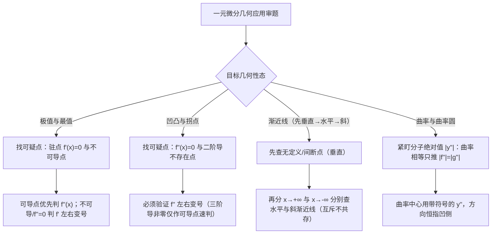

# 第5讲 一元函数微分学的应用（一）——几何应用

本讲对应考研数学二一元函数微分学几何应用四大模块：**单调性、极值与最值**、**曲线凹凸性与拐点**、**渐近线**、**曲率与曲率圆**。题号“例”指张宇强化 36 讲，“B”指《1000 题》强化篇第 5 章。原题回查 [[考研数学/强化/试题册_强化篇与综合篇/05_强化篇_高数_第5章_一元函数微分学的应用(一)_几何应用.pdf|1000题试题册第5章]]，解析回查 [[考研数学/强化/解析册_强化篇与综合篇/05_强化篇_高数_第5章_一元函数微分学的应用(一)_几何应用.pdf|1000题解析册第5章]]。

---

> [!important] 近 17 年数二真题雷达（2010—2026｜S 级高频几何核心）
> - **考频画像**：近 17 年主考 **33 题**（2010—2014 共 9 题，2015—2026 共 24 题，近 6 年新大纲 **9 题**，解答题 6 次），跨讲渗透 **15 次**，平均每年约 2 题。
> - **真题落点**：
>   - *2021—2026 新大纲（9 题）*：`21-T4(选)`、`21-T18(解)`、`23-T1(选)`、`23-T7(选)`、`24-T11(填)`、`25-T2(选)`、`25-T12(填)`、`26-T5(选)`、`26-T13(填)`
>   - *2015—2020 经典（15 题）*：`15-T4(选)`、`15-T19(解)`、`16-T4(选)`、`16-T5(选)`、`16-T9(填)`、`17-T2(选)`、`17-T9(填)`、`17-T18(解)`、`18-T10(填)`、`18-T12(填)`、`19-T2(选)`、`19-T6(选)`、`19-T10(填)`、`19-T15(解)`、`20-T15(解)`
>   - *2010—2014 经典（9 题）*：`10-T10(填)`、`10-T15(解)`、`11-T3(选)`、`11-T16(解)`、`12-T1(选)`、`12-T13(填)`、`14-T2(选)`、`14-T3(选)`、`14-T4(选)`
> - **高频命题规律与反套路核心**：
>   1. **渐近线变形与去伪**：`12-T1`（先约公因式消可去间断点）、`21-T18`（含 $|x|$ 分 $x\to\pm\infty$ 得两条斜渐近线，凹凸勿漏 $x=-1$ 分割）、`23-T1`（$1=\ln\mathrm{e}$ 合并对数）、`25-T12`（三次根式泰勒展开）。
>   2. **曲率与曲率圆回归**：`24-T11`（$y^2=x$ 原点改对 $y$ 求导定曲率圆）、`14-T4` & `26-T13`（区分曲率与**曲率半径**，勿填倒数）、`16-T5` & `19-T6`（曲率分子含 $|y''|$，相切且曲率相等推不出 $f''=g''$）。
>   3. **极值/拐点/凹凸边界**：`15-T4` & `16-T4`（导图判不可导变号点与渐近线拐点）、`23-T7`（无极值 $\Delta_1\le 0$ 可取等，有拐点 $\Delta_2>0$ 不可取等）、`25-T2`（变限泰勒偶极奇拐）、`14-T3` & `17-T2` & `26-T5`（弦线不等式与无可导/连续前提三点割线定义）。
> - **每日复习聚焦**：看 Part II 开头 Mermaid 决策树 + 「渐近线分 $\pm\infty$ + 曲率半径/绝对值 + 极值拐点端点等号 + 无可导前提凹函数定义」。

---

## 第一部分｜知识点与核心结论

### 一、函数单调性、极值与最值理论 【🔥 必背｜停下来默背 1 遍】

**1. 切线、法线方程与截距公式速查** 【📌 扫一眼｜确认“我还会”就过】
- 设曲线 $y = f(x)$ 在点 $P_0(x_0, y_0)$ 处可导（$y_0 = f(x_0)$），切线斜率 $k = f'(x_0)$：
  - **切线方程**：$y - y_0 = f'(x_0)(x - x_0)$；
  - **法线方程**：$y - y_0 = -\dfrac{1}{f'(x_0)}(x - x_0)\quad (f'(x_0) \ne 0)$。
- **四大截距公式（实数坐标，带正负号，绝非距离）**：

| 直线类型 | $x$ 轴截距（令 $y=0$） | $y$ 轴截距（令 $x=0$） |
|---|---|---|
| **切线** | $X = x_0 - \dfrac{y_0}{f'(x_0)}\ (f'(x_0)\ne 0)$ | $Y = y_0 - x_0 f'(x_0)$ |
| **法线** | $X = x_0 + y_0 f'(x_0)$ | $Y = y_0 + \dfrac{x_0}{f'(x_0)}\ (f'(x_0)\ne 0)$ |

- **特殊切线情形**：
  - 若 $f'(x_0) = 0$：切线为水平直线 $y = y_0$（$y_0 \ne 0$ 时无 $x$ 轴截距）；法线为垂直直线 $x = x_0$（$x_0 \ne 0$ 时无 $y$ 轴截距）。
  - 若 $\lim_{x\to x_0}\dfrac{f(x)-f(x_0)}{x-x_0} = \infty$：曲线在 $x_0$ 处有垂直切线 $x = x_0$，法线为水平直线 $y = y_0$。

**2. 单调性判别定理与充要准则** 【🔥 必背｜停下来默背 1 遍】
- **严格单调判别定理（教材标准表述）**：
  设函数 $y = f(x)$ 在 $[a, b]$ 上连续，在 $(a, b)$ 内可导：
  1. 若在 $(a, b)$ 内 $f'(x) \ge 0$，且等号仅在有限多个点处成立（或在任意非空子区间上不恒为零），则 $f(x)$ 在 $[a, b]$ 上**严格单调增加**；
  2. 若在 $(a, b)$ 内 $f'(x) \le 0$，且等号仅在有限多个点处成立（或在任意非空子区间上不恒为零），则 $f(x)$ 在 $[a, b]$ 上**严格单调减少**。
  - **核心要点**：<mark>有限点导数为零仍保持严格单调</mark>；该条件旨在排除“平坡”（子区间上 $f'(x) \equiv 0$），只要在任意非空开子区间上 $f'(x) \not\equiv 0$，严格单调性即保持。
- **弱单调的充要条件**：
  - $f(x)$ 在 $[a, b]$ 上单调增加（单调不减） $\iff$ 在 $(a, b)$ 内 $f'(x) \ge 0$；
  - $f(x)$ 在 $[a, b]$ 上单调减少（单调不增） $\iff$ 在 $(a, b)$ 内 $f'(x) \le 0$。
- **逆命题避坑**：
  - <mark>严格单增只推导数非负而非恒正</mark>（反例：$f(x) = x^3$ 在 $\mathbb{R}$ 上严格单增，但 $f'(0) = 0$）。

**3. 极值概念、内点属性与费马引理（必要条件）** 【🔥 必背｜停下来默背 1 遍】
- **极值的局部定义**：设函数 $f(x)$ 在点 $x_0$ 的某邻域 $U(x_0, \delta)$ 内有定义。对该邻域内任意一点 $x$：
  - 若恒有 $f(x) \le f(x_0)$（或在去心邻域内严格 $< f(x_0)$），则称 $x_0$ 为**极大值点**，$f(x_0)$ 为**极大值**；
  - 若恒有 $f(x) \ge f(x_0)$（或在去心邻域内严格 $> f(x_0)$），则称 $x_0$ 为**极小值点**，$f(x_0)$ 为**极小值**。
- **内点属性**：极值是局部内点性态，仅针对定义域内部点，闭区间端点不讨论极值。
- **费马引理（极值的必要条件）**：设函数 $f(x)$ 在点 $x_0$ 处可导。若 $x_0$ 为 $f(x)$ 的极值点，则必有：
  $$
  f'(x_0) = 0.
  $$
- **极值候选点（可疑点）排查清单**：
  - **两类内点**：先排查驻点（$f'(x)=0$）与不可导点；注意不可导点**包含有定义的间断点**，不可仅检查连续点。
  - **典型反例**：$y=\lvert x\rvert$ 在 $x=0$ 处不可导但取严格极小值；若 $f(0)=1$ 且 $f(x)=\lvert x\rvert\ (x\ne0)$，则 $x=0$ 为可去间断点，却是极大值点。
  - **判别避坑**：<mark>间断点可为极值点但不能套变号判据</mark>，须直接用定义比较邻域内函数值。 `[真题·2011-T3 / 2019-T15]` 参见 [[第5讲_讲义.pdf]] 第 3 页。
- **闭区间端点最值的单侧导数必要条件**：

| 端点位置 | 取得最大值（若单侧导存在） | 取得最小值（若单侧导存在） |
|---|---|---|
| **左端点 $a$** | $f'_+(a) \le 0$ | $f'_+(a) \ge 0$ |
| **右端点 $b$** | $f'_-(b) \ge 0$ | $f'_-(b) \le 0$ |

  - 以上仅为端点最值的**必要条件**，不保证充分；求闭区间最值仍须比较全部候选点与端点的函数值。参见基础讲义 PDF 第 24 页习题 5.2。

**4. 极值三大充分条件判别对照表** 【🔥 必背｜停下来默背 1 遍】

| 判别法 | 适用条件 | 判定准则 | 失效情形与备用方案 |
|---|---|---|---|
| **第一充分条件**（一阶导变号法则） | $f(x)$ 在 $x_0$ 处连续，在去心邻域 $\mathring{U}(x_0, \delta)$ 内可导 | $f'(x)$ 在 $x_0$ 左正右负 $\implies$ 极大值； $f'(x)$ 在 $x_0$ 左负右正 $\implies$ 极小值； $f'(x)$ 两侧同号 $\implies$ 非极值点 | $f'(x)$ 在 $x_0$ 附近振荡变号时失效；不可导但连续的点若两侧导数变号依然有效 |
| **第二充分条件**（二阶导驻点法则） | $f(x)$ 在 $x_0$ 处二阶可导，且 $f'(x_0) = 0$ | $f''(x_0) < 0 \implies$ 严格极大值； $f''(x_0) > 0 \implies$ 严格极小值 | $f''(x_0) = 0$ 时失效，须退回第一充分条件或改用更高阶导数 |
| **第三充分条件**（高阶导数判别） | $f(x)$ 在 $x_0$ 具有 $n$ 阶连续导数，且 $f'(x_0) = \dots = f^{(n-1)}(x_0) = 0,\ f^{(n)}(x_0) \ne 0$ | $n$ 为偶数：$f^{(n)}(x_0) < 0 \implies$ 极大值，$f^{(n)}(x_0) > 0 \implies$ 极小值； $n$ 为奇数：$x_0$ 非极值点 | 需高阶可导；若奇数阶非零项先出现，曲线穿透该点，无极值 |

- `【⚡ 真题补丁｜2025-T2】` 变限积分原点判极值与拐点：<mark>展开主部次数偶数判极值奇数判拐点</mark>。
  - 对被积函数展开最低阶主部并积分，得 $F(x)-F(0)=cx^k+o(x^k)\ (c\ne 0,\ k\ge 2)$，可跳过高阶求导直接定性：
    - $k$ 为偶数 $\implies x=0$ 为**极值点**（$c>0$ 极小，$c<0$ 极大），非拐点；
    - $k$ 为奇数（$k\ge 3$）$\implies (0,F(0))$ 为**拐点**，非极值点。

**5. 最值定理与开区间唯一极值点法则** 【📌 扫一眼｜确认“我还会”就过】
- **闭区间连续最值存在定理**：闭区间 $[a,b]$ 上的连续函数必能取得最大值与最小值，且最值只能在以下三类点中产生：
  1. 开区间 $(a,b)$ 内的驻点（$f'(x) = 0$）；
  2. 开区间 $(a,b)$ 内的不可导点；
  3. 区间端点 $x = a$ 与 $x = b$。
- **开区间唯一极值点法则**：设 $f(x)$ 在区间 $I$（开区间或无穷区间）上连续，且在 $I$ 内存在**唯一的极值点** $x_0$：
  - 若 $x_0$ 为极大值点，则 $f(x_0)$ 为 $f(x)$ 在 $I$ 上的最大值；
  - 若 $x_0$ 为极小值点，则 $f(x_0)$ 为 $f(x)$ 在 $I$ 上的最小值。
- **微积分基本定理与增量累加求最值**：若导函数 $f'(x)$ 连续，则任意点函数值满足：
  $$
  f(x) = f(x_0) + \int_{x_0}^x f'(t)\,\mathrm{d}t.
  $$
  导函数图像在横轴上方围成的面积对应函数值的正增量，在横轴下方围成的面积对应负增量。

---

### 二、曲线凹凸性与拐点分析 【🔥 必背｜停下来默背 1 遍】

**1. 凹凸性的几何定义（割线与切线视角）** 【⚡ 避坑｜最值钱，必须精读 1 分钟】
- **同济教材规范**：开口向上（凹向向上，类似 $y = x^2$）称为**凹（凹弧 / 下凸）**；开口向下（凸向向上，类似 $y = -x^2$）称为**凸（凸弧 / 上凸）**。
- **定义一（割线中点定义 / Jensen 不等式）**：设 $f(x)$ 在区间 $I$ 上连续。对 $I$ 内任意相异两点 $x_1, x_2$（$x_1 \ne x_2$）：
  - **凹弧**：$f\!\left(\dfrac{x_1 + x_2}{2}\right) < \dfrac{f(x_1) + f(x_2)}{2}$（<mark>凹弧恒位于任意两点弦线的下方</mark> `[真题·2014-T3 / 2017-T2]`）；
  - **凸弧**：$f\!\left(\dfrac{x_1 + x_2}{2}\right) > \dfrac{f(x_1) + f(x_2)}{2}$（弧位于弦的上方）。
- **定义二（切线支撑表述）**：设 $f(x)$ 在区间 $I$ 内可导。对 $I$ 内任意 $x \ne x_0$：
  - **凹弧**：$f(x) > f(x_0) + f'(x_0)(x - x_0)$（曲线位于切线上方）；
  - **凸弧**：$f(x) < f(x_0) + f'(x_0)(x - x_0)$（曲线位于切线下方）。
- `【⚡ 真题补丁｜2026-T5】` 未给可导或连续前提时禁用二阶导，<mark>须用凹函数三点割线斜率定义判别</mark>。
  - **充要条件**：对任意 $x_1 < x_2 < x_3$，曲线为凹 $\iff \dfrac{f(x_2)-f(x_1)}{x_2-x_1} \le \dfrac{f(x_3)-f(x_1)}{x_3-x_1} \le \dfrac{f(x_3)-f(x_2)}{x_3-x_2}$；固定右端点 $x_3=1$ 即得 $g(x)=\dfrac{f(x)-f(1)}{x-1}$ 在 $[-1,1)$ 上递增（选 C）。
  - **选项排错**：
    - A 错（在 $(-1,0)$ 减、$(0,1)$ 增）：缺少连续前提，被突变点 $f(0)=1$ 推翻；
    - B 错（极小值推 $(-1,0)$ 减、$(0,1)$ 增）：被振荡极小 $x^2\!\left(2+\sin\frac{1}{x}\right)$ 推翻；
    - D 错（逆命题）：被 $f(x)=(x-1)(x+1)^3$（在 $(-1,0)$ 上 $f''<0$ 为凸弧）推翻。

**2. 曲线凹凸性的二阶导判定定理** 【🔥 必背｜停下来默背 1 遍】
- 设函数 $f(x)$ 在 $[a, b]$ 上连续，在 $(a, b)$ 内二阶可导：
  1. 若在 $(a, b)$ 内 $f''(x) \ge 0$，**且等号仅在有限多个点处成立（或在任意非空子区间上不恒为零）**，则曲线 $y = f(x)$ 在 $[a, b]$ 上**严格凹**（凹弧）；
  2. 若在 $(a, b)$ 内 $f''(x) \le 0$，**且等号仅在有限多个点处成立（或在任意非空子区间上不恒为零）**，则曲线 $y = f(x)$ 在 $[a, b]$ 上**严格凸**（凸弧）。

**3. 拐点的定义与三层次判定准则** 【🔥 必背｜停下来默背 1 遍】
- **定义与书写规范**：连续曲线上凹弧与凸弧的分界点称为**拐点**。<mark>拐点必须写二维坐标不能只写横坐标</mark>，即 $(x_0, f(x_0))$。
- **充要条件**：连续曲线 $y = f(x)$ 在点 $(x_0, f(x_0))$ 左右两侧的凹凸性**严格相反**（由凹变凸或由凸变凹）。
- **必要条件**：若 $f(x)$ 在 $x_0$ 处二阶可导且 $(x_0, f(x_0))$ 为拐点，则必有 $f''(x_0) = 0$。
- **拐点候选点（可疑点）排查清单**（拐点必在这两类点中产生）：
  1. 二阶导数为零的点：$f''(x) = 0$；
  2. <mark>二阶导不存在的连续点也可为拐点</mark>（如 $y = x^{1/3}$ 在原点二阶导不存在，但两侧凹凸相反，$(0,0)$ 为拐点）`[真题·2015-T4 / 2016-T4]`。
- **拐点三大充分条件**：
  1. **第一充分条件（二阶导变号法则）**：设 $f(x)$ 在 $x_0$ 处连续，在去心邻域 $\mathring{U}(x_0, \delta)$ 内二阶可导。若 $f''(x)$ 在 $x_0$ 左右两侧异号，则 $(x_0, f(x_0))$ 为拐点；若同号，则非拐点。
  2. **第二充分条件（三阶导判据）**：设 $f(x)$ 在 $x_0$ 处三阶可导，若 $f''(x_0) = 0$ 且 $f'''(x_0) \ne 0$，则 $(x_0, f(x_0))$ 必为拐点。
  3. **高阶导数判据**：设 $f''(x_0) = \dots = f^{(n-1)}(x_0) = 0,\ f^{(n)}(x_0) \ne 0$。若 $n$ 为奇数（$n \ge 3$），则 $(x_0, f(x_0))$ 为拐点；若 $n$ 为偶数，则非拐点。

**4. 导数变号、判别式与点性态辨析对照表** 【⚡ 避坑｜最值钱，必须精读 1 分钟】

| 问题类型 | 核心数学条件 | 判别式特征（针对二次因子 $P(x)$） | 命题实质与反例防坑 |
|---|---|---|---|
| **无极值点** | $f'(x) = P(x)\mathrm{e}^{kx}$ 恒不变号 | $\Delta_1 \le 0$（允许重根） | 判别式等于零时为二重实根相切，一阶导不穿轴变号，仍无极值 |
| **存在拐点** | $f''(x) = Q(x)\mathrm{e}^{kx}$ 必须穿轴变号 | $\Delta_2 > 0$（严格大于零） | 若 $\Delta_2 = 0$ 为二重实根，$f''(x)$ 切于横轴不变号，无拐点 |
| **一点二阶可导与邻域单调** | $f(x)$ 在 $x_0$ 处二阶可导，且 $f'(x_0) > 0$ | 利用低阶导数连续性 | <mark>一点二阶可导才保一阶导局部保号</mark> `[真题·2022-T3]`，可推邻域严格单增 |
| **一点二阶导为正与邻域凹凸** | $f(x)$ 在 $x_0$ 处满足 $f''(x_0) > 0$ | 不能保证邻域凹凸性 | <mark>一点二阶导为正推不出邻域局部凹凸</mark> `[真题·2022-T3]`，因不保证 $f''$ 连续 |

- `【⚡ 真题补丁｜2023-T7】` 无极值允许重根不穿轴，<mark>有拐点必须变号故判别式不可取等</mark>。
  - 选填题常在参数端点开闭设卡（如 $[1,2)$ 选 C，干扰项为 $[0,1),[1,+\infty),[2,+\infty)$）：
    - 无极值：$\Delta_1 = 4 - 4a \le 0 \implies a \ge 1$（可取等）；
    - 有拐点：$\Delta_2 = 16 - 4(a+2) > 0 \implies a < 2$（$a=2$ 时重根相切同正无拐点，不可取等）。

---

### 三、渐近线理论与求法速查 【🔥 必背｜停下来默背 1 遍】

**1. 三类渐近线判据与标准排查顺序** 【🔥 必背｜停下来默背 1 遍】
考场排查渐近线的标准顺序：**先查铅直渐近线，再查水平渐近线，无水平渐近线的方向再查斜渐近线**。

- **铅直渐近线（无穷间断点）**：
  若 $\lim_{x\to x_0^+} f(x) = \infty$ 或 $\lim_{x\to x_0^-} f(x) = \infty$，则直线 $x = x_0$ 为曲线的铅直渐近线。
  - **排查位置**：分母零点、对数真数趋零点、无定义孤立点及分段函数分界点。
- **水平渐近线（正负无穷极限）**：
  若 $\lim_{x\to+\infty} f(x) = A$，则 $y = A$ 为 $x\to+\infty$ 方向的水平渐近线；若 $\lim_{x\to-\infty} f(x) = B$，则 $y = B$ 为 $x\to-\infty$ 方向的水平渐近线。
  - **方向独立性**：<mark>正负无穷方向必须分开求极限排查</mark> `[真题·2021-T18]`，全平面至多存在 2 条水平渐近线。
- **斜渐近线（两步极限法）**：
  在某一趋向（$x\to+\infty$ 或 $x\to-\infty$）下，若存在有限实数：
  $$
  a = \lim_{x\to\infty}\frac{f(x)}{x} \ne 0,\qquad b = \lim_{x\to\infty}[f(x) - ax],
  $$
  则直线 $y = ax + b$ 为该方向的斜渐近线。
  - **退化与失效情形**：若 $a = 0$，退化为水平渐近线；若 $a \ne 0$ 存在但 $b$ 不存在或为无穷大，则无斜渐近线（如 $y = x + \sqrt{x}$ 无斜渐近线）。

**2. 泰勒渐近展开法（一步直达斜渐近线）** 【🔥 必背｜停下来默背 1 遍】
- **核心法则**：当 $x \to \pm\infty$ 时，若通过提取主项与麦克劳林展开将 $f(x)$ 化为：
  $$
  f(x) = ax + b + \alpha(x),\qquad \lim_{x\to\pm\infty}\alpha(x) = 0\quad (a \ne 0),
  $$
  即可直接读出斜渐近线 $y = ax + b$。
- **展开阶数控制**：若函数外部乘有 $x^m$，内部括号至少须展开至 $\dfrac{1}{x^m}$ 项，以确保相乘后的常数项 $b$ 完整保留、不致遗漏。

**3. 渐近线条数上界与对称性法则** 【📌 扫一眼｜确认“我还会”就过】
- **单向互斥法则**：<mark>同侧无穷方向水平与斜渐近线互斥</mark> `[真题·2014-T2 / 2023-T1]`，同一趋向下至多存在其一。
- **全平面条数上界**：一元显式函数的水平渐近线与斜渐近线合计至多 2 条（分别对应 $+\infty$ 与 $-\infty$）；铅直渐近线条数取决于无穷间断点的个数。
- **奇偶对称性**：
  - 偶函数：若 $x\to+\infty$ 有斜渐近线 $y = ax + b$，则 $x\to-\infty$ 必有 $y = -ax + b$；若有铅直渐近线 $x = x_0$，则必有 $x = -x_0$。
  - 奇函数：若 $x\to+\infty$ 有斜渐近线 $y = ax + b$，则 $x\to-\infty$ 必有 $y = ax - b$。
- **反函数映射法则**：原函数与反函数图像关于 $y = x$ 对称：
  - 原函数的水平渐近线 $y = c \iff$ 反函数的铅直渐近线 $x = c$；
  - 原函数的铅直渐近线 $x = c \iff$ 反函数的水平渐近线 $y = c$。

---

### 四、曲率与曲率圆理论（数学二核心） 【🔥 必背｜停下来默背 1 遍】

**1. 弧微分与曲率的几何定义** 【📌 扫一眼｜确认“我还会”就过】
- **弧微分公式**：
  - 直角坐标：$\mathrm{d}s = \sqrt{1 + (y')^2}\,\mathrm{d}x$；
  - 参数方程：$\mathrm{d}s = \sqrt{(x'(t))^2 + (y'(t))^2}\,\mathrm{d}t$；
  - 极坐标：$\mathrm{d}s = \sqrt{r^2 + (r')^2}\,\mathrm{d}\theta$。
- **曲率定义**：切线倾角 $\alpha$ 对弧长 $s$ 变化率的绝对值，刻画曲线在一点处的弯曲程度：
  $$
  K = \lim_{\Delta s\to 0}\left\lvert\frac{\Delta\alpha}{\Delta s}\right\rvert = \left\lvert\frac{\mathrm{d}\alpha}{\mathrm{d}s}\right\rvert.
  $$

**2. 三种坐标形式下的曲率公式对照表** 【🔥 必背｜停下来默背 1 遍】

| 坐标表示形式 | 曲线方程表达 | 曲率计算公式 $K$ | 结构特征与记忆要点 |
|---|---|---|---|
| **直角坐标** | $y = f(x)$ | $K = \dfrac{\lvert y''\rvert}{[1 + (y')^2]^{3/2}}$ | <mark>直角曲率分子带绝对值曲率半径取倒数</mark> `[真题·2012-T13 / 2014-T4 / 2019-T6]` |
| **参数方程** | $\begin{cases}x = \varphi(t) \\ y = \psi(t)\end{cases}$ | $K = \dfrac{\lvert x'y'' - x''y'\rvert}{[(x')^2 + (y')^2]^{3/2}}$ | 分子为一、二阶导构成的二阶行列式绝对值；分母为速度模长立方 |
| **极坐标方程** | $r = r(\theta)$ | $K = \dfrac{\lvert r^2 + 2(r')^2 - r r''\rvert}{[r^2 + (r')^2]^{3/2}}$ | 由 $x=r\cos\theta,\ y=r\sin\theta$ 代入参数公式导出（数学二独有考点） |

- `【⚡ 真题补丁｜2026-T13】` 隐函数求曲率半径保留整式求导，<mark>填答前务必核对问曲率还是半径</mark>。
  - 对隐式方程 $F(x,y)=0$ 保留整式对 $x$ 连续求导两次，代点解出 $y'$ 与 $y''$ 后代入 $\rho = \dfrac{[1+(y')^2]^{3/2}}{\lvert y''\rvert}$。
  - 同理 `2014-T4` 的干扰项 B 实为曲率 $K$，题干所求曲率半径 $\rho=10\sqrt{10}$ 应选 C。

**3. 曲率半径、曲率中心与曲率圆方程** 【⚡ 避坑｜最值钱，必须精读 1 分钟】
- **曲率半径**：曲率的倒数记作 $\rho$：
  $$
  \rho = \frac{1}{K} = \frac{[1 + (y')^2]^{3/2}}{\lvert y''\rvert}\quad (y'' \ne 0).
  $$
- **曲率中心 $(\alpha, \beta)$ 坐标公式**：
  设曲线在点 $(x_0, y_0)$ 处二阶可导且 $y''(x_0) \ne 0$，曲率圆中心坐标为：
  $$
  \alpha = x_0 - \frac{y'(x_0)[1 + (y'(x_0))^2]}{y''(x_0)},\qquad \beta = y_0 + \frac{1 + (y'(x_0))^2}{y''(x_0)}.
  $$
  - **符号注意**：<mark>曲率中心分母带符号恒指向曲线凹侧</mark>，$y''$ 不加绝对值，其正负号自动决定圆心偏向曲线的凹侧。
- **曲率圆方程**：
  $$
  (x - \alpha)^2 + (y - \beta)^2 = \rho^2.
  $$
- **曲率圆的二阶密切性质与泰勒系数对应**：
  - 曲率圆与曲线在切点 $(x_0, y_0)$ 处具有**二阶密切**接触，两者的函数值、一阶导数、二阶导数完全相等：
    $$
    y(x_0) = f(x_0),\qquad y'_x\big|_{x=x_0} = f'(x_0),\qquad y''_{xx}\big|_{x=x_0} = f''(x_0).
    $$
  - 若在 $x \to x_0$ 时已知渐近展开 $f(x) - [A + B(x - x_0) + C(x - x_0)^2] = o((x - x_0)^2)$，则直接读出：
    $$
    A = f(x_0),\qquad B = f'(x_0),\qquad C = \frac{f''(x_0)}{2!}.
    $$
- `【⚡ 真题补丁｜2024-T11】` 曲线切线竖直时直角公式失效，<mark>切线竖直时互换变量改对纵坐标求导</mark>。
  - **真题示范**：曲线 $y^2=x$ 在原点 $(0,0)$ 处切线竖直（$x=0$），$y'_x$ 不存在；
  - 改将 $x$ 视作 $y$ 的函数 $x(y)=y^2$ 对 $y$ 求导，得 $x'(0)=0,\ x''(0)=2 \implies K=2,\ \rho=\frac{1}{2}$；
  - 由开口向右确定曲率中心 $\left(\frac{1}{2},0\right)$，曲率圆方程为 $\left(x-\frac{1}{2}\right)^2+y^2=\frac{1}{4}$。

---

## 第二部分｜题型体系与解题方法论

### 一、函数单调性、极值与最值判定

| 题干特征 | 优先方法 | 真题印证与避坑 |
|---|---|---|
| 求闭区间连续函数的最值 | 先求导判单调性与驻点，<mark>不可导点与断点均须纳入极值排查</mark> | `[真题·2011-T3 / 2017-T18 / 2019-T15 / 2020-T15]`；防漏不可导点或丢绝对值 |
| 变上限积分函数求单调性或极值 | 直接求导 $f'(x)$，找导数零点并利用保号性划分区间；原点高阶判别优先用泰勒主部偶极奇拐 | `[真题·2016-T4 / 2025-T2]`（变限积分泰勒主部偶次判极值、奇次判拐点） |
| 上限与被积函数同时含自变量 $x$ | 先拆项或换元将 $x$ 移至积分号外，再对 $x$ 求导 | `[真题·2010-T15]`、`26-T18`；<mark>多单调区间用逗号隔开禁用并集号</mark> |
| 给出导函数 $f'(x)$ 图象与各块面积 | 用微积分基本定理累加有符号面积还原各点函数值比较 | 强化高频母型；防漏加基准值 $f(x_0)$ 或忘取横轴下方面积负号 |
| 动切点在坐标轴上的截距进入极限 | 设切点坐标写出切线方程，令 $Y=0$ 得截距代入化简 | `[真题·2015-T19]`；防误把带符号的截距加上绝对值 |
| 已知 $f(0)=0$ 需比较 $f(x)$ 与 $f'(x)$ | 在 $[0,x]$ 上用拉格朗日中值定理化为 $f(x)=xf'(\xi)$ 比较 | `[真题·2021-T4]`（分离参数注意 $x=1$ 间断点）；防忽略区间端点符号 |

> [!tip] 核心提醒
> 1. 闭区间最值优先求导观察导数全区间正负，若恒正或恒负直接由单调性在端点取最值，无需盲目计算原函数；图形面积累加时横轴下方积分为负面积，切勿漏加基准值 $f(x_0)$。
> 2. 变上限积分被积函数含 $x$ 时不能直接代入上限求导；求截距进入复合极限时需利用连续性先判内层趋向。
> - `【⚡ 真题补丁｜2010-T15 / 2011-T3 / 2019-T15】` 分段与变限极值：<mark>含参先拆外变量且不可导点也验变号</mark>。
>   - `2010-T15`：$f'(x)=2x\int_1^{x^2}\mathrm{e}^{-t^2}\mathrm{d}t$ 有 3 个驻点 $0,\pm 1$，单调区间写“和”或逗号禁用 $\cup$；
>   - `2011-T3`：$f(x)=\ln\lvert(x-1)(x-2)(x-3)\rvert$ 不可丢绝对值致缩小定义域，驻点共 2 个（选 C）；
>   - `2019-T15`：$x=0$ 处虽 $\lim_{x\to 0^+}f'(x)=-\infty$ 不可导，但左侧递增、右侧递减仍为极大值 $f(0)=1$，另有极小值 $1-\mathrm{e}^{-1}$ 与 $\mathrm{e}^{-2/\mathrm{e}}$。

> [!example]- 例5.1｜切线在 $x$ 轴截距代入复合极限与导数定义
> - **【题目】**：设 $f(x)$ 有连续的一阶导数，且 $f(0) = 0, f'(0) = 1$。求极限 $\lim_{x \to 0} \frac{x f(u)}{u f(x)}$，其中 $u$ 是曲线 $y=f(x)$ 在点 $(x, f(x))$ 处的切线在 $x$ 轴上的截距。
> - **【为什么这么想】**：先用点斜式写出切线方程，令纵坐标为零求得 $x$ 轴截距表达式 $u(x)$。由 $f'(x)$ 的连续性确认 $x\to 0$ 时内层截距 $u\to 0$，进而拆分极限转化为导数定义式求解。
> - **【完整解答】**：
>   曲线在动点 $(x, f(x))$ 处的切线方程为：
>   $$
>   Y - f(x) = f'(x)(X - x).
>   $$
>   令 $Y = 0$，解得切线在 $x$ 轴上的截距 $X$：
>   $$
>   u = x - \frac{f(x)}{f'(x)}.
>   $$
>   由于 $f(x)$ 与 $f'(x)$ 连续，且 $f(0) = 0, f'(0) = 1 \ne 0$，当 $x \to 0$ 时：
>   $$
>   \lim_{x \to 0} u = \lim_{x \to 0} \left(x - \frac{f(x)}{f'(x)}\right) = 0 - \frac{f(0)}{f'(0)} = 0.
>   $$
>   将所求极限拆分为两项乘积：
>   $$
>   \lim_{x \to 0} \frac{x f(u)}{u f(x)} = \lim_{x \to 0}\frac{x}{f(x)} \cdot \lim_{u \to 0}\frac{f(u)}{u}.
>   $$
>   由导数定义可知：
>   $$
>   \lim_{x \to 0}\frac{f(x)}{x} = \lim_{x \to 0}\frac{f(x) - f(0)}{x - 0} = f'(0) = 1 \implies \lim_{x \to 0}\frac{x}{f(x)} = 1.
>   $$
>   同理，当 $u \to 0$ 时 $\lim_{u \to 0}\frac{f(u)}{u} = f'(0) = 1$。
>   因此：
>   $$
>   \lim_{x \to 0} \frac{x f(u)}{u f(x)} = 1 \cdot 1 = 1.
>   $$
> - **【复盘提醒】**：截距是带符号的坐标值，不可加绝对值；拆分内层变量 $u$ 的极限时，必须验证内层极限趋向于零且分母在去心邻域内非零。

> [!example]- 例5.8｜变上限积分求导判单调性与闭区间端点最值
> - **【题目】**：求函数 $f(x) = \int_{0}^{x} \frac{t}{t^2 + 2t + 2} \mathrm{d}t$ 在 $[0, 1]$ 上的最大值。
> - **【为什么这么想】**：闭区间连续函数求最值无需直接求出整个变上限积分，先对变上限积分求导，利用一阶导数在区间的正负直接判定单调性，将最值锁定在端点。
> - **【完整解答】**：
>   由变上限积分求导定理，对 $f(x)$ 求导得：
>   $$
>   f'(x) = \frac{x}{x^2 + 2x + 2} = \frac{x}{(x + 1)^2 + 1}.
>   $$
>   当 $x \in (0, 1]$ 时，分母恒正且分子 $x > 0$，故恒有：
>   $$
>   f'(x) > 0.
>   $$
>   因此 $f(x)$ 在闭区间 $[0, 1]$ 上严格单调递增。
>   故函数在 $[0, 1]$ 上的最大值必在右端点 $x = 1$ 处取得：
>   $$
>   f(1) = \int_{0}^{1} \frac{t}{t^2 + 2t + 2}\,\mathrm{d}t = \int_{0}^{1} \frac{(t + 1) - 1}{(t + 1)^2 + 1}\,\mathrm{d}t.
>   $$
>   拆项积分：
>   $$
>   f(1) = \frac{1}{2}\int_{0}^{1} \frac{\mathrm{d}((t+1)^2+1)}{(t+1)^2+1} - \int_{0}^{1} \frac{\mathrm{d}t}{(t+1)^2+1}.
>   $$
>   代入上下限：
>   $$
>   f(1) = \left[\frac{1}{2}\ln((t+1)^2+1) - \arctan(t+1)\right]_0^1 = \left(\frac{1}{2}\ln 5 - \arctan 2\right) - \left(\frac{1}{2}\ln 2 - \arctan 1\right).
>   $$
>   整理得：
>   $$
>   f(1) = \frac{1}{2}\ln\frac{5}{2} - \arctan 2 + \frac{\pi}{4}.
>   $$
> - **【复盘提醒】**：闭区间最值题切忌盲目积出原函数，务必“导数先行”；确定单调性后只需对确定的极值端点执行一次定积分计算。

> [!example]- 例5.9 / B23｜导函数图形有符号面积累加还原函数最值
> - **【题目】**：设 $f'(x)$ 在区间 $[0, 4]$ 上连续，曲线 $y = f'(x)$ 与直线 $x = 0, x = 4, y = 0$ 围成三个区域，其面积分别为 $S_1 = 3, S_2 = 4, S_3 = 2$，且 $f(0) = 1$。已知 $f'(x)$ 在 $(0,1)$ 和 $(3,4)$ 上位于横轴下方，在 $(1,3)$ 上位于横轴上方。求 $f(x)$ 在 $[0, 4]$ 上的最大值与最小值。（A）$2, -3$；（B）$4, -3$；（C）$2, -2$；（D）$4, -2$。
> - **【为什么这么想】**：导函数的零点对应原函数的驻点，导函数图形与横轴所围面积即为原函数在各区间的定积分增量。利用微积分基本定理将初始值 $f(0)$ 逐段累加，算出所有驻点和端点的函数值直接比大小。
> - **【完整解答】**：
>   由导函数图形知，区间 $(0,4)$ 内驻点为 $f'(x) = 0$ 的点，即 $x = 1$ 与 $x = 3$。
>   由闭区间连续最值定理，最值只能在驻点与端点 $\{0, 1, 3, 4\}$ 处产生。
>   根据定积分的几何意义与微积分基本定理：
>   - 在 $[0, 1]$ 上，$f'(x) \le 0$，积分值为负面积：$\int_0^1 f'(x)\,\mathrm{d}x = -S_1 = -3$；
>   - 在 $[1, 3]$ 上，$f'(x) \ge 0$，积分值为正面积：$\int_1^3 f'(x)\,\mathrm{d}x = S_2 = 4$；
>   - 在 $[3, 4]$ 上，$f'(x) \le 0$，积分值为负面积：$\int_3^4 f'(x)\,\mathrm{d}x = -S_3 = -2$。
>   从基准值 $f(0) = 1$ 开始依次累加各点值：
>   $$
>   f(1) = f(0) + \int_0^1 f'(x)\,\mathrm{d}x = 1 - 3 = -2;
>   $$
>   $$
>   f(3) = f(1) + \int_1^3 f'(x)\,\mathrm{d}x = -2 + 4 = 2;
>   $$
>   $$
>   f(4) = f(3) + \int_3^4 f'(x)\,\mathrm{d}x = 2 - 2 = 0.
>   $$
>   汇总四个候选点的值：$f(0) = 1, f(1) = -2, f(3) = 2, f(4) = 0$。
>   比较可得：最大值为 $f(3) = 2$，最小值为 $f(1) = -2$。故选 (C)。
> - **【复盘提醒】**：横轴下方的几何面积对应负的定积分增量；累加时千万不可漏加基准值 $f(0)=1$，不能把各块面积本身直接错当成函数值。

> [!example]- B8｜含参变上限积分拆项求导与驻点极值判别
> - **【题目】**：求函数 $f(x)=\int_1^x(x^2-t^2)\ln(1+t^2)\,\mathrm{d}t$ 的极值。
> - **【为什么这么想】**：上限含 $x$，且被积函数中也含外层自变量 $x$。不能直接代入求导，须先用乘法分配律把 $x^2$ 提到积分号外，化为两个独立变上限积分再求导。
> - **【完整解答】**：
>   将原式拆开，把外层自变量 $x$ 提至积分号外：
>   $$
>   f(x) = x^2 \int_1^x \ln(1+t^2)\,\mathrm{d}t - \int_1^x t^2\ln(1+t^2)\,\mathrm{d}t.
>   $$
>   对 $x$ 求导：
>   $$
>   f'(x) = 2x \int_1^x \ln(1+t^2)\,\mathrm{d}t + x^2 \ln(1+x^2) - x^2\ln(1+x^2) = 2x \int_1^x \ln(1+t^2)\,\mathrm{d}t.
>   $$
>   令 $f'(x) = 0$，得候选驻点：$x = 0$ 或 $\int_1^x \ln(1+t^2)\,\mathrm{d}t = 0$。
>   因为被积函数 $\ln(1+t^2) \ge 0$ 且仅在 $t=0$ 处取零，所以变上限积分为零当且仅当上限等于下限，即 $x = 1$。
>   因此驻点为 $x = 0$ 与 $x = 1$。
>   记辅助函数 $J(x) = \int_1^x \ln(1+t^2)\,\mathrm{d}t$。分析 $f'(x) = 2x J(x)$ 的符号：
>   - 当 $x < 0$ 时，$2x < 0$ 且 $J(x) < 0 \implies f'(x) > 0$；
>   - 当 $0 < x < 1$ 时，$2x > 0$ 且 $J(x) < 0 \implies f'(x) < 0$；
>   - 当 $x > 1$ 时，$2x > 0$ 且 $J(x) > 0 \implies f'(x) > 0$。
>   由一阶导数第一充分条件：
>   - $x = 0$ 处导数由正变负，为极大值点；
>   - $x = 1$ 处导数由负变正，为极小值点。
>   计算极值：
>   极小值为 $f(1) = 0$；
>   极大值为：
>   $$
>   f(0) = \int_1^0 (-t^2)\ln(1+t^2)\,\mathrm{d}t = \int_0^1 t^2\ln(1+t^2)\,\mathrm{d}t.
>   $$
>   分部积分：
>   $$
>   f(0) = \left[\frac{t^3}{3}\ln(1+t^2)\right]_0^1 - \frac{2}{3}\int_0^1 \frac{t^4}{1+t^2}\,\mathrm{d}t = \frac{1}{3}\ln 2 - \frac{2}{3}\int_0^1 \left(t^2 - 1 + \frac{1}{1+t^2}\right)\mathrm{d}t.
>   $$
>   $$
>   f(0) = \frac{1}{3}\ln 2 - \frac{2}{3}\left[\frac{1}{3} - 1 + \frac{\pi}{4}\right] = \frac{1}{3}\ln 2 + \frac{4}{9} - \frac{\pi}{6}.
>   $$
> - **【复盘提醒】**：变上限积分“上限含 $x$ 且被积函数含 $x$”时，直接代入求导是致命错因，务必先拆开提至积分号外，或套用莱布尼茨积分法则。

> [!example]- B11｜拉格朗日中值定理比较函数值与导数值定增减
> - **【题目】**：设 $f'(x)$ 在 $[0,1]$ 上单调增加，$f(0)=f'(0)=0$，则在 $[0,1]$ 上：（A）$\mathrm{e}^x f(x)$ 增、$\mathrm{e}^{-x}f(x)$ 减；（B）二者均增；（C）前者减、后者增；（D）二者均减。
> - **【为什么这么想】**：求导考查 $(\mathrm{e}^{-x}f(x))' = \mathrm{e}^{-x}(f'(x)-f(x))$ 的符号。已知 $f(0)=0$，借助拉格朗日中值定理将 $f(x)$ 转化为 $x f'(\xi)$，再利用导函数的单调性比较 $f'(\xi)$ 与 $f'(x)$ 的大小。
> - **【完整解答】**：
>   对任意 $x \in (0, 1]$，函数 $f$ 在区间 $[0, x]$ 上满足拉格朗日中值定理条件，存在 $\xi \in (0, x)$ 使得：
>   $$
>   \frac{f(x) - f(0)}{x - 0} = f'(\xi) \implies f(x) = x f'(\xi).
>   $$
>   因为 $f'(x)$ 在 $[0,1]$ 上单调增加，且 $0 < \xi < x \le 1$，所以：
>   $$
>   0 = f'(0) \le f'(\xi) \le f'(x).
>   $$
>   又因 $0 < x \le 1$，故：
>   $$
>   f(x) = x f'(\xi) \le x f'(x) \le f'(x) \implies f'(x) - f(x) \ge 0.
>   $$
>   求导判断两函数单调性：
>   1. 对 $\mathrm{e}^{-x}f(x)$ 求导：
>      $$
>      (\mathrm{e}^{-x}f(x))' = \mathrm{e}^{-x}[f'(x) - f(x)] \ge 0,
>      $$
>      故 $\mathrm{e}^{-x}f(x)$ 在 $[0,1]$ 上单调增加。
>   2. 对 $\mathrm{e}^x f(x)$ 求导：
>      $$
>      (\mathrm{e}^x f(x))' = \mathrm{e}^x [f(x) + f'(x)].
>      $$
>      由于 $f'(x) \ge 0$ 且 $f(x) = x f'(\xi) \ge 0$，故 $(\mathrm{e}^x f(x))' \ge 0$ 恒成立，因此 $\mathrm{e}^x f(x)$ 亦单调增加。
>   综上，二者在 $[0,1]$ 上均单调增加。选 (B)。
> - **【复盘提醒】**：见到条件 $f(0)=0$ 且需要比较 $f(x)$ 与 $f'(x)$ 之间的差式符号时，优先利用拉格朗日中值定理构造增量公式 $f(x) = x f'(\xi)$。

---

### 二、曲线凹凸性、拐点与图象性态

| 题干特征 | 优先方法 | 真题印证与避坑 |
|---|---|---|
| 函数含参数，已知无极值但有拐点 | 一阶导二次式令 $\Delta_1\le 0$，二阶导二次式令 $\Delta_2> 0$ 联立求解 | `[真题·2023-T7]`（无极值 $\Delta_1\le 0$ 可取等 vs 有拐点 $\Delta_2>0$ 不可取等） |
| 已知单点具有二阶导数判邻域单调性 | 由二阶可导知一阶导连续，由 $f'(x_0)>0$ 保号推出邻域单调增加 | `[真题易错·2022-T3]`（$f''(x_0)>0$ 推不出邻域凹；$f'(x_0)>0$ 才推邻域单增） |
| 已知 $f'(x_0)=0$ 且 $f''(x_0)>0$ 或导函数图形判凹凸拐点 | 验 $f''$ 左右异号；导图找单调反转点含渐近线处 | `[真题·2011-T16 / 2014-T3 / 2015-T4 / 2016-T4 / 2017-T2 / 2019-T2]` |
| 比较函数增量之比与导数之比的单调性 | 设增量商辅助函数求导，结合柯西中值定理化简为差式判断 | 强化高频母型；防误认为二者充要（实为充分不必要） |
| 无可导/连续前提下比较曲线弧、弦中点或定点割线斜率单调性 | 回归凹函数三点割线斜率原始定义 $\frac{f(x_2)-f(x_1)}{x_2-x_1}\le\frac{f(x_3)-f(x_2)}{x_3-x_2}$，禁惯性套 $f''>0$ | `[真题·2026-T5]`（凹推 $\frac{f(x)-f(1)}{x-1}$ 增，但逆不成立，反例 $(x-1)(x+1)^3$） |

> [!tip] 核心提醒
> 1. 无极值点允许导数有二重根切点（$\Delta_1 \le 0$）；拐点必须穿透横轴变号，二次式判别式必须严格大于零（$\Delta_2 > 0$），重根切点无拐点。
> 2. <mark>连续前提下导数渐近线反转点亦为拐点</mark>：如 `16-T4` 选 B（$2$ 极值 $a,c$ 与 $3$ 拐点 $b,e,d$；A 漏渐近线 $b$，C/D 误计相切点 $d$）；`15-T4` 选 C（$x=A$ 与不可导变号点 $x=0$；B 漏 $0$，D 误计相切点 $B$）；`19-T2` 验 $y''(0)=0$ 两侧同负非拐点；`11-T16` 参数凹凸区间须映射回 $x$ 区间。
> 3. <mark>凸凹曲线与弦线不等式用特例秒排</mark>：`14-T3`（选 D，$f''\ge 0\Rightarrow f(x)\le g(x)$；A/B 单调性推不出凹凸，C 方向反）与 `17-T2`（选 B，严格下凸在折线弦 $2\lvert x\rvert-1$ 下方；偶抛物线 $2x^2-1$ 秒排 A/C/D）。

> [!example]- 例5.2｜一阶导二次式判别式判无极值与二阶导判拐点
> - **【题目】**：设函数 $f(x) = (x^2 + a)\mathrm{e}^x$，若 $f(x)$ 没有极值点，但曲线 $y = f(x)$ 有拐点，则 $a$ 的取值范围是（ ）。（A）$[0, 1)$；（B）$[1, +\infty)$；（C）$[1, 2)$；（D）$[2, +\infty)$。
> - **【为什么这么想】**：指数项恒正，一阶导与二阶导的符号分别完全由二次多项式决定。“无极值点”等价于一阶导不变号（判别式非正）；“有拐点”等价于二阶导有变号穿透零点（判别式严格为正）。
> - **【完整解答】**：
>   求一阶导数：
>   $$
>   f'(x) = 2x\mathrm{e}^x + (x^2 + a)\mathrm{e}^x = (x^2 + 2x + a)\mathrm{e}^x.
>   $$
>   因 $\mathrm{e}^x > 0$，函数无极值点要求 $f'(x)$ 在全实数域不变号，即二次式 $x^2 + 2x + a \ge 0$ 恒成立：
>   $$
>   \Delta_1 = 2^2 - 4a = 4(1 - a) \le 0 \implies a \ge 1.
>   $$
>   求二阶导数：
>   $$
>   f''(x) = (2x + 2)\mathrm{e}^x + (x^2 + 2x + a)\mathrm{e}^x = (x^2 + 4x + a + 2)\mathrm{e}^x.
>   $$
>   曲线有拐点，要求 $f''(x)$ 必须具有穿透横轴的变号零点。因此二次方程 $x^2 + 4x + a + 2 = 0$ 必须有两个相异实根：
>   $$
>   \Delta_2 = 4^2 - 4(a + 2) = 16 - 4a - 8 = 8 - 4a > 0 \implies a < 2.
>   $$
>   （注：若 $\Delta_2 = 0$，零点为二重根，两侧二阶导同号不变号，不能形成拐点）。
>   联立两不等式得：$1 \le a < 2$，即 $a \in [1, 2)$。故选 (C)。
> - **【复盘提醒】**：无极值与有拐点的判别式取等条件不同：无极值允许切点重根（$\Delta_1 \le 0$）；拐点须两侧变号，判别式不能取等（$\Delta_2 > 0$）。

> [!example]- 例5.4｜单点二阶导存在与邻域单调性及凹凸性反例辨析
> - **【题目】**：设函数 $f(x)$ 在 $x = x_0$ 处有二阶导数，则下列结论正确的是（ ）。（A）当 $f(x)$ 在 $x_0$ 的某邻域内单调增加时，$f'(x_0) > 0$；（B）当 $f'(x_0) > 0$ 时，$f(x)$ 在 $x_0$ 的某邻域内单调增加；（C）当曲线 $f(x)$ 在 $x_0$ 的某邻域内是凹的时，$f''(x_0) > 0$；（D）当 $f''(x_0) > 0$ 时，曲线 $f(x)$ 在 $x_0$ 的某邻域内是凹的。
> - **【为什么这么想】**：“在某点具有二阶导数”保证一阶导函数 $f'(x)$ 在该点邻域存在且在该点连续，因此可对一阶导直接使用局部保号性；但并不能保证二阶导函数在该点连续，二阶导的单点正负无法传递给邻域。
> - **【完整解答】**：
>   逐项排查分析：
>   - **选项 (A) 错误**：区间严格单调增加只能推出导数非负，不能推出严格大于零。经典反例：$f(x) = x^3$ 在 $x_0 = 0$ 附近严格单增，但 $f'(0) = 0$。
>   - **选项 (B) 正确**：已知 $f(x)$ 在 $x = x_0$ 处具有二阶导数，这意味着 $f'(x)$ 在 $x_0$ 的某邻域内存在，且 $f'$ 在 $x_0$ 处可导。可导必连续，故 $f'(x)$ 在 $x_0$ 处**连续**。已知 $f'(x_0) > 0$，由连续函数的局部保号性，必存在 $\delta > 0$，使得当 $x \in (x_0 - \delta, x_0 + \delta)$ 时恒有 $f'(x) > 0$。因此 $f(x)$ 在该邻域内单调增加。
>   - **选项 (C) 错误**：区间内为凹曲线只能推出二阶导数非负。经典反例：$f(x) = x^4$ 在 $x_0 = 0$ 邻域内严格为凹，但在 $x_0 = 0$ 处 $f''(0) = 0$。
>   - **选项 (D) 错误**：单点二阶导数 $f''(x_0) > 0$ 无法推出 $f''(x)$ 在邻域内连续，无法保证邻域内 $f''(x) > 0$ 恒成立，因此不能保证整个邻域为凹。
>   综上，正确选项为 (B)。
> - **【复盘提醒】**：可导只能推得低一阶导函数连续，绝不能越级假设高阶导数连续；由点处导数保号必须依赖该阶导数本身的连续性。

> [!example]- B9｜单点二阶导差商定义保号判定单侧单调与振荡反例
> - **【题目】**：设函数 $f(x)$ 在 $x=0$ 的某邻域内有定义，则以下结论正确的是：（A）若 $f(0)=0, f'(0)=0$，则 $x=0$ 必不是极值点；（B）若 $f'(0)=0, f''(0)=0$，则 $x=0$ 必是极值点；（C）若 $f(0)=0, f'(0)>0$，则存在 $\delta>0$ 使得 $f$ 在 $(0,\delta)$ 内单调递增；（D）若 $f'(0)=0, f''(0)>0$，则存在 $\delta>0$ 使得 $f$ 在 $(-\delta,0)$ 内单调递减。
> - **【为什么这么想】**：题设仅给出点处的导数值信息，无法直接套用邻域保号。当已知驻点处 $f''(0)>0$ 时，必须回归二阶导数的原初定义式，通过极限的局部保号性分析一阶导数在零点左右两侧的确定符号。
> - **【完整解答】**：
>   根据二阶导数在 $x = 0$ 处的定义，且已知 $f'(0) = 0$：
>   $$
>   f''(0) = \lim_{x\to 0}\frac{f'(x) - f'(0)}{x - 0} = \lim_{x\to 0}\frac{f'(x)}{x} > 0.
>   $$
>   由函数极限的保号性定理，存在 $\delta > 0$，当 $x \in (-\delta, \delta)$ 且 $x \ne 0$ 时，商式保持严格为正：
>   $$
>   \frac{f'(x)}{x} > 0.
>   $$
>   - 当 $x \in (-\delta, 0)$ 时，$x < 0 \implies f'(x) < 0$，导数小于零，故函数 $f(x)$ 在左邻域 $(-\delta, 0)$ 内单调递减；
>   - 当 $x \in (0, \delta)$ 时，$x > 0 \implies f'(x) > 0$，导数大于零，故函数 $f(x)$ 在右邻域 $(0, \delta)$ 内单调递增。
>   因此 (D) 结论完全正确。
>   排除其他选项：
>   - 对 (A)：取 $f(x) = x^2$，$f(0)=0, f'(0)=0$，但 $x=0$ 是严格极小值点，排除 (A)；
>   - 对 (B)：取 $f(x) = x^3$，$f'(0)=0, f''(0)=0$，但 $x=0$ 是拐点而非极值点，排除 (B)；
>   - 对 (C)：构造振荡反例函数 $f(x) = x + 2x^2\sin\frac{1}{x^2}\ (x \ne 0), f(0) = 0$。由导数定义可算得 $f'(0) = 1 > 0$。但在去心邻域内其导数 $f'(x) = 1 + 4x\sin\frac{1}{x^2} - \frac{4}{x}\cos\frac{1}{x^2}$，由于含有振荡项 $\frac{4}{x}\cos\frac{1}{x^2}$，在靠近原点处无穷多次变号，不存在任何单调子区间，排除 (C)。
>   综上，选 (D)。
> - **【复盘提醒】**：仅已知一点导数正负时，切勿轻率推断邻域单调，重点防范 $x + 2x^2\sin(1/x^2)$ 这一考研第一经典振荡反例。

> [!example]- B14｜柯西中值定理连接导数之比与增量之比单调性
> - **【题目】**：设函数 $f, g$ 在 $[a,b]$ 上连续、在 $(a,b)$ 内可导，$g'(x)>0$。在 $(a,b)$ 上，“$f'(x)/g'(x)$ 严格递增”是“$[f(x)-f(a)]/[g(x)-g(a)]$ 严格递增”的：（A）充分非必要条件；（B）必要非充分条件；（C）充分必要条件；（D）既非充分又非必要条件。
> - **【为什么这么想】**：看到增量之比 $\frac{f(x)-f(a)}{g(x)-g(a)}$，第一时间联想到柯西中值定理将其化为某内点处的导数比值 $\frac{f'(\xi)}{g'(\xi)}$。对商式直接求导，提取公因式制造出两点导数比值的差值。
> - **【完整解答】**：
>   设辅助函数 $H(x) = \frac{f(x) - f(a)}{g(x) - g(a)}$。
>   对任意 $x \in (a, b)$，由柯西中值定理，存在 $\xi \in (a, x)$ 使得：
>   $$
>   H(x) = \frac{f(x) - f(a)}{g(x) - g(a)} = \frac{f'(\xi)}{g'(\xi)}.
>   $$
>   对 $H(x)$ 求导并通分：
>   $$
>   H'(x) = \frac{f'(x)[g(x) - g(a)] - g'(x)[f(x) - f(a)]}{[g(x) - g(a)]^2}.
>   $$
>   提取因式变形为差式：
>   $$
>   H'(x) = \frac{g'(x)}{g(x) - g(a)}\left[\frac{f'(x)}{g'(x)} - \frac{f(x) - f(a)}{g(x) - g(a)}\right] = \frac{g'(x)}{g(x) - g(a)}\left[\frac{f'(x)}{g'(x)} - \frac{f'(\xi)}{g'(\xi)}\right].
>   $$
>   1. **检验充分性**：若 $\frac{f'(x)}{g'(x)}$ 在 $(a, b)$ 上严格递增。因为 $a < \xi < x$，所以：
>      $$
>      \frac{f'(x)}{g'(x)} > \frac{f'(\xi)}{g'(\xi)}.
>      $$
>      又由 $g'(x) > 0$ 知 $g(x) - g(a) > 0$，故导数 $H'(x) > 0$ 恒成立。
>      因此 $H(x)$ 在 $(a, b)$ 上严格递增，充分性成立。
>   2. **检验必要性（构造反例）**：反之不成立。在 $[0, 4\pi]$ 上构造函数：
>      $$
>      g(x) = x,\qquad f(x) = x^2 + \frac{x}{2}\sin x.
>      $$
>      此时 $g'(x) = 1 > 0$，$H(x) = \frac{f(x)-f(0)}{g(x)-g(0)} = x + \frac{1}{2}\sin x$。
>      导数 $H'(x) = 1 + \frac{1}{2}\cos x \ge \frac{1}{2} > 0$，说明 $H(x)$ 严格递增。
>      然而，导数之比为 $\frac{f'(x)}{g'(x)} = 2x + \frac{1}{2}\sin x + \frac{x}{2}\cos x$。
>      考查其导数：$\left(\frac{f'(x)}{g'(x)}\right)' = 2 + \cos x - \frac{x}{4}\sin x$。在 $x = \frac{5\pi}{2}$ 处：
>      $$
>      \left(\frac{f'(x)}{g'(x)}\right)'\Bigg|_{x=\frac{5\pi}{2}} = 2 + 0 - \frac{5\pi}{4} = 2 - \frac{5\pi}{4} < 0.
>      $$
>      这说明 $\frac{f'(x)}{g'(x)}$ 在区间内并不是单调递增的，必要性不成立。
>   综上，该条件为**充分非必要条件**。选 (A)。
> - **【复盘提醒】**：导数比与增量比的结构转化首选柯西中值定理；求导后整理出差式因子 $\left[\frac{f'(x)}{g'(x)} - H(x)\right]$ 是证明该类命题的通用关键步。

> [!example]- ⚡ 真题母题 2026-T5｜无可导前提下的凹函数三点割线斜率定义（强反套路）
> - **【题目】**：设函数 $f(x)$ 在 $[-1,1]$ 上有定义，则下列结论正确的是（ ）（2026 数二 T5 选择题）。
>   (A) 若 $f(x)$ 在 $(-1,0)$ 上单调减少、在 $(0,1)$ 上单调增加，则 $f(0)$ 是 $f(x)$ 的极小值
>   (B) 若 $f(0)$ 是 $f(x)$ 的极小值，则 $f(x)$ 在 $(-1,0)$ 上单调减少、在 $(0,1)$ 上单调增加
>   (C) 若曲线 $y=f(x)$ 在 $[-1,1]$ 上是凹的，则函数 $g(x)=\frac{f(x)-f(1)}{x-1}$ 在 $[-1,1)$ 上单调增加
>   (D) 若函数 $g(x)=\frac{f(x)-f(1)}{x-1}$ 在 $[-1,1)$ 上单调增加，则曲线 $y=f(x)$ 在 $[-1,1]$ 上是凹的
> - **【为什么这么想】**：
>   本题属于 2026 新大纲“去可导化、去连续化”的典型考法：题干仅给“在 $[-1,1]$ 上有定义”，**既无连续条件，也无可导条件**。
>   - 面对 (A)(B)：缺连续性可用孤立突变点 $f(0)=1$ 排除 (A)；缺导数保号可用振荡极小值函数 $x^2(2+\sin\frac{1}{x})$ 排除 (B)；
>   - 面对 (C)(D)：不能惯性套用 $f''>0$，须回归凹函数的原始定义（弦在弧上方 / 三点割线斜率单调性）：将任意 $x_2\in(x_1,1)$ 写成 $x_1$ 与 $1$ 的凸组合即可不靠求导证出 (C)；而 (D) 仅固定右端点 $x=1$ 的割线斜率递增，推不出全区间凹，取多项式 $f(x)=(x-1)(x+1)^3$ 即可否定。
> - **【完整解答】**：
>   正确答案选 **(C)**。
>   1. **严密无求导证明 (C) 成立（凹函数原始凸组合定义）**：
>      任取 $-1 \le x_1 < x_2 < 1$。将 $x_2$ 写为 $x_1$ 与 $1$ 的凸组合：
>      $$
>      x_2 = (1-\lambda)x_1 + \lambda\cdot 1,\qquad \lambda = \frac{x_2 - x_1}{1 - x_1}\in(0,1),\quad 1-\lambda = \frac{1 - x_2}{1 - x_1}\in(0,1).
>      $$
>      由曲线 $y=f(x)$ 在 $[-1,1]$ 上为凹的原始定义（弦在弧上方，**无需任何连续或可导前提**）：
>      $$
>      f(x_2) \le \frac{1 - x_2}{1 - x_1}f(x_1) + \frac{x_2 - x_1}{1 - x_1}f(1).
>      $$
>      两边同减去 $f(1)$ 并化简右端系数（注意 $1 - \frac{x_2-x_1}{1-x_1} = \frac{1-x_2}{1-x_1}$）：
>      $$
>      f(x_2) - f(1) \le \frac{1 - x_2}{1 - x_1}[f(x_1) - f(1)].
>      $$
>      因为 $1 - x_2 > 0$，两边同除以正数 $(1 - x_2)$ 得：
>      $$
>      \frac{f(x_2) - f(1)}{1 - x_2} \le \frac{f(x_1) - f(1)}{1 - x_1}.
>      $$
>      两边同乘以 $-1$（不等号反向）：
>      $$
>      \frac{f(x_1) - f(1)}{x_1 - 1} \le \frac{f(x_2) - f(1)}{x_2 - 1} \implies g(x_1) \le g(x_2).
>      $$
>      故 $g(x)=\frac{f(x)-f(1)}{x-1}$ 在 $[-1,1)$ 上单调增加，**(C) 正确**。
>   2. **构造反例逐项排除 (A)(B)(D)**：
>      - **排除 (A)（缺连续性）**：取 $f(x)=\begin{cases}x^2, & x\ne 0,\\ 1, & x=0.\end{cases}$ 在 $(-1,0)$ 单减、$(0,1)$ 单增，但 $f(0)=1$ 是极大值而非极小值；
>      - **排除 (B)（振荡极小值点）**：取 $f(x)=\begin{cases}x^2\left(2+\sin\frac{1}{x}\right), & x\ne 0,\\ 0, & x=0.\end{cases}$ 对一切 $x\ne 0$ 有 $f(x)\ge x^2 > 0 = f(0)$，故 $f(0)$ 是严格极小值；但 $f'(x)=2x\left(2+\sin\frac{1}{x}\right)-\cos\frac{1}{x}$ 在原点任意去心邻域内无穷次变号，不单调；
>      - **排除 (D)（单定点割线递增推不出全区间凹）**：取 $f(x) = (x-1)(x+1)^3$，则 $f(1)=0$，在 $[-1,1)$ 上 $g(x)=\frac{f(x)-f(1)}{x-1}=(x+1)^3$ 严格单调增加；然而求二阶导得 $f''(x)=12x(x+1)$，当 $x\in(-1,0)$ 时 $f''(x)<0$，曲线在 $(-1,0)$ 上是**凸的**而非凹的。
> - **【复盘提醒】**：
>   1. 凹函数的三点割线斜率定义 $\frac{f(x_2)-f(x_1)}{x_2-x_1}\le\frac{f(x_3)-f(x_1)}{x_3-x_1}\le\frac{f(x_3)-f(x_2)}{x_3-x_2}\ (x_1<x_2<x_3)$ 不依赖导数，是近两年（`25-T21`、`26-T5`）连续考查的概念本源；
>   2. 记住反例 $f(x)=(x-1)(x+1)^3$：固定单个端点的割线斜率单增，只能控制点 $(1,f(1))$ 出发的射线族，不能排除区间内部局部凸起。

---

### 三、渐近线的条数与方程快速求解

| 题干特征 | 优先方法 | 真题印证与避坑 |
|---|---|---|
| 函数含分母零点、对数真数趋零点 | <mark>无定义点先约公因式消可去再判铅直</mark> | `[真题·2012-T1 / 2016-T9 / 2018-T10 / 2021-T18]`（凹凸区间勿漏 $x=-1$ 分割） |
| $x\to\pm\infty$ 极限为常数 $A$ | 直接得出水平渐近线 $y=A$，且该侧不再搜寻斜渐近线 | `[真题·2014-T2 / 2019-T10 / 2021-T18]`（`14-T2` 排 A/B/D 仅 $x+\sin\frac{1}{x}$ 选 C） |
| 对数型函数 $x\ln(\mathrm{e}+g(x))$ 且 $g(x)\to 0$ | 提取常数底数 $\mathrm{e}$ 化为 $x[\ln\mathrm{e}+\ln(1+\frac{g(x)}{\mathrm{e}})]$ 展开求斜渐近线 | `[真题·2023-T1]`（$1=\ln\mathrm{e}$ 合并对数）；勿直接洛必达 |
| 分式根式或幂指函数求斜渐近线 | 提最高次项因式或改写 $x(\mathrm{e}^{h(x)}-1)$ 展开至 $ax+b+o(1)$ | `[真题易错·2020-T15]`、`[真题·2010-T10 / 2017-T9 / 2025-T12]` |
| 外部乘有因子 $x^m$（如 $x^2$）的斜渐近线 | 括号内必须展开到 $\frac{1}{x^m}$ 阶，确保常数项 $b$ 精确保留不漏项 | `[真题·2018-T12 / 2025-T12]`；防交叉相乘产生的常数项遗漏 |
| 表达式含二次根式 $\sqrt{x^2}$ 或 $\lvert x\rvert$ 且 $x\to -\infty$ | <mark>负无穷开偶次根先化为负的自变量</mark>，再分侧独立计算 | `[真题易错·2021-T18]`（含 $\lvert x\rvert$ 分 $x\to\pm\infty$ 得两条斜渐近线，写清左右依据） |
| 给定反函数 $y=g(x)$ 要求渐近线方程 | 反解方程求无穷极限，或直接对应原函数的铅直渐近线为反函数水平渐近线 | 强化高频母型；利用反函数关于 $y=x$ 对称性互换水平与铅直渐近线 |
| 极坐标方程 $r=r(\theta)$ 且 $\theta\to\theta_0$ 时 $r\to\infty$ | 参数化 $x=r\cos\theta, y=r\sin\theta$，计算 $a=\lim\tan\theta, b=\lim(y-ax)$ | 强化高频母型；防漏检验 $r\to\infty$ 的角度临界值 $\theta_0$ |

> [!tip] 核心提醒
> 1. 同一无穷大侧（$+\infty$ 或 $-\infty$）水平与斜渐近线互斥，算出水平渐近线后该侧不再求斜渐近线；全平面渐近线排查顺序为“铅直 $\to$ 水平 $\to$ 斜线”。
> 2. 展开法求斜渐近线必须展开到 $o(1)$，交叉项相乘产生的常数项最易遗漏；负无穷开方 $\sqrt{x^2} = -x$ 符号判定是考研第一高频失分陷阱。

> [!example]- 例5.5｜对数提公因式提取常数法求斜渐近线
> - **【题目】**：曲线 $y = x \ln \left( \mathrm{e} + \frac{1}{x - 1} \right)$ 的斜渐近线方程为（ ）。（A）$y = x + \mathrm{e}$；（B）$y = x + \frac{1}{\mathrm{e}}$；（C）$y = x$；（D）$y = x - \frac{1}{\mathrm{e}}$。
> - **【为什么这么想】**：直接算斜率 $a = \lim \frac{y}{x}$；求截距 $b = \lim (y - ax)$ 时，对数内含常数项 $\mathrm{e}$，提取 $\mathrm{e}$ 凑出标准等价无穷小 $\ln(1+u) \sim u$。
> - **【完整解答】**：
>   1. 计算斜率 $a$：
>      $$
>      a = \lim_{x \to \infty} \frac{y}{x} = \lim_{x \to \infty} \ln \left( \mathrm{e} + \frac{1}{x - 1} \right) = \ln \mathrm{e} = 1.
>      $$
>   2. 计算截距 $b$：
>      $$
>      b = \lim_{x \to \infty} (y - ax) = \lim_{x \to \infty} \left[ x \ln \left( \mathrm{e} + \frac{1}{x - 1} \right) - x \right].
>      $$
>      提取对数真数中的常数 $\mathrm{e}$：
>      $$
>      \ln\left(\mathrm{e} + \frac{1}{x-1}\right) = \ln\left[\mathrm{e}\left(1 + \frac{1}{\mathrm{e}(x-1)}\right)\right] = 1 + \ln\left(1 + \frac{1}{\mathrm{e}(x-1)}\right).
>      $$
>      代入截距极限：
>      $$
>      b = \lim_{x \to \infty} \left\{ x\left[1 + \ln\left(1 + \frac{1}{\mathrm{e}(x-1)}\right)\right] - x \right\} = \lim_{x \to \infty} x \ln\left(1 + \frac{1}{\mathrm{e}(x-1)}\right).
>      $$
>      当 $x \to \infty$ 时，$\frac{1}{\mathrm{e}(x-1)} \to 0$，利用等价无穷小 $\ln(1+u) \sim u$：
>      $$
>      b = \lim_{x \to \infty} x \cdot \frac{1}{\mathrm{e}(x - 1)} = \frac{1}{\mathrm{e}}.
>      $$
>   故斜渐近线方程为 $y = x + \frac{1}{\mathrm{e}}$。选 (B)。
> - **【复盘提醒】**：对数真数趋于非 1 常数时，提取常数底数转化为 $\ln(1+u)$ 是处理未定式减法标准手速。

> [!example]- 例5.6｜根式提公因式泰勒展开直接读出斜渐近线
> - **【题目】**：曲线 $y = \frac{(1 + x)^{3/2}}{\sqrt{x}}$ 的斜渐近线方程为 \_\_\_\_\_\_\_\_。
> - **【为什么这么想】**：定义域为 $x > 0$。分子分母最高次均为 $\frac{3}{2}$ 次，提出主部 $x$ 后，利用二项式展开 $(1+u)^\alpha = 1 + \alpha u + o(u)$，一步化为 $ax+b+o(1)$ 直接读出渐近线方程。
> - **【完整解答】**：
>   由定义域 $x > 0$，将分子提取 $x^{3/2}$：
>   $$
>   y = \frac{x^{3/2}\left(1 + \frac{1}{x}\right)^{3/2}}{\sqrt{x}} = x \left(1 + \frac{1}{x}\right)^{3/2}.
>   $$
>   当 $x \to +\infty$ 时，$\frac{1}{x} \to 0$。利用广义二项式展开：
>   $$
>   \left(1 + \frac{1}{x}\right)^{3/2} = 1 + \frac{3}{2}\cdot\frac{1}{x} + o\left(\frac{1}{x}\right).
>   $$
>   乘以外部因子 $x$：
>   $$
>   y = x \left[1 + \frac{3}{2x} + o\left(\frac{1}{x}\right)\right] = x + \frac{3}{2} + o(1).
>   $$
>   根据斜渐近线的展开定义，直接读出斜渐近线方程为：
>   $$
>   y = x + \frac{3}{2}.
>   $$
> - **【复盘提醒】**：用展开法求斜渐近线时，若展开到 $o(1)$，一次项系数必为 $a$，常数项必为 $b$，计算效率远高于分别求极限。

> [!example]- 例5.7｜反函数水平渐近线与原函数铅直渐近线对应
> - **【题目】**：设 $g(x)$ 是函数 $f(x) = \frac{1}{2} \ln \frac{3 + x}{3 - x}$ 的反函数，则曲线 $y = g(x)$ 的渐近线方程为 \_\_\_\_\_\_\_\_。
> - **【为什么这么想】**：方法一可直接反解出反函数解析式求正负无穷极限；方法二可利用反函数与原函数图形关于 $y=x$ 对称的几何性质，原函数的铅直渐近线直接对应反函数的水平渐近线。
> - **【完整解答】**：
>   **方法一（求反函数显式表达）**：
>   令 $y = \frac{1}{2}\ln\frac{3+x}{3-x}$，两边同乘 2 并取指数：
>   $$
>   \mathrm{e}^{2y} = \frac{3 + x}{3 - x} \implies x(\mathrm{e}^{2y} + 1) = 3(\mathrm{e}^{2y} - 1) \implies x = \frac{3(\mathrm{e}^{2y} - 1)}{\mathrm{e}^{2y} + 1} = 3 - \frac{6}{\mathrm{e}^{2y} + 1}.
>   $$
>   互换自变量与因变量，得到反函数：
>   $$
>   g(x) = 3 - \frac{6}{\mathrm{e}^{2x} + 1}.
>   $$
>   计算无穷远处的极限：
>   $$
>   \lim_{x \to +\infty} g(x) = 3 - 0 = 3;
>   $$
>   $$
>   \lim_{x \to -\infty} g(x) = 3 - 6 = -3.
>   $$
>   因此，曲线 $y = g(x)$ 的水平渐近线方程为 $y = 3$ 和 $y = -3$（即 $y = \pm 3$）。
>   
>   **方法二（几何对偶速算法）**：
>   原函数 $f(x) = \frac{1}{2}\ln\frac{3+x}{3-x}$ 的无定义边界为 $x = 3$（分母趋零真数趋于 $+\infty$）与 $x = -3$（真数趋于 $0$ 取对数趋于 $-\infty$）。
>   故原函数存在两条铅直渐近线 $x = 3$ 与 $x = -3$。
>   由反函数关于 $y = x$ 对称性，原函数的铅直渐近线 $x = \pm 3$ 必映射为反函数的水平渐近线 $y = \pm 3$。
> - **【复盘提醒】**：考场上牢记“反函数的水平渐近线等价于原函数的铅直渐近线”，无需反解函数即可迅速确定正确选项。

> [!example]- B15｜展开法求斜渐近线防止漏掉交叉相乘常数项与补查铅直线
> - **【题目】**：曲线 $y=(5x-3)\mathrm{e}^{-1/x}$ 的渐近线为：（A）$x=0, y=5x+2$；（B）$x=0, y=5x-8$；（C）$x=0, y=5x-3$；（D）$x=0, y=5x-2$。
> - **【为什么这么想】**：首先排查无定义点 $x=0$ 处的单侧无穷极限确定铅直线；接着在无穷远处展开 $\mathrm{e}^{-1/x}$，注意“大量乘小量”交叉项产生的常数。
> - **【完整解答】**：
>   1. **排查铅直渐近线**：函数的无定义孤立点为 $x = 0$。
>      考查左侧极限 $x \to 0^-$：此时 $-\frac{1}{x} \to +\infty \implies \mathrm{e}^{-1/x} \to +\infty$。
>      $$
>      \lim_{x \to 0^-} (5x - 3)\mathrm{e}^{-1/x} = (-3) \cdot (+\infty) = -\infty.
>      $$
>      因此 $x = 0$ 是一条铅直渐近线。
>   2. **展开法求斜渐近线**：当 $x \to \infty$ 时，$\frac{1}{x} \to 0$。
>      将指数函数展开至二阶项：
>      $$
>      \mathrm{e}^{-1/x} = 1 - \frac{1}{x} + \frac{1}{2x^2} + o\left(\frac{1}{x^2}\right).
>      $$
>      代入原式展开：
>      $$
>      y = (5x - 3)\left[1 - \frac{1}{x} + o\left(\frac{1}{x}\right)\right] = 5x - 5 - 3 + o(1) = 5x - 8 + o(1).
>      $$
>      其中 $5x \cdot \left(-\frac{1}{x}\right) = -5$ 贡献了常数项，与常数项 $-3$ 合并得到截距 $-8$。
>      故斜渐近线方程为 $y = 5x - 8$。
>   综合得渐近线为 $x = 0$ 和 $y = 5x - 8$。选 (B)。
> - **【复盘提醒】**：展开求截距时，最易漏掉一次多项式项与展开首项小量相乘产生的新常数项（此处 $-5$）；求全部渐近线时绝不能遗漏定义域断点处的铅直渐近线。

> [!example]- B16｜正负无穷分侧排查与二次根式绝对值正负号讨论
> - **【题目】**：曲线 $y=\frac{\sqrt{x^2-x+1}}{\mathrm{e}^x-1}$ 的渐近线共有：（A）1 条；（B）2 条；（C）3 条；（D）4 条或以上。
> - **【为什么这么想】**：分母零点找铅直线；指数函数 $\mathrm{e}^x$ 在正负无穷表现迥异，正无穷侧趋于无穷、负无穷侧趋于零，必须严格两侧分开排查。特别注意 $x\to-\infty$ 时根号提因式出现 $\sqrt{x^2}=\lvert x\rvert=-x$。
> - **【完整解答】**：
>   1. **铅直渐近线**：分母为零的点为 $x = 0$。
>      当 $x \to 0$ 时，分子趋于 $1$，分母趋于 $0$，故 $\lim_{x\to 0} y = \infty$。
>      因此 $x = 0$ 为铅直渐近线（第 1 条）。
>   2. **$x \to +\infty$ 侧水平渐近线**：
>      分子为一次方阶增长，分母为指数阶 $\mathrm{e}^x \to +\infty$：
>      $$
>      \lim_{x\to+\infty}\frac{\sqrt{x^2-x+1}}{\mathrm{e}^x-1} = 0.
>      $$
>      故 $y = 0$ 是正无穷侧的水平渐近线（第 2 条）。该侧已有水平渐近线，不再存在斜渐近线。
>   3. **$x \to -\infty$ 侧斜渐近线**：
>      当 $x \to -\infty$ 时，$\mathrm{e}^x \to 0$，分母 $\mathrm{e}^x - 1 \to -1$。
>      处理分子中的二次根式，提因式注意绝对值：
>      $$
>      \sqrt{x^2-x+1} = \lvert x\rvert \sqrt{1 - \frac{1}{x} + \frac{1}{x^2}} = -x \left(1 - \frac{1}{2x} + o\left(\frac{1}{x}\right)\right) = -x + \frac{1}{2} + o(1).
>      $$
>      分母利用几何级数展开：
>      $$
>      \frac{1}{\mathrm{e}^x - 1} = -\frac{1}{1 - \mathrm{e}^x} = -(1 + \mathrm{e}^x + \dots) = -1 + o\left(\frac{1}{x}\right).
>      $$
>      故函数渐近式为：
>      $$
>      y = \left(-x + \frac{1}{2} + o(1)\right)(-1) = x - \frac{1}{2} + o(1).
>      $$
>      故 $y = x - \frac{1}{2}$ 为负无穷侧的斜渐近线（第 3 条）。
>   综上，全平面共有 3 条渐近线。选 (C)。
> - **【复盘提醒】**：负无穷开根号 $\sqrt{x^2} = -x$ 易丢负号；含 $\mathrm{e}^x$ 或 $\arctan x$ 的函数在正负无穷不对称，须分侧计算。

> [!example]- B17｜极坐标曲线参数化结合洛必达法则求斜渐近线
> - **【题目】**：曲线 $r(3\theta-\pi)=1$ 的斜渐近线方程为：（A）$y=\sqrt{2}x-\frac{3}{2}$；（B）$y=\sqrt{2}x+\frac{3}{2}$；（C）$y=\sqrt{3}x-\frac{2}{3}$；（D）$y=\sqrt{3}x+\frac{2}{3}$。
> - **【为什么这么想】**：极坐标曲线求斜渐近线，先转化为直角坐标参数方程 $x = r\cos\theta, y = r\sin\theta$。找出使 $r\to\infty$ 的角位置 $\theta \to \frac{\pi}{3}$，再分别求斜率 $a = \lim \frac{y}{x}$ 与截距 $b = \lim (y - ax)$。
> - **【完整解答】**：
>   极坐标方程为 $r = \frac{1}{3\theta - \pi}$。
>   当 $\theta \to \frac{\pi}{3}$ 时，分母趋零，动径 $r \to \infty$。
>   直角坐标参数化形式为：
>   $$
>   x(\theta) = r\cos\theta = \frac{\cos\theta}{3\theta - \pi},\qquad y(\theta) = r\sin\theta = \frac{\sin\theta}{3\theta - \pi}.
>   $$
>   1. **计算斜率 $a$**：
>      $$
>      a = \lim_{\theta\to\pi/3}\frac{y(\theta)}{x(\theta)} = \lim_{\theta\to\pi/3}\tan\theta = \tan\frac{\pi}{3} = \sqrt{3}.
>      $$
>   2. **计算截距 $b$**：
>      $$
>      b = \lim_{\theta\to\pi/3}[y(\theta) - \sqrt{3}x(\theta)] = \lim_{\theta\to\pi/3}\frac{\sin\theta - \sqrt{3}\cos\theta}{3\theta - \pi}.
>      $$
>      此极限为 $\frac{0}{0}$ 型未定式，应用洛必达法则：
>      $$
>      b = \lim_{\theta\to\pi/3}\frac{\cos\theta - \sqrt{3}(-\sin\theta)}{3} = \lim_{\theta\to\pi/3}\frac{\cos\theta + \sqrt{3}\sin\theta}{3}.
>      $$
>      代入 $\theta = \frac{\pi}{3}$：
>      $$
>      b = \frac{\frac{1}{2} + \sqrt{3}\cdot\frac{\sqrt{3}}{2}}{3} = \frac{\frac{1}{2} + \frac{3}{2}}{3} = \frac{2}{3}.
>      $$
>   故斜渐近线方程为 $y = \sqrt{3}x + \frac{2}{3}$。选 (D)。
> - **【复盘提醒】**：对分子的 $-\sqrt{3}\cos\theta$ 求导时切记负负得正为 $+\sqrt{3}\sin\theta$；极坐标斜渐近线通用公式为 $a = \lim \tan\theta, b = \lim r(\sin\theta - a\cos\theta)$。

> [!example]- B19｜外层二次乘积下的高阶麦克劳林展开求斜渐近线
> - **【题目】**：求曲线 $y=x^2\left[\frac{(1+1/x)^x}{\mathrm{e}}-1\right]$（$x>0$）的斜渐近线方程。
> - **【为什么这么想】**：外部乘有 $x^2$，求斜渐近线 $y = ax + b + o(1)$ 要求展开后必须产生 $x$ 项和常数项。因此括号内部的表达式必须展开到 $\frac{1}{x^2}$ 阶（相当于原底数的三阶展开）。
> - **【完整解答】**：
>   设 $t = \frac{1}{x}$。当 $x \to +\infty$ 时 $t \to 0^+$。
>   1. **对内层指数求对数高阶展开**：
>      $$
>      x\ln\left(1 + \frac{1}{x}\right) = \frac{\ln(1+t)}{t} = \frac{t - \frac{1}{2}t^2 + \frac{1}{3}t^3 + o(t^3)}{t} = 1 - \frac{1}{2}t + \frac{1}{3}t^2 + o(t^2).
>      $$
>   2. **化归指数项并展开**：
>      $$
>      \frac{(1+1/x)^x}{\mathrm{e}} = \mathrm{e}^{x\ln(1+1/x) - 1} = \mathrm{e}^{-\frac{1}{2}t + \frac{1}{3}t^2 + o(t^2)}.
>      $$
>      设整体指数增量 $u = -\frac{1}{2}t + \frac{1}{3}t^2 + o(t^2) \to 0$。
>      利用指数函数的标准展开式 $\mathrm{e}^u = 1 + u + \frac{u^2}{2} + o(u^2)$：
>      $$
>      u^2 = \left(-\frac{1}{2}t + o(t)\right)^2 = \frac{1}{4}t^2 + o(t^2).
>      $$
>      代入得：
>      $$
>      \mathrm{e}^u = 1 + \left(-\frac{1}{2}t + \frac{1}{3}t^2\right) + \frac{1}{2}\left(\frac{1}{4}t^2\right) + o(t^2) = 1 - \frac{1}{2}t + \left(\frac{1}{3} + \frac{1}{8}\right)t^2 + o(t^2).
>      $$
>      通分合并二阶项系数：$\frac{1}{3} + \frac{1}{8} = \frac{11}{24}$。故：
>      $$
>      \frac{(1+1/x)^x}{\mathrm{e}} = 1 - \frac{1}{2x} + \frac{11}{24x^2} + o\left(\frac{1}{x^2}\right).
>      $$
>   3. **代回原函数整理渐近线**：
>      $$
>      y = x^2 \left[\left(1 - \frac{1}{2x} + \frac{11}{24x^2} + o\left(\frac{1}{x^2}\right)\right) - 1\right] = x^2 \left[-\frac{1}{2x} + \frac{11}{24x^2} + o\left(\frac{1}{x^2}\right)\right] = -\frac{1}{2}x + \frac{11}{24} + o(1).
>      $$
>   故所求斜渐近线方程为：
>   $$
>   y = -\frac{1}{2}x + \frac{11}{24}.
>   $$
> - **【复盘提醒】**：外部有几次方，内部展开阶数就必须跟进几阶，否则常数项会被截断丢失；指数复合展开时切勿漏算 $\frac{u^2}{2}$ 项对 $t^2$ 的交叉贡献。

---

### 四、曲率、曲率半径与曲率圆方程

| 题干特征 | 优先方法 | 真题印证与避坑 |
|---|---|---|
| 已知曲率圆方程，求函数在切点处的泰勒展开 | 对曲率圆隐式求导两次定切点 $f(x_0), f'(x_0), f''(x_0)$，代入展开式匹配系数 | `[真题易错·2019-T6]`（<mark>曲率相等只推二阶导绝对值相等</mark>，反例 $\pm x^2$ 推翻 B/C） |
| 直角坐标曲线 $y=f(x)$ 或隐函数求曲率/曲率半径 | 计算一阶导与二阶导，套用公式 $K=\frac{\lvert y''\rvert}{[1+(y')^2]^{3/2}}$ 及 $\rho=1/K$ | `[真题·2012-T13 / 2016-T5 / 2026-T13]`（<mark>二阶导全负曲线在切线下方且逆序</mark>；`16-T5` 选 A，`12-T13` 舍 $(0,0)$） |
| 参数方程曲线求曲率 | 计算 $x'(t), y'(t), x''(t), y''(t)$，套用参数曲率公式代入计算 | `[真题·2014-T4 / 2018-T12 / 2019-T2]`；`14-T4` 半径 $10\sqrt{10}$ 选 C（B 为曲率 $K$） |
| 极坐标曲线 $r=r(\theta)$ 求曲率 | 求出 $r'(\theta), r''(\theta)$，套用极坐标曲率公式代入求值 | 强化高频母型（数二独有）；防分子 $2(r')^2$ 漏系数 $2$ |
| 求曲率圆方程（含竖直切线情形） | 先算曲率半径 $\rho$ 与曲率中心 $(\alpha,\beta)$，写出 $(x-\alpha)^2+(y-\beta)^2=\rho^2$；切线竖直时改将 $x$ 视为 $y$ 的函数对 $y$ 求导 | `[真题·2024-T11]`（$y^2=x$ 原点竖直切线改对 $y$ 求导，中心指凹侧 $(\frac{1}{2},0)$） |

> [!tip] 核心提醒
> 1. 曲率圆与曲线在切点处具有“二阶密切”，即函数值、一阶导、二阶导完全相同；泰勒展开二次项系数 $c = \frac{f''(x_0)}{2!}$，分母的 $2!$ 务必记得除以 2。
> 2. 曲率 $K \ge 0$ 恒非负（带绝对值），曲率半径 $\rho = 1/K > 0$；曲率中心纵坐标 $\beta = y_0 + \frac{1+(y')^2}{y''}$ 中分母 $y''$ 不带绝对值，符号决定中心位于曲线凹向一侧。

> [!example]- 例5.3｜曲率圆二次隐式求导与二次泰勒展开系数对应
> - **【题目】**：已知曲线 $y = f(x)$ 在点 $(0, 1)$ 处的曲率圆方程为 $(x - 1)^2 + y^2 = 2$，且当 $x \to 0$ 时，二阶可导函数 $f(x)$ 与 $a + bx + cx^2$ 的差为 $o(x^2)$，则（ ）。（A）$a = 0, b = 1, c = \frac{3}{2}$；（B）$a = 1, b = 0, c = 1$；（C）$a = 1, b = 1, c = -1$；（D）$a = 1, b = 0, c = -1$。
> - **【为什么这么想】**：曲率圆与原曲线在切点处相切且二阶密切接触，意味着在点 $(0,1)$ 处，曲率圆的函数值、一阶导数、二阶导数与原曲线完全一致。直接对曲率圆隐式求导两次即可解出这三个点值，进而确定麦克劳林展开系数。
> - **【完整解答】**：
>   根据曲率圆二阶密切性质，原曲线在切点 $x = 0$ 处满足：
>   $$
>   f(0) = y(0),\qquad f'(0) = y'(0),\qquad f''(0) = y''(0).
>   $$
>   1. 切点 $(0, 1)$ 在曲线上，故：
>      $$
>      f(0) = 1.
>      $$
>   2. 对曲率圆方程 $(x - 1)^2 + y^2 = 2$ 两边关于 $x$ 求导：
>      $$
>      2(x - 1) + 2y y' = 0 \implies y' = -\frac{x - 1}{y}.
>      $$
>      代入切点坐标 $x = 0, y = 1$：
>      $$
>      f'(0) = y'(0) = -\frac{0 - 1}{1} = 1.
>      $$
>   3. 对 $2(x - 1) + 2y y' = 0$ 两边继续关于 $x$ 求导：
>      $$
>      2 + 2(y')^2 + 2y y'' = 0 \implies 1 + (y')^2 + y y'' = 0.
>      $$
>      代入 $y(0) = 1, y'(0) = 1$：
>      $$
>      1 + 1^2 + 1 \cdot y''(0) = 0 \implies f''(0) = y''(0) = -2.
>      $$
>   4. 由带佩亚诺余项的麦克劳林公式：
>      $$
>      f(x) = f(0) + f'(0)x + \frac{f''(0)}{2!}x^2 + o(x^2) = 1 + x - x^2 + o(x^2).
>      $$
>      对照题设 $f(x) = a + bx + cx^2 + o(x^2)$，匹配待定系数：
>      $$
>      a = 1,\qquad b = 1,\qquad c = -1.
>      $$
>   故选 (C)。
> - **【复盘提醒】**：泰勒展开的二次项系数是 $c = \frac{f''(0)}{2!} = \frac{-2}{2} = -1$，切勿粗心直接把二阶导数 $-2$ 错填为系数 $c$。

> [!example]- ⚡ 真题母题 2024-T11｜竖直切线曲线 $y^2=x$ 原点曲率圆方程（改对 $y$ 求导）
> - **【题目】**：曲线 $y^2 = x$ 在点 $(0, 0)$ 处的曲率圆方程为 \_\_\_\_\_\_\_\_（2024 数二 T11 填空题，5 分）。
> - **【为什么这么想】**：
>   若把 $y$ 看作 $x$ 的函数，在 $(0,0)$ 处 $y=\pm\sqrt{x}$ 非单值且切线竖直（$x=0$），导数 $y'_x$ 不存在，直角坐标公式 $K=\frac{\lvert y''\rvert}{[1+(y')^2]^{3/2}}$ 失效。切换自变量，**将 $x$ 视为 $y$ 的函数 $x=y^2$**，对 $y$ 求导得 $x'_y(0)=0,\ x''_{yy}(0)=2$，再由开口方向定曲率中心。
> - **【完整解答】**：
>   1. **互换主客变量，对 $y$ 求导算曲率与曲率半径**：
>      将曲线方程写为以 $y$ 为自变量的显函数：$x(y) = y^2$。
>      对 $y$ 连续求导两次：
>      $$
>      x'(y) = 2y \implies x'(0) = 0,\qquad x''(y) = 2 \implies x''(0) = 2.
>      $$
>      代入对称形式的曲率公式，得原点处的曲率 $K$ 与曲率半径 $\rho$：
>      $$
>      K = \frac{\lvert x''(0)\rvert}{\left[1 + (x'(0))^2\right]^{3/2}} = \frac{2}{(1 + 0)^{3/2}} = 2,\qquad \rho = \frac{1}{K} = \frac{1}{2}.
>      $$
>   2. **几何定向（或对称公式）锁定曲率中心 $(\alpha,\beta)$**：
>      - **几何法**：抛物线 $x=y^2$ 关于 $x$ 轴对称、开口朝向 $x$ 轴正半轴，在顶点 $(0,0)$ 处切线为 $y$ 轴、法线为 $x$ 轴。由于曲率中心沿法线指向凹侧且到切点距离为 $\rho=\frac{1}{2}$，故曲率中心为 $\left(\frac{1}{2}, 0\right)$；
>      - **公式验算法（互换 $x,y$ 角色）**：
>        $$
>        \alpha = x_0 + \frac{1 + (x'(0))^2}{x''(0)} = 0 + \frac{1}{2} = \frac{1}{2},\qquad \beta = y_0 - \frac{x'(0)[1 + (x'(0))^2]}{x''(0)} = 0 - 0 = 0.
>        $$
>   3. **写出曲率圆方程**：
>      $$
>      \left(x - \frac{1}{2}\right)^2 + y^2 = \frac{1}{4}\qquad (\text{或展开写作 } x^2 + y^2 - x = 0).
>      $$
> - **【复盘提醒】**：
>   1. 曲率是曲线的内蕴几何量，与坐标轴命名无关。遇 $y'_x$ 不存在（竖直切线）或 $x$ 是 $y$ 的简单显函数时，改对 $y$ 求导；
>   2. 填空收尾核对圆方程右端是 **$\rho^2 = \left(\frac{1}{2}\right)^2 = \frac{1}{4}$**，勿误写为 $\rho = \frac{1}{2}$。
