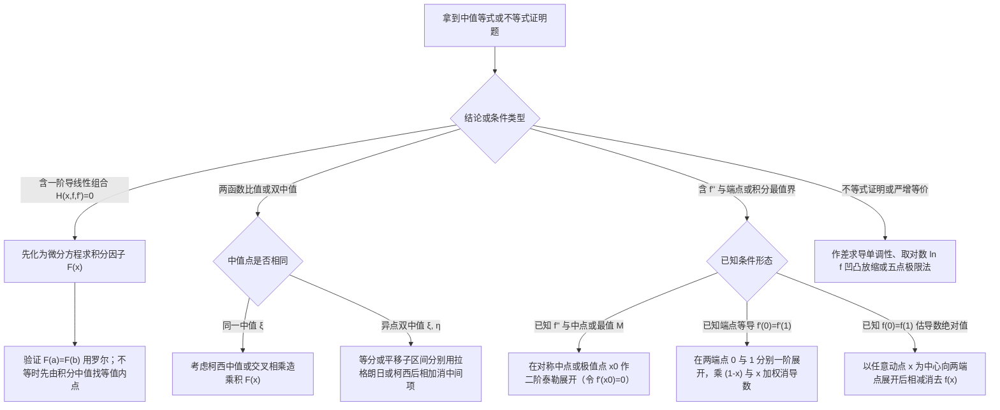

# 第6讲 一元函数微分学的应用（二）——中值定理、微分等式与微分不等式

本讲按数学二考纲范围，整合《基础30讲》《强化36讲》与《1000题》第 6 章内容，聚焦一元微分学在中值定理、等式与不等式证明中的应用：**四大中值定理条件与几何意义**、**泰勒中值定理（中点与端点加权展开）**、**辅助函数与方程实根分布**，以及**微分不等式证明三法**（单调性、泰勒余项放缩、凹凸切线/割线放缩）。题号“例”对应张宇强化讲义，“B”对应《1000题》强化篇第 6 章。

基础讲义对照：[[第6讲_讲义.pdf]]，PDF 第 1—18 页为知识讲解与例题，第 19—22 页为习题及解答。

---

> [!important] 近 17 年数二真题雷达（2010—2026｜A+ 级压轴证明高频区）
> - **考频画像**：近 17 年主考 **12 题**（2010—2014 共 3 题，2015—2026 共 9 题；近 6 年新大纲 **3 题连霸 T21 压轴**），另跨讲联动第 11 讲 `22-T21`（雷达共 **13 题**，解答题占 12 题），跨讲渗透 6 次。
> - **真题落点**：
>   - *2021—2026 新大纲（3 主考 + 1 联动）*：`23-T21(解)`、`24-T21(解)`、`25-T21(解)`（另 `22-T21(解)` 联动第 11 讲积分不等式）
>   - *2015—2020 经典（6 题）*：`15-T21(解)`、`17-T19(解)`、`18-T18(解)`、`19-T21(解)`、`20-T6(选)`、`20-T20(解)`
>   - *2010—2014 经典（3 题）*：`10-T21(解)`、`12-T20(解)`、`13-T18(解)`
> - **高频命题特点与破题要点**：
>   1. **泰勒展开成压轴主力**：`19-T21`（驻点 $x_0$ 二阶展开）、`23-T21`（第 1 问中点 $x=0$ 消 $f'(0)$，第 2 问绕极值点 $x_0$ 展开）、`24-T21`（端点 $0$ 与 $1$ 加权一阶展开消 $f'(0)=f'(1)$ 积分得 $\frac{1}{12}$）。
>   2. **辅助函数与异点双中值**：`10-T21`（构造 $f(x)-\frac{1}{3}x^3$ 在等分点 $x=\frac{1}{2}$ 两侧相加消中间项）、`13-T18`（奇函数 $f(0)=0$ + $f''+f'=1$ 造 $\mathrm{e}^x[f'(x)-1]$）、`20-T6`（$\mathrm{e}^{-x}f(x)$ 单调性）。
>   3. **回归分析本源（2025 反套路）**：`25-T21` 证 $f'$ 严格单增 $\iff$ 割线斜率严格递增——必要性用拉格朗日，**充分性禁用拉格朗日**，须取五点 $x_1<x_2<x_3<x_4<x_5$ 靠中间固定割线保住严格不等号。
> - **每日复习聚焦**：看 Part II 开头 Mermaid 决策树 + 中点/端点/驻点三大泰勒展开 + 辅助函数反推表 + `25-T21` 五点极限法。

---

## 第一部分｜知识点与核心结论

### 一、四大中值定理定理群与适用条件【🔥 必背｜停下来默背 1 遍】

**0. 介值定理的有限平均值形式**【📌 扫一眼｜确认“我还会”就过】
- 若 $f$ 在 $[a,b]$ 连续，且 $x_1,\dots,x_n\in[a,b]$，则存在 $\xi\in[a,b]$，使得
  $$
  f(\xi)=\frac{f(x_1)+\cdots+f(x_n)}{n}.
  $$
  证明：设 $m,M$ 为 $f$ 在该区间的最小值、最大值，平均值位于 $[m,M]$，由介值定理可取到。也可把区间缩小到这几个点中最小值与最大值所构成的区间。

**1. 费马引理与导数极值充分必要逻辑**【🔥 必背｜停下来默背 1 遍】
- **定理内容**：设函数 $f(x)$ 在点 $x_0$ 处满足：
  1. 在点 $x_0$ 的某邻域 $U(x_0)$ 内有定义；
  2. 在点 $x_0$ 处取得极值（极大值或极小值）；
  3. 在点 $x_0$ 处可导。
  则必有 $f'(x_0) = 0$。
- **几何本质**：可导函数在极值点处的切线必平行于 $x$ 轴（水平切线）。
- **极值与驻点的逻辑边界**：
  1. **必要非充分**：导数为零的点称为**驻点**。驻点未必是极值点（例如 $f(x) = x^3$ 在 $x=0$ 处 $f'(0)=0$，但单调递增，非极值点）。
  2. **内点与局部极值**：费马引理针对定义域**内点**处的局部极值。按常规定义，极值点要求完整双侧去心邻域，区间端点不讨论极值；即使按单侧邻域定义端点极值，端点单侧导数亦不必为零（例如 $f(x) = x$ 在 $[0, 1]$ 上的最大值点 $x=1$，$f'_-(1) = 1 \ne 0$）。
  3. **可导条件不可缺**：连续函数在极值点处可以不可导（例如 $f(x) = |x|$ 在 $x=0$ 处取极小值但不可导）。因此<mark>极值可疑点含驻点与不可导点</mark>。

**2. 罗尔定理及其核心特征**【🔥 必背｜停下来默背 1 遍】
- **定理内容**：设函数 $f(x)$ 满足以下三大条件：
  1. 在闭区间 $[a, b]$ 上连续；
  2. 在开区间 $(a, b)$ 内可导；
  3. 区间两端点函数值相等，即 $f(a) = f(b)$。
  则在开区间 $(a, b)$ 内至少存在一点 $\xi \in (a, b)$，使得 $f'(\xi) = 0$。
- **几何本质**：连接连续光滑曲线两端点的弦线若为水平线，则曲线内部至少存在一条与该弦线平行的水平切线（<mark>闭区间连续与开区间可导缺一不可</mark>）。
- **推广形式：端点极限相同**：若 $f$ 在开区间 $(a,b)$ 内可导，且两端单侧极限同为有限数，或同为 $+\infty$，或同为 $-\infty$，则存在 $\xi\in(a,b)$ 使 $f'(\xi)=0$；端点也可为无穷远。证明时可先取一个函数值偏离共同极限的内点，再在两侧选有限截点，使该内点的值严格高于或低于两个截点值，最后用极值定理与费马引理；常数函数情形直接成立。
- **三大条件缺一不可的反例辨析对照表**：

| 缺失或破坏的条件 | 具体反例函数与区间 | 破坏后果与结论失效原因 |
|---|---|---|
| 破坏闭区间连续性 | $f(x) = \begin{cases} x, & 0 \le x < 1 \\ 0, & x = 1 \end{cases}$ 在 $[0, 1]$ | $f(0)=f(1)=0$，但对任意 $x \in (0, 1)$ 均有 $f'(x) = 1 \ne 0$，无水平切线 |
| 破坏开区间可导性 | $f(x) = 1 - \vert x \vert$ 在 $[-1, 1]$ | $f(-1)=f(1)=0$，但在 $x=0$ 处不可导，区间内导数非 $1$ 即 $-1$，不存在 $f'(\xi)=0$ |
| 破坏两端点值相等 | $f(x) = x$ 在 $[0, 1]$ | 闭区间连续且开区间可导，但 $f(0)=0 \ne f(1)=1$，导数恒为 $1$，无零点 |

- **罗尔定理的核心推论**：
  1. 若可导函数 $f(x)$ 在区间上有 $n$ 个互异零点，则其导函数 $f'(x)$ 在该区间内至少有 $n-1$ 个零点。
  2. 推广到高阶：若函数 $f(x)$ 在闭区间上有 $n$ 个互异零点，且在区间内 $n-1$ 阶可导，则对任意 $1 \le k \le n-1$，$f^{(k)}(x)$ 在区间内至少有 $n-k$ 个零点；最高阶导数 $f^{(n-1)}(x)$ 在开区间内至少存在一个零点。
  3. 若 $f$ 在 $[a,b]$ 连续、$(a,b)$ 可导，且<mark>端点单侧导异号必存在内点驻点</mark>，即 $f'_+(a)f'_-(b)<0 \implies \exists\xi\in(a,b)$ 使 $f'(\xi)=0$。例如左端导数正、右端导数负时，两端均不是最大值点，最大值在内部取得，再用费马引理；反向情形考虑最小值。

**3. 拉格朗日中值定理与有限增量公式**【🔥⚡ 必背+避坑｜停下来默背 1 遍 + 精读 1 分钟】
- **定理内容**：设函数 $f(x)$ 满足：
  1. 在闭区间 $[a, b]$ 上连续；
  2. 在开区间 $(a, b)$ 内可导。
  则在开区间 $(a, b)$ 内至少存在一点 $\xi \in (a, b)$，使得：
  $$
  f(b) - f(a) = f'(\xi)(b - a) \iff \frac{f(b) - f(a)}{b - a} = f'(\xi).
  $$
- **有限增量形式**：令 $a = x_0, b = x_0 + \Delta x$，则增量可表示为：
  $$
  \Delta y = f(x_0 + \Delta x) - f(x_0) = f'(x_0 + \theta \Delta x)\Delta x,\qquad 0 < \theta < 1.
  $$
- **几何本质**：在光滑曲线上，至少存在一条切线与连接两端点的割线平行。拉格朗日中值定理是微分学联系“函数有限增量 $\Delta y$”与“局部导数变化率 $f'$”的唯一桥梁。
- **三大核心推论**：
  1. **恒常判定定理**：若在区间 $I$ 上 $f'(x) \equiv 0$，则 $f(x) \equiv C$（常数）。
  2. **单调性严格判定与充分必要条件**：若在区间 $I$ 上 $f'(x) \ge 0$，且等号仅在有限多个孤立点处成立，则函数 $f(x)$ 在 $I$ 上严格单调递增；其数学严格充要条件为：在区间 $I$ 上 $f'(x) \ge 0$ 且在任意非空子区间上均不恒为零。
  3. **导函数极限定理**：设 $f(x)$ 在 $[x_0, x_0 + \delta)$ 上连续，在 $(x_0, x_0 + \delta)$ 内可导。若极限 $\lim_{x \to x_0^+} f'(x) = A$ 存在，则右导数 $f'_+(x_0)$ 必存在且等于 $A$。
  4. **导数介值定理（达布定理 / Darboux 定理）**：若 $f(x)$ 在闭区间 $[a, b]$ 上可导，则<mark>导函数无须连续但必具介值性且无一类间断</mark>：对于严格介于 $f'_+(a)$ 与 $f'_-(b)$ 之间的任意实数 $\mu$，必存在 $\xi \in (a, b)$ 使得 $f'(\xi) = \mu$，故导函数绝不可能出现第一类间断点。
- `【⚡ 真题补丁｜2025-T21】` 割线斜率严格递增推 $f'$ 严格递增：<mark>充分性禁用拉格朗日改用五点极限法</mark>。
  - 必要性可在 $[x_1,x_2]$ 与 $[x_2,x_3]$ 上直接用拉格朗日中值定理证得；
  - 充分性禁用拉格朗日（中值点不可控），且不能直接对三点差商两端取极限（退化为 $\le$）；须在 $(x_1,x_5)$ 内插三点构成有序五点 $x_1<x_2<x_3<x_4<x_5$，写严格斜率链 $\frac{f(x_2)-f(x_1)}{x_2-x_1}<\frac{f(x_3)-f(x_1)}{x_3-x_1}<\frac{f(x_5)-f(x_3)}{x_5-x_3}<\frac{f(x_5)-f(x_4)}{x_5-x_4}$，令 $x_2\to x_1^+,\ x_4\to x_5^-$ 取极限并靠中间两段固定割线保住严格 $<$，得 $f'(x_1)<f'(x_5)$。

**4. 柯西中值定理与两函数导数商**【📌 扫一眼｜确认“我还会”就过】
- **定理内容**：设函数 $f(x)$ 和 $g(x)$ 满足：
  1. 在闭区间 $[a, b]$ 上均连续；
  2. 在开区间 $(a, b)$ 内均可导；
  3. 对任意 $x \in (a, b)$，均有 $g'(x) \ne 0$。
  则在开区间 $(a, b)$ 内至少存在一点 $\xi \in (a, b)$，使得：
  $$
  \frac{f(b) - f(a)}{g(b) - g(a)} = \frac{f'(\xi)}{g'(\xi)}.
  $$
- **几何本质**：在平面直角坐标系中，考虑由参数方程 $\begin{cases} x = g(t) \\ y = f(t) \end{cases}$ 定义的曲线，割线斜率 $\frac{f(b)-f(a)}{g(b)-g(a)}$ 必等于该参数曲线内部某点切线的斜率 $\frac{f'(\xi)}{g'(\xi)}$。
- **关键约束条件解析**：条件 $g'(x) \ne 0$ 具有双重使命：一方面由罗尔定理直接保证了分母增量 $g(b) - g(a) \ne 0$；另一方面保证了右侧导数之商的分母有意义。在具体解题应用中，必须显式核验该条件。

**5. 四大中值定理开闭区间条件与统一演化脉络对照表**【📌 扫一眼｜确认“我还会”就过】

| 定理名称 | 闭区间要求 | 开区间要求 | 附加条件 | 核心中值结论 | 适用题型与本质功能 |
|---|---|---|---|---|---|
| 费马引理 | 邻域内有定义 | 内点 $x_0$ 处可导 | $x_0$ 为局部极值点 | $f'(x_0) = 0$ | 驻点判别，证明内点导数为零 |
| 罗尔定理 | $[a, b]$ 连续 | $(a, b)$ 可导 | 端点相等 $f(a) = f(b)$ | $f'(\xi) = 0$ | 证明导数零点、方程实根、辅助函数求导 |
| 拉格朗日定理 | $[a, b]$ 连续 | $(a, b)$ 可导 | 无 | $\frac{f(b)-f(a)}{b-a} = f'(\xi)$ | 单函数差商化导数、有限增量放缩、导数极限定理 |
| 柯西定理 | $[a, b]$ 连续 | $(a, b)$ 可导 | 开区间内 $g'(x) \ne 0$ | $\frac{f(b)-f(a)}{g(b)-g(a)} = \frac{f'(\xi)}{g'(\xi)}$ | 两函数增量比值化导数商、变限积分除以幂函数 |

- **统一演化脉络**：
  - 特化方向（一般到特殊）：柯西中值定理 $\xrightarrow{g(x) = x}$ 拉格朗日中值定理 $\xrightarrow{f(a)=f(b)}$ 罗尔定理；
  - 证明依赖方向（底层到高层）：费马引理（结合最值定理）$\Longrightarrow$ 罗尔定理 $\Longrightarrow$ 拉格朗日中值定理 $\Longrightarrow$ 柯西中值定理。

---

### 二、泰勒中值定理与展开策略【🔥⚡ 必背+避坑｜停下来默背 1 遍 + 精读 1 分钟】

**1. 泰勒中值定理及其拉格朗日余项**【🔥 必背｜停下来默背 1 遍】
- **定理内容**：设函数 $f(x)$ 在含 $x_0$ 的闭区间上有 $n$ 阶连续导数，在开区间内具有 $n+1$ 阶导数，则对区间内任意 $x$，有：
  $$
  f(x) = f(x_0) + f'(x_0)(x - x_0) + \frac{f''(x_0)}{2!}(x - x_0)^2 + \dots + \frac{f^{(n)}(x_0)}{n!}(x - x_0)^n + R_n(x).
  $$
  其中拉格朗日余项为：
  $$
  R_n(x) = \frac{f^{(n+1)}(\xi)}{(n+1)!}(x - x_0)^{n+1},
  $$
  其中 $\xi$ 介于 $x_0$ 与 $x$ 之间。
- **两种余项的适用分工**：
  1. **佩亚诺余项 $o((x - x_0)^n)$**：局部定性刻画，仅用于求 $x \to x_0$ 的极限或确定无穷小阶数，不能用于全区间误差估计或不等式证明。
  2. **拉格朗日余项 $\frac{f^{(n+1)}(\xi)}{(n+1)!}(x - x_0)^{n+1}$**：全局定量刻画，中值点 $\xi$ 落在区间内部，<mark>不等式与中值估计必用拉格朗日余项</mark>，用于截断误差及配合介值性合成双中值。

**2. 中点展开对称消奇数次项策略**【🔥⚡ 必背+避坑｜停下来默背 1 遍 + 精读 1 分钟】
- **原理**：在对称区间 $[x_0 - h, x_0 + h]$ 上，以中心 $x_0$ 为展开点，分别在 $x_0 + h$ 和 $x_0 - h$ 处展开到二阶：
  $$
  f(x_0 + h) = f(x_0) + f'(x_0)h + \frac{1}{2}f''(\xi_1)h^2,\qquad \xi_1 \in (x_0, x_0 + h),
  $$
  $$
  f(x_0 - h) = f(x_0) - f'(x_0)h + \frac{1}{2}f''(\xi_2)h^2,\qquad \xi_2 \in (x_0 - h, x_0).
  $$
- **对称消项**：
  两式相加，一阶项 $f'(x_0)h$ 抵消：
  $$
  f(x_0 + h) + f(x_0 - h) - 2f(x_0) = \frac{h^2}{2}[f''(\xi_1) + f''(\xi_2)].
  $$
  由二阶导数的达布介值性，存在 $\xi \in (x_0 - h, x_0 + h)$ 使 $\frac{f''(\xi_1) + f''(\xi_2)}{2} = f''(\xi)$，从而得：
  $$
  \frac{f(x_0 + h) + f(x_0 - h) - 2f(x_0)}{h^2} = f''(\xi).
  $$
  据此可导出对称二阶差分商与二阶导数的关系及中点凸性判据。
- `【⚡ 真题补丁｜2023-T21】` 中点展开与驻点展开切换：<mark>证二阶导下界必绕极值点展开消一阶导</mark>。
  - 第 (1) 问以中点 $x=0$ 为展开中心消去 $f'(0)$ 并配合介值定理；第 (2) 问证明 $\lvert f''(\eta)\rvert$ 下界时若续在 $x=0$ 展开无法消去 $f'(0)$，须改绕极值点（驻点）$x_0$ 作二阶泰勒展开借 $f'(x_0)=0$ 消一阶项，再向较近端点展开得出下界。

**3. 端点展开加权消导数项策略**【🔥⚡ 必背+避坑｜停下来默背 1 遍 + 精读 1 分钟】
- **原理**：已知端点函数值（如 $f(0), f(1)$）及 $|f''(x)| \le M$，估计区间内任意动点 $x \in [0, 1]$ 的 $|f'(x)|$。
- **操作方式**：
  不在固定中点展开，而是**以任意动点 $x$ 为展开中心**，分别向两端点 $0$ 与 $1$ 作带拉格朗日余项的一阶泰勒展开：
  $$
  f(0) = f(x) - x f'(x) + \frac{1}{2}x^2 f''(\xi_1),\qquad \xi_1 \in (0, x),
  $$
  $$
  f(1) = f(x) + (1 - x)f'(x) + \frac{1}{2}(1 - x)^2 f''(\xi_2),\qquad \xi_2 \in (x, 1).
  $$
  两式相减消去未知的 $f(x)$：
  $$
  f(1) - f(0) = f'(x) + \frac{1}{2}\left[(1 - x)^2 f''(\xi_2) - x^2 f''(\xi_1)\right].
  $$
  解出 $f'(x)$：
  $$
  f'(x) = [f(1) - f(0)] - \frac{1}{2}(1 - x)^2 f''(\xi_2) + \frac{1}{2}x^2 f''(\xi_1).
  $$
  若 $f(0) = f(1)$，取绝对值并用三角不等式及 $x^2 + (1-x)^2 \le 1$，得全区间估计 $|f'(x)| \le \frac{M}{2}$（端点 $x=0, 1$ 处由导函数连续性取极限或单侧展开同样成立）。
- `【⚡ 真题补丁｜2024-T21】` 已知 $f'(0)=f'(1)$：<mark>双端点一阶展开按 1 减 x 与 x 加权消导</mark>。
  - 分别在端点 $0$ 与 $1$ 处展开 $f(x)=f(0)+f'(0)x+\frac{1}{2}f''(\xi_1)x^2$ 与 $f(x)=f(1)+f'(1)(x-1)+\frac{1}{2}f''(\xi_2)(x-1)^2$；
  - 两式分别乘以 $(1-x)$ 与 $x$ 相加，一阶导合并为 $x(1-x)[f'(0)-f'(1)]=0$ 抵消，余项放缩为 $\frac{1}{2}x(1-x)$，在 $[0,1]$ 积分即得 $\frac{1}{12}$。

**4. 常用函数麦克劳林展开公式速查（8大基石公式）**【🔥 必背｜停下来默背 1 遍】
- 在证明不等式与高阶导数估计中，以下 8 大带有拉格朗日余项（或佩亚诺余项）的公式是直接展开的基础：
  $$
  \frac{1}{1 - x} = 1 + x + x^2 + \dots + x^n + \frac{x^{n+1}}{(1 - \xi)^{n+2}},
  $$
  $$
  \frac{1}{1 + x} = 1 - x + x^2 - \dots + (-1)^n x^n + \frac{(-1)^{n+1}x^{n+1}}{(1 + \xi)^{n+2}},
  $$
  $$
  \mathrm{e}^x = 1 + x + \frac{x^2}{2!} + \dots + \frac{x^n}{n!} + \frac{\mathrm{e}^\xi}{(n+1)!}x^{n+1},
  $$
  $$
  \sin x = x - \frac{x^3}{3!} + \frac{x^5}{5!} - \dots + \frac{(-1)^{m-1}}{(2m-1)!}x^{2m-1} + \frac{\sin\left(\xi + \frac{2m+1}{2}\pi\right)}{(2m+1)!}x^{2m+1},
  $$
  $$
  \cos x = 1 - \frac{x^2}{2!} + \frac{x^4}{4!} - \dots + \frac{(-1)^m}{(2m)!}x^{2m} + \frac{\cos\left(\xi + \frac{2m+2}{2}\pi\right)}{(2m+2)!}x^{2m+2},
  $$
  $$
  \ln(1 + x) = x - \frac{x^2}{2} + \frac{x^3}{3} - \dots + \frac{(-1)^{n-1}}{n}x^n + \frac{(-1)^n}{(n+1)(1 + \xi)^{n+1}}x^{n+1},
  $$
  $$
  (1 + x)^\alpha = 1 + \alpha x + \frac{\alpha(\alpha - 1)}{2!}x^2 + \dots + \frac{\alpha(\alpha - 1)\dots(\alpha - n + 1)}{n!}x^n + \frac{\alpha(\alpha-1)\dots(\alpha-n)}{(n+1)!(1+\xi)^{n+1-\alpha}}x^{n+1},
  $$
  $$
  \arctan x = x - \frac{x^3}{3} + \frac{x^5}{5} - \dots + \frac{(-1)^{m-1}}{2m-1}x^{2m-1} + o(x^{2m}).
  $$

---

### 三、辅助函数构造法与导数逆运算法则【🔥 必背｜停下来默背 1 遍】

**1. 微分方程通解反求辅助函数法**【🔥 必背｜停下来默背 1 遍】
- **思路**：证明形如 $H(\xi, f(\xi), f'(\xi), \dots) = 0$ 的中值等式，<mark>中值点还原变量解微分方程构造辅助函数</mark>，由其通解恒等式构造 $F(x)$。
- **一阶线性型积分因子**（<mark>禁直接同除原函数须乘恒正指数因子</mark> `[真题·2013-T18 / 2015-T21 / 2017-T19 / 2020-T6]`）：
  若目标式移项后为 $f'(x) + P(x)f(x) = 0$：
  1. 两端同乘恒正积分因子 $\mu(x) = \mathrm{e}^{\int P(x)\mathrm{d}x}$：
     $$
     \mathrm{e}^{\int P(x)\mathrm{d}x}f'(x) + P(x)\mathrm{e}^{\int P(x)\mathrm{d}x}f(x) = \left[f(x)\mathrm{e}^{\int P(x)\mathrm{d}x}\right]' = 0.
     $$
  2. 设辅助函数：
     $$
     F(x) = f(x)\mathrm{e}^{\int_{x_0}^x P(t)\mathrm{d}t}.
     $$
  3. 求导验算：
     $$
     F'(x) = \mathrm{e}^{\int_{x_0}^x P(t)\mathrm{d}t}\left[f'(x) + P(x)f(x)\right].
     $$
     因 $\mathrm{e}^{\int P(t)\mathrm{d}t} > 0$ 恒成立，故 $F'(\xi) = 0 \iff f'(\xi) + P(\xi)f(\xi) = 0$。
- `【⚡ 真题补丁｜2020-T6】` 见 $f'(x)>f(x)>0$ 造积分因子 $g(x)=\mathrm{e}^{-x}f(x)$ 严格递增，<mark>两点比值下界即指数差</mark>。
  - 四选项全核验：由 $g'(x)=\mathrm{e}^{-x}[f'(x)-f(x)]>0$ 得 $g$ 严格递增（亦可用特例 $f(x)=\mathrm{e}^{2x}$ 秒验），故 $\frac{f(0)}{f(-1)}>\mathrm{e}^1$（**选 B**）；A 错（$f$ 增故 $\frac{f(-2)}{f(-1)}<1$）；C 错（应 $> \mathrm{e}^2$）；D 错（应 $> \mathrm{e}^3$）。

**2. 常见导数逆运算法则速查表**【🔥 必背｜停下来默背 1 遍】
- 考研数学二高频微分等式中，目标导数结构与辅助函数原型的对应关系如下表所示：

| 目标导数结构 / 微分等式特征 | 优先构造的辅助函数 $F(x)$ | 求导验算 $F'(x)$ 与等价逻辑 |
|---|---|---|
| $f'(x) + a f(x) = 0$ | $F(x) = \mathrm{e}^{ax} f(x)$ | $F'(x) = \mathrm{e}^{ax}[f'(x) + af(x)]$，指数因子恒非零 |
| $x f'(x) + n f(x) = 0$ | $F(x) = x^n f(x)$ | $F'(x) = x^{n-1}[xf'(x) + nf(x)]$，需 $x \ne 0$ |
| $x f'(x) - f(x) = 0$ | $F(x) = \frac{f(x)}{x}$ | $F'(x) = \frac{xf'(x) - f(x)}{x^2}$，商导数逆运算 |
| $f'(x)g(x) + f(x)g'(x) = 0$ | $F(x) = f(x)g(x)$ | $F'(x) = f'(x)g(x) + f(x)g'(x)$，乘积导数原型 |
| $f'(x)g(x) - f(x)g'(x) = 0$ | $F(x) = \frac{f(x)}{g(x)}$ | $F'(x) = \frac{f'(x)g(x) - f(x)g'(x)}{g^2(x)}$，需开区间内 $g(x) \ne 0$ |
| $f'(x) + f^2(x) = 0$ | $F(x) = f(x)\mathrm{e}^{\int_0^x f(t)\mathrm{d}t}$ | $F'(x) = \mathrm{e}^{\int_0^x f(t)\mathrm{d}t}[f'(x) + f^2(x)]$，复合指数积分因子 |
| $f'(x) + f(x)\tan x = 0$ | $F(x) = \frac{f(x)}{\cos x}$ | $F'(x) = \frac{f'(x)\cos x + f(x)\sin x}{\cos^2 x}$，需 $\cos x \ne 0$ |
| $f'(x) - f(x)\cot x = 0$ | $F(x) = \frac{f(x)}{\sin x}$ | $F'(x) = \frac{f'(x)\sin x - f(x)\cos x}{\sin^2 x}$，需 $\sin x \ne 0$ |
| $[f'(x)]^2 + f(x)f''(x) = 0$ | $F(x) = f(x)f'(x)$ | $F'(x) = [f'(x)]^2 + f(x)f''(x)$，两端积分即得 $\frac{1}{2}f^2$ 原函数 |
| $f(x)f''(x) - [f'(x)]^2 = 0$ | $F(x) = \frac{f'(x)}{f(x)} = [\ln f(x)]'$ | $F'(x) = \frac{f(x)f''(x) - [f'(x)]^2}{f^2(x)} = [\ln f(x)]''$ |

**3. 跨阶配凑与变限积分构造策略**【📌 扫一眼｜确认“我还会”就过】
- **隔代相见加减中间层（跨阶配凑法）**：
  若目标式出现跨阶相减（如 $f''(x) - f(x) = 0$ 或 $f'(x) - \int_0^x f(t)\mathrm{d}t = 0$），中间缺少一阶或零阶导数，采用“补齐中间层”：
  $$
  f'' - f = (f'' - f') + (f' - f).
  $$
  令 $u(x) = f'(x) - f(x)$，则目标式化为 $u'(x) + u(x) = 0$。由积分因子法，辅助函数构造为：
  $$
  F(x) = \mathrm{e}^x u(x) = \mathrm{e}^x [f'(x) - f(x)],\qquad F'(x) = \mathrm{e}^x [f''(x) - f(x)].
  $$
- **变限积分引入升阶法**：
  若已知条件含变上限积分 $\int_0^x f(t)\mathrm{d}t$，设 $I(x) = \int_0^x f(t)\mathrm{d}t$，则 $I'(x) = f(x), I''(x) = f'(x)$。<mark>证被积函数有 n 零点即证原函数有 n 加 1 零点</mark>。

---

### 四、方程根与导数零点分布理论【📌 扫一眼｜确认“我还会”就过】

**1. 零点定理与连续函数介值性**【🔥 必背｜停下来默背 1 遍】
- **零点定理**：设函数 $f(x)$ 在闭区间 $[a, b]$ 上连续，且端点异号即 $f(a)f(b) < 0$，则在开区间 $(a, b)$ 内至少存在一个实根 $\xi \in (a, b)$ 使得 $f(\xi) = 0$。
- **介值定理**：设 $f(x) \in C[a, b]$ 且最小值与最大值分别为 $m, M$，则对任意介于 $m$ 与 $M$ 之间的数 $C$，必存在 $\xi \in [a, b]$ 使得 $f(\xi) = C$。

**2. 罗尔定理推论与方程根数上界判定**【📌 扫一眼｜确认“我还会”就过】
- **根数上界定理**：设函数 $f(x)$ 在区间 $I$ 上 $n$ 阶可导。若在区间 $I$ 上 $f^{(n)}(x) \ne 0$ 恒成立，则方程 $f(x) = 0$ 在区间 $I$ 内**至多有 $n$ 个实根**。
- **反证法锁定唯一实根逻辑链**：
  要证明方程 $f(x) = 0$ 在区间 $I$ 内有且仅有一个实根，标准步骤为（<mark>存在性靠零点定理唯一性靠导数保号</mark>）：
  1. **存在性**：由零点定理或具体代入特殊点，证明至少存在一个实根 $x_0 \in I$；
  2. **唯一性**：反设存在两个不同实根 $x_1 < x_2$ 使得 $f(x_1) = f(x_2) = 0$。由罗尔定理，在 $(x_1, x_2)$ 内至少存在一点 $\xi$ 使得 $f'(\xi) = 0$。若已知在区间 $I$ 内 $f'(x) > 0$（或 $f'(x) < 0$）严格保号，则直接产生矛盾，从而唯一性得证。

**3. 极值点与单调区间分离根法**【📌 扫一眼｜确认“我还会”就过】
- **分离实根的实战步骤**：
  1. 求一阶导数 $f'(x)$，解方程 $f'(x) = 0$ 求出全部驻点，并找出不可导点，将定义域划分为若干严格单调子区间；
  2. 在每个单调子区间上，函数值严格单调变化，因此每个区间内**至多存在一个实根**；
  3. 计算各驻点处的极值以及区间端点（或极限值）的正负号：
     - 若单调区间两端点函数值同号，该区间内**无实根**；
     - 若单调区间两端点函数值异号，该区间内**恰有一个实根**。

**4. 含参方程实根存在性与参数分离法**【📌 扫一眼｜确认“我还会”就过】
- **参数分离标准范式**：
  对于含参数 $k$ 的方程 $F(x, k) = 0$：
  1. 将方程等价化简，将参数 $k$ 单独分离到等式一侧：$k = \varphi(x)$；
  2. 方程在区间 $I$ 内有实根 $\iff$ 水平直线 $y = k$ 与曲线 $y = \varphi(x)$ 在区间 $I$ 内有交点；
  3. 通过对 $\varphi(x)$ 求导，求出 $\varphi(x)$ 在区间 $I$ 上的极值、单调区间及边界极限，得出 $\varphi(x)$ 的严格**值域范围 $[\alpha, \beta]$**；
  4. 方程有根的充要条件即为：$k \in [\alpha, \beta]$；交点个数即为实根个数。

---

### 五、微分不等式证明三大通法【🔥⚡ 必背+避坑｜停下来默背 1 遍 + 精读 1 分钟】

**1. 求导利用单调性证明不等式（作差法）**【🔥 必背｜停下来默背 1 遍】
- **基本思路**：证明 $f(x) \ge g(x)$（$x \in [a, b]$）：
  1. **作差移项**：令辅助函数 $h(x) = f(x) - g(x)$；
  2. **锚定基准零点**：寻找基准点 $x_0$（通常为区间端点如 $x_0 = a$ 或 $x_0 = 0$），确认 $h(x_0) = 0$；
  3. **求导判符号**：<mark>基准点取零再看高阶导保号逐层反推</mark> `[真题·2012-T20]`（若一阶导不明显，连续求二阶、三阶导再逆推）。

**2. 泰勒公式余项放缩法**【🔥⚡ 必背+避坑｜停下来默背 1 遍 + 精读 1 分钟】
- **适用场景**：已知或易求高阶导数符号（如 $f''(x) \ge 0$），或待证不等式中含有多项式逼近结构。
- **切线不等式的泰勒本原**：
  若 $f''(x) \ge 0$ 恒成立，在任意点 $x_0$ 处作带拉格朗日余项的一阶泰勒展开：
  $$
  f(x) = f(x_0) + f'(x_0)(x - x_0) + \frac{1}{2}f''(\xi)(x - x_0)^2.
  $$
  由于余项 $\frac{1}{2}f''(\xi)(x - x_0)^2 \ge 0$，直接扔掉余项即得全局切线放缩不等式：
  $$
  f(x) \ge f(x_0) + f'(x_0)(x - x_0).
  $$
- **高阶放缩原则**：展开到题干所求多项式的最高次幂，余项符号若恒为正，直接丢弃余项得下界；若余项符号恒为负，直接丢弃余项得上界。

**3. 凹凸性切线与割线放缩法**【⚡ 避坑｜最值钱，必须精读 1 分钟】
- **凹凸性切线割线核心性质对照表**：

| 函数性态 | 充要导数条件 | 切线位置与放缩不等式 | 割线位置与放缩不等式 | 割线斜率单调性 |
|---|---|---|---|---|
| 下凸函数（凹向上） | $f''(x) > 0$ | <mark>下凸弧线恒在切线上方且在割线下方</mark>：$f(x) \ge f(x_0) + f'(x_0)(x - x_0)$ | $f((1-t)a + tb) \le (1-t)f(a) + tf(b)$ | 割线斜率随区间右移严格递增 |
| 上凹函数（凹向下） | $f''(x) < 0$ | 曲线在切线下方：$f(x) \le f(x_0) + f'(x_0)(x - x_0)$ | 曲线在割线上方：$f((1-t)a + tb) \ge (1-t)f(a) + tf(b)$ | 割线斜率随区间右移严格递减 |

- **全实轴凸函数有界必为常数定理（反证法经典模型）**：
  若 $f(x)$ 在 $\mathbb{R}$ 上满足 $f''(x) \ge 0$ 且 $|f(x)| \le M$ 有界，则 $f(x) \equiv C$。
  - **核心证法**：任取 $x_0$，由切线放缩 $f(x) \ge f(x_0) + f'(x_0)(x - x_0)$。<mark>倾斜切线无穷发散与有界性导出矛盾</mark>：若 $f'(x_0) \ne 0$，必在正或负无穷侧趋于 $+\infty$，迫使 $f'(x) \equiv 0 \implies f(x) \equiv C$。

---

## 第二部分｜题型体系与解题方法论

### 一、罗尔定理与函数零点存在性证明

| 题干特征 | 优先方法 | 真题印证与避坑 |
|---|---|---|
| 待证式为 $f'(\xi) + P(\xi)f(\xi) = 0$ 等一阶线性组合 | 一阶微分方程通解法求积分因子，构造 $F(x) = \mathrm{e}^{\int P} f$ 验算端点相等用罗尔 | `[真题·2013-T18 / 2015-T21 / 2017-T19]`；`13-T18` 造 $\mathrm{e}^x[f'(x)-1]$ |
| 待证式为两函数导数差商交叉相乘（如 $[g(b)-g]f' - [f-f(a)]g' = 0$） | 去分母移项，构造两端均为零的乘积辅助函数 $F(x) = [f(x)-f(a)][g(b)-g(x)]$ | `[真题·2018-T18]`；交叉相乘还原原函数后须显式核验分母非零 |
| 条件给积分等式 $\int_a^b f(x)w(x)\mathrm{d}x = 0$（权函数 $w(x) \ge 0$） | 带有非负权函数的推广积分第一中值定理化出内点零点 $f(\xi)=0$ | `[真题·2019-T21]`；<mark>推广积分中值权函数全区间不可变号</mark> |
| 条件给积分等式 $\int_0^\pi f(x)\mathrm{d}x = 0$ 与 $\int_0^\pi f(x)\cos x\mathrm{d}x = 0$ | 设变上限积分 $F(x) = \int_0^x f$，分部积分制造三个零点，两次罗尔定理 | 证 $f$ 有 $n$ 零点 $\to$ 证原函数 $F$ 有 $n+1$ 零点，防漏端点 $F(0)=0$ |
| 曲线与二次多项式抛物线有 3 个互异交点，证 $f''(\xi) = 2a$ | 作差设 $F(x) = f(x) - (ax^2+bx+c)$，在三零点间应用两次罗尔定理 | 经典高阶罗尔模型；注意逐次缩窄区间确保 $\xi_1 \ne \xi_2$ |
| 凸/凹函数割线斜率方程 $f'(x_n) = M/n$，证零点唯一性与极限 | 严格单调性保证导数单调，利用导数介值性定唯一根，单调有界收敛原理求极限 | 跨讲联动第 2 讲；导数无须连续，达布定理即保介值性 |
| 研究含参数方程实根个数（如 $ax - b\ln x = 0$） | 求导找驻点划分单调区间，由极值正负与两端极限分离实根个数 | `21-T4` 跨讲联动；必查定义域间断点（如 $x=0$ 或 $x=1$）防漏根 |
| 变限积分方程含对数项 $\int_1^x \frac{\sin t}{t}\mathrm{d}t = \ln x^2$ 根数讨论 | 作差求导，利用被积函数有界性判定导数恒负严格单调，代入特殊点定唯一实根 | 注意定义域 $x>0$ 与 $x<0$ 两支分别讨论，勿只看正半轴 |
| 参数方程曲线与水平线交点根数分析 | 参数求导 $\frac{\mathrm{d}y}{\mathrm{d}x} = \frac{y'(t)}{x'(t)}$ 找驻点判定极值，平移直线分类讨论 | 需同步核验 $x'(t)$ 符号判断曲线是否折返 |
| 含参数代数方程 $x - \arctan x = kx^3$ 在区间内有实根求 $k$ 范围 | 参变量分离为 $k = \varphi(x)$，求导分析 $\varphi(x)$ 极值与单调区间求得值域 | `21-T4`；分离变量除以 $x^3$ 前须单独检验 $x=0$ 是否为根 |
| 比值含三角方程 $\frac{\tan x}{x} = k$ 在开区间内有根 | 求导证明比值函数严格单调递增，开区间计算端点极限确定取值范围 | 严格区分开区间与闭区间端点处 $k$ 能否取等号 |

> [!tip] 核心提醒
> 1. 应用罗尔定理的关键在于构造两端等值的辅助函数（<mark>端点相等时才可直接用罗尔定理</mark>）；若端点值不等，须先借助积分中值定理或零点定理锁定等值内点。
> 2. 讨论方程根的个数或参数范围时，优先采用“参数分离法”将方程转化为 $k = \varphi(x)$ 求值域；若无法分离，则求导找全部极值点划分单调区间，在每个单调区间利用端点正负号分离实根。

> [!example]- 例6.1｜配凑指数积分因子辅助函数与罗尔定理
> - **【题目】**：设函数 $f(x)$ 在 $[0, 1]$ 上连续，在 $(0, 1)$ 内可导，$f(0) = f(1)$，且满足 $\int_0^1 f(x) \mathrm{d}x = 0$。证明：存在 $\xi \in (0, 1)$，使得 $f'(\xi) + f^2(\xi) = 0$。
> - **【为什么这么想】**：待证式为 $f'(\xi) + f^2(\xi) = 0$。若直接分离变量同除 $f^2$ 或改写为 $\frac{f'(x)}{f(x)} + f(x) = 0$，由于题设未保证 $f(x) \ne 0$，除法在零点处无意义。因此改用处处恒正的指数积分因子 $\mu(x) = \mathrm{e}^{\int_0^x f(t)\mathrm{d}t} > 0$，构造 $F(x) = f(x)\mathrm{e}^{\int_0^x f(t)\mathrm{d}t}$，求导得 $F'(x) = \mathrm{e}^{\int_0^x f(t)\mathrm{d}t}[f'(x) + f^2(x)]$。结合 $\int_0^1 f(x)\mathrm{d}x = 0$ 与 $f(0) = f(1)$ 得 $F(0) = F(1)$，由罗尔定理即证，全程避开除零问题。
> - **【完整解答】**：
>   构造辅助函数：
>   $$
>   F(x) = f(x)\mathrm{e}^{\int_0^x f(t)\mathrm{d}t}.
>   $$
>   因为 $f(x)$ 在 $[0, 1]$ 上连续，在 $(0, 1)$ 内可导，所以变上限积分 $\int_0^x f(t)\mathrm{d}t$ 可导，进而 $F(x)$ 在 $[0, 1]$ 上连续，在 $(0, 1)$ 内可导。
>   代入两端点值检验：
>   $$
>   F(0) = f(0)\mathrm{e}^0 = f(0),
>   $$
>   $$
>   F(1) = f(1)\mathrm{e}^{\int_0^1 f(t)\mathrm{d}t} = f(1)\mathrm{e}^0 = f(1).
>   $$
>   已知 $f(0) = f(1)$，故 $F(0) = F(1)$。
>   由罗尔定理，在开区间 $(0, 1)$ 内至少存在一点 $\xi \in (0, 1)$，使得 $F'(\xi) = 0$。
>   对 $F(x)$ 求导：
>   $$
>   F'(x) = f'(x)\mathrm{e}^{\int_0^x f(t)\mathrm{d}t} + f(x) \cdot f(x)\mathrm{e}^{\int_0^x f(t)\mathrm{d}t} = \mathrm{e}^{\int_0^x f(t)\mathrm{d}t}\left[f'(x) + f^2(x)\right].
>   $$
>   代入 $\xi$ 得：
>   $$
>   F'(\xi) = \mathrm{e}^{\int_0^\xi f(t)\mathrm{d}t}\left[f'(\xi) + f^2(\xi)\right] = 0.
>   $$
>   由于指数因子 $\mathrm{e}^{\int_0^\xi f(t)\mathrm{d}t} > 0$ 恒不为零，必有：
>   $$
>   f'(\xi) + f^2(\xi) = 0.
>   $$
> - **【复盘提醒】**：积分条件 $\int_0^1 f(x)\mathrm{d}x = 0$ 是保证辅助函数端点相等的关键锁钥。若目标式为 $f'(x) + k f^2(x) = 0$，对应的积分因子为 $\mathrm{e}^{k\int_0^x f(t)\mathrm{d}t}$，指数因子的严格恒正性保证了求导因式与原方程实根的精确等价。

> [!example]- 例6.2｜去分母交叉相乘构造两端为零乘积辅助函数
> - **【题目】**：已知函数 $f(x)$ 和 $g(x)$ 在 $[a, b]$ 上连续，在 $(a, b)$ 内可导，且对任意 $x \in (a, b)$ 均有 $g'(x) \ne 0$。证明：存在 $\xi \in (a, b)$，使得：
>   $$
>   \frac{f(\xi) - f(a)}{g(b) - g(\xi)} = \frac{f'(\xi)}{g'(\xi)}.
>   $$
> - **【为什么这么想】**：待证结论为分式比例式，两端点在中值式中交叉出现（左端含 $f(a)$ 和 $g(b)$，两端不在同一侧）。直接套用柯西中值定理会导致端点不对称。将等式去分母交叉相乘并移项：
>   $$
>   [g(b) - g(\xi)]f'(\xi) - [f(\xi) - f(a)]g'(\xi) = 0.
>   $$
>   观察其导数结构，左侧恰为两个二项式乘积 $[f(x) - f(a)][g(b) - g(x)]$ 的导数反演，代入端点发现 $F(a) = 0, F(b) = 0$ 完美闭合。
> - **【完整解答】**：
>   将目标等式移项去分母，等价转化为证明：
>   $$
>   [g(b) - g(\xi)]f'(\xi) - [f(\xi) - f(a)]g'(\xi) = 0.
>   $$
>   令辅助函数：
>   $$
>   F(x) = [f(x) - f(a)][g(b) - g(x)].
>   $$
>   因为 $f(x), g(x)$ 在 $[a, b]$ 上连续，在 $(a, b)$ 内可导，故 $F(x)$ 在 $[a, b]$ 上连续，在 $(a, b)$ 内可导。
>   代入端点检验：
>   $$
>   F(a) = [f(a) - f(a)][g(b) - g(a)] = 0,
>   $$
>   $$
>   F(b) = [f(b) - f(a)][g(b) - g(b)] = 0.
>   $$
>   满足 $F(a) = F(b) = 0$。
>   由罗尔定理，存在 $\xi \in (a, b)$，使得 $F'(\xi) = 0$。
>   对 $F(x)$ 求导：
>   $$
>   F'(x) = f'(x)[g(b) - g(x)] + [f(x) - f(a)][-g'(x)] = [g(b) - g(x)]f'(x) - [f(x) - f(a)]g'(x).
>   $$
>   故 $F'(\xi) = 0$ 即：
>   $$
>   [g(b) - g(\xi)]f'(\xi) - [f(\xi) - f(a)]g'(\xi) = 0.
>   $$
>   因为 $g'(x) \ne 0$，由罗尔定理 $g(b) - g(\xi) \ne 0$（否则在 $(\xi, b)$ 内将存在导数零点与 $g' \ne 0$ 矛盾），两端同除以 $[g(b) - g(\xi)]g'(\xi)$，即得：
>   $$
>   \frac{f(\xi) - f(a)}{g(b) - g(\xi)} = \frac{f'(\xi)}{g'(\xi)}.
>   $$
> - **【复盘提醒】**：见到分式结构且两端点不在同侧的中值等式，先交叉相乘化为乘积和差形式再反推原函数，避免盲目套柯西定理，同时核验分母非零。

> [!example]- 例6.3｜积分第一中值定理制造内点等值结合罗尔定理
> - **【题目】**：设 $f(x)$ 在 $[0, 1]$ 上连续，在 $(0, 1)$ 内可导，且满足 $f(1) = k \int_0^{\frac{1}{k}} x \mathrm{e}^{1-x} f(x) \mathrm{d}x \quad (k > 1)$。证明：至少存在一点 $\xi \in (0, 1)$，使得：
>   $$
>   f'(\xi) = (1 - \xi^{-1})f(\xi).
>   $$
> - **【为什么这么想】**：
>   1. 目标式移项为 $\xi f'(\xi) + (1 - \xi)f(\xi) = 0$。当 $x > 0$ 时，同除以 $x$ 得 $f'(x) + (\frac{1}{x} - 1)f(x) = 0$。
>   2. 积分因子为 $\mathrm{e}^{\int (\frac{1}{x} - 1)\mathrm{d}x} = x \mathrm{e}^{-x}$，故辅助函数原型为 $F(x) = x \mathrm{e}^{-x} f(x)$，或等价取 $G(x) = \frac{\mathrm{e}^x f(x)}{x}$。
>   3. 题设给出 $f(1)$ 与 $[0, 1/k]$ 上定积分的关系。由积分第一中值定理可将积分化为内点 $x_0 \in (0, 1/k)$ 的函数值，从而构成 $F(x_0) = F(1)$ 的罗尔条件。
> - **【完整解答】**：
>   对定积分使用积分第一中值定理：
>   因为被积函数连续，在区间 $[0, \frac{1}{k}]$ 上由积分中值定理，至少存在一点 $x_0 \in (0, \frac{1}{k})$，使得：
>   $$
>   \int_0^{\frac{1}{k}} x \mathrm{e}^{1-x} f(x) \mathrm{d}x = x_0 \mathrm{e}^{1 - x_0} f(x_0) \left(\frac{1}{k} - 0\right) = \frac{1}{k} x_0 \mathrm{e}^{1 - x_0} f(x_0).
>   $$
>   将此式代入题设条件：
>   $$
>   f(1) = k \cdot \left[\frac{1}{k} x_0 \mathrm{e}^{1 - x_0} f(x_0)\right] = x_0 \mathrm{e}^{1 - x_0} f(x_0).
>   $$
>   两端同除以 $\mathrm{e}$：
>   $$
>   \mathrm{e}^{-1} f(1) = x_0 \mathrm{e}^{-x_0} f(x_0) \implies 1 \cdot \mathrm{e}^{-1} f(1) = x_0 \mathrm{e}^{-x_0} f(x_0).
>   $$
>   构造辅助函数：
>   $$
>   F(x) = x \mathrm{e}^{-x} f(x).
>   $$
>   因为 $k > 1$，所以 $0 < x_0 < \frac{1}{k} < 1$，故区间 $[x_0, 1] \subset (0, 1]$。
>   函数 $F(x)$ 在 $[x_0, 1]$ 上连续，在 $(x_0, 1)$ 内可导，且：
>   $$
>   F(x_0) = x_0 \mathrm{e}^{-x_0} f(x_0) = 1 \cdot \mathrm{e}^{-1} f(1) = F(1).
>   $$
>   由罗尔定理，在开区间 $(x_0, 1) \subset (0, 1)$ 内至少存在一点 $\xi \in (x_0, 1)$，使得 $F'(\xi) = 0$。
>   计算导数：
>   $$
>   F'(x) = \mathrm{e}^{-x} f(x) - x \mathrm{e}^{-x} f(x) + x \mathrm{e}^{-x} f'(x) = \mathrm{e}^{-x}\left[x f'(x) + (1 - x)f(x)\right].
>   $$
>   代入 $\xi$ 且 $\mathrm{e}^{-\xi} \ne 0$：
>   $$
>   \xi f'(\xi) + (1 - \xi)f(\xi) = 0.
>   $$
>   因为 $\xi \in (x_0, 1)$ 故 $\xi > 0$，两端同除以 $\xi$：
>   $$
>   f'(\xi) = \frac{\xi - 1}{\xi}f(\xi) = (1 - \xi^{-1})f(\xi).
>   $$
> - **【复盘提醒】**：本题为“积分中值定理制造内点等值 + 微分方程通解构造辅助函数”的组合。遇到 $f(1) = k \int_0^{1/k} \dots$ 结构，先用积分中值定理将积分化为点值。

> [!example]- 例6.4｜构造双变限积分乘积辅助函数应用罗尔定理
> - **【题目】**：设正值函数 $f(x)$ 和 $g(x)$ 在 $[a, b]$ 上连续。证明：存在 $\xi \in (a, b)$，使得：
>   $$
>   \frac{f(\xi)}{g(\xi)} = \frac{\int_a^\xi f(x) \mathrm{d}x}{\int_\xi^b g(x) \mathrm{d}x}.
>   $$
> - **【为什么这么想】**：待证等式两端均为变限积分比值。去分母变形为：
>   $$
>   f(\xi)\int_\xi^b g(x) \mathrm{d}x - g(\xi)\int_a^\xi f(x) \mathrm{d}x = 0.
>   $$
>   两项分别对应变上限积分 $\int_a^x f$ 与变下限积分 $\int_x^b g$ 的求导结果 $f(x)$ 与 $-g(x)$。由乘积求导法则 $(\Phi \Psi)' = \Phi' \Psi + \Phi \Psi'$ 恰好得到该减号结构，且两端点代入均为零。
> - **【完整解答】**：
>   令辅助函数：
>   $$
>   F(x) = \left(\int_a^x f(t) \mathrm{d}t\right) \cdot \left(\int_x^b g(t) \mathrm{d}t\right).
>   $$
>   因为 $f(t), g(t)$ 在 $[a, b]$ 上连续，所以两变限积分在 $[a, b]$ 上连续且在 $(a, b)$ 内可导，故 $F(x)$ 在 $[a, b]$ 上连续，在 $(a, b)$ 内可导。
>   代入端点值：
>   $$
>   F(a) = \left(\int_a^a f(t) \mathrm{d}t\right) \cdot \left(\int_a^b g(t) \mathrm{d}t\right) = 0 \cdot \int_a^b g(t) \mathrm{d}t = 0,
>   $$
>   $$
>   F(b) = \left(\int_a^b f(t) \mathrm{d}t\right) \cdot \left(\int_b^b g(t) \mathrm{d}t\right) = \left(\int_a^b f(t) \mathrm{d}t\right) \cdot 0 = 0.
>   $$
>   因此 $F(a) = F(b) = 0$。
>   由罗尔定理，在开区间 $(a, b)$ 内至少存在一点 $\xi \in (a, b)$，使得 $F'(\xi) = 0$。
>   由变上限与变下限积分求导法则：
>   $$
>   F'(x) = f(x) \cdot \int_x^b g(t) \mathrm{d}t + \left(\int_a^x f(t) \mathrm{d}t\right) \cdot [-g(x)] = f(x)\int_x^b g(t) \mathrm{d}t - g(x)\int_a^x f(t) \mathrm{d}t.
>   $$
>   令 $F'(\xi) = 0$ 得：
>   $$
>   f(\xi)\int_\xi^b g(t) \mathrm{d}t = g(\xi)\int_a^\xi f(t) \mathrm{d}t.
>   $$
>   因为 $f(x) > 0, g(x) > 0$，且 $\xi \in (a, b)$，故 $\int_\xi^b g(t) \mathrm{d}t > 0$ 且 $g(\xi) > 0$。两端同除以 $g(\xi)\int_\xi^b g(t) \mathrm{d}t$，得证：
>   $$
>   \frac{f(\xi)}{g(\xi)} = \frac{\int_a^\xi f(x) \mathrm{d}x}{\int_\xi^b g(x) \mathrm{d}x}.
>   $$
> - **【复盘提醒】**：双变限积分乘积 $F(x) = \left(\int_a^x f\right)\left(\int_x^b g\right)$ 是考研数学处理“一端变上限、一端变下限”的经典模型，求导时注意变下限求导自带的负号。

> [!example]- 例6.5｜正权函数变号积分与推广积分第一中值定理
> - **【题目】**：证明：若 $f(x)$ 在 $[0, \frac{\pi}{2}]$ 上连续，且满足 $\int_0^{\frac{\pi}{2}} f(x) \cos x \mathrm{d}x = 0$，则存在 $\xi \in (0, \frac{\pi}{2})$，使得 $f(\xi) = 0$。
> - **【为什么这么想】**：积分等式中 $\cos x$ 在区间 $[0, \frac{\pi}{2}]$ 上严格非负且不恒为零，属于标准的“正权函数”。对于非负连续权函数，可直接套用推广的积分第一中值定理将连续函数 $f(x)$ 提至积分号外，从而立即断言内部零点的存在。
> - **【完整解答】**：
>   因为 $f(x)$ 与 $\cos x$ 在 $[0, \frac{\pi}{2}]$ 上连续，且在区间 $[0, \frac{\pi}{2}]$ 上权函数 $\cos x \ge 0$ 恒成立且不恒等于零。
>   由推广的积分第一中值定理，在开区间 $(0, \frac{\pi}{2})$ 内至少存在一点 $\xi \in (0, \frac{\pi}{2})$，使得：
>   $$
>   \int_0^{\frac{\pi}{2}} f(x) \cos x \mathrm{d}x = f(\xi) \int_0^{\frac{\pi}{2}} \cos x \mathrm{d}x.
>   $$
>   计算余弦函数的定积分：
>   $$
>   \int_0^{\frac{\pi}{2}} \cos x \mathrm{d}x = [\sin x]_0^{\frac{\pi}{2}} = 1 - 0 = 1 \ne 0.
>   $$
>   已知题设 $\int_0^{\frac{\pi}{2}} f(x) \cos x \mathrm{d}x = 0$，代入得：
>   $$
>   f(\xi) \cdot 1 = 0 \implies f(\xi) = 0.
>   $$
>   故在开区间 $(0, \frac{\pi}{2})$ 内至少存在一点 $\xi$，使得 $f(\xi) = 0$。
> - **【复盘提醒】**：使用推广积分第一中值定理 $\int_a^b f(x)g(x)\mathrm{d}x = f(\xi)\int_a^b g(x)\mathrm{d}x$ 时，前提必须严格核验“权函数 $g(x)$ 在闭区间上不变号”（同正或同负）。若权函数在区间内部变号，则不能直接使用，需分段或引入辅助函数分部积分。

> [!example]- 例6.6｜变限积分零点配合分部积分制造三个零点及分段罗尔
> - **【题目】**：设函数 $f(x)$ 在 $[0, \pi]$ 上连续，且满足 $\int_0^\pi f(x) \mathrm{d}x = 0$，$\int_0^\pi f(x) \cos x \mathrm{d}x = 0$。证明：在 $(0, \pi)$ 内至少存在两个不同的点 $\xi_1, \xi_2$，使得 $f(\xi_1) = f(\xi_2) = 0$。
> - **【为什么这么想】**：要证被积函数 $f(x)$ 有两个零点，由罗尔定理，其原函数（变限积分 $F(x) = \int_0^x f$）在区间内至少需要 3 个零点。已知 $F(0)=0$ 和 $F(\pi)=0$ 已提供两个零点，第 3 个零点必由第二个条件 $\int_0^\pi f(x)\cos x\mathrm{d}x = 0$ 给出。利用分部积分将 $f(x)\mathrm{d}x$ 换成 $\mathrm{d}F(x)$，将条件转化为 $\int_0^\pi F(x)\sin x\mathrm{d}x = 0$，由于 $\sin x > 0$，反证法立即迫使 $F(x)$ 在内部产生变号零点。
> - **【完整解答】**：
>   设变上限积分辅助函数：
>   $$
>   F(x) = \int_0^x f(t) \mathrm{d}t,\qquad x \in [0, \pi].
>   $$
>   因为 $f(x)$ 连续，所以 $F(x)$ 在 $[0, \pi]$ 上可导，且 $F'(x) = f(x)$。
>   由定义与题设第一条件：
>   $$
>   F(0) = 0,\qquad F(\pi) = \int_0^\pi f(t) \mathrm{d}t = 0.
>   $$
>   对题设第二个积分运用分部积分法：
>   $$
>   0 = \int_0^\pi f(x) \cos x \mathrm{d}x = \int_0^\pi \cos x \,\mathrm{d}F(x) = [F(x) \cos x]_0^\pi - \int_0^\pi F(x) (-\sin x) \mathrm{d}x.
>   $$
>   代入端点值 $F(0) = F(\pi) = 0$：
>   $$
>   [F(\pi)\cos\pi - F(0)\cos 0] + \int_0^\pi F(x) \sin x \mathrm{d}x = 0 \implies \int_0^\pi F(x) \sin x \mathrm{d}x = 0.
>   $$
>   在开区间 $(0, \pi)$ 内，$\sin x > 0$ 恒成立。
>   反设 $F(x)$ 在 $(0, \pi)$ 内无零点，由连续函数的介值性，$F(x)$ 必在 $(0, \pi)$ 内恒正或恒负。
>   若 $F(x) > 0$，则被积函数 $F(x)\sin x > 0$，定积分 $\int_0^\pi F(x)\sin x\mathrm{d}x > 0$，与等于零矛盾；
>   若 $F(x) < 0$，同理可得定积分严格小于零，亦矛盾。
>   因此，在开区间 $(0, \pi)$ 内至少存在一点 $x_0 \in (0, \pi)$，使得 $F(x_0) = 0$。
>   综上，函数 $F(x)$ 在 $[0, \pi]$ 上至少有三个互异的零点：$0 < x_0 < \pi$。
>   分别在闭区间 $[0, x_0]$ 和 $[x_0, \pi]$ 上对 $F(x)$ 应用罗尔定理：
>   1. 存在 $\xi_1 \in (0, x_0)$，使得 $F'(\xi_1) = f(\xi_1) = 0$；
>   2. 存在 $\xi_2 \in (x_0, \pi)$，使得 $F'(\xi_2) = f(\xi_2) = 0$。
>   由介值位置可知 $0 < \xi_1 < x_0 < \xi_2 < \pi$，两点互不相等，即在 $(0, \pi)$ 内至少存在两个不同的零点。
> - **【复盘提醒】**：证明 $f(x)$ 有 $n$ 个零点，等价于证明其原函数 $F(x)$ 有 $n+1$ 个零点。利用分部积分法将“正交积分条件”降阶为“变上限积分与保号函数的积分”，是考研数学中挖掘隐藏零点的最高频技巧。

> [!example]- B12｜构造多项式差函数与多次罗尔定理反求高阶导数
> - **【题目】**：设函数 $y = f(x)$ 在 $(\alpha, \beta)$ 内二阶可导，且其图像在区间内有三个不同点满足方程 $y = ax^2 + bx + c$。证明：存在 $\xi \in (\alpha, \beta)$，使得 $f''(\xi) = 2a$。
> - **【为什么这么想】**：题干给出曲线与二次抛物线相交于 3 个不同点。记交点横坐标为 $x_1 < x_2 < x_3$。两曲线相交即函数值相等，作差构建辅助函数 $F(x) = f(x) - (ax^2+bx+c)$，则 $F(x)$ 天然具有 3 个不同零点。对 $F(x)$ 连续两次使用罗尔定理，二阶导数项中二次项二次求导后即为常数 $2a$，立即锁定结论。
> - **【完整解答】**：
>   设三个不同交点的横坐标分别为 $x_1, x_2, x_3$，不妨设 $\alpha < x_1 < x_2 < x_3 < \beta$。
>   构造辅助函数：
>   $$
>   F(x) = f(x) - (ax^2 + bx + c).
>   $$
>   由题设，在三个交点处函数值相等，即：
>   $$
>   F(x_1) = F(x_2) = F(x_3) = 0.
>   $$
>   因为 $f(x)$ 在 $(\alpha, \beta)$ 内二阶可导，故 $F(x)$ 在 $(\alpha, \beta)$ 内二阶可导。
>   1. 在闭区间 $[x_1, x_2]$ 上，由于 $F(x_1) = F(x_2) = 0$，由罗尔定理，存在 $\eta_1 \in (x_1, x_2)$ 使得 $F'(\eta_1) = 0$；
>   2. 在闭区间 $[x_2, x_3]$ 上，由于 $F(x_2) = F(x_3) = 0$，由罗尔定理，存在 $\eta_2 \in (x_2, x_3)$ 使得 $F'(\eta_2) = 0$。
>   由分段区间位置可知 $\eta_1 < x_2 < \eta_2$，故 $\eta_1 \ne \eta_2$。
>   再对导函数 $F'(x)$ 在闭区间 $[\eta_1, \eta_2]$ 上应用罗尔定理：
>   存在 $\xi \in (\eta_1, \eta_2) \subset (\alpha, \beta)$，使得 $F''(\xi) = 0$。
>   对 $F(x)$ 求二阶导数：
>   $$
>   F''(x) = f''(x) - (ax^2 + bx + c)'' = f''(x) - 2a.
>   $$
>   代入 $\xi$ 得：
>   $$
>   F''(\xi) = f''(\xi) - 2a = 0 \implies f''(\xi) = 2a.
>   $$
> - **【复盘提醒】**：几何交点即为差函数的零点。$n+1$ 个交点可确定差函数的 $n+1$ 个零点，通过 $n$ 次连续应用罗尔定理，即可证明 $n$ 阶导数与参考曲线 $n$ 阶导数在某点相等。

> [!example]- B14｜凹函数割线斜率零点唯一性与极限中值分析
> - **【题目】**：设函数 $f(x)$ 在 $[0, 1]$ 上连续，且 $f(0) = f(1) = 0$，在 $(0, 1)$ 内二阶可导且满足 $f''(x) < 0$。记 $M = \max_{0 \le x \le 1} f(x)$。
>   (1) 证明：对任意正整数 $n$，存在唯一的 $x_n \in (0, 1)$，使得 $f'(x_n) = \frac{M}{n}$；
>   (2) 证明：数列极限 $\lim_{n \to \infty} x_n$ 存在，且 $\lim_{n \to \infty} f(x_n) = M$。
> - **【为什么这么想】**：
>   1. 条件 $f''(x) < 0$ 意味着一阶导数 $f'(x)$ 在 $(0, 1)$ 上严格单调递减（严格上凹）。严格单调性是保证方程根唯一的充分必要保障。
>   2. 两端为零且内点有最大值 $M > 0$，最大值点必为内点 $c \in (0, 1)$，此处驻点 $f'(c) = 0$。利用在 $[0, c]$ 上的拉格朗日中值定理找到一个大于 $M$ 的导数值，由导数介值性立即锁定 $x_n$ 的存在性与唯一性。
>   3. 随着 $n \to \infty$，$f'(x_n) = M/n \to 0$。由于导数单调，自变量必单调逼近驻点 $c$。
> - **【完整解答】**：
>   **(1) 证明存在性与唯一性**：
>   因为 $f(x)$ 在 $[0, 1]$ 上连续，由闭区间最值定理，$f(x)$ 在 $[0, 1]$ 上必能取得最大值 $M$。
>   若最大值在端点取得，则 $M = f(0) = f(1) = 0$，但由严格凹性 $f''(x) < 0$，弦线位于曲线下方，内部必有 $f(x) > 0$，故必存在内点 $c \in (0, 1)$ 使得 $f(c) = M > 0$。
>   由费马引理，内点极值点导数为零，即 $f'(c) = 0$。
>   在闭区间 $[0, c]$ 上对 $f(x)$ 应用拉格朗日中值定理：
>   存在 $u \in (0, c)$，使得：
>   $$
>   f'(u) = \frac{f(c) - f(0)}{c - 0} = \frac{M}{c}.
>   $$
>   因为 $0 < c < 1$，所以 $\frac{M}{c} > M \ge \frac{M}{n} > 0$。
>   又因为在 $(0, 1)$ 内 $f''(x) < 0$，所以导函数 $f'(x)$ 在 $(0, 1)$ 内严格单调递减。
>   在区间 $[u, c]$ 上，导函数取值满足：$f'(u) > \frac{M}{n} > 0 = f'(c)$。
>   由可导函数的导数介值性（或导函数连续），存在 $x_n \in (u, c) \subset (0, 1)$ 使得 $f'(x_n) = \frac{M}{n}$。
>   由于 $f'(x)$ 在 $(0, 1)$ 上严格单调递减，方程 $f'(x) = \frac{M}{n}$ 的解必然唯一。
>   **(2) 证明极限**：
>   对于任意正整数 $n$，因为 $\frac{M}{n} > \frac{M}{n+1} > 0 = f'(c)$，且 $f'(x)$ 严格单调递减，所以必须有：
>   $$
>   u < x_n < x_{n+1} < c.
>   $$
>   因此数列 $\{x_n\}$ 严格单调递增，且有上界 $c$。
>   由单调有界收敛准则，极限 $\lim_{n \to \infty} x_n = x^*$ 存在，且 $x^* \le c$。
>   假设 $x^* < c$。由导数单调性，对所有 $n$ 均有 $x_n \le x^* < c$，故 $f'(x_n) \ge f'(x^*) > f'(c) = 0$。
>   但已知 $f'(x_n) = \frac{M}{n} \to 0$ ($n \to \infty$)，取极限得 $0 \ge f'(x^*) > 0$，矛盾。
>   因此必须有 $x^* = c$，即 $\lim_{n \to \infty} x_n = c$。
>   由函数 $f(x)$ 在点 $c$ 处的连续性：
>   $$
>   \lim_{n \to \infty} f(x_n) = f\left(\lim_{n \to \infty} x_n\right) = f(c) = M.
>   $$
> - **【复盘提醒】**：凹函数 $f''(x) < 0$ 保证了导函数 $f'(x)$ 的“严格单调性”，这是断言方程实根“唯一性”的最强工具；在处理含 $n$ 的数列极限时，结合单调有界定理与反证法定出极限位置是标准套路。

> [!example]- 例6.17｜导数驻点与极值正负分离方程实根个数
> - **【题目】**：设函数 $f(x) = ax - b\ln x \quad (a > 0)$ 有 2 个零点，则 $\frac{b}{a}$ 的取值范围是（ ）.
>   (A) $(0, \mathrm{e})$ \qquad (B) $(\mathrm{e}, +\infty)$ \qquad (C) $(0, \frac{1}{\mathrm{e}})$ \qquad (D) $(\frac{1}{\mathrm{e}}, +\infty)$
> - **【为什么这么想】**：函数定义域为 $(0, +\infty)$。方程根的个数由函数的单调区间与极值符号唯一确定。对 $f(x)$ 求导，求出唯一点驻点，由极小值严格小于零且两端趋于正无穷，直接锁定实根个数恰为 2 的充要条件。
> - **【完整解答】**：
>   函数的定义域为 $(0, +\infty)$。求导：
>   $$
>   f'(x) = a - \frac{b}{x} = \frac{ax - b}{x}.
>   $$
>   1. 若 $b \le 0$，当 $x > 0$ 时 $ax - b > 0$，故 $f'(x) > 0$，函数 $f(x)$ 在 $(0, +\infty)$ 上严格单调递增，至多有 1 个零点，不合题意。
>   2. 若 $b > 0$，令 $f'(x) = 0$，解得唯一驻点：
>      $$
>      x_0 = \frac{b}{a} > 0.
>      $$
>      当 $0 < x < \frac{b}{a}$ 时，$f'(x) < 0$，$f(x)$ 严格单调递减；
>      当 $x > \frac{b}{a}$ 时，$f'(x) > 0$，$f(x)$ 严格单调递增。
>      因此，$x_0 = \frac{b}{a}$ 是函数 $f(x)$ 的唯一极小值点，亦为全区间的全局最小值点：
>      $$
>      f_{\min} = f\left(\frac{b}{a}\right) = a \cdot \frac{b}{a} - b \ln\left(\frac{b}{a}\right) = b\left[1 - \ln\left(\frac{b}{a}\right)\right].
>      $$
>   3. 要使函数在 $(0, +\infty)$ 内恰有 2 个零点，必须且仅需全局最小值严格小于零：
>      $$
>      f_{\min} < 0 \iff b\left[1 - \ln\left(\frac{b}{a}\right)\right] < 0.
>      $$
>      由于 $b > 0$，除以 $b$ 得：
>      $$
>      1 - \ln\left(\frac{b}{a}\right) < 0 \implies \ln\left(\frac{b}{a}\right) > 1 \implies \frac{b}{a} > \mathrm{e}.
>      $$
>   4. 检验端点极限：当 $\frac{b}{a} > \mathrm{e}$ 时，$\lim_{x \to 0^+} f(x) = +\infty$，$\lim_{x \to +\infty} f(x) = +\infty$。由零点定理，在区间 $(0, \frac{b}{a})$ 和 $(\frac{b}{a}, +\infty)$ 内各存在且仅存在 1 个零点，合计恰有 2 个零点。
>   故应选 (B)。
> - **【复盘提醒】**：讨论零点个数的标准范式：求导得驻点划分单调区间 $\to$ 计算极值点正负号 $\to$ 核验区间端点极限。若只有唯一极值，极值异号必对应双根。

> [!example]- 例6.18｜利用被积函数变号与分段积分估算确定零点个数
> - **【题目】**：设 $f(x)$ 在 $[0, \frac{3}{2}\pi]$ 上连续，在 $(0, \frac{3}{2}\pi)$ 内是函数 $\frac{\sin x}{x}$ 的一个原函数，且 $f(0) = 0$。
>   (1) 证明：$f(\frac{3}{2}\pi) > 0$；
>   (2) 求方程 $\int_1^x \frac{\sin t}{t} \mathrm{d}t = \ln x^2$ 的实根个数。
> - **【为什么这么想】**：
>   1. 第一问 $f(\frac{3}{2}\pi) = \int_0^{\frac{3}{2}\pi} \frac{\sin x}{x}\mathrm{d}x$。正弦函数在 $[0, \pi]$ 为正，在 $[\pi, \frac{3}{2}\pi]$ 为负。通过区间平移换元将负区间对称映射到前半段，利用分母 $x < x + \pi$ 产生放大效应作差证明严格大于零。
>   2. 第二问求方程实根个数。作差设辅助函数，观察导数 $\frac{\sin x - 2}{x}$，由 $\vert\sin x\vert \le 1$ 得导数恒负，从而严格单调，代入 $x=1$ 即得唯一实根。
> - **【完整解答】**：
>   **(1) 证明 $f(\frac{3}{2}\pi) > 0$**：
>   由原函数定义与连续性，$f(x) = \int_0^x \frac{\sin t}{t}\mathrm{d}t$。因此：
>   $$
>   f\left(\frac{3}{2}\pi\right) = \int_0^{\frac{3}{2}\pi} \frac{\sin x}{x}\mathrm{d}x = \int_0^\pi \frac{\sin x}{x}\mathrm{d}x + \int_\pi^{\frac{3}{2}\pi} \frac{\sin x}{x}\mathrm{d}x.
>   $$
>   对第二项积分作变量代换，令 $x = t + \pi$：
>   $$
>   \int_\pi^{\frac{3}{2}\pi} \frac{\sin x}{x}\mathrm{d}x = \int_0^{\frac{\pi}{2}} \frac{\sin(t + \pi)}{t + \pi}\mathrm{d}t = -\int_0^{\frac{\pi}{2}} \frac{\sin t}{t + \pi}\mathrm{d}t.
>   $$
>   将第一项积分拆分为 $[0, \frac{\pi}{2}]$ 与 $[\frac{\pi}{2}, \pi]$：
>   $$
>   \int_0^\pi \frac{\sin x}{x}\mathrm{d}x = \int_0^{\frac{\pi}{2}} \frac{\sin t}{t}\mathrm{d}t + \int_{\frac{\pi}{2}}^\pi \frac{\sin x}{x}\mathrm{d}x.
>   $$
>   由于当 $x \in (\frac{\pi}{2}, \pi)$ 时 $\sin x > 0$，故 $\int_{\frac{\pi}{2}}^\pi \frac{\sin x}{x}\mathrm{d}x > 0$。因此：
>   $$
>   f\left(\frac{3}{2}\pi\right) > \int_0^{\frac{\pi}{2}} \frac{\sin t}{t}\mathrm{d}t - \int_0^{\frac{\pi}{2}} \frac{\sin t}{t + \pi}\mathrm{d}t = \int_0^{\frac{\pi}{2}} \sin t \left(\frac{1}{t} - \frac{1}{t + \pi}\right)\mathrm{d}t.
>   $$
>   在开区间 $(0, \frac{\pi}{2})$ 内，$\sin t > 0$，且 $\frac{1}{t} - \frac{1}{t+\pi} = \frac{\pi}{t(t+\pi)} > 0$。
>   故被积函数处处严格大于零，定积分严格大于零，即得证 $f(\frac{3}{2}\pi) > 0$。
>   **(2) 求方程实根个数**：
>   方程定义域要求 $x^2 > 0 \iff x \ne 0$。又由积分上限 $x$，讨论 $x > 0$（当 $x < 0$ 时原积分非实数模型）。
>   整理方程为：
>   $$
>   \int_1^x \frac{\sin t}{t}\mathrm{d}t - 2\ln x = 0.
>   $$
>   设辅助函数：
>   $$
>   F(x) = \int_1^x \frac{\sin t}{t}\mathrm{d}t - 2\ln x,\qquad x \in (0, +\infty).
>   $$
>   对 $F(x)$ 求导：
>   $$
>   F'(x) = \frac{\sin x}{x} - \frac{2}{x} = \frac{\sin x - 2}{x}.
>   $$
>   因为对任意实数 $x$，恒有 $\sin x \le 1$，所以：
>   $$
>   \sin x - 2 \le 1 - 2 = -1 < 0.
>   $$
>   当 $x > 0$ 时，分母 $x > 0$，故 $F'(x) < 0$ 恒成立。
>   因此，函数 $F(x)$ 在 $(0, +\infty)$ 上严格单调递减。
>   代入特殊点 $x = 1$：
>   $$
>   F(1) = \int_1^1 \frac{\sin t}{t}\mathrm{d}t - 2\ln 1 = 0 - 0 = 0.
>   $$
>   因为 $F(x)$ 严格单调递减且 $F(1) = 0$，由严格单调性，方程在 $(0, +\infty)$ 内有且仅有一个实根 $x = 1$。
> - **【复盘提醒】**：判断正负交错周期被积函数的积分正负，常用区间平移折半抵消；数根题中若求导后分子可由有界性（如 $\sin x - 2 < 0$）定号，即可直接转化为单调性问题。

> [!example]- 例6.21｜参数方程求导判单调性与曲线极值交点分析
> - **【题目】**：设函数 $y = y(x)$ 由参数方程 $\begin{cases} x = \frac{1}{3}t^3 + t + \frac{1}{3}, \\ y = \frac{1}{3}t^3 - t + \frac{1}{3} \end{cases}$ 确定。
>   (1) 求函数 $y(x)$ 的极值；
>   (2) 若 $\begin{cases} u = x, \\ v = y + k \end{cases}$ 且 $v = v(u)$ 恰有一个零点，求常数 $k$ 的取值范围。
> - **【为什么这么想】**：
>   1. 第一问：考查参数方程求一阶导与二阶导确定极值。检验 $\frac{\mathrm{d}x}{\mathrm{d}t} = t^2 + 1 > 0$ 恒成立，保证反函数存在且处处单调，由一阶导等于零解驻点，二阶导符号判定极值类型。
>   2. 第二问：$v(u) = 0 \iff y(x) + k = 0 \iff y(x) = -k$。曲线恰有一个零点即水平直线 $y = -k$ 与曲线 $y(x)$ 恰有一个交点。利用第一问求得的极大值和极小值，直接画出函数形态并写出交点分离条件。
> - **【完整解答】**：
>   **(1) 求极值**：
>   计算导数：
>   $$
>   \frac{\mathrm{d}x}{\mathrm{d}t} = t^2 + 1 > 0,\qquad \frac{\mathrm{d}y}{\mathrm{d}t} = t^2 - 1.
>   $$
>   因为 $\frac{\mathrm{d}x}{\mathrm{d}t} > 0$ 恒成立，所以 $x(t)$ 严格单调递增，存在单值反函数 $t = t(x)$。
>   一阶导数为：
>   $$
>   \frac{\mathrm{d}y}{\mathrm{d}x} = \frac{\frac{\mathrm{d}y}{\mathrm{d}t}}{\frac{\mathrm{d}x}{\mathrm{d}t}} = \frac{t^2 - 1}{t^2 + 1}.
>   $$
>   令 $\frac{\mathrm{d}y}{\mathrm{d}x} = 0$，解得驻点对应参数：$t_1 = -1, t_2 = 1$。
>   计算二阶导数：
>   $$
>   \frac{\mathrm{d}^2y}{\mathrm{d}x^2} = \frac{\frac{\mathrm{d}}{\mathrm{d}t}\left(\frac{\mathrm{d}y}{\mathrm{d}x}\right)}{\frac{\mathrm{d}x}{\mathrm{d}t}} = \frac{\frac{2t(t^2 + 1) - (t^2 - 1)2t}{(t^2 + 1)^2}}{t^2 + 1} = \frac{4t}{(t^2 + 1)^3}.
>   $$
>   代入驻点判定极值：
>   - 当 $t = -1$ 时，$x(-1) = -\frac{1}{3} - 1 + \frac{1}{3} = -1$，$\left.\frac{\mathrm{d}^2y}{\mathrm{d}x^2}\right|_{t=-1} = \frac{-4}{8} = -\frac{1}{2} < 0$。
>     故在 $x = -1$ 处取得极大值：
>     $$
>     y_{\max} = y(-1) = -\frac{1}{3} - (-1) + \frac{1}{3} = 1.
>     $$
>   - 当 $t = 1$ 时，$x(1) = \frac{1}{3} + 1 + \frac{1}{3} = \frac{5}{3}$，$\left.\frac{\mathrm{d}^2y}{\mathrm{d}x^2}\right|_{t=1} = \frac{4}{8} = \frac{1}{2} > 0$。
>     故在 $x = \frac{5}{3}$ 处取得极小值：
>     $$
>     y_{\min} = y(1) = \frac{1}{3} - 1 + \frac{1}{3} = -\frac{1}{3}.
>     $$
>   **(2) 求 $k$ 的取值范围**：
>   方程 $v(u) = 0$ 等价于：
>   $$
>   y(x) + k = 0 \iff y(x) = -k.
>   $$
>   考察函数 $y(x)$ 的几何形态：
>   当 $t \to -\infty$ 时，$x \to -\infty, y \to -\infty$；
>   曲线从 $-\infty$ 严格递增至极大值点 $(-1, 1)$；
>   随后在区间 $[-1, \frac{5}{3}]$ 上严格递减至极小值点 $(\frac{5}{3}, -\frac{1}{3})$；
>   之后当 $t \to +\infty$ 时，$x \to +\infty, y \to +\infty$，曲线严格递增至 $+\infty$。
>   水平直线 $y = -k$ 与曲线 $y = y(x)$ 恰有一个交点的几何充要条件为：该直线高于极大值或低于极小值：
>   $$
>   -k > y_{\max} = 1  \quad \text{or} \quad  -k < y_{\min} = -\frac{1}{3}.
>   $$
>   解得：
>   $$
>   k < -1  \quad \text{or} \quad  k > \frac{1}{3}.
>   $$
> - **【复盘提醒】**：参数方程求二阶导数必须严格遵循商法则后再除以 $\frac{\mathrm{d}x}{\mathrm{d}t}$；第二问将新变量平移转化为直线 $y = -k$ 与极值的相对位置，是解析数根最清晰的数形结合途径。

> [!example]- B16｜参变量分离法与构造单调函数确定参数范围
> - **【题目】**：确定常数 $k$ 的取值范围，使方程 $x - \arctan x = kx^3$ 在区间 $(0, 1]$ 内有实根。
> - **【为什么这么想】**：方程含有参数 $k$ 且 $k$ 为一次形式。在区间 $(0, 1]$ 内，$x > 0$ 保证了 $x^3 \ne 0$，因此可以直接分离出参数 $k = \frac{x - \arctan x}{x^3}$。方程有实根等价于参数 $k$ 属于该函数在 $(0, 1]$ 上的值域。通过求导判定单调性并求端点极限与函数值即可。
> - **【完整解答】**：
>   当 $x \in (0, 1]$ 时，$x^3 > 0 \ne 0$，原方程等价变形为参数分离形式：
>   $$
>   k = \varphi(x) = \frac{x - \arctan x}{x^3},\qquad x \in (0, 1].
>   $$
>   对 $\varphi(x)$ 求导：
>   $$
>   \varphi'(x) = \frac{\left(1 - \frac{1}{1 + x^2}\right)x^3 - 3x^2(x - \arctan x)}{x^6} = \frac{\frac{x^5}{1 + x^2} - 3x^2(x - \arctan x)}{x^6} = \frac{\frac{x^3}{1 + x^2} - 3(x - \arctan x)}{x^4}.
>   $$
>   为判定分子符号，设辅助函数：
>   $$
>   h(x) = \frac{x^3}{1 + x^2} - 3x + 3\arctan x,\qquad x \in [0, 1].
>   $$
>   对 $h(x)$ 求导：
>   $$
>   h'(x) = \frac{3x^2(1 + x^2) - x^3(2x)}{(1 + x^2)^2} - 3 + \frac{3}{1 + x^2} = \frac{3x^2 + x^4}{(1 + x^2)^2} - \frac{3x^2}{1 + x^2} = \frac{3x^2 + x^4 - 3x^2(1 + x^2)}{(1 + x^2)^2} = \frac{-2x^4}{(1 + x^2)^2}.
>   $$
>   当 $x \in (0, 1]$ 时，$h'(x) < 0$ 恒成立。
>   因为 $h(0) = 0$，且 $h(x)$ 在 $[0, 1]$ 上严格单调递减，所以当 $x \in (0, 1]$ 时，恒有 $h(x) < h(0) = 0$。
>   因此，$\varphi'(x) = \frac{h(x)}{x^4} < 0$ 在 $(0, 1]$ 上恒成立。
>   故函数 $\varphi(x)$ 在区间 $(0, 1]$ 上严格单调递减。
>   计算端点值与左端极限：
>   - 在右端点 $x = 1$ 处：
>     $$
>     \varphi(1) = \frac{1 - \arctan 1}{1^3} = 1 - \frac{\pi}{4}.
>     $$
>   - 在左端点求 $x \to 0^+$ 时的极限，使用泰勒展开式 $\arctan x = x - \frac{x^3}{3} + o(x^3)$：
>     $$
>     \lim_{x \to 0^+} \varphi(x) = \lim_{x \to 0^+} \frac{x - \left(x - \frac{x^3}{3} + o(x^3)\right)}{x^3} = \lim_{x \to 0^+} \frac{\frac{1}{3}x^3 + o(x^3)}{x^3} = \frac{1}{3}.
>     $$
>   由函数严格单调递减性，$\varphi(x)$ 在半开区间 $(0, 1]$ 上的值域为：
>   $$
>   \left[1 - \frac{\pi}{4},\, \frac{1}{3}\right).
>   $$
>   因此，方程在 $(0, 1]$ 内有实根的充要条件是常数 $k$ 的取值范围为：
>   $$
>   1 - \frac{\pi}{4} \le k < \frac{1}{3}.
>   $$
> - **【复盘提醒】**：参数分离法是解决含参方程实根存在性的最高优先级方法。关键卡壳点在于求导后分子符号不直观时，必须果断进行“二次设辅助函数求导逆推”；左端点由于是开区间，取值只能无限趋近极限值而不可取等。

> [!example]- B17｜比值函数单调性求值域与开区间根的存在性
> - **【题目】**：设方程 $\frac{\tan x}{x} = k$ 在区间 $(0, \frac{\pi}{4})$ 内有实根，则常数 $k$ 的取值范围是（ ）.
>   (A) $0 < k < \frac{4}{\pi} - 1$ \qquad (B) $\frac{4}{\pi} - 1 < k < \frac{4}{\pi}$ \qquad (C) $1 < k < \frac{4}{\pi}$ \qquad (D) $\frac{4}{\pi} - 1 < k < 1$
> - **【为什么这么想】**：方程左端为比值函数 $f(x) = \frac{\tan x}{x}$。考查其在 $(0, \frac{\pi}{4})$ 上的单调性与值域：求导结合 $2x > \sin 2x$ 得严格单调递增，由两端极限即得 $k$ 的取值范围。
> - **【完整解答】**：
>   令 $f(x) = \frac{\tan x}{x}$，定义域为 $(0, \frac{\pi}{4})$。求导：
>   $$
>   f'(x) = \frac{x \sec^2 x - \tan x}{x^2} = \frac{\frac{x}{\cos^2 x} - \frac{\sin x}{\cos x}}{x^2} = \frac{x - \sin x \cos x}{x^2 \cos^2 x} = \frac{2x - \sin 2x}{2x^2 \cos^2 x}.
>   $$
>   当 $x \in (0, \frac{\pi}{4})$ 时，$2x \in (0, \frac{\pi}{2})$。由经典几何不等式知在第一象限正角大于正弦，即 $2x > \sin 2x$。
>   又因分母 $2x^2 \cos^2 x > 0$，所以 $f'(x) > 0$ 恒成立。
>   故函数 $f(x)$ 在开区间 $(0, \frac{\pi}{4})$ 上严格单调递增。
>   计算两端点的极限：
>   - 当 $x \to 0^+$ 时：
>     $$
>     \lim_{x \to 0^+} \frac{\tan x}{x} = 1.
>     $$
>   - 当 $x \to \frac{\pi}{4}^-$ 时：
>     $$
>     \lim_{x \to \frac{\pi}{4}^-} \frac{\tan x}{x} = \frac{\tan\frac{\pi}{4}}{\frac{\pi}{4}} = \frac{1}{\frac{\pi}{4}} = \frac{4}{\pi}.
>     $$
>   由严格单调性，$f(x)$ 在开区间 $(0, \frac{\pi}{4})$ 上的值域为 $(1, \frac{4}{\pi})$。
>   因此，方程在该开区间内有实根的充要条件为：
>   $$
>   1 < k < \frac{4}{\pi}.
>   $$
>   故应选 (C)。
> - **【复盘提醒】**：比值函数 $\frac{\tan x}{x}$ 在 $(0, \frac{\pi}{2})$ 上严格单调递增是必须熟练掌握的经典结论；注意原区间为开区间，端点极限值 $1$ 和 $\frac{4}{\pi}$ 均不可取等。

---

### 二、拉格朗日与柯西中值定理证明等式

| 题干特征 | 优先方法 | 真题印证与避坑 |
|---|---|---|
| 条件给导数极限 $\lim_{x \to x_0^+} f'(x) = A$，证明单侧导数 $f'_+(x_0) = A$ | 导数定义写出差商，分子用拉格朗日中值定理化为 $f'(\xi_x)$ 取夹逼极限 | 须先确认 $f$ 在 $x_0$ 右连续；注意逆命题不成立（如 $x^2\sin\frac{1}{x}$） |
| 赫尔德高阶连续条件 $\vert f(x) - f(y) \vert \le M\vert x - y \vert^\alpha$（$\alpha > 1$） | 差商模长绝对值由无穷小控制，夹逼得导数处处为零推常数 | 仅当 $\alpha>1$ 推常函数；$\alpha=1$ 仅推 Lipschitz 连续（如 $f(x)=x$） |
| 导数在无穷远处有正下界 $\lim_{x \to -\infty} f'(x) = A > 0$，求证函数发散 | 保号性设下界，在 $[x, X]$ 上拉格朗日有限增量放缩控制函数趋于负无穷 | 勿漏取定界点 $X$ 并严格说明 $x<X$ 时乘 $(x-X)<0$ 变号方向 |
| 最值点与端点零点界估计（$f(0)=f(2)=0$ 且 $\vert f(x) \vert \le M$） | 最值点向距离较近的端点应用拉格朗日中值定理，区间长度 $\le 1$ 推得 $\vert f'(\xi) \vert \ge M$ | `[真题·2023-T21]` 极值点距离折半思想同源；较近端点保证步长 $\le \frac{b-a}{2}$ |
| 异点双中值等式（如 $f'(\xi)+f'(\eta)=\xi^2+\eta^2$） | 移项同构后积分造 $F(x)=f(x)-\frac{x^3}{3}$，在等分点 $[0,\frac{1}{2}],[\frac{1}{2},1]$ 分别用拉格朗日相加 | `[真题·2010-T21]`（<mark>等分步长相等相加才可消去中间点</mark> $F(\frac{1}{2})$） |
| 积分中值内点参数方程 $f(x) - f(0) = x f'(\theta x)$，求 $\lim_{x \to 0^+} \theta$ | 将两端展开为麦克劳林展开式至显现首个非零摄动阶，对比系数代数求极限 | 禁机械背 $\theta\to\frac{1}{2}$；若首非零阶为 $n$ 次，极限为 $n^{-1/(n-1)}$ |
| 结论为端点平方差与定积分比值等于两点比（$\frac{b^2-a^2}{\int_a^b f} = \frac{2\xi}{f(\xi)}$） | 柯西中值定理，选取 $F(x) = x^2$ 与 $G(x) = \int_a^x f(t)\mathrm{d}t$ 对比导数商 | 须核验开区间内分母导数 $G'(x)=f(x)\ne 0$ |
| 变上限二次变限积分计算与中值式 $\int_1^\xi \sin t^2\mathrm{d}t = \xi(\cos 1 - 1)$ | 交换二重积分次序算出定积分值，取 $h(x) = x^2$ 结合柯西中值定理得出中值 | 联动第 14 讲换序；柯西分子分母务必成对还原原函数 |
| 判定函数极限存在与导数极限存在的逻辑充分必要关系 | 拉格朗日有限增量定理，高频反例：$\frac{\sin(x^2)}{x}$（导数振荡）、$x$（导数常数） | `[真题·2020-T6]`（<mark>已知导数线性不等式立刻乘指数因子</mark>，构造 $\mathrm{e}^{-x}f(x)$ 单调性） |
| 无穷远处 $\lim f(x)$ 与 $\lim f'(x)$ 均收敛推导导数必收敛于零 | 拉格朗日中值定理将 $f(x+1)-f(x)$ 转化为导数中值，两端取极限直接定为零 | 必用固定步长 $1$ 令 $\xi_x\in(x,x+1)\to+\infty$，禁无前提直接洛必达 |
| 积分方程阻尼衰减 $\lim_{x \to +\infty}[f(x) + f'(x)] = 0$，求 $\lim f(x)$ | 配指数积分因子构造 $\frac{\mathrm{e}^x f(x)}{\mathrm{e}^x}$，运用洛必达法则转化为已知极限 | 洛必达仅需分母 $\mathrm{e}^x\to+\infty$（$\frac{*}{\infty}$ 型），无须已知分子趋于无穷 |

> [!tip] 核心提醒
> 1. 拉格朗日与柯西中值定理的核心功效是“将离散的两点差商转化为局部的连续导数”；柯西中值定理本质上是拉格朗日定理在二维参数曲线上的推广，解题关键在于准确识别分子与分母各自对应的原函数。
> 2. 求中值内点参数 $\theta(x)$ 随自变量趋向端点的极限时，泰勒公式展开是唯一标准通用解法：两边展开至相同阶数，令同次幂系数相等直接求解。

> [!example]- 例6.9｜导数定义结合拉格朗日中值定理证明导数极限定理
> - **【题目】**：已知函数 $f(x)$ 在 $[x_0, x_0 + \delta)$ 上连续，在 $(x_0, x_0 + \delta)$ 内可导（$\delta > 0$）。证明：若极限 $\lim_{x \to x_0^+} f'(x) = A$ 存在，则右导数 $f'_+(x_0)$ 必存在且等于 $A$。
> - **【为什么这么想】**：待证目标为单侧导数 $f'_+(x_0)$，必须严格回到导数定义式 $\lim_{x \to x_0^+} \frac{f(x) - f(x_0)}{x - x_0}$。分子是同一函数在两点之间的增量，利用闭区间连续与开区间可导性，直接使用拉格朗日中值定理将其降阶为导函数 $f'(\xi_x)$，再利用自变量趋近时的夹逼准则取极限。
> - **【完整解答】**：
>   由单侧导数的定义：
>   $$
>   f'_+(x_0) = \lim_{x \to x_0^+} \frac{f(x) - f(x_0)}{x - x_0}.
>   $$
>   任取 $x \in (x_0, x_0 + \delta)$，由题设，$f(x)$ 在闭区间 $[x_0, x]$ 上连续，在开区间 $(x_0, x)$ 内可导。
>   由拉格朗日中值定理，存在 $\xi_x \in (x_0, x)$，使得：
>   $$
>   \frac{f(x) - f(x_0)}{x - x_0} = f'(\xi_x).
>   $$
>   因为 $x_0 < \xi_x < x$，当 $x \to x_0^+$ 时，由两边夹逼准则可知：
>   $$
>   \lim_{x \to x_0^+} \xi_x = x_0^+.
>   $$
>   又已知极限 $\lim_{t \to x_0^+} f'(t) = A$，由复合函数的极限运算法则：
>   $$
>   f'_+(x_0) = \lim_{x \to x_0^+} \frac{f(x) - f(x_0)}{x - x_0} = \lim_{x \to x_0^+} f'(\xi_x) = A.
>   $$
>   得证右导数存在且 $f'_+(x_0) = A$。
> - **【复盘提醒】**：导数极限定理是沟通“导函数极限”与“该点处导数”的核心桥梁。注意反命题不成立：$f'_+(x_0)$ 存在不能反推 $\lim_{x \to x_0^+} f'(x)$ 存在（经典反例 $f(x) = x^2\sin(1/x)$ 在原点处导数为零，但导函数在原点近旁振荡无极限）。

> [!example]- 例6.10｜高阶赫尔德连续条件推导导数处处为零判定常数
> - **【题目】**：设函数 $f(x)$ 在区间 $[a, b]$ 上满足条件：对任意 $x, y \in [a, b]$，均有：
>   $$
>   |f(x) - f(y)| \le M |x - y|^\alpha,
>   $$
>   其中常数 $M > 0$，$\alpha > 1$。证明：$f(x)$ 在区间 $[a, b]$ 上必为常数函数。
> - **【为什么这么想】**：证明可导函数为常数的最快策略是证明导函数恒为零（$f'(x) \equiv 0$）。直接从导数定义出发，写出差商的模长，代入已知不等式，由于方幂 $\alpha > 1$，差商被一个正方幂无穷小 $|x-y|^{\alpha-1}$ 控制，取极限后导数被夹逼为零。
> - **【完整解答】**：
>   在区间 $[a, b]$ 上任取一点 $x$。对于任意 $y \in [a, b]$ 且 $y \ne x$，考虑差商的绝对值：
>   $$
>   \left|\frac{f(y) - f(x)}{y - x}\right| = \frac{|f(y) - f(x)|}{|y - x|}.
>   $$
>   将题设不等式 $\vert f(x) - f(y) \vert \le M\vert x - y \vert^\alpha$ 代入上式分子：
>   $$
>   \left|\frac{f(y) - f(x)}{y - x}\right| \le \frac{M|y - x|^\alpha}{|y - x|} = M|y - x|^{\alpha - 1}.
>   $$
>   因为常数 $\alpha > 1$，所以指数 $\alpha - 1 > 0$。
>   当 $y \to x$ 时：
>   $$
>   \lim_{y \to x} M|y - x|^{\alpha - 1} = 0.
>   $$
>   由夹逼定理：
>   $$
>   \lim_{y \to x} \left|\frac{f(y) - f(x)}{y - x}\right| = 0 \iff \lim_{y \to x} \frac{f(y) - f(x)}{y - x} = 0.
>   $$
>   由导数定义，函数 $f(x)$ 在点 $x$ 处可导，且导数值满足：
>   $$
>   f'(x) = 0.
>   $$
>   由点 $x \in [a, b]$ 的任意性，在整个闭区间 $[a, b]$ 上导数处处恒等于零，即 $f'(x) \equiv 0$。
>   由拉格朗日中值定理推论（恒常定理），函数 $f(x)$ 在区间 $[a, b]$ 上必为常数函数。
> - **【复盘提醒】**：必须深刻辨析指数 $\alpha$ 的分界点：当 $\alpha = 1$ 时为标准的李普希茨条件（函数一致连续但未必定为常数，如 $f(x)=x$）；只有当 $\alpha > 1$ 时，差商才会被无穷小压迫为零，从而逼迫函数退化为常数。

> [!example]- 例6.11｜导数极限保号性与拉格朗日增量放缩证明极限
> - **【题目】**：已知函数 $f(x)$ 在 $(-\infty, 0)$ 上可导，且满足 $\lim_{x \to -\infty} f'(x) = A > 0$。证明：$\lim_{x \to -\infty} f(x) = -\infty$。
> - **【为什么这么想】**：已知导数在 $-\infty$ 处的极限为正实数 $A$。由极限保号性，在负无穷充分远处，导函数必然被某个正下界（如 $A/2$）控死。在任意点 $x$ 与该临界点之间使用拉格朗日中值定理，有限增量公式产生线性项 $\frac{A}{2}(x - X)$，当 $x \to -\infty$ 时线性项奔向 $-\infty$，通过单侧放缩证明极限发散。
> - **【完整解答】**：
>   因为 $\lim_{x \to -\infty} f'(x) = A > 0$，取正数 $\varepsilon = \frac{A}{2} > 0$。
>   由函数极限的保号性定义，存在常数 $X < 0$，使得当 $t < X$ 时，恒有：
>   $$
>   |f'(t) - A| < \frac{A}{2} \implies f'(t) > A - \frac{A}{2} = \frac{A}{2} > 0.
>   $$
>   对于任意满足 $x < X$ 的实数 $x$，函数 $f(t)$ 在闭区间 $[x, X]$ 上连续，在开区间 $(x, X)$ 内可导。
>   由拉格朗日中值定理，在 $(x, X)$ 内存在一点 $\xi \in (x, X)$，使得：
>   $$
>   f(X) - f(x) = f'(\xi)(X - x).
>   $$
>   因为 $\xi < X$，所以 $f'(\xi) > \frac{A}{2}$。又因为 $X - x > 0$，代入得：
>   $$
>   f(X) - f(x) > \frac{A}{2}(X - x).
>   $$
>   移项解出 $f(x)$ 的上界估计：
>   $$
>   f(x) < f(X) - \frac{A}{2}(X - x) = f(X) - \frac{A}{2}X + \frac{A}{2}x.
>   $$
>   上式中 $f(X)$ 和 $\frac{A}{2}X$ 均为确定的常数。
>   当 $x \to -\infty$ 时，因为 $\frac{A}{2} > 0$，所以：
>   $$
>   \lim_{x \to -\infty} \left[f(X) - \frac{A}{2}X + \frac{A}{2}x\right] = -\infty.
>   $$
>   由极限的比较判别法，必有：
>   $$
>   \lim_{x \to -\infty} f(x) = -\infty.
>   $$
> - **【复盘提醒】**：将定性极限转化为“固定实数下界”是分析证明题的标准开局；拉格朗日中值定理将无穷远处的导数下界转化为自变量差值的一次方放大，从而将求证发散转化为一次函数的无穷大。

> [!example]- 例6.12｜最值点与较近端点间拉格朗日中值定理及界估计
> - **【题目】**：设函数 $f(x)$ 在区间 $[0, 2]$ 上具有连续的一阶导数，且满足 $f(0) = f(2) = 0$。记 $M = \max_{x \in [0, 2]} |f(x)|$。
>   (1) 证明：存在 $\xi \in (0, 2)$，使得 $\vert f'(\xi) \vert \ge M$；
>   (2) 若对任意 $x \in (0, 2)$ 均有 $|f'(x)| \le M$，证明：必有 $M = 0$。
> - **【为什么这么想】**：
>   1. 第一问：若 $M = 0$，结论平凡。若 $M > 0$，最大绝对值必在内点 $x_0 \in (0, 2)$ 取得。该点将区间分成两段，其到较近端点的距离不超过 $1$。向较近端点使用拉格朗日中值定理，由于分母处到端点距离不超过 1，差商模长天然大于等于 $M$。
>   2. 第二问：若导数全区间不超过 $M$，由第一问可知最大值点只能是区间正中点 $x_0 = 1$。再通过构造差函数 $F(x) = f(x) - Mx$ 的单调性，推得曲线必须处处贴在斜率为 $M$ 的直线上，与端点极值驻点产生不可调和的矛盾，迫使 $M = 0$。
> - **【完整解答】**：
>   **(1) 证明存在 $\xi \in (0, 2)$ 使得 $\vert f'(\xi) \vert \ge M$**：
>   若 $M = 0$，则在 $[0, 2]$ 上恒有 $f(x) \equiv 0$，此时 $f'(x) \equiv 0$，任意 $\xi \in (0, 2)$ 均满足 $|f'(\xi)| = 0 \ge M$，结论自然成立。
>   若 $M > 0$，因为 $|f(x)|$ 在闭区间 $[0, 2]$ 上连续，必能取得最大值 $M$。
>   由于 $|f(0)| = |f(2)| = 0 < M$，故最大值必在开区间内某点 $x_0 \in (0, 2)$ 取得，即 $|f(x_0)| = M$。
>   - 若 $x_0 \in (0, 1)$：考查闭区间 $[0, x_0]$，区间长度 $x_0 - 0 = x_0 < 1$。
>     由拉格朗日中值定理，存在 $\xi_1 \in (0, x_0) \subset (0, 2)$，使得：
>     $$
>     |f'(\xi_1)| = \frac{|f(x_0) - f(0)|}{x_0 - 0} = \frac{M}{x_0} > \frac{M}{1} = M.
>     $$
>   - 若 $x_0 \in (1, 2)$：考查闭区间 $[x_0, 2]$，区间长度 $2 - x_0 < 1$。
>     由拉格朗日中值定理，存在 $\xi_2 \in (x_0, 2) \subset (0, 2)$，使得：
>     $$
>     |f'(\xi_2)| = \frac{|f(2) - f(x_0)|}{2 - x_0} = \frac{M}{2 - x_0} > \frac{M}{1} = M.
>     $$
>   - 若 $x_0 = 1$：考查闭区间 $[0, 1]$，区间长度为 $1$。
>     由拉格朗日中值定理，存在 $\xi_3 \in (0, 1) \subset (0, 2)$，使得：
>     $$
>     |f'(\xi_3)| = \frac{|f(1) - f(0)|}{1 - 0} = \frac{M}{1} = M.
>     $$
>   综合上述三种情形，在开区间 $(0, 2)$ 内必定存在某点 $\xi$，使得 $\vert f'(\xi) \vert \ge M$。
>   **(2) 证明 $M = 0$**：
>   已知对任意 $x \in (0, 2)$ 均有 $|f'(x)| \le M$。
>   结合第 (1) 问的结论，若 $M > 0$，则最大值点 $x_0$ 绝不可能落在 $(0, 1)$ 或 $(1, 2)$ 内（否则必会产生严格大于 $M$ 的导数点与已知矛盾）。
>   因此，最大值点只能是 $x_0 = 1$，且必有 $|f(1)| = M$。
>   不妨设 $f(1) = M > 0$（若 $f(1) = -M$，只需考察 $-f(x)$）：
>   因为在 $x = 1$ 处取得最大值且在内点可导，由费马引理：
>   $$
>   f'(1) = 0.
>   $$
>   考虑闭区间 $[0, 1]$。设辅助函数：
>   $$
>   F(x) = f(x) - Mx,\qquad x \in [0, 1].
>   $$
>   由题设，在 $(0, 1)$ 内 $f'(x) \le |f'(x)| \le M$，故：
>   $$
>   F'(x) = f'(x) - M \le 0.
>   $$
>   因此 $F(x)$ 在 $[0, 1]$ 上单调递减。
>   检验端点：$F(0) = f(0) - 0 = 0$，$F(1) = f(1) - M = M - M = 0$。
>   因为 $F(x)$ 单调递减且两端点函数值同为零，故在 $[0, 1]$ 上恒有：
>   $$
>   F(x) \equiv 0 \implies f(x) = Mx,\qquad x \in [0, 1].
>   $$
>   由此推得在 $x = 1$ 处的左导数：
>   $$
>   f'_-(1) = \lim_{x \to 1^-} \frac{f(x) - f(1)}{x - 1} = M.
>   $$
>   因为题设导数连续，左导数必等于该点导数 $f'(1) = M$。
>   但前文已由费马引理证明极值驻点 $f'(1) = 0$，因此：
>   $$
>   M = 0.
>   $$
>   与假设 $M > 0$ 产生矛盾，故必有 $M = 0$。
> - **【复盘提醒】**：双端点为零时，从最值点向较近端点作差商可保证区间长度 $\le \frac{b-a}{2}$；第 (2) 问由端点导数等于 $M$ 与内点驻点导数为 $0$ 的矛盾反证得出 $M=0$。

> [!example]- 例6.13｜中值定理内点参数精确求解与趋近极限
> - **【题目】**：已知函数 $f(x) = \mathrm{e}^x$。若对于任意 $x > 0$，均满足积分中值公式：
>   $$
>   \int_0^x f(t) \mathrm{d}t = x f(\theta x),\qquad 0 < \theta < 1.
>   $$
>   求极限：$\lim_{x \to 0^+} \theta$。
> - **【为什么这么想】**：直接将 $f(x) = \mathrm{e}^x$ 代入等式，左边积出为 $\mathrm{e}^x - 1$，右端为 $x\mathrm{e}^{\theta x}$。两边同时对 $x = 0$ 作麦克劳林展开，对比展开式中的主导项系数，直接解出参数 $\theta$ 并求极限。
> - **【完整解答】**：
>   将 $f(x) = \mathrm{e}^x$ 代入已知等式：
>   左边定积分直接积出：
>   $$
>   \int_0^x \mathrm{e}^t \mathrm{d}t = [\mathrm{e}^t]_0^x = \mathrm{e}^x - 1.
>   $$
>   等式即为：
>   $$
>   \mathrm{e}^x - 1 = x \mathrm{e}^{\theta x}.
>   $$
>   两边同除以 $x$（$x > 0$）：
>   $$
>   \mathrm{e}^{\theta x} = \frac{\mathrm{e}^x - 1}{x}.
>   $$
>   对等式两边在 $x \to 0^+$ 时取展开式：
>   左边麦克劳林展开：
>   $$
>   \mathrm{e}^{\theta x} = 1 + \theta x + o(x).
>   $$
>   右边将 $\mathrm{e}^x$ 展开到二阶：
>   $$
>   \frac{\mathrm{e}^x - 1}{x} = \frac{\left(1 + x + \frac{1}{2}x^2 + o(x^2)\right) - 1}{x} = 1 + \frac{1}{2}x + o(x).
>   $$
>   两端对比得：
>   $$
>   1 + \theta x + o(x) = 1 + \frac{1}{2}x + o(x).
>   $$
>   两端减去 $1$ 并同除以 $x$：
>   $$
>   \theta + \frac{o(x)}{x} = \frac{1}{2} + \frac{o(x)}{x}.
>   $$
>   令 $x \to 0^+$ 取极限，得：
>   $$
>   \lim_{x \to 0^+} \theta = \frac{1}{2}.
>   $$
> - **【复盘提醒】**：对于满足一般中值公式 $f(x) - f(0) = x f'(\theta x)$ 的二阶可导函数，只要 $f''(0) \ne 0$，其中值参数均有普遍结论 $\lim_{x \to 0^+} \theta = \frac{1}{2}$（几何直观：割线平行切线的位置在中点附近）。泰勒展开对比同次项系数是最快求解法。

> [!example]- 例6.14｜构造平方函数与变上限积分应用柯西中值定理
> - **【题目】**：设 $f(x)$ 在闭区间 $[a, b]$ 上连续，且 $f(x) > 0$（$0 < a < b$）。证明：存在 $\xi \in (a, b)$，使得：
>   $$
>   \frac{b^2 - a^2}{\int_a^b f(x) \mathrm{d}x} = \frac{2\xi}{f(\xi)}.
>   $$
> - **【为什么这么想】**：观察待证等式两端，左边是两端点值的差式比值：分子为 $b^2 - a^2$，分母为 $\int_a^b f(x)\mathrm{d}x - \int_a^a f(x)\mathrm{d}x$；右边则是两个函数在点 $\xi$ 处的导数比值：$(x^2)' = 2x$，$(\int_a^x f)' = f(x)$。这完全吻合柯西中值定理的标准形式 $\frac{F(b)-F(a)}{G(b)-G(a)} = \frac{F'(\xi)}{G'(\xi)}$。
> - **【完整解答】**：
>   定义两个辅助函数：
>   $$
>   F(x) = x^2,\qquad G(x) = \int_a^x f(t) \mathrm{d}t,\qquad x \in [a, b].
>   $$
>   核验柯西中值定理的适用条件：
>   1. 因为 $f(x)$ 在 $[a, b]$ 上连续，所以变上限积分 $G(x)$ 在 $[a, b]$ 上连续，在 $(a, b)$ 内可导；多项式函数 $F(x) = x^2$ 同样在 $[a, b]$ 上连续，在 $(a, b)$ 内可导；
>   2. 求导可得 $F'(x) = 2x$，$G'(x) = f(x)$；
>   3. 题设 $f(x) > 0$，故对任意 $x \in (a, b)$，分母导数 $G'(x) = f(x) \ne 0$ 恒成立。
>   由柯西中值定理，在开区间 $(a, b)$ 内至少存在一点 $\xi \in (a, b)$，使得：
>   $$
>   \frac{F(b) - F(a)}{G(b) - G(a)} = \frac{F'(\xi)}{G'(\xi)}.
>   $$
>   代入端点值与导数值：
>   $$
>   F(b) - F(a) = b^2 - a^2,
>   $$
>   $$
>   G(b) - G(a) = \int_a^b f(t) \mathrm{d}t - 0 = \int_a^b f(x) \mathrm{d}x,
>   $$
>   $$
>   F'(\xi) = 2\xi,\qquad G'(\xi) = f(\xi).
>   $$
>   代入即得：
>   $$
>   \frac{b^2 - a^2}{\int_a^b f(x) \mathrm{d}x} = \frac{2\xi}{f(\xi)}.
>   $$
> - **【复盘提醒】**：识别柯西中值定理看分子分母是否同为端点增量差。证明时须显式核验开区间内分母导数非零。

> [!example]- 例6.15｜二重变限积分计算与柯西中值定理构造
> - **【题目】**：设 $f(x) = \int_1^x \sin t^2 \mathrm{d}t$，$g(x) = \int_0^x f(t) \mathrm{d}t$。
>   (1) 计算定积分 $g(1)$ 的值；
>   (2) 证明：存在 $\xi \in (0, 1)$，使得 $\int_1^\xi \sin t^2 \mathrm{d}t = \xi(\cos 1 - 1)$。
> - **【为什么这么想】**：
>   1. 第一问：$g(1) = \int_0^1 \left(\int_1^x \sin t^2\mathrm{d}t\right)\mathrm{d}x$ 为累次积分。由于被积函数不便直接积出，交换积分次序将 $x$ 放在内层直接积出 $t$，再积分求得常数值。
>   2. 第二问：目标式移项为 $\frac{\int_1^\xi \sin t^2\mathrm{d}t}{2\xi} = \frac{1}{2}(\cos 1 - 1) = g(1) = \frac{g(1)-g(0)}{1-0}$。由分母 $2\xi = (x^2)'$ 选 $h(x) = x^2$ 与 $g(x)$ 联立柯西中值定理即可得证。
> - **【完整解答】**：
>   **(1) 计算 $g(1)$**：
>   由定义写出二次积分：
>   $$
>   g(1) = \int_0^1 f(x) \mathrm{d}x = \int_0^1 \mathrm{d}x \int_1^x \sin t^2 \mathrm{d}t = -\int_0^1 \mathrm{d}x \int_x^1 \sin t^2 \mathrm{d}t.
>   $$
>   积分区域为 $D = \{(x, t) \mid 0 \le x \le 1,\, x \le t \le 1\}$。
>   交换积分次序，先对 $x$ 积分：
>   $$
>   g(1) = -\int_0^1 \mathrm{d}t \int_0^t \sin t^2 \mathrm{d}x = -\int_0^1 t \sin t^2 \mathrm{d}t.
>   $$
>   凑微分直接积出：
>   $$
>   g(1) = \left[\frac{1}{2} \cos t^2\right]_0^1 = \frac{1}{2}(\cos 1 - \cos 0) = \frac{1}{2}(\cos 1 - 1).
>   $$
>   **(2) 证明中值等式**：
>   构造辅助函数 $h(x) = x^2$。考查 $g(x)$ 与 $h(x)$ 在闭区间 $[0, 1]$ 上的性质：
>   1. 因为 $f(x)$ 连续，所以 $g(x)$ 在 $[0, 1]$ 上连续可导，且 $g'(x) = f(x) = \int_1^x \sin t^2 \mathrm{d}t$；
>   2. $h(x) = x^2$ 在 $[0, 1]$ 上连续可导，且 $h'(x) = 2x$；
>   3. 当 $x \in (0, 1)$ 时，$h'(x) = 2x \ne 0$。
>   由柯西中值定理，在开区间 $(0, 1)$ 内至少存在一点 $\xi \in (0, 1)$，使得：
>   $$
>   \frac{g(1) - g(0)}{h(1) - h(0)} = \frac{g'(\xi)}{h'(\xi)}.
>   $$
>   代入已知端点值：$g(0) = 0$，$h(1) - h(0) = 1^2 - 0 = 1$；
>   由第 (1) 问知 $g(1) = \frac{1}{2}(\cos 1 - 1)$；
>   导数值 $g'(\xi) = \int_1^\xi \sin t^2\mathrm{d}t$，$h'(\xi) = 2\xi$。
>   代入柯西等式得：
>   $$
>   \frac{\frac{1}{2}(\cos 1 - 1)}{1} = \frac{\int_1^\xi \sin t^2 \mathrm{d}t}{2\xi}.
>   $$
>   两端同乘 $2\xi$ 整理即得证：
>   $$
>   \int_1^\xi \sin t^2 \mathrm{d}t = \xi(\cos 1 - 1).
>   $$
> - **【复盘提醒】**：本题将积分学中的“交换二次积分次序”与微分学中的“柯西中值定理”紧密结合。第二问中分母的 $2\xi$ 是联想到辅助函数 $h(x) = x^2$ 的最强破题指引。

> [!example]- B1｜函数极限与导数极限关联判定及拉格朗日反例辨析
> - **【题目】**：设函数 $f(x)$ 在 $(0, +\infty)$ 上可导。判断以下三个命题的真伪，并给出严谨证明或反例：
>   ① 若 $\lim_{x \to +\infty} f(x)$ 存在，则 $\lim_{x \to +\infty} f'(x)$ 存在；
>   ② 若 $\lim_{x \to +\infty} f'(x)$ 存在，则 $\lim_{x \to +\infty} f(x)$ 存在；
>   ③ 若 $\lim_{x \to +\infty} f'(x) = A$，则 $\lim_{x \to +\infty} [f(x+1) - f(x)] = A$。
> - **【为什么这么想】**：
>   1. 命题 ①：函数趋于常数时，曲线可以无限快速高频抖动，导数并不趋于零，典型反例为带有振荡因子的阻尼波。
>   2. 命题 ②：斜率趋于常数（如 $f'(x) \equiv 1$），函数可以直接线性发散至无穷大。
>   3. 命题 ③：差分 $f(x+1)-f(x)$ 是步长为 $1$ 的割线增量，直接套用拉格朗日中值定理化为单点导数 $f'(\xi_x)$，利用复合函数极限传递性证明。
> - **【完整解答】**：
>   - **命题 ① 为假（不成立）**：
>     构造经典反例：$f(x) = \frac{\sin(x^2)}{x}$。
>     当 $x \to +\infty$ 时，因为 $|\sin(x^2)| \le 1$，由无穷小乘有界量定理可知 $\lim_{x \to +\infty} f(x) = 0$ 存在。
>     但求导得：
>     $$
>     f'(x) = \frac{2x^2\cos(x^2) - \sin(x^2)}{x^2} = 2\cos(x^2) - \frac{\sin(x^2)}{x^2}.
>     $$
>     当 $x \to +\infty$ 时，第二项趋于零，而第一项 $2\cos(x^2)$ 在 $[-2, 2]$ 之间剧烈高频振荡，极限不存在。
>   - **命题 ② 为假（不成立）**：
>     构造简单反例：$f(x) = x$。
>     对任意 $x > 0$，导数 $f'(x) = 1$，极限 $\lim_{x \to +\infty} f'(x) = 1$ 存在。
>     但原函数 $\lim_{x \to +\infty} f(x) = \lim_{x \to +\infty} x = +\infty$，极限发散不存在。
>   - **命题 ③ 为真（成立）**：
>     对任意 $x > 0$，函数 $f(t)$ 在闭区间 $[x, x+1]$ 上连续，在开区间 $(x, x+1)$ 内可导。
>     由拉格朗日中值定理，存在 $\xi_x \in (x, x+1)$，使得：
>     $$
>     f(x+1) - f(x) = f'(\xi_x) \cdot [(x+1) - x] = f'(\xi_x).
>     $$
>     因为 $x < \xi_x < x+1$，当 $x \to +\infty$ 时，由夹逼准则直接推得 $\lim_{x \to +\infty} \xi_x = +\infty$。
>     已知 $\lim_{t \to +\infty} f'(t) = A$，由复合函数的极限运算法则：
>     $$
>     \lim_{x \to +\infty} [f(x+1) - f(x)] = \lim_{x \to +\infty} f'(\xi_x) = A.
>     $$
> - **【复盘提醒】**：导数极限与原函数极限的辨析常考两个反例：阻尼高频振荡 $f(x) = \frac{\sin(x^2)}{x}$（否定“原函数有极限推导数有极限”）；斜渐近线 $f(x) = x$（否定“导数有极限推原函数有极限”）。

> [!example]- B2｜无穷远处导数极限收敛性与微分方程阻尼衰减极限
> - **【题目】**：设函数 $f(x)$ 在 $(0, +\infty)$ 上可导。
>   (1) 若 $\lim_{x \to +\infty} f(x)$ 存在且 $\lim_{x \to +\infty} f'(x)$ 亦存在，证明：$\lim_{x \to +\infty} f'(x) = 0$；
>   (2) 若 $\lim_{x \to +\infty} [f(x) + f'(x)] = 0$，证明：必有 $\lim_{x \to +\infty} f(x) = 0$。
> - **【为什么这么想】**：
>   1. 第一问：设两极限分别为 $A$ 和 $B$。利用拉格朗日中值定理把增量 $f(x+1)-f(x)$ 写成 $f'(\xi_x)$。两边同时取无穷大极限，左端为 $A-A=0$，右端为 $B$，必然迫使 $B=0$。
>   2. 第二问：将 $f(x) + f'(x)$ 识别为带有一阶微分方程积分因子导数的结构。构造 $\frac{\mathrm{e}^x f(x)}{\mathrm{e}^x}$，分子分母同乘指数因子，运用洛必达法则转化为已知和式的极限。
> - **【完整解答】**：
>   **(1) 证明 $\lim_{x \to +\infty} f'(x) = 0$**：
>   设 $\lim_{x \to +\infty} f(x) = A$，$\lim_{x \to +\infty} f'(x) = B$（$A, B$ 均为有限实数）。
>   对任意 $x > 0$，函数 $f(t)$ 在闭区间 $[x, x+1]$ 上连续，在开区间 $(x, x+1)$ 内可导。
>   由拉格朗日中值定理，存在 $\xi_x \in (x, x+1)$，使得：
>   $$
>   f(x+1) - f(x) = f'(\xi_x).
>   $$
>   当 $x \to +\infty$ 时，等式左边的极限为：
>   $$
>   \lim_{x \to +\infty} [f(x+1) - f(x)] = \lim_{x \to +\infty} f(x+1) - \lim_{x \to +\infty} f(x) = A - A = 0.
>   $$
>   等式右边当 $x \to +\infty$ 时，因 $x < \xi_x < x+1$，故 $\xi_x \to +\infty$，从而：
>   $$
>   \lim_{x \to +\infty} f'(\xi_x) = \lim_{\xi \to +\infty} f'(\xi) = B.
>   $$
>   两端极限必然相等，故 $B = 0$，即 $\lim_{x \to +\infty} f'(x) = 0$。
>   **(2) 证明 $\lim_{x \to +\infty} f(x) = 0$**：
>   恒等变形将 $f(x)$ 改写为比值分式形式：
>   $$
>   f(x) = \frac{\mathrm{e}^x f(x)}{\mathrm{e}^x}.
>   $$
>   考查极限 $\lim_{x \to +\infty} \frac{\mathrm{e}^x f(x)}{\mathrm{e}^x}$：
>   分母 $\lim_{x \to +\infty} \mathrm{e}^x = +\infty$ 严格单调增加。
>   分别对分子分母关于 $x$ 求导：
>   分母导数为 $(\mathrm{e}^x)' = \mathrm{e}^x$；
>   分子导数为 $[\mathrm{e}^x f(x)]' = \mathrm{e}^x f(x) + \mathrm{e}^x f'(x) = \mathrm{e}^x[f(x) + f'(x)]$。
>   计算导数之商的极限：
>   $$
>   \lim_{x \to +\infty} \frac{[\mathrm{e}^x f(x)]'}{(\mathrm{e}^x)'} = \lim_{x \to +\infty} \frac{\mathrm{e}^x[f(x) + f'(x)]}{\mathrm{e}^x} = \lim_{x \to +\infty} [f(x) + f'(x)].
>   $$
>   已知题设 $\lim_{x \to +\infty} [f(x) + f'(x)] = 0$ 存在。
>   由洛必达法则（$\frac{*}{\infty}$ 型法则只要分母趋于无穷大即可应用），必有：
>   $$
>   \lim_{x \to +\infty} f(x) = \lim_{x \to +\infty} \frac{\mathrm{e}^x f(x)}{\mathrm{e}^x} = \lim_{x \to +\infty} \frac{[\mathrm{e}^x f(x)]'}{(\mathrm{e}^x)'} = 0.
>   $$
> - **【复盘提醒】**：第 (1) 问“函数与导数在无穷远处均收敛 $\implies$ 导数收敛于零”是客观题常见结论；第 (2) 问引入指数因子 $\frac{\mathrm{e}^x f(x)}{\mathrm{e}^x}$ 再用 $\frac{*}{\infty}$ 型洛必达法则，避免对 $f$ 的可积性作额外假设。

> [!example]- B10｜积分中值参数唯一性证明与高阶展开定极限
> - **【题目】**：设函数 $f(x) = \int_0^x \mathrm{e}^{t^2} \mathrm{d}t \quad (x \ge 0)$。
>   (1) 证明：对任意 $x > 0$，存在唯一的 $\theta(x) \in (0, 1)$，使得 $\int_0^x \mathrm{e}^{t^2} \mathrm{d}t = x f'[x\theta(x)]$；
>   (2) 计算极限：$\lim_{x \to 0^+} \theta(x)$。
> - **【为什么这么想】**：
>   1. 第一问：证明参数唯一性。利用导函数严格单调递增性（$f''(x) > 0$），保证了反函数的单值存在性，再结合拉格朗日中值定理在开区间内部直接锁定唯一中值参数。
>   2. 第二问：求中值点参数极限。将等式两边在 $x = 0$ 处展开到 $x^3$ 阶（积分展开与导数展开），对比展开式的主导项系数，解出 $\theta^2$ 的极限值后开方。
> - **【完整解答】**：
>   **(1) 证明存在性与唯一性**：
>   由变上限积分求导公式：
>   $$
>   f'(u) = \mathrm{e}^{u^2},\qquad u \ge 0.
>   $$
>   对 $f'(u)$ 再次求导：
>   $$
>   f''(u) = 2u\mathrm{e}^{u^2}.
>   $$
>   当 $u > 0$ 时，$f''(u) > 0$，因此导函数 $f'(u)$ 在 $[0, +\infty)$ 上是严格单调递增的。
>   由严格单调性，反函数 $(f')^{-1}$ 在其值域上单值存在。
>   对任意固定的 $x > 0$，函数 $f(t)$ 在闭区间 $[0, x]$ 上连续，在开区间 $(0, x)$ 内可导。
>   由拉格朗日中值定理：
>   $$
>   f(x) - f(0) = x f'(\xi),\qquad \xi \in (0, x).
>   $$
>   因为 $f(0) = \int_0^0 \mathrm{e}^{t^2}\mathrm{d}t = 0$，所以：
>   $$
>   \int_0^x \mathrm{e}^{t^2}\mathrm{d}t = x f'(\xi).
>   $$
>   因为 $\xi \in (0, x)$，记 $\theta = \frac{\xi}{x}$，则必有 $0 < \theta < 1$，且满足 $\xi = x\theta$。
>   代入即得 $\int_0^x \mathrm{e}^{t^2}\mathrm{d}t = x f'[x\theta]$。
>   又因为 $f'(u)$ 在 $(0, x)$ 上严格单调递增，故方程 $f'(u) = \frac{1}{x}\int_0^x \mathrm{e}^{t^2}\mathrm{d}t$ 的根 $u = \xi$ 必然唯一。
>   从而参数 $\theta(x) = \frac{\xi}{x}$ 具有唯一性。
>   **(2) 求极限 $\lim_{x \to 0^+} \theta(x)$**：
>   将已知等式两边在 $x \to 0^+$ 处进行泰勒展开：
>   被积函数展开：
>   $$
>   \mathrm{e}^{t^2} = 1 + t^2 + o(t^2).
>   $$
>   等式左边逐项积分展开：
>   $$
>   \int_0^x \mathrm{e}^{t^2}\mathrm{d}t = \int_0^x [1 + t^2 + o(t^2)]\mathrm{d}t = x + \frac{1}{3}x^3 + o(x^3).
>   $$
>   等式右边由 $f'(u) = \mathrm{e}^{u^2}$，代入 $u = x\theta$：
>   $$
>   x f'[x\theta] = x \mathrm{e}^{(x\theta)^2} = x\left[1 + (x\theta)^2 + o((x\theta)^2)\right] = x + \theta^2 x^3 + o(x^3).
>   $$
>   将两边展开式联立：
>   $$
>   x + \frac{1}{3}x^3 + o(x^3) = x + \theta^2 x^3 + o(x^3).
>   $$
>   两端消去首项 $x$，同除以 $x^3$（$x > 0$）：
>   $$
>   \frac{1}{3} + \frac{o(x^3)}{x^3} = \theta^2(x) + \frac{o(x^3)}{x^3}.
>   $$
>   令 $x \to 0^+$ 取极限：
>   $$
>   \lim_{x \to 0^+} \theta^2(x) = \frac{1}{3}.
>   $$
>   因为 $\theta(x) \in (0, 1)$ 恒取正值，两边开平方得：
>   $$
>   \lim_{x \to 0^+} \theta(x) = \frac{\sqrt{3}}{3}.
>   $$
> - **【复盘提醒】**：中值参数 $\theta(x)$ 的极限求解不能盲目套用微分中值定理的一般结论 $\frac{1}{2}$。当展开式中首个非零摄动项不是一次方而是二次方（如 $t^2$ 积分为 $\frac{1}{3}x^3$）时，系数比值往往对应 $\frac{1}{\sqrt{3}} = \frac{\sqrt{3}}{3}$，必须严格通过泰勒公式展开定量计算。

---

### 三、含双中值 $\xi, \eta$ 或多中值综合题

| 题干特征 | 优先方法 | 真题印证与避坑 |
|---|---|---|
| 条件给内点最值点，待证两问分别含一阶导与二阶导中值界（如 $f'(\xi)>2$ 与 $f''(\eta)<-4$） | 极值点拉格朗日化差商定一阶导界，费马引理驻点为中心作二阶泰勒展开定二阶导界 | `[真题易错·2019-T21]`、`[真题·2023-T21]`；第(2)问绕极值点 $x_0$ 展开，禁机械套中点 |
| 待证式为双中值导数平均值合一（$f(0)+f(2)-2f(1)=f''(\xi)$） | 在中点向左右两侧对称泰勒展开得双中值 $x_1, x_2$，利用导函数介值性（达布定理）合二为一 | `[真题·2023-T21]` 第(1)问同源；即使未给 $f''$ 连续，导函数达布介值性仍成立 |
| 条件给积分正负与单调性，构造辅助函数三点为零推高阶导零点 | 利用单调平移分段积分定常数正负，检验三零点 $F(-1)=F(0)=F(1)=0$，两次罗尔定理 | `[真题·2020-T20]` 同类变限构造；找齐三零点须明确给出两两不等顺序 |

> [!tip] 核心提醒
> 1. 求解含有双中值 $\xi, \eta$ 的综合题，关键在于“寻找区间的内部分割点（如对称中心、极值点或零点）”；<mark>一阶导归零后极值点最利二阶展开</mark>（`19-T21` 第 2 问须绕最大值点 $x_0$ 泰勒展开而非再套导数中值定理）。
> 2. 导函数即使不连续也必定满足介值性（达布定理）：两个中值的加权平均值 $\frac{1}{2}[f''(x_1) + f''(x_2)]$ 必落在两点导数值之间，可直接等价写为区间内某单一中值 $f''(\xi)$。

> [!example]- 例6.7｜内点极值费马引理与双中值泰勒展开二阶导数估计
> - **【题目】**：设函数 $f(x)$ 在 $[0, 1]$ 上二阶可导，$f(0) = 0$，且 $f(x)$ 在 $(0, 1)$ 内取得最大值 2，在 $(0, 1)$ 内取得最小值。证明：
>   (1) 存在 $\xi \in (0, 1)$，使得 $f'(\xi) > 2$；
>   (2) 存在 $\eta \in (0, 1)$，使得 $f''(\eta) < -4$。
> - **【为什么这么想】**：
>   1. 第一问：设最大值在内点 $x_1 \in (0, 1)$ 取得，$f(x_1) = 2$。连接端点 $(0, 0)$ 与 $(x_1, 2)$ 的割线斜率为 $\frac{2}{x_1}$。由于 $0 < x_1 < 1$，割线斜率天然严格大于 2。由拉格朗日中值定理，必存在一点导数等于该割线斜率，从而大于 2。
>   2. 第二问：由费马引理，极大值点必为驻点 $f'(x_1) = 0$。设最小值点为 $x_2 \in (0, 1)$，由于 $f(0)=0$，最小值必满足 $f(x_2) \le 0$。以驻点 $x_1$ 为中心作带拉格朗日余项的二阶泰勒展开，一阶导数项消失，直接将函数值跨度 $f(x_2) - f(x_1) \le -2$ 与二阶导数 $f''(\eta)$ 挂钩，结合自变量距离的平方上界 $(x_2 - x_1)^2 < 1$ 推出 $f''(\eta) < -4$。
> - **【完整解答】**：
>   **(1) 证明存在 $\xi \in (0, 1)$ 使得 $f'(\xi) > 2$**：
>   设函数 $f(x)$ 在点 $x_1 \in (0, 1)$ 处取得最大值，即：
>   $$
>   f(x_1) = 2.
>   $$
>   在闭区间 $[0, x_1]$ 上对 $f(x)$ 应用拉格朗日中值定理：
>   因为 $f(x)$ 在 $[0, x_1]$ 连续，在 $(0, x_1)$ 可导，存在 $\xi \in (0, x_1) \subset (0, 1)$，使得：
>   $$
>   f(x_1) - f(0) = f'(\xi)(x_1 - 0).
>   $$
>   代入已知端点值 $f(0) = 0, f(x_1) = 2$：
>   $$
>   2 - 0 = f'(\xi) \cdot x_1 \implies f'(\xi) = \frac{2}{x_1}.
>   $$
>   因为 $x_1 \in (0, 1)$，所以 $0 < x_1 < 1 \implies \frac{1}{x_1} > 1$。
>   因此：
>   $$
>   f'(\xi) = \frac{2}{x_1} > 2.
>   $$
>   **(2) 证明存在 $\eta \in (0, 1)$ 使得 $f''(\eta) < -4$**：
>   因为 $x_1 \in (0, 1)$ 是函数 $f(x)$ 在开区间内的极大值点，且 $f(x)$ 在该点可导，由费马引理：
>   $$
>   f'(x_1) = 0.
>   $$
>   设函数 $f(x)$ 在点 $x_2 \in (0, 1)$ 处取得最小值，记为 $m = f(x_2)$。
>   因为 $f(0) = 0$，且 $m$ 为全区间上的最小值，故必有：
>   $$
>   f(x_2) = m \le f(0) = 0.
>   $$
>   在点 $x = x_1$ 处将 $f(x)$ 作带拉格朗日余项的一阶泰勒展开：
>   $$
>   f(x) = f(x_1) + f'(x_1)(x - x_1) + \frac{f''(\eta)}{2!}(x - x_1)^2,
>   $$
>   其中 $\eta$ 介于 $x$ 与 $x_1$ 之间。
>   令 $x = x_2$，代入上式：
>   $$
>   f(x_2) = f(x_1) + f'(x_1)(x_2 - x_1) + \frac{1}{2}f''(\eta)(x_2 - x_1)^2.
>   $$
>   代入已知值 $f(x_1) = 2$，$f'(x_1) = 0$ 以及 $f(x_2) \le 0$：
>   $$
>   2 + 0 + \frac{1}{2}f''(\eta)(x_2 - x_1)^2 \le 0.
>   $$
>   移项得：
>   $$
>   \frac{1}{2}f''(\eta)(x_2 - x_1)^2 \le -2 \implies f''(\eta)(x_2 - x_1)^2 \le -4.
>   $$
>   因为 $x_1 \ne x_2$（若 $x_1 = x_2$，最大值与最小值重合则函数为常数 2，与 $f(0)=0$ 矛盾），且 $x_1, x_2 \in (0, 1)$，所以：
>   $$
>   0 < (x_2 - x_1)^2 < 1 \implies \frac{1}{(x_2 - x_1)^2} > 1.
>   $$
>   两端同除以严格正数 $(x_2 - x_1)^2$：
>   $$
>   f''(\eta) \le \frac{-4}{(x_2 - x_1)^2} < -4.
>   $$
>   故存在 $\eta \in (0, 1)$（$\eta$ 介于 $x_1$ 与 $x_2$ 之间），使得 $f''(\eta) < -4$。
> - **【复盘提醒】**：第 (2) 问是二阶泰勒展开估计导数界的典型模型。关键在于选定展开中心——极值点处一阶导数为零，以极大值点 $x_1$ 为中心展开可自然消去 $f'(x_1)$，直接沟通二阶导数与最值差。

> [!example]- 例6.22｜区间拆分与双子区间分别应用拉格朗日定理构造双中值
> - **【题目】**：设可导函数 $f(x)$ 在 $[-1, 1]$ 上严格单调递增，且满足 $\int_{-1}^1 f(x) \mathrm{d}x = 0$。记常数 $a = \int_0^1 f(x) \mathrm{d}x$。
>   (1) 证明：$a > 0$；
>   (2) 设辅助函数 $F(x) = a(1 - x^2) + \int_1^x f(t) \mathrm{d}t$，证明：在 $(-1, 1)$ 内至少存在一点 $\xi \in (-1, 1)$，使得 $F''(\xi) = 0$。
> - **【为什么这么想】**：
>   1. 第一问：证明定积分大于零。利用严格单调递增性，将负区间 $[-1, 0]$ 平移至 $[0, 1]$：$f(x-1) < f(x)$，两边积分得出对称区间前半段积分严格小于后半段，结合总积分为零即证 $a > 0$。
>   2. 第二问：待证为 $F''(\xi) = 0$。由罗尔定理，要证二阶导数有零点，只需证 $F'(x)$ 有 2 个零点，即原函数 $F(x)$ 有 3 个不同零点。检验 $F(-1), F(1)$ 与中点 $F(0)$，结合已知积分条件可得三点均为零。
> - **【完整解答】**：
>   **(1) 证明 $a > 0$**：
>   将积分区间拆分为两部分：
>   $$
>   \int_{-1}^1 f(x) \mathrm{d}x = \int_{-1}^0 f(x) \mathrm{d}x + \int_0^1 f(x) \mathrm{d}x.
>   $$
>   对第一项作平移换元，令 $x = t - 1$：
>   $$
>   \int_{-1}^0 f(x) \mathrm{d}x = \int_0^1 f(t - 1) \mathrm{d}t.
>   $$
>   因为 $f(x)$ 严格单调递增，对任意 $t \in (0, 1)$，恒有 $t - 1 < t$，从而：
>   $$
>   f(t - 1) < f(t).
>   $$
>   两边在 $[0, 1]$ 上积分：
>   $$
>   \int_0^1 f(t - 1) \mathrm{d}t < \int_0^1 f(t) \mathrm{d}t = a.
>   $$
>   代入总积分式：
>   $$
>   \int_{-1}^1 f(x) \mathrm{d}x = \int_0^1 f(t - 1) \mathrm{d}t + a < a + a = 2a.
>   $$
>   已知题设 $\int_{-1}^1 f(x)\mathrm{d}x = 0$，故：
>   $$
>   0 < 2a \implies a > 0.
>   $$
>   **(2) 证明存在 $\xi \in (-1, 1)$ 使得 $F''(\xi) = 0$**：
>   考察辅助函数 $F(x) = a(1 - x^2) + \int_1^x f(t) \mathrm{d}t$。
>   因为 $f(t)$ 可导，所以 $\int_1^x f(t)\mathrm{d}t$ 二阶可导，故 $F(x)$ 在 $[-1, 1]$ 上具有连续的二阶导数。
>   分别计算 $F(x)$ 在三个特殊点 $-1, 0, 1$ 处的函数值：
>   - 在 $x = 1$ 处：
>     $$
>     F(1) = a(1 - 1^2) + \int_1^1 f(t) \mathrm{d}t = 0 + 0 = 0.
>     $$
>   - 在 $x = -1$ 处：
>     $$
>     F(-1) = a(1 - (-1)^2) + \int_1^{-1} f(t) \mathrm{d}t = 0 - \int_{-1}^1 f(t) \mathrm{d}t = 0 - 0 = 0.
>     $$
>   - 在 $x = 0$ 处：
>     $$
>     F(0) = a(1 - 0) + \int_1^0 f(t) \mathrm{d}t = a - \int_0^1 f(t) \mathrm{d}t = a - a = 0.
>     $$
>   综上可知，函数 $F(x)$ 在闭区间 $[-1, 1]$ 上具有三个不同的零点：
>   $$
>   F(-1) = F(0) = F(1) = 0.
>   $$
>   对 $F(x)$ 分别在闭区间 $[-1, 0]$ 和 $[0, 1]$ 上应用罗尔定理：
>   1. 存在 $\xi_1 \in (-1, 0)$，使得 $F'(\xi_1) = 0$；
>   2. 存在 $\xi_2 \in (0, 1)$，使得 $F'(\xi_2) = 0$。
>   由子区间划分可知 $-1 < \xi_1 < 0 < \xi_2 < 1$，故 $\xi_1 \ne \xi_2$。
>   再对导函数 $F'(x)$ 在闭区间 $[\xi_1, \xi_2]$ 上应用罗尔定理：
>   存在 $\xi \in (\xi_1, \xi_2) \subset (-1, 1)$，使得：
>   $$
>   F''(\xi) = 0.
>   $$
> - **【复盘提醒】**：$a(1-x^2)$ 在 $x=\pm 1$ 处为零、在 $x=0$ 处等于 $a$，恰与 $\int_1^0 f = -a$ 抵消。证二阶导数零点时，常先找原函数的 3 个零点再分两步用罗尔定理。

> [!example]- 例6.8｜导数介值达布定理与两端泰勒展开双中值加权消项
> - **【题目】**：
>   (1) 设函数 $f(x)$ 在 $[a, b]$ 上可导。若 $f'_+(a) \ne f'_-(b)$，证明：对于任意介于 $f'_+(a)$ 与 $f'_-(b)$ 之间的实数 $\mu$，必存在 $\xi \in (a, b)$，使得 $f'(\xi) = \mu$（达布定理 / 导数介值定理）；
>   (2) 若函数 $f(x)$ 在 $[0, 2]$ 上具有二阶导数，证明：存在 $\xi \in (0, 2)$，使得：
>   $$
>   f(0) + f(2) - 2f(1) = f''(\xi).
>   $$
> - **【为什么这么想】**：
>   1. 第一问：达布定理证明。待证式为 $f'(\xi) - \mu = 0$，构造辅助函数 $F(x) = f(x) - \mu x$。由导数保号性，两端点均非最小值点，闭区间连续函数必在开区间内部取得最小值，由费马引理最小值点导数必为零。
>   2. 第二问：左侧 $f(0) + f(2) - 2f(1) = [f(0) - f(1)] + [f(2) - f(1)]$ 是以 $x = 1$ 为中心向两侧对称跨步的增量和。在 $x = 1$ 处向两侧作二阶泰勒展开，一阶导数抵消，得 $\frac{1}{2}[f''(x_1) + f''(x_2)]$，再由第 (1) 问的导函数介值性合成为单一中值 $f''(\xi)$。
> - **【完整解答】**：
>   **(1) 证明导数介值定理（达布定理）**：
>   因为 $f'_+(a) \ne f'_-(b)$，不妨设 $f'_+(a) < \mu < f'_-(b)$（反之同理）。
>   构造辅助函数：
>   $$
>   F(x) = f(x) - \mu x,\qquad x \in [a, b].
>   $$
>   因为 $f(x)$ 在 $[a, b]$ 上可导，所以 $F(x)$ 在 $[a, b]$ 上连续，在 $(a, b)$ 内可导。
>   计算端点单侧导数：
>   $$
>   F'_+(a) = f'_+(a) - \mu < 0,\qquad F'_-(b) = f'_-(b) - \mu > 0.
>   $$
>   由导数定义与极限保号性：
>   - 因为 $F'_+(a) = \lim_{x \to a^+} \frac{F(x) - F(a)}{x - a} < 0$，在 $a$ 的某右邻域内必有 $\frac{F(x) - F(a)}{x - a} < 0 \implies F(x) < F(a)$，故端点值 $F(a)$ 绝不是 $F(x)$ 在 $[a, b]$ 上的最小值；
>   - 因为 $F'_-(b) = \lim_{x \to b^-} \frac{F(x) - F(b)}{x - b} > 0$，在 $b$ 的某左邻域内必有 $\frac{F(x) - F(b)}{x - b} > 0 \implies F(x) < F(b)$（因 $x - b < 0$），故端点值 $F(b)$ 亦不是最小值。
>   由闭区间上连续函数的最值定理，$F(x)$ 在 $[a, b]$ 上必能取得最小值。
>   因为端点均不是最小值点，该最小值必然在开区间内部某点 $\xi \in (a, b)$ 取得。
>   由费马引理，内点极值点处导数必为零，即：
>   $$
>   F'(\xi) = 0 \implies f'(\xi) - \mu = 0 \implies f'(\xi) = \mu.
>   $$
>   **(2) 证明 $f(0) + f(2) - 2f(1) = f''(\xi)$**：
>   以 $x = 1$ 为展开中心，分别在端点 $x = 0$ 和 $x = 2$ 处作带拉格朗日余项的一阶泰勒展开：
>   $$
>   f(0) = f(1) + f'(1)(0 - 1) + \frac{1}{2}f''(x_1)(0 - 1)^2 = f(1) - f'(1) + \frac{1}{2}f''(x_1),\qquad x_1 \in (0, 1),
>   $$
>   $$
>   f(2) = f(1) + f'(1)(2 - 1) + \frac{1}{2}f''(x_2)(2 - 1)^2 = f(1) + f'(1) + \frac{1}{2}f''(x_2),\qquad x_2 \in (1, 2).
>   $$
>   将上述两式相加：
>   $$
>   f(0) + f(2) = 2f(1) + \frac{1}{2}f''(x_1) + \frac{1}{2}f''(x_2).
>   $$
>   移项整理：
>   $$
>   f(0) + f(2) - 2f(1) = \frac{f''(x_1) + f''(x_2)}{2}.
>   $$
>   令实数 $\mu = \frac{f''(x_1) + f''(x_2)}{2}$。
>   由实数性质，实数 $\mu$ 必介于 $f''(x_1)$ 与 $f''(x_2)$ 之间（若 $f''(x_1) = f''(x_2)$，则 $\mu = f''(x_1)$，取 $\xi = x_1$ 即可）。
>   因为 $f(x)$ 具有二阶导数，所以一阶导函数 $f'(x)$ 在闭区间 $[x_1, x_2] \subset (0, 2)$ 上可导。
>   由第 (1) 问证明的导数介值定理，对于介于导数值 $f''(x_1)$ 与 $f''(x_2)$ 之间的任意数 $\mu$，在开区间 $(x_1, x_2)$ 内必定存在一点 $\xi \in (x_1, x_2) \subset (0, 2)$，使得：
>   $$
>   (f')'(\xi) = f''(\xi) = \mu.
>   $$
>   将 $\mu = f''(\xi)$ 代回，即得证：
>   $$
>   f(0) + f(2) - 2f(1) = f''(\xi).
>   $$
> - **【复盘提醒】**：第 (1) 问为第 (2) 问的引理。泰勒展开相加得到两中值二阶导数的平均值时，不能不加说明直接写作 $f''(\xi)$，须显式援引二阶导函数的达布介值性。

---

### 四、泰勒公式展开证明不等式与高阶导数估计

| 题干特征 | 优先方法 | 真题印证与避坑 |
|---|---|---|
| 条件给两端点值及 $\vert f''(x) \vert \le M$，求全区间任意点导数界 $\vert f'(x) \vert \le C$ | 以任意动点 $x$ 为展开中心向端点 $0, 1$ 展开，相减消去 $f(x)$ 解出一阶导放缩 | `[真题·2024-T21]` 对偶模型；`24-T21` 为双端点 $0,1$ 展开加权 $(1-x),x$ 消 $f'(0)=f'(1)$ |
| 引入内点零点 $f(1/2)=0$，证严格不等式 $\vert f'(x) \vert < M/2$ | 罗尔定理在子区间得驻点，由驻点与动点距离严格小于半区间长排除等号 | `[真题·2015-T21 / 2019-T21]` 严格不等号模型；须单独排除取等条件 |
| 对称二阶差分中点不等式 $f(x) \le \frac{1}{2}[f(x+h)+f(x-h)] \iff f''(x) \ge 0$ | 必要性除 $h^2$ 取泰勒极限保号，充分性在两相邻子区间用拉格朗日与导数单调性 | `[真题·2022-T21]` 凹凸积分不等式同源；对称差分分母为 $h^2$ 而非 $2h$ |
| 条件给定积分 $\int_0^1 f(x)\mathrm{d}x = 0$ 与凹凸性，判中心点 $f(1/2)$ 符号 | 在 $x=1/2$ 处作切线放缩（一阶泰勒），全区间积分使一次导数项奇对称消零 | `18-T4`、`[真题·2022-T21]`；<mark>中点一阶切线积分后一次导奇对称消</mark> |

> [!tip] 核心提醒
> 1. 全区间导数上界估计常采用反向展开：以待求点 $x$ 为展开中心向两端点展开，两式相减消去未知项 $f(x)$。
> 2. 下凸函数（$f'' > 0$）在区间中点处的切线放缩经全区间积分后，一次项 $\int_a^b (x - \frac{a+b}{2})\mathrm{d}x = 0$ 自动消去，直接联系积分值与中点函数值。

> [!example]- 例6.16｜以任意点为展开中心向两端泰勒展开消项与导数估计
> - **【题目】**：设函数 $f(x)$ 在闭区间 $[0, 1]$ 上二阶可导，满足 $f(0) = f(1)$，且对任意 $x \in [0, 1]$ 均有 $|f''(x)| \le 2$。证明：对任意 $x \in [0, 1]$，恒有：
>   $$
>   |f'(x)| \le 1.
>   $$
> - **【为什么这么想】**：待证结论要求对区间内“每一个动点 $x$”均建立一阶导数界的估计。若在固定中点 $1/2$ 展开，无法直接获取任意动点 $x$ 处的导数。因此必须反向操作：以区间内部任意待求点 $x \in (0, 1)$ 为展开中心，分别向已知相等函数值的两端点 $0$ 和 $1$ 进行带拉格朗日余项的一阶泰勒展开。两式相减自然消去未知的零阶项 $f(x)$，解出一阶导数表达式后取模放缩。
> - **【完整解答】**：
>   任取点 $x \in (0, 1)$。以 $x$ 为展开中心，在端点 $0$ 与 $1$ 处分别应用带拉格朗日余项的一阶泰勒公式：
>   $$
>   f(0) = f(x) + f'(x)(0 - x) + \frac{1}{2}f''(\xi_1)(0 - x)^2 = f(x) - x f'(x) + \frac{1}{2}x^2 f''(\xi_1),
>   $$
>   其中 $\xi_1 \in (0, x)$；
>   $$
>   f(1) = f(x) + f'(x)(1 - x) + \frac{1}{2}f''(\xi_2)(1 - x)^2 = f(x) + (1 - x)f'(x) + \frac{1}{2}(1 - x)^2 f''(\xi_2),
>   $$
>   其中 $\xi_2 \in (x, 1)$。
>   将第二式减去第一式：
>   $$
>   f(1) - f(0) = f'(x) + \frac{1}{2}\left[(1 - x)^2 f''(\xi_2) - x^2 f''(\xi_1)\right].
>   $$
>   由题设 $f(0) = f(1)$，左端为零，移项解出 $f'(x)$：
>   $$
>   f'(x) = \frac{1}{2}\left[x^2 f''(\xi_1) - (1 - x)^2 f''(\xi_2)\right].
>   $$
>   两端取绝对值，应用三角不等式及已知条件 $|f''(t)| \le 2$：
>   $$
>   |f'(x)| \le \frac{1}{2}\left[x^2 |f''(\xi_1)| + (1 - x)^2 |f''(\xi_2)|\right] \le \frac{1}{2}\left[2x^2 + 2(1 - x)^2\right] = x^2 + (1 - x)^2.
>   $$
>   考查二次函数 $g(x) = x^2 + (1 - x)^2 = 2x^2 - 2x + 1$ 在闭区间 $[0, 1]$ 上的最值：
>   其对称轴为 $x = \frac{1}{2}$，开口向上，最大值必在端点取得：
>   $$
>   g(0) = 1,\qquad g(1) = 1,\qquad g\left(\frac{1}{2}\right) = \frac{1}{2}.
>   $$
>   故当 $x \in (0, 1)$ 时，恒有 $g(x) \le 1$。
>   由此推得，对任意 $x \in (0, 1)$，均有：
>   $$
>   |f'(x)| \le 1.
>   $$
>   端点补全核验：
>   - 在 $x = 0$ 处，将 $f(1)$ 在 $x = 0$ 处展开：$f(1) = f(0) + f'(0) \cdot 1 + \frac{1}{2}f''(\eta_1) \cdot 1^2$。因 $f(1)=f(0)$，得 $f'(0) = -\frac{1}{2}f''(\eta_1)$，故 $|f'(0)| \le \frac{1}{2} \cdot 2 = 1$；
>   - 在 $x = 1$ 处，将 $f(0)$ 在 $x = 1$ 处展开同理可得 $|f'(1)| \le 1$。
>   综上所述，对任意 $x \in [0, 1]$，均有 $|f'(x)| \le 1$。
> - **【复盘提醒】**：解题关键在于“设动点为中心消去零阶未知项”；二次多项式 $x^2 + (1-x)^2 \le 1$（对于 $x \in [0, 1]$）是考研中加权平方放缩的高频代数放缩项，需熟练掌握。

> [!example]- B7｜双端点泰勒展开对称相消与二阶导数最优界估计
> - **【题目】**：设函数 $f(x)$ 在闭区间 $[0, 1]$ 上二阶可导，满足 $\vert f''(x) \vert \le M$（$M > 0$），且 $f(0) = f(1) = 0$。证明：
>   (1) 对任意 $x \in [0, 1]$，均有 $|f'(x)| \le \frac{M}{2}$；
>   (2) 若再有 $f(\frac{1}{2}) = 0$，则对任意 $x \in [0, 1]$，严格不等式 $|f'(x)| < \frac{M}{2}$ 成立。
> - **【为什么这么想】**：
>   1. 第一问：与例6.16同构，以任意点 $x$ 为展开中心向端点 0 和 1 展开，相减消去 $f(x)$，利用二次多项式 $x^2 + (1-x)^2 \le 1$ 直接推出非严格不等式 $|f'(x)| \le \frac{M}{2}$。
>   2. 第二问：关键在于排除等号。若取等，由二次函数性质仅可能在端点处取到；因新增 $f(1/2) = 0$，在 $[0, 1/2]$ 与 $[1/2, 1]$ 上分别用罗尔定理得驻点 $u \in (0, 1/2)$ 与 $v \in (1/2, 1)$，区间内任一点到对应驻点的距离严格小于 $1/2$，用拉格朗日中值定理即可排除取等。
> - **【完整解答】**：
>   **(1) 证明 $|f'(x)| \le \frac{M}{2}$**：
>   对任意 $x \in (0, 1)$，以 $x$ 为展开中心，在端点 0 与 1 处分别作带拉格朗日余项的一阶泰勒展开：
>   $$
>   0 = f(0) = f(x) - x f'(x) + \frac{1}{2}x^2 f''(\xi_1),\qquad \xi_1 \in (0, x),
>   $$
>   $$
>   0 = f(1) = f(x) + (1 - x)f'(x) + \frac{1}{2}(1 - x)^2 f''(\xi_2),\qquad \xi_2 \in (x, 1).
>   $$
>   两式相减消去 $f(x)$：
>   $$
>   f'(x) = \frac{1}{2}\left[x^2 f''(\xi_1) - (1 - x)^2 f''(\xi_2)\right].
>   $$
>   两端取绝对值并放缩：
>   $$
>   |f'(x)| \le \frac{1}{2}\left[x^2 |f''(\xi_1)| + (1 - x)^2 |f''(\xi_2)|\right] \le \frac{M}{2}\left[x^2 + (1 - x)^2\right].
>   $$
>   因为当 $x \in [0, 1]$ 时，$x^2 + (1 - x)^2 = 2x^2 - 2x + 1 \le 1$，故：
>   $$
>   |f'(x)| \le \frac{M}{2} \cdot 1 = \frac{M}{2},\qquad x \in (0, 1).
>   $$
>   在端点处，由 $f(1) = f(0) + f'(0) + \frac{1}{2}f''(\eta)$ 得 $|f'(0)| \le \frac{M}{2}$；同理 $|f'(1)| \le \frac{M}{2}$。
>   故对任意 $x \in [0, 1]$，均有 $|f'(x)| \le \frac{M}{2}$。
>   **(2) 证明严格不等式 $|f'(x)| < \frac{M}{2}$**：
>   已知 $f(0) = f(\frac{1}{2}) = f(1) = 0$。
>   - 在闭区间 $[0, \frac{1}{2}]$ 上，因为 $f(0) = f(\frac{1}{2}) = 0$，由罗尔定理，必存在驻点 $u \in (0, \frac{1}{2})$，使得 $f'(u) = 0$；
>   - 在闭区间 $[\frac{1}{2}, 1]$ 上，因为 $f(\frac{1}{2}) = f(1) = 0$，由罗尔定理，必存在驻点 $v \in (\frac{1}{2}, 1)$，使得 $f'(v) = 0$。
>   现在对任意 $x \in [0, 1]$ 进行分类讨论：
>   - 若 $x \in [0, \frac{1}{2}]$：
>     在 $x$ 与驻点 $u$ 之间对导函数 $f'(t)$ 应用拉格朗日中值定理：
>     存在 $\zeta_1$ 介于 $x$ 与 $u$ 之间，使得：
>     $$
>     |f'(x)| = |f'(x) - f'(u)| = |f''(\zeta_1)| \cdot |x - u|.
>     $$
>     因为 $|f''(\zeta_1)| \le M$，且 $x \in [0, \frac{1}{2}], u \in (0, \frac{1}{2})$，自变量差值严格受控：
>     $$
>     |x - u| < \frac{1}{2} - 0 = \frac{1}{2}.
>     $$
>     因此：
>     $$
>     |f'(x)| \le M |x - u| < M \cdot \frac{1}{2} = \frac{M}{2}.
>     $$
>   - 若 $x \in [\frac{1}{2}, 1]$：
>     在 $x$ 与驻点 $v$ 之间同理应用拉格朗日中值定理：
>     存在 $\zeta_2$ 介于 $x$ 与 $v$ 之间，使得：
>     $$
>     |f'(x)| = |f'(x) - f'(v)| = |f''(\zeta_2)| \cdot |x - v| \le M |x - v|.
>     $$
>     因为 $x \in [\frac{1}{2}, 1], v \in (\frac{1}{2}, 1)$，故 $|x - v| < 1 - \frac{1}{2} = \frac{1}{2}$。
>     因此：
>     $$
>     |f'(x)| < M \cdot \frac{1}{2} = \frac{M}{2}.
>     $$
>   综合可知，对所有 $x \in [0, 1]$，严格不等式 $|f'(x)| < \frac{M}{2}$ 恒成立。
> - **【复盘提醒】**：证严格不等式排除等号时，需借助“罗尔定理得驻点 + 距离严格受控”给出明确的代数支点（如 $|x-u| < 1/2$），不能在展开式中无依据地写严格小于。

> [!example]- B15｜对称二阶差分商的泰勒展开与二阶导数凹凸性等价判据
> - **【题目】**：设函数 $f(x)$ 在区间 $(a, b)$ 上二次可微。证明：对任意 $x \in (a, b)$ 和充分小的正数 $h$（满足 $x \pm h \in (a, b)$），中点不等式 $f(x) \le \frac{1}{2}[f(x + h) + f(x - h)]$ 成立的充分必要条件是：对任意 $x \in (a, b)$，均有 $f''(x) \ge 0$。
> - **【为什么这么想】**：
>   1. 必要性（左推右）：将中点不等式整理为对称二阶差分商 $\frac{f(x+h) + f(x-h) - 2f(x)}{h^2} \ge 0$。在 $x$ 处作二阶带佩亚诺余项泰勒展开，相加后一阶导消去，直接逼近 $f''(x)$，由极限保号性立即锁定 $f''(x) \ge 0$。
>   2. 充分性（右推左）：若 $f''(x) \ge 0$，则一阶导函数 $f'(t)$ 单调不减。在对称子区间 $[x-h, x]$ 和 $[x, x+h]$ 上分别使用拉格朗日中值定理，由于中值满足 $\xi_1 < x < \xi_2$，由导数单调性 $f'(\xi_1) \le f'(\xi_2)$，移项即得中点不等式。
> - **【完整解答】**：
>   **(1) 必要性证明（由 $f(x) \le \frac{1}{2}[f(x+h)+f(x-h)]$ 推出 $f''(x) \ge 0$）**：
>   将已知不等式两端同乘 2 并移项整理：
>   $$
>   f(x + h) + f(x - h) - 2f(x) \ge 0.
>   $$
>   两端同除以正数 $h^2 > 0$：
>   $$
>   \frac{f(x + h) + f(x - h) - 2f(x)}{h^2} \ge 0.
>   $$
>   因为 $f(x)$ 在点 $x$ 处二次可微，由带佩亚诺余项的二阶泰勒公式：
>   $$
>   f(x + h) = f(x) + f'(x)h + \frac{1}{2}f''(x)h^2 + o(h^2),
>   $$
>   $$
>   f(x - h) = f(x) - f'(x)h + \frac{1}{2}f''(x)h^2 + o(h^2).
>   $$
>   将两式相加：
>   $$
>   f(x + h) + f(x - h) = 2f(x) + f''(x)h^2 + o(h^2).
>   $$
>   移项并代入差分商：
>   $$
>   \frac{f(x + h) + f(x - h) - 2f(x)}{h^2} = f''(x) + \frac{o(h^2)}{h^2} \ge 0.
>   $$
>   令 $h \to 0^+$ 取极限，由极限的保号性：
>   $$
>   f''(x) = \lim_{h \to 0^+} \frac{f(x + h) + f(x - h) - 2f(x)}{h^2} \ge 0.
>   $$
>   由点 $x \in (a, b)$ 的任意性，对任意 $x \in (a, b)$ 均有 $f''(x) \ge 0$。
>   **(2) 充分性证明（由 $f''(x) \ge 0$ 推出中点不等式成立）**：
>   因为在 $(a, b)$ 上 $f''(x) \ge 0$，所以一阶导函数 $f'(t)$ 在 $(a, b)$ 上单调递增（单调不减）。
>   对任意 $x \in (a, b)$ 及充分小的 $h > 0$，考查相邻的两个闭区间 $[x - h, x]$ 和 $[x, x + h]$：
>   - 在 $[x - h, x]$ 上对 $f(t)$ 应用拉格朗日中值定理：
>     存在 $\xi_1 \in (x - h, x)$，使得：
>     $$
>     f(x) - f(x - h) = f'(\xi_1)[x - (x - h)] = h f'(\xi_1).
>     $$
>   - 在 $[x, x + h]$ 上对 $f(t)$ 应用拉格朗日中值定理：
>     存在 $\xi_2 \in (x, x + h)$，使得：
>     $$
>     f(x + h) - f(x) = f'(\xi_2)[(x + h) - x] = h f'(\xi_2).
>     $$
>   由中值点范围可知：$\xi_1 < x < \xi_2$。
>   因为 $f'(t)$ 单调不减，所以：
>   $$
>   f'(\xi_1) \le f'(\xi_2).
>   $$
>   两端同乘正数 $h > 0$：
>   $$
>   h f'(\xi_1) \le h f'(\xi_2) \implies f(x) - f(x - h) \le f(x + h) - f(x).
>   $$
>   移项整理：
>   $$
>   2f(x) \le f(x + h) + f(x - h) \implies f(x) \le \frac{1}{2}[f(x + h) + f(x - h)].
>   $$
>   综合必要性与充分性，命题得证。
> - **【复盘提醒】**：对称二阶差分商 $\lim_{h \to 0} \frac{f(x+h)+f(x-h)-2f(x)}{h^2} = f''(x)$ 需熟记其泰勒展开推导；充分性借相邻区间拉格朗日中值定理把 $f''\ge 0$ 化为一阶导单调，是绕开二次积分的直接证法。

> [!example]- B13｜二阶导数切线放缩与中点泰勒展开对称消项积分判号
> - **【题目】**：设函数 $f(x)$ 在闭区间 $[0, 1]$ 上二阶可导，且满足 $\int_0^1 f(x) \mathrm{d}x = 0$。则下列选项中正确的是（ ）.
>   (A) 当 $f'(x) < 0$ 时，必有 $f(\frac{1}{2}) < 0$；
>   (B) 当 $f''(x) < 0$ 时，必有 $f(\frac{1}{2}) < 0$；
>   (C) 当 $f'(x) > 0$ 时，必有 $f(\frac{1}{2}) < 0$；
>   (D) 当 $f''(x) > 0$ 时，必有 $f(\frac{1}{2}) < 0$。
> - **【为什么这么想】**：
>   1. 条件给出全区间定积分为零，设问聚焦在对称中心点 $x_0 = 1/2$ 处的函数值符号。
>   2. 选项涉及二阶导数符号。当 $f''(x) > 0$ 时，曲线为严格下凸函数，除切点外，曲线上每一点都严格位于其切线上方（切线放缩不等式）。
>   3. 在中心点 $x_0 = 1/2$ 处作切线方程，两边在对称区间 $[0, 1]$ 上积分。一次线性项 $(x - 1/2)$ 由于奇对称性在 $[0, 1]$ 上的积分为零，直接得出定积分大于 $f(1/2)$，立即锁定 $f(1/2) < 0$。
> - **【完整解答】**：
>   考查选项 (D)：当 $f''(x) > 0$ 时，函数 $f(x)$ 在 $[0, 1]$ 上为严格下凸函数。
>   在区间中点 $x_0 = \frac{1}{2}$ 处对 $f(x)$ 作带拉格朗日余项的一阶泰勒展开（即切线方程）：
>   $$
>   f(x) = f\left(\frac{1}{2}\right) + f'\left(\frac{1}{2}\right)\left(x - \frac{1}{2}\right) + \frac{1}{2}f''(\xi)\left(x - \frac{1}{2}\right)^2,
>   $$
>   其中 $\xi$ 介于 $x$ 与 $\frac{1}{2}$ 之间。
>   因为对任意 $x \in [0, 1]$ 均有 $f''(x) > 0$，所以当 $x \ne \frac{1}{2}$ 时，余项 $\frac{1}{2}f''(\xi)(x - \frac{1}{2})^2 > 0$ 严格恒正。
>   因此，对于任意 $x \ne \frac{1}{2}$，曲线严格位于切线上方：
>   $$
>   f(x) > f\left(\frac{1}{2}\right) + f'\left(\frac{1}{2}\right)\left(x - \frac{1}{2}\right).
>   $$
>   对上述严格不等式两端在闭区间 $[0, 1]$ 上逐项求定积分：
>   $$
>   \int_0^1 f(x) \mathrm{d}x > \int_0^1 \left[f\left(\frac{1}{2}\right) + f'\left(\frac{1}{2}\right)\left(x - \frac{1}{2}\right)\right] \mathrm{d}x.
>   $$
>   左边已知 $\int_0^1 f(x)\mathrm{d}x = 0$；
>   右边第一项为常数积分：$\int_0^1 f(\frac{1}{2})\mathrm{d}x = f(\frac{1}{2}) \cdot (1 - 0) = f(\frac{1}{2})$；
>   右边第二项线性项积分：
>   $$
>   \int_0^1 \left(x - \frac{1}{2}\right) \mathrm{d}x = \left[\frac{1}{2}\left(x - \frac{1}{2}\right)^2\right]_0^1 = \frac{1}{2}\left(\frac{1}{4} - \frac{1}{4}\right) = 0.
>   $$
>   因此：
>   $$
>   0 > f\left(\frac{1}{2}\right) + 0 \implies f\left(\frac{1}{2}\right) < 0.
>   $$
>   故 (D) 正确。
>   - **反例排除其他选项**：
>     - 排除 (A) 和 (C)：取过对称中心的一阶多项式 $f(x) = \mp(x - \frac{1}{2})$。直接求导可知 $f'(x) = \mp 1$，且 $\int_0^1 f(x)\mathrm{d}x = 0$，但此时 $f(1/2) = 0$，既非负也非正，(A)(C) 均错；
>     - 排除 (B)：取开口向下的二次抛物线 $f(x) = \frac{1}{12} - (x - \frac{1}{2})^2$。此时 $f''(x) = -2 < 0$，定积分 $\int_0^1 f(x)\mathrm{d}x = \frac{1}{12} - \frac{1}{12} = 0$，但此时 $f(1/2) = \frac{1}{12} > 0$，与 $f(1/2) < 0$ 矛盾，(B) 错。
>   综上，应选 (D)。
> - **【复盘提醒】**：本题考查的核心模型是“下凸函数在切线上方 + 对称区间线性项积分归零”。只要选择展开中心为积分区间对称中点，一阶导数的影响在积分下完全被滤除，直接建立起二阶导数符号与中点函数值的单向判定。

> [!example]- ⚡ 真题母题 2024-T21｜端点 $0,1$ 加权一阶泰勒展开与 $\frac{1}{12}$ 积分放缩
> - **【题目】**：设函数 $f(x)$ 在 $[0, 1]$ 上具有二阶导数，满足 $f'(0) = f'(1)$，且对任意 $x \in [0, 1]$ 均有 $|f''(x)| \le 1$。证明：
>   (1) 对任意 $x \in [0, 1]$，有 $\left|f(x) - (1-x)f(0) - x f(1)\right| \le \frac{1}{2}x(1-x)$；
>   (2) $\left|\int_0^1 f(x)\,\mathrm{d}x - \frac{f(0)+f(1)}{2}\right| \le \frac{1}{12}$。
> - **【为什么这么想】**：
>   1. 题设给出 $f'(0)=f'(1)$ 与 $|f''(x)|\le 1$，而第 (1) 问左端同时含 $f(x)$、$(1-x)f(0)$ 与 $x f(1)$ 且不含一阶导数。
>   2. 由权重 $(1-x), x$ 与消去 $f'(0), f'(1)$ 的需求，采用**双端点一阶泰勒展开加权消项法**：在 $x=0$ 与 $x=1$ 处分别对 $f(x)$ 作带拉格朗日余项的一阶泰勒展开，再乘以 $(1-x)$ 与 $x$ 相加。一阶导系数为 $(1-x)x$ 与 $x(x-1)=-x(1-x)$，借助 $f'(0)=f'(1)$ 正负抵消。
>   3. 第 (2) 问注意到 $\int_0^1 [(1-x)f(0)+x f(1)]\,\mathrm{d}x = \frac{f(0)+f(1)}{2}$ 且 $\int_0^1 \frac{1}{2}x(1-x)\,\mathrm{d}x = \frac{1}{12}$，对第 (1) 问结论在 $[0, 1]$ 上积分并用绝对值积分不等式即证。
> - **【完整解答】**：
>   **(1) 端点加权一阶泰勒展开证明第(1)问**：
>   当 $x = 0$ 或 $x = 1$ 时，不等式左右两端均为 $0$，结论显然成立。
>   当 $x \in (0, 1)$ 时，分别在端点 $0$ 与 $1$ 处对 $f(x)$ 作带拉格朗日余项的一阶泰勒展开：
>   $$
>   f(x) = f(0) + f'(0)x + \frac{1}{2}f''(\xi_1)x^2,\qquad \xi_1 \in (0, x),
>   $$
>   $$
>   f(x) = f(1) + f'(1)(x - 1) + \frac{1}{2}f''(\xi_2)(x - 1)^2,\qquad \xi_2 \in (x, 1).
>   $$
>   将第一式乘以 $(1 - x)$，第二式乘以 $x$，两式相加得：
>   $$
>   \begin{aligned}
>   f(x) &= (1-x)f(0) + x f(1) + x(1-x)[f'(0) - f'(1)] \\
>   &\quad + \frac{1}{2}x(1-x)\left[x f''(\xi_1) + (1-x)f''(\xi_2)\right].
>   \end{aligned}
>   $$
>   由题设 $f'(0) = f'(1)$，上式中的一阶导数项完全消去，移项得：
>   $$
>   f(x) - (1-x)f(0) - x f(1) = \frac{1}{2}x(1-x)\left[x f''(\xi_1) + (1-x)f''(\xi_2)\right].
>   $$
>   因为 $x \in (0, 1)$，有 $x > 0$、$1 - x > 0$，结合 $|f''(t)| \le 1$，两端取绝对值并应用三角不等式：
>   $$
>   \begin{aligned}
>   \left|f(x) - (1-x)f(0) - x f(1)\right| &\le \frac{1}{2}x(1-x)\left[x|f''(\xi_1)| + (1-x)|f''(\xi_2)|\right] \\
>   &\le \frac{1}{2}x(1-x)[x + (1-x)] = \frac{1}{2}x(1-x).
>   \end{aligned}
>   $$
>   综上，对任意 $x \in [0, 1]$，第(1)问不等式恒成立。
>
>   **(2) 两端积分放缩证明第(2)问**：
>   注意到线性组合项在 $[0, 1]$ 上的定积分为：
>   $$
>   \int_0^1 \left[(1-x)f(0) + x f(1)\right]\mathrm{d}x = f(0)\left[x - \frac{x^2}{2}\right]_0^1 + f(1)\left[\frac{x^2}{2}\right]_0^1 = \frac{f(0) + f(1)}{2}.
>   $$
>   因此由定积分绝对值不等式及第(1)问结论，有：
>   $$
>   \begin{aligned}
>   \left|\int_0^1 f(x)\,\mathrm{d}x - \frac{f(0)+f(1)}{2}\right| &= \left|\int_0^1 \left[f(x) - (1-x)f(0) - x f(1)\right]\mathrm{d}x\right| \\
>   &\le \int_0^1 \left|f(x) - (1-x)f(0) - x f(1)\right|\mathrm{d}x \\
>   &\le \int_0^1 \frac{1}{2}x(1-x)\,\mathrm{d}x = \frac{1}{2}\left[\frac{x^2}{2} - \frac{x^3}{3}\right]_0^1 = \frac{1}{2}\cdot\frac{1}{6} = \frac{1}{12}.
>   \end{aligned}
>   $$
>   证毕。
> - **【复盘提醒】**：
>   1. **审题注意**：本题条件是 $f'(0)=f'(1)$，不是 $f(0)=f(1)$，误看条件会导致展开方向完全相反。
>   2. **展开方向对偶对比**：`例6.16` 已知 $f(0)=f(1)$ 估 $|f'(x)|$，**以动点 $x$ 为中心向端点 $0,1$ 展开**再相减消 $f(x)$；`2024-T21` 已知 $f'(0)=f'(1)$ 估 $f(x)$，**以端点 $0,1$ 为中心向动点 $x$ 展开**再以 $(1-x), x$ 加权相加消 $f'(0)-f'(1)$。两者成对记忆。

---

### 五、构造辅助函数与微分不等式证明

| 题干特征 | 优先方法 | 真题印证与避坑 |
|---|---|---|
| 条件含 $[f']^2 > f f''$ 且 $f > 0$，证 $f(x) \le \mathrm{e}^x$ | 识别 $(\ln f)'' = \frac{ff''-(f')^2}{f^2} < 0$，设 $g=\ln f$ 用凹函数切线放缩 | <mark>平方差导数结构立刻取对数求二阶导</mark>，先确认 $f(x)>0$ |
| 微分不等式 $f'(x) > 2f(x) > 0$，比较函数值比值与指数界 | 积分因子法设 $g(x) = \mathrm{e}^{-2x}f(x)$ 严格单调递增，代入两点得比值下界 | `[真题·2017-T19 / 2020-T6]`；注意积分因子负号，勿漏乘 |
| 微分不等式 $f'(x) < 2f(x)$，比较含对数项代数式大小 | 设 $g(x) = \mathrm{e}^{-2x}f(x)$ 严格单调递减，代入 $\ln a < \ln b$ 判大小 | $\mathrm{e}^{-2\ln a}=a^{-2}$，注意单调递减时不等号反向 |
| 导数严格单增与相邻区间割线斜率递增的充要性 | 必要性用拉格朗日，充分性取五点构造严格斜率链并取单侧极限 | `[真题·2025-T21]`；<mark>充分性禁中值定理须五点斜率取极限</mark> |
| 乘积非负：$(x-1)(x - \ln^2 x + 2k\ln x - 1) \ge 0$ | 围绕 $x=1$ 判同号，求导得极小值非负，逆推单调性 | 注意 $(x-1)$ 在 $x=1$ 两侧变号，不可只证 $x>1$ |
| 偶函数对称不等式（如 $x\ln\frac{1+x}{1-x}+\cos x\ge 1+\frac{x^2}{2}$） | 先缩半区间至 $[0,1)$，再作差求一二阶导或用拉格朗日余项泰勒放缩 | `[真题·2012-T20]`（<mark>奇偶对称区间先行折半再求导或泰勒</mark>） |
| $f''(x) \ge 0$，证切线不等式及全实轴有界必为常数 | 一阶泰勒余项非负得切线下界，反设 $f'(x_0)\ne 0$ 推无穷远处发散矛盾 | 分 $f'(x_0)>0$（$x\to+\infty$）与 $f'(x_0)<0$（$x\to-\infty$）双向反证 |
| 跨正负区间比值不等式比较（$b > 0 > a$） | 设比值函数求导判单调，交叉相乘注意负分母使不等号反向 | 乘以负数 $a<0$ 或负因子时不等号反向 |
| 双侧连锁不等式 $a^2 < ab\frac{\ln a}{\ln b} < b^2$ | 两端同除 $ab$，拆为 $x/\ln x$ 与 $x\ln x$ 两个独立单调函数证明 | 核验 $a,b>1$ 保证 $\ln b>0$，再分别定单调区间 |
| 二阶可导且 $\lim_{x \to 0}\frac{f(x)}{x} = 1,\ f''(x) < 0$ | 由极限得 $f(0)=0,\ f'(0)=1$，上凹曲线位于切线 $y=x$ 下方 | 联动第 1 讲；先由连续性定 $f(0)=0$，再由定义定 $f'(0)=1$ |
| 半轴正值函数 $f(x) > 0$ 且 $f''(x) \le 0$，证 $f'(x) \ge 0$ | 反证法：若某点 $f'(x_0)<0$，单调导数给出负斜率线性上界，无穷远处变负矛盾 | 不能只写“余项非正故趋于负无穷”，须写出线性上界 $f(x_0)+f'(x_0)(x-x_0)$ |

> [!tip] 核心提醒
> 1. 证明微分不等式首选作差构造辅助函数求导判单调；若条件含 $[f']^2$ 与 $ff''$，优先取对数转化为凹凸性切线放缩。
> 2. 用凸/凹函数切线放缩证明全区间性质时，反证法常借助非零斜率切线在无穷远处的发散性与“有界性”或“正值性”导出矛盾。

> [!example]- B5｜取对数构造凹函数与切线放缩法证明微分不等式
> - **【题目】**：设正值函数 $f(x)$ 在 $\mathbb{R}$ 上二阶可导，且满足 $[f'(x)]^2 > f(x)f''(x)$。若函数 $h(x) = f(x) - x$ 在 $x = 0$ 处取得极值 1，证明：对任意实数 $x$，恒有：
>   $$
>   f(x) \le \mathrm{e}^x.
>   $$
> - **【为什么这么想】**：
>   1. 条件 $[f'(x)]^2 > f(x)f''(x)$ 且 $f(x) > 0$，移项同除 $f^2(x)$ 得 $[\ln f(x)]'' < 0$，即 $g(x) = \ln f(x)$ 严格上凹。
>   2. 极值条件给出一阶初值：$h(0) = f(0) - 0 = 1 \implies f(0) = 1$；极值驻点导数为零：$h'(0) = f'(0) - 1 = 0 \implies f'(0) = 1$。
>   3. 对于对数函数 $g(x) = \ln f(x)$，在 $x=0$ 处其函数值为 $g(0) = \ln 1 = 0$，切线斜率为 $g'(0) = \frac{f'(0)}{f(0)} = 1$。切线方程即为 $y = x$。严格上凹函数的图像永远落在切线下方，两边取指数即得结论。
> - **【完整解答】**：
>   由题设，函数 $h(x) = f(x) - x$ 在点 $x = 0$ 处取得极值 1。
>   因此：
>   $$
>   h(0) = f(0) - 0 = 1 \implies f(0) = 1.
>   $$
>   因为 $f(x)$ 二阶可导，所以 $h(x)$ 在 $x = 0$ 处可导，由费马引理，极值点必为驻点：
>   $$
>   h'(0) = f'(0) - 1 = 0 \implies f'(0) = 1.
>   $$
>   因为 $f(x) > 0$ 恒成立，构造对数辅助函数：
>   $$
>   g(x) = \ln f(x),\qquad x \in \mathbb{R}.
>   $$
>   对 $g(x)$ 连续求两次导数：
>   一阶导数为：
>   $$
>   g'(x) = \frac{f'(x)}{f(x)}.
>   $$
>   二阶导数为：
>   $$
>   g''(x) = \frac{f''(x)f(x) - [f'(x)]^2}{f^2(x)}.
>   $$
>   已知题设条件 $[f'(x)]^2 > f(x)f''(x)$，即 $f(x)f''(x) - [f'(x)]^2 < 0$。
>   又因 $f(x) > 0 \implies f^2(x) > 0$，所以对任意实数 $x$，恒有：
>   $$
>   g''(x) < 0.
>   $$
>   这表明函数 $g(x)$ 在 $\mathbb{R}$ 上是严格上凹函数。
>   计算 $g(x)$ 在点 $x = 0$ 处的函数值与切线斜率：
>   $$
>   g(0) = \ln f(0) = \ln 1 = 0,
>   $$
>   $$
>   g'(0) = \frac{f'(0)}{f(0)} = \frac{1}{1} = 1.
>   $$
>   在 $x = 0$ 处对 $g(x)$ 作带拉格朗日余项的一阶泰勒展开（即切线放缩）：
>   $$
>   g(x) = g(0) + g'(0)x + \frac{1}{2}g''(\xi)x^2 = x + \frac{1}{2}g''(\xi)x^2,
>   $$
>   其中 $\xi$ 介于 $0$ 与 $x$ 之间。
>   因为 $g''(\xi) < 0$，且当 $x \ne 0$ 时 $x^2 > 0$，所以余项 $\frac{1}{2}g''(\xi)x^2 < 0$。
>   因此，对所有实数 $x$，恒有切线不等式：
>   $$
>   g(x) \le x \iff \ln f(x) \le x.
>   $$
>   因为底数 $\mathrm{e} > 1$，指数函数 $y = \mathrm{e}^t$ 在 $\mathbb{R}$ 上严格单调递增，两边取指数：
>   $$
>   \mathrm{e}^{\ln f(x)} \le \mathrm{e}^x \implies f(x) \le \mathrm{e}^x.
>   $$
>   得证。
> - **【复盘提醒】**：看到条件 $[f']^2 > ff''$（或反向）时，必须形成“对数二阶导”的条件反射；凹凸性切线放缩法（$g(x) \le g(x_0) + g'(x_0)(x - x_0)$）往往比复杂的多次积分简单数倍。

> [!example]- B8｜微分方程积分因子单调性与单调递增比较函数值
> - **【题目】**：设函数 $f(x)$ 在闭区间 $[-2, 2]$ 上可导，且满足微分不等式 $f'(x) > 2f(x) > 0$。则下列选项中正确的是（ ）.
>   (A) $\frac{f(-2)}{f(-1)} > 1$ \qquad (B) $\frac{f(0)}{f(-1)} > \mathrm{e}^2$ \qquad (C) $\frac{f(1)}{f(-1)} < \mathrm{e}^2$ \qquad (D) $\frac{f(2)}{f(-1)} < \mathrm{e}^3$
> - **【为什么这么想】**：不等式 $f'(x) - 2f(x) > 0$ 是典型的一阶线性微分算子。配乘正积分因子 $\mu(x) = \mathrm{e}^{-2x}$，构造辅助函数 $g(x) = \mathrm{e}^{-2x}f(x)$。由求导知 $g'(x) > 0$，函数严格单调递增，将各点自变量代入即可直接比较比值与指数幂的大小。
> - **【完整解答】**：
>   由题设条件，在 $[-2, 2]$ 上恒有：
>   $$
>   f'(x) - 2f(x) > 0,\qquad f(x) > 0.
>   $$
>   两端同乘严格正函数 $\mathrm{e}^{-2x} > 0$：
>   $$
>   \mathrm{e}^{-2x}f'(x) - 2\mathrm{e}^{-2x}f(x) > 0 \iff [\mathrm{e}^{-2x}f(x)]' > 0.
>   $$
>   构造辅助函数：
>   $$
>   g(x) = \mathrm{e}^{-2x}f(x),\qquad x \in [-2, 2].
>   $$
>   因为 $g'(x) = \mathrm{e}^{-2x}[f'(x) - 2f(x)] > 0$，所以辅助函数 $g(x)$ 在 $[-2, 2]$ 上严格单调递增。
>   对任意满足 $-2 \le x_1 < x_2 \le 2$ 的两点，恒有：
>   $$
>   g(x_1) < g(x_2) \iff \mathrm{e}^{-2x_1}f(x_1) < \mathrm{e}^{-2x_2}f(x_2).
>   $$
>   两端同除以正数 $\mathrm{e}^{-2x_2}f(x_1) > 0$：
>   $$
>   \frac{f(x_2)}{f(x_1)} > \frac{\mathrm{e}^{-2x_1}}{\mathrm{e}^{-2x_2}} = \mathrm{e}^{2(x_2 - x_1)}.
>   $$
>   逐一核验各选项：
>   - 考查选项 (B)：取 $x_1 = -1, x_2 = 0$。由 $-1 < 0$，代入上式得：
>     $$
>     \frac{f(0)}{f(-1)} > \mathrm{e}^{2(0 - (-1))} = \mathrm{e}^2.
>     $$
>     故 (B) 必正确。
>   - 检验 (A)：取 $x_1 = -2, x_2 = -1$，则 $\frac{f(-1)}{f(-2)} > \mathrm{e}^2 > 1 \implies \frac{f(-2)}{f(-1)} < \mathrm{e}^{-2} < 1$，(A) 错误；
>   - 检验 (C)：取 $x_1 = -1, x_2 = 1$，应有 $\frac{f(1)}{f(-1)} > \mathrm{e}^{2(1 - (-1))} = \mathrm{e}^4 > \mathrm{e}^2$，(C) 错误；
>   - 检验 (D)：取 $x_1 = -1, x_2 = 2$，应有 $\frac{f(2)}{f(-1)} > \mathrm{e}^{2(2 - (-1))} = \mathrm{e}^6 > \mathrm{e}^3$，(D) 错误。
>   综上，正确选项为 (B)。
> - **【复盘提醒】**：处理 $f'(x) \pm k f(x) \gtrless 0$ 型问题，统一构造 $\mathrm{e}^{\mp kx}f(x)$ 判定单调性。两点函数值之比 $\frac{f(x_2)}{f(x_1)}$ 与指数跨度 $\mathrm{e}^{k(x_2 - x_1)}$ 的大小关系可一步写出。

> [!example]- B9｜负阻尼积分因子构造与指数复合单调函数比较大小
> - **【题目】**：若可导函数 $f(x)$ 满足微分不等式 $f'(x) < 2f(x)$，当常数 $b > a > 0$ 时，下列选项中正确的是（ ）.
>   (A) $b^2 f(a) > a^2 f(b)$ \qquad (B) $b^2 f(\ln a) > a^2 f(\ln b)$ \qquad (C) $b^2 f(a) < a^2 f(b)$ \qquad (D) $b^2 f(\ln a) < a^2 f(\ln b)$
> - **【为什么这么想】**：条件 $f'(x) - 2f(x) < 0$ 提示构造 $g(x) = \mathrm{e}^{-2x}f(x)$，该函数严格单调递减。选项 (B) 和 (D) 中自变量为 $\ln a$ 和 $\ln b$。因为 $b > a > 0$，所以 $\ln a < \ln b$。由单调递减性直接得出 $g(\ln a) > g(\ln b)$，代入指数运算化简即得。
> - **【完整解答】**：
>   由已知微分不等式 $f'(x) - 2f(x) < 0$，两端同乘正因子 $\mathrm{e}^{-2x} > 0$：
>   $$
>   \mathrm{e}^{-2x}f'(x) - 2\mathrm{e}^{-2x}f(x) < 0 \iff [\mathrm{e}^{-2x}f(x)]' < 0.
>   $$
>   构造辅助函数：
>   $$
>   g(x) = \mathrm{e}^{-2x}f(x).
>   $$
>   由导数严格小于零可知，函数 $g(x)$ 在其定义域上是严格单调递减的。
>   因为 $b > a > 0$，由自然对数函数 $y = \ln x$ 在 $(0, +\infty)$ 上的严格单调递增性：
>   $$
>   \ln a < \ln b.
>   $$
>   由函数 $g(x)$ 的严格单调递减性，必有：
>   $$
>   g(\ln a) > g(\ln b).
>   $$
>   将辅助函数定义代入：
>   $$
>   \mathrm{e}^{-2\ln a} f(\ln a) > \mathrm{e}^{-2\ln b} f(\ln b).
>   $$
>   利用对数与指数运算性质：
>   $$
>   \mathrm{e}^{-2\ln a} = \mathrm{e}^{\ln(a^{-2})} = a^{-2} = \frac{1}{a^2},
>   $$
>   $$
>   \mathrm{e}^{-2\ln b} = \mathrm{e}^{\ln(b^{-2})} = b^{-2} = \frac{1}{b^2}.
>   $$
>   代入不等式得：
>   $$
>   \frac{f(\ln a)}{a^2} > \frac{f(\ln b)}{b^2}.
>   $$
>   因为 $b > a > 0$，两端同乘严格正数 $a^2 b^2 > 0$，不等号方向不变：
>   $$
>   b^2 f(\ln a) > a^2 f(\ln b).
>   $$
>   故应选 (B)。
> - **【复盘提醒】**：本题妙在将微分方程积分因子 $\mathrm{e}^{-2x}$ 与自变量对数换元 $x = \ln t$ 巧妙联动，利用对数将系数中的平方项 $a^2, b^2$ 自然转化为指数幂，解题时审题看到 $a^2, b^2$ 与对数共存，应秒联想到 $\mathrm{e}^{-2\ln a} = \frac{1}{a^2}$。

> [!example]- 例6.19｜割线斜率单调性与拉格朗日增量严格递增充要条件证明
> - **【题目】**：设函数 $f(x)$ 在区间 $(a, b)$ 内可导。证明：导函数 $f'(x)$ 在 $(a, b)$ 内严格单调增加的充分必要条件是对 $(a, b)$ 内任意的三个点 $x_1 < x_2 < x_3$，均有割线斜率严格递增：
>   $$
>   \frac{f(x_2) - f(x_1)}{x_2 - x_1} < \frac{f(x_3) - f(x_2)}{x_3 - x_2}.
>   $$
> - **【为什么这么想】**：
>   1. 必要性（导数单调增推割线斜率单调增）：两段差商直接套用拉格朗日中值定理化为导数 $f'(\xi_1)$ 和 $f'(\xi_2)$，由中值点自然满足 $\xi_1 < x_2 < \xi_2$，由导数严格递增立即得证。
>   2. 充分性（割线斜率单调增推导数单调增）：任取 $x < y$，取定区间内分界点 $c \in (x, y)$。让动点分别在 $x$ 的左侧和 $y$ 的右侧取步长 $h > 0$，利用已知割线斜率传递不等式取 $h \to 0^+$ 极限，由保号性夹出 $f'(x) \le \frac{f(c)-f(x)}{c-x} < \frac{f(y)-f(c)}{y-c} \le f'(y) \implies f'(x) < f'(y)$。
> - **【完整解答】**：
>   **(1) 必要性证明（若 $f'(x)$ 严格单调增加，推割线不等式）**：
>   设 $x_1 < x_2 < x_3$ 为 $(a, b)$ 内任意三点。
>   因为 $f(x)$ 在 $(a, b)$ 内可导，所以在闭区间 $[x_1, x_2]$ 和 $[x_2, x_3]$ 上均连续，在对应开区间内均可导。
>   分别应用拉格朗日中值定理：
>   - 在 $[x_1, x_2]$ 上，存在 $\xi_1 \in (x_1, x_2)$，使得：
>     $$
>     \frac{f(x_2) - f(x_1)}{x_2 - x_1} = f'(\xi_1).
>     $$
>   - 在 $[x_2, x_3]$ 上，存在 $\xi_2 \in (x_2, x_3)$，使得：
>     $$
>     \frac{f(x_3) - f(x_2)}{x_3 - x_2} = f'(\xi_2).
>     $$
>   由区间包含关系可直接得出：
>   $$
>   \xi_1 < x_2 < \xi_2.
>   $$
>   因为已知 $f'(x)$ 在 $(a, b)$ 内严格单调增加，所以必有：
>   $$
>   f'(\xi_1) < f'(\xi_2).
>   $$
>   将差商代回，即得证：
>   $$
>   \frac{f(x_2) - f(x_1)}{x_2 - x_1} < \frac{f(x_3) - f(x_2)}{x_3 - x_2}.
>   $$
>   **(2) 充分性证明（若割线不等式成立，推 $f'(x)$ 严格单调增加）**：
>   在 $(a, b)$ 内任取两点 $x < y$。在开区间 $(x, y)$ 内任意固定一点 $c$，满足 $x < c < y$。
>   取充分小的正数 $h > 0$，使得 $x - h \in (a, b)$ 且 $y + h \in (a, b)$。
>   此时有有序四点：$x - h < x < c < y < y + h$。
>   由已知割线斜率严格递增的性质，分别考查相邻三点：
>   1. 对 $x - h < x < c$，有：
>      $$
>      \frac{f(x) - f(x - h)}{h} < \frac{f(c) - f(x)}{c - x}.
>      $$
>   2. 对 $x < c < y$，有：
>      $$
>      \frac{f(c) - f(x)}{c - x} < \frac{f(y) - f(c)}{y - c}.
>      $$
>   3. 对 $c < y < y + h$，有：
>      $$
>      \frac{f(y) - f(c)}{y - c} < \frac{f(y + h) - f(y)}{h}.
>      $$
>   联立上述三个不等式可得连锁严格不等式：
>   $$
>   \frac{f(x) - f(x - h)}{h} < \frac{f(c) - f(x)}{c - x} < \frac{f(y) - f(c)}{y - c} < \frac{f(y + h) - f(y)}{h}.
>   $$
>   令 $h \to 0^+$ 取极限。由函数在 $x$ 和 $y$ 处的可导性：
>   $$
>   \lim_{h \to 0^+} \frac{f(x) - f(x - h)}{h} = f'(x),\qquad \lim_{h \to 0^+} \frac{f(y + h) - f(y)}{h} = f'(y).
>   $$
>   由极限保号性（不严格不等式）：
>   $$
>   f'(x) \le \frac{f(c) - f(x)}{c - x} < \frac{f(y) - f(c)}{y - c} \le f'(y).
>   $$
>   由于中间两项是严格小于号，所以首尾两项必然满足：
>   $$
>   f'(x) < f'(y).
>   $$
>   由 $x < y$ 的任意性，导函数 $f'(x)$ 在 $(a, b)$ 内严格单调增加。
> - **【复盘提醒】**：充分性证明中“引入中介点 $c$”是破除极限取等退化风险的经典技巧；若直接对两点差商取极限，保号性会退化为 $\le$，只有利用中间两个固定点割线的严格小于号，才能牢牢锁死导数的“严格单调性”。

> [!example]- 例6.20｜作差构造辅助函数二次求导判单调性证明非负性
> - **【题目】**：已知常数 $k \ge \ln 2 - 1$。证明：对任意 $x > 0$，恒有：
>   $$
>   (x - 1)\left(x - \ln^2 x + 2k \ln x - 1\right) \ge 0.
>   $$
> - **【为什么这么想】**：待证式包含前置因式 $(x - 1)$，其在 $x = 1$ 的左侧严格为负、右侧严格为正。要保证乘积非负，后一因式 $f(x) = x - \ln^2 x + 2k\ln x - 1$ 必须在 $x = 1$ 处过零点（$f(1) = 0$），并且在 $x > 1$ 时单调递增至正、在 $0 < x < 1$ 时单调递减至负。因此只需证明 $f(x)$ 在 $(0, +\infty)$ 上全局单调递增，即求导后一阶导数恒非负。
> - **【完整解答】**：
>   设辅助函数：
>   $$
>   f(x) = x - \ln^2 x + 2k \ln x - 1,\qquad x \in (0, +\infty).
>   $$
>   检验特殊点 $x = 1$：
>   $$
>   f(1) = 1 - \ln^2 1 + 2k \ln 1 - 1 = 1 - 0 + 0 - 1 = 0.
>   $$
>   对 $f(x)$ 求一阶导数：
>   $$
>   f'(x) = 1 - \frac{2\ln x}{x} + \frac{2k}{x} = \frac{x - 2\ln x + 2k}{x}.
>   $$
>   因为分母 $x > 0$，导数符号完全由分子决定。设分子函数为：
>   $$
>   g(x) = x - 2\ln x + 2k,\qquad x \in (0, +\infty).
>   $$
>   对 $g(x)$ 求导求其极值：
>   $$
>   g'(x) = 1 - \frac{2}{x} = \frac{x - 2}{x}.
>   $$
>   令 $g'(x) = 0$，解得 $g(x)$ 在 $(0, +\infty)$ 内的唯一驻点为：
>   $$
>   x = 2.
>   $$
>   - 当 $0 < x < 2$ 时，$g'(x) < 0$，$g(x)$ 严格单调递减；
>   - 当 $x > 2$ 时，$g'(x) > 0$，$g(x)$ 严格单调递增。
>   因此，$x = 2$ 是函数 $g(x)$ 的唯一极小值点，也是其全区间的全局最小值点。
>   计算最小值：
>   $$
>   g_{\min} = g(2) = 2 - 2\ln 2 + 2k.
>   $$
>   已知题设常数条件满足 $k \ge \ln 2 - 1$，两端同乘 2 并整理：
>   $$
>   2k \ge 2\ln 2 - 2 \iff 2 - 2\ln 2 + 2k \ge 0.
>   $$
>   因此：
>   $$
>   g_{\min} = g(2) \ge 0.
>   $$
>   由此推得，对任意 $x > 0$，恒有 $g(x) \ge g_{\min} \ge 0$。
>   代回一阶导数表达式：
>   $$
>   f'(x) = \frac{g(x)}{x} \ge 0,\qquad x \in (0, +\infty).
>   $$
>   从而函数 $f(x)$ 在 $(0, +\infty)$ 上是单调递增函数。
>   结合 $f(1) = 0$：
>   - 当 $x > 1$ 时，由单调递增性必有 $f(x) \ge f(1) = 0$；
>   - 当 $0 < x < 1$ 时，由单调递增性必有 $f(x) \le f(1) = 0$。
>   因此，对于任意 $x > 0$，两因式 $(x - 1)$ 与 $f(x)$ 始终严格同号：
>   $$
>   (x - 1)f(x) = (x - 1)\left(x - \ln^2 x + 2k \ln x - 1\right) \ge 0.
>   $$
>   得证。
> - **【复盘提醒】**：乘积不等式 $(x-a)H(x) \ge 0$ 的标准破题切入点永远是“同号性”分析；当一阶导数正负不直观时，设分子为新函数二次求导，利用求最值的方式锁定一阶导数的全局正负号是考研核心通法。

> [!example]- B6｜二阶导数非负切线放缩与全实轴有界凸函数常数证明
> - **【题目】**：设函数 $f(x)$ 在 $\mathbb{R}$ 上二阶可导，且对任意 $x \in \mathbb{R}$ 均有 $f''(x) \ge 0$。证明：
>   (1) 对任意 $x_0, x \in \mathbb{R}$，切线不等式 $f(x) \ge f(x_0) + f'(x_0)(x - x_0)$ 恒成立；
>   (2) 若存在正实数 $M > 0$，使得对任意 $x \in \mathbb{R}$ 均有 $|f(x)| \le M$（即函数在全实轴有界），证明：$f(x)$ 必为常数函数。
> - **【为什么这么想】**：
>   1. 第一问：在点 $x_0$ 处作带拉格朗日余项的一阶泰勒展开，因为 $f''(\xi) \ge 0$，余项非负，丢弃余项直接得出切线不等式。
>   2. 第二问：目标证函数为常数，只需证 $f'(x_0) \equiv 0$。用反证法：若某点导数非零（如 $f'(x_0) > 0$），切线为正斜率直线，当 $x \to +\infty$ 时切线趋于 $+\infty$，曲线在其上方随之发散至 $+\infty$，与全实轴有界性矛盾。
> - **【完整解答】**：
>   **(1) 证明切线不等式**：
>   任取点 $x_0, x \in \mathbb{R}$。在点 $x_0$ 处对 $f(x)$ 作带拉格朗日余项的一阶泰勒展开：
>   $$
>   f(x) = f(x_0) + f'(x_0)(x - x_0) + \frac{1}{2}f''(\xi)(x - x_0)^2,
>   $$
>   其中 $\xi$ 介于 $x_0$ 与 $x$ 之间。
>   因为对任意实数 $t$ 恒有 $f''(t) \ge 0$，且 $(x - x_0)^2 \ge 0$，所以余项：
>   $$
>   \frac{1}{2}f''(\xi)(x - x_0)^2 \ge 0.
>   $$
>   因此：
>   $$
>   f(x) \ge f(x_0) + f'(x_0)(x - x_0).
>   $$
>   **(2) 证明 $f(x)$ 为常数函数**：
>   任取实数 $x_0 \in \mathbb{R}$。反设导数值 $f'(x_0) \ne 0$：
>   - 若 $f'(x_0) > 0$：
>     由第 (1) 问已证的切线不等式，对所有 $x > x_0$，恒有：
>     $$
>     f(x) \ge f(x_0) + f'(x_0)(x - x_0).
>     $$
>     令 $x \to +\infty$。因为 $f'(x_0) > 0$，所以线性项趋于无穷：
>     $$
>     \lim_{x \to +\infty} \left[f(x_0) + f'(x_0)(x - x_0)\right] = +\infty.
>     $$
>     由极限保序性，必有：
>     $$
>     \lim_{x \to +\infty} f(x) = +\infty.
>     $$
>     但这与题设有界性假设 $|f(x)| \le M$ 产生直接矛盾。
>   - 若 $f'(x_0) < 0$：
>     同理由切线不等式，对所有 $x < x_0$，考虑 $x \to -\infty$：
>     因为 $f'(x_0) < 0$ 且 $x - x_0 \to -\infty$，乘积仍趋于正无穷：
>     $$
>     \lim_{x \to -\infty} \left[f(x_0) + f'(x_0)(x - x_0)\right] = +\infty.
>     $$
>     从而推得：
>     $$
>     \lim_{x \to -\infty} f(x) = +\infty.
>     $$
>     同样与 $|f(x)| \le M$ 产生矛盾。
>   综合上述反证，对任意 $x_0 \in \mathbb{R}$，必须有：
>   $$
>   f'(x_0) = 0.
>   $$
>   由点 $x_0$ 的任意性，在整个实数域 $\mathbb{R}$ 上恒有 $f'(x) \equiv 0$。
>   由恒常判定定理，函数 $f(x)$ 必为常数函数。
> - **【复盘提醒】**：证明常值函数的规范代数目标是 $\boxed{f'(x) \equiv 0}$ 而非直接验证 $f(x)=C$；全实轴有界的下凸函数必为常数是现代分析的核心名题，反证法利用倾斜切线在无穷远处的发散性是唯一最快通路。

> [!example]- B18｜构造比值单调辅助函数与负数乘积去分母符号变号陷阱
> - **【题目】**：设实数 $b > 0 > a$。则下列选项中正确的是（ ）.
>   (A) $a\mathrm{e}^a(\mathrm{e}^b - 1) > b\mathrm{e}^b(\mathrm{e}^a - 1)$ \qquad (B) $a\mathrm{e}^a(\mathrm{e}^b - 1) < b\mathrm{e}^b(\mathrm{e}^a - 1)$
>   (C) $b\mathrm{e}^a(\mathrm{e}^b - 1) > a\mathrm{e}^b(\mathrm{e}^a - 1)$ \qquad (D) $b\mathrm{e}^a(\mathrm{e}^b - 1) < a\mathrm{e}^b(\mathrm{e}^a - 1)$
> - **【为什么这么想】**：
>   1. 观察表达式结构：各项均含 $t\mathrm{e}^t$ 与 $(\mathrm{e}^t - 1)$ 的交叉乘积。两端除以因式化为同构函数：$\frac{a\mathrm{e}^a}{\mathrm{e}^a - 1}$ 与 $\frac{b\mathrm{e}^b}{\mathrm{e}^b - 1}$。
>   2. 辅助函数构造：$h(x) = \frac{x\mathrm{e}^x}{\mathrm{e}^x - 1} = \frac{x}{1 - \mathrm{e}^{-x}}$。求导利用经典不等式 $\mathrm{e}^x > 1 + x$ 判定其在 $\mathbb{R}$ 上严格单调递增。
>   3. 易错点：已知 $a < 0 < b$，有 $\mathrm{e}^a - 1 < 0$、$\mathrm{e}^b - 1 > 0$，故分母乘积 $(\mathrm{e}^a - 1)(\mathrm{e}^b - 1) < 0$，交叉相乘去分母时不等号反向。
> - **【完整解答】**：
>   构造辅助函数：
>   $$
>   h(x) = \frac{x\mathrm{e}^x}{\mathrm{e}^x - 1} = \frac{x}{1 - \mathrm{e}^{-x}},\qquad x \ne 0.
>   $$
>   补充定义 $h(0) = \lim_{x \to 0} \frac{x}{1 - \mathrm{e}^{-x}} = 1$，使 $h(x)$ 在 $\mathbb{R}$ 上连续。
>   对 $x \ne 0$ 求导：
>   $$
>   h'(x) = \frac{1 \cdot (1 - \mathrm{e}^{-x}) - x \cdot (\mathrm{e}^{-x})}{(1 - \mathrm{e}^{-x})^2} = \frac{1 - (1 + x)\mathrm{e}^{-x}}{(1 - \mathrm{e}^{-x})^2} = \frac{\mathrm{e}^x - (1 + x)}{\mathrm{e}^x(1 - \mathrm{e}^{-x})^2}.
>   $$
>   由指数函数经典切线不等式：对任意 $x \ne 0$，恒有 $\mathrm{e}^x > 1 + x$。
>   因此分子 $\mathrm{e}^x - (1 + x) > 0$，分母亦恒为正。
>   故对任意 $x \ne 0$，恒有 $h'(x) > 0$。
>   由此可知，函数 $h(x)$ 在全实轴 $\mathbb{R}$ 上是严格单调递增的。
>   因为题设 $a < 0 < b$，由单调递增性必有：
>   $$
>   h(a) < h(b) \iff \frac{a\mathrm{e}^a}{\mathrm{e}^a - 1} < \frac{b\mathrm{e}^b}{\mathrm{e}^b - 1}.
>   $$
>   现在考查分母的符号：
>   - 因为 $a < 0$，所以 $\mathrm{e}^a < 1 \implies \mathrm{e}^a - 1 < 0$；
>   - 因为 $b > 0$，所以 $\mathrm{e}^b > 1 \implies \mathrm{e}^b - 1 > 0$。
>   因此两分母乘积为严格负数：
>   $$
>   (\mathrm{e}^a - 1)(\mathrm{e}^b - 1) < 0.
>   $$
>   在不等式两边同乘严格负数 $(\mathrm{e}^a - 1)(\mathrm{e}^b - 1)$，不等号方向必须**改变方向（严格反向）**：
>   $$
>   a\mathrm{e}^a(\mathrm{e}^b - 1) > b\mathrm{e}^b(\mathrm{e}^a - 1).
>   $$
>   对照选项，应选 (A)。
> - **【复盘提醒】**：单调性判断正确后，跨越原点的代数变形须显式核验乘除因子的正负号，避免漏反不等号。

> [!example]- B19｜双侧对数单调函数拆分与连锁不等式分别证明
> - **【题目】**：设常数满足 $\mathrm{e} < a < b$。证明：
>   $$
>   a^2 < ab\frac{\ln a}{\ln b} < b^2.
>   $$
> - **【为什么这么想】**：待证为双侧连锁不等式。两端同时同除以正数 $ab$ 进行变量分离，等价转化为 $\frac{a}{b} < \frac{\ln a}{\ln b} < \frac{b}{a}$。将其拆解为两个独立命题：左侧交叉相乘为 $\frac{a}{\ln a} < \frac{b}{\ln b}$；右侧交叉相乘为 $a\ln a < b\ln b$。分别构造单调函数求导核验即可。
> - **【完整解答】**：
>   因为 $\mathrm{e} < a < b$，所以 $a > 0, b > 0$，乘积 $ab > 0$ 恒为正。
>   将待证连锁不等式各部分同除以 $ab$：
>   $$
>   \frac{a^2}{ab} < \frac{ab\frac{\ln a}{\ln b}}{ab} < \frac{b^2}{ab} \iff \frac{a}{b} < \frac{\ln a}{\ln b} < \frac{b}{a}.
>   $$
>   因为 $\ln a > 1 > 0$ 且 $\ln b > 1 > 0$，上述连锁不等式等价于同时成立以下两个不等式：
>   1. **左侧不等式**：
>      $$
>      \frac{a}{b} < \frac{\ln a}{\ln b} \iff \frac{a}{\ln a} < \frac{b}{\ln b}.
>      $$
>   2. **右侧不等式**：
>      $$
>      \frac{\ln a}{\ln b} < \frac{b}{a} \iff a \ln a < b \ln b.
>      $$
>   分别构造两个辅助函数进行单调性判定：
>   - 对于左侧不等式，构造辅助函数：
>     $$
>     \varphi(x) = \frac{x}{\ln x},\qquad x \in [\mathrm{e}, +\infty).
>     $$
>     求导可得：
>     $$
>     \varphi'(x) = \frac{1 \cdot \ln x - x \cdot \frac{1}{x}}{\ln^2 x} = \frac{\ln x - 1}{\ln^2 x}.
>     $$
>     当 $x > \mathrm{e}$ 时，$\ln x > 1$，故 $\varphi'(x) > 0$ 恒成立。
>     因此 $\varphi(x)$ 在 $[\mathrm{e}, +\infty)$ 上是严格单调递增的。
>     因为 $\mathrm{e} < a < b$，所以：
>     $$
>     \varphi(a) < \varphi(b) \implies \frac{a}{\ln a} < \frac{b}{\ln b} \implies a^2 < ab\frac{\ln a}{\ln b}.
>     $$
>   - 对于右侧不等式，构造辅助函数：
>     $$
>     \psi(x) = x \ln x,\qquad x \in [\mathrm{e}, +\infty).
>     $$
>     求导可得：
>     $$
>     \psi'(x) = \ln x + x \cdot \frac{1}{x} = \ln x + 1.
>     $$
>     当 $x > \mathrm{e}$ 时，由 $\ln x > 1$ 直接可得 $\psi'(x) > 1 + 1 = 2 > 0$。
>     因此 $\psi(x)$ 在 $[\mathrm{e}, +\infty)$ 上亦是严格单调递增的。
>     因为 $\mathrm{e} < a < b$，所以：
>     $$
>     \psi(a) < \psi(b) \implies a\ln a < b\ln b \implies ab\frac{\ln a}{\ln b} < b^2.
>     $$
>   综合左、右两侧不等式，得证对任意 $\mathrm{e} < a < b$ 均有：
>   $$
>   a^2 < ab\frac{\ln a}{\ln b} < b^2.
>   $$
> - **【复盘提醒】**：双侧连锁不等式不宜整体硬求导；通过对称除法分离变量，拆为两个独立单调函数分别证明更简洁。

> [!example]- B20｜二阶可导极限确定切线方程与凹函数切线上方放缩
> - **【题目】**：设函数 $f(x)$ 在 $\mathbb{R}$ 上二阶可导，且对任意 $x \in \mathbb{R}$ 满足 $f''(x) < 0$。若已知极限 $\lim_{x \to 0} \frac{f(x)}{x} = 1$，证明：对任意实数 $x$，恒有：
>   $$
>   f(x) \le x.
>   $$
> - **【为什么这么想】**：
>   1. 极限条件解读：极限 $\lim_{x \to 0} \frac{f(x)}{x} = 1$。因为分母趋于零且极限有限，必须分子趋于零；由二阶可导必连续，立即锁死初值 $f(0) = 0$。
>   2. 进一步由导数定义可直接求得原点导数值：$f'(0) = \lim_{x\to 0} \frac{f(x)-f(0)}{x} = 1$。
>   3. 几何放缩：在 $x=0$ 处作曲线的切线，切线方程恰好是 $y = f(0) + f'(0)x = x$。由条件 $f''(x) < 0$（严格上凹函数），凹函数除切点外永远严格落在切线下方，直接证明 $f(x) \le x$。
> - **【完整解答】**：
>   因为 $f(x)$ 在 $\mathbb{R}$ 上二阶可导，所以 $f(x)$ 必然在 $x = 0$ 处连续。
>   已知极限：
>   $$
>   \lim_{x \to 0} \frac{f(x)}{x} = 1.
>   $$
>   由分母 $\lim_{x \to 0} x = 0$ 及商的极限存在性质，必有分子极限为零：
>   $$
>   \lim_{x \to 0} f(x) = \lim_{x \to 0} \left[\frac{f(x)}{x} \cdot x\right] = 1 \cdot 0 = 0.
>   $$
>   由连续性可得点值：
>   $$
>   f(0) = \lim_{x \to 0} f(x) = 0.
>   $$
>   由导数定义，函数在点 $x = 0$ 处的一阶导数值为：
>   $$
>   f'(0) = \lim_{x \to 0} \frac{f(x) - f(0)}{x - 0} = \lim_{x \to 0} \frac{f(x)}{x} = 1.
>   $$
>   在切点 $x = 0$ 处将 $f(x)$ 作带拉格朗日余项的一阶泰勒展开（即切线方程）：
>   $$
>   f(x) = f(0) + f'(0)x + \frac{1}{2}f''(\xi)x^2,
>   $$
>   其中 $\xi$ 介于 $0$ 与 $x$ 之间。
>   代入初值 $f(0) = 0, f'(0) = 1$：
>   $$
>   f(x) = x + \frac{1}{2}f''(\xi)x^2.
>   $$
>   因为对任意实数 $t$ 恒有 $f''(t) < 0$，且当 $x \ne 0$ 时 $x^2 > 0$。
>   所以余项严格小于零：
>   $$
>   \frac{1}{2}f''(\xi)x^2 < 0,\qquad \forall x \ne 0.
>   $$
>   因此，当 $x \ne 0$ 时，严格有：
>   $$
>   f(x) < x.
>   $$
>   当 $x = 0$ 时，$f(0) = 0$，等号成立。
>   综合可知，对任意实数 $x \in \mathbb{R}$，恒有：
>   $$
>   f(x) \le x.
>   $$
> - **【复盘提醒】**：从 $\lim_{x \to 0} \frac{f(x)}{x} = 1$ 提取两项信息：一是 $f(0)=0$（由连续性保证），二是切线斜率 $f'(0)=1$；再由凹凸性确定曲线与切线的上下位置即可。

> [!example]- B21｜半开区间正值凹函数导数非负性与切线反证法
> - **【题目】**：设函数 $f(x) > 0$ 在区间 $[0, +\infty)$ 上恒成立，$f''(x)$ 存在且满足 $f''(x) \le 0$。证明：对任意 $x \in [0, +\infty)$，均有：
>   $$
>   f'(x) \ge 0.
>   $$
> - **【为什么这么想】**：待证结论为导数非负。用反证法：假设存在 $x_0 \ge 0$ 使 $f'(x_0) < 0$。由 $f''(x) \le 0$ 知 $f'$ 单调不增，该点右侧导数不超过负常数 $f'(x_0)$。由中值定理或切线放缩，曲线位于斜率为负的直线下方，当 $x \to +\infty$ 时函数趋于 $-\infty$，与 $f(x) > 0$ 矛盾。
> - **【完整解答】**：
>   反设结论不成立，即存在某个点 $x_0 \in [0, +\infty)$，使得：
>   $$
>   f'(x_0) < 0.
>   $$
>   由题设条件，在 $[0, +\infty)$ 上恒有 $f''(x) \le 0$。
>   因此导函数 $f'(x)$ 在 $[0, +\infty)$ 上是单调递减（单调不增）的。
>   对于任意满足 $x > x_0$ 的实数 $x$，函数 $f(t)$ 在闭区间 $[x_0, x]$ 上满足拉格朗日中值定理条件：
>   存在 $\xi \in (x_0, x)$，使得：
>   $$
>   f(x) - f(x_0) = f'(\xi)(x - x_0).
>   $$
>   因为 $x_0 < \xi < x$，由导函数的单调不增性：
>   $$
>   f'(\xi) \le f'(x_0).
>   $$
>   因为 $x - x_0 > 0$，两边同乘 $(x - x_0)$ 不等号方向不变：
>   $$
>   f(x) - f(x_0) \le f'(x_0)(x - x_0).
>   $$
>   移项解出 $f(x)$ 的上界估计：
>   $$
>   f(x) \le f(x_0) + f'(x_0)(x - x_0).
>   $$
>   在上述不等式中，$f(x_0)$ 是确定的正实数，而假设 $f'(x_0) < 0$ 是一个确定的负常数。
>   当 $x \to +\infty$ 时，因为斜率 $f'(x_0) < 0$，右端线性函数极限为负无穷：
>   $$
>   \lim_{x \to +\infty} \left[f(x_0) + f'(x_0)(x - x_0)\right] = -\infty.
>   $$
>   由极限保序性，当自变量 $x$ 充分大时，必有：
>   $$
>   f(x) < 0.
>   $$
>   但这与题设已知“函数在 $[0, +\infty)$ 上恒满足 $f(x) > 0$”产生直接矛盾。
>   因此，假设不成立，对任意 $x \in [0, +\infty)$，必须有：
>   $$
>   f'(x) \ge 0.
>   $$
> - **【复盘提醒】**：反证法适用于“正值 + 二阶导保号”约束。注意不能只写“泰勒余项非正故趋于负无穷”，真正导致发散的是固定负斜率线性项 $f'(x_0)(x-x_0)$，须写出拉格朗日增量或切线上界。

> [!example]- ⚡ 真题母题 2025-T21｜导函数严格单增 $\iff$ 三点割线斜率不等式（五点极限法破除中值定理依赖）
> - **【题目】**：设函数 $f(x)$ 在区间 $(a, b)$ 内可导，证明：导函数 $f'(x)$ 在 $(a, b)$ 内严格单调增加的充分必要条件是，对 $(a, b)$ 内任意的 $x_1 < x_2 < x_3$，均有
>   $$
>   \frac{f(x_2) - f(x_1)}{x_2 - x_1} < \frac{f(x_3) - f(x_2)}{x_3 - x_2}.
>   $$
> - **【为什么这么想】**：
>   1. **必要性（$f'$ 严格单增 $\implies$ 割线斜率严格递增）**：在 $[x_1, x_2]$ 与 $[x_2, x_3]$ 上分别用拉格朗日中值定理，由 $\xi_1 < x_2 < \xi_2$ 与 $f'$ 严格单增即证。
>   2. **充分性（割线斜率严格递增 $\implies$ $f'$ 严格单增）**：
>      - **为何不能用拉格朗日中值定理**：在两个子区间套用拉格朗日仅能得到未知内点 $\xi_1 < \xi_2$ 满足 $f'(\xi_1) < f'(\xi_2)$，无法推出任意指定两点 $x_1 < x_5$ 处的 $f'(x_1) < f'(x_5)$。
>      - **五点极限法**：若直接对两点差商取极限，保号性会使 `<` 退化为 `≤`，丢掉“严格”二字。因此在 $[x_1, x_5]$ 内固定中转点 $x_3$，在两侧各插动点 $x_2 \in (x_1, x_3)$、$x_4 \in (x_3, x_5)$，组成**有序五点** $x_1 < x_2 < x_3 < x_4 < x_5$。由加权平均性推出严格斜率链：
>        $$
>        \frac{f(x_2)-f(x_1)}{x_2-x_1} < \frac{f(x_3)-f(x_1)}{x_3-x_1} < \frac{f(x_5)-f(x_3)}{x_5-x_3} < \frac{f(x_5)-f(x_4)}{x_5-x_4},
>        $$
>        再令 $x_2 \to x_1^+$、$x_4 \to x_5^-$ 取极限：两端退化为 `≤`，但**中间两段固定割线之间的严格不等号 `<` 保持不变**，从而得到 $f'(x_1) < f'(x_5)$。
> - **【完整解答】**：
>   **(1) 必要性证明**：
>   设 $f'(x)$ 在 $(a, b)$ 内严格单调增加。任取 $x_1, x_2, x_3 \in (a, b)$ 且 $x_1 < x_2 < x_3$。
>   因为 $f(x)$ 在 $(a, b)$ 内可导，故在 $[x_1, x_2]$ 与 $[x_2, x_3]$ 上分别连续、在对应开区间内可导。由拉格朗日中值定理，存在 $\xi_1 \in (x_1, x_2)$ 与 $\xi_2 \in (x_2, x_3)$，使得：
>   $$
>   \frac{f(x_2) - f(x_1)}{x_2 - x_1} = f'(\xi_1),\qquad \frac{f(x_3) - f(x_2)}{x_3 - x_2} = f'(\xi_2).
>   $$
>   由 $x_1 < \xi_1 < x_2 < \xi_2 < x_3$ 知 $\xi_1 < \xi_2$。又 $f'(x)$ 严格单调增加，故 $f'(\xi_1) < f'(\xi_2)$，即：
>   $$
>   \frac{f(x_2) - f(x_1)}{x_2 - x_1} < \frac{f(x_3) - f(x_2)}{x_3 - x_2}.
>   $$
>
>   **(2) 充分性证明（五点极限法，禁用拉格朗日中值定理）**：
>   先建立辅助结论：对 $(a, b)$ 内任意 $u < v < w$，由题设 $\frac{f(v)-f(u)}{v-u} < \frac{f(w)-f(v)}{w-v}$，记 $k_1 = \frac{f(v)-f(u)}{v-u}$、$k_2 = \frac{f(w)-f(v)}{w-v}$（$k_1 < k_2$），由于
>   $$
>   \frac{f(w) - f(u)}{w - u} = \frac{(v-u)k_1 + (w-v)k_2}{(v-u) + (w-v)},
>   $$
>   而 $v - u > 0,\ w - v > 0$，加权平均严格介于 $k_1, k_2$ 之间，故有：
>   $$
>   \frac{f(v) - f(u)}{v - u} < \frac{f(w) - f(u)}{w - u} < \frac{f(w) - f(v)}{w - v}.
>   $$
>   现在在 $(a, b)$ 内任取两点 $x_1 < x_5$。先固定一点 $x_3 \in (x_1, x_5)$，再任取两点 $x_2 \in (x_1, x_3)$ 与 $x_4 \in (x_3, x_5)$，构成有序五点：
>   $$
>   x_1 < x_2 < x_3 < x_4 < x_5.
>   $$
>   依次对三元组 $(x_1, x_2, x_3)$、$(x_1, x_3, x_5)$ 与 $(x_3, x_4, x_5)$ 应用上述辅助结论及题设不等式：
>   1. 对 $(x_1, x_2, x_3)$：$\dfrac{f(x_2) - f(x_1)}{x_2 - x_1} < \dfrac{f(x_3) - f(x_1)}{x_3 - x_1}$；
>   2. 对 $(x_1, x_3, x_5)$：$\dfrac{f(x_3) - f(x_1)}{x_3 - x_1} < \dfrac{f(x_5) - f(x_3)}{x_5 - x_3}$；
>   3. 对 $(x_3, x_4, x_5)$：$\dfrac{f(x_5) - f(x_3)}{x_5 - x_3} < \dfrac{f(x_5) - f(x_4)}{x_5 - x_4}$。
>   联立得到四项严格斜率链：
>   $$
>   \frac{f(x_2) - f(x_1)}{x_2 - x_1} < \frac{f(x_3) - f(x_1)}{x_3 - x_1} < \frac{f(x_5) - f(x_3)}{x_5 - x_3} < \frac{f(x_5) - f(x_4)}{x_5 - x_4}.
>   $$
>   固定 $x_1, x_3, x_5$，分别令 $x_2 \to x_1^+$ 与 $x_4 \to x_5^-$ 取极限。因为 $f(x)$ 在 $x_1, x_5$ 处可导，由导数定义及极限保号性得：
>   $$
>   f'(x_1) = \lim_{x_2 \to x_1^+}\frac{f(x_2) - f(x_1)}{x_2 - x_1} \le \frac{f(x_3) - f(x_1)}{x_3 - x_1} < \frac{f(x_5) - f(x_3)}{x_5 - x_3} \le \lim_{x_4 \to x_5^-}\frac{f(x_5) - f(x_4)}{x_5 - x_4} = f'(x_5).
>   $$
>   因中间两个固定常数的不等号为严格 `<`，从而必有 $f'(x_1) < f'(x_5)$。由 $x_1 < x_5$ 的任意性，导函数 $f'(x)$ 在 $(a, b)$ 内严格单调增加。
> - **【复盘提醒】**：
>   1. **与 `例6.19` 对比**：`例6.19` 在外侧取 $x-h, y+h$，依赖 $(a,b)$ 为开区间；`2025-T21` 的**内插五点极限法**（$x_1<x_2<x_3<x_4<x_5$）全部点均落在 $[x_1, x_5]$ 内部，无需越界，在闭区间 $[a, b]$ 上（端点取单侧导数）依然成立。
>   2. **关键得分点**：① 写出加权平均引理 $\frac{f(v)-f(u)}{v-u} < \frac{f(w)-f(u)}{w-u} < \frac{f(w)-f(v)}{w-v}$；② 明确写出中间两段固定割线的严格 `<` 夹在两端极限 `≤` 之间；③ 充分性不使用拉格朗日中值定理。
