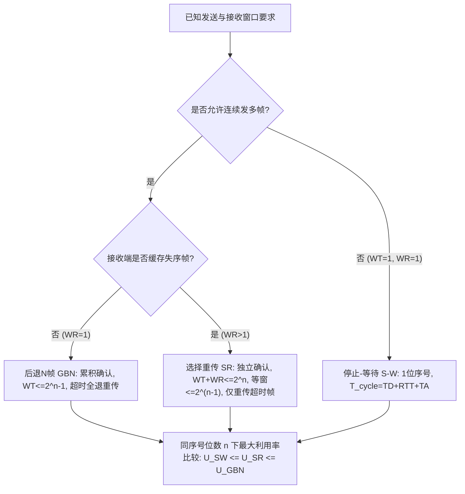

# 第3章 数据链路层

> [!abstract] 本章复盘目标
> 数据链路层解决的是相邻节点之间如何以帧为单位传输数据。本章主线是：先把网络层分组组织成可识别的帧，再检测或纠正差错、控制发送节奏并实现可靠传输；广播信道还要解决介质争用，最终落到以太网、无线局域网、PPP 和交换机的具体工作机制。

> [!important] 近 18 年 408 计网真题雷达（2009—2026）
> - **考频画像**：18 年共考查 **36 道主归属单选题 + 3 道跨章渗透题**，以及 `2010-T47`、`2017-T47`、`2022-T47`、`2025-T47(2)` 综合大题考查；近 5 年共 **10 道选择 + 2 道大题**（2022-T47、2023-T35/T36/T37、2024-T35/T36/T37、2025-T34/T35/T47、2026-T35/T36）。详细索引见 [[00_408计网｜考前急救与真题落点总控|返回计网总控]]。
> - **近 5 年考法演变（2022—2026）**：ARQ 转向**同序号位数下利用率大小对比**（2023）、SR 超时停滞跟踪（2024）与**卫星链路反推窗口/位数**（2025）；介质访问控制集中于 **Hub 往返延时扣减**（2022）、连续冲突退避截断（2023/2025）、CSMA/CA 隐藏站 NAV 与起止时间切分（2024/2026）及 VLAN 端口隔离收帧（2024/2026）。
> - **高频丢分盲区**：① GBN 收到 `ACK k` 未划掉整片前缀、流水线分母误加 $W_T T_D$、漏套 $W_T+W_R\le 2^m$（2009/2014/2015）；② 经 Hub 最远距离漏除以 2 或漏扣二次 $T_H$（2016/2022）；③ 不熟 NAV 倒计时起点，以及 802.11 上/下行三地址写混（2022/2024）。

## 考纲定位

- 基本功能：封装成帧、透明传输、差错检测、流量控制与可靠传输。
- 差错控制：奇偶校验、CRC、海明码及码距。
- 可靠传输：停止-等待、GBN、SR、滑动窗口和信道利用率。
- 介质访问控制：信道划分、ALOHA、CSMA、CSMA/CD、CSMA/CA、令牌传递。
- 局域网：以太网、IEEE 802.11、VLAN、MAC 帧格式和最小帧长。
- 广域网与设备：PPP、交换机工作原理及自学习。

> [!important] 复习优先级
> 第一梯队是滑动窗口、三种 ARQ、信道利用率、CSMA/CD、CSMA/CA、以太网帧、802.11 地址字段和交换机自学习；第二梯队是 CRC、海明码、CDMA、VLAN 和 PPP。

## 章节知识脉络

1. **把数据变成帧**：组帧与透明传输。
2. **判断帧是否正确**：奇偶校验、CRC、海明码。
3. **让帧按能力和顺序传输**：流量控制、滑动窗口、ARQ。
4. **多人共享信道时决定谁发送**：信道划分、随机访问、轮询访问。
5. **把机制落到具体网络**：以太网、Wi-Fi、VLAN、PPP。
6. **让局域网高效转发**：网桥、交换机、自学习、冲突域与广播域。

---

# 3.1 数据链路层的功能

## 3.1.1 数据链路层所处的地位 【📌 扫一眼｜确认“我还会”就过】

### 这一节要解决什么问题

- 数据链路层负责哪一段通信？
- 链路、数据链路和帧分别是什么？
- 为什么端到端路径上的帧会不断改变？

### 核心理解

数据链路层的任务是让**帧在一段链路或一个网络中传输**。主机具有完整协议栈，路由器转发时使用下三层；分组每经过一个路由器，都会解封装到网络层以选择下一跳，再使用下一段链路的数据链路层协议重新封装。

- **链路（Link）**：***<u>相邻节点之间的一段无源物理线路</u>***。
- **数据链路（Data Link）**：***<u>在物理链路上加上实现通信协议的软硬件后形成的逻辑通信通道</u>***（常采用网络适配器/网卡实现）。
- **帧（Frame）**：***<u>数据链路层的协议数据单元（PDU）</u>***。

> [!abstract] 💡 数据链路层核心功能属性归纳
> - ***<u>组帧（定义数据格式）</u>***：在网络层数据前后加上首部和尾部形成帧【数据链路层】。
> - ***<u>在物理层提供的不可靠连接上提供节点到节点的传输</u>***【数据链路层】。
> - ***<u>控制对物理传输介质的访问（由 MAC 子层完成）</u>***【数据链路层】。
> - ***<u>为终端节点隐蔽物理传输细节属于物理层功能</u>***【物理层】（链路层不关心具体比特如何通过电磁信号传输）。

因此，端到端传输中通常是 **IP 数据报的源、目的 IP 地址保持不变，而帧及其源、目的 MAC 地址逐跳改变**。

数据链路层常用两类信道：

| 信道 | 通信关系 | 核心问题 |
|---|---|---|
| 点对点信道 | 一对一 | 组帧、差错、可靠传输 |
| 广播信道 | 一对多，共享介质 | 除上述问题外，还要***<u>控制对物理传输介质的访问（介质争用协调）</u>*** |

## 3.1.2 链路管理 【💤 可跳过｜冲刺期直接跳过不看】

链路管理包括连接的**建立、维持和释放**，主要服务于面向连接的数据链路层协议。建立连接前需确认双方就绪并协商必要参数，通信过程中维护状态，结束后释放资源。

> [!warning] 易错点
> 链路管理不等于电路管理；***<u>“电路管理”是物理层的功能</u>***，不是数据链路层的功能。

## 3.1.3 封装成帧与透明传输 【📌 扫一眼｜确认“我还会”就过】

- **封装成帧**：在网络层数据前后添加首部和尾部，使接收方能识别帧的开始与结束（即***<u>定义数据格式</u>***）。
- **帧定界**：利用首尾控制信息找出边界。
- **MTU（最大传输单元）**：***<u>帧中数据部分（载荷 Payload）允许的最大长度</u>***，绝不是整个帧的最大长度。
- **透明传输**：无论数据中出现什么比特或字符组合，都能作为普通数据传输，***<u>绝不会被接收方误判为帧定界等控制信息</u>***。

“透明”不是没有帧边界，而是帧定界和转义机制对网络层不可见。接收方去除填充后，必须恢复出原始服务数据单元。

## 3.1.4 流量控制 【📌 扫一眼｜确认“我还会”就过】

流量控制通过限制发送方速率，防止接收方因处理能力或缓存不足而丢帧。

- ***<u>流量控制实质是对发送方数据流量（发送速率）的限制与控制</u>***，使其不超过接收方的接收能力与缓存空间。

| 层次 | 控制范围 | 典型方式 |
|---|---|---|
| 数据链路层 | 相邻节点之间（一跳） | ACK、固定滑动窗口 |
| 传输层 | 端到端（进程间） | 接收方通告窗口，动态调整发送窗口 |

> [!warning] 易错点：流量控制 vs 拥塞控制
> - ***<u>流量控制解决“接收方来不及接收”</u>***：属于点对点局部通信匹配问题。
> - ***<u>拥塞控制解决“网络中注入的数据过多导致网络性能下降”</u>***：属于全局性问题，由***<u>网络层或传输层</u>***实现，绝非数据链路层功能。

## 3.1.5 差错检测与可靠传输 【📌 扫一眼｜确认“我还会”就过】

传输差错分为：

- **位错**：比特翻转，常用 ***<u>CRC 循环冗余码</u>*** 检测。
- **帧错**：帧丢失、重复、失序。
  - ***<u>计时器超时重发机制：专门用于避免传输过程中丢帧造成的死锁与丢失</u>***。
  - ***<u>帧编号机制：专门用于让接收方判断收到的帧是否重复或失序</u>***。

> [!abstract] 💡 数据链路层三类服务模型与应用场景
> 1. ***<u>无确认的无连接服务</u>***：源端发帧不建逻辑连接，目的端收到不发确认，丢帧不检测不重传。
>    - **适用场景**：***<u>信道误码率极低、信道非常可靠</u>***（差错恢复交由高层处理），或***<u>对实时性要求极高的通信</u>***（在实时音视频中，***<u>数据迟到比数据损坏更严重</u>***）。
> 2. ***<u>有确认的无连接服务</u>***：不建连接，<mark>但每发一帧必须收到确认</mark>（如无线局域网 IEEE 802.11）。 `[真题·2011-T36]`
> 3. ***<u>有确认的面向连接服务</u>***：建链 $\rightarrow$ 确认重传传输 $\rightarrow$ 拆链，可靠性最高但开销最大。

现代网络是否在数据链路层提供可靠传输取决于链路质量：

- 高质量有线链路常只检错，发现错误便丢弃，由高层恢复。
- 无线链路误码率较高，常在链路层确认并重传。

> [!important] 必须记住
> “上交的帧几乎可认为无比特差错”不等于“所有发送的帧都成功交付”。***<u>只检错不重传的链路层仍是不可靠的尽最大努力交付</u>***。

### 常考题型与解题方法

#### 题型：判断某功能属于哪一层

- **识别特征**：题干出现帧定界、透明传输、相邻节点、MAC、介质访问、电路管理、拥塞控制。
- **解题步骤**：先看控制对象，再看 PDU；帧及相邻节点通常属于数据链路层。
- **常见干扰项**：
  - ***<u>电路管理、隐蔽物理传输细节属于物理层</u>***；
  - ***<u>拥塞控制、路由选择属于网络层/传输层</u>***；
  - ***<u>进程间端到端流量控制属于传输层</u>***。
- **检查动作**：问自己“这是控制一跳，还是控制整条路径，还是底层电气？”
- **一句话方法**：物理层管比特信号与电路，链路层管一跳的帧格式与介质访问，网络层管路径与拥塞，传输层管端到端进程通信。

### 一分钟回顾

- 三个基本问题：封装成帧、透明传输、差错检测。
- 流量控制限制发送方，可靠传输依靠***<u>计时器超时重传（防丢失）</u>***和***<u>帧编号（防重复）</u>***。
- 链路层是否重传取决于链路质量和协议设计；信道可靠且实时性高时首选***<u>无确认的无连接服务</u>***。

---

# 3.2 组帧

### 这一节要解决什么问题

- 连续比特流中如何识别一帧的开始和结束？
- 数据本身与定界符相同时，怎样仍能透明传输？
- 四种组帧方法各自依赖什么条件、容易在哪里出错？

组帧要同时解决**帧定界、帧同步和透明传输**。通常既有首部也有尾部，因为连续比特流本身没有天然边界。

## 3.2.1 字符计数法 【📌 扫一眼｜确认“我还会”就过】

帧首部的计数字段记录本帧总字节数，且**包括计数字段自身占用的 1B**。接收方按计数值定位本帧结尾和下一帧开头。

- **优点**：简单。
- **缺点**：***<u>计数字段一旦出错，接收方无法正确找到下一帧的起点，导致后续多帧连续失去同步（灾难性失步）</u>***。

## 3.2.2 字节填充法 【📌 扫一眼｜确认“我还会”就过】

使用特殊控制字符标记帧首尾，如 SOH、EOT 或 FLAG（`01111110`）。若数据中出现控制字符或转义字符 ESC 自身：

- **发送方规则**：***<u>逐字节扫描，只要遇到与控制字符相同或与 ESC 相同的字节，立即在其前插入一个转义字符 ESC</u>***。
- **接收方规则**：***<u>遇到 ESC 就删除该 ESC，并将其后的紧邻字节按普通数据保留</u>***。

> [!important] 字节填充算法（字符定界）
> 若数据中出现 `A, B, ESC, FLAG`，组帧发送序列为：
> `[FLAG] A B [ESC] ESC [ESC] FLAG [FLAG]`（在原有的 ESC 和 FLAG 自身前面均需插入 ESC）。

## 3.2.3 零比特填充法 【🔥 必背｜停下来默背 1 遍】

以固定比特模式 `01111110` 作为首尾标志（如 HDLC 协议）。

- **发送方规则**：***<u>扫描数据字段，只要连续出现 5 个 1，就立即强制在其后插入一个 0</u>***。 `[真题·2013-T37]`
- **接收方规则**：***<u>扫描数据字段，只要连续出现 5 个 1 且其后紧跟 0，就自动删除该 0 还原数据</u>***；若连续 6 个 1 且后跟 0 则为帧标志。

![[assets/第3章-数据链路层/图3.7-零比特填充.jpg|700]]

*图 3.7：发送方填 0、接收方删 0 后恢复原始数据。*

> [!warning] 高频陷阱
> 1. ***<u>只对数据载荷部分填充，绝不对首尾定界标志做填充</u>***。
> 2. 规则是***<u>“看见第 5 个连续的 1 后必须立即填 0”</u>***，<mark>而不是等看见 6 个 1 才填</mark>。 `[真题·2013-T37]`
> 3. 例：原数据 `01111100 01111110` $\rightarrow$ 第一组 5 个 1 后填 0 为 `011111000`，第二组 6 个 1 在前 5 个 1 后填 0 为 `011111010`。
> 4. `【⚡ 真题补丁｜2013-T37】` 对待发比特串从左到右仅在连续 5 个 1 后填 0；新填入的 0 打断连续 1 计数，不与后面的 1 重新凑数。

## 3.2.4 违规编码法 【💤 可跳过｜冲刺期直接跳过不看】

利用物理层编码中不会表示正常数据的冗余信号作为帧边界。例如曼彻斯特编码正常码元必有中间跳变，可利用***<u>“高-高”或“低-低”等无跳变的违规电平组合</u>***来定界。

- **优点**：***<u>无须在数据中插入额外字符或比特，无透明传输开销</u>***。
- **缺点**：***<u>只适用于存在冗余编码组合的物理编码环境（如曼彻斯特编码）</u>***。

## 四种组帧方法对比

| 方法 | 定界依据 | 透明传输手段 | 主要缺点或条件 |
|---|---|---|---|
| 字符计数 | 首部长度字段 | 无特殊填充 | ***<u>计数出错会导致后续多帧连续失步</u>*** |
| 字节填充 | 特殊字符（如 FLAG） | ***<u>插入 ESC 转义</u>*** | 面向字节，数据中遇控制符或 ESC 前加 ESC |
| 零比特填充 | 固定比特串 `01111110` | ***<u>5 个 1 后强制填 0</u>*** | 面向比特硬件扫描，绝不出现连续 6 个 1 |
| 违规编码 | 非法信号组合（无跳变电平） | ***<u>无须额外填充</u>*** | ***<u>依赖物理编码冗余</u>*** |

### 常考题型与解题方法

#### 题型：求填充后的比特串或字符序列

- **识别特征**：给出 FLAG、ESC 或 `01111110`，要求写实际发送序列。
- **解题步骤**：
  1. 先圈出数据区（不含定界符）；
  2. 从左到右只扫描原始数据：遇到 5 个 1 填 0（零比特），或遇到定界符/ESC 前加 ESC（字节填充）；
  3. 最后在两端加上首尾标志。
- **常见干扰项**：把新填入的 0 与后续 1 重新合并计数；漏掉原数据中的 ESC；对 FLAG 本身做填充。
- **检查动作**：去填充后应逐位或逐字节还原原数据。
- **一句话方法**：先处理载荷，再包首尾；反向去填充必须完全可逆。

### 一分钟回顾

- 字符计数最怕计数字段出错导致连续失步。
- 字节填充转义特殊字符及 ESC，零比特填充每 5 个 1 填 0。
- 违规编码不填充，但依赖物理层冗余。

---

# 3.3 差错控制

### 这一节要解决什么问题

- 如何用冗余信息发现位错，甚至定位并纠正错误？
- 码距如何决定编码的检错与纠错上限？
- CRC 和海明码的计算如何写成稳定、可检查的步骤？

## 码距与检错、纠错能力 【🔥⚡ 必背+避坑｜停下来默背 1 遍 + 精读 1 分钟】

两个码字对应位不同的数量称为海明距离；***<u>编码集中任意两个合法码字的最小海明距离称为该编码集的码距 $d_{\mathrm{min}}$</u>***。可通过异或后统计 1 的个数求两个码字的距离。

> [!abstract] 💡 码距与检纠错能力核心定理（三种工作模式）
> 1. **模式一：纯检错模式（只检不纠，$c=0$）**
>    - ***<u>$l \ge d + 1 \implies$ 码距为 $l$ 时，最多可 100% 检出 $l - 1$ 位错误</u>***（例：码距 $l=4$ 时可检 $4-1=3$ 位错）。
> 2. **模式二：纯纠错模式（只纠不额外多检，$d=c$）**
>    - ***<u>$l \ge 2c + 1 \implies$ 码距为 $l$ 时，最多可纠正 $\lfloor (l - 1)/2 \rfloor$ 位错误</u>***（例：码距 $l=4$ 时可纠 $\lfloor 3/2 \rfloor = 1$ 位错）。
> 3. **模式三：同时纠错与检错模式（边纠边检，SEC-DED 经典设计）**
>    - ***<u>$l \ge d + c + 1$（且 $d > c$）</u>***：若既要纠正 $c=1$ 位错，又要检出更多位错，则 $4 \ge d + 1 + 1 \implies d \le 2$。
>    - 即码距为 4 时，具有***<u>“纠正 1 位错并同时检测 2 位错”</u>***的能力（SEC-DED: Single Error Correction, Double Error Detection）。
>    - **为什么此时不能检 3 位错？** 因为当发生 3 位错时，错误码字与另一个合法码字的距离仅为 1，纠错机制会将其“误纠正”为错误的合法码字。

> [!warning] 易错点
> 题目若给出码字集合求编码集的检错/纠错能力，***<u>必须将所有合法码字两两异或求距离并取最小值 $d_{\mathrm{min}}$</u>***，<mark>切勿只挑其中某一对</mark>。 `[真题易错·2025-T34]`
> - `【⚡ 真题补丁｜2025-T34】` 编码集 `{10011010, 01011100, 11110000, 00001111}` 最小码距 $d_{\min}=4$，100% 检 3 位错、纠 1 位错。

## 3.3.1 检错编码 【🔥⚡ 必背+避坑｜停下来默背 1 遍 + 精读 1 分钟】

### 1. 奇偶检验码

在 $n$ 位数据后增加 1 位校验位，使整个码字中 1 的数量保持为奇数或偶数。

- **奇校验**：码字中 1 的总数为奇数。
- **偶校验**：码字中 1 的总数为偶数。
- **能力边界**：***<u>只能检查出奇数个比特的错误；偶数个比特翻转奇偶性不变，完全无法检测（包括双位错误）</u>***。
- ***<u>只能检错，无法定位错误，更无法纠错；码距恒为 2</u>***。

### 2. 循环冗余码 CRC

设数据为 $M$，生成多项式对应的二进制串为 $G$，$G$ 的最高次数为 $r$，则除数有 $r+1$ 位，生成 $r$ 位 FCS。

> [!abstract] 💡 CRC 核心特性与考点归纳
> - ***<u>通信双方必须预先商定相同的生成多项式 $G(X)$</u>***。
> - ***<u>带 $r$ 个校验位的多项式编码可以检测到所有长度 $\le r$ 的突发性错误</u>***。
> - ***<u>CRC 校验码可以检测出所有的单比特错误</u>***。
> - ***<u>CRC 具有检错能力但无自动纠错能力，可以通过移位寄存器等硬件高速完成</u>***。

#### 发送方固定步骤

1. 将生成多项式写成二进制系数串（最高阶为 $r$，串长 $r+1$ 位）；最高位和最低位必须为 1。
2. 在数据 $M$ 后补 $r$ 个 0，得到 $M\cdot 2^r$。
3. 用 $G$ 对补零后的串做模 2 除法（加减法不进位不借位，等价于异或）。
4. 取 $r$ 位余数作为 FCS（***<u>余数位数不足 $r$ 位时前面必须补 0 补齐 $r$ 位</u>***）。
5. 发送序列 = 原始数据 $M$ + $r$ 位 FCS。

#### 接收方固定步骤

用相同的生成多项式 $G$ <mark>模 2 除收到的完整接收串</mark>： `[真题·2023-T37]`
- ***<u>余数为 0：只能判定未检测出错误，不能断言传输中一定无错</u>***。若非零错误多项式恰能被生成多项式整除，也会漏检。
- ***<u>余数非 0：判定传输出现差错，直接丢弃该帧</u>***。
- `【⚡ 真题补丁｜2023-T37】` 发送端先补 $r$ 个 0 再除 $G$；接收端验证时直接用收到的完整码字除以 $G$，切勿再多补 $r$ 个 0（省算多步且等价）。

![[assets/第3章-数据链路层/图3.8-CRC模2除法.jpg|500]]

*图 3.8：模 2 除法示例，所得 $r$ 位余数作为 FCS。*

## 3.3.2 纠错编码：海明码 【⚡ 避坑｜最值钱，必须精读 1 分钟】

设信息位有 $n$ 位，校验位有 $k$ 位。要覆盖 $n+k$ 个单比特错误位置及 1 个无错状态，需满足海明不等式：

$$
2^k \ge n + k + 1
$$

- `【⚡ 真题补丁｜2013-分类】` 求最少校验位数 $k$ 须用海明不等式 $2^k \ge n+k+1$（$n=8\implies k=4$），勿用码距公式反推。

- ***<u>标准海明码能纠正 1 位差错</u>***（最小码距 $l=3$）。
- 若在海明码最高位增加 1 位全校验位，则码距变为 4：
  - 若工作在**纯检错模式**：可 100% 检测不超过 $4-1=3$ 位错；
  - 若工作在**边纠边检模式 (SEC-DED)**：具有***<u>检测 2 位错并纠正 1 位错</u>***的能力（计算机内存 ECC 最经典设计）。

### 海明码构造步骤

1. **求校验位数**：从小到大试 $k$，代入 $2^k \ge n+k+1$（例：$n=10$ 时，取 $k=4$ 使 $2^4=16 \ge 10+4+1=15$）。
2. **放校验位**：$P_i$ 放在海明位号 $2^{i-1}$，即第 1、2、4、8、…… 位。
3. **放信息位**：按题目约定的顺序填入其余位置。
4. **确定校验组**：将各信息位的位号展开为二进制；位号二进制第 $i$ 位为 1，就归入 $P_i$ 的校验组。
5. **计算校验位**：按偶校验（使校验组异或为 0）或奇校验计算各 $P_i$。
6. **接收端纠错**：计算各校验组的校验子 $S_k\cdots S_1$。全 0 表示无单比特错误；非 0 时，***<u>校验子的十进制值就是出错位的位号，将该位取反即可纠正</u>***。

### 常考题型与解题方法

#### 题型 1：码距能力判断
- **解题步骤**：对码字集两两异或求距离取最小值 $l$；检错上限 $l-1$；纠错上限 $\lfloor(l-1)/2 \rfloor$。

#### 题型 2：CRC 计算与验证
- **解题步骤**：生成多项式阶数为 $r$ $\rightarrow$ 补 $r$ 个 0 $\rightarrow$ 模 2 除法 $\rightarrow$ 余数必须为 $r$ 位 $\rightarrow$ 拼接在数据末尾。

### 一分钟回顾

- 检 $d$ 位错需码距至少 $d+1$；纠 $c$ 位错需至少 $2c+1$。
- 奇偶校验只能检测奇数位错，CRC 能检所有单比特错及长度 $\le r$ 突发错。
- CRC 双方需预商定多项式，余数长度等于多项式最高阶数 $r$。
- 海明码校验位放 $2^{i-1}$ 位置，满足 $2^k \ge n+k+1$，可纠正 1 位错。

---

# 3.4 流量控制与可靠传输机制

### 这一节要解决什么问题

- 如何防止发送方过快，并让丢失、重复或失序的帧得到正确处理？
- S-W、GBN、SR 的窗口、确认与重传策略有何本质区别？
- 如何由时延、帧长和窗口大小计算信道利用率与实际速率？

## 3.4.1 流量控制与滑动窗口机制 【🔥⚡ 必背+避坑｜停下来默背 1 遍 + 精读 1 分钟】

发送窗口表示当前允许发送的连续序号集合，接收窗口表示当前允许接收的连续序号集合。

> [!important] 窗口机制基本属性
> - ***<u>数据链路层的滑动窗口大小在整个通信过程中通常是固定的</u>***（区别于传输层 TCP 的动态滑动窗口）。
> - ***<u>发送窗口大小为 $W_T$ 时，最多可以有 $W_T$ 个帧已发送但尚未收到确认</u>***。

![[assets/第3章-数据链路层/图3.9-发送窗口滑动.jpg|750]]

*图 3.9：窗口内还可发送、已发送未确认和已确认帧的位置随 ACK 向前滑动。*

### 滑动窗口与序号位数约束

若帧序号使用 $n$ 比特，则序号空间大小为 $2^n$（序号取值 $0 \sim 2^n-1$）。滑动窗口必须满足总不等式：

$$
W_T + W_R \le 2^n
$$

| 协议 | 发送窗口 $W_T$ | 接收窗口 $W_R$ | 最大发送窗口 | 序号位数约束 | 接收失序帧 |
|---|---|---|---|---|---|
| **停止-等待 (S-W)** | 1 | 1 | 1 | $n \ge 1$ (1位即可: 0/1) | 否 |
| **后退 N 帧 (GBN)** | $>1$ | 1 | ***<u>$W_T \le 2^n - 1$</u>*** | ***<u>$2^n \ge W_T + 1$</u>*** | 否，直接丢弃 |
| **选择重传 (SR)** | $>1$ | $>1$ | ***<u>$W_T + W_R \le 2^n$</u>*** | 两窗口相等时 ***<u>$W_T = W_R \le 2^{n-1}$</u>*** | ***<u>是，窗口内缓存</u>*** |

> [!warning] 序号空间重叠陷阱
> 若 GBN 取 $W_T = 2^n$，当一整轮 ACK 全部丢失超时重传时，接收方无法区分收到的帧是上一轮的重传帧还是下一轮的新帧；<mark>因此 GBN 必须留出至少一个空序号</mark>，即 $W_T \le 2^n - 1$。 `[真题易错·2015-T35 / 2019-T35]`
> - `【⚡ 真题补丁｜2015-T35】` 算出 $W_T\ge 7.2\to 8$ 后勿直选 3 位序号；因 $W_T+W_R\le 2^m$ 且 $W_R\ge 1$，$W_T=8$ 至少需 4 位。
> - `【⚡ 真题补丁｜2019-T35】` 3 位序号共有 $2^3=8$ 个编号，当发送窗口 $W_T=5$ 时接收窗口 $W_R$ 最大为 $8-5=3$。

## 3.4.2 可靠传输机制 【🔥⚡ 必背+避坑｜停下来默背 1 遍 + 精读 1 分钟】

可靠传输的基本工具是：**帧编号、确认机制、超时重传计时器和接收缓存**。

### 1. 停止-等待协议 (Stop-and-Wait, S-W)

- ***<u>工作过程</u>***：发送方每发送 1 帧就停止并启动计时器；收到接收方的 ACK 后，发送窗口才右移 1 格并发送下一帧。
- ***<u>差错处理</u>***：
  - 数据帧丢失/出错：发送方计时器超时重传该帧。
  - ACK 丢失：发送方超时重传旧帧；接收方根据 1 位序号识别重复帧，***<u>丢弃重复数据并重发该帧的 ACK</u>***。
- ***<u>序号要求</u>***：只需 1 比特序号（0 与 1 交替）即可保证协议正确运行。
- ***<u>信道利用率</u>***：信道利用率不可能达到 100%，***<u>适合 RTT 较小的信道</u>***。

### 2. 后退 N 帧协议 (Go-Back-N, GBN)

- ***<u>连续发送</u>***：发送方可连续发送发送窗口 $W_T$ 内的多个数据帧。
- ***<u>接收窗口与失序处理</u>***：***<u>接收窗口 $W_R = 1$，接收方只能按序接收；失序到达的帧即使完全正确也一律丢弃</u>***。
- ***<u>确认机制</u>***：***<u>采用累积确认（Cumulative ACK）</u>***。ACK $n$ 表示 $n$ 号及之前的所有帧<mark>均已正确接收</mark>，下一帧期望接收 $n+1$ 号。 `[真题易错·2009-T35 / 2017-T47]`
- ***<u>超时与重传</u>***：发送方通常只需维护***<u>一个最早未确认帧的计时器</u>***。一旦超时，***<u>必须重传当前发送窗口内所有已发送但未确认的帧（后退重发 $N$ 个帧）</u>***。 `[真题·2009-T35 / 2017-T47]`

![[assets/第3章-数据链路层/图3.11-GBN工作时序.jpg|750]]

*图 3.11：2 号帧出错后，后续失序帧被丢弃；超时后从 2 号帧开始整体后退重传。*

### 3. 选择重传协议 (Selective Repeat, SR)

- ***<u>接收窗口与失序处理</u>***：***<u>接收窗口 $W_R > 1$，接收方支持无序接收，可接收并缓存落在当前接收窗口内的失序无差错帧</u>***；待缺失帧补齐后，成批按序交付网络层。
- ***<u>确认机制</u>***：***<u>采用逐帧独立确认机制</u>***。ACK $n$ 仅确认 $n$ 号帧自身，<mark>不具累积确认含义</mark>。 `[真题·2011-T35 / 2024-T37]`
- ***<u>超时与重传</u>***：<mark>发送方为每个已发送帧维护独立的计时器</mark>；***<u>某帧超时后，仅重传该超时帧本身</u>***。 `[真题·2011-T35 / 2024-T37]`
- ***<u>失序 ACK 处理</u>***：***<u>收到失序的 ACK（如先收到 5 号 ACK 而 4 号未收到）时，仅标记 5 号已确认，不触发 4 号重传，继续发送窗口内未发送的新帧；仅当 4 号自身超时才重发 4 号</u>***。

![[assets/第3章-数据链路层/图3.12-SR工作时序.jpg|750]]

*图 3.12：SR 缓存失序帧，缺失帧补齐后成批按序交付。*

### 三种 ARQ 的核心对比

| 项目 | 停止-等待 (S-W) | 后退 N 帧 (GBN) | 选择重传 (SR) |
|---|---|---|---|
| 发送窗口 $W_T$ | 1 | $1 < W_T \le 2^n - 1$ | $1 < W_T \le 2^{n-1}$ (等窗口时) |
| 接收窗口 $W_R$ | 1 | 1 | $1 < W_R \le 2^{n-1}$ |
| 确认机制 | 单帧确认 | ***<u>累积确认</u>*** | ***<u>独立确认</u>*** |
| 失序帧处理 | 丢弃 | ***<u>直接丢弃</u>*** | ***<u>缓存于接收窗口内</u>*** |
| 超时重传范围 | 当前帧 | ***<u>超时帧及其后所有未确认帧</u>*** | ***<u>仅超时帧本身</u>*** |
| 计时器个数 | 1 个 | 通常 1 个（最早未确认帧） | ***<u>每个未确认帧 1 个独立计时器</u>*** |
| 接收端缓存 | 仅 1 帧 | 仅 1 帧 | ***<u>较大（$W_R$ 个帧缓存）</u>*** |
| 适用信道 | RTT 小、速率低 | 误码率极低的有线链路 | 误码率较高或大 RTT 链路 |

> [!warning] 真题补丁（2009 / 2011 / 2017 / 2024）
> - `【⚡ 真题补丁｜2009-T35 & 2017-T47】` GBN 收 `ACK 3` 即划掉 0~3 前缀（哪怕 ACK 1 丢）重传 4~7；重传 $S_{x,y}$ 须刷新 $y$。
> - `【⚡ 真题补丁｜2011-T35 & 2024-T37】` SR 收到 `ACK 2/3` 但 `F1` 未确认时，发送窗口左边界停在 `1` 处，可先发后续空余序号（如 `F4`）；待 `F1` 超时只重传 `F1` 本身。

## 4. 信道利用率与实际传输速率 【🔥⚡ 必背+避坑｜停下来默背 1 遍 + 精读 1 分钟】

设：
- $T_D = L_D / C$：数据帧发送时延（$L_D$ 为数据帧长，$C$ 为数据传输速率）；
- $T_A = L_A / C$：确认帧发送时延（若忽略确认帧长则 $T_A = 0$）；
- $RTT$：往返传播时延（单向传播时延为 $T_p$ 时，$RTT = 2T_p$）；
- $T_{\text{cycle}} = T_D + RTT + T_A$：一个发送周期。

### 1. 停止-等待协议信道利用率

![[assets/第3章-数据链路层/图3.13-停止等待发送周期.jpg|700]]

$$
U = \frac{T_D}{T_D + RTT + T_A} = \frac{L_D / C}{L_D / C + 2T_p + L_A / C}
$$

- ***<u>停止-等待协议利用率恒 $< 100\%$</u>***。***<u>在大时延带宽积信道（如卫星链路）上利用率极低</u>***。 `[真题·2018-T36 / 2020-T36]`

### 2. 连续 ARQ 协议信道利用率

在无差错条件下，<mark>发送方在每个周期内最多可连续发送</mark> $W_T$ 个数据帧： `[真题易错·2012-T36 / 2014-T36 / 2025-T47]`

$$
U = \min\left(1, \frac{W_T \times T_D}{T_D + RTT + T_A}\right)
$$

> [!abstract] 💡 信道满载（利用率达到 100%）条件推导模型
> 1. 要使流水线填满（利用率达到 100%），一个发送周期内连续发送的帧数必须覆盖整个往返周期：
>    $$
>    W_T \ge \left\lceil \frac{T_D + RTT + T_A}{T_D} \right\rceil
>    $$
> 2. 再由窗口与序号位数关系求最小比特数 $n$：
>    - GBN：$2^n - 1 \ge W_T \implies 2^n \ge W_T + 1$
>    - SR (等窗口)：$2^{n-1} \ge W_T \implies 2^n \ge 2W_T$
> 3. ***<u>帧长可变时的极值陷阱</u>***：若数据帧长在 $[L_{\min}, L_{\max}]$ 变化，为保证信道利用率在任何情况下都能达到最高，***<u>必须以最小帧长 $L_{\min}$ 计算 $T_D$ 来确定所需的最大窗口 $W_T$</u>***。

### 3. 实际数据传输速率

$$
\text{实际数据传输速率} = U \times \text{信道带宽 } C = \frac{\text{一个周期内发送的有效载荷量}}{T_{\text{cycle}}}
$$

> [!tip] 三种协议在相同 3 比特序号下的利用率关系
> 当序号为 3 比特时，$W_{T,\text{SW}}=1$，$W_{T,\text{SR}}=4$，$W_{T,\text{GBN}}=7$。<mark>因此在相同信道环境下</mark>： `[真题·2023-T35]`
> $$
> U_{\text{S-W}} \le U_{\text{SR}} \le U_{\text{GBN}}
> $$
> - `【⚡ 真题补丁｜2014-T36 & 2023-T35】` 分母 $T_D+RTT+T_A$ 勿加 $W_T T_D$；等长 $T_A=T_D$；3 位 $U_{SW}\le U_{SR}\le U_{GBN}$。
> - `【⚡ 真题补丁｜2012-T36】` 卫星流水线满载先算 $W_T=\lceil(T_D+RTT)/T_D\rceil$，再代入 $2^m-1\ge W_T$ 定最少序号位（如 4 bit）。
> - `【⚡ 真题补丁｜2020-T36 & 2025-T47(2)】` 先解 $W_T T_D/(T_D+RTT)\ge 0.8$ 向上取整求窗，再由 $2^m-1 \ge W_T$ 定序号位 $m$。

### 常考题型与解题方法

#### 题型 1：根据 ACK 与超时判断重传帧数
- **GBN 场景**：收到 ACK 4 表明 0~4 号均已确认；若已发 0~6 号且发生超时，***<u>只需重传 5、6 号共 2 帧</u>***。
- **SR 场景**：已发 0~3 号，收到 ACK 1，0 号与 2 号依次超时，***<u>只需重传 0 号与 2 号共 2 帧</u>***。

#### 题型 2：求最大窗口与最小序号位数
- GBN 给定 $n$ 位 $\rightarrow W_T = 2^n - 1$；
- SR 给定 $n$ 位且等窗口 $\rightarrow W_T = W_R = 2^{n-1}$；
- SR 给定 $n$ 位且 $W_T$ $\rightarrow W_R \le \min(W_T, 2^n - W_T)$（例：$n=3, W_T=5 \implies W_R \le 8-5=3$）。

### 一分钟回顾

- S-W：一发一等，1 位编号防重复，超时防丢帧。
- GBN：累积确认，接收窗口为 1，错一退一串，最大发送窗口 $2^n-1$。
- SR：独立确认，接收窗口 $>1$ 缓存失序帧，错谁重谁，等窗口最大 $2^{n-1}$。
- 理论上连续 ARQ 发送窗口足够大时信道利用率可达 100%。

---

# 3.5 介质访问控制

### 这一节要解决什么问题

- 多个站点共享广播信道时，怎样分配发送权并处理冲突？
- 信道划分、随机访问和轮询访问分别适合什么负载与场景？
- 如何识别复用方式、CSMA 策略并完成 CDMA 解码？

共享广播信道上的多个站点可能同时发送而冲突，***<u>MAC 子层的核心任务是控制和协调所有站点对共享介质的访问</u>***。

## 3.5.1 信道划分介质访问控制 【🔥 必背｜停下来默背 1 遍】

信道划分是**静态分配**：<mark>把广播信道划分为互不干扰的子信道</mark>，***<u>绝不发生物理冲突</u>***。 `[真题·2013-T36]`

| 方式 | 划分维度 | 信号与应用特点 | 关键机制 |
|---|---|---|---|
| **FDM (频分复用)** | 频率 | ***<u>适合传输模拟信号</u>*** | 总频带分割为互不重叠的子频带，设隔离带 |
| **TDM (时分复用)** | 时间 | ***<u>抗干扰强，适合传输数字信号</u>*** | 预先分配固定时隙，时隙空闲亦不可挪用 |
| **STDM (统计时分复用)** | 时间 | ***<u>动态按需分配时隙</u>*** | 时隙内***<u>必须携带源/目的地址信息</u>*** |
| **WDM (波分复用)** | 波长 | 光纤通信 | 本质是光频分复用 |
| **CDM/CDMA (码分多址)** | 码片序列 | ***<u>既共享时间又共享频率</u>*** | 依靠***<u>相互正交的码片序列</u>***区分不同站点 |

> [!abstract] 💡 TDM 时分复用的物理介质满足条件与量纲陷阱
> 将 $N$ 路独立用户信号时分交织复用在同一条物理介质上传输时，介质必须满足以下两项物理条件：
> 1. **位速率维度（Bit Rate，单位 $\mathrm{b/s}$）**：
>    - ***<u>介质的位速率必须大于单个信号的位速率</u>***（介质承载总速率 $R_{\text{medium}} \ge \sum_{i=1}^N R_i = N \cdot R_{\text{single}} > R_{\text{single}}$）。
> 2. **频率带宽维度（Bandwidth，单位 $\mathrm{Hz}$）**：
>    - ***<u>介质的物理频带宽度（$\mathrm{Hz}$）必须大于复合信号所需的频宽</u>***（根据奈奎斯特准则，复合高速比特流需要更高的调制频率范围）。
> 3. **命题量纲混淆陷阱**：
>    - “频带宽度（$\mathrm{Hz}$）”与“位速率（$\mathrm{b/s}$）”属于不同物理量纲，***<u>切勿跨量纲直接比大小</u>***（如“介质的带宽大于信号的位速率”属于典型的物理量纲错误表述）。

### CDMA 码分多址计算

设码片长度为 $m$ 位，将比特 0 映射为 $-1$，比特 1 映射为 $+1$。

> [!abstract] 💡 CDMA 编码与解码核心规则
> 1. **正交性要求**：任意两个站点码片序列 $A, B$ 的规格化内积必须为 0：
>    $$
>    A \cdot B = \frac{1}{m} \sum_{i=1}^m A_i B_i = 0
>    $$
> 2. **发送规则**：
>    - 发送比特 1：发送自身原码片序列 $+A$；
>    - 发送比特 0：发送自身反码片序列 $-A$（各项全部取相反数）；
>    - 未发送数据：发送全 0 向量 $\mathbf{0}$。
> 3. **解码规则**：接收端收到总叠加信号 $R = \sum S_{\text{send}}$ 后，用目标站码片 $A$ <mark>求规格化内积</mark>： `[真题·2014-T37]`
>    - $A \cdot R = +1 \implies$ 目标站发送了比特 1；
>    - $A \cdot R = -1 \implies$ 目标站发送了比特 0；
>    - $A \cdot R = 0 \implies$ 目标站未发送数据。
> - `【⚡ 真题补丁｜2014-T37】` 解码题按 $m$ 位分组切开，用待测站码片逐组求内积再除以 $m$，正值为 `1`、负值为 `0`、零为未发送。

## 3.5.2 随机访问介质访问控制 【💤 可跳过｜冲刺期直接跳过不看】

随机访问是**动态争用分配**，所有站点共享全部带宽，发送时可能发生冲突。

### 1. ALOHA 协议

- **纯 ALOHA**：***<u>想发就发，有数据立即发送；若超时未收到确认，则随机推迟重发；冲突概率最高</u>***。
- **时隙 ALOHA**：把时间划分为等长时隙，***<u>规定只能在时隙起点发送；将冲突危险期减半</u>***。

### 2. CSMA 载波监听多路访问

工作原则：***<u>发送前先监听信道（先听后发）</u>***。

| 策略 | 信道空闲时 | 信道忙时 | 性能与权衡 |
|---|---|---|---|
| **1-坚持 CSMA** | ***<u>立即发送</u>*** | ***<u>持续监听</u>*** | 延迟小；但信道刚空闲时多个等待站同时发，***<u>冲突概率极高</u>*** |
| **非坚持 CSMA** | ***<u>立即发送</u>*** | ***<u>放弃监听，随机等待一段随机时间后再监听</u>*** | 冲突概率低；但随机等待导致***<u>信道利用率低、平均延迟大</u>*** |
| **$p$-坚持 CSMA** | ***<u>以概率 $p$ 发送，以 $1-p$ 推迟到下一时隙</u>*** | ***<u>持续监听（等下一时隙）</u>*** | ***<u>仅用于时隙信道</u>***；保留坚持监听优点，折中降低冲突 |

> [!important] 为什么 CSMA 仍然会发生冲突？
> 信号在物理线路上传播存在***<u>传播时延</u>***。当站点 A 监听到信道空闲时，<mark>站点 B 发送的信号可能已经在途中</mark>但尚未到达 A，导致 A、B 信号在信道上交汇碰撞。 `[真题·2013-T36]`

## 3.5.3 轮询访问：令牌传递协议 【💤 可跳过｜冲刺期直接跳过不看】

- **拓扑结构**：***<u>逻辑上为环形结构，物理上常为星形结构（通过集线器/MAU连接）</u>***。
- **发送权限**：环上只有一个控制发送权的特殊帧（令牌 Token）单向循环流动。***<u>只有获得令牌的节点才有权在令牌持有时间内发送数据，绝不发生物理冲突</u>***。
- **通信方式**：***<u>半双工通信，所有节点共享信道总带宽</u>***。
- **数据回收**：***<u>数据帧绕环一周后由源站点负责从环上接收并移除（回收），随后释放新令牌</u>***。
- **适用场景**：***<u>特别适合网络负载极重、多节点争用的广播信道</u>***。
- **最坏等待时延**：***<u>节点等待令牌的最大时间 = 所有其他节点传送令牌的时间与在持有时间内发送数据的时间总和</u>***。

### 三大类介质访问控制对比

| 类别 | 典型协议 | 是否发生冲突 | 负载适应性 |
|---|---|---|---|
| **静态信道划分** | FDM, TDM, WDM, CDMA | ***<u>绝不发生冲突</u>*** | 适合用户少、负载稳定的场景 `[真题·2013-T36]` |
| **动态随机访问** | ALOHA, CSMA, CSMA/CD, CSMA/CA | ***<u>可能发生冲突</u>*** | 适合轻负载、突发性流量 |
| **动态轮询访问** | 令牌环 (IEEE 802.5, FDDI) | ***<u>绝不发生冲突</u>*** | 适合重负载、对确定性时延要求高的场景 |

- `【⚡ 真题补丁｜2013-T36】` 静态信道划分（FDM/TDM/CDMA）与令牌传递无冲突；CSMA 属随机访问，因传播时延仍可能冲突。

### 一分钟回顾

- FDM 适合模拟，TDM 适合数字，STDM 动态按需带地址。
- CDMA 码片必须正交（内积为 0），解码用规格化内积判 $+1/-1/0$。
- CSMA 先听后发，因传播时延仍会冲突；1-坚持忙时持续听，非坚持忙时随机等。
- 令牌传递无论负载多重都无冲突，源站负责回收帧并释放新令牌。

---

# 3.6 局域网

### 这一节要解决什么问题

- 以太网为什么需要最短帧长，MAC 帧各字段如何配合工作？
- 无线局域网为何使用 CSMA/CA，802.11 地址如何随方向填写？
- VLAN 如何在交换网络中划分广播域并跨交换机延伸？

## 3.6.1 局域网的基本概念和体系结构 【📌 扫一眼｜确认“我还会”就过】

局域网技术特性三要素：***<u>拓扑结构、传输介质、介质访问控制方式（最关键）</u>***。

- **以太网**：***<u>采用分组交换技术，逻辑拓扑为总线形，现代物理拓扑为星形</u>***。
- **网卡 (NIC)**：工作在***<u>物理层和数据链路层</u>***，实现编解码、串并转换、组帧及 MAC 地址识别。以太网网卡采用***<u>曼彻斯特编码</u>***实现自同步。
- **MAC 地址**：***<u>长 48 位 (6B)，固化在网卡 ROM 中，由 IEEE 统一分配，不是通过 DNS 域名解析查得的</u>***。以太网广播地址为 `FF-FF-FF-FF-FF-FF`。
- **网卡单播过滤**：网卡收到单播帧若目的 MAC 不是自己，***<u>直接丢弃该帧，不向网络层报告任何错误</u>***。
- **IEEE 802 体系**：把数据链路层拆分为 ***<u>MAC 子层（与介质相关，负责组帧、介质争用、差错检验）</u>*** 和 ***<u>LLC 子层（与介质无关，向网络层提供统一接口）</u>***。

## 3.6.2 以太网与 IEEE 802.3 【🔥⚡ 必背+避坑｜停下来默背 1 遍 + 精读 1 分钟】

### 以太网服务模型

以太网采用<mark>无连接、无确认的工作方式</mark>，提供***<u>无连接的不可靠交付服务（尽最大努力交付）</u>***。它使用 FCS 检错，错帧直接丢弃，链路层不重传（`【⚡ 真题补丁｜2012-T35】`）。 `[真题·2011-T36 / 2012-T35]`

### 1. 传输介质标准

| 标准 | 介质 | 拓扑 | 最大段长 | 编码/双工特性 |
|---|---|---|---:|---|
| **10Base-5** | 粗同轴电缆 | 总线 | 500m | 曼彻斯特编码 |
| **10Base-2** | 细同轴电缆 | 总线 | 185m | 曼彻斯特编码 |
| **10Base-T** | 双绞线 (UTP) | 星形 | 100m | RJ-45 接口，***<u>Hub 连接时只能半双工</u>*** |
| **100Base-T** | 双绞线 | 星形 | 100m | ***<u>快速以太网，支持全双工/半双工</u>*** |
| **1000Base-X/T** | 光纤/双绞线 | 星形/点对点 | - | ***<u>吉比特以太网，支持全双工/半双工</u>*** |
| **10GBase-R** | 光纤 | 点对点 | - | ***<u>10吉比特以太网，只支持全双工，不使用 CSMA/CD</u>*** |

### 2. CSMA/CD 载波监听多路访问/碰撞检测

工作口诀：***<u>先听后发，边听边发，冲突停发，随机重发</u>***。

> [!important] 适用环境与双工模式
> - ***<u>仅适用于半双工共享总线或 Hub 连接的以太网</u>***。 `[真题·2015-T36]`
> - ***<u>全双工交换式以太网中各端口独占双向通路，绝不发生冲突，不使用 CSMA/CD</u>***。

![[assets/第3章-数据链路层/图3.22-CSMACD冲突传播.jpg|700]]

*图 3.22：传播时延使两端都可能先判断空闲，最迟经过 $2\tau$ 才能检测冲突。*

#### 争用期与最短帧长

设网络最远两端点之间的单向传播时延为 $\tau$，则***<u>争用期（碰撞窗口）为 $2\tau$</u>***。

发送方在发送过程中必须持续边发边听；为了在发送完毕之前能够检测到最远端产生的冲突，***<u>帧的发送时延必须大于等于争用期 $2\tau$</u>***：

$$
\frac{L_{\min}}{R} \ge 2\tau \implies L_{\min} = 2\tau \cdot R
$$

- 10Mb/s 传统以太网：争用期为 $51.2\mu s$，***<u>最短帧长为 512bit = 64B</u>***。<mark>凡小于 64B 的帧均为冲突碎片帧</mark>（残帧），接收后直接丢弃。 `[真题·2009-T37 / 2010-T47 / 2019-T36]`
- 若网络传输速率 $R$ 提高或电缆长度增加（$\tau$ 增大），为保证冲突检测，***<u>必须相应增加最短帧长，或缩短网络最大跨距</u>***。 `[真题·2009-T37 / 2019-T36]`
- 若网络中存在中继器/Hub，其内部转发时延 $t_{\text{hub}}$ <mark>会加入单向路径</mark>，争用期公式变为 $2\tau + 2t_{\text{hub}}$。 `[真题易错·2016-T36 / 2022-T47]`

> [!warning] 真题补丁（2009 / 2010 / 2015 / 2016 / 2019 / 2022 / 2023 / 2025）
> - `【⚡ 真题补丁｜2016-T36 & 2022-T47(2)】` 经 Hub 最远距离 $d_{\max}=v(L_{\min}/(2R)-T_H)$：先除 2 得单向预算再扣单程 $T_H$。
> - `【⚡ 真题补丁｜2009-T37 & 2019-T36】` 题干明确给出最短帧长（如 `128B`）时直接代题干值，勿惯性代 `64B`；最小帧长减少 $\Delta L$ 时距离变化量为 $\Delta d = v\Delta L/(2R)$。
> - `【⚡ 真题补丁｜2010-T47】` 发生碰撞时信号在中点相遇为 $\tau/2$，但双方均检测到冲突的时间区间为 $[\tau, 2\tau)$；求 1518B 帧有效数据传输速率时分子须剥去 18B 帧头尾取 `1500B`。
> - `【⚡ 真题补丁｜2015-T36】` CSMA/CD 仅用于有线半双工以太网，不适用无线；传播时延 $\tau\to 0$ 时理想信道利用率趋近 100%。

#### 截断二进制指数退避算法

检测到冲突后，站点停止发送并发送 32/48bit 人为干扰信号（Jamming Signal），然后执行退避：

1. 确定冲突参数：***<u>$k = \min(\text{冲突次数 } i, 10)$</u>***。 `[真题易错·2023-T36 / 2025-T35]`
2. 选择随机倍数：***<u>从整数集合 $[0, 2^k - 1]$ 中等概率随机选择一个整数 $r$</u>***。
3. <mark>计算退避等待时间</mark>：***<u>等待时间 = $r \times 2\tau$（$r$ 个争用期时间片）</u>***。 `[真题·2023-T36 / 2025-T35]`
4. 退出条件：***<u>当连续冲突达 16 次仍不成功时，认定网络拥塞严重，放弃发送该帧并向网络层报错</u>***。
5. `【⚡ 真题补丁｜2023-T36 & 2025-T35】` $i=11$ 截断 $k=10$，最大退避 $1023\times 51.2\mu s=52.3776$ ms（$i=4$ 得 $768\mu s$）。

> [!tip] 冲突概率分析
> 冲突次数 $i$ 越小，$2^k-1$ 范围越小，选到相同随机数的概率越大，***<u>再次冲突概率越高</u>***；重传次数越多，$2^k-1$ 范围越大，***<u>再次冲突概率越低</u>***。

### 3. 以太网 V2 MAC 帧格式

![[assets/第3章-数据链路层/图3.23-以太网V2帧格式.jpg|750]]

| 字段 | 长度 | 内容与考点 |
|---|---:|---|
| **目的 MAC 地址** | 6B | 目的接口物理地址（单播/多播/广播 `FF-FF-FF-FF-FF-FF`） |
| **源 MAC 地址** | 6B | 发送接口物理地址 |
| **类型 (Type)** | 2B | 标志上层协议（如 `0x0800` 表示 IPv4，`0x0806` 表示 ARP） |
| **数据载荷 (Data)** | ***<u>46 ～ 1500B</u>*** | 承载网络层 PDU；***<u>MTU 为 1500B</u>***；***<u>下限 46B 来自 $64 - 18 = 46\mathrm{B}$</u>*** `[真题·2012-T47]` |
| **帧校验序列 (FCS)** | 4B | ***<u>CRC 检错，检验范围从目的 MAC 到数据字段末尾</u>*** |

> [!warning] 高频陷阱
> 1. 物理层在 MAC 帧前附加的 ***<u>8B 前导码（7B 前同步码 + 1B 帧开始定界符 SFD）不计入 MAC 帧长，也不属于 FCS 校验范围</u>***。
> 2. ***<u>以太网 MAC 帧长范围为 64B ～ 1518B</u>***（不含 8B 前导码）。
> 3. 以太网没有“帧结束定界符”，依靠违规电平消失与帧间最小间隔（10Mb/s 下为 $9.6\mu s$）判定帧结束。

## 3.6.3 IEEE 802.11 无线局域网 【🔥⚡ 必背+避坑｜停下来默背 1 遍 + 精读 1 分钟】

### 1. 无线局域网组成

- **BSS (基本服务集)**：最小构建单元，包含 1 个 AP 和若干移动站。
- **ESS (扩展服务集)**：多个 BSS 通过分配系统 (DS) 互联而成。
- **SSID**：服务集标识符（Wi-Fi 名称），不超过 32B。
- **自组网络 (ad hoc)**：***<u>无 AP 基础设施，所有站点对等通信并可充当路由器转发</u>***。

### 2. CSMA/CA 载波监听多路访问/冲突避免

> [!abstract] 💡 为什么无线局域网不能使用 CSMA/CD？
> 1. ***<u>硬件无法实现边发边听</u>***：<mark>无线网卡发送信号的功率远大于接收信号的功率</mark>，本端发射的信号会完全淹没接收通道。 `[真题·2015-T36]`
> 2. ***<u>隐蔽站 (Hidden Station) 问题</u>***：A 与 C 互相处于无线覆盖范围之外（听不到对方），但同时向中间的 AP 发送数据时，信号在 AP 处发生冲突。
> 3. ***<u>暴露站 (Exposed Station) 问题</u>***：B 听到 A 在发送，误以为信道忙而不敢向 C 发送，导致信道资源浪费。

![[assets/第3章-数据链路层/图3.26-无线隐蔽站.jpg|450]]

*图 3.26：隐蔽站 A、C 听不到彼此，但同时向 AP 发送会在 AP 处冲突。*

#### CSMA/CA 核心机制

- **服务性质**：***<u>802.11 MAC 对数据帧提供有确认（ACK）的无连接服务</u>***（每个数据帧必须收到 ACK 确认，否则超时重传；`【⚡ 真题补丁｜2011-T36 & 2018-T35】` 预约信道用 RTS/CTS 帧）。
- **帧间间隔 (IFS)**：通过控制等待时间赋予不同帧优先级：
  $$
  \text{SIFS} < \text{PIFS} < \text{DIFS}
  $$
  - **SIFS (短帧间间隔)**：<mark>最短，优先级最高</mark>。用于 ***<u>ACK 帧、CTS 帧、分片后续帧</u>***。 `[真题·2020-T37]`
  - **PIFS (点协调帧间间隔)**：中等，用于 AP 集中轮询。
  - **DIFS (分布式协调帧间间隔)**：最长，用于 ***<u>普通 DCF 数据帧和 RTS 帧的发送</u>***（`【⚡ 真题补丁｜2020-T37】` 发送前等待的最长间隔为 DIFS，后续控制/确认回复均为 SIFS）。
- **退避机制与冻结规则**：
  - 发送前信道忙或刚完成一次发送：等待 DIFS 后启动随机退避计时器。
  - ***<u>信道空闲时退避计时器倒计时；一旦检测到信道忙，计时器立即冻结暂停</u>***；<mark>待信道再次持续空闲 DIFS 后，从冻结值继续倒数至 0 发送</mark>。 `[真题·2018-T35]`
- **虚拟载波监听与 RTS/CTS 预约**：
  - <mark>源站发送短 RTS 帧预约信道</mark>；AP 广播 CTS 帧许可发送。 `[真题·2018-T35]`
  - 周围隐蔽站收到 CTS 后，<mark>提取其中的持续期字段</mark>，***<u>设置自身的网络分配向量 NAV（在 NAV 期间保持静默不发）</u>***，从而降低隐蔽站引发冲突的概率；预约不能保证消除所有冲突。 `[真题易错·2024-T36]`
  - 典型时序：$\text{DIFS} \rightarrow \text{RTS} \rightarrow \text{SIFS} \rightarrow \text{CTS} \rightarrow \text{SIFS} \rightarrow \text{DATA} \rightarrow \text{SIFS} \rightarrow \text{ACK}$。
  - **从收到 CTS 的末尾开始计算 NAV**：<mark>依次还有 SIFS、DATA 发送、SIFS 和 ACK 发送</mark>；已完成的 RTS、CTS 及其之前的间隔不再计入。先用数据帧总比特数除以速率求 DATA 发送时延，再按题目给定的传播时延等条件相加。 `[真题易错·2024-T36 / 2026-T35]`
  - `【⚡ 真题补丁｜2024-T36】` 收 CTS 后从 CTS 右侧切开算 NAV：$2T_{\text{SIFS}} + T_{\text{DATA}} + T_{\text{ACK}}$，勿加 RTS 或 DIFS。
  - `【⚡ 真题补丁｜2026-T35】` 若题目问“从开始发送数据帧至确认接收方收到”，因计时起点已在 `DIFS` 之后，仅需计 `DATA + SIFS + (ACK与传播)`，如 $40+28=68\ \mu\text{s}$。

### 3. 802.11 MAC 帧地址字段

![[assets/第3章-数据链路层/图3.28-802.11数据帧格式.jpg|750]]

> [!abstract] 💡 802.11 MAC 帧四地址快速判断模型
> 始终牢记前两地址由当前无线跳决定：
> - ***<u>地址 1 (RA)：当前无线链路的直接接收方 MAC</u>***。
> - ***<u>地址 2 (TA)：当前无线链路的直接发送方 MAC</u>***。
> - ***<u>地址 3：链路外部真正缺少的源或目的 MAC</u>***。
> - `【⚡ 真题补丁｜2017-T35 & 2022-T47(4)】` 上行 `STA→AP` 为 `(AP, 源STA, DA)`；下行 `AP→STA` 为 `(目的STA, AP, 源SA)`。
> 
> | 场景 | 去往 AP (To DS) | 来自 AP (From DS) | 地址 1 (RA) | 地址 2 (TA) | 地址 3 (DA/SA) |
> |---|:---:|:---:|---|---|---|
> | **工作站 $\rightarrow$ AP** | 1 | 0 | ***<u>AP 的 MAC</u>*** | ***<u>工作站源 MAC</u>*** | ***<u>最终目的 MAC (DA)</u>*** `[真题·2017-T35]` |
> | **AP $\rightarrow$ 工作站** | 0 | 1 | ***<u>工作站目的 MAC</u>*** | ***<u>AP 的 MAC</u>*** | ***<u>原始源 MAC (SA)</u>*** `[真题易错·2022-T47]` |

## 3.6.4 VLAN 基本概念与基本原理 【🔥⚡ 必背+避坑｜停下来默背 1 遍 + 精读 1 分钟】

- **本质**：***<u>建立在交换技术基础上的逻辑广播域划分服务，与用户的物理位置无关</u>***。
- **广播域与通信边界**：***<u>不同 VLAN 是彼此隔离的广播域；属于不同 VLAN 的主机即使连在同一台交换机上，也无法直接进行数据链路层通信，必须通过网络层（路由器或三层交换机）转发</u>***。 `[真题易错·2024-T35 / 2026-T36]`
- `【⚡ 真题补丁｜2024-T35 & 2026-T36】` 按端口划定多个 VLAN 后，不同 VLAN 之间连广播帧也无法互通，故跨 VLAN 主机不会出现在彼此的 ARP 表中，也不会收到对方发送的单播或广播帧。
- **划分方式**：***<u>基于交换机端口（最常用）、基于 MAC 地址、基于网络层协议/IP 等（不存在基于用户名划分）</u>***。

### 802.1Q 帧与 Trunk 干线

![[assets/第3章-数据链路层/图3.30-802.1Q帧格式.jpg|700]]

在以太网帧的源 MAC 和类型字段之间插入 ***<u>4B 的 802.1Q VLAN 标签</u>***：
- 标签包含 2B TPID (`0x8100`) 和 2B TCI，其中 ***<u>VLAN 标识符 VID 占 12 位（可表示 $2^{12}=4096$ 个 VLAN）</u>***。
- 插入 4B 标签后：
  - ***<u>最大帧长由 1518B 扩展为 1522B</u>***。
  - ***<u>最小帧长保持 64B 不变</u>***。
  - ***<u>数据载荷最小长度变为 $64 - (6+6+4+2+4) = 42\mathrm{B}$</u>***。

> [!abstract] 💡 802.1Q 填充字节计算模型
> 若上层 IP 数据报长度为 $L_{\text{IP}}$：
> - 在标准以太网帧中，数据载荷不足 46B 时需填充 $46 - L_{\text{IP}}$ 字节。
> - 在 802.1Q 帧中，数据载荷不足 42B 时需填充 ***<u>$42 - L_{\text{IP}}$ 字节</u>***（例：40B IP 数据报封装进 802.1Q 帧需填充 $42 - 40 = 2\mathrm{B}$）。

- **端口类型**：***<u>Access 端口连接终端主机，传输标准无标签帧；Trunk 端口连接交换机之间，传输带 802.1Q 标签的帧</u>***。

### 一分钟回顾

- 以太网无连接不可靠，网卡两层功能，曼彻斯特自同步，48 位 MAC 错帧静默丢弃。
- CSMA/CD 先听后发边听边发，争用期 $2\tau$，最短帧长 $L_{\min}=2\tau R$ (64B)，指数退避 16 次放弃。
- 802.11 无线网用 CSMA/CA + ACK，SIFS<PIFS<DIFS，NAV 预约缓解隐蔽站冲突，地址 1 接、地址 2 发。
- VLAN 隔离广播域，跨 VLAN 需三层，802.1Q 标签 4B (VID 12位)，最大帧 1522B，载荷下限 42B。

---

# 3.7 广域网

### 这一节要解决什么问题

- 广域网与互联网、局域网的边界分别是什么？
- PPP 如何建链、封装、透明传输并配置网络层协议？
- 为什么 PPP 有连接却仍提供不可靠的数据传输服务？

## 3.7.1 广域网的基本概念 【💤 可跳过｜冲刺期直接跳过不看】

广域网 (WAN) 通常由***<u>节点交换机和点对点链路</u>***连接而成，采用***<u>分组交换、存储转发</u>***技术，覆盖范围广。

| 项目 | 广域网 (WAN) | 局域网 (LAN) |
|---|---|---|
| 覆盖范围 | 跨城市、国家甚至全球 | 局部区域（单位、园区） |
| 涉及层次 | ***<u>物理层、数据链路层、网络层</u>*** | ***<u>主要是物理层和数据链路层</u>*** |
| 典型拓扑 | 网状拓扑 | 总线形、星形、环形 |
| 核心设备 | ***<u>节点交换机（广域网内部转发）</u>*** | 交换机、集线器 |
| 关系辨析 | 广域网是一种物理网络；***<u>互联网通过路由器互联不同网络（含 LAN 和 WAN）</u>*** | 局域网属于局部内部网络，跨网互联同样依赖路由器 |

> [!abstract] 💡 TCP/IP 协议族与 HDLC 归属辨析
> - **TCP/IP 体系核心协议**：
>   - 应用层：FTP、HTTP、DNS、DHCP、SMTP 等；
>   - 传输层：TCP、UDP；
>   - 网络层：IP、ICMP、IGMP、ARP、RARP；
>   - 数据链路层：***<u>PPP（点对点协议）、以太网 MAC 协议</u>***（TCP/IP 体系广泛使用的链路层协议）。
> - **HDLC 协议归属**：
>   - ***<u>HDLC 是由 ISO（国际标准化组织）制定的面向比特型数据链路层协议，绝不属于 TCP/IP 协议族</u>***。

## 3.7.2 点对点协议 PPP 【📌 扫一眼｜确认“我还会”就过】

PPP (Point-to-Point Protocol) 是目前使用最广泛的点对点数据链路层协议。

### 1. PPP 的三大组成部分

1. ***<u>链路控制协议 (LCP)</u>***：用于建立、配置、测试和释放数据链路连接。
2. ***<u>一套网络控制协议 (NCP)</u>***：针对每种支持的网络层协议（如 IPv4、IPv6 等）提供配置参数协商。
3. ***<u>成帧方法</u>***：将 IP 数据报封装到串行点对点链路的方法。

### 2. PPP 帧格式

![[assets/第3章-数据链路层/图3.33-PPP帧格式.jpg|700]]

| 字段 | 长度 | 固定内容与作用 |
|---|---:|---|
| **F (标志)** | 1B | ***<u>固定为 `0x7E` (`01111110`)，首尾定界</u>*** |
| **A (地址)** | 1B | ***<u>固定为 `0xFF`</u>*** |
| **C (控制)** | 1B | ***<u>固定为 `0x03`</u>*** |
| **协议 (Protocol)** | 2B | ***<u>标识信息字段类型（如 `0x0021` 为 IP，`0xC021` 为 LCP）</u>*** |
| **信息 (Info)** | ***<u>0 ～ 1500B</u>*** | 载荷数据；***<u>点对点无冲突，故无最短帧长限制（信息段可为 0B）</u>*** |
| **FCS** | 2B | CRC 检错冗余码 |

### 3. 透明传输机制

- **异步传输（逐字节传输）**：***<u>采用字节填充法，转义字符为 `0x7D`</u>***。
  - 数据中出现 `0x7E` $\rightarrow$ 转换为 2 字节序列 `(0x7D, 0x5E)`；
  - 数据中出现 `0x7D` $\rightarrow$ 转换为 2 字节序列 `(0x7D, 0x5D)`。
- **同步传输（逐比特传输）**：***<u>采用零比特填充法（只要出现 5 个连续 1，立即插入 1 个 0）</u>***。

### 4. PPP 的服务性质与特征归纳

> [!abstract] 💡 PPP 协议核心属性判别
> - ***<u>服务类型：面向连接的不可靠数据传输服务</u>***。
>   - 建链阶段：通过 LCP/NCP 进行协商确认；
>   - 数据阶段：***<u>不编号、不确认、不重传</u>***，接收端仅做 CRC 检错，错帧直接丢弃。
> - ***<u>仅支持全双工点对点链路，绝不支持广播或多点链路</u>***。
> - ***<u>点对点链路无争用，不使用 CSMA/CD，没有任何最短帧长限制</u>***。
> - ***<u>PPP 协议面向字节，所有帧长均为整数个字节</u>***。
> - ***<u>支持多种网络层协议（通过不同的 NCP 分别配置）</u>***。

![[assets/第3章-数据链路层/图3.34-PPP状态转换.jpg|650]]

*图 3.34：PPP 状态转换流程：静止 $\rightarrow$ 物理建链 $\rightarrow$ LCP 协商 $\rightarrow$ 鉴别 $\rightarrow$ NCP 配置 $\rightarrow$ 打开传输 $\rightarrow$ 终止。*

### 一分钟回顾

- 广域网包含下三层，节点交换机内部转发，互联网靠路由器互连。
- PPP 包含成帧、LCP（管链路）和一套 NCP（管网络层配置）。
- 异步 PPP 字节填充 (`0x7D`)，同步 PPP 零比特填充 (5个1填0)。
- PPP 面向字节、全双工点对点、无最短帧限制、面向连接但数据传输不可靠。

---

# 3.8 数据链路层设备

### 这一节要解决什么问题

- 网桥、交换机和集线器依据什么信息处理数据？
- 交换机如何从通信过程中自学习并完成过滤、转发和洪泛？
- 各类设备如何改变冲突域、广播域和可并行吞吐量？

## 3.8.1 网桥与交换机的基本概念 【📌 扫一眼｜确认“我还会”就过】

- **网桥与以太网交换机**：属于***<u>数据链路层设备（兼具物理层功能）</u>***，根据帧的***<u>目的 MAC 地址</u>***进行转发和过滤（`【⚡ 真题补丁｜2009-T36】`）。
- ***<u>以太网交换机实质上就是一个多端口的网桥</u>***。 `[真题·2015-T37]`

## 3.8.2 以太网交换机工作原理 【🔥⚡ 必背+避坑｜停下来默背 1 遍 + 精读 1 分钟】

### 1. 核心特性

- **冲突域与广播域**：***<u>交换机的每个端口都是一个独立的冲突域（隔离冲突域）；但所有端口默认处于同一个广播域（不隔离广播域）</u>***。 `[真题易错·2015-T37 / 2016-T35 / 2020-T35]`
- **独占带宽**：***<u>每个端口独立独占其额定带宽</u>***（区别于集线器 $N$ 用户共享带宽、平均仅 $1/N$）。
- **并行通信**：交换机内部具有高带宽背板总线和交换矩阵，***<u>在全双工模式下支持多对端口同时并行通信</u>***，总吞吐量随可并行端口数成倍增加。
- **故障隔离**：将网络分段，单个端口网段的故障不会影响其他网段正常运行。

> [!abstract] 💡 交换机 vs 集线器混合拓扑最大总吞吐量计算模型
> 设各设备端口链路额定带宽均为 $R$：
> 1. **全部使用交换机（Switch）**：
>    - 每个端口独占带宽且支持多对同时全双工并行通信；
>    - 若网络中有 $N$ 台主机和 $M$ 台服务器全部全速工作，***<u>理论最大总吞吐量 $= (N + M) \times R$</u>***。
> 2. **部分系/网段换为集线器（Hub）**：
>    - 每个 Hub 内部所有主机共享单一冲突域（总带宽仅为 $1 \times R$）；
>    - 若 $k$ 个系换为 Hub，其余服务器插在主交换机上，***<u>总吞吐量 $= k \times R + M \times R$</u>***。
> 3. **全部换为集线器（Hub）**：
>    - 全网级联退化为单一总线冲突域，同一时刻全网仅允许 1 台设备发送，***<u>理论最大总吞吐量 $= 1 \times R$</u>***。

### 2. 交换方式对比

| 交换方式 | 启动转发时机 | 转发时延 | 差错处理与速率匹配 |
|---|---|---|---|
| **直通交换 (Cut-through)** | ***<u>仅读取目的 MAC 地址 (6B) 后立即转发</u>*** | ***<u>极小（仅读取 6B 的时间）</u>*** | ***<u>不检错（可能转发错帧），不支持不同速率端口匹配</u>*** `[真题·2013-T38]` |
| **存储转发 (Store-and-Forward)** | ***<u>完整接收整帧并经 FCS 检错无误后再转发</u>*** | 较大（读取整帧时间） | ***<u>能过滤差错帧，支持不同速率端口之间的转换</u>*** |

> [!tip] 直通交换时延推导
> 在 100Mb/s 以太网中，直通交换机读取 6B 目的 MAC 地址引入的最小转发时延为（`【⚡ 真题补丁｜2013-T38】`）：
> $$
> t = \frac{6 \times 8\text{ bit}}{100\text{ Mb/s}} = 0.48\,\mu\text{s}
> $$

### 3. 交换机自学习与转发算法

![[assets/第3章-数据链路层/图3.35a-交换表初始状态.jpg|450]]

![[assets/第3章-数据链路层/图3.35b-交换机自学习结果.jpg|450]]

> [!abstract] 💡 交换机自学习与转发三步思考模型
> 交换机接收到数据帧后，严格区分两类 PDU 地址的角色：
> 1. **第一步：学习源 MAC 地址（自学习依据）**
>    - ***<u>自学习建表依据：入帧的【源物理地址 / 源 MAC 地址】与进入的端口号</u>***。
>    - 将 `{源 MAC 地址, 进入端口号}` <mark>写入或更新交换表</mark>，刷新老化计时器。***<u>绝不从目的 MAC 地址学习。</u>*** `[真题易错·2014-T34 / 2021-T47]`
> 2. **第二步：查询目的 MAC 地址（转发决策依据）**
>    - ***<u>转发决策依据：入帧的【目的物理地址 / 目的 MAC 地址】检索交换表</u>***。 `[真题·2009-T36]`
> 3. **第三步：决定转发动作（转/滤/洪）**
>    - **已知单播且目的端口 $\ne$ 入端口**：***<u>仅向目的端口精准单播转发</u>***。
>    - **已知单播且目的端口 $=$ 入端口**：***<u>执行过滤（丢弃该帧），不向任何其他端口转发</u>***。
>    - **未知单播或广播帧**：***<u>从除进入端口外的所有其他活动端口进行洪泛（Flooding）</u>***。 `[真题·2014-T34]`
>    - `【⚡ 真题补丁｜2014-T34 & 2021-T47】` 交换机只记录主动发送过帧的源 MAC 与入端口；未发送过任何帧的主机（如旁观节点）不会进入交换表，但仍会接收本广播域内洪泛的 ARP 广播帧。

## 3.8.3 设备对域的影响与拓扑辨析 【🔥⚡ 必背+避坑｜停下来默背 1 遍 + 精读 1 分钟】

### 设备层次与域隔离全景对比

| 设备 | 工作层次 | 隔离冲突域 (碰撞域) | 隔离广播域 | 典型代表 |
|---|:---:|:---:|:---:|---|
| **中继器、集线器 (Hub)** | ***<u>物理层</u>*** | ***<u>否 (0 隔离)</u>*** | ***<u>否 (0 隔离)</u>*** | 10Base-T Hub |
| **网桥、二层交换机 (Switch)** | ***<u>数据链路层</u>*** | ***<u>是 (每端口独立冲突域)</u>*** | ***<u>否 (默认同属 1 广播域)</u>*** | 二层以太网 Switch |
| **路由器 (Router) / 三层交换机** | ***<u>网络层</u>*** | ***<u>是</u>*** | ***<u>是 (每接口独立广播域)</u>*** | <mark>路由器各接口</mark> `[真题·2010-T38 / 2020-T35]` |
| **VLAN (虚拟局域网)** | 二层逻辑划分 | ***<u>是</u>*** | ***<u>是 (每 VLAN 独立广播域)</u>*** | 802.1Q VLAN |

### 混合拓扑物理接收判定

- ***<u>集线器 (Hub) 连接的网段</u>***：<mark>Hub 在物理层盲目转发比特</mark>，向除入端口外的所有接口广播电信号，因此***<u>连接在同一个 Hub 上的所有主机在物理层均能收到该数据信号</u>***。 `[真题易错·2016-T35]`
- ***<u>交换机 (Switch) 连接的网段</u>***：交换机表项建立后，单播帧仅定向发送至目的接口，***<u>其他端口连接的主机在物理层根本收不到该单播帧信号</u>***。

### 一分钟回顾

- 交换机是多端口网桥，工作在数据链路层，每个端口独占带宽且为独立冲突域。
- 直通交换读 6B 目的 MAC 即发（$0.48\mu s$），存储转发整帧检错后发。
- 自学习算法：学源地址建表，查目的地址转发；未知单播和广播向除入端口外洪泛，同端口过滤。
- Hub 不隔离任何域，Switch 隔离冲突域，Router 和 VLAN 隔离广播域。

> [!example]- ⚡ 真题母题 2022-T47｜局域网设备选型、Hub 最远距离、DHCP 广播与 802.11 三地址
> **题目要点**：路由器 `R` 的接口 `E0 (192.168.0.1/25, ...A1)` 连交换机 `S`，`R` 另接 `设备1` $\to$ `H1` 及 `设备2` $\to$ `H2, H3`；`S` 连 `DHCP 服务器 (.2, ...B1)` 和 `AP (...C1)`，`AP` 下无线连 `H4 (.3, ...D1)` 与 `H5 (.4, ...E1)`。已知 `H1` 与 `H2` 同广播域不同冲突域，`H2` 与 `H3` 同冲突域；`100BaseT` 下经过 `设备2` 产生额外延迟 `1.51 μs`，$v=2\times 10^8\ \text{m/s}$。
>
> **为什么这么想**：
> 1. **设备选型看域隔离**：同广播域不同冲突域需隔冲突域不隔广播域（交换机）；同冲突域不隔任何域（集线器）。
> 2. **经 Hub 算最远距离**：最坏碰撞往返经 `设备2` 两次，单向时间预算 $L_{\min}/(2R) = 2.56\ \mu\text{s}$ 先扣掉单向 $T_H=1.51\ \mu\text{s}$，再乘 $v$。
> 3. **回溯入网时刻而非终态**：图上 `H4` 和 `DHCP` 已有地址是入网后配置；`H4` 刚开机时未知自身 IP 也未知服务器 MAC，发广播 `DISCOVER`。
> 4. **802.11 先分上行/下行**：`H5` 收到的帧来自 `AP → H5`（下行，`From DS=1`）。
>
> **标准解答**：
> 1. `设备1` 为 **100BaseT 以太网交换机**；`设备2` 为 **100BaseT 集线器（Hub）**。
> 2. $T_D = 64\times 8 / 100\text{M} = 5.12\ \mu\text{s}$；$d_{\max} = 200\times (2.56 - 1.51) = \mathbf{210\ m}$。
> 3. `M` 为 **`DHCPDISCOVER`**；`R` 的 `E0` **能收到**该以太网帧（`S` 在同广播域洪泛，但路由器不跨接口转发普通二层广播）；`S` 转发给 DHCP 服务器的帧目的 MAC 仍为 **`FF-FF-FF-FF-FF-FF`**。
> 4. `H5` 收到下行帧：**地址 1（RA）=`00-11-11-11-11-E1`（H5）**，**地址 2（TA）=`00-11-11-11-11-C1`（AP）**，**地址 3（SA）=`00-11-11-11-11-D1`（H4）**。
>
> **个人复盘提醒**：切勿以为交换机知道服务器 MAC 就会帮主机改写广播目的 MAC；802.11 填三地址先圈定问的是上行（To AP）还是下行（From AP）。

---

# 3.9 本章小结及疑难点

## 1. 为什么 $W_R=1$ 时，$W_T$ 不能等于 $2^n$？

若发送窗口占满整个序号空间，发送方发完一轮后：
- 所有 ACK 成功返回时，下一轮会再次发送相同序号的新帧；
- 所有 ACK 丢失时，超时会重传上一轮相同序号的旧帧。

接收方仅凭序号无法区分新帧和旧帧。因此至少要空出一个序号，GBN 必须满足 $W_T \le 2^n - 1$。更一般地，发送窗口和接收窗口不能在序号环上产生导致新旧帧歧义的重叠，故有 $W_T + W_R \le 2^n$。

## 2. 为什么 PPP 不用编号和确认保证可靠交付？

PPP 所在的现代有线点对点链路误码率低，链路层确认重传会增加开销；即便一跳可靠，IP 数据报仍可能在后续路由器因拥塞丢失，不能保证端到端可靠。于是 PPP 选择 CRC 检错、有错即弃，把端到端恢复交给 TCP 等高层协议。

## 3. 为什么争用期内无冲突，后续便不会冲突？

经过最大往返传播时延 $2\tau$ 后，发送帧的首部已经到达最远站点。若此时没有冲突，其他站点都会监听到信道忙，不会再启动发送，因此当前帧已成功占用信道。

## 4. 提高以太网速率后如何仍满足冲突检测？

最短帧长满足 $L_{\min} = 2\tau R$。当 $R$ 增大而 $L_{\min}$ 保持 64B 时，必须减小 $\tau$，即缩短网络最大直径并控制中继设备时延。100Base-T 将典型双绞线段长限制为 100m；其 96bit 帧间间隔在时间上由 $9.6\mu s$ 缩短为 $0.96\mu s$。

---

# 本章高频题型总表

| 题干特征 | 优先方法/起手式 | 真题印证与避坑 |
|---|---|---|
| 组帧与填充 | 先处理数据载荷，再加首尾定界符 | 2013-T37：见 5 个连续 1 立即填 0；勿对 FLAG 本身填充 |
| 码距与检纠错能力 | 编码集两两异或取最小 $d_{\min}$ | 2025-T34：$d_{\min}=4$ 可 100% 检 $\le 3$ 位、纠 $\le 1$ 位 |
| CRC 检错 | $G$ 最高阶 $r$ 即余数位数，模 2 除 | 2023-T37：接收端直接除完整码字，不必再补 $r$ 个 0 |
| 海明码校验位数 | 列海明不等式 $2^k \ge n+k+1$ 试整数 | 2013 分类：求位数 $k$ 用不等式，勿用码距式反推 |
| 滑动窗口与序号位数 | $W_T+W_R \le 2^m$，GBN $W_T\le 2^m-1$ | 2015-T35、2019-T35：算得 $W_T=8$ 时 3 位不够需 4 位 |
| GBN / SR 确认与重传 | GBN 划去最新累计确认前缀；SR 仅重传超时帧 | 2009-T35、2011-T35、2017-T47、2024-T37：捎带重传须刷新 $y$ |
| 信道利用率与周期 | $U=\min(1, W_T T_D / (T_D+RTT+T_A))$ | 2014-T36、2023-T35、2025-T47：分母无 $W_T$；$U_{\text{SW}}\le U_{\text{SR}}\le U_{\text{GBN}}$ |
| CDMA 解码 | 0 映射 $-1$、1 映射 $+1$，求规格化内积 | 2014-T37：各组内积除以码片长 $m$，判 $+1/-1/0$ |
| CSMA/CD 最远距离与时间 | $d_{\max}=v(L_{\min}/(2R)-T_H)$；退避 $k=\min(i,10)$ | 2010/2016/2019/2022/2025：先除 2 再扣 $T_H$；勿忽略题给 `128B` |
| CSMA/CA NAV 与帧间隔 | `DIFS > PIFS > SIFS`；从 CTS 末尾切算 NAV | 2018/2020/2024-T36、2026-T35：从开始发 DATA 算不含 DIFS |
| 802.11 MAC 三地址 | 先判上/下行：地址 1 接、地址 2 发、地址 3 补端 | 2017-T35、2022-T47(4)：下行 `AP→STA` 地址 3 为原始 SA |
| VLAN 与 802.1Q | 4B 标签 (12 位 VID)，跨 VLAN 需三层转发 | 2024-T35、2026-T36：不同 VLAN 隔广播，ARP 与帧均不互通 |
| 交换机自学习与直通时延 | 学源 MAC、查目的 MAC；直通读 6B 目的 MAC | 2009/2013/2014/2021-T47：未发过帧的主机不进交换表 |
| 冲突域与广播域计数 | 先切广播域 (Router/VLAN)，再切冲突域 (Switch) | 2016-T35、2020-T35：Hub 0 隔离；同一 Hub 物理层全收 |

# 高频易混概念对比

| 易混项 | 正确区别 |
|---|---|
| 链路与数据链路 | 链路是无源物理线路；数据链路包含实现协议的软硬件（网卡） |
| 流量控制与拥塞控制 | 流量控制解决收发能力匹配（一跳或端到端）；拥塞控制解决网络全局过载（网络层/传输层） |
| 电路管理与链路管理 | 电路管理属于物理层；链路管理属于数据链路层（面向连接协议） |
| 检错与可靠传输 | CRC 负责检错丢弃；确认、编号和重传才构成可靠传输 |
| GBN ACK 与 SR ACK | GBN 为累积确认（$\le n$ 均到）；SR 为独立确认（仅当前帧自身） |
| 以太网与 Wi-Fi 服务模型 | 以太网为无连接不可靠服务（无 ACK）；802.11 为有确认的无连接服务（需 ACK） |
| MTU 与以太网帧长 | MTU 是数据载荷上限 (1500B)；MAC 帧长为 64~1518B（含首尾部） |
| CSMA/CD 与 CSMA/CA | CD 有线边发边听冲突停发；CA 无线预约避免冲突并靠 ACK 确认 |
| 直通交换与存储转发 | 直通仅读 6B 目的 MAC 即发（时延极小不检错）；存储转发整帧检错后发（时延大可过滤错帧） |
| 交换机与集线器 | 集线器物理层共享带宽 0 隔离；交换机链路层独占带宽隔离冲突域 |
| VLAN 与新型局域网 | VLAN 是二层逻辑广播域划分服务，不是新型物理局域网 |
| PPP 检错与可靠服务 | PPP 有 CRC 检错，但数据阶段不编号不重传，属于面向连接的不可靠服务 |

# 选择题快速判断结论

- 数据链路层的传输单位是帧，负责相邻节点间传输，核心功能包含组帧、透明传输、差错控制、介质访问控制。
- 物理层负责电路管理与隐蔽传输细节；网络层/传输层负责拥塞控制。
- 信道可靠且对实时性要求高时，首选***<u>无确认的无连接服务</u>***（数据迟到比数据损坏更严重）。
- 字符计数法最怕计数字段出错导致连续失步；字节填充在控制符与 ESC 前加 ESC；零比特填充每 5 个 1 填 0。
- 码距 $l$ 决定上限：检 $l-1$ 位错，纠 $\lfloor(l-1)/2 \rfloor$ 位错；海明不等式 $2^k \ge n+k+1$。
- CRC 双方预商定生成多项式，余数长度等于多项式最高阶数 $r$，余数为 0 仅表示未检出差错，硬件可高效实现。
- 滑动窗口中链路层窗口大小固定；最多有 $W_T$ 帧已发未确认；总不等式 $W_T + W_R \le 2^n$。
- GBN 累积确认，接收窗口 1，错一退一串，发送窗口最大 $2^n-1$。
- SR 独立逐帧确认，接收窗口 $>1$ 缓存失序帧，错谁重谁，等窗口最大 $2^{n-1}$。
- 连续 ARQ 发送窗口足够大时信道利用率可达 100%；停止等待利用率恒 $<100\%$。
- 静态信道划分（FDM/TDM/WDM/CDMA）与轮询访问（令牌）绝无冲突；随机访问（ALOHA/CSMA）可能冲突。
- CSMA 先听后发，因传播时延仍会冲突；1-坚持忙时持续听，非坚持忙时随机等。
- 令牌环无论负载多重都无冲突，半双工共享带宽，源站负责回收帧并释放新令牌。
- 以太网 MAC 提供无连接不可靠服务；网卡工作在物理层和链路层，用曼彻斯特自同步，48 位 MAC 错帧静默丢弃。
- CSMA/CD 争用期 $2\tau$，最短帧长 $L_{\min} = 2\tau R$ (64B)；全双工不使用 CSMA/CD；退避 16 次放弃。
- 802.11 无线局域网使用 CSMA/CA 且对数据帧逐帧 ACK 确认；SIFS<PIFS<DIFS；NAV 预约缓解隐蔽站冲突；地址 1 接、地址 2 发。
- VLAN 隔离广播域，跨 VLAN 必须经由三层路由；802.1Q 插入 4B 标签 (VID 占 12 位)，最大帧 1522B，载荷下限 42B。
- PPP 包含成帧、LCP 和 NCP；异步字节填充，同步零比特填充；全双工点对点，无最短帧限制，面向连接但不可靠。
- 交换机是多端口网桥，隔离冲突域但不隔离广播域；每端口独占带宽；直通交换读 6B 目的 MAC 即发。
- 交换机自学习：根据源 MAC 学习端口，根据目的 MAC 查询转发；未知目的和广播向除入端口外洪泛，同端口过滤。

# 小节自测清单

- [ ] 能解释链路与数据链路、流量控制与拥塞控制、电路管理与链路管理的层次边界。
- [ ] 能手工完成字节填充和零比特填充，并反向验证还原。
- [ ] 能由码距判断检错与纠错能力上限，并由海明不等式计算冗余位数。
- [ ] 能完成 CRC 模 2 除法、FCS 生成及余数验证。
- [ ] 能默写 S-W、GBN、SR 的窗口大小不等式、确认机制、重传范围及计时器差异。
- [ ] 能根据 ACK 序列与超时事件画出发送窗口移动和重传帧序列。
- [ ] 能推导并计算信道利用率、实际传输速率及流水线满载最小窗口。
- [ ] 能计算 CDMA 规格化内积并恢复各站发送数据。
- [ ] 能解释 CSMA/CD 的争用期、最短帧长、截断二进制指数退避算法及全双工免争用。
- [ ] 能默写以太网 V2 帧各字段长度、46B 数据下限来源及前导码排除规则。
- [ ] 能解释无线局域网为何不用 CSMA/CD，以及 SIFS/DIFS、NAV 和 ACK 机制。
- [ ] 能根据 To DS/From DS 标志快速填写 802.11 帧的地址 1、2、3。
- [ ] 能解释 802.1Q 标签结构、12 位 VID、最大帧 1522B 及 42B 载荷下限。
- [ ] 能说明 PPP 的三大组成、填充方式、状态过程及“面向连接但不可靠”的原因。
- [ ] 能逐帧模拟交换机自学习表中表项建立、单播精准转发、同端口过滤与洪泛过程。
- [ ] 能在混合拓扑中准确数出冲突域与广播域个数，并判断各节点物理层能否接收信号。

# 冲刺主动回忆卡（遮挡自测）

> 先独立口述公式和边界，再展开核对；卡顿项直接回看对应 `🔥⚡` 小节与决策树。

## 01｜海明不等式 vs 码距 & CRC 接收端（2013 / 2023-T37 / 2025-T34）

问题：求“最少需要几位海明校验位 $k$”用哪个公式？最小码距 $d_{\min}=4$ 能 100% 检测和纠正几位错？CRC 接收端验错需要再补 $r$ 个 0 吗？

> [!success]- 正确解释
> - **海明与码距**：求校验位数 $k$ 用海明不等式 $2^k \ge n+k+1$；$d_{\min}=4$ 可 100% 检 $\le 3$ 位错，纠 $\le 1$ 位错。
> - **CRC 接收端**：直接用收到的完整码字模 2 除以生成多项式 $G$ 看余数是否为 0，**不必再补 $r$ 个 0**。

## 02｜GBN 累计确认、周期分母与序号位数（2009 / 2014 / 2015 / 2017 / 2023）

问题：GBN 连续发 `0~7`，收到 `ACK 3`（中间 `ACK 1` 丢失）时重传哪几帧？算得发送窗口 $W_T=8$ 时 3 位序号够吗？连续 ARQ 利用率分母含 $W_T T_D$ 吗？

> [!success]- 正确解释
> - **累计确认与窗口**：收到 `ACK 3` 划掉 `0~3` 整片，仅重传 `4~7` 共 4 帧；由 $W_T+W_R \le 2^m$ 且 $W_R \ge 1$，$W_T=8$ 至少需 **4 位序号**。
> - **利用率分母**：分母是 $T_D+RTT+T_A$（不含 $W_T$）；3 位序号同信道下 $U_{\text{SW}}\le U_{\text{SR}}\le U_{\text{GBN}}$。

## 03｜经 Hub 最远距离与退避截断（2010 / 2016 / 2022 / 2023 / 2025）

问题：主机间经 1 台转发时延为 $T_H$ 的 Hub 通信，最远距离公式怎么扣 $T_H$？`10BaseT` 连续第 11 次冲突时随机退避上限是多少？

> [!success]- 正确解释
> - **Hub 扣减**：往返经过 2 次 Hub，公式 $d_{\max}=v(L_{\min}/(2R)-T_H)$，必须先将 $L_{\min}/R$ 除 2 得单向总预算，再扣 1 次 $T_H$。
> - **截断退避**：$k=\min(11,10)=10$，$r_{\max}=2^{10}-1=1023$，最大等待 $1023\times 51.2\ \mu\text{s}=52.3776\text{ ms}$。

## 04｜CSMA/CA 隐藏站 NAV 与起止切分（2024-T36 / 2026-T35）

问题：隐藏站收到 CTS 后如何切算 NAV？若题目问“从开始发送 DATA 到确认接收方收到”，是否需要计入 `DIFS`？

> [!success]- 正确解释
> - **CTS 后切算 NAV**：从 CTS 末尾向右相加，计 $2T_{\text{SIFS}}+T_{\text{DATA}}+T_{\text{ACK}}$（再按题意加传播时延），不加 CTS 之前的 `RTS` 或 `DIFS`。
> - **起点在 DATA**：从开始发送 DATA 计时已在 `DIFS` 之后，**不含 DIFS**（2026-T35 为 $40+28=68\ \mu\text{s}$）。

## 05｜802.11 上下行三地址与端口 VLAN（2017 / 2022-T47 / 2024 / 2026）

问题：802.11 上行（`STA→AP`）和下行（`AP→STA`）帧的地址 1、2、3 怎么填？物理连在同一台交换机但属不同 VLAN 的主机，ARP 表和广播帧能互通吗？

> [!success]- 正确解释
> - **三地址口诀**：地址 1 收、地址 2 发、地址 3 补无线链路外部的端地址——上行 `(AP, 源STA, DA)`，下行 `(目的STA, AP, 源SA)`。
> - **VLAN 隔离**：不同 VLAN 相互隔离广播域，二层单播与广播帧（含 ARP）均不互通，跨 VLAN 必须经三层路由。

# 刷题后补充区

> [!todo] 错题回填
> 不抄完整题干，只记录可迁移的方法；优先回填到对应小节。

## 错题：一句话概括题型

- 错因：
- 漏掉的关键条件：
- 正确切入点：
- 可复用结论：
- 下次检查动作：
