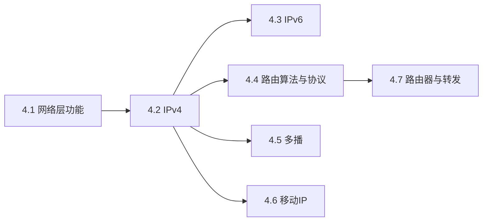
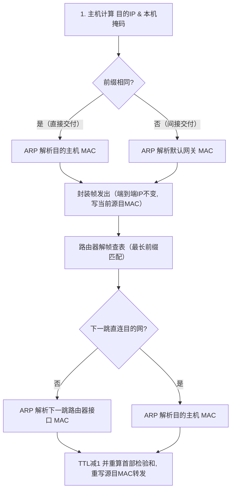

# 第4章 网络层

> [!abstract] 本章复盘目标
> 网络层解决的是跨越多个异构网络的主机到主机交付：主机怎样编址，路由器怎样选路和逐跳转发，以及 IPv4/IPv6、路由协议、多播和移动场景怎样工作。复习主线是：**地址与分组 -> 本地交付/跨网转发 -> 路由表来源 -> 特殊网络服务**。

> [!success] 选择题选项深度消化说明
> 本章课后选择题已按“每道题、每个选项”完成考点剖析与错因审查。笔记严格遵循**去题号化**与**小节严格归位**原则，并将核心考点以 `***<u>粗体+斜体+下划线</u>***` 组合突出，配合结构化思考推导模型、易错陷阱提示与分类属性标签，便于考前极速背诵与推导。

> [!important] 近 18 年 408 计网真题雷达（2009—2026）
> - **考频画像**：18 年共考查 **35 道主归属单选题 + 4 道跨章渗透题**，以及 **8 道主归属大题**（`2009/2013/2014-T43/2015/2018/2019/2020/2024-T47`）和 5 道跨章大题（`2011/2012/2021/2022/2025-T47`）；近 5 年共 11 道主归属选择 + 1 道跨章选择 + 3 道大题（`2022-T35/T36/T37/T47`、`2023-T38/T39/T40`、`2024-T35/T47`、`2025-T36/T37/T47`、`2026-T37/T38/T39`）。详见 [[00_408计网｜考前急救与真题落点总控|返回计网总控]]。
> - **近 5 年考法演变（2022—2026）**：子网规划重均分定位（2026-T39）、已有主机反推掩码与多区划分（2022-T36、2025-T47）及范围精算（2023-T39）；路由转向 LS 断链重算并聚合计数（2026-T37）、OSPF 分区域（2026-T38）与多 AS 综合（2024-T47）；NAT 延伸至 `/30` 对端推算（2023-T38）及改 UDP 源端口重算校验和（2025-T37）。
> - **高频丢分盲区**：① 划 5 子网未右半偏心切、恰划 3 子网跨 128 墙、算余量漏扣路由器口（2018/2019/2021）；② 过路由器误只改目的 MAC、双 NAT 漏静态端口映射、片偏移误拿片长除 8（2018/2020）；③ 路由表漏 `/32` 或 `0/0`、聚合后忘用最长前缀匹配、RIP 16 当可达、跨 AS 错用 RIP（2009/2010/2013/2014/2016/2024）；④ ICMP 直接服务误选 PPP、拥塞丢包误判超时（2010/2012）。

## 考纲定位

- **核心考点**：IPv4 数据报首部、分类地址/子网划分/CIDR、NAT、ARP、DHCP、ICMP、路由器逐跳转发、RIP/OSPF/BGP、网络层设备。
- **重点计算**：IP 分片与片偏移、子网规划（FLSM/VLSM）、最长前缀匹配查表、距离向量/RIP 表更新、流水时延计算。
- **其他考纲内容**：SDN 基本概念、IPv6 主要特点和地址、IP 多播概念和地址、移动 IP 概念与通信过程。IPv4/IPv6 过渡和多播 MAC 映射等可作为相关拓展。

## 章节知识脉络

---

# 4.1 网络层的功能

## 4.1.1 异构网络互连 【📌 扫一眼｜确认“我还会”就过】

### 这一节要解决什么问题

为什么不同底层技术、编址和拓扑的网络能组成一个互联网？

- 网络层向上提供**主机到主机**的通信；它以统一的 IP 协议屏蔽不同链路层网络的差异。
- 真正意义的网络互连通常依赖**路由器**。集线器只扩展物理网络，交换机/网桥通常只扩展二层网络；它们不把不同 IP 网络互连起来。

![[assets/第4章-网络层/图4.1a-实际互连网络.jpg|500]]

![[assets/第4章-网络层/图4.1b-虚拟互连网络.jpg|430]]

> [!important] 必须记住
> IP 网络是“虚拟互连网络”：底层网络可以异构，但只要都运行 IP，在网络层看来就像一个统一的网络。

| 中继系统 | 工作层次 | 典型设备 | 能否实现不同网络的互连 | 域隔离属性 |
|---|---:|---|---|---|
| 物理层 | 1 | 中继器、集线器 | 否，***<u>只扩大同一物理网络</u>*** | 不隔离冲突域，不隔离广播域 |
| 数据链路层 | 2 | 网桥、交换机 | 通常否，***<u>只扩展二层广播域</u>*** | ***<u>隔离冲突域</u>***，不隔离广播域 `[真题·2010-T38 / 2015-T37]` |
| 网络层 | 3 | 路由器 | **是**，***<u>实现异构网络互连</u>*** | ***<u>隔离冲突域，隔离广播域</u>*** |
| 网络层以上 | 4 及以上 | 网关 | **是**，可做***<u>高层协议转换</u>*** | 隔离冲突域，隔离广播域 |

> [!warning] 易错点
> “网关”在 TCP/IP 历史语境中有时指路由器；按 OSI 分层题意，网络层以上的协议转换设备才称网关。应看题干上下文。

> [!abstract] 💡 解题核心思考模型：异构网络判定与互连边界
> - **异构判定标准**：判定网络是否“异构”取决于通信子网的***<u>物理层或数据链路层协议至少有一项不同</u>***（及数据单元差异），与终端计算机的***<u>操作系统无关</u>***。
> - **互连层次原则**：使用中继系统互连时，***<u>该设备所在层次及以下各层协议允许不同</u>***，但***<u>该设备以上无法转换的高层协议必须保持兼容相同</u>***。
>
> > [!warning] 易错陷阱与干扰项
> > - 选项常把“互联网通常统一使用 IP”偷换为“互连双方的网络层协议绝不可能不同”（专用互连设备/多协议路由器允许连接 IPv4 与 IPv6 等不同网络层体系）。

## 4.1.2 路由与转发 【🔥 必背｜停下来默背 1 遍】

- **路由选择** `【控制平面】`：<mark>多个路由器协同交换信息、运行选路算法、生成和维护</mark>***<u>路由表</u>***。 `[真题·2012-T37]`
- **分组转发** `【数据平面】`：单个路由器根据***<u>转发表</u>***<mark>将到达分组从合适输出端口转发出去</mark>（执行***<u>存储转发机制</u>***：必须先收完整分组再开始发送）。 `[真题·2012-T37]`
- 路由表偏重计算和维护；转发表由其导出，偏重高速查找。基础题中常不严格区分，综合题必须区分。

> [!abstract] 💡 解题核心思考模型：路由表与逐跳转发
> - **路由表核心内容**：保存***<u>目的网络 $\rightarrow$ 下一跳 IP/输出接口</u>***，***<u>不保存端到端完整路径</u>***（源主机与中间路由器均不知道全路径）。
> - **转发依据**：转发时仅依据 IP 数据报首部的***<u>目的 IP 地址</u>***，不依据端口号、域名或跨网目的 MAC 地址。
>
> > [!warning] 易错陷阱与干扰项
> > - **完整路径认知**：源主机和中间路由器都只负责决定当前“下一跳”，均不掌握端到端完整路径。
> > - **下一跳 MAC**：由当前链路的 ARP 协议动态解析，***<u>绝不是路由表的核心路径字段</u>***，也不写入原 IP 数据报首部。
> > - **协议分层归属**：IP、ICMP 属于 `【网络层】`，TCP/UDP 属于 `【传输层】`，FTP/HTTP/DNS 属于 `【应用层】`。

## 4.1.3 网络层的两种服务 【⚡ 避坑｜最值钱，必须精读 1 分钟】

### 虚电路服务

![[assets/第4章-网络层/图4.2-虚电路工作原理.jpg|650]]

先建立逻辑连接，之后同一虚电路上的分组沿固定路径、携带较短 VCID；***<u>是否随会话结束而释放取决于虚电路类型：SVC 临时建立并释放，PVC 预先配置并长期存在</u>***。

### 数据报服务

![[assets/第4章-网络层/图4.3-数据报转发.jpg|650]]

无需建连，每个分组携带完整源/目的地址、独立查表选路。TCP/IP 网络层采用**无连接、尽最大努力交付**的数据报服务。

| 项目 | 数据报服务 `【无连接】` | 虚电路服务 `【面向连接】` |
|---|---|---|
| 建立连接 | ***<u>不需要</u>*** | ***<u>必须先建立逻辑连接</u>*** |
| 选路 | ***<u>每个分组独立选路转发</u>*** | <mark>建立时确定路径</mark>，***<u>后续沿同一路由固定转发</u>*** `[真题·2020-T34]` |
| 首部开销 | 携带***<u>完整源/目的 IP 地址</u>*** | <mark>仅建连阶段用全地址</mark>，传输阶段携带***<u>短 VCID</u>*** `[真题·2020-T34]` |
| 顺序与可靠性 | ***<u>不保证有序，不保证可靠</u>*** | ***<u>保证分组有序到达，通常由网络负责可靠性</u>*** `[真题·2020-T34]` |
| 故障适应性 | 节点故障可***<u>自动更新路由绕行</u>***，鲁棒性强 | ***<u>经过故障节点的虚电路全部中断</u>*** |
| 资源共享 | 动态统计复用，适合突发性通信 | 逻辑信道复用，***<u>适合长时间/大批量通信</u>***（摊薄建连开销） |

> [!important] 关键边界
> IP 的“尽最大努力”意味着不保证无差错、按时、有序、无重复地交付；它也不是主动随意丢弃，只会在首部差错、TTL 到期、缓存/拥塞等条件下丢弃。可靠性交付由 TCP 等高层承担。

> [!abstract] 💡 解题核心思考模型：虚电路与数据报辨析
> - **虚电路本质**：建立的是***<u>逻辑连接</u>***，<mark>并非为每条虚电路独占一条物理线路</mark>；多条虚电路可共享链路，**建立虚电路不必然要求预留带宽**，是否预留由具体技术和服务质量机制决定。虚电路仍属于分组交换；共享介质是否发生冲突取决于底层介质访问机制。 `[真题·2020-T34]`
> - **生命周期分类**：包含临时建立释放的 SVC（动态虚电路）和预先配置固定的 PVC（永久虚电路），***<u>并非会话结束都必须释放</u>***。
> - **适用场景对比**：虚电路适合长时间、大批量通信，以摊薄建立与释放连接的开销；仅有虚电路并不自动保证实时性。数据报在网络节点故障率高、可重新选路时更有适应性。
>
> > [!warning] 易错陷阱与干扰项
> > - **电路交换 vs 虚电路**：传统电路交换不提供逐分组差错控制；虚电路分组交换在教材口径下由网络负责差错与流量控制。
> > - **数据报失序**：数据报独立选路只是***<u>可能失序</u>***，绝非“必然失序”。

- `【⚡ 真题补丁｜2020-T34】` 虚电路建立的是逻辑连接，不必为每条虚电路预先分配独占带宽，可保证同一虚电路内分组按序到达。

## 4.1.4 SDN 的基本概念 【📌 扫一眼｜确认“我还会”就过】

![[assets/第4章-网络层/图4.4-SDN结构.jpg|650]]

- SDN 将控制平面和数据平面解耦：控制逻辑**逻辑集中**于控制器，转发设备分布部署并匹配流表。
- 北向接口面向网络应用；南向接口（如 OpenFlow）连接控制器与转发设备；东西向接口用于控制器集群协作。
- 优点是全局视图、可编程、设备简化；风险是控制器成为安全与性能的关键点。

> [!abstract] 💡 解题核心思考模型：SDN 架构与接口方向
> - **架构核心**：SDN 是***<u>控制平面与数据平面解耦</u>***的软件可编程体系，非全新物理拓扑。
> - **接口流向判定**：
>   - ***<u>控制器 $\rightarrow$ 交换机下发流表</u>*** $\Rightarrow$ **南向接口**（如 OpenFlow）。 `[真题·2022-T37]`
>   - ***<u>应用 $\rightarrow$ 控制器表达策略与需求</u>*** $\Rightarrow$ **北向接口**。 `[真题·2022-T37]`
>   - ***<u>控制器集群之间协作</u>*** $\Rightarrow$ **东西向接口**。 `[真题·2022-T37]`
>
> > [!warning] 易错陷阱与干扰项
> > - OpenFlow 是南向接口协议，***<u>并没有取代所有的传统网络协议与路由决策逻辑</u>***，只是将路由计算交由集中控制器完成。

- `【⚡ 真题补丁｜2022-T37】` SDN 控制器通过**南向接口**（如 OpenFlow）向底层分组转发设备下发流表，控制数据平面转发。

## 4.1.5 拥塞控制 【📌 扫一眼｜确认“我还会”就过】

- **拥塞**：网络中分组量超过处理能力，负载继续升高而吞吐增长很小甚至下降。
- **拥塞控制** `【全局性】`：涉及全网资源与所有路由器队列；**流量控制** `【点到点】`：防止发送方压垮接收方。
- **控制分类**：
  - **开环控制** `【静态预防】`：预先制定接纳、调度、丢弃策略，***<u>不依赖当前运行反馈</u>***；
  - **闭环控制** `【动态调整】`：在线监测网络状态，***<u>基于反馈机制</u>***动态调节。

> [!abstract] 💡 解题核心思考模型：网络拥塞的判定与排队分析
> - **拥塞判定**：负载增加而吞吐量增长很小，可能已出现轻度拥塞；负载继续增加而吞吐量反而下降，是严重拥塞的典型表现。
> - **多路汇聚排队模型**：全双工不等于不拥塞；多个输入流汇聚到同一输出口时，若实际到达速率持续高于输出速率，队列会增长；有限缓存耗尽后才会丢包。短时突发可能只造成暂时排队。
> - **拓扑题检查动作**：***<u>按流向汇总所有可能进入同一输出端口的输入速率，再与该输出容量比较；不能只比较相邻两条链路的标称带宽</u>***。
>
> > [!warning] 易错陷阱与干扰项
> > - 仅凭节点收发分组的“数量增多/减少”不能直接判定拥塞；单纯增加带宽或缓存也无法根治拥塞（可能引发重传风暴与更大延迟）。

---

# 4.2 IPv4

## 4.2.1 IPv4 分组 【🔥⚡ 必背+避坑｜停下来默背 1 遍 + 精读 1 分钟】

### IPv4 首部与字段

![[assets/第4章-网络层/图4.5-IPv4数据报格式.jpg|750]]

IPv4 数据报 = 首部 + 数据。固定首部 20B；首部长度字段以 4B 为单位，最大首部 60B。

| 字段 | 位数/单位 | 用途与考试要点 |
|---|---|---|
| 版本 | 4 bit | IPv4 固定为 4 |
| 首部长度 IHL | 4 bit，单位 ***<u>4B</u>*** | 常见 `0x45`：版本 4、IHL=5，即首部 20B（最大 60B） |
| 总长度 | 16 bit，单位 ***<u>1B</u>*** | 首部 + 数据，最大 65535B |
| 标识 | 16 bit | ***<u>同一原始数据报的分片标识相同</u>***，不是连接序号 |
| 标志 | 3 bit | ***<u>DF=1 禁止分片</u>***；***<u>MF=1 后面还有分片</u>***（MF=0 示末片或未分片） |
| 片偏移 | 13 bit，单位 ***<u>8B</u>*** | 分片数据区相对原数据区的起始位置 $/8$ |
| TTL | 8 bit | ***<u>每过一台路由器减 1，减至 0 时丢弃，并在不属于 ICMP 禁发情形时通常回送“时间超过”</u>*** `[真题·2012-T47 / 2014-T43]` |
| 协议 | 8 bit | 上交协议：***<u>TCP=6，UDP=17，ICMP=1，OSPF=89</u>*** |
| 首部检验和 | 16 bit | ***<u>只校验首部</u>***（16位反码求和取反，每跳重算；***<u>出错直接丢弃且不回送 ICMP</u>***） `[真题·2012-T37]` |
| 源/目的地址 | 各 32 bit | 跨普通路由器转发端到端保持不变，NAT 转换是例外 |

> [!warning] 单位速记陷阱
> - 首部长度 IHL $\rightarrow$ 单位 **4B**；总长度 $\rightarrow$ 单位 **1B**；片偏移 $\rightarrow$ 单位 **8B**。

> [!abstract] 💡 解题核心思考模型：IPv4 首部字段与分片定位
> - **单位速记三剑客**：***<u>IHL $\times$ 4B</u>***、***<u>总长度 $\times$ 1B</u>***、***<u>片偏移 $\times$ 8B</u>***。
> - **协议层速判**：题库口径下 ***<u>IP、ICMP、ARP、RARP 属网络层相关协议，TCP/UDP 属传输层</u>***；IPv4 的“版本”字段表示版本 4，“协议”字段才表示数据应交给哪个上层或配套协议。
> - **分片计算四步法**：
>   1. **非末片最大数据量**：$D_{max} = 8 \lfloor\frac{MTU - H}{8}\rfloor$（***<u>非末片数据载荷必须是 8B 整数倍</u>***）。 `[真题易错·2018-T47 / 2021-T36]`
>   2. **切片数据边界**：第 $i$ 片首字节编号 $= \text{片偏移} \times 8$；尾字节编号 $= \text{首字节} + \text{数据长} - 1$。
>   3. **标志位判定**：除最后一片外 ***<u>$MF=1$</u>***，最后一片 ***<u>$MF=0$</u>***；片偏移为 0 且 $MF=0$ 说明***<u>未分片</u>***。
>   4. **分片与重组位置**：源主机与沿途路由器均可分片，但***<u>仅在目的主机进行重组</u>***。
> - **再次分片边界**：***<u>已经形成的 IPv4 分片还可能在后续更小 MTU 链路上再次分片；各片可沿不同路径乱序到达，但仍只由最终目的主机重组</u>***。
> - **片偏移 0 的判定边界**：***<u>片偏移为 0 只能说明该片从原数据区起点开始，可能是首片也可能是未分片数据报；必须再结合 MF、总长度和题目上下文判断</u>***。
>
> > [!warning] 易错陷阱与干扰项
> > - **DF=1 遇超限**：若 $DF=1$ 且分组长度大于输出链路 MTU，路由器直接丢弃并向源主机发送 ICMP 终点不可达（需要分片但设置了 DF 标志）报文。
> > - **首部检验和差错**：检验和不含伪首部；若检验和错误，路由器***<u>直接静默丢弃，绝不向源地址回送 ICMP 报文</u>***（因源 IP 可能已损坏）。

### IP 分片计算模板

![[assets/第4章-网络层/图4.6-IP分片.jpg|720]]

设原报文首部为 $H$，输出链路 MTU 为 $M$：

$$
D_{max}=8\left\lfloor\frac{M-H}{8}\right\rfloor
$$

1. 先取每个非末片最多承载的数据 $D_{max}$。
2. 原数据长度为 `总长度 - H`，按 $D_{max}$ 连续切片。
3. 每片总长度 = 本片数据长度 + $H$；片偏移 = 此前数据总长度 $/8$。
4. <mark>除最后一片外 MF=1，最后一片 MF=0</mark>；标识相同。 `[真题·2021-T36]`

> [!tip] 例：4000B、首部20B、MTU=1500B
> 数据 3980B；每个非末片装 1480B。三片数据为 1480、1480、1020B，片偏移为 0、185、370，总长度为 1500、1500、1040B。

- `【⚡ 真题补丁｜2018-T47 / 2021-T36】` `MTU=800B` 且首部 20B 时非末片载荷最大 `776B`；2021-T36 第 2 片总长 `796B`、`MF=1`，偏移 `97`（`776/8`）。
- `【⚡ 真题补丁｜2012-T47 / 2014-T43】` TTL 每过一台路由器减 1；抓包显示 TTL 由 64 变为 49 对应经过 15 台路由器（2012-T47）。

## 4.2.2 IPv4 地址 【🔥⚡ 必背+避坑｜停下来默背 1 遍 + 精读 1 分钟】

### 地址、分类地址与特殊地址

- IPv4 地址长 32 bit，标识**接口**而非整台主机；多网卡主机/路由器每个接口需有 IP，且连到不同网络的接口网络前缀不同。
- 传统分类地址：A 类首位 `0`，B 类 `10`，C 类 `110`；现代转发以 CIDR 前缀为准，分类主要用于理解历史规则。
- **点分十进制初筛**：***<u>每个十进制段必须位于 0～255；末段为 0 或 255 并不自动等于网络地址或广播地址，必须结合掩码判断</u>***。
- **分类地址数量边界**：在明确采用默认分类掩码时，***<u>传统 C 类网络共有 256 个地址、可分配给普通接口的地址为 $2^8-2=254$ 个</u>***。

![[assets/第4章-网络层/图4.7-分类IPv4地址.jpg|650]]

| 特殊地址 | 含义 | 能否作普通主机地址 | 路由与源/目的限制 |
|---|---|---|---|
| 主机号全 0 | 网络/子网地址 | 否 | 仅标识网络本身 |
| 主机号全 1 | <mark>该网络直接广播地址</mark> | 否 | 仅作目的地址；教材传统口径下可向指定网络广播，现代路由器通常默认禁用定向广播转发 `[真题·2011-T38 / 2012-T39 / 2019-T47]` |
| `127.0.0.0/8` | 本地环回地址 | 否 | <mark>可作本机源/目的</mark>，***<u>绝不送上物理网络</u>*** `[真题·2017-T36]` |
| `0.0.0.0` | 本网络本主机 | 不作普通目的 | DHCP 初始申请阶段***<u>仅作源 IP</u>*** `[真题·2017-T36]` |
| `255.255.255.255` | 受限广播地址 | 否 | ***<u>仅作目的 IP，路由器绝不向外转发</u>*** `[真题易错·2017-T36]` |
| 私有地址块 | `10/8`, `172.16/12`, `192.168/16` | 内网可用 | 内网可作源/目的；***<u>不作为全球公网可路由前缀，公网边界通常过滤或不正常转发</u>*** |

> [!abstract] 💡 解题核心思考模型：子网规划与 CIDR 最长匹配
> - **地址块关键数量推导**：
>   - 地址块总地址数 $= 2^{32-n}$；普通可分配主机 IP 数 $= 2^{32-n} - 2$（<mark>扣除网络地址与直接广播地址</mark>）。 `[真题·2010-T37 / 2017-T38 / 2023-T39 / 2026-T39]`
>   - ***<u>FLSM 规划</u>***：分别计算“当前与未来所需子网数”和“每网最大主机数”对借位/留位的约束，再选择***<u>同时满足两项条件</u>***的统一掩码。
>   - ***<u>VLSM 规划</u>***：按需求***<u>从大子网到小子网</u>***依序对齐分配，防止重叠；<mark>若题目追问“可能的最小子网”，应沿二叉划分树让其他子网尽可能大</mark>，***<u>不能机械平均切分</u>***。 `[真题易错·2019-T37 / 2021-T35 / 2025-T47]`
>   - 点到点链路：传统考题按 ***<u>`/30`（2 个可用 IP）</u>*** 作答；明确采用 RFC 3021 新标准时可用 ***<u>`/31`（2 个地址全可用，无网络/广播保留）</u>***。
> - **双“最多”题的语义边界**：***<u>“最多还能划分多少子网”与“不再细分时每网最多容纳多少主机”可以分别对应两种借位方案，不要求两个最大值在同一种划分中同时实现</u>***。
> - **CIDR 归一化**：***<u>任意写成 `IP/n` 的 IP 不一定是地址块首地址，必须把后 $32-n$ 位清零后才能得到规范网络地址</u>***。 `[真题·2022-T35]`
> - **最长前缀匹配原则**：多个路由表项均匹配目的 IP 时，***<u>选择子网掩码最长（网络前缀最长）的表项转发</u>***（`/32` 主机路由优先于具体子网，`0.0.0.0/0` 默认路由为最后兜底）。 `[真题易错·2013-T47 / 2015-T38]`
> - **聚合语义边界**：***<u>只要求“覆盖若干路由”时可以允许聚合块带入额外地址；若要求“不引入多余地址”，子块必须连续、同下一跳，并按大小相同、相邻且边界对齐的兄弟块精确合并</u>***。
> - **地址块分配冲突**：***<u>已分配子网与覆盖它的任何祖先前缀存在地址空间重叠，祖先前缀不能再作为另一独立子网分配</u>***；判断若干子网能否组成母网还要同时检查对齐、无重叠和完整覆盖。
>
> > [!warning] 易错陷阱与干扰项
> > - **划分子网的本质**：划分子网能够***<u>缩小广播域、提升地址利用率和安全性</u>***，但***<u>不会增加网络总的主机容纳上限</u>***（反而因多占网络/广播地址而略有减少）。
> > - **默认网关合法性**：默认网关必须是***<u>本子网内已分配给路由器接口的合法主机 IP</u>***，绝不能配置为子网网络地址或广播地址。
> > - **路由聚合条件**：精确聚合不仅要求共同前缀，<mark>还要求子地址块连续、对齐且具有相同下一跳</mark>，***<u>不得引入多余外部地址</u>***。 `[真题·2009-T47 / 2011-T37 / 2018-T38]`

![[assets/第4章-网络层/图4.8-路由聚合.jpg|600]]

- `【⚡ 真题补丁｜2010-T37 / 2011-T38 / 2012-T39 / 2017-T38】` `IP & 掩码` 得网络号；`/30` 广播达 2 主机；`/22` 广播末 10 位全 1；`/16` 均分 128 网每网 510。
- `【⚡ 真题补丁｜2017-T36 / 2019-T37 / 2021-T35】` `0.0.0.0` 仅作源 IP；划 5 子网右半偏心切最小 254（2019）；恰划 3 子网仅有 `1/2+1/4+1/4`（2021）。
- `【⚡ 真题补丁｜2018-T47 / 2022-T35 / 2023-T39 / 2026-T39】` 算余量勿漏扣路由器接口（2018-T47）；`/22` 均分 32 子网得 `/27`，按步长 32 定位主机（2026-T39）。
- `【⚡ 真题补丁｜2011-T37 / 2013-T47 / 2015-T38 / 2018-T38】` 4 个连续 `/21` 聚合成 `/19`（2018-T38）；查表始终按最长前缀匹配，`/27` 优于 `/25` 与 `/23`（2015-T38）。

## 4.2.3 网络地址转换 NAT 【🔥⚡ 必背+避坑｜停下来默背 1 遍 + 精读 1 分钟】

![[assets/第4章-网络层/图4.9-NAT工作原理.jpg|720]]

- NAT 将私网 `{私有 IP, 端口}` 映射为公网 `{公网 IP, 端口}`，缓解公网 IPv4 地址不足并隐藏内网结构。
- <mark>出站：改源 IP/源端口并建表；入站响应：按表反向改目的 IP/目的端口</mark>。静态映射（端口映射）允许公网主动访问内网服务。 `[真题易错·2020-T47]`

> [!abstract] 💡 解题核心思考模型：NAT 转换与跨网追踪
> - **转换机制** `【网络层 + 传输层】`：NAT 路由器维护 `{私网 IP:端口 $\leftrightarrow$ 公网 IP:端口}` 映射表。
>   - **出站方向**：将 IP 数据报首部的***<u>源私网 IP 及源端口</u>***替换为 NAT 路由器的***<u>公网 IP 及新分配端口</u>***。 `[真题·2016-T38 / 2023-T38 / 2025-T37]`
>   - **入站响应**：按映射表将***<u>目的公网 IP 及目的端口</u>***反向替换为***<u>内网主机私网 IP 及内网端口</u>***。
> - **地址端到端对比**：普通路由器转发***<u>源/目的 IP 端到端完全不变</u>***；仅经过 NAT 路由器时源/目的 IP 与端口才会发生改写。
> - **多级 NAT 追踪**：***<u>分组每经过一层 NAT，都会按该 NAT 的内外接口和方向再次转换相应地址/端口</u>***；不能把相邻路由器接口、网络地址或广播地址误当成 NAT 出口映射地址。
>
> > [!warning] 易错陷阱与干扰项
> > - NAT、CIDR、子网划分都只能**缓解** IPv4 枯竭，**根本解决** IPv4 地址耗尽的根本方案是***<u>全面过渡到 IPv6</u>***。

- `【⚡ 真题补丁｜2016-T38 / 2023-T38】` NAT 出口常用 `/30` 点对点链路（块长 4，掐头去尾仅 2 个可用 IP），由一端接口 IP 可锁定对端公网 IP（如 `.34` 配 `.33`）。
- `【⚡ 真题补丁｜2019-T47 / 2020-T47 / 2025-T37】` 双 NAT 同名私网互访需在被访端配置静态端口映射（2020-T47）；NAPT 改写 UDP 源端口后须同步重算已启用的检验和（2025-T37）。

## 4.2.4 网络层转发分组的过程 【🔥⚡ 必背+避坑｜停下来默背 1 遍 + 精读 1 分钟】

### 路由器逐跳转发算法

1. 取 IP 数据报的目的地址 $D$。
2. 用 $D$ 与转发表各前缀比对，按最长前缀匹配选出表项。
3. 若下一跳是直连目的网络，则 ARP 目的主机；否则 ARP 下一跳路由器接口。
4. 重新封装为输出链路的帧，从输出接口发送；无匹配时使用默认路由，仍无则报告目的不可达。

> [!abstract] 💡 解题核心思考模型：逐跳转发中 IP 与 MAC 的动态演变
> - **交付判定三部曲**：
>   1. **源端判定**：<mark>主机用自身子网掩码与目的 IP 按位与</mark>，若与本机网络前缀相同 $\Rightarrow$ ***<u>直接交付</u>***（ARP 目的主机 MAC）；若不同 $\Rightarrow$ ***<u>间接交付</u>***（ARP 默认网关 MAC）。 `[真题易错·2016-T39 / 2022-T36]`
>   2. **路由器查表**：解封装链路层帧 $\rightarrow$ 提取目的 IP $\rightarrow$ 执行***<u>最长前缀匹配</u>*** $\rightarrow$ 确定下一跳 IP 与输出接口。
>   3. **重新封帧**：利用 ARP 解析下一跳的 MAC 地址 $\rightarrow$ 重新封装为输出链路帧格式发出。
> - **地址变化规律**：***<u>IP 看端到端（源/目的 IP 全程不变），MAC 看当前一跳（源/目的 MAC 逐跳重写）</u>***。 `[真题易错·2018-T37]`
> - **拓扑题检查动作**：***<u>逐跳写出“源 IP、目的 IP、源 MAC、目的 MAC”四元组；普通路由器只重写当前帧的两个 MAC，NAT 才可能改 IP 与端口</u>***。
>
> > [!warning] 易错陷阱与干扰项
> > - 下一跳 IP 仅供路由器内部确定下一跳硬件地址，***<u>绝不能写回原 IP 数据报首部的目的 IP 字段</u>***。
> > - 目的为 `255.255.255.255` 的受限广播***<u>只在本地广播域内交付，不查询默认路由，也不由路由器转发</u>***；同链路主机的掩码或默认网关配置错误时，应分别追踪双方判定、路由与返回路径，不能直接断言一定互通；路由器是否可从接收接口转发还需看具体配置。

- `【⚡ 真题补丁｜2016-T39 / 2018-T37 / 2022-T36】` 默认网关设错只断跨网、同网仍通（2016-T39）；分组过普通路由器源/目的 MAC 成对重封装，IP 端到端不变（2018-T37）。

## 4.2.5 地址解析协议 ARP 【🔥⚡ 必背+避坑｜停下来默背 1 遍 + 精读 1 分钟】

![[assets/第4章-网络层/图4.10-ARP工作原理.jpg|720]]

ARP 的作用是解析**本局域网内** <mark>IP 到 MAC 的映射</mark>。ARP 请求是链路层广播，ARP 响应通常是单播；各设备维护可老化的 ARP 缓存。 `[真题·2012-T38]`

![[assets/第4章-网络层/图4.11-ARP四种情况.jpg|720]]

| 发送者 | IP 分组要去往 | ARP 的解析对象 |
|---|---|---|
| 主机 | 同一局域网的主机 `【直接交付】` | 目的主机 MAC |
| 主机 | 异网主机 `【间接交付】` | ***<u>默认网关接口 MAC</u>*** |
| 路由器 | 直连网主机 `【直接交付】` | 目的主机 MAC |
| 路由器 | 非直连网主机 `【间接交付】` | ***<u>下一跳路由器接口 MAC</u>*** |

> [!abstract] 💡 解题核心思考模型：ARP 运作机理与广播域边界
> - **工作特性** `【网络层】`：ARP 是解决同一局域网内部由 IP 解析出 MAC 的协议。
>   - **ARP 请求**：以***<u>链路层广播（目的 MAC 全 F）</u>***形式发送，被限制在***<u>同一广播域/VLAN 内部</u>***。 `[真题·2015-T47 / 2021-T47]`
>   - **ARP 响应**：目标主机以***<u>链路层单播</u>***形式直接回复发送方。
> - **跨网通信 ARP 目标**：源主机跨网发送时，***<u>第一跳 ARP 查询的是默认网关的 MAC 地址</u>***，绝非远端目的主机的 MAC。
> - **独立掩码判定**：***<u>每台主机都使用自己的掩码独立判断直接/间接交付；掩码不一致可能造成不对称 ARP 和单向可达</u>***。
> - **VLAN 学习边界**：***<u>ARP 表只会直接学习本 VLAN/广播域中的主机或本 VLAN 网关；物理上接在同一交换机并不代表属于同一 ARP 广播域</u>***。 `[真题易错·2024-T35]`
>
> > [!warning] 易错陷阱与干扰项
> > - 接收数据并不以 ARP 缓存中已有对端映射为前提；只有当***<u>本地准备向外发送数据帧且 ARP 缓存未命中</u>***时才触发 ARP 请求。
> > - ARP 请求广播后，广播域内其他主机都会收到，***<u>但只有目标 IP 的拥有者响应，其他主机不会因为收到了广播就回复</u>***。

- `【⚡ 真题补丁｜2012-T38 / 2015-T47 / 2021-T47 / 2024-T35】` ARP 解析 MAC；空表广播全 F；VLAN1 与 VLAN3 隔离广播致 ARP 表互不包含（2024）。

## 4.2.6 动态主机配置协议 DHCP 【🔥⚡ 必背+避坑｜停下来默背 1 遍 + 精读 1 分钟】

DHCP 是基于 UDP 的应用层协议，为主机自动配置 IP、掩码、默认网关、DNS 和租期。 下表按教材的**初次申请、无中继且服务器广播应答**的模型说明；Offer 和 ACK 并非在所有实现中都必然广播。

| 阶段 | 报文 | 传输层承载 | 客户端源 IP | 目的 IP | 作用与交互细节 |
|---|---|---|---|---|---|
| 发现 | Discover | UDP 67/68 | `0.0.0.0` | `255.255.255.255` | <mark>广播寻找网络中的 DHCP 服务器</mark> `[真题·2015-T47 / 2022-T47]` |
| 提供 | Offer | UDP 67/68 | 服务器 IP | `255.255.255.255` | 服务器广播拟分配的 IP、掩码、网关、租期等 |
| 选择请求 | Request | UDP 67/68 | ***<u>`0.0.0.0`</u>*** | `255.255.255.255` | ***<u>广播选择接受某服务器的 Offer（并通知其他服务器释放）</u>*** |
| 确认 | ACK | UDP 67/68 | 服务器 IP | `255.255.255.255` | 服务器确认绑定，客户端正式获得 IP 配置 |

> [!abstract] 💡 解题核心思考模型：DHCP 生命周期与租约续订
> - **协议属性** `【应用层】`：基于 ***<u>UDP（服务器端口 67，客户端端口 68）</u>***。
> - **应答方式边界**：按 [RFC 2131 第 4.1 节](https://www.rfc-editor.org/rfc/rfc2131.html#section-4.1)，服务器处理 Offer/ACK 时会根据中继地址、客户端地址和广播标志决定发送方式；不要把教材的广播示例当作一律广播。
> - **租期续订机制**：
>   - 租期达到 ***<u>50%</u>*** 时：客户端以***<u>当前已获 IP 为源地址</u>***，向提供租约的 DHCP 服务器发送 ***<u>单播 Request</u>***。
>   - 若未响应，租期达到 ***<u>87.5%</u>*** 时：客户端仍以***<u>当前已获 IP 为源地址</u>***，向全网发送 ***<u>广播 Request</u>***。
>   - 租期到期未续订成功：立即停止使用该 IP，重新进入 Discover 状态。
> - **协议职责排除法**：***<u>ARP 解析 IP 到 MAC，RARP 是历史上的反向解析，NAT 转换地址，只有 DHCP 才能动态下发 IP、掩码、网关、DNS 与租期等完整主机配置</u>***。 `[真题·2012-T38]`
>
> > [!warning] 易错陷阱与干扰项
> > - 客户端在发出第三步 Request 报文时，<mark>因尚未收到 ACK 确认</mark>，***<u>源 IP 必须仍为 `0.0.0.0`</u>***，不能提前使用 Offer 中的拟分配 IP。 `[真题易错·2025-T36]`

- `【⚡ 真题补丁｜2015-T47 / 2022-T47 / 2025-T36】` 初次入网 `DISCOVER` 与 `REQUEST` 源 IP 为 `0.0.0.0`、目的 `255.255.255.255`、目的 MAC 全 F。

## 4.2.7 网际控制报文协议 ICMP 【⚡ 避坑｜最值钱，必须精读 1 分钟】

- ICMP 是 IP 的配套网络层协议，<mark>ICMP 报文封装在 IP 数据报中</mark>，**不是**应用层协议。 `[真题易错·2012-T33]`
- 差错报告：终点不可达、时间超过、参数问题、改变路由（重定向）；教材中的源点抑制在现代标准中已废弃。
- 不对 ICMP 差错报文、非首片、目的为广播/多播及特殊地址的数据报再发送 ICMP 差错报告，避免反馈风暴。
- `ping` 用 ICMP 回送请求/回答；`traceroute/tracert` 递增 TTL，利用沿途的 ICMP 时间超过报文定位路径。

> [!abstract] 💡 解题核心思考模型：ICMP 报文类型与差错禁用边界
> - **协议属性** `【网络层】`：<mark>直接装入 IP 数据报的数据部分传送</mark>（协议号 1），不是应用层协议。 `[真题易错·2012-T33]`
> - **报文分类**：
>   - **差错报告报文**：
>     - ***<u>终点不可达</u>***（网络/主机/协议/端口不可达或需要分片但 DF=1）、***<u>时间超过</u>***（TTL 减至 0 或分片重组超时）；
>     - ***<u>参数问题</u>***（首部字段损坏）、***<u>改变路由/重定向</u>***。
>   - **询问报文**：***<u>回送请求与回答</u>***（`ping` 命令底层）、***<u>时间戳请求与回答</u>***。
> - **ICMP 差错报文“五不发”边界**：
>   1. ***<u>不对 ICMP 差错报告报文</u>*** 再发差错报文；
>   2. ***<u>不对第一个分片以后的后续所有分片</u>*** 发送差错报文；
>   3. ***<u>不对具有组播/多播或广播地址的数据报</u>*** 发送差错报文；
>   4. ***<u>不对具有特殊地址（如 127.0.0.0 或 0.0.0.0）的数据报</u>*** 发送差错报文；
>   5. <mark>对首部检验和出错的数据报直接丢弃</mark>，***<u>不发送任何 ICMP 报文</u>***。 `[真题·2012-T37]`
> - **TTL 与工具辨析**：***<u>路由器收到 TTL=1 的数据报时先减为 0，再丢弃并通常返回“时间超过”</u>***；`ping` 使用的是回送请求/回答询问报文，不属于差错报告。
> - **标准版本边界**：***<u>旧教材把拥塞丢包对应为 ICMP“源点抑制”，但现代标准已废弃该报文；作答必须区分教材列出的历史类型与现行机制</u>***。 `[真题易错·2010-T36]`

- `【⚡ 真题补丁｜2010-T36 / 2012-T33 / 2012-T37】` IP 直接承载 ICMP（2012-T33）；拥塞发源抑制（2010-T36）；首部校验错静默丢弃不发 ICMP。

### 4.2 一分钟回顾

- IPv4 转发靠目的 IP 的最长前缀匹配；交付链路上靠当前一跳的 MAC。
- 分片：同标识、偏移单位 8B、非末片数据长度为 8B 整数倍、目的主机重组。
- NAT 改地址/端口；ARP 只在本广播域解析；DHCP 初始阶段四报文以广播为主；ICMP 是 IP 层控制报文。

---

# 4.3 IPv6

## 4.3.1 IPv6 的核心特点 【📌 扫一眼｜确认“我还会”就过】

- **超大地址空间**：地址从 32 bit 扩展到 ***<u>128 bit（16B）</u>***，<mark>地址空间是 IPv4 的</mark> ***<u>$2^{96}$ 倍</u>***（非 96 倍）。 `[真题易错·2023-T40]`
- **固定基本首部**：<mark>基本首部固定为</mark> ***<u>40B</u>***（比 IPv4 简单，字段减至 8 个）；灵活的可选功能移至***<u>扩展首部</u>***中，路由器通常不检查处理扩展首部。 `[真题易错·2023-T40]`
- **校验与分片简化**：
  - ***<u>取消网络层首部检验和</u>***：加快路由器逐跳转发速度（差错控制由链路层 CRC 和传输层校验和负责）。
  - ***<u>中间路由器绝不分片</u>***：遇到超限直接丢弃并向源点发送 ICMPv6“分组太大”报文；***<u>仅源主机可端到端分片</u>***。
- **服务质量与协议支持**：支持使用***<u>流标号（Flow Label）</u>***识别数据流，便于网络提供差异化处理；单靠该字段不能保证 QoS；支持即插即用（无状态自动配置）。
- **通信方式**：支持***<u>单播、多播、任播（Anycast）</u>***，***<u>IPv6 取消了广播地址</u>***（广播功能全部由多播实现）。

> [!abstract] 💡 解题核心思考模型：IPv6 特征与首部演进
> - **首部长度认知**：IPv6 ***<u>基本首部固定 40B</u>***，但整个 IPv6 数据报总长度依然是***<u>可变的</u>***（受扩展首部与数据载荷决定）。
> - **差错控制边界**：IPv6 取消网络层首部检验和***<u>不代表全网无差错检测</u>***，数据链路层（帧校验）和传输层（TCP/UDP 伪首部校验）仍执行差错检测。
>
> > [!warning] 易错陷阱与干扰项
> > - 题干将“$2^{96}$ 倍”混淆为“96 倍”；将“IPv6 基本首部固定”混淆为“IPv6 数据报长度固定”；误认为 IPv6 仍存在广播地址。

## 4.3.2 IPv6 基本首部字段 【📌 扫一眼｜确认“我还会”就过】

![[assets/第4章-网络层/图4.12-IPv6扩展首部.jpg|650]]

![[assets/第4章-网络层/图4.13-IPv6基本首部.jpg|750]]

| IPv6 字段 | 位数 | 核心作用与考点 | 对标 IPv4 概念 |
|---|---|---|---|
| 版本 | 4 bit | IPv6 的版本字段值为 6 | IPv4 版本字段值为 4 |
| 通信量类、流标号 | 8 bit / 20 bit | 区分业务优先级与流服务质量 | IPv4 服务类型/区分服务演进 |
| 有效载荷长度 | 16 bit | ***<u>基本首部之后的字节总数（含扩展首部与数据）</u>*** | 对标（总长度 $-$ 40B） |
| 下一个首部 | 8 bit | ***<u>指明紧随其后的扩展首部类型或高层协议</u>*** | 类似 IPv4 协议字段 |
| 跳数限制 Hop Limit | 8 bit | ***<u>每经一台路由器减 1，减至 0 丢弃</u>*** | ***<u>与 IPv4 TTL 在限制转发跳数的考试模型中作用相当</u>*** `[真题·2023-T40]` |
| 源/目的 IP 地址 | 各 128 bit | 标识源接口与目的接口 | 地址长度扩展为 4 倍 |

## 4.3.3 IPv6 地址表示与压缩规则 【📌 扫一眼｜确认“我还会”就过】

- **基本格式**：冒号十六进制记法，128 bit 分为 ***<u>8 组，每组 4 个十六进制数</u>***（16 bit）。
- **前导零压缩**：每组中***<u>开头的 0 可以省略，末尾的 0 不能省略</u>***（如 `0042` $\rightarrow$ `42`，`4200` 不可省）。
- **双冒号零压缩 `::`**：连续全零组可用 `::` 替代，但***<u>一个 IPv6 地址中至多只能出现一次 `::`</u>***（否则还原时歧义）。
- **特殊保留地址**：
  - `::/128`（未指明地址）：仅可在主机未配置 IP 初始化时作源地址。
  - `::1/128`（本地环回地址）：等价于 IPv4 的 `127.0.0.1`。
  - `FF00::/8`（多播地址）；`FE80::/10`（链路本地单播地址）。

> [!abstract] 💡 解题核心思考模型：IPv6 地址压缩与还原
> - **还原展开公式**：数出非压缩的段数 $k$，则 `::` 处还原出的全零段数为 ***<u>$8 - k$ 组 `0000`</u>***，并在每组左侧补足 4 位十六进制；***<u>最后必须复查恰好 8 组、共 128 bit</u>***。

## 4.3.4 从 IPv4 向 IPv6 过渡 【📌 扫一眼｜确认“我还会”就过】

- **双协议栈（Dual Stack）**：<mark>主机或路由器同时安装配置 IPv4 和 IPv6 两个协议栈</mark>，根据 DNS 解析结果智能选择协议。 `[真题·2023-T40]`
- **隧道技术（Tunneling）**：将 IPv6 数据报***<u>整体封装为 IPv4 数据报的数据部分</u>***，<mark>穿越 IPv4 骨干网络隧道</mark>。 `[真题·2023-T40]`

> [!abstract] 💡 解题核心思考模型：IPv4 与 IPv6 综合对比
> - **共性对比**：在每经路由器减一的题目模型中，Hop Limit 与 TTL 起相同的跳数限制作用；均支持无连接数据报传输。
> - **差异对比**：IPv4 首部可变（20~60B），IPv6 基本首部固定（40B）；IPv4 中间可分片，IPv6 仅源端分片；IPv4 有广播，IPv6 无广播。
> - **组合判断检查动作**：***<u>逐项核对“地址空间倍数、基本首部是否固定、过渡技术、字段功能是否等价”四个限定条件，再组合判断，不能凭单个关键词选项</u>***。

- `【⚡ 真题补丁｜2023-T40】` IPv4 向 IPv6 过渡采用双协议栈和隧道技术；Hop Limit 等价 TTL；基本首部固定 40B 但数据报总长仍可变。

### 4.3 一分钟回顾

- 固定 40B 是 IPv6 **基本首部**；Hop Limit 等价 TTL；IPv6 地址压缩时 `::` 只能出现一次；IPv4 与 IPv6 不直接兼容，过渡靠双栈和隧道。

---

# 4.4 路由算法与路由协议

## 4.4.1 路由算法 【🔥⚡ 必背+避坑｜停下来默背 1 遍 + 精读 1 分钟】

### 静态与动态路由

- **静态路由** `【非自适应】`：由网络管理员手工配置，开销小、安全性高，但不能自适应拓扑变化，适合小型稳定网络。
- **动态路由** `【自适应】`：路由器运行路由协议，自动适应拓扑与流量变化，能动态生成与调整路由表，主要分为距离-向量和链路状态两类。
- **收敛（Convergence）**：网络拓扑改变后，全网所有路由器的路由表***<u>重新达到与当前网络状态完全一致并稳定</u>***的状态。
- **属性边界**：***<u>静态路由“不自动变化”不等于“永远不能修改”，管理员可随时手工调整；静态与动态路由都依赖路由表，动态路由通常具有更高的协议与计算开销</u>***。

### 距离-向量算法

![[assets/第4章-网络层/图4.15-距离向量算法.jpg|580]]

每个节点只知道直连链路费用和邻居的距离向量：

$$
d_x(y)=\min_{v\in N(x)}\{c(x,v)+d_v(y)\}
$$

![[assets/第4章-网络层/图4.16-距离向量迭代.jpg|620]]

- **信息交换特点**：***<u>仅向直接相邻邻居</u>*** 发送自己的 ***<u>完整路由表/距离向量</u>***。
- **计算方法**：收到邻居向量后，<mark>先将该邻居发来的每个距离加上“本机到该邻居的链路代价”</mark>，再与本表横向比较取最小值。 `[真题·2021-T37]`
- **逐目的比较边界**：***<u>本地代价最小的邻接链路并不保证是所有目的网络的最优下一跳；每个目的都必须分别比较所有邻居候选值</u>***。
- **表格计算动作**：***<u>把邻居排成列、目的网络排成行，逐格计算 $c(x,v)+d_v(y)$，每行选最小值并同步记录对应邻居作为下一跳</u>***。

### 链路状态算法

每个节点探测直连邻居和链路费用，将**自己的局部链路状态**可靠洪泛到全网；<mark>所有节点得到同一 LSDB，分别运行 Dijkstra 算法求最短路径</mark>。典型协议 OSPF。 `[真题·2026-T37]`

| 核心维度 | 距离-向量算法（DV） | 链路状态算法（LS） |
|---|---|---|
| 协议属性 | `【分散式拓扑感知】` | `【全局式拓扑感知】` |
| 掌握信息 | ***<u>仅知相邻邻居通告的距离与下一跳</u>*** | ***<u>掌握全网/区域的完整网络拓扑图</u>*** |
| 交换内容 | 自己的***<u>完整距离向量/路由表</u>*** | 仅通告***<u>本机直连链路状态及代价（LSA）</u>*** |
| 发送范围 | ***<u>仅发给直接相邻的邻居节点</u>*** | ***<u>可靠洪泛（Flooding）到全网/区域内所有节点</u>*** |
| 最短路算法 | Bellman-Ford 迭代更新 | 独立运行 ***<u>Dijkstra 算法</u>*** 计算最短路径树 |
| 核心协议 | RIP | OSPF |

> [!abstract] 💡 解题核心思考模型：路由算法类型速判
> - 看到“与相邻路由器交换、完整路由表、慢收敛、无穷计数” $\Rightarrow$ 判定为 **距离-向量（DV）**。
> - 看到“全网洪泛、直连链路状态、一致 LSDB、Dijkstra、快速收敛” $\Rightarrow$ 判定为 **链路状态（LS）**。
>
> > [!warning] 易错陷阱与干扰项
> > - Prim / Kruskal 是求**最小生成树**算法，拓扑排序是解决**有向无环依赖**算法，***<u>均不是链路状态路由的最短路径算法</u>***。
> > - 路由协议负责计算 IP 路径，***<u>解析下一跳 MAC 地址属于 ARP 协议的工作</u>***。

- `【⚡ 真题补丁｜2021-T37】` DV 算法逐邻居计算 $c(x,v)+d_v(y)$ 取最小，各目的网络独立选优（2021-T37）。
- `【⚡ 真题补丁｜2026-T37】` 链路状态网络断链后须重跑 Dijkstra 重算最短路径树，再对同下一跳相邻前缀充分聚合统计剩余表项（2026-T37）。

## 4.4.2 分层次的路由选择协议 【📌 扫一眼｜确认“我还会”就过】

互联网划分为多个自治系统 AS（Autonomous System）。
- **内部网关协议（IGP）**：在同一个 AS 内部使用的路由协议（如 RIP、OSPF）。
- **外部网关协议（EGP）**：<mark>在不同 AS 之间交换可达性信息的路由协议</mark>（如 BGP-4）。 `[真题·2013-T47 / 2026-T38]`

> [!abstract] 💡 解题核心思考模型：分层路由的优势与拓扑可见性
> - **区域抽象化**：区域内部路由器仅掌握本区域的详细拓扑，对区域外部***<u>仅掌握抽象汇总的可达信息</u>***，从而大幅减少路由表规模与洪泛开销。
> - **复杂度代价**：***<u>划分区域减少洪泛范围和通信量，但会增加路由信息种类、边界角色与协议实现复杂度，不能据此判断 OSPF“更简单”</u>***。

## 4.4.3 RIP 路由信息协议 【🔥⚡ 必背+避坑｜停下来默背 1 遍 + 精读 1 分钟】

RIP 是 IGP、距离向量协议、应用层协议，基于 ***<u>UDP 端口 520</u>***。

- **度量指标**：以***<u>跳数（Hop Count）</u>***为唯一度量（直连网络距离为 1，每经一台路由器跳数加 1）；***<u>有效最大跳数为 15，跳数 16 表示不可达</u>***。 `[真题易错·2010-T35 / 2024-T47]`
- **信息交互**：默认每 ***<u>30 秒</u>*** 仅与 ***<u>直接相邻路由器</u>*** 交换一次 ***<u>完整路由表</u>***；若 180 秒未收到更新则标记该路由不可达。
- **优化目标**：追求跳数最少，***<u>不保证端到端时延最短</u>***。

### RIP 路由表更新规则

收到邻居 $X$ 发来的路由表后，先把所有表项的距离加 1、下一跳均改为 $X$。对于目的网络 $Net$：
1. **本表无 $Net$**：***<u>直接填入</u>***。
2. **本表有 $Net$ 且原下一跳恰为 $X$**：***<u>无论距离变大变小，无条件用新值更新</u>***（最新状态反映）。
3. **本表有 $Net$ 且原下一跳不是 $X$**：***<u>仅当新距离更小时才予以替换</u>***。

![[assets/第4章-网络层/图4.18-RIP坏消息传播.jpg|600]]

> [!abstract] 💡 解题核心思考模型：RIP 无穷计数与坏消息传播
> - **慢收敛本质**：“好消息传播得快，坏消息传播得慢”。当某直连链路断开时，路由器未能立即感知全局，<mark>容易利用邻居尚未更新的旧路由形成环路</mark>，双方互相累加跳数，直至达到 ***<u>16（不可达）</u>*** 才能终止。 `[真题易错·2016-T37]`
> - **缓解技术**：***<u>水平分割（不向原来源方向回传该路由）</u>***、***<u>毒性逆转（回传时将距离置为 16）</u>***。

- `【⚡ 真题补丁｜2010-T35 / 2016-T37】` RIP 距离 **16 表示不可达**（2010-T35）；某网断链后，同跳数或次近邻居未同步更新时，旧路由会把距离 16 拉回 3（2016-T37）。

## 4.4.4 OSPF 开放最短路径优先协议 【🔥⚡ 必背+避坑｜停下来默背 1 遍 + 精读 1 分钟】

OSPF 是 IGP、链路状态协议，直接承载在 ***<u>IP 数据报中（协议号 89）</u>***，不使用 UDP/TCP。

- **动态特性**：当链路状态改变时，使用***<u>可靠洪泛法（Flooding）</u>***传播链路状态更新；未分区模型可概括为全 AS 洪泛，***<u>划分区域后普通链路状态洪泛主要限制在本区域，跨区域信息由 ABR 连接主干区域传播</u>***，LSA 通常每 30 分钟周期刷新。
- **度量依据**：以***<u>链路费用/代价（Cost）</u>***为依据（通常与带宽反比），支持等价多路径（ECMP）负载分担。
- **区域划分（Area）**：<mark>通过划分区域将洪泛限制在区域内部</mark>，所有非主干区域必须与***<u>主干区域（Area 0）</u>***直接相连。 `[真题·2026-T38]`

![[assets/第4章-网络层/图4.19-OSPF区域.jpg|720]]

| 分组类型 | 核心功能 | 交互顺序与应用场景 |
|---|---|---|
| **Hello** | ***<u>发现邻居、维持邻接关系</u>*** | 周期性发送保活（默认 10s） |
| **DD**（Database Description） | ***<u>交换 LSDB 摘要信息</u>*** | 建立邻接时比较双方数据库目录 |
| **LSR**（Link State Request） | ***<u>请求缺失或较新的链路状态</u>*** | 根据 DD 摘要向邻居索取详细 LSA |
| **LSU**（Link State Update） | ***<u>发送 LSA 详细内容（洪泛）</u>*** | 响应 LSR 或链路发生变化时洪泛 |
| **LSAck**（Link State Ack） | ***<u>对收到的 LSU 进行显式确认</u>*** | 保障链路状态洪泛的可靠性 |

> [!abstract] 💡 解题核心思考模型：OSPF 路由器角色与时延计算
> - **路由器多重角色**：
>   - **内部路由器（IR）**：所有接口均在同一非主干区域内。
>   - **主干路由器（BR）**：至少有一个接口属于 Area 0（主干区域）。
>   - **区域边界路由器（ABR）**：连接主干区域 Area 0 与其他区域（***<u>ABR 同时必然是 BR</u>***）。
>   - **自治系统边界路由器（ASBR）**：与其他 AS 交换路由信息的路由器。
> - **流水式存储转发时延模型**：若某路径包含 $L$ 条等速链路（单链路发送时延为 $T$），需传输 $N = \lceil F/P \rceil$ 个分组，忽略传播和处理时延时，总传输时延为 ***<u>$(L + N - 1)T$</u>***。
> - **综合题顺序**：***<u>先按 OSPF 链路代价确定实际最优路径，再统计该路径的链路数 $L$ 并代入流水时延公式</u>***；不能先按跳数最少擅自选路。

- `【⚡ 真题补丁｜2014-T43 / 2026-T38】` 支持划分多区域的 IGP 是 **OSPF**（2026-T38）；OSPF 按链路代价累加最小值选路，而非按跳数最少（2014-T43）。

## 4.4.5 BGP 边界网关协议 【🔥⚡ 必背+避坑｜停下来默背 1 遍 + 精读 1 分钟】

BGP 是 AS 间 EGP、路径向量协议、应用层协议，基于 ***<u>TCP 端口 179</u>***。

- **核心内容**：BGP 交换的是 ***<u>目的网络前缀 + 路径属性（包含 AS-PATH 经过的 AS 序列）</u>***，而非仅下一跳或单纯跳数。
- **选路原则**：选择 ***<u>策略优先、无环路且较好的路径</u>***，不追求全局最优最短路径。
- **教材中的选路思路**：多条候选路由先比较本地偏好值，较高者优先；相同条件下比较 AS-PATH 长度；<mark>仍无法决定时可比较到出口的内部代价（热土豆路由）</mark>。具体实现还可能包含其他属性和规则，不能把该顺序当作完整的通用决策过程。 `[真题·2024-T47]`
- **BGP 会话**：
  - **eBGP 会话**：位于不同 AS 的边界路由器之间建立的 TCP 连接。
  - **iBGP 会话**：位于同一 AS 内部的 BGP 路由器之间同步外部路由信息的 TCP 连接。
- **路径属性边界**：***<u>AS-PATH 记录经过的自治系统序列，不记录逐台路由器序列；NEXT-HOP 只是一个路径属性，不能单独代表完整的 BGP 可达性信息</u>***。

![[assets/第4章-网络层/图4.20-BGP路由.jpg|720]]

![[assets/第4章-网络层/图4.23-热土豆路由.jpg|620]]

| BGP 报文 | 报文作用与考点 |
|---|---|
| **Open** | ***<u>与相邻对等体建立连接并初始化认证</u>*** |
| **Update** | ***<u>通告新路由或撤销失效路由（核心报文）</u>*** |
| **Keepalive** | ***<u>周期性保活（对 Open 的确认及维持连接）</u>*** |
| **Notification** | ***<u>差错报告与关闭连接</u>*** |

### RIP、OSPF、BGP 三大协议核心对比

| 核心对比项 | RIP | OSPF | BGP-4 |
|---|---|---|---|
| **协议分类** | 内部网关协议 IGP | 内部网关协议 IGP | <mark>外部网关协议 EGP</mark> `[真题·2026-T38]` |
| **协议体系层次** | `【应用层】` | `【网络层】` | `【应用层】` |
| **底层传输承载** | ***<u>UDP 520</u>*** | ***<u>IP 协议号 89</u>*** | ***<u>TCP 179</u>*** `[真题易错·2013-T47 / 2017-T37]` |
| **算法原理** | 距离-向量（Bellman-Ford） | 链路状态（Dijkstra） | 路径向量（Path Vector） |
| **选路度量标准** | ***<u>跳数最少</u>***（上限 15） | ***<u>链路代价最低</u>***（带宽相关） | ***<u>AS 策略优先的较好路径</u>*** |
| **防环机制** | 水平分割、毒性逆转 | 区域结构、Dijkstra 树 | ***<u>AS-PATH 检查（含本 AS 则丢弃）</u>*** |

- `【⚡ 真题补丁｜2013-T47 / 2017-T37】` 直接封装 RIP/OSPF/BGP 依次为 UDP/IP/TCP（2017-T37）；AS 之间必须使用基于 TCP 179 的 BGP 交换可达性（2013-T47）。

> [!example]- ⚡ 真题母题 2024-T47｜多 AS 路由综合（OSPF/TTL、RIP 扩散、eBGP/iBGP 与热土豆）
> **题目要点**：跨 `AS1`（16 跳直径）与 `AS2` 多域互联拓扑，考查内部协议选型、初始最小 `TTL`、AS2 同时开机后 `RIP` 路由扩散时刻、跨 AS 与 AS 内 BGP 交互报文及热土豆出口选择。
>
> **为什么这么想**：
> 1. **IGP 选型与 TTL**：`AS1` 最大跳数 16 超过 RIP 最大有效跳数 15，只能用 **OSPF**；跨网络路径若需经过至少 16 跳路由器（每次减 1 且终点交付时大于 0），初始 `TTL >= 16`。
> 2. **RIP 按 30 s 逐跳扩散**：路由器同时开机先仅有直连网络，每隔 `30 s` 与相邻路由器交换路由表（水波纹推进），经 1 轮交换（`30 s`）到达 `R21`，经 2 轮交换（`60 s`）到达 `R22`。
> 3. **eBGP 与 iBGP 分工**：跨 AS 边界路由器建立 **eBGP** 会话，用 **`UPDATE`** 报文通告新增/撤销前缀与 `AS-PATH`；AS1 内部路由器之间通过 **iBGP** 会话同步外部可达性。
> 4. **热土豆路由原则**：多个 AS 出口均可到达同一外部目的网络且 `AS-PATH` 相同，优先选到出口路由器本 AS 内部 OSPF 代价最小者（更快把分组送出本 AS）。
>
> **标准解答**：
> 1. `AS1` 应选用 **OSPF**（最大跳数 16 超 RIP 上限 15）；初始 **`TTL >= 16`**。
> 2. `AS2` 内随 RIP 每 `30 s` 周期逐跳扩散，相应路由器分别在 **`30 s`**、**`60 s`** 收敛获知目标网络。
> 3. 跨 AS 使用 **eBGP** 发送 **`UPDATE`** 报文，AS1 内部通过 **iBGP** 分发外部路由信息。
> 4. 按**热土豆路由**比较本 AS 内部 OSPF 代价选择最优出口边界路由器（对应 **`R11`**、**`R13`**）。

---

# 4.5 IP 多播

## 4.5.1 多播的概念 【📌 扫一眼｜确认“我还会”就过】

![[assets/第4章-网络层/图4.24-单播与多播.jpg|700]]

- **一对多交付**：源主机只发送一份分组，路由器仅在***<u>多播转发树的分叉点才进行复制</u>***。
- **多播 vs 广播/多次单播**：相比多次单播，多播能够显著***<u>节省源主机计算资源与骨干链路带宽</u>***，并减轻处理时延；但 IP 多播仍属于***<u>尽最大努力交付</u>***；多播应用常用 UDP。
- **输出接口边界**：***<u>普通单播分组通常只选择一个输出接口，多播分组才可能在转发树分叉点复制并从多个输出接口发出</u>***。
- **比较检查动作**：***<u>画出各接收者共享的路径，比较“源端复制多份”和“分叉点才复制”；公共链路越长，多播相对多次单播节省越明显</u>***。

## 4.5.2 IP 多播地址 【📌 扫一眼｜确认“我还会”就过】

- **D 类地址范围**：`224.0.0.0` 到 `239.255.255.255`（前 4 位固定为 `1110`）。
- **地址使用限制**：
  - 多播地址 ***<u>只能作为目的 IP 地址</u>***，***<u>绝不能作为源 IP 地址</u>***。
  - 多播数据报 ***<u>绝不产生 ICMP 差错报文</u>***（避免反馈风暴）。
  - 多播应用常用 ***<u>UDP 传输</u>***（TCP 面向点到点连接，不适用于一对多多播）；这不表示所有目的为多播地址的 IP 报文都必须封装 UDP，例如 IGMP 直接封装在 IP 中。

## 4.5.3 局域网硬件多播与 IGMP 【📌 扫一眼｜确认“我还会”就过】

![[assets/第4章-网络层/图4.25-多播地址映射.jpg|690]]

- **以太网多播 MAC 映射规则**：
  - 以太网多播 MAC 地址固定前缀为 ***<u>`01-00-5E`（高 24 位）</u>***，第 25 位固定为 ***<u>`0`</u>***。
  - 仅将 IP 多播地址的 ***<u>低 23 位</u>*** 直接映射到 MAC 地址的低 23 位。
  - **多对一映射关系**：D 类 IP 地址有 28 位可变，映射到 MAC 只有 23 位，因此存在 ***<u>$2^5 = 32$ 个 IP 多播地址映射到同一个 MAC 地址</u>***（主机网卡收到多播帧后，还需在网络层由 IP 软件进行二次精确过滤）。
- **网际组管理协议 IGMP** `【网络层】`：
  - 作用范围：***<u>仅在本地局域网子网内部</u>*** 让多播路由器获知本网是否存在某组的成员，***<u>不负责跨网转发与全网成员维护</u>***。
- **多播路由协议**：在路由器之间构建***<u>无环路的多播转发树</u>***（以源为根），从树根到叶子逐跳无环转发。
- **干扰项归属**：***<u>IGMP 只维护本地组成员关系，多播转发树负责避免多播路由环路，TTL 只限制分组寿命，水平分割则用于缓解距离向量协议的无穷计数</u>***。

> [!abstract] 💡 解题核心思考模型：以太网多播 MAC 映射计算
> - **两步计算法**：
>   1. 提取 IP 多播地址的后 3 字节（24 bit），将其第 2 字节最高位强制置 0（与 `0x7F` 按位与）。
>   2. 拼接在 `01-00-5E` 之后形成 6 字节 MAC 地址。

### 4.5 一分钟回顾

- 多播不是广播；D 类地址只作目的地址；“32 对 1 映射”来自 D 类可变 28 位而 MAC 映射仅保留 23 位；IGMP 管本地成员，路由协议管跨网转发树。

---

# 4.6 移动 IP

## 4.6.1 移动 IP 的基本概念 【💤 可跳过｜冲刺期直接跳过不看】

![[assets/第4章-网络层/图4.26-移动IP.jpg|700]]

移动 IP 允许移动节点跨网漫游时***<u>保持永久的归属 IP 地址不变</u>***，从而有助于维持已有的传输层 TCP 连接；切换时仍可能丢包或中断，不能保证任何条件下连接都不中断。三大核心实体：
- **移动节点（MN）**：具有永久 IP 地址的移动终端设备。
- **归属代理（HA / 本地代理）**：移动节点归属网络中的路由器，维护移动节点当前位置目录。
- **外地代理（FA）**：被访网络中的路由器，协助移动节点接入并提供转交服务。

| 地址类型 | 是否固定 | 核心功能与使用位置 |
|---|---|---|
| **归属地址（Home Address）** | ***<u>永久固定不变</u>*** | 移动节点的主标识，供上层应用及通信对端识别使用 |
| **转交地址（Care-of Address）** | ***<u>随漫游网络动态改变</u>*** | 标识移动节点当前的物理接入点，供 HA 建立隧道转发 |

## 4.6.2 移动 IP 通信流程与路径 【💤 可跳过｜冲刺期直接跳过不看】

1. **代理发现与注册**：移动节点漫游到被访网络后，通过代理通告/请求获取***<u>临时转交地址</u>***，并向外地代理登记，由外地代理向归属代理 HA ***<u>正式注册转交地址</u>***。
2. **入站接收（隧道转发）**：外部主机发往归属地址的数据报先到达归属网络，由 HA 截获后***<u>重新封装为隧道数据报</u>***（目的 IP 为转交地址）转发给 FA，FA 解封装后交付给移动节点。
3. **出站发送（直接转发）**：移动节点向外部主机发送数据时，***<u>可以归属地址为源 IP</u>*** 通过被访网络路由器向外发出（教材中的基本路径不必经过 HA）；若被访网络的入口过滤不接受该源地址，可采用反向隧道等机制。
4. **注销**：移动节点返回归属网络时，向 HA 注销转交地址，恢复常规直接通信。

> [!abstract] 💡 解题核心思考模型：移动 IP 注册与收发非对称路径
> - **核心流程四步**：***<u>代理发现 $\rightarrow$ 注册 $\rightarrow$ 分组路由 $\rightarrow$ 注销</u>***。
> - **收发非对称性**：移动节点在被访网络中***<u>教材基本模型中“发数据可直接发，收数据经 HA 隧道转交”</u>***；实际网络可能采用反向隧道等处理。
>
> > [!warning] 易错陷阱与干扰项
> > - 误将“带着笔记本通过 DHCP 获取新 IP 上网”当成移动 IP（DHCP 改变了主机的 IP 地址，会导致已有 TCP 会话中断；移动 IP 的精髓是**归属地址在移动 IP 会话模型中保持稳定**）。
> > - 移动节点的新位置信息最终必须***<u>向归属代理 HA 注册</u>***，而非仅通知外地代理 FA 即算完成。

---

# 4.7 网络层设备

## 4.7.1 冲突域和广播域 【🔥⚡ 必背+避坑｜停下来默背 1 遍 + 精读 1 分钟】

| 设备/机制 | 工作层次 | 冲突域隔离 | 广播域隔离 | 典型应用与特性 |
|---|---:|---|---|---|
| **中继器、集线器** | 物理层 (L1) | ***<u>不隔离</u>*** | ***<u>不隔离</u>*** | 共享物理介质，所有端口同属一个冲突域和广播域 |
| **网桥、二层交换机** | 数据链路层 (L2) | ***<u>每个端口独立隔离</u>*** | ***<u>默认不隔离</u>*** | 按 MAC 转发，隔离冲突域但默认洪泛广播帧 |
| **路由器** | 网络层 (L3) | ***<u>每个接口独立隔离</u>*** | ***<u>每个接口独立隔离</u>*** | 按目的 IP 选路转发，***<u>完整隔离广播域、抑制广播风暴</u>*** `[真题·2010-T38 / 2020-T35]` |
| **VLAN（虚拟局域网）** | 二层逻辑划分 | ***<u>隔离</u>*** | ***<u>隔离</u>*** | 逻辑切分广播域，跨 VLAN 通信必须经三层路由器/交换机 |

- **二层洪泛边界**：***<u>交换机对广播帧和未知单播帧都会在所属 VLAN 内洪泛，因此按端口隔离冲突域并不等于隔离广播域</u>***。
- **计数口径**：先识别物理共享段并将每段只计一次。交换机—路由器的独立链路是否计入，应依题图、双工状态及题目采用的冲突域口径判断；全双工链路不发生 CSMA/CD 冲突，题解有时只统计共享介质段。
- **远距离异构互连**：***<u>需要跨越广域链路连接远距离异构 LAN 时，通常应使用路由器配合广域网技术，不能仅靠集线器或二层交换机延伸</u>***。

> [!abstract] 💡 解题核心思考模型：冲突域与广播域计数模型
> - **第一步（数广播域）**：沿二层链路追踪广播可达范围，以路由器接口和 VLAN 边界切分；同一 VLAN 可跨多台交换机，不能简单把所有端口或设备数量相加。
> - **第二步（数冲突域）**：
>   - 同一 Hub 连接的所有主机与端口***<u>合并计为 1 个冲突域</u>***。
>   - 交换机或路由器连接的不同链路通常分属不同网段；对同一条链路两端的端口不能重复计数，并结合全双工及题目口径处理点对点链路。
>
> > [!warning] 易错陷阱与干扰项
> > - **全双工与拥塞**：全双工以太网虽然消除了链路介质上的 CSMA/CD 冲突，但***<u>不能消除路由器内部缓存溢出引发的排队拥塞</u>***。

- `【⚡ 真题补丁｜2010-T38 / 2015-T37 / 2020-T35】` 路由器同时隔离冲突域与广播域并抑制广播风暴（2010-T38）；交换机仅按端口隔离冲突域（2015-T37、2020-T35）。

## 4.7.2 路由器的组成和体系结构 【📌 扫一眼｜确认“我还会”就过】

![[assets/第4章-网络层/图4.27-路由器体系结构.jpg|700]]

路由器由两大核心功能部分组成：
- **路由选择部分** `【控制平面】`：
  - 组成：***<u>路由选择处理机 + 路由选择协议 + 路由表</u>***。
  - 职责：多路由器协同交换拓扑信息、运行路由算法，负责计算并维护路由表。
- **分组转发部分** `【数据平面】`：
  - 组成：***<u>输入端口 + 交换结构 + 输出端口</u>***。
  - 职责：根据转发表对到达的分组执行最快查找与输出转发。
  - 端口处理能力：路由器端口必须具备 ***<u>物理层、数据链路层、网络层</u>*** 三层的处理能力。

> [!abstract] 💡 解题核心思考模型：网络设备时延与差错丢弃
> - **处理时延对比**：集线器（物理层转发，时延最小） $<$ 二层交换机（硬件查 MAC 表，时延居中） $<$ 路由器（解析三层 IP 首部与最长前缀匹配，***<u>处理时延通常最大</u>***）。
> - **丢包合法性**：<mark>路由器在发现首部差错、TTL=0 或内部队列溢出拥塞时</mark>，***<u>有权合理丢弃分组</u>***；网络层不保证分组完全不丢失。 `[真题易错·2012-T37]`
> - **部件问法映射**：***<u>问“谁计算并维护路由”选路由选择处理机；问“谁把输入端口的分组送往输出端口”选交换结构；完整转发部分必须包含输入端口、交换结构和输出端口</u>***。

## 4.7.3 路由表与分组转发 【🔥⚡ 必背+避坑｜停下来默背 1 遍 + 精读 1 分钟】

![[assets/第4章-网络层/图4.28-路由表拓扑.jpg|650]]

标准路由表核心包含四要素：***<u>目的网络 IP、子网掩码、下一跳 IP 地址、输出接口</u>***。

| 字段名称 | 核心职责与使用场景 | 关键考点边界 |
|---|---|---|
| **目的网络 / 掩码** | 用于与到达分组的目的 IP 执行***<u>最长前缀匹配</u>*** | 区分具体子网路由与聚合路由 |
| **下一跳 IP 地址** | 指明应转发给的***<u>相邻路由器接口 IP</u>*** | 仅供本地 ARP 解析 MAC，***<u>绝不写回原 IP 数据报</u>*** |
| **输出接口** | 决定数据从路由器的哪个物理/逻辑端口发出 | ***<u>可能对应物理接口或逻辑接口</u>***，与下一跳字段作用不同 |
| **默认路由** | ***<u>`0.0.0.0/0` 是前缀长度为 0、优先级最低的兜底路由</u>*** | ***<u>仅在无任何更具体前缀匹配且表中确有默认项时使用</u>***，不是特定主机路由 `[真题·2009-T47 / 2014-T43]` |

> [!abstract] 💡 解题核心思考模型：路由表构造与查表解题
> - **直连网络**：下一跳写“直连”或相应本地输出接口。
> - **非直连远端网络**：下一跳必须写***<u>本路由器直接相邻的下一跳路由器接口 IP</u>***（不能写远端目的主机或远端路由器出口）。
> - **字段作用检查**：***<u>先用源、目的地址的网络前缀判定直接/间接交付；匹配表项后，下一跳指出交给哪个相邻节点，输出接口决定从哪个物理或逻辑端口发出，二者不能互换</u>***。
> - **最长匹配法则**：查表时列出所有匹配项，严格选择***<u>子网掩码最长</u>***的路由条目。
> - **聚合路由完整性**：***<u>聚合表项必须同时写对聚合前缀、掩码、相邻下一跳和输出接口；下一跳不能写远端路由器或本机接口地址</u>***。
> - **选路边界**：***<u>路由协议按各自度量或策略选路，路由器不保证总是选择端到端时延最小路径，也不使用远端物理地址进行跨网选路</u>***。

- `【⚡ 真题补丁｜2009-T47 / 2014-T43】` 构造路由表切勿遗漏 `/32` 特定主机路由和 `0.0.0.0/0` 默认路由，直连网段填直连与对应出口。

---

# 4.8 本章小结及疑难点

## 三个跨小节核心链条

### 1. 主机跨网发送一个 IP 数据报全过程

目的 IP 与本机掩码比较 $\rightarrow$ 判定为异网 $\rightarrow$ ARP 默认网关 MAC $\rightarrow$ 封装为以太网帧送达网关 $\rightarrow$ 路由器解帧并查转发表（最长前缀匹配） $\rightarrow$ ARP 下一跳路由器/目的主机 MAC $\rightarrow$ 重新封装帧并逐跳发送。
- 核心记忆口诀：***<u>IP 看端到端（源/目的 IP 全程不变），MAC 看当前一跳（源/目的 MAC 逐跳重写）</u>***。

### 2. 路由表的生成与数据平面转发

管理员静态配置 / 动态协议（RIP/OSPF/BGP）计算 $\rightarrow$ 生成控制平面路由表 $\rightarrow$ 编译导出为数据平面转发表 $\rightarrow$ 交换结构高速存储转发。

### 3. 为什么 IP 的“不可靠”反而成就了互联网

无连接与尽最大努力交付极大简化了网络核心路由器设计，降低了硬件成本，提高了对网络拓扑变化的鲁棒性；***<u>当应用需要可靠、有序交付时，可由传输层 TCP 等端系统机制提供，UDP 应用则可能自行实现或选择不提供</u>***。

> [!example]- ⚡ 真题母题 2025-T47｜GEO 卫星通信、GBN 链路协议设计（SLP）与子网划分
> **题目要点**：地面网络经静止轨道（GEO）卫星与远端互联（卫星轨道高 `36000 km`，光速 $c = 300000\ \text{km/s}$），考查：(1) 单程传播时延、路径最大吞吐量及上传 `4000 B` 耗时；(2) `SLP` 采用 `GBN`（`1500 B` 帧）且信道利用率 $U \ge 80\%$ 时的窗口与最少序号位；(3) 将 `10.10.10.0/24` 划给管理区（已知主机 `H: 10.10.10.33/26`，需 $\ge 60$）、生活区（$\ge 120$）和作业区（$\ge 60$）。（注：依据已核验试卷文字与拓扑结构整理，具体链路带宽按题图印刷值代入）
>
> **为什么这么想**：
> 1. **GEO 卫星单程需算上行+下行**：地面经 GEO 卫星到达另一端经历两次 `36000 km` 空间距离，单程传播时延为 $2\times 36000 / 300000 = 0.24\ \text{s}$（双程 `RTT = 0.48 s`，切勿忘乘 2）；路径最大吞吐量看瓶颈链路速率；上传总时间由瓶颈发送时延加传播时延导出。
> 2. **高延迟信道反推 GBN 序号位**：已知单帧发送时延 $T_D = 1500\times 8 / R_{\text{sat}}$ 与 `RTT = 0.48 s`，代入 $W_T T_D / (T_D + \text{RTT}) \ge 0.8$ 求最小整数发送窗口 $W_T$，再用 $2^m - 1 \ge W_T$ 求最小序号位数 $m$。
> 3. **已知 `/26` 主机约束下的 VLSM 划分**：生活区需求 $\ge 120$ 必须占 `/25`（可用 126），且因 `10.10.10.33/26` 落在前四分之一块内，管理区占用 `10.10.10.0/26`，自然锁定生活区占后半段 `10.10.10.128/25`，作业区占第二段 `10.10.10.64/26`。
>
> **标准解答要点**：
> 1. 卫星单程传播时延 = **`0.24 s`**（往返 **`RTT = 0.48 s`**）；最大吞吐量等于路径**瓶颈链路带宽**；`4000 B` 上传时间按 $32000 / \text{瓶颈速率} + \text{传播时延}$ 计算。
> 2. 联立 $W_T T_D / (T_D + 0.48) \ge 0.8$ 与 $2^m - 1 \ge W_T$，求得最小发送窗口 $W_T$ 及最小序号位数 $m = \lceil \log_2(W_T + 1)\rceil$。
> 3. 管理区 **`10.10.10.0/26`**、作业区 **`10.10.10.64/26`**、生活区 **`10.10.10.128/25`**。

# 本章高频题型总表

| 题干特征 | 优先方法/起手式 | 真题印证与避坑 |
|---|---|---|
| **IPv4 首部与 TTL** | 记单位 4B/1B/8B；每经路由器 TTL 减 1 | 2012-T47、2014-T43：`0x45` 示 20B；首部校验错不发 ICMP |
| **IP 分片计算** | $D_{max} = 8 \lfloor(\text{MTU}-H)/8\rfloor$，偏移除 8 | 2018-T47、2021-T36：`MTU=800B` 非末片载 776B、第 2 片 796B |
| **子网与 VLSM 规划** | 从大到小对齐切；多区先看已有主机落点 | 2019/2021/2023/2025/2026：恰 3 块不跨 128 墙；余量扣路由器口 |
| **聚合与最长匹配** | 兄弟块对齐合并后，查表优先最长掩码 | 2011/2013/2015/2018-T38：聚合后 `/27` 仍优于 `/25` 与 `/23` |
| **NAT 与 NAPT 追踪** | 出去改源、进来改目；`/30` 块锁对端 IP | 2016/2020/2023/2025：双 NAT 配静态映射；NAPT 重算 UDP 校验 |
| **ARP 跨网与 DHCP** | 异网查网关 MAC；初始 DHCP 源 `0.0.0.0` | 2015/2022/2024/2025：VLAN 隔 ARP 广播；交换机不改全 F MAC |
| **ICMP 封装与禁用** | ICMP 由 IP 封装；首部出错静默丢弃 | 2010-T36、2012-T33/T37：拥塞源抑制、TTL=0 超时、禁用五情景 |
| **RIP / OSPF / BGP 选路** | RIP 15 跳/30s 扩散；OSPF 代价/分区；BGP TCP | 2016/2017/2024/2026：LS 断链重跑树再聚合；热土豆看内部代价 |
| **IPv6 与 SDN** | 基本首部 40B 无广播；流表走南向接口 | 2022-T37、2023-T40：双栈/隧道过渡；Hop Limit 等价 TTL |
| **冲突域 / 广播域与路由表** | 路由器/VLAN 切广播域；构造勿漏 `/32` 与 `0/0` | 2009-T47、2010-T38、2020-T35：Hub 同域；全双工不防排队拥塞 |

# 高频易混概念对比

| 易混概念对 | 关键区别 |
|---|---|
| **路由选择 vs 分组转发** | 前者属控制平面（协同计算与建表）；后者属数据平面（单机高速查表与端口输出） |
| **路由表 vs 转发表** | 路由表偏重算法计算与拓扑维护；转发表由路由表导出，经优化专供硬件高速查找 |
| **直接交付 vs 间接交付** | 同一网络内直接 ARP 目的主机；跨越不同子网先间接交给默认网关 |
| **IP 地址 vs MAC 地址** | IP 地址标识跨网端到端逻辑节点；MAC 地址标识同一局域网链路内当前一跳硬件物理接口 |
| **分片 vs 重组** | IPv4 源主机与中间路由器均可分片，但**仅在目的主机重组**；IPv6 仅源主机分片 |
| **流量控制 vs 拥塞控制** | 流量控制解决点到点收发能力匹配；拥塞控制解决全网链路与路由器总负载过载问题 |
| **RIP vs OSPF** | 距离向量/UDP 520/跳数/交换全表 vs 链路状态/IP 89/代价/可靠洪泛局部 LSA |
| **OSPF vs BGP** | AS 内部最低开销选路 vs AS 之间基于策略和 AS-PATH 的较好可达选路 |
| **多播 vs 广播** | 多播仅复制交付给特定组成员；广播无条件交付给同一广播域内的所有节点 |
| **NAT 转换 vs 普通路由** | NAT 改写 IP 首部源/目的 IP 及传输层端口；普通路由器转发绝不修改 IP 首部端到端地址 |

# 选择题快速判断结论

- IP 地址标识的是**接口**而非整台主机；连接多个网络的路由器拥有多个不同 IP 地址。
- IPv4 的 TTL 和 IPv6 的 Hop Limit 每经过一台路由器转发减 1，减至 0 丢弃。
- IPv4 片偏移以 8B 为单位，除最后一片外各分片数据区长度必须是 8B 的整数倍。
- IPv4 首部检验和只覆盖首部（不含伪首部），路由器每跳重算；检验和出错直接丢弃且不发 ICMP。
- CIDR 查表永远遵循**最长前缀匹配原则**；默认路由是 `/0`，特定主机路由是 `/32`。
- ARP 请求为广播、响应为单播；ARP 广播绝不能跨越路由器传播。
- DHCP、RIP、BGP 属于**应用层协议**；ICMP、IGMP、OSPF、ARP 属于**网络层协议**。
- RIP 最大有效跳数为 15，跳数 16 表示不可达；OSPF 独立运行 Dijkstra；BGP 用 AS-PATH 防环。
- IPv4 多播地址只能作目的 IP；IPv6 取消了广播地址。
- 二层交换机按端口隔离冲突域但默认不隔离广播域；三层路由器同时隔离冲突域和广播域。

# 本章刷题顺序建议

1. **第一阶段（基础概念与首部）**：先完成 IPv4 首部字段、地址分类、特殊地址、ARP/DHCP/ICMP 协议机制选择题。
2. **第二阶段（核心计算专题）**：集中突破 IP 分片计算、CIDR 掩码与地址块推导、FLSM/VLSM 规划、最长前缀匹配查表。
3. **第三阶段（逐跳转发与拓扑）**：结合拓扑图训练“主机发送 $\rightarrow$ ARP 解析 $\rightarrow$ 路由查表 $\rightarrow$ MAC 变换”的端到端追踪题。
4. **第四阶段（路由协议专项）**：熟练掌握 RIP 距离向量更新算法，深度对比 OSPF 与 BGP 的报文及选路策略。
5. **第五阶段（设备与综合题）**：攻克冲突域/广播域计数、路由表构造、以及结合传输层/应用层的跨章节大题。

# 小节自测清单

- [ ] 能区分虚电路与数据报服务，并准确阐释 IP“尽最大努力交付”的内涵与边界。
- [ ] 能熟练从 IPv4 首部读出 IHL、总长度、协议号，并解释标识、标志与片偏移字段。
- [ ] 能根据 MTU 与首部长度，独立完成含 DF/MF/片偏移的 IPv4 分片数值计算。
- [ ] 能根据 IP 和掩码计算网络地址、广播地址及可用范围，并按需求设计 VLSM。
- [ ] 能在重叠地址前缀中熟练执行最长前缀匹配，写出正确的下一跳与输出接口。
- [ ] 能准确说明跨网通信时 ARP 的解析目标与 IP/MAC 在转发过程中的变化规律。
- [ ] 能写出 DHCP DORA 四阶段报文地址及续约机制，列举 ICMP 报文类型与差错禁用场景。
- [ ] 能全面对比 IPv4 与 IPv6 在地址空间、首部结构、分片机制及过渡方案上的异同。
- [ ] 能按规则手工模拟 RIP 路由表更新，阐述 OSPF 链路状态洪泛与 BGP 路径向量选路。
- [ ] 能计算以太网多播 MAC 映射地址，解释 IGMP 本地范围与移动 IP 隧道收发机制。
- [ ] 能在复杂网络拓扑中准确数出冲突域与广播域数量，并构造最简路由器转发表。

# 冲刺主动回忆卡（遮挡自测）

> 先不看展开区口述解题起手式，再点开核对；答不准直接回看对应 `🔥⚡` 小节与决策树。

## 01｜ICMP 外层封装与差错报文五不发（2010-T36 / 2012-T33 / T37）

问题：TCP/IP 中直接为 ICMP 提供服务的是哪一层协议？IPv4 首部检验和出错时路由器是否发送 ICMP 差错报文？

> [!success]- 正确解释
> - **直接服务看外层信封**：ICMP 直接封装在 **IP** 数据报的数据部分（协议号 1），不是 PPP 或应用层。
> - **静默丢弃与五不发**：IPv4 首部检验和出错直接丢弃且**不发任何 ICMP**；另外不对 ICMP 差错报文、非首片、广播/多播地址、特殊地址发差错报文。

## 02｜VLSM 偏心切 5 块、恰划 3 块与 `/30` 锁定（2016 / 2019 / 2021 / 2023 / 2025）

问题：将大块划成 5 个子网求“可能的最小子网”怎么切？一个 `/24` 恰划 3 个子网时，为何不能出现跨 `128` 边界的组合？`/30` 点对点链路怎么锁定对端 IP？

> [!success]- 正确解释
> - **非均匀切分**：求 5 块中最小块时沿二叉划分树对一半连续切 4 刀（非均分借 3 位）；恰划 3 块唯一结构是 `1/2 + 1/4 + 1/4`（不跨 128 中线墙）。
> - **`/30` 锁定**：块大小 4，掐掉网络号和广播号仅剩 2 个可用 IP，已知本端接口 IP 可直接锁定对端（如 `.34` 配 `.33`）。

## 03｜IPv4 分片 8B 对齐与剩余主机扣接口（2018-T47 / 2021-T36）

问题：`MTU=800 B`、首部 `20 B` 时，非末片最多承载多少字节数据？片偏移怎么算？算子网还能再分配几台主机时常漏扣什么？

> [!success]- 正确解释
> - **8B 对齐与偏移**：$D_{\max}=8\lfloor(800-20)/8\rfloor=776\text{ B}$，总长 `796 B`；片偏移 = 本片起始数据字节下标 `/ 8`（首片为 0、第 2 片 `776/8=97`）。
> - **余量扣减**：可用总数 $2^{32-n}-2$ 之后，除扣除已有主机外，**切勿漏扣本子网路由器默认网关接口占用的 1 个 IP**。

## 04｜跨普通路由器 MAC 重写与双 NAT / NAPT（2018 / 2020 / 2025-T37）

问题：分组经过普通路由器时源/目的 IP 与源/目的 MAC 怎么变？双 NAT 同名私网访问内网 Web 服务需要什么配置？NAPT 改写 UDP 源端口后还需更新什么？

> [!success]- 正确解释
> - **逐跳四元组**：普通路由器源/目的 IP 端到端不变，**源 MAC 与目的 MAC 成对重写**（外加 TTL 减 1、重算 IP 首部检验和）。
> - **NAT 特例**：外部主动访问 NAT 内网服务须配置**静态端口映射**；NAPT 改写 IP 或 UDP 端口后必须同步重算已启用的 **UDP 检验和**。

## 05｜路由表 `/32` 与 `0/0` 构造及最长前缀匹配（2009 / 2013 / 2014 / 2015）

问题：手写路由器转发表容易漏哪两类特殊表项？多条前缀同时匹配目的 IP 时如何决策？

> [!success]- 正确解释
> - **必检两类表项**：直连特定主机路由（掩码 `255.255.255.255` 即 `/32`）与通往互联网的默认路由（`0.0.0.0/0`）。
> - **最长匹配**：列出所有按位与命中的表项，严格选择**掩码/前缀最长**者（`/32` 最优先，`0.0.0.0/0` 最后兜底）。

## 06｜RIP 扩散、OSPF 分区/断链聚合与 BGP 热土豆（2010 / 2016 / 2024 / 2026）

问题：AS 内直径 16 跳能否用 RIP？支持划多区域的 IGP 是哪个？跨 AS 与 AS 内同步外部路由各用什么协议？热土豆路由按什么选出口？

> [!success]- 正确解释
> - **IGP 边界**：RIP 最大有效跳数 15（16 不可达），16 跳须选 **OSPF**；支持多区域（Area 0+常规区）的 IGP 仅 **OSPF**；LS 断链后须重跑 Dijkstra 再充分聚合。
> - **EGP 与热土豆**：跨 AS 用 **eBGP**（TCP 179，`UPDATE` 报文），AS 内用 **iBGP** 同步；**热土豆路由**选本 AS 内部 OSPF 代价最小的出口边界路由器。

# 刷题后补充区

> [!todo] 错题深度回填
> 刷题遇到错题时，不抄冗长题干，只提炼抽象出的**判断条件、易错偷换点与下次检查动作**，回填至对应小节。

## 错题：一句话概括题型
- **错因**：
- **漏掉的关键条件**：
- **正确切入点**：
- **可复用结论**：
- **下次检查动作**：
