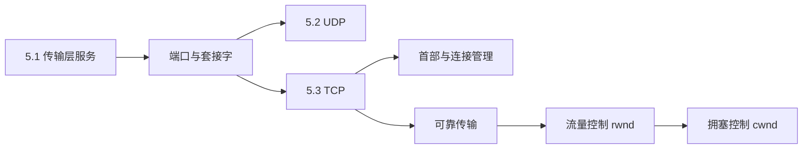
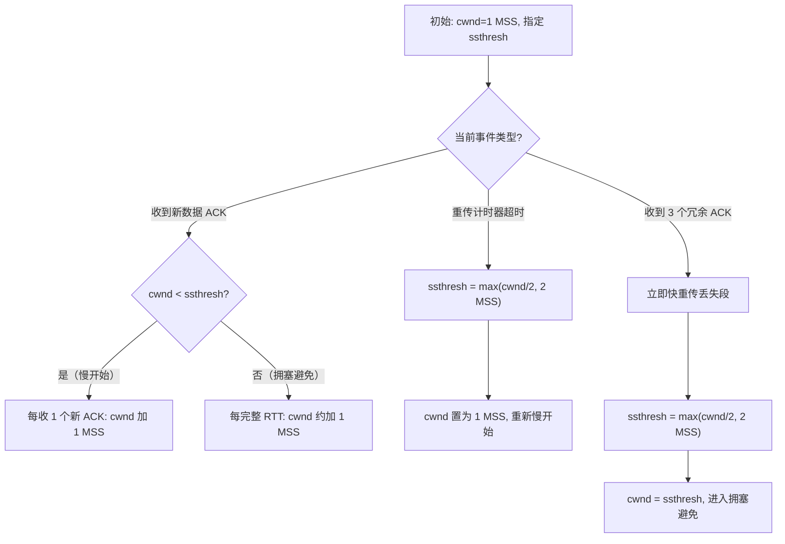

# 第5章 传输层

> [!abstract] 本章复盘目标
> 传输层把网络层的“主机到主机”交付，变成应用进程之间的端到端逻辑通信。复习主线是：**端口定位进程 -> UDP 的轻量数据报 -> TCP 如何用首部、连接管理、确认重传、窗口与拥塞控制实现可靠字节流**。本章综合题首先要分清 `seq/ack`、`rwnd/cwnd`、流量控制/拥塞控制以及事件发生的时刻。

**二轮读法：** 先回忆文末 [[#刷题后补充区|8 个个人错题模型]]，卡住再跳回正文。`important` 记核心规律，`warning` 查考题边界，**6 处 `danger` 专门标记本轮实际错因**。

> [!important] 近 18 年 408 计网真题雷达（2009—2026）
> - **考频画像**：18 年共考查 **24 道主归属单选题 + 3 道跨章渗透题**，以及 **4 道综合大题**（`2012-T47`、`2016-T41`、`2023-T47`、`2026-T47`）；近 5 年共 **6 道主归属选择 + 1 道跨章选择 + 2 道大题**（`2022-T38/T39`、`2023-T47`、`2024-T38/T39`、`2025-T37/T38/T39`、`2026-T47`）。详细索引见 [[00_408计网｜考前急救与真题落点总控|返回计网总控]]。
> - **近 5 年考法演变（2022—2026）**：TCP 聚焦逐 ACK 增窗与 `swnd = min(cwnd, rwnd)` 扣在途字节（2025-T38、2026-T47）、超时恢复轮次（2022-T38）；连接管理常考主动/被动关闭 `2MSL` 边界（2022-T39、2024-T38）及建连至确认全文件总耗时（2023-T47、2026-T47）；UDP 侧重 16 位反码回卷校验（2024-T39）、NAT 改端口重算校验（2025-T37）与 UDP/TCP 时延对比（2025-T39）。
> - **高频丢分盲区**：① 同段 `seq/ack` 混方向、SYN/FIN 忘计 1 序号（错题模型 1–2）；② `min(rwnd, cwnd)` 漏扣在途未确认字节（错题模型 3、2021-T40、2025-T38）；③ 慢开始单 ACK 误翻倍或用旧 `ssthresh` 减半（错题模型 4–5、2016-T41、2026-T47）；④ 混淆“确定收全数据”与“主动关闭等 `2MSL` 进入 `CLOSED`”（错题模型 6–7、2022-T39、2024-T38、2026-T47）。

## 考纲定位

- 核心：传输层服务、端口与套接字、UDP、TCP 首部、连接管理、可靠传输、流量控制、拥塞控制。
- 重点计算：UDP 检验和与分片、TCP 首部字段、三次握手/四次挥手的序号确认号、滑动窗口、吞吐率、`cwnd` 演化。
- 高频判断：UDP 是否可靠、TCP 是否保留报文边界、`ack` 的含义、SYN/FIN 是否消耗序号、`rwnd` 与 `cwnd` 的控制对象。

## 章节知识脉络

---

# 5.1 传输层提供的服务

## 5.1.1 传输层的功能 【📌 扫一眼｜确认“我还会”就过】

### 这一节要解决什么问题

网络层已能把 IP 数据报送到目标主机，为什么还需要传输层？如何让数据最终交给目标主机中的正确进程？

![[assets/第5章-传输层/图5.1-传输层进程逻辑通信.jpg|650]]

### 核心知识

- 数据链路层提供**相邻节点**间逻辑通信；网络层提供**主机到主机**逻辑通信；传输层提供运行在不同主机上的**进程到进程**逻辑通信，<mark>即端到端逻辑通信</mark>。 `[真题·2009-T33]`
- IP 只能找到目的主机，不能定位目的进程；传输层通过端口完成最后一跳的进程交付。
- **复用**：发送方多个应用进程共用一个传输层协议向下交付数据。**分用**：接收方依据报文首部信息，把数据交给正确的应用进程。
- 传输层检验范围是**整个报文（首部和数据）**。TCP 检错后会通过可靠传输机制恢复；UDP 检错后通常直接丢弃。IPv4 首部检验和仅覆盖 IP 首部。
- TCP 向应用表现为可靠、全双工的面向连接信道；UDP 向应用表现为无连接、不可靠信道。二者都建立在网络层尽最大努力交付之上。

> [!important] 必须记住
> 传输层通信端点是**应用进程**，不是主机；“端到端”在本章通常就是“进程到进程”。

### 网络层与传输层的复用/分用

| 层次 | 复用 | 分用依据 | 交付对象 |
|---|---|---|---|
| 网络层 | 封装不同传输层协议的数据 | IPv4 的协议字段 | TCP、UDP 等传输层协议 |
| 传输层 | 多个应用进程共用 TCP 或 UDP | <mark>目的端口号</mark> | 应用进程 `[真题·2018-T39]` |

### 常考题型与解题方法

#### 题型：分层服务范围判断

- 识别特征：题干出现“相邻节点、主机、进程、端到端、逻辑通信”。
- 解题步骤：先找通信实体，再对应层次：相邻节点 -> 链路层；主机 -> 网络层；进程 -> 传输层。
- 常见干扰项：把“端到端”误判为主机到主机；在 TCP/IP 语境里，端到端通常强调两端进程。
- 一句话方法：**链路看节点，网络看主机，传输看进程。**

- `【⚡ 真题补丁｜2009-T33 / 2018-T39】` 传输层提供进程间端到端逻辑通信，分用依据目的端口号（2018-T39）；链路层仅负责相邻节点通信（2009-T33）。

## 5.1.2 传输层的寻址与端口 【🔥 必背｜停下来默背 1 遍】

### 核心知识

- **端口**是传输层与应用层的服务访问点。TCP/UDP 首部的源端口、目的端口实现应用进程寻址。
- 端口号为 16 bit，范围 `0~65535`；只在**本机**有意义。不同主机上相同端口无关联；***<u>TCP 和 UDP 的端口空间独立，同一主机可同时使用相同端口号。</u>***
- 服务器端口：熟知端口 `0~1023`；登记端口 `1024~49151`。客户端短暂端口：`49152~65535`，运行时动态分配、结束后回收。
- 常见熟知端口：FTP 控制 `21`（数据 `20`）、TELNET `23`、SMTP `25`、DNS `53`、TFTP `69`、HTTP `80`、SNMP `161`。
- 套接字：`Socket = (IP 地址 : 端口号)`，在给定传输层协议的语境中标识通信端点，并非操作系统进程的全网唯一编号。一条 TCP 连接由通信双方**两个套接字**（源/目的 IP、源/目的端口四元组）唯一确定。

> [!warning] 高频陷阱
> 端口不是硬件接口，也不是全网唯一编号。单独的端口号不能唯一定位互联网进程；`IP 地址 + 端口号` 才是一个套接字。

### 概念辨析

| 名称 | 标识对象 | 是否全网唯一 | 典型用途 |
|---|---|---|---|
| IP 地址 | 主机/网络接口 | 在互联网路由语境中标识目标主机 | 找到目标主机 |
| 端口号 | 本机应用进程 | 否 | 在目标主机内分用 |
| 套接字 `(IP:端口)` | 某主机上的应用进程端点 | 给定传输层协议后区分端点 | 标识通信端点 |
| TCP 连接 | 两个套接字的组合 | 是 | 标识一条双向 TCP 会话 |

### 一分钟回顾

- 不同主机相同端口、同一主机 TCP 与 UDP 相同端口都可并存。
- 报文的**源端口**相当于回信时使用的目的端口线索。
- 服务访问点：链路层看帧类型，网络层看 IP 协议字段，传输层看端口号。

## 5.1.3 无连接服务与面向连接服务 【🔥 必背｜停下来默背 1 遍】

| 项目 | UDP | TCP |
|---|---|---|
| 连接 | 无连接 | 面向连接，传前建连、传后释放 |
| 可靠性/顺序 | 不保证 | 可靠、按序、无重复交付 |
| 通信方式 | 一对一、一对多、多对多 | 仅一对一 |
| 数据组织 | 面向报文，保留报文边界 | 面向字节流，不保留应用数据块边界 |
| 首部 | 固定 8B | 最小 20B，可带选项 |
| 控制 | 复用/分用、差错检测 | 另有确认、重传、流量控制、拥塞控制、连接管理 |
| 常见应用 | DNS、TFTP、DHCP、RIP、SNMP、实时多媒体 | FTP、SMTP、TELNET、HTTP |

> [!important] 使用条件
> ***<u>UDP 不负责确认、重传、排序，但应用层可以自行实现可靠机制。</u>*** “UDP 不可靠”不等于“基于 UDP 的应用一定不可靠”。TCP 不提供广播和多播。

### 常考题型与解题方法

#### 题型：根据应用需求选 TCP/UDP

- ***<u>实时性优先、可容忍少量丢包、需多播：倾向 UDP。</u>***
- ***<u>文件传输、远程登录、邮件等强调完整有序交付：倾向 TCP。</u>*** 先看需求，再选机制，不只背协议名。
- 检查动作：别把“有检验和”误作“可靠传输”；可靠还需要确认、重传、排序等机制。

- `【⚡ 真题补丁｜2014-T39 / 2025-T39】` UDP 无连接并做检验和丢错但不保证可靠（2014-T39）；RTT=8 ms 时短请求响应 UDP 最短 8 ms、新建 TCP 为 16 ms（2025-T39）。

## 5.1 小节自测

- [ ] 能否说明 IP 到达目的主机后为何仍需要端口？
- [ ] 能否写出套接字与 TCP 连接的标识方式？
- [ ] 能否在“可靠、面向报文、多播、全双工、字节流”中分辨 TCP/UDP 特征？

---

# 5.2 UDP

## 5.2.1 UDP 数据报 【🔥 必背｜停下来默背 1 遍】

### 这一节要解决什么问题

UDP 在 IP 的数据报服务上究竟增加了什么？四个首部字段如何支持应用进程交付与差错检测？

### UDP 的特点

- UDP 只在 IP 之上增加**复用/分用和差错检测**，<mark>无连接、不维护连接状态、无确认/重传/排序/流量控制/拥塞控制</mark>。 `[真题·2014-T39]`
- **面向报文**：应用交下一个报文，UDP 加首部后原样交 IP；UDP 不合并、不拆分，保留边界。报文过长可能被 IP 分片，过短则首部开销占比高。
- 首部只有 8B；支持一对一、一对多和多对多，适合低时延、小请求或多播场景。

![[assets/第5章-传输层/图5.2-UDP数据报格式.jpg|500]]

| 字段 | 长度 | 含义与考点 |
|---|---:|---|
| 源端口 | 16 bit | 发送进程端口；<mark>不需回复时可为 0</mark> `[真题·2018-T39]` |
| 目的端口 | 16 bit | 接收进程端口；分用关键字段，必须有效 |
| 长度 | 16 bit | **UDP 首部 + 数据**总长度，最小为 `8B`；<mark>不含伪首部</mark> `[真题·2025-T37]` |
| 检验和 | 16 bit | <mark>覆盖伪首部、UDP 首部、数据</mark>；IPv4 可不用（填 0），IPv6 强制使用 `[真题易错·2024-T39 / 2025-T37]` |

![[assets/第5章-传输层/图5.3-UDP基于端口的分用.jpg|340]]

- 若目的端口没有对应进程，接收方丢弃 UDP 数据报，并由 ICMP 返回“端口不可达”。

> [!warning] 高频陷阱
> UDP “长度”字段不记录首部长度，也**不包括伪首部**；UDP 固定首部 8B，所以没有“首部长度”字段。

### 常考题型与解题方法

#### 题型：UDP/IP/以太网封装效率与 IP 分片

- 识别特征：给出应用数据长度、MTU 或以太网有效载荷、各层首部长度。
- 解题步骤：
  1. UDP 总长 = 应用数据 + `8B`。
  2. 每个 IP 分片最大数据载荷 = `MTU - IP 首部长度`；除最后一片外，数据部分必须是 `8B` 的整数倍。
  3. 分片数向上取整；片偏移 = 本片数据起点 / `8B`。
  4. 传输效率 = 应用数据 / 实际封装总字节数，确认题干是否要求加入帧首尾、前导码或 VLAN。
- 检查动作：IP 分片时，UDP 首部只位于第一个分片的数据部分，UDP 总长度始终不变。

## 5.2.2 UDP 检验 【🔥⚡ 必背+避坑｜停下来默背 1 遍 + 精读 1 分钟】

![[assets/第5章-传输层/图5.4-UDP伪首部与首部.jpg|600]]

### 核心知识

- 在 IPv4 中，计算检验和时临时加一个 **12B 伪首部**：源 IP、目的 IP、全 0、协议号 `17`、UDP 长度。伪首部不向网络层传送，也不交应用层，不计入 UDP 长度。
- 发送方：检验和字段先置 0；将伪首部、UDP 首部、数据按 16 bit 分组做**二进制反码求和**；数据为奇数字节时仅为计算补一个 `0B`；<mark>结果取反填入字段</mark>。 `[真题·2024-T39]`
- 接收方（已启用检验和）：把伪首部、收到的 UDP 首部（含检验和）和数据按相同规则求和；结果为 `16` 个 1 才通过，否则出错。
- 伪首部把源/目的 IP 纳入校验，可发现地址在传输中被错误改动；它不是 UDP 真正首部。

### 计算模板

$$
\text{checksum}=\sim\operatorname{ones\text{-}complement\_sum}(\text{伪首部},\text{UDP 首部},\text{数据})
$$

1. 把待加字段补齐为 16 bit 字；奇数个字节时在**计算副本**末尾补 0。
2. 逐个相加；<mark>若最高位有进位，执行回卷：把进位加回最低位</mark>。 `[真题·2024-T39 / 2025-T37]`
3. 发送端对最终和按位取反；接收端含检验和一起求和，结果应全 1。

> [!warning] 高频陷阱：没计算 ≠ 算出零
> ***<u>IPv4 UDP 不使用检验和 → 字段写全 0；实际计算结果全 0 → 字段写全 1。</u>*** 前者表示未启用校验，后者是有效校验值的编码，不能混用。见 [RFC 768](https://www.rfc-editor.org/rfc/rfc768.html)。NAT 的更新条件见 [[#跨层字段是否变化 【⚡ 避坑｜最值钱，必须精读 1 分钟】|跨层对照表]]。

### 一分钟回顾

- IPv4 仅检验 IP 首部；UDP 检验 UDP 首部和数据，并借伪首部覆盖 IP 地址。
- ***<u>UDP 检错不等于可靠传输：检出错误通常丢弃，不由 UDP 自己请求重传。</u>*** 普通 UDP 中，非零检验和验证失败应丢弃；教材解析中“可交上层”的宽泛说法不要当成默认协议规则。见 [RFC 1122 §4.1.3.4](https://www.rfc-editor.org/rfc/rfc1122.html#section-4.1.3.4)。 `[真题易错·2014-T39]`

- `【⚡ 真题补丁｜2024-T39 / 2025-T37】` UDP 校验和用 16 位反码求和并回卷取反（2024-T39）；NAPT 改 UDP 源端口后须重算已启用的校验和（2025-T37）。

## 5.2 小节自测

- [ ] UDP 需要把哪些内容加入检验和？哪些内容绝不随报文传送？
- [ ] 能否根据 MTU 求片偏移，并说明其单位为何是 8B？
- [ ] 收到不存在的目的 UDP 端口时，接收方的处理是什么？

---

# 5.3 TCP

## 5.3.1 TCP 的特点 【📌 扫一眼｜确认“我还会”就过】

### 核心知识

- TCP 在不可靠 IP 之上，靠检验、序号、确认、重传、窗口和连接管理提供**无差错、不丢失、不重复、按序**的可靠字节流服务。
- 面向连接、一对一、全双工。双方各有发送缓存和接收缓存。
- **面向字节流**：TCP 给字节编号，但不保留应用交付数据块的边界；可拆分长数据块，也可暂存并合并短数据块。报文段边界由 TCP 根据窗口、MSS 和网络情况决定。

> [!important] 必须记住
> “TCP 是面向字节流”不等于“每个 TCP 报文段只含一个应用报文”，也不等于“应用一次写入对应一次发送”。

## 5.3.2 TCP 报文段 【🔥⚡ 必背+避坑｜停下来默背 1 遍 + 精读 1 分钟】

![[assets/第5章-传输层/图5.5-TCP报文段格式.jpg|650]]

### 首部字段

| 字段 | 长度 | 关键含义 |
|---|---:|---|
| 源/目的端口 | 各 16 bit | 标识两端进程 |
| 序号 `seq` | 32 bit | 普通数据段中为**第一个数据字节**的序号；无数据的纯 ACK 标示本方下一个可用序号，模 $2^{32}$ 回绕 |
| 确认序号 `ack` | 32 bit | ACK=1 时有效，<mark>期望对方下一个序号</mark>；表示此前序号空间已连续收到（含 SYN/FIN） `[真题·2009-T38]` |
| 数据偏移 | 4 bit | TCP 首部长度，单位 `4B`；最小值 5 -> `20B`，最大值 15 -> `60B` |
| 控制位 | 6 bit | URG、ACK、PSH、RST、SYN、FIN |
| 窗口 | 16 bit | 当前作为接收方还能接收的字节数，即通告 `rwnd` |
| 检验和 | 16 bit | 覆盖 TCP 首部和数据，IPv4 中计算也用 12B 伪首部（协议号为 6） |
| 紧急指针 | 16 bit | 仅 URG=1 有效，指出开头紧急数据长度 |
| 选项/填充 | 可变 | 选项最多 40B；含 MSS、窗口扩大、时间戳等；填充使首部为 4B 整数倍 |

### 比较传输层有效载荷效率

题目若只计传输层单元，应用数据为 $D$、该协议首部为 $H$，则有效载荷占比为 $D/(D+H)$。UDP 固定首部 $8\mathrm{B}$；求 TCP 的**最大**效率时，<mark>若无选项且按最小首部取</mark> $20\mathrm{B}$。题目若要求链路或 IP 层效率，还需把相应层的开销计入分母。 `[真题·2021-T39]`

### 控制位速记与条件

| 位 | 含义 | 何时关注 |
|---|---|---|
| URG | 紧急指针有效 | 零窗口仍须处理紧急指示；不等于任意数据都可越过窗口 |
| ACK | 确认号有效 | 建连后正常数据/确认/释放段通常都为 1 |
| PSH | 尽快交付应用 | 交互式通信 |
| RST | 复位连接 | 严重差错或拒绝非法连接/段 |
| SYN | 同步、建连 | 本教材普通握手模型中不带数据，但消耗 1 个序号 |
| FIN | 发送方向关闭 | FIN 即使不带数据也消耗 1 个序号 |

> [!important] 公式与边界
> 若普通数据段不含 SYN/FIN，且 $seq=s$、数据长度 $L>0$，数据序号范围是 $s\sim s+L-1$，下一段新数据的 $seq=s+L$。确认号 $ack=N$ 表示 $N-1$ 及以前的**连续序号空间**均已确认；<mark>数据传输时就是连续字节</mark>。重传仍使用原数据的序号。 `[真题·2009-T38 / 2013-T39]`

> [!danger] 实际错题：seq 说自己，ack 说对方
> ***<u>同一个段的 seq 与 ack 属于两个独立方向，通常没有直接算术关系。</u>*** `[真题易错·2013-T39]`
> 例如 B → A：$seq=601,\ ack=501$。`seq` 表示本段从 **B 自己的 601** 开始（纯 ACK 则是本方下一个可用序号）；`ack` 表示 B 已连续收到 **A 到 500**，接着要 501。**不能用 601 推导 501。**
> 下次先画 A → B、B → A 两条序号轴；对方的 `ack` 是对本方的确认进度，也不必等于本方下一次新发的 `seq`——本方可能已有更多数据发出但未确认。

> [!danger] 实际错题：ACK 是控制位，不是互斥报文类型
> ***<u>ACK=1 只表示确认号有效，可以和 SYN、FIN 或数据同时出现。</u>*** `SYN+ACK`、`FIN+ACK`、`ACK+DATA` 都正常；DATA 指有效载荷，不是控制位。
> FIN 关闭**自己的发送方向**，同时携带的 `ack` 确认**对方方向**的数据，互不冲突。建连后大多数正常 TCP 段的 ACK 位通常为 1；不要把“ACK 报文”一律理解成“无数据的纯 ACK”。

### SYN / FIN / ACK 与序号空间

| 内容 | 消耗序号 |
|---|---:|
| 数据 $n\mathrm{B}$ | $n$ |
| SYN | 1 |
| FIN | 1 |
| 纯 ACK（无数据，无 SYN/FIN） | 0 |
| ACK + $n\mathrm{B}$ 数据 | $n$ |
| FIN + ACK（无数据） | 1，仅 FIN 消耗 |

***<u>SYN/FIN 占一个序号，不等于它们是一个有效数据字节。</u>*** 若第四次挥手的纯 ACK 为 $seq=985$，<mark>它不发送“第 985 个数据字节”</mark>；在本方刚发完 FIN、其后无新数据且无回绕的情形，FIN 占 984，最后数据到 983。若 FIN 携带 $n\mathrm{B}$ 数据，对它的确认应为 $seq+n+1$，不能只加 1。 `[真题易错·2012-T47 / 2020-T39 / 2023-T47]`

### 常考题型：32 bit 序号回绕

TCP 按字节编号，一个完整序号空间覆盖 $2^{32}\mathrm{B}$。连续发送、忽略重传与首部开销时：

$$
t=\frac{2^{32}\times 8}{R}\quad(R\text{ 的单位为 bit/s})
\qquad\text{或}\qquad
t=\frac{2^{32}}{R_{\mathrm{byte}}}\quad(R_{\mathrm{byte}}\text{ 的单位为 B/s})
$$

**检查：** ***<u>$2^{32}$ 是字节数，不是 bit 数，也不是报文段数。</u>*** 若给的是链路速率而非 TCP 数据速率，按题意先扣协议开销；“绕一圈”不等于“传一个最大序号的报文段”。

### 常考题型：解析十六进制 TCP 首部

1. 前 4B 是源/目的端口，之后 4B 是 `seq`，再后 4B 是 `ack`。
2. 第 13 个字节的高 4 位是数据偏移，乘 `4B` 得 TCP 首部长度。
3. 控制位判断报文含义：`SYN=1, ACK=0` 为第一次握手；`SYN=1, ACK=1` 为第二次握手；`FIN=1` 请求关闭。
4. 最后检查目的端口推断应用协议，以及 IP 总长度是否能得出数据长度。

- `【⚡ 真题补丁｜2009-T38 / 2013-T39 / 2021-T39】` `ack` 指期待下一字节；双向互传新 `seq` 承接对方前 `ack`；12B 最大效率 UDP 60%、TCP 37.5%。
- `【⚡ 真题补丁｜2012-T47 / 2020-T39】` `SYN=1`(`seq=1000`) 至 `FIN=1`(`5001`) 共传 $5001-1001=4000\text{B}$；纯 ACK 帧载荷仍须填充至 46B。

## 5.3.3 TCP 连接管理 【🔥⚡ 必背+避坑｜停下来默背 1 遍 + 精读 1 分钟】

### 连接建立：三次握手

![[assets/第5章-传输层/图5.6-TCP三次握手.jpg|620]]

| 次序 | 方向 | 标志与字段 | 状态变化 |
|---|---|---|---|
| 1 | 客户 -> 服务器 | `SYN=1, ACK=0, seq=x` | 客户：CLOSED -> SYN-SENT；服务器预先 LISTEN |
| 2 | 服务器 -> 客户 | `SYN=1, ACK=1, seq=y, ack=x+1` | 服务器：LISTEN -> <mark>SYN-RCVD</mark> `[真题·2011-T39 / 2026-T47]` |
| 3 | 客户 -> 服务器 | `ACK=1, seq=x+1, ack=y+1`，<mark>可带数据</mark> | 客户发出时 ESTABLISHED；服务器收到后 ESTABLISHED `[真题·2019-T39 / 2026-T47]` |

- 本教材普通握手模型中，第 1、2 次 SYN 不携带数据，但各消耗 1 个序号；***<u>第 3 次 ACK 可以捎带 Request，不必另等一个报文才能请求服务。</u>*** 若不带数据，它不再消耗序号。
- 从客户发送第一次 SYN 算起：客户最早 `1RTT` 后可发数据；服务器最早 `1.5RTT` 后可发数据。
- 三次而非两次的核心：让服务器能确认客户仍愿意建立本次连接，避免迟到的旧 SYN 让服务器错误分配资源。

### 连接释放：四次挥手

![[assets/第5章-传输层/图5.7-TCP四次挥手.jpg|620]]

下表按 **FIN 不携带数据、普通主动/被动关闭** 列式；$a$ 是主动方当时对被动方的期望序号。

| 次序 | 方向 | 标志与字段 | 关键状态 |
|---|---|---|---|
| 1 | 主动方 -> 被动方 | 实际常为 `FIN=1, ACK=1, seq=u, ack=a` | <mark>主动方 FIN-WAIT-1</mark>；FIN 消耗序号，ack 同时确认对方数据 `[真题·2021-T38]` |
| 2 | 被动方 -> 主动方 | `ACK=1, seq=v, ack=u+1` | <mark>被动方 CLOSE-WAIT，主动方 FIN-WAIT-2</mark> `[真题·2021-T38]` |
| 3 | 被动方 -> 主动方 | `FIN=1, ACK=1, seq=w, ack=u+1` | 被动方 LAST-ACK；可在此之前继续发送数据 |
| 4 | 主动方 -> 被动方 | `ACK=1, seq=u+1, ack=w+1` | <mark>被动方收到后 CLOSED</mark>；主动方 TIME-WAIT，等待 `2MSL` 后 CLOSED `[真题易错·2021-T38 / 2022-T39]` |

- TCP 全双工，所以被动方收到 FIN 只关闭“对方 -> 自己”的方向；它还能把剩余数据发完，故第 2、3 步通常分开。
- `TIME-WAIT` 的两个目的：最后 ACK 若丢失，主动方仍能响应被动方重传的 FIN；等待旧报文从网络消失，避免干扰后续连接。它不是对“最后 ACK 必达”的无条件保证。

> [!warning] 四次挥手是逻辑动作，不一定是四个独立段
> 常规动作是 **FIN → ACK → FIN → ACK**；被动方可能尚有数据，所以先确认、以后再 FIN。***<u>若无剩余数据且立即关闭，第二步 ACK 与第三步 FIN 可以合并为一个 ACK+FIN 段。</u>*** 此时共三个段；并非只有题目写“最短”才允许合并，但求最短时间时尤其要检查这个条件。
> 表中第一次和第三次均可为 **FIN+ACK**；“后面三次 ACK=1”不表示第一次 ACK=0。

### 常考题型：握手/挥手字段与时间

- 先标出每一方向最后已经发送到哪个序号；普通数据段的 `seq` 是本段首字节，纯 ACK 的 seq 取本方下一个可用序号，`ack` 看对方方向。
- 遇 SYN 或 FIN，对本方向序号额外 `+1`；普通纯 ACK 不加。
- 时间题先圈计时起止事件，再逐箭头累加传播时间；问收到服务响应不加关闭时间，问主动方 CLOSED 才还需计入 TIME-WAIT。

### TCP 建连 / 请求响应 / 释放连接时延题模板

**统一前提：** 下表无丢包，忽略发送、处理及排队时延，单程按 $0.5\mathrm{RTT}$；请求/响应短小，不受多轮数据窗口限制。TCP 按普通新连接，不引入 Fast Open、TLS 或额外交互。

#### 1. 请求响应：先找真正的终点

| 从首次发送起 | TCP 新连接的事件 | UDP 的对照 |
|---|---|---|
| $0$ | C → S：SYN | C → S：Request |
| $0.5\mathrm{RTT}$ | S 收到，返回 SYN+ACK | S 收到，返回 Response |
| $1\mathrm{RTT}$ | C 收到，发送 **ACK+Request** | **C 收到 Response，结束** |
| $1.5\mathrm{RTT}$ | S 收到 Request，返回 Response | — |
| $2\mathrm{RTT}$ | **C 收到 Response，结束** | — |

> [!danger] 实际错题：不能只算到 Request 到达服务器
> ***<u>服务器收到请求是 $1.5\mathrm{RTT}$；客户端收到响应才是 $2\mathrm{RTT}$。</u>*** 最后半个 RTT 不能漏。
> <mark>简单请求响应</mark>：**新 TCP 为 $2\mathrm{RTT}$，UDP 为 $1\mathrm{RTT}$**。若 TCP 已建立，可只需 $1\mathrm{RTT}$；三次握手也不等于三个 RTT。 `[真题·2025-T39]`

#### 2. 最短关闭：同一时间轴，分别读两端 CLOSED

从**主动方发 FIN** 起计，且被动方无剩余数据、立即合并 ACK+FIN：

| 时刻 | 事件 / 状态 |
|---|---|
| $0$ | 主动方发送 FIN（通常也有 ACK） |
| $0.5\mathrm{RTT}$ | 被动方收到，立即返回 ACK+FIN |
| $1\mathrm{RTT}$ | 主动方收到，发送最终纯 ACK，**开始 TIME-WAIT** |
| $1.5\mathrm{RTT}$ | 被动方收到最终 ACK，**CLOSED** |
| $1\mathrm{RTT}+2\mathrm{MSL}$ | 主动方等待结束，**CLOSED** |

***<u>$2\mathrm{MSL}$ 从主动方发送最终 ACK、进入 TIME-WAIT 时开始，不从第一次 FIN 开始。</u>*** 常规四段流程若存在被动方剩余发送/处理等待，要另外计入；丢包重传也会延长时间。 `[真题易错·2022-T39 / 2024-T38]`

#### 3. 数据量 + cwnd + RTT：按事件列账，不用总数据直接除速率

1. **定条件：** 写初始 `cwnd`、`ssthresh`、`rwnd`、MSS 和计时终点；按满 MSS 分段时，数据量 $D$ 对应 $\lceil D/\mathrm{MSS}\rceil$ 段，末段可不足 MSS；MSS 是上限，不保证每段都满。
2. **定首发：** 第三次握手可携带首段数据，其他段也可在窗口允许时立即发送；按 [[#常考题型：可发送数据范围|窗口三步法]] 决定每次新发多少，不能超过剩余数据。
3. **列事件：** `时刻 → 新确认量 → 更新后的 cwnd/rwnd → 未确认量 → 本次可新发量`；遇中途 ACK 就逐个更新，只有满足完整轮次条件才使用 $1,2,4,\ldots$。
4. **标完成：** <mark>“最后数据发出”“对端收到全部数据”“发送方收到全部确认”是三个不同事件</mark>。最后一批发出后仍可能要等 ACK，不能漏这一轮。 `[真题易错·2023-T47 / 2026-T47]`
5. **接关闭：** 本教材的组合时延题按**全部数据确认后再发 FIN**，然后接上上表；若题设允许 FIN 捎带末数据，应重新画时序，不能把教材约定当成 TCP 的固定限制。TCP 关闭允许待发数据先完成交付，见 [RFC 9293 §3.6](https://www.rfc-editor.org/rfc/rfc9293.html#section-3.6)。

**最后检查：** 先统一 ms/s；$D/R$ 只能反映串行发送耗时，不能替代建连、等待 ACK、响应返回和 TIME-WAIT。若题目不忽略发送时延，再将其放到相应箭头上。

- `【⚡ 真题补丁｜2011-T39 / 2019-T39 / 2021-T38】` 二次握手 `SYN=1,ACK=1` 确认 `x+1`，三次 `y+1`；主动关闭发末 ACK 进 `TIME_WAIT`。
- `【⚡ 真题补丁｜2016-T41 / 2022-T39 / 2024-T38】` 被动最短关闭 `1.5 RTT`，主动 `1 RTT+2MSL`；2024-T38 传 3000B 含 `2MSL` 共 `60.04 s`。

## 5.3.4 TCP 可靠传输 【🔥⚡ 必背+避坑｜停下来默背 1 遍 + 精读 1 分钟】

### 序号、确认与重传

- TCP 按**字节**编号，不按报文段编号。普通数据段的 `seq` 是数据部分第一个字节号；SYN/FIN 另占序号，见前面的统一计数表。
- TCP 默认**累积确认**：数据传输中，`ack=N` 只确认从起点到 `N-1` 的连续字节；<mark>收到后面的失序段，确认号仍指向缺失的第一个字节</mark>。 `[真题·2011-T40]`
- 已发送未确认的数据保留在发送缓存中；确认可延迟或与反向数据捎带。
- 本教材重点讨论两种重传触发：**超时**和**3 个冗余 ACK**。RTO 会依据 RTT 样本动态调整，以免因网络时延波动过早重传或等待过久；实际算法不仅考虑平滑 RTT，还考虑时延波动等因素，不能固定理解为“只比平均值略大”。例如 [RFC 6298 §2](https://www.rfc-editor.org/rfc/rfc6298.html#section-2) 同时使用 SRTT 与 RTTVAR。

#### 冗余 ACK 与快重传

- 某个期待段丢失、后续失序段到达时，接收方每收到一个失序段立即回复对“最后连续字节”的重复确认。
- 发送方连续收到同一确认号的**3 个冗余 ACK**，<mark>立即重传丢失段，不等超时</mark>。 `[真题·2019-T38]`
- 注意：触发快重传时，除了最初那一个正常确认外，另有 3 个重复确认；总共看到了 4 个相同确认号。

> [!important] 一句话方法
> `ack` 永远问“下一个想要谁”；缺的是谁，冗余 ACK 就持续指向谁。

### 常考题型：`seq/ack` 与失序段分析

1. 为每段写出覆盖字节区间：`[seq, seq+数据长度-1]`。
2. 先画接收方已连续接收的右边界；`ack=右边界+1`，而非已收到最大序号 `+1`。
3. 缺段后来的失序段不推进累积确认号；根据题设判断其是否缓存。
4. 看清“收到 3 个冗余 ACK”是立即快重传，不要把它当作超时。

- `【⚡ 真题补丁｜2011-T40 / 2019-T38】` 失序收到第 1、3 段时，`ack` 仍指期待的第 2 段首字节（2011-T40）；连续收到 3 个冗余 ACK 立即快重传，不必等超时（2019-T38）。

## 5.3.5 TCP 流量控制 【🔥⚡ 必背+避坑｜停下来默背 1 遍 + 精读 1 分钟】

### 这一节要解决什么问题

接收方来不及读数据时，如何避免发送方把它的接收缓存塞满？

![[assets/第5章-传输层/图5.9-TCP流量控制.jpg|640]]

- 流量控制面向**接收方处理/缓存能力**，是端到端、点对点的速度匹配。接收方以 TCP 首部窗口字段通告接收窗口 `rwnd`。
- 发送方按最新 `rwnd` 控制未确认数据量，不超过接收方容纳能力。`rwnd=0` 时暂停普通新数据发送，但仍须进行零窗口探测（可重传，或携带少量新数据），不是所有 TCP 段都停发；也不表示可无限重传旧数据。见 [RFC 9293 §3.8.6.1](https://www.rfc-editor.org/rfc/rfc9293.html#section-3.8.6.1)。
- 零窗口通知后，若非零窗口更新段丢失，双方可能相互等待。发送方启动**持续计时器**；超时后发送零窗口探测，接收方在确认中重新通告当前窗口，以打破死锁。

| 对比项 | 传输层流量控制 | 数据链路层流量控制 |
|---|---|---|
| 通信范围 | 端到端（两个进程） | 相邻节点 |
| 窗口 | 按接收缓存动态变化 | 通常固定 |
| 控制目标 | 接收方不溢出 | 相邻接收端不溢出 |

### 常考题型：可发送数据范围

**先固定时刻：** 若刚收到新 ACK，先更新确认进度、`cwnd` 和最新通告的 `rwnd`，再执行三步；全部窗口统一为 B 或 MSS。

| 步骤 | 计算 | 检查 |
|---|---|---|
| ① 算总容量 | $swnd=\min(rwnd,cwnd)$ | 只考流量控制、拥塞不限制时才只用 rwnd |
| ② 找已占用 | $F=$ 已发送但尚未确认的数据量 | 按累计确认号划去已确认部分，不把反方向 seq 混入 |
| ③ 算还能新发 | $U=\max(0,swnd-F)$ | 不是总容量，也不能出现负的新发量 |

> [!danger] 实际错题：窗口容量不等于当前还能发送量
> ***<u>先取两个窗口的较小值，再减已发送未确认量。</u>*** 例如 $rwnd=4\mathrm{MSS}$、更新后 $cwnd=3\mathrm{MSS}$、尚未确认 $1\mathrm{MSS}$，还能新发 $3-1=2\mathrm{MSS}$，不是 3 或 4。 `[真题易错·2010-T39 / 2015-T39 / 2021-T40 / 2025-T38]`
> 题设按满 MSS 发段时，段数为 $\lfloor U/\mathrm{MSS}\rfloor$；若允许短段，余量还能构成不足 MSS 的段。最后也不能超过应用剩余待发数据量。

- 从有效确认段读出 $ack=A$、$rwnd=W$，**接收方许可范围**为 $[A,A+W-1]$；再结合 cwnd 和已发部分取可新发区间。`ACK=1` 时确认号字段才有意义。
- 旧数据重传不占用**新的序号区间**，不代表可无视窗口限制。ACK 释放的是发送方的未确认额度，<mark>不代表接收方应用已读走缓存，rwnd 不一定随之增大</mark>。 `[真题易错·2015-T39]`

> [!warning] 高频陷阱
> `rwnd` 由接收方通告，限制的是“接收方吃得下多少”；它不是发送方自主估计的网络容量，也不是拥塞窗口。

- `【⚡ 真题补丁｜2010-T39 / 2015-T39 / 2021-T40】` 先取 `min(cwnd,rwnd)` 再扣在途未确认字节；应用不读缓存致 `rwnd` 降至 1KB 或 0（2015）。

## 5.3.6 TCP 拥塞控制 【🔥⚡ 必背+避坑｜停下来默背 1 遍 + 精读 1 分钟】

### 这一节要解决什么问题

接收方即使有足够缓存，网络中的链路和路由器也可能过载。TCP 如何根据网络反馈调整注入网络的数据量？

### 流量控制与拥塞控制

| 项目 | 流量控制 | 拥塞控制 |
|---|---|---|
| 限制对象 | 接收方能力 | 网络承载能力 |
| 反馈来源 | 接收方通告 `rwnd` | 发送方根据超时、冗余 ACK 等网络现象判断 |
| 范围 | 端到端 | 全局网络问题 |
| 控制量 | `rwnd` | `cwnd`、`ssthresh` |

- 实际发送窗口上限：

$$
\text{send window}=\min(\mathrm{rwnd},\mathrm{cwnd})
$$

- `cwnd` 常用 MSS 表示，计算前须与 rwnd 统一单位；题干未特别说明时，按本教材模型：初始 `cwnd=1 MSS`，到门限切换、快恢复采用减半后的简化结果。**总窗口还要扣未确认量**，见 [[#常考题型：可发送数据范围|窗口三步法]]。

### 慢开始与拥塞避免

![[assets/第5章-传输层/图5.10-慢开始与拥塞避免.jpg|650]]

| 条件/事件 | `ssthresh` | `cwnd` | 后续算法 |
|---|---|---|---|
| 建连 | 给定初值 | `1 MSS` | 慢开始 |
| `cwnd < ssthresh` | 不变 | 教材模型中每个确认新数据的 ACK `+1 MSS`；<mark>满足整轮条件才近似翻倍</mark> | 慢开始 `[真题易错·2016-T41 / 2017-T39 / 2026-T47]` |
| `cwnd > ssthresh` | 不变 | <mark>充分发送并获确认时</mark>，每 RTT 约 `+1 MSS` | 拥塞避免 `[真题·2020-T38]` |
| `cwnd = ssthresh` | 不变 | 题目通常允许切入拥塞避免 | 以题设为准 |
| 超时 | 拥塞发生时 `cwnd/2`（下限 `2 MSS`） | 置 `1 MSS` | <mark>慢开始</mark> `[真题易错·2009-T39 / 2022-T38]` |

- 慢开始的“慢”指从小窗口谨慎起步，不是窗口增长慢；在每 RTT 视角中，它是指数增长。

> [!danger] 实际错题高频坑：微观每 ACK 增长，宏观才按 RTT 翻倍
> **底层规则（本教材按满 MSS 段确认）：** ***<u>每收到一个确认新数据的 ACK，cwnd 增加 1 MSS，不是收到一个 ACK 就翻倍。</u>*** <mark>冗余 ACK 不属于这里的“新 ACK”</mark>。 `[真题易错·2016-T41 / 2025-T38 / 2026-T47]`
> 例如仍在慢开始且门限足够高，当前 $cwnd=2\mathrm{MSS}$：第 1 个新 ACK 后为 **3 MSS**，第 2 个后才为 **4 MSS**。
> **宏观结论：** 满窗口发送、每段分别及时确认、整轮 ACK 都回来且未触及门限，才有每 RTT 近似翻倍。若问中途时刻，或受 rwnd/数据不足/延迟确认限制，回到逐 ACK 规则，不能硬套 $1\to2\to4\to8$。

> [!warning] 门限是换挡点，RTT 时点要先固定
> 按教材的轮次近似，若 $cwnd=4\mathrm{MSS}$、$ssthresh=6\mathrm{MSS}$，应列 **$4\to6\to7\to8$**，不是 $4\to8$ 后再想起门限；到 6 后按拥塞避免。若明确给出逐 ACK 细节或另一等号处理规则，以题设为准。
> ***<u>“第 n 次传输时”“第 n 个 RTT 后”“收到某 ACK 后”不是同一时刻。</u>*** 用 $t=0$ 写下处理后的初值；第 1 轮用该值发送，第 1 轮确认后才写下一值。整轮表不能替代中途事件表。

### 快重传与快恢复

![[assets/第5章-传输层/图5.11-快恢复.jpg|650]]

- 收到 3 个冗余 ACK：先**快重传**丢失段；按教材简化快恢复，令 `ssthresh=cwnd/2`（下限 `2 MSS`）、`cwnd=ssthresh`，进入拥塞避免。取一半的基数都是**拥塞信号出现时、调整前的 cwnd**。
- 与超时的差异：超时把 `cwnd` 重置到 1，说明拥塞更严重；3 个冗余 ACK 表示后续数据仍能到达，只减半并线性恢复。

![[assets/第5章-传输层/图5.12-TCP拥塞控制流程.jpg|620]]

> [!danger] 实际错题：新门限取当前 cwnd 的一半，不是旧门限的一半
> ***<u>先保存拥塞发生时的 cwnd，再算新 ssthresh，最后修改 cwnd。</u>*** 教材常用 $ssthresh_{\mathrm{new}}=\max(cwnd_{\mathrm{before}}/2,2\mathrm{MSS})$。
>
> - **超时：** 新门限按上式，$cwnd\leftarrow1\mathrm{MSS}$，重新慢开始。
> - **3 个冗余 ACK：** 新门限按上式，简化快恢复后 $cwnd\leftarrow ssthresh_{\mathrm{new}}$，进入拥塞避免。
>
> 若原门限 8、拥塞时 cwnd 为 12（单位 MSS），新门限是 **6，不是 4**；不要先把 cwnd 改成 1 再除以 2。

> [!note]- 标准边界：别把教材简化算法当成所有 TCP 实现
> 本节解教材题使用上述模型。[RFC 5681 §3.1–3.2](https://www.rfc-editor.org/rfc/rfc5681.html#section-3.1) 的门限计算基于 FlightSize（已发未确认量），不应一律拿 cwnd 替代；Reno 快恢复还存在临时 $ssthresh+3\mathrm{MSS}$ 的阶段。小于 MSS 的新确认、延迟 ACK 等也会影响增长。题目明确给出这些条件时按其规则，不能混套。

### 常考题型：拥塞窗口演化

1. **横轴先固定时刻**：“某 ACK 后”“每轮开始”或“每 RTT 结束”；先写 $t=0$，全题不混用。
2. 每一步比较 `cwnd` 与 `ssthresh`：**中途新 ACK 按单次增量**；完整轮次满足条件时才使用翻倍或约 `+1 MSS`，到门限换算法。
3. 出现丢包信号：先用**调整前当前 cwnd** 算新门限，再按“超时 / 3 冗余 ACK”更新 cwnd；别用旧门限除以 2。
4. 同时给出 rwnd 时，取 min 得总窗口，再扣未确认量；**不要把 cwnd 本身改成 rwnd**，<mark>也别把少发一轮的数据误算成满窗口增长</mark>。 `[真题易错·2014-T38]`

> [!warning] 高频陷阱
> “收到 3 个冗余 ACK”不是超时：前者执行快恢复，`cwnd` 减半；后者重新慢开始，`cwnd` 置 1。窗口增大动作发生在收到确认后。

- `【⚡ 真题补丁｜2009-T39 / 2014-T38 / 2017-T39 / 2020-T38】` 慢开始 `1→32KB` 至少 5 RTT；拥塞避免 `8→32KB` 需 24 RTT；始终受 `rwnd` 封顶。
- `【⚡ 真题补丁｜2016-T41 / 2022-T38 / 2025-T38】` 超时 `16→1` 恢复 `16` 需 `3+8=11 RTT`；收 `ack=3001` 增至 3 MSS，扣在途 1 可发 2 段。

> [!example]- ⚡ 真题母题 2026-T47｜TCP 建连、慢开始逐 ACK 增窗、挥手末段字段与总时延
> **题目要点**：客户端 `C` 向服务器 `Si` 上传 `2000 B` 文件，已知 `MSS=500 B`，`RTT=5 ms`，`rwnd` 恒为 `1000 B`（初始发送前 `cwnd=1 MSS`，`ssthresh` 足够大），`C` 与 `Si` 的 `ISN` 分别为 `1000` 和 `2000`，第 3 次握手可捎带首段数据，忽略发送、排队及处理时延。
>
> **为什么这么想**：
> 1. **建连与首确认**：TCP 建立需 `3` 次握手；`C` 的 `SYN` 消耗序号 `1000`，故 `Si` 第 2 次握手期望收到字节序号 `ack_seq = 1001`。
> 2. **逐 ACK 增窗不要错数段次**：`C` 数据自 `1001` 起占 4 段（`1001~1500`、`1501~2000`、`2001~2500`、`2501~3000`）。第 1 段（`1001~1500`）确认号 `1501` 使 `cwnd` 从 `1` 增为 `2 MSS`；题目问收到 `ack_seq=2001` 时已是**第 2 个新数据 ACK**，处于慢开始阶段 `cwnd` 再加 `1 MSS` 变为 `3 MSS = 1500 B`（切勿错算为 `2 MSS`），发送窗口受限于 `min(1500 B, 1000 B) = 1000 B`。
> 3. **挥手末段字段**：文件传完占 `1001~3000`，`C` 发 `FIN` 占 `seq=3001`；`Si` 无应用数据发送（`ISN=2000` 的 `SYN` 占 `2000`），故 `Si` 最后发送的第 3 次挥手（`FIN=1, ACK=1`）字段为 `seq=2001, ack_seq=3002, FIN=1`。
> 4. **总时间按轮次累加**：`0~1 RTT` 完成前两次握手（`1 RTT` 发第 3 次 ACK + 第 1 段 500B）；`1~2 RTT` 收 `ACK 1501`（`cwnd=2`）；`2~3 RTT` 受 `rwnd=1000B` 限制发第 2、3 段（`1000B`）并收到确认；`3~4 RTT` 发并确认末段 500B（仅问“确定 `Si` 收到整个文件”，不加挥手时间）。
>
> **标准解答**：
> 1. 建立连接共需 **`3`** 次握手；`Si` 回复确认号 **`ack_seq = 1001`**。
> 2. `C` 收到 `ack_seq = 2001` 后 **`cwnd = 1500 B`（3 MSS）**，**`swnd = 1000 B`**。
> 3. 释放连接需 **`4`** 次挥手；`Si` 发出的最后一个段 **`seq = 2001`**、**`ack_seq = 3002`**、**`FIN = 1`**。
> 4. 从发起建连到 `C` 确定 `Si` 收到整个文件总耗时 **`4 RTT = 20 ms`**。

## 5.3 小节自测

- [ ] `seq=501` 且数据 200B 时，覆盖哪些字节？确认号应是多少？
- [ ] 三次握手和四次挥手里，哪些段的 SYN/FIN/ACK 为 1，哪些会消耗序号？
- [ ] 能否用 `ack`、`rwnd` 算出允许发送范围和可用窗口？
- [ ] 见到超时或 3 个冗余 ACK，能否立即写出 `ssthresh`、`cwnd` 与下一个算法？
- [ ] 只收到一个新 ACK，能否依次完成“更新 cwnd → 取 min → 扣未确认量”？
- [ ] 能否区分“请求到达服务器”“响应到达客户”“主动端 CLOSED”三个时延终点？

---

# 5.4 本章小结及疑难点

## MSS 设得过大或过小 【📌 扫一眼｜确认“我还会”就过】

- MSS 是 TCP **数据字段**的最大长度；MTU 是链路层帧中数据部分的最大长度，二者不要混同。
- MSS 太小：每段首部占比高，效率低。MSS 太大：可能超过路径 MTU 而发生 IP 分片；任一分片丢失会使整个 TCP 段重传。
- 原则：尽量大但避免 IP 分片。教材给出的默认 MSS 为 `536B`，对应能接收 `536B` 数据加 `20B` TCP 首部的段；实际题目优先采用题设。

## TCP 更像 GBN 还是 SR 【📌 扫一眼｜确认“我还会”就过】

- TCP 使用累积确认，表面类似 GBN；但接收方可缓存失序正确段，发送方通常只重传真正丢失段，因此并非纯 GBN。
- 有 SACK 选项时，接收方还能告诉发送方哪些非连续数据块已到达，行为更接近 SR。
- 应试结论：TCP 的基础重传机制可看作 GBN 与 SR 的混合，不要一概写成其中一种。

## 为什么不同拥塞信号处理不同 【📌 扫一眼｜确认“我还会”就过】

- 超时：连确认都不能及时回来，拥塞更严重，`cwnd=1` 后重新试探。
- 3 个冗余 ACK：后续段已到达，网络仍有传输能力，`cwnd` 减半后快恢复。

## 为什么初始序号不能固定 【💤 可跳过｜冲刺期直接跳过不看】

旧连接迟到的报文可能落入新连接的接收窗口；初始序号随时间变化/随机化能让旧段不被当作新数据，从而避免混淆。

## 为什么链路无差错时 TCP 可靠交付仍不多余 【💤 可跳过｜冲刺期直接跳过不看】

IP 数据报可因独立选路失序、TTL 到期、路由器拥塞丢弃等原因无法可靠交付。这些问题即使链路无比特差错、节点未故障也可能存在。

## 跨层字段是否变化 【⚡ 避坑｜最值钱，必须精读 1 分钟】

**场景：** 同一个 IPv4 数据报跨路由器正常转发，无 NAT、隧道或应用代理，不修改端到端数据；MAC/FCS 按逐跳以太网封装讨论。

| 项目 | 是否变化 | 原因 / 边界 |
|---|---|---|
| TCP/UDP 总长度 | 通常不变 | 完整传输层单元端到端不变；TCP 没有独立的“总长度”首部字段 |
| TCP/UDP 源、目的端口 | 不变 | 普通路由转发不改传输层端口 |
| TCP/UDP 检验和 | 通常不变 | 内容及伪首部中的端到端 IP 未变；**TTL 不在伪首部中** |
| 源 / 目的 IP | 不变 | 端到端地址，不是下一跳路由器地址 |
| TTL | 每次路由转发减 1 | 控制数据报在网络中的寿命 |
| IPv4 首部检验和 | 更新 | TTL 改变，需要重新计算或增量更新 |
| 源 / 目的 MAC | 每跳重新填写，通常变化 | 换成本跳发送接口 / 下一跳接收接口的地址 |
| FCS | 每跳重新计算 | 新帧重新封装；不能只看应用数据有没有变 |

> [!warning] 跨层综合题：NAT 是例外，IP 分片别误当 UDP 拆包
> ***<u>普通路由看“端到端不变、逐跳重封装”；遇 NAT 再检查 IP / 端口 / 检验和。</u>*** NAT 改 IP，NAPT 还可能改端口 → 伪首部或传输层首部改变 → TCP / 已启用的 UDP 检验和必须相应更新。**IPv4 UDP 原字段为 0（未启用）时仍保留 0**，见 [RFC 3022 §4.1–4.2](https://www.rfc-editor.org/rfc/rfc3022.html#section-4.1)。
> 若 IPv4 分片，各片 IP 总长、偏移等还会变化，但重组后的完整 TCP/UDP 单元长度不变；不能把“每片的 IP 长度”当成“UDP 长度”。

---

# 本章高频题型总表

| 题干特征 | 优先方法/起手式 | 真题印证与避坑 |
|---|---|---|
| 分层/端口判断 | 先找通信实体，对应节点/主机/进程 | 2009-T33、2018-T39：分用看目的端口，端口空间独立 |
| UDP 首部/检验和 | 首部固定 8B、临时加 12B 伪首部 | 2024-T39、2025-T37：16 位回卷求和；NAPT 须重算校验 |
| IP 分片封装效率 | 先算 `MTU-IP 首部`，非末片 8B 对齐 | 2021-T39：12B 载荷最大效率 UDP 60.0%、TCP 37.5% |
| TCP 首部解析 | 前 4B 端口、次 8B `seq/ack`、偏移乘 4B | 2012-T47：核对控制位组合；纯 ACK 帧不足 46B 须填充 |
| 双向 `seq/ack` 计算 | 画双方向序号轴，SYN/FIN 各计 1 序号 | 2009-T38、2013-T39、2020-T39：双向 `seq` 承接对方 `ack` |
| 三次握手与四次挥手 | 标出合并 ACK+FIN 条件与 `TIME_WAIT` | 2011/2019/2021：被动最短 1.5 RTT；主动关闭加 `2MSL` |
| 流量与发送窗口 | 更新后取 $\min(rwnd,cwnd)$ 扣在途未确认 | 2010/2015/2021/2025：勿直接把总窗口当还能新发字节数 |
| 拥塞窗口演化 | 固定时点，区分超时与 3 个冗余 ACK | 2016-T41、2022/2025/2026：逐 ACK 加 1 MSS；旧门限勿除 2 |
| 请求响应与关闭时延 | 圈定起止事件并画全往返传播箭头 | 2022/2024/2025/2026：短请求 UDP 1 RTT/新 TCP 2 RTT |
| 32 bit 序号回绕 | 字节空间 $2^{32}\mathrm{B}$ 按速率换算时间 | 若给 bit/s 需乘 8，勿按报文段数量编号 |
| 跨层字段变化 | 先分普通路由、NAT 与 IP 分片 | 2025-T37：TTL 不进伪首部；普通路由 MAC/FCS 逐跳换 |

# 高频易混概念对比

| 易混项 | 正确区别 |
|---|---|
| 端口号 vs 套接字 | 端口只标识本机进程；套接字是 `IP:端口`，标识网络端点 |
| UDP 面向报文 vs TCP 面向字节流 | UDP 保留应用报文边界；TCP 不保留，能拆分/合并 |
| `seq` vs `ack` | 分属两个方向；seq 描述本段自身序号，ack 描述对方连续接收进度 |
| ACK 控制位 vs 纯 ACK 段 | ACK=1 可与数据或 FIN 同时出现；只有无数据且无 SYN/FIN 才不占序号 |
| 正常 ACK vs 冗余 ACK | 正常 ACK 推进确认号；失序后重复的相同 ACK 才是冗余 ACK |
| `rwnd` vs `cwnd` | 前者保护接收方缓存，后者保护网络；实际窗口取较小者 |
| 流量控制 vs 拥塞控制 | 前者端到端接收能力问题，后者全网承载问题 |
| MSS vs MTU | MSS 是 TCP 数据最大长度；MTU 是链路层数据字段最大长度 |
| 超时 vs 3 冗余 ACK | 超时：`cwnd=1` 慢开始；3 冗余 ACK：减半后快恢复 |

# 选择题快速判断结论

- 传输层对进程提供逻辑通信；网络层对主机提供逻辑通信。
- TCP 和 UDP 端口空间相互独立；相同端口号可在同一主机共存。
- UDP 检验和能检错，但不保证可靠交付；可靠性可由应用层补充。
- UDP 长度 = UDP 首部 + 数据，伪首部只用于计算。
- TCP 首部最小 `20B`，最大 `60B`；数据偏移单位是 `4B`。
- TCP 的确认号确认的是连续字节；SYN/FIN 即使无数据也消耗 1 个序号。
- `rwnd=0` 暂停普通新数据发送，但不停止零窗口探测；持续计时器用于解决零窗口死锁。
- 本教材慢开始每个新数据 ACK 加 `1 MSS`，充分发送、逐段确认且未到门限的完整 RTT 才近似翻倍；拥塞避免充分发送时每 RTT 约加 `1 MSS`。

# 本章刷题顺序建议

1. 端口、TCP/UDP 特性与首部字段选择题，先把概念边界做牢。
2. UDP 检验和、封装效率、分片计算，强制写单位和首部是否计入。
3. TCP `seq/ack`、三次握手与四次挥手，全部画时序。
4. 滑动窗口、吞吐率和 `cwnd` 演化，先区分“逐 ACK 事件”与“完整 RTT”，列表计算后再做综合题。

# 刷题后补充区

> [!important] 我的二轮检查卡
> 本轮弱点不在定义背不出，而在**方向、条件、时刻、占用量、终点**漏了一项。下列只保留可迁移错因；具体公式和边界回跳正文，不重复抄题。

## 错题模型 1：双向 seq/ack 混淆

- **错因：** 把同一个段里的 seq、ack 当成同一方向变量。
- **正确切入：** ***<u>seq 说自己，ack 说对方。</u>***
- **下次检查：** 先画 A → B、B → A 两条序号轴；确认进度不等于本方新发位置。→ [[#5.3.2 TCP 报文段 【🔥⚡ 必背+避坑｜停下来默背 1 遍 + 精读 1 分钟】|双向字段与首部]]

## 错题模型 2：FIN/SYN/ACK 控制位机械理解

- **错因：** 把 FIN 与 ACK 当互斥类型，或把 SYN/FIN 当有效数据字节。
- **正确切入：** ***<u>控制位可组合，序号消耗另算。</u>*** SYN+ACK、FIN+ACK、DATA+ACK 都正常。
- **下次检查：** 逐位看含义，再数数据、SYN、FIN；纯 ACK 不加 1。→ [[#SYN / FIN / ACK 与序号空间|统一计数表]]

## 错题模型 3：发送窗口少扣已发送未确认

- **错因：** 把 min 算出的总窗口全部当作还能发的空闲量。
- **正确切入：** ***<u>更新窗口 → 取 min → 扣未确认量。</u>***
- **下次检查：** 在已发区间中划去新确认部分；只扣仍未确认的同方向数据。→ [[#常考题型：可发送数据范围|三步法]]

## 错题模型 4：慢开始机械按 RTT 翻倍

- **错因：** 中途只到一个 ACK，就把 cwnd 翻倍。
- **正确切入：** ***<u>教材模型每新 ACK 加 1 MSS，完整一轮满足条件才近似翻倍。</u>***
- **下次检查：** 标“当前收到几个新 ACK、是否到门限”；不先猜下一轮窗口。→ [[#慢开始与拥塞避免|微观与宏观规则]]

## 错题模型 5：ssthresh 来源混淆

- **错因：** 用旧门限除以 2，或先重置 cwnd 再算门限。
- **正确切入：** ***<u>新门限取拥塞发生时、调整前的 cwnd 的一半，注意下限。</u>***
- **下次检查：** 圈当前 cwnd；算门限后，再分超时回 1 / 三冗余 ACK 简化减半。→ [[#快重传与快恢复|两类丢包信号]]

## 错题模型 6：TCP 时延只算到 Request 到达服务器

- **错因：** 在服务器收到请求时就停止计时，漏掉响应返回。
- **正确切入：** ***<u>请求到达与响应返回是两个终点，新连接简单请求响应为 2 RTT。</u>***
- **下次检查：** 先圈题目问谁收到什么，再补完整 Request → Response 箭头。→ [[#TCP 建连 / 请求响应 / 释放连接时延题模板|统一时延模板]]

## 错题模型 7：TIME-WAIT / 2MSL

- **错因：** 主动方发完最终 ACK 就算 CLOSED，或两端都加 2MSL。
- **正确切入：** ***<u>普通主动关闭方发最终 ACK 后等 2MSL；被动方收到该 ACK 后关闭。</u>***
- **下次检查：** 分开标两端 CLOSED，确认 ACK+FIN 能否合并、计时从哪里开始。→ [[#2. 最短关闭：同一时间轴，分别读两端 CLOSED|关闭时间轴]]

## 错题模型 8：跨层字段变化混判

- **错因：** 把逐跳 MAC、端到端 IP 和传输层检验和混为一谈。
- **正确切入：** ***<u>MAC/FCS 逐跳；IP 端到端但 TTL 改；传输层端到端，NAT 另查。</u>***
- **下次检查：** 先标协议层，再问有无 NAT、IP 分片、UDP 校验是否启用。→ [[#跨层字段是否变化 【⚡ 避坑｜最值钱，必须精读 1 分钟】|跨层字段表]]
