# 第6章 应用层

> [!abstract] 本章复盘目标
> 应用层直接面向用户需求，规定应用进程之间交换消息的格式、语义和顺序。本章主线是：先理解 C/S 与 P2P 两种应用模型，再掌握 DNS 如何把域名解析为 IP，最后串起 FTP、电子邮件和 WWW/HTTP 的工作流程、端口、传输层协议及 RTT 计算。综合题通常把应用层协议与 TCP/UDP、ARP、IP、交换机或 NAT 结合考查。

> [!tip] 二轮使用方式
> 王道核心与本轮易错点直接阅读；跨章节综合、课外拓展按需展开。优先复测文末“本轮主动回忆卡”：先回答问题、填写“我的易错”，再展开正确解释。HTTP 按本章 HTTP/1.0、HTTP/1.1 题目模型讨论；计算以题干条件为准。

> [!important] 近 18 年 408 计网真题雷达（2009—2026）
> - **考频画像**：18 年共考查 **17 道主归属单选题 + 1 道跨章渗透题**，以及 **3 道综合大题**（`2011-T47`、`2021-T47`、`2023-T47`）；近 5 年共 **4 道主归属选择 + 1 道跨章选择 + 1 道大题**（`2022-T40`、`2023-T47`、`2024-T40`、`2025-T39/T40`、`2026-T40`）。详细索引见 [[00_408计网｜考前急救与真题落点总控|返回计网总控]]。
> - **近 5 年考法演变（2022—2026）**：HTTP 连续考查流水线叠加 TCP 慢开始（2022-T40）、HTTP/1.0 非持续非并行 RTT 计算（2024-T40）及 Cookie 作用边界（2026-T40，用于跟踪会话状态而非缩短对象响应时间）；邮件紧扣 POP3 拉取及单连接读多封邮件（2025-T40）；综合大题聚焦 FTP 双连接叠加 TCP 慢开始（2023-T47）与开机访问 Web 跨层链条（2021-T47）。
> - **高频丢分盲区**：① 混淆 DNS 查询次数与“请求+响应”报文总数，或混判本地 DNS 与权限 DNS 职责（回忆卡 03–05、2016-T40、2020-T40）；② “直接封装”跳层误选 IP，或忽略 Web 前置的 DNS/UDP 与 ARP（回忆卡 06–10、2021-T47）；③ 第三次握手捎带 HTTP 请求误算成 `2.5 RTT`，或误判 `FIN` 后不能收数据（回忆卡 11–12）。

## 考纲定位

- 网络应用模型：C/S、P2P 的角色、优缺点和适用场景。
- 域名系统 DNS：层次域名空间、四类域名服务器、递归/迭代查询、缓存与 TTL。
- 文件传输协议 FTP：服务器进程、控制连接与数据连接、PORT/PASV、TCP 可靠传输。
- 电子邮件：用户代理、邮件服务器、SMTP、POP3、IMAP、邮件格式和 MIME。
- 万维网：URL、HTML、HTTP；HTTP 无连接/无状态、Cookie、代理、高速缓存、持续连接与 RTT。
- 重点计算：DNS 查询次数与访问时延、FTP TCP 序号和拥塞窗口、HTTP 非持续/持续/流水线连接时延。

## 章节知识脉络

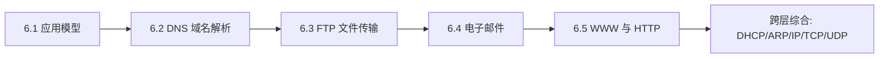

---

# 6.1 网络应用模型

## 6.1.1 客户/服务器模型 【📌 扫一眼｜确认“我还会”就过】

### 这一节要解决什么问题

- 谁发起服务请求，谁提供服务？
- 为什么服务器要持续监听，而客户必须知道服务器地址？
- C/S 模型的集中管理和性能瓶颈从哪里来？

### 核心知识

- C/S（Client/Server）中，<mark>服务器是始终处于开启状态的服务提供方，客户是主动发起请求并接收结果的服务请求方</mark>。 `[真题·2019-T40]`
- 服务器程序启动后在熟知端口监听，可以并发处理多个客户；客户程序事先需要知道服务器的 IP 地址和端口，服务器可从客户报文中获知客户地址。
- 典型应用：Web（浏览器/ Web 服务器）、FTP、SMTP/POP3/IMAP。

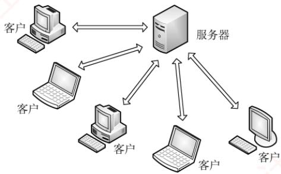

### C/S 的特点、优点与限制

- 网络中计算机地位不平等，权限、数据和管理集中在服务器，便于统一维护。
- <mark>客户之间通常不直接通信</mark>；例如两个浏览器不会直接交换 Web 数据。 `[真题·2019-T40]`
- 服务器的处理能力和出口带宽决定系统吞吐量，客户数过多时服务器成为瓶颈，可扩展性有限。
- “客户”和“服务器”是角色，不是固定的硬件类型；同一主机上的不同进程可以在不同通信中扮演不同角色。

> [!important] 必须记住
> C/S 中客户是请求方、服务器是服务方；服务器通常面向任务，客户通常面向用户。服务器能否主动向客户发送数据，要看具体应用协议和连接状态，不能把“客户主动发起”误读为“服务器永远不能发送”。

### 常考题型与解题方法

#### 题型：判断 C/S 角色和特征

- 识别特征：出现“始终开启、监听、服务请求、集中管理、客户之间通信”等关键词。
- 解题步骤：先找请求的发起者，再找持续监听者；最后检查题目是否把角色偷换成硬件/软件。
- 常见干扰项：说客户是硬件、服务器是软件；说客户之间可以直接通信；说服务器不能在连接建立后发送通知。
- 一句话方法：**客户主动请求，服务器持续服务；角色由一次通信中的职责决定。**

- `【⚡ 真题补丁｜2019-T40】` C/S 模型中客户之间不直接通信，客户向持续运行的服务器发起请求，节点能力不要求对等。

## 6.1.2 P2P 模型 【💤 可跳过｜冲刺期直接跳过不看】

### 核心知识

- P2P（Peer-to-Peer）中没有固定的客户/服务器划分，<mark>每个节点既能下载也能上传，任意两个对等方可直接通信</mark>。 `[真题·2019-T40]`
- 从实现机制看，节点访问别人资源时是客户，向别人提供资源时又是服务器，因此 P2P 仍可看作客户/服务器角色在节点间动态切换。

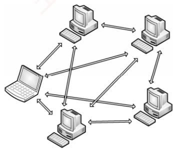

### 与 C/S 的对比

| 方面 | C/S | P2P |
|---|---|---|
| 资源位置 | 主要集中在服务器 | 分散在众多对等节点 |
| 通信关系 | 客户通常不直接通信 | 节点之间可直接通信 |
| 扩展性 | 受单一服务器性能、带宽限制 | <mark>节点增加通常带来更多服务能力</mark> `[真题·2019-T40]` |
| 健壮性 | 服务器故障影响大 | 单节点失效通常影响较小 |
| 管理 | 集中、便于权限控制 | 分散，管理和安全更复杂 |
| 代价 | 服务器承担主要压力 | 节点需占用 CPU、内存、磁盘和上行带宽 |

- P2P 的优势：减轻中心服务器压力，任务可并行分散，容量随节点增加，避免单点依赖。
- P2P 的代价：节点既是用户又是服务提供者，可能拖慢本机；大量 P2P 流量还可能造成 ISP 链路拥塞。
- P2P 网络是建立在 IP 网络之上的**逻辑覆盖网络**，不是与互联网并行铺设的物理网络。

> [!warning] 高频陷阱
> “对等”不等于所有节点硬件性能相同，也不等于形成独立物理网络；它强调通信和服务角色可以对等、动态变化。

### 小节自测

1. 为什么大量用户同时下载同一文件时 P2P 通常比 C/S 更有扩展性？
2. C/S 中服务器能否主动发送数据？应依据什么判断？
3. P2P 是物理网络还是覆盖在 IP 网络上的逻辑网络？

---

# 6.2 域名系统

## 6.2.1 层次域名空间 【📌 扫一眼｜确认“我还会”就过】

### 这一节要解决什么问题

IP 地址便于路由但难以记忆，如何使用有层次、可管理的名字定位主机？

- DNS（Domain Name System）是互联网的命名系统，主要把域名映射为 IP 地址，也支持反向解析。
- DNS 是基于 C/S 模型的分布式数据库系统。**王道本章默认：DNS → UDP → 53**；题干明确给出特殊条件时按题干。

### 域名的层次和书写规则

以 `www.cskaoyan.com` 为例：`www` 是最低级的三级标号，`cskaoyan` 是二级域名，`com` 是顶级域名；最低级写在最左边，顶级域写在最右边。


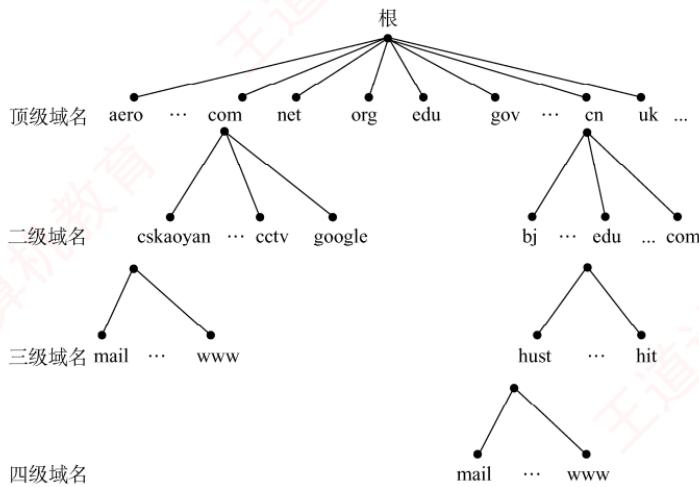

- 标号中的英文字母不区分大小写；除连字符 `-` 外不使用其他标点。
- 每个标号最多 63 个字符，完整域名（含点）最多 255 个字符。
- 域（domain）是名字空间中可管理的划分，可继续委托为子域；域不一定等于区。

### 顶级域名分类

| 类型 | 含义 | 例子 |
|---|---|---|
| 国家顶级域名 ccTLD | 国家/地区 | `.cn`、`.us` |
| 通用顶级域名 gTLD | 组织类别 | `.com`、`.net`、`.org`、`.edu`、`.gov` |
| 基础结构域名 | 反向解析等基础设施 | `.arpa` |

- 上级域可将子域委派给下级管理；域名的层级不一定等于独立权限服务器的数量。
- 域名与 IP 不是一一对应：一个域名可对应多个 IP，多个域名也可对应同一 IP，同一主机还可拥有多个域名。

> [!important] 必须记住
> 域名能解析为 IP，只说明存在映射关系，不说明是一一对应。下次遇到“一一对应”，分别检查“一个域名能否对应多个 IP”和“多个域名能否对应同一 IP”；在本章 IP 网络语境中，主机通信需要 IP，但不一定需要域名。

## 6.2.2 域名服务器 【🔥 必背｜停下来默背 1 遍】

### 区与服务器的分工

- 一个服务器负责管辖的范围称为**区（zone）**，其范围小于或等于某个域。
- 权限域名服务器保存自己负责区内主机名到 IP 的权威映射。
- 没有一台服务器保存全网所有映射，DNS 通过层次化、分布式存储完成扩展。

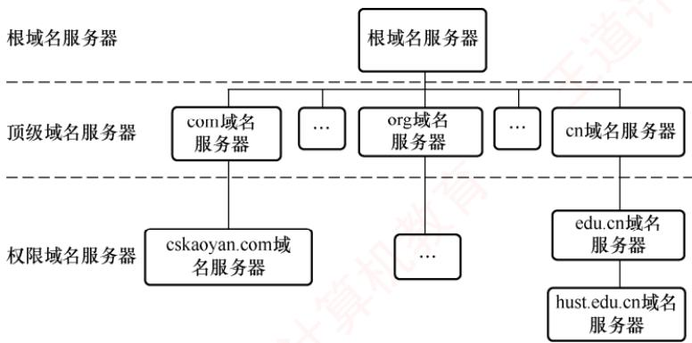

### 四类域名服务器

| 类型 | 负责内容 | 典型返回内容 |
|---|---|---|
| 根域名服务器 | 根及顶级域入口 | 对应 TLD 服务器的地址 |
| 顶级域名服务器 | 例如 `.com` 下的二级域 | 目标区权限服务器地址，或直接答案 |
| 权限/授权域名服务器 | 特定区内的权威记录 | 对自己直接管理且有地址记录的主机，给出目标 IP |
| 本地域名服务器 | ISP/学校/组织配置，替主机查询并缓存 | 最终答案或代查结果 |

- 主机缓存未命中、需要发起 DNS 查询时，通常首先联系配置的本地域名服务器；主机只需知道它的 IP，不必预先知道根、TLD、权限服务器的 IP。
- 本地 DNS 服务器也可能同时承担权限服务器角色。

> [!warning] 本轮辨析：本地 DNS 与权限 DNS
> “主机首先问谁、主机需要配置谁的 IP”选本地 DNS；“保存其管辖主机的权威映射、解析其管辖的主机名”选权限 DNS。本地 DNS 可凭缓存回答，也可代查，但“能回答”不等于“对该记录有管理权限”。

## 6.2.3 域名解析过程 【🔥⚡ 必背+避坑｜停下来默背 1 遍 + 精读 1 分钟】

### 递归查询与迭代查询

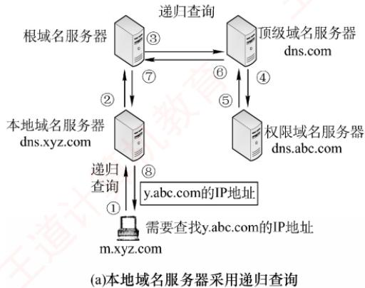

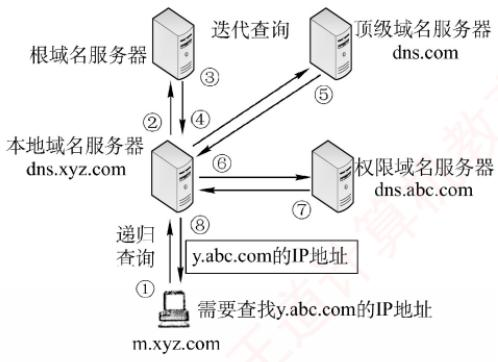

| 查询方式 | 谁负责继续查 | 返回内容 | 题目判断口诀 |
|---|---|---|---|
| 递归查询 | 被询问的服务器代替请求方继续查 | 最终答案或失败信息 | 委托对方查到底 |
| 迭代查询 | 原请求方（典型题中为本地 DNS）继续查 | 答案、下一站线索或失败信息 | 给线索，自己往下查 |

> [!important] 王道默认判断
> **王道本章默认：主机向本地域名服务器采用递归查询；本地域名服务器向其他域名服务器通常采用迭代查询。题干若明确给出其他查询方式，则按题干。**

- 教材典型流程中，主机查询本地 DNS，本地再分别查询根、TLD 和权限 DNS。在无缓存命中、无重传、一次查询对应一次响应的假设下，共 4 次查询、4 次响应，即 8 个 DNS 报文。**这是该例的数量，不是 DNS 报文数的普遍上限**；更深的区域委派可增加查询次数。

### DNS 缓存与 TTL

- 主机和本地域名服务器都会缓存近期的域名解析结果；缓存命中可直接返回，减少查询次数和时延。
- 记录带 TTL（生存时间），到期自动失效，避免拓扑或地址变化被永久缓存。
- 因此同一域名可能在不同时间解析出不同 IP，同一主机也可能被多个域名指向。

> [!tip] 分清缓存在哪一端
> 主机缓存命中：主机无需发出 DNS 查询；主机未命中而本地 DNS 命中：主机仍查询本地 DNS，但本地 DNS 向外查询 0 次。题目问“谁发了几条请求”，只数该实体发出的请求。

### 常考题型与解题方法

#### 题型 1：判断主机和服务器的查询条数

- 识别特征：题目问“用户主机、本地域名服务器分别发送几条 DNS 请求”。
- 步骤：先圈出计数主体和缓存位置，再找“谁继续发请求”。常规无重传模型下，主机向本地发 1 条请求；<mark>本地向外递归时可只向下一站发 1 条</mark>，向外迭代时需逐站发请求。 `[真题易错·2010-T40]`
- 检查动作：只问请求条数时不乘 2；问请求与响应报文总数时，才在一次请求对应一次响应的模型下乘 2。

**本轮 DNS 第12题：`www.abc.xyz.com`。** 按题目可能逐级委派、查询成功的模型，本地 DNS 最多依次访问根、`.com`、`xyz.com`、`abc.xyz.com` 的服务器，发出 4 次查询；<mark>若已有目标记录缓存，最少发出 0 次</mark>。不是对着域名的点号机械计数，也不要额外为主机标号 `www` 再造一级服务器。 `[真题易错·2016-T40]`

若另问上述最深路径的总报文数：计入主机与本地 DNS 的一问一答，就是 $2\times(1+4)=10$ 个报文。先确定统计对象，才能判断是 4 次还是 10 个。

#### 题型 2：计算解析次数和 RTT

- 先数本地域名服务器实际发出的查询：缓存命中为 0；未命中且迭代时，按需要经过的根/TLD/各级权限服务器计数。
- 再加 HTTP 的 TCP 建连和请求响应 RTT；题干若说明主机与本地 DNS 之间时延忽略，则不要额外加该段 RTT。
- 教材 2020 题给定“根→`.com`→`abc.com`”查询路径，且局域网时延、对象传输时延忽略：<mark>缓存命中时 HTTP 取页面需</mark> $2RTT$；最深查询路径另加 $3RTT$，共 $5RTT$。这里的 3 次查询由该题路径决定，不能推广为所有域名的最大值。 `[真题·2020-T40]`

#### 题型 3：DNS 使用 UDP 是否会因丢包失效

- 本章默认 DNS 使用 UDP，开销低、响应快；丢包时由 DNS 应用自行设置定时器并重发请求。
- 同一查询重复执行通常不会产生副作用，因此不必依赖 TCP 的自动重传。

> [!warning] 高频陷阱
> 判断查询方式，要看当前一跳中谁承担后续查询：被问者代查是递归，原请求者按线索继续查是迭代。本地 DNS 接受主机的递归请求，同时向外迭代，完全可以并存。

- `【⚡ 真题补丁｜2010-T40 / 2016-T40】` 递归查询下向根服务器仅发 1 条请求（2010-T40）；`www.abc.xyz.com` 本地迭代发出 0～4 次查询（2016-T40）。
- `【⚡ 真题补丁｜2020-T40】` DNS 迭代叠加 HTTP 取页面时，本地缓存命中仅需 `2 RTT`；无缓存按实际查询路径另加外网查询 RTT。

> [!note]- 课外拓展，不用于本章默认选择题判断
>
> - 一个区通常至少配置两个权限域名服务器，以提高可靠性。
> - DNS 在大报文或特殊情况下可使用 TCP；本章默认选择题仍先按 DNS → UDP → 53 判断。
> - 查询方式校核：[RFC 1034](https://www.rfc-editor.org/rfc/rfc1034.html#section-4.3.1)。

### 一分钟回顾

- 先问本地 DNS；缓存命中可不访问根/TLD。
- 递归是服务器代查并返回最终答案；迭代是返回下一站线索。
- “其管辖主机的权威记录”对应权限 DNS；其他服务器也可通过缓存返回答案。

### 小节自测

1. `www.abc.xyz.com` 在最坏情况下、本地采用迭代时可能访问哪些层次？
2. 为什么主机不需要知道根服务器 IP？
3. 多个域名指向一个 IP 是否允许？“能解析”为什么不能推出“一一对应”？

---

# 6.3 文件传输协议

## 6.3.1 FTP 的工作原理 【📌 扫一眼｜确认“我还会”就过】

### 核心知识

- FTP（File Transfer Protocol）面向异构网络提供可靠、交互式文件传输，允许指定文件类型/格式并进行权限管理。
- 支持匿名 FTP 共享公共文件；服务器可同时服务多个客户。
- FTP 采用 C/S 模式、基于 TCP，服务器端主进程监听熟知端口 `21`，为每个请求创建从属进程处理。
- FTP 是有状态协议：服务器要在会话中维护用户账户、控制连接、远程目录当前位置等状态。

## 6.3.2 控制连接与数据连接 【🔥⚡ 必背+避坑｜停下来默背 1 遍 + 精读 1 分钟】

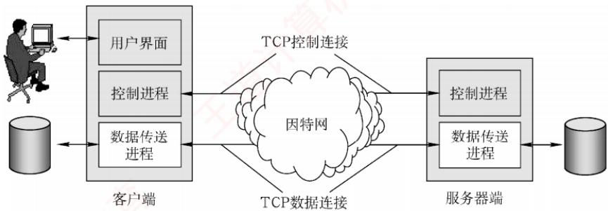

FTP 使用两条并行 TCP 连接：

| 连接 | 服务器端口（默认） | 传输内容 | 生命周期 |
|---|---:|---|---|
| 控制连接 | `21` | 登录、目录操作、传送命令、中断命令 | <mark>整个会话保持</mark> `[真题·2009-T40 / 2017-T40 / 2023-T47]` |
| 数据连接 | `20`（主动模式） | 文件或目录列表的实际数据 | <mark>每次传输建立，结束后关闭</mark> `[真题·2017-T40 / 2023-T47]` |

- 控制连接先建立、后释放；数据连接后建立、先释放。
- <mark>控制信息和文件数据走不同逻辑信道</mark>，因此 FTP 是**带外传送**；HTTP 的请求/响应通常在同一 TCP 连接中，属于带内传送。 `[真题·2009-T40]`
- 服务器端 `20/21` 是熟知端口；<mark>客户端控制连接和数据连接端口通常由系统动态分配</mark>，不能把客户端端口误写成固定 20/21。 `[真题易错·2017-T40]`

### PORT 与 PASV

- **PORT（主动）模式**：客户端先连服务器 `21`，登录后随机开放本地端口并通过 PORT 告知服务器；服务器从 `20` 端口主动连接客户端该端口传数据。
- **PASV（被动）模式**：客户端发送 PASV；服务器随机开放数据端口并返回端口号；客户端主动连接该端口传数据。
- 题目未特别说明时，本教材按主动模式处理；<mark>明确指定 PASV 时，不能再套服务器数据端口 20</mark>。 `[真题易错·2017-T40]`

> [!important] 必须记住
> “FTP 使用 20、21 端口”默认指服务器端端口；控制连接不传文件，数据连接不传登录命令。`LIST` 返回的目录列表同样走数据连接。

> [!note]- 了解：FTP 与 NFS
> FTP 修改远程文件通常先下载再上传；NFS 可读写远程文件的指定片段。二轮优先掌握 FTP 双连接、端口和 PORT/PASV。

### 常考题型与解题方法

#### 题型 1：连接、端口和传送方向

- 识别特征：出现“命令、登录、LIST、文件内容、20/21、先后释放”。
- 步骤：命令/登录/中断 -> 控制连接 21；文件/列表 -> 数据连接；先控制后数据，先释放数据后释放控制。
- 检查动作：题干说的是服务器端口还是客户端端口；是否指定 PASV。

#### 跨章节综合补充：TCP 序号与拥塞窗口

> [!note]- 只在题目给出 seq、MSS、cwnd 等条件时展开
>
> - SYN、FIN 各占 1 个序号，纯 ACK 不占序号。若该方向从初始序号 $I$ 起只发送 $L$ 字节文件，首字节序号为 $I+1$，独立 FIN 的序号为 $I+1+L$，确认该 FIN 的确认号为 $I+2+L$（不考虑序号回绕）。
> - 按教材慢开始模型，若初始 $cwnd=1MSS$、阈值为 $4MSS$，且无丢包、接收窗口足够大，各轮发送上限为 $1,2,4,5,6,\ldots$ 个 MSS。这些初值是题目条件，不能当作所有 TCP 的固定配置。
> - 平均应用层速率为 $L/T$；$L$ 以字节计时结果为 B/s，换成 bit/s 要乘 8。$T$ 是否包含建连或释放，取决于题目计时起止点。

#### 本轮易错：封装方向与“直接封装”

| 题目问法 | 解题方向 | 结果 |
|---|---|---|
| FTP 服务器发送文件时如何封装 | 从应用层向下 | 应用数据 → TCP 报文段 → IP 数据报 → 以太网帧 → 比特 |
| FTP 客户接收文件时如何解封装 | 从下层向上 | 比特 → 帧 → IP 数据报 → TCP 报文段 → 应用数据 |
| 谁“直接封装”应用报文 | 只看相邻下一层 | <mark>FTP：TCP；DNS（普通查询）：UDP；DHCP：UDP</mark> `[真题易错·2018-T33]` |

> [!warning] 本轮检查动作
> 先圈“发送/接收”，再圈“直接/逐层”。IP 最终也包住 DNS 报文，但直接包住它的是 UDP；不能跳过传输层作答。

> [!warning] 高频陷阱
> 不要写“客户端使用 20 端口”。客户端端口一般是临时端口；20 端口是主动模式下 FTP 服务器的数据端口。也不要把控制连接称为“传输连接”或“会话连接”，教材的标准术语只有控制连接、数据连接。

- `【⚡ 真题补丁｜2009-T40 / 2017-T40 / 2018-T33】` FTP 控制连接带外用 TCP；PASV 数据口非 20；DNS 用 UDP，FTP/SMTP/HTTP 用 TCP。

> [!example]- ⚡ 真题母题 2023-T47｜FTP 控制/数据连接、TCP 慢开始演化与传输总耗时
> **题目要点**：主机 `H` 向 FTP 服务器 `S` 上传大小为 `18000 B` 的文件 `F`；`MSS=1000 B`，`RTT=10 ms`，`ssthresh=4 MSS`，接收窗口足够大且无丢包重传；数据连接建立时 `S`（或发送方）初始序号 `ISN=100`（按 `H` 从 `100` 起发，设 `F` 首字节 `seq=101`），忽略发送、排队及处理时延。
>
> **为什么这么想**：
> 1. **双连接属性**：控制连接贯穿整个会话（持久），数据连接按次建立关闭（非持久）；登录命令走控制连接 `21` 端口。
> 2. **序号与 FIN**：`SYN` 占 100，`F` 占 `101~18100`，`H` 的 `FIN` 占 `18101`，故 `S` 对 `FIN` 的 `ACK` 确认号为 `18102`。
> 3. **逐 ACK 与整轮演进**：第 1 轮（1–2 RTT）发 `1 MSS`（`101~1100`），收 `ACK 1101` 后 `cwnd=2 MSS`；第 2 轮发 `2 MSS`（`1101~2100`、`2101~3100`），先收 `ack=2101` 仍处于慢开始阶段故 `cwnd` 增为 `3 MSS`，再收 `ack=3101` 增至门限 `4 MSS`；第 3 轮切入拥塞避免发 `4 MSS`（累计确认至 `7101`），整轮确认完后 `cwnd` 线性增 1 至 `5 MSS`。
> 4. **总耗时与吞吐**：`0~1 RTT` 完成前两次握手（第 3 次 ACK+第 1 段数据于 `1 RTT` 发出），后续五轮各发 `1, 2, 4, 5, 6` 个 `MSS`（合计 `18 MSS = 18000 B`），`6 RTT = 60 ms` 全部确认到达。
>
> **标准解答**：
> 1. 控制连接是**持久的**，数据连接是**非持久的**；登录过程通过**控制连接**传送。
> 2. 文件 `F` 第 1 个字节序号 **`101`**；服务器第 2 次挥手 `ACK` 段的确认号 **`18102`**。
> 3. `H` 收到 `ack=2101` 时 `cwnd = 3 MSS = 3000 B`；收到 `ack=7101` 时 `cwnd = 5 MSS = 5000 B`。
> 4. 从发起数据连接建连到 `H` 收到 `F` 全部确认最短总时间为 **`6 RTT = 60 ms`**，平均应用层传输速率为 **`18000 × 8 / 0.06 = 2.4 Mbps`**。

### 小节自测

1. FTP 为什么需要两条连接？
2. 主动模式和被动模式是谁主动发起数据连接？
3. 发送与接收的层次顺序如何相反？直接封装 FTP、DNS、DHCP 报文的分别是谁？

---

# 6.4 电子邮件

## 6.4.1 电子邮件系统的组成结构 【🔥 必背｜停下来默背 1 遍】

### 核心知识

- 电子邮件是异步通信：发送者和接收者不必同时在线；邮件先存入接收方服务器邮箱，接收者稍后读取。
- 三部分：用户代理（UA）、邮件服务器、邮件发送/读取协议。

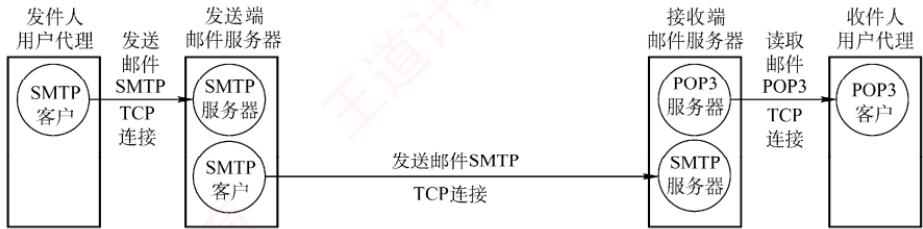

- 用户代理是用户界面，支持撰写、显示、处理邮件，如 Outlook、Foxmail。
- 邮件服务器既可作为 SMTP 服务器接收邮件，也可作为 SMTP 客户向下一台服务器发送邮件。
- 发送邮件的数据流：<mark>发送方 UA → 发送方邮件服务器 → 接收方邮件服务器，两段均使用 SMTP over TCP</mark>（普通邮件客户端模型）。 `[真题·2012-T40 / 2025-T40]`
- 读取邮件的交互：接收方 UA ↔ 接收方邮件服务器，使用 POP3 / IMAP over TCP。**UA 主动建立连接和请求，邮件内容从服务器传到 UA。**

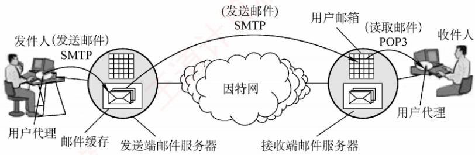

### Push 与 Pull

| 目的 | 协议 | 方式 | 典型连接 |
|---|---|---|---|
| 发送邮件 | SMTP | <mark>Push，发送方主动推送</mark> | UA 到发送服务器、服务器到服务器 `[真题·2012-T40]` |
| 读取邮件 | POP3/IMAP | <mark>Pull，用户代理主动拉取</mark> | UA ↔ 接收服务器；邮件内容由服务器到 UA `[真题·2012-T40]` |

## 6.4.2 电子邮件格式与 MIME 【🔥 必背｜停下来默背 1 遍】

### 邮件格式

- 一封邮件由**信封**和**内容**组成；内容又分为首部和主体。
- 教材以 RFC 822 介绍首部格式；传输时的信封与显示给用户的邮件首部是不同概念，信封用于投递，不必与显示的收件人首部完全相同。
- `From`、`To`、`Subject` 等首部行均为“字段名: 值”；首部与主体之间必须用一个空行分隔。
- 教材将 `To`、`From` 作为常见邮件首部（From 常由系统自动填充），`Subject` 用于说明主题；邮箱地址通常写为 `用户名@域名`。**标准格式中的必填与实际投递收件人要分开**：按 [RFC 5322 第 3.6 节](https://www.rfc-editor.org/rfc/rfc5322.html#section-3.6)，`Date` 和 `From` 是必需首部，`To` 和 `Subject` 在语法上可省略；投递仍需在信封中指定实际收件人。教材书页 284 将 `To` 称为必填，是简化口径。

```text
From: fh@hit.edu.cn
To: abc@cskaoyan.com
Subject: Say hello to Internet

邮件主体
```

### MIME 的作用

<mark>SMTP 原本只直接支持 7 位 ASCII 文本</mark>，不能直接传输中文、图像、音视频或可执行文件。MIME 不替换 SMTP，而是在发送端把非 ASCII 内容编码为 ASCII，交给 SMTP 传输，接收端再解码还原。 `[真题·2013-T40 / 2018-T40]`

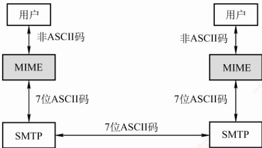

MIME 的主要内容：

1. 增加 MIME-Version、Content-Description、Content-ID、Content-Transfer-Encoding、Content-Type 等首部字段。
2. 统一多媒体邮件内容的表示格式。
3. 定义不会被邮件系统破坏的传送编码。

> [!important] 必须记住
> “SMTP 不能直接传非 ASCII”不等于“邮件不能传附件”；附件通常先经 MIME 编码，再由 SMTP 传送。无需转换即可由 SMTP 直接传送的是 ASCII 文本。

- `【⚡ 真题补丁｜2013-T40 / 2018-T40】` SMTP 原生仅直接支持 7 位 ASCII 文本传输，无需 MIME 转换即可传送的也是 ASCII 文本。

## 6.4.3 SMTP 和 POP3 【🔥⚡ 必背+避坑｜停下来默背 1 遍 + 精读 1 分钟】

### SMTP

- SMTP（Simple Mail Transfer Protocol）基于 TCP，服务器熟知端口 `25`，用于 UA 到发送服务器、邮件服务器之间的发送。
- 本章双邮件服务器模型中，发送方与接收方邮件服务器直接建立 TCP 连接；沿途路由器转发 IP 包，不承担 SMTP 邮件处理。按题图判断邮件传递阶段。
- 三阶段：
  1. **连接建立**：SMTP 客户连接接收服务器 `25`；服务器返回 `220 Service ready`；客户发送 `HELO`。
  2. **邮件传送**：`MAIL FROM` -> 服务器 `250 OK`；一个或多个 `RCPT TO` 验证收件人；服务器肯定响应后发送 `DATA`；正文以 `<CRLF>.<CRLF>` 结束。
  3. **连接释放**：客户发送 `QUIT`，服务器返回 `221`，释放 TCP 连接。
- `RCPT TO` 先验证收件人，可避免传完长邮件才发现地址无效。

### POP3、IMAP 与 Web 邮箱

- POP3 基于 TCP、端口 `110`，用于用户代理从服务器读取邮件；支持“下载并保留”和“下载并删除”。**一次 POP3 会话可经同一条 TCP 连接读取多封邮件**，<mark>不必为每封邮件重新建连</mark>。 `[真题·2015-T33 / 2025-T40]`
- IMAP 功能更强：邮件和文件夹保留在服务器，支持远程搜索、移动邮件、维护会话状态，并可选择只下载首部或附件的一部分。
- Web 邮箱（如 Gmail、Hotmail）中，浏览器与邮件服务器之间的发送/读取使用 HTTP；只有邮件服务器之间传递邮件时使用 SMTP。

### 常考题型与解题方法

#### 题型：根据阶段判断应用层协议

- UA -> 发送方邮件服务器：SMTP。
- 发送方邮件服务器 -> 接收方邮件服务器：SMTP。
- 收件人 UA 主动向接收方邮件服务器取信：POP3、IMAP；若用浏览器访问 Web 邮箱，则为 HTTP。邮件内容方向都是服务器 → UA。
- 看到端口 `25` 优先判断 SMTP，看到 `110` 判断 POP3；再检查报文方向，不能只看一个端口就忽略角色。

#### 题型：判断 SMTP、POP3、IMAP 能力

- SMTP：发送，不负责用户从邮箱读取；基于 TCP；原生直接传 7 位 ASCII。
- POP3：<mark>读取，功能简单；不能代替 SMTP 发送</mark>。 `[真题易错·2025-T40]`
- IMAP：读取且保留服务器端状态，支持远程文件夹/搜索/部分下载。

> [!warning] 高频陷阱
> From、To、Subject 的来源不同：From 常由系统自动填充，To 和 Subject 通常由用户填写；不能说邮件头所有字段都由系统自动生成。SMTP 是“推”，POP3/IMAP 是“拉”。

- `【⚡ 真题补丁｜2012-T40 / 2015-T33 / 2025-T40】` SMTP 负责推发送，POP3 基于 TCP 拉读取（2012/2015）；POP3 支持在**同一条 TCP 连接**中连续读取多封邮件（2025-T40）。

### 小节自测

1. 为什么用户用浏览器登录 Gmail 时不是直接使用 POP3？
2. MIME 改变了 SMTP 还是扩展了 SMTP？
3. 邮件服务器 A 向 B 发邮件时，A 和 B 分别扮演什么 SMTP 角色？

---

# 6.5 万维网

## 6.5.1 万维网的概念与组成结构 【⚡ 避坑｜最值钱，必须精读 1 分钟】

### 核心知识

- WWW 是建立在互联网之上的分布式、联机式信息存储空间；资源通过超链接互相连接。
- 三个核心标准：
  - URL：统一资源定位符，唯一标识资源并描述访问方式。
  - HTTP：浏览器与 Web 服务器交互的应用层协议，基于 TCP。
  - HTML：描述网页结构和内容的标记语言，可组织文本、图像、声音和视频。
- URL 一般形式：

$$
<协议>://<主机>:<端口>/<路径>
$$

协议可为 `http`、`https`、`ftp` 等；端口和路径可省略，HTTP 默认端口为 `80`，路径默认根目录。

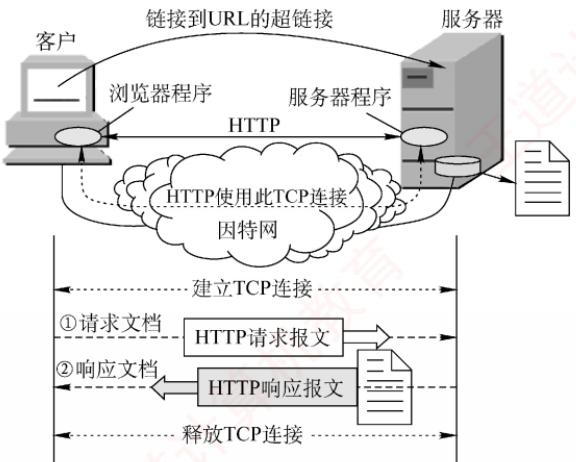

### 从输入 URL 到页面显示

1. 浏览器从 URL 取出域名（以下按本章普通 HTTP、使用域名访问的模型）。
2. 先检查域名缓存，未命中时通过 DNS 获取服务器 IP。
3. 与服务器 `80` 端口建立 TCP 连接。
4. 发送 HTTP `GET` 请求，服务器返回 HTML。
5. 浏览器解析 HTML；若引用图像、CSS、脚本等资源，继续发出 HTTP 请求。
6. 资源接收完毕后按 HTTP 版本和连接方式复用或释放 TCP，浏览器渲染页面。

> [!warning] 本轮辨析：域名解析、地址解析、网页传输
> DNS 做“域名 → IP”；ARP 做“本链路下一跳 IPv4 地址 → MAC”；HTTP 请求网页。域名未知 IP 且缓存未命中时，Web 访问的两组核心搭配是 **DNS/UDP + HTTP/TCP**。<mark>ARP 缓存未命中才需 ARP 查询；访问外网时通常查网关的 MAC</mark>，不是远端 Web 服务器的 MAC。 `[真题易错·2014-T40 / 2021-T47]`

DHCP 用于尚未配置网络参数的主机，<mark>ICMP、PPP 等是否出现由具体场景决定</mark>；它们不是每次网页访问都必定发生的步骤。 `[真题·2014-T40]`

- `【⚡ 真题补丁｜2014-T40 / 2021-T47】` 访问 Web 网页串联 DHCP、DNS(UDP)、ARP、TCP 与 HTTP，不会用到 SMTP（2014-T40）；交换表只自学习发出帧的源 MAC（2021-T47）。

## 6.5.2 超文本传输协议 【🔥⚡ 必背+避坑｜停下来默背 1 遍 + 精读 1 分钟】

### 1. HTTP 的操作过程和特点

- Web 服务器持续监听 TCP `80`；解析域名得到 IP 后，浏览器建立 TCP，发送请求，服务器返回响应。
- 教材称 HTTP 本身**无连接**，是说交换 HTTP 报文前无需再建立一个独立于 TCP 的“HTTP 连接”。本章 HTTP/1.0、HTTP/1.1 使用的是 TCP，不能因这个词改选 UDP。
- HTTP **无状态**，是说协议本身不要求请求依赖以前的交互状态；网站可另外管理用户会话。它不保证重复请求的响应内容相同，页面内容本身可能变化。

### Cookie

- 首次访问时服务器生成识别码，在响应中发送 `Set-Cookie: 12345`；浏览器将其与域名保存。
- 再次访问时浏览器在请求中发送 `Cookie: 12345`；<mark>服务器据此查询后端数据库，恢复用户状态或提供个性化服务</mark>。 `[真题易错·2015-T40 / 2026-T40]`
- Cookie 通常存储在用户主机的文本文件中，由服务器产生，可能带来隐私风险；它不是服务器端唯一存储。

### 持续连接和页面加载时延

先统一计时口径：下表按 TCP 正常三次握手、往返路径传播时间对称、无重传，并忽略处理和小报文发送时延推导。以客户端发 SYN 为 $t=0$，第三次 ACK 可捎带 HTTP 请求。

| 时刻 | 发生的事件 | 计时意义 |
|---|---|---|
| $0$ | 客户端发送 SYN | 开始建连 |
| $0.5RTT$ | 服务器收到 SYN，发 SYN+ACK | 第一次握手到达 |
| $1RTT$ | 客户端收到 SYN+ACK，发 ACK+HTTP 请求 | 客户端已可发请求 |
| $1.5RTT$ | 服务器收到第三次 ACK 和请求 | 服务器侧握手完成，可返回响应 |
| $2RTT$ | 客户端收到小对象响应 | 本模型下完成一次对象获取 |

> [!important] 本轮疑点：1.5RTT 与 2RTT 各算到哪里
> “三次握手完整到服务器收到第三次 ACK”是 $1.5RTT$；HTTP 常见分解是“前两次握手 $1RTT$ + 请求/响应 $1RTT$”。第三次 ACK 与 HTTP 请求同行，后半段已经计入请求/响应，不能再算成 $1.5RTT+1RTT$。若题目规定请求晚于第三次 ACK 另行发送或有额外等待，须按题目重画时间线。

以下页面时延结论假设 DNS 已完成、引用对象在收到 HTML 后才得知、都在同一服务器，且忽略处理时延；只有不受发送/接收窗口限制时，才能直接按对象的请求轮次计 RTT。

| 方式 | 连接特点 | 典型 RTT 开销 |
|---|---|---|
| HTTP/1.0 非持续 | 每个对象单独 TCP 连接 | 每个对象 $2RTT+T_{传输}$ |
| HTTP/1.1 持续、非流水线 | 同一 TCP 连接复用，但请求需等待前一响应 | 只付一次前两次握手的 $1RTT$；每个对象再付 $1RTT+T_{传输}$ |
| HTTP/1.1 持续、流水线 | 可连续发送多个请求 | 收到 HTML 后，小引用对象可用一轮请求/响应获取；不代表数据传输时间和窗口限制消失 |

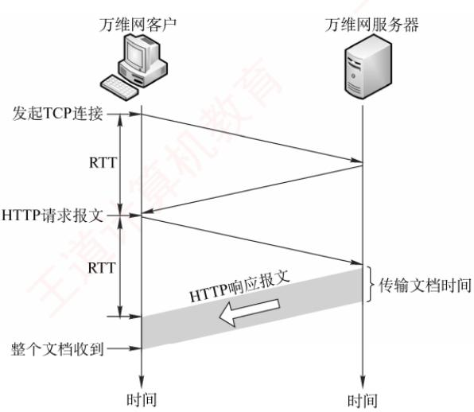

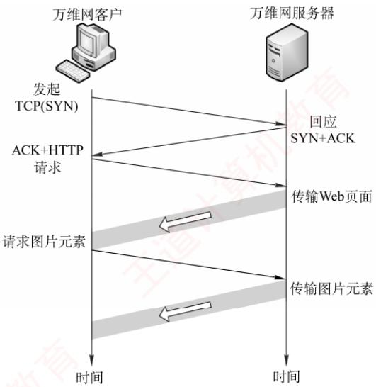

- 非持续连接请求一个对象，按上述时间线为 $2RTT+T_{传输}$。
- 1 个 HTML 和 7 张小图片：<mark>非持续且不并行时为</mark> $8\times2RTT=16RTT$；若允许 7 张图片的连接全部并行、忽略对象发送时延，则 HTML 用 $2RTT$，图片共用 $2RTT$，合计 $4RTT$。若限制并行数，应分批计。 `[真题·2024-T40]`
- 持续非流水线：从“发出 HTML 请求”开始，<mark>HTML 加 5 张小图片需</mark> $(1+5)RTT=6RTT$；计时起点已经越过前两次握手，不再加建连开销。 `[真题·2011-T47]`
- 持续流水线：从“发出 HTML 请求”开始，一轮拿 HTML，下一轮连续请求并拿小引用对象，理想情况共 $2RTT$；若从 SYN 开始则为 $3RTT$。有 MSS/cwnd 限制时再按实际发送轮次计算。

> [!warning] 时延计算三步法
> 先圈计时起点与终点（点击 / SYN / HTTP 请求；收到数据 / 收到确认 / CLOSED），再判缓存与连接方式，最后检查窗口和报文传输时间。只有终点涉及主动关闭方进入 CLOSED 时，才按正常释放模型计入 TIME_WAIT 的 $2MSL$；收到网页本身不需要等待它。

### 2. HTTP 报文结构和方法

本章 HTTP/1.x 的开始行和首部采用文本格式，字段长度不固定；主体可以是图像等二进制数据。请求和响应均按以下结构阅读：

1. **开始行**：请求报文为请求行，响应报文为状态行。
2. **首部行**：每行 `字段名: 值`，首部结束后有一个仅含 CRLF 的空行。
3. **实体主体**：可有可无。GET、HEAD 请求通常没有主体；POST、PUT 等请求可携带主体；响应常通过主体携带资源内容，但对 HEAD 的响应不含主体。

> [!note]- 课外拓展，不用于本章默认选择题判断
> HTTP 方法语义校核：[RFC 9110](https://www.rfc-editor.org/rfc/rfc9110.html#section-9.3)。

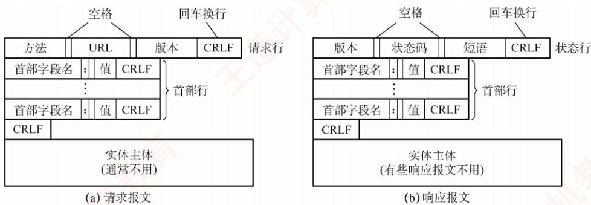

请求行格式：`方法 相对URL HTTP版本`。

| 方法 | 功能 |
|---|---|
| GET | 读取 URL 标识的资源 |
| HEAD | 只请求资源首部，不返回对象主体，常用于调试/检查 |
| POST | 向服务器提交/添加信息 |
| PUT | 在指定 URL 存储文档 |
| DELETE | 删除 URL 标识的资源 |
| CONNECT | 建立代理隧道/用于代理服务器 |

典型请求：

```text
GET /bbs/index.htm HTTP/1.1
Host: www.cskaoyan.com
Connection: Keep-Alive
User-Agent: Mozilla/5.0
Accept-Language: cn

```

- `Host` 给出服务器域名；因为已有 Host，请求行可使用相对 URL。
- `Connection: Keep-Alive` 请求持续连接；`Connection: close` <mark>请求传输后关闭</mark>。 `[真题·2015-T40]`
- 响应状态行格式为 `HTTP/版本 状态码 短语`，如 `202 Accepted`、`400 Bad Request`、`404 Not Found`。

### 3. 代理服务器

- 代理服务器（Web cache）在本地磁盘缓存近期请求和响应。
- 新请求命中缓存时直接返回，不必访问原始服务器；<mark>可减少出口链路流量、降低延迟</mark>。 `[真题易错·2026-T40]`
- 代理可放在客户端、服务器端或网络中间节点。

### 4. 抓包报文的分层读取

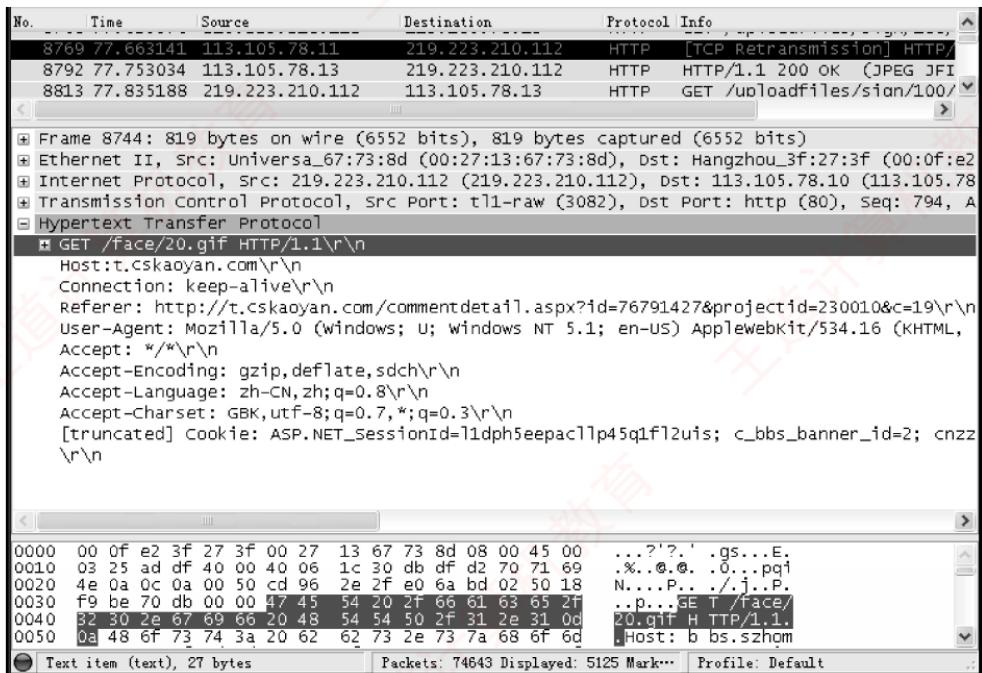

阅读以太网抓包时按层定位：

- 以太网前 6B：目的 MAC；接着 6B：源 MAC；类型 `08 00` 表示上层为 IPv4。
- IPv4 首部通常 20B，其中源/目的 IP 各 4B。
- TCP 首部通常至少 20B；其后的 TCP 数据部分就是 HTTP ASCII 请求，例如 `GET /face/20.gif HTTP/1.1`。
- 服务器熟知端口在 TCP 目的端口或源端口中出现时，要结合方向判断是请求还是响应。

### 5. 常见应用层协议与端口

| 应用 | 传输层协议 | 服务器熟知端口 |
|---|---|---:|
| FTP 数据连接（主动模式） | TCP | 20；PASV 按协商端口 |
| FTP 控制连接 | <mark>TCP</mark> | 21 `[真题·2018-T33]` |
| TELNET | TCP | 23 |
| SMTP | <mark>TCP</mark> | 25 `[真题·2018-T33]` |
| DNS | <mark>UDP（本章默认）</mark> | 53 `[真题·2018-T33]` |
| TFTP | UDP | 69 |
| HTTP | <mark>TCP</mark> | 80 `[真题·2018-T33]` |
| POP3 | TCP | 110 |
| SNMP | UDP | 161 |

### 常考题型与解题方法

#### 题型 1：从 URL/浏览流程判断协议

- 使用域名且目标 IP 缓存未命中时，先 DNS/UDP 获取 IP，再 TCP 建连并传 HTTP；已有 IP 或缓存命中时可跳过网络 DNS 查询。
- 看到“域名解析”找 DNS，看到本链路“IP → MAC 地址解析”找 ARP。题目问“直接封装”时只选相邻下一层。
- 完整浏览过程可能同时使用 UDP 和 TCP；“HTTP 自身使用 TCP”不等于“访问网页全程只用 TCP”。<mark>普通网页访问不需要 SMTP</mark>。 `[真题·2014-T40]`

#### 题型 2：HTTP 时延与 RTT

- 题干从“发出 HTTP 请求”开始：此前的前两次握手不计；请求若捎带在第三次 ACK 中，该 ACK 的传播已包含在请求的传播中。
- 题干从“请求建立 TCP 连接”开始：先计前两次握手的 $1RTT$，再按捎带和响应规则继续计时；不要将它误称为“服务器已完成完整三次握手”。
- HTTP/1.0 每对象一个连接；HTTP/1.1 默认持续；<mark>流水线可合并请求，但 TCP 慢开始仍限制一次可发送的数据量</mark>。 `[真题易错·2022-T40]`

> [!example]- 跨章节综合：网页 1MSS、图片 3MSS
> 按教材初始 $cwnd=1MSS$、接收窗口足够大且始终处于慢开始的模型：第 1 RTT 完成前两次握手；第 2 RTT 请求并收到 HTML；第 3 RTT 请求图片并收到 $2MSS$；第 4 RTT 收到余下 $1MSS$。共 $4RTT$。教材第 18 题的解析采用初始 $cwnd=1MSS$；题面没有明确给出初始拥塞窗口，结论依赖这个教材模型，不能由 HTTP/1.1 本身推出。

#### 题型 3：HTTP 报文、Cookie 和方法

- 看到 `HEAD`：只要首部，不返回对象；看到 `Connection: Close`：非持续；看到 `Cookie`：浏览器曾保存该站点状态。
- 先看方法再判断请求主体：GET/HEAD 通常没有，POST/PUT 可有；“HEAD 请求通常无主体”与“HEAD 响应不返回主体”要分清。HTTP/1.x 首部末尾有空行。

**出现 MSS/cwnd/FIN/MSL → 不套普通 HTTP RTT 公式，画 TCP 时间线。**

> [!example]- 典型综合错题模型：本轮第14题（HTTP + TCP 释放）
>
> - **半关闭**：H 发 FIN 表示 H→S 方向不再发送后续应用数据；S→H 仍可继续发送剩余数据，H 仍需接收并发送 ACK。收到第一个数据段就发 FIN，不等于两端立即停传。
> - **FIN 可与数据同段**：它可标记发送方最后一批数据的结束，但不能突破 MSS。若最后一批为 $2MSS$，仍须拆成两个数据段，最后一个可以带 FIN。
> - **正常主动关闭**：H 发 FIN 后经 FIN_WAIT_1、FIN_WAIT_2；收到 S 的 FIN 并发出最终 ACK 时进入 TIME_WAIT，再等 $2MSL$ 才 CLOSED。
>
> **教材第14题的计算条件**：总数据 $5KB$，$MSS=1KB$，$RTT=50ms$，$MSL=800ms$。原解析采用初始 $cwnd=1MSS$，无丢包、接收窗口足够大、慢开始且忽略发送/处理时延的模型；不是从“HTTP/1.1”本身推出初始窗口。
>
> | 自 H 发 SYN 起的时刻 | 事件 | 此时的关键含义 |
> |---|---|---|
> | $0$ | H 发 SYN | 起点 |
> | $1RTT$ | H 收 SYN+ACK，发第三次 ACK+HTTP 请求 | 请求随第三次握手前往 S |
> | $2RTT$ | H 收到首批 $1KB$，立即发 FIN+ACK | H 关闭发送方向，仍可收剩余 $4KB$ |
> | $2.5RTT$ | S 收 FIN+ACK，确认 H 的 FIN，并发下一批 $2KB$ | $cwnd$ 增为 $2MSS$；数据分成两个 MSS 段 |
> | $3RTT$ | H 收到这批数据和确认，继续发 ACK | 累计收到 $3KB$；H 可处于 FIN_WAIT_2 |
> | $3.5RTT$ | S 收 ACK，窗口增至 $4MSS$，发余下 $2KB$，最后一段带 FIN | 数据和关闭信号共用这一轮 |
> | $4RTT$ | H 收齐数据和 FIN，发最终 ACK，进入 TIME_WAIT | 从此时开始计 $2MSL$ |
> | $4RTT+2MSL$ | H 进入 CLOSED | 题目要求的终点 |
>
> 因此该题为：
>
> $$
> T=4RTT+2MSL=4\times50+2\times800=1800\text{ ms}.
> $$
>
> > [!warning] 下次检查动作
> > 在时间线上分别标出两方向的 FIN、每轮允许发送的数据量和计时终点。问“收到全部数据”时到 $4RTT$ 即止；本题问 H 进入 CLOSED 才加 $2MSL$。无需再为最终 ACK 到达 S 多加 $0.5RTT$，它的传播已与 H 的 TIME_WAIT 重叠。$4RTT+2MSL$ 是本例结果，不是所有 HTTP 释放题的公式。
>
> > [!note]- 课外拓展，不用于本章默认选择题判断
> > TCP 释放与半关闭校核：[RFC 9293](https://www.rfc-editor.org/rfc/rfc9293.html#section-3.6)。

> [!warning] 高频陷阱
> HTTP 的“无连接”描述不能用来选择 UDP；“无状态”也不妨碍 Cookie 与网站后端记录会话。判断时先写清所属层次和所讨论的机制。

- `【⚡ 真题补丁｜2015-T40 / 2026-T40】` `Connection: Close` 表示非持续连接（2015-T40）；Cookie 用于服务端识别与会话跟踪，**不能缩短 Web 对象响应时间**（2026-T40）。
- `【⚡ 真题补丁｜2011-T47 / 2022-T40 / 2024-T40】` HTTP/1.0 非持续非并行 1+7 对象需 `16 RTT`；HTTP/1.1 流水受慢开始制约，2022 需 `4 RTT`。

### 小节自测

1. 为什么 HTTP/1.1 持续连接仍可能需要多于 2RTT？
2. `GET` 与 `HEAD` 的返回内容有何区别？
3. 对含 1 个 HTML 和 3 个图片的页面，HTTP/1.0 非并行与 HTTP/1.1 流水线的 RTT 如何比较？
4. 为什么服务器收到第三次 ACK 在 $1.5RTT$，而 HTTP 单对象获取可在 $2RTT$ 完成？
5. H 发 FIN 后还能收数据、发 ACK 吗？TIME_WAIT 从哪一个事件开始？

---

# 6.6 本章小结及疑难点

## 1. 客户端端口与服务器端口

- 服务器使用公开的熟知端口，便于客户定位服务；客户使用操作系统动态分配的临时端口。
- 一个端点由 `(IP 地址, 端口号)` 标识；一条 TCP 连接由双方两个套接字共同确定。
- 判断端口时必须结合报文方向和协议，不能只看到数字就断言是客户端或服务器。

## 2. 互联网与万维网的区别

- 互联网是全球互联的网络基础设施和 TCP/IP 通信体系。
- WWW 是建立在互联网之上的应用层生态，由网页、网站、URL、HTML 和 HTTP 组成。
- 记忆：互联网提供连通性，WWW 提供通过浏览器访问的链接文档服务。

## 3. 为什么 HTTP/1.1 下载页面和图片仍可能需要多个 RTT

持续连接减少重复 TCP 建连，不消除拥塞控制。若题目采用初始 $cwnd=1MSS$ 的模型，服务器须随确认扩大窗口；页面和图片超过当前窗口时，就要多个传输轮次。按题干或教材解析给定的初始窗口计算，不把 $1MSS$ 背成通用默认值。

## 4. 主机刚开机后访问 Web 的跨层过程

1. DHCP 获取 IP、子网掩码、默认网关和 DNS 服务器地址；DHCP 报文通常封装在 UDP/IP/以太网帧中。
2. DNS 解析域名；发送前若 ARP 表无记录，先用 ARP 广播解析同网段 DNS 或默认网关的 MAC。
3. 浏览器向 Web 服务器 `80` 端口建立 TCP，发送 `GET`，接收 HTTP 响应。
4. 解析 HTML 后继续请求图片等资源；依据 HTTP 版本复用或新建连接。
5. 数据链路层帧在交换机中按 MAC 学习/转发，在路由器处按 IP 转发；跨网段时 NAT 可能改写源 IP/端口，TTL 每经过路由器减 1，IP 首部检验和需重算。

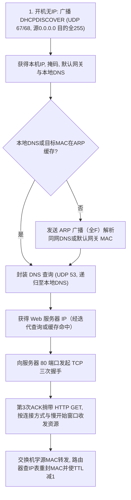

---

# 本章高频题型总表

| 题干特征 | 优先方法/起手式 | 真题印证与避坑 |
|---|---|---|
| C/S 与 P2P 角色判断 | 找请求发起方与持续监听方 | 2019-T40：C/S 客户间不直接通信，角色非硬件属性 |
| DNS 查询次数与主体 | 先圈计数主体、缓存端和委托方向 | 2010/2016-T40：递归向根仅 1 次；迭代 0~4 次，不背死 8 个 |
| DNS 叠加 HTTP 时延 | 先算本地外网查询次数，再加 HTTP 建连请求 | 2020-T40：缓存命中最短 2 RTT；最深再加对应层级 RTT |
| FTP 双连接与端口 | 命令/登录看 21 持久，文件/LIST 看数据非持久 | 2009/2017/2023-T47：带外传送；PASV 数据口非 20 |
| FTP 叠加 TCP 演进 | SYN/FIN 各占 1 序号，慢开始逐 ACK 扩窗 | 2023-T47：收 `ack=2101` 时 `cwnd=3MSS`，全传 6 RTT |
| 直接封装与跨层链 | “直接”仅找相邻下层，先圈发送/接收方向 | 2018-T33 / 2021-T47：DNS/DHCP→UDP，FTP/HTTP→TCP |
| SMTP / POP3 / IMAP | 发信推送用 SMTP，收信拉取用 POP3/IMAP | 2012/2013/2018/2025-T40：原生 7 位 ASCII；POP3 单连接可多封 |
| HTTP 页面与流水线 | 分版本判持续/并行，再核 TCP 慢开始窗口 | 2022/2024-T40：1.0 非并行 1+7 耗 16 RTT；Cookie 不降时延 |
| HTTP + TCP 半关闭 | 标两方向 FIN、每轮发送量和最终 CLOSED 条件 | 第 14 题模型：发 FIN 仍可收数据，仅主动 `CLOSED` 计 `2MSL` |
| HTTP 报文与方法 | 开始行-首部-空行-主体对照读 | 2015/2026-T40：`HEAD` 只要首部；`Connection: Close` 非持续 |
| 以太网分层抓包 | 按 MAC(14B) → IP(20B) → TCP(20B+) 切偏移 | 2011-T47：先看 `08 00` 再读源目端口判断请求或响应方向 |

# 高频易混概念对比

| 易混项 | 正确区别 |
|---|---|
| 域名与 IP | 域名便于记忆，IP 用于路由；映射不必一一对应 |
| DNS 与 ARP | DNS：域名 → IP；ARP：本链路下一跳 IPv4 地址 → MAC |
| 递归与迭代 | 递归由被询问者代查到底；迭代返回下一站线索 |
| 控制连接与数据连接 | FTP 控制连接传命令且持久；数据连接传文件且临时 |
| SMTP 与 POP3 | SMTP 推送邮件；POP3 拉取邮件 |
| POP3 与 IMAP | POP3 简单读取；IMAP 维护服务器端状态并支持文件夹/部分下载 |
| HTTP 无连接与 TCP 有连接 | HTTP 不维护独立连接，报文可通过 TCP 连接传输 |
| HTTP 无状态与 Cookie | HTTP 默认不记录历史，Cookie 在应用层补充识别信息 |
| 持续与流水线 | 持续复用 TCP；流水线还允许连续发送多个请求 |
| 三次握手与 HTTP 取对象 | 对称时延模型：服务器握手完成为 $1.5RTT$；第三次 ACK 捎带请求时小对象可在 $2RTT$ 到客户端 |
| FIN 与整个连接结束 | FIN 关闭一个发送方向；反向仍可传数据，正常主动关闭方最后还需 TIME_WAIT |
| 服务器熟知端口与客户端口 | 熟知端口在服务器端公开；客户端口由系统临时分配 |

# 选择题快速判断结论

- 王道本章默认：DNS → UDP → 53；FTP、SMTP、HTTP、POP3 使用 TCP。题干明确给特殊条件时按题干。
- 王道本章默认：主机向本地域名服务器采用递归查询；本地域名服务器向其他域名服务器通常采用迭代查询。题干若明确给出其他查询方式，则按题干。
- DNS 缓存命中时可以不向根/TLD/权限服务器发查询；TTL 到期后记录失效。
- 域名能解析成 IP 不代表一一对应；DNS 查询无“普遍最多 8 个报文”的结论。
- FTP 先控制后数据，先释放数据后释放控制；命令不走数据连接。
- SMTP 支持 UA 到服务器、服务器到服务器的发送，不支持用户从服务器读取邮件。
- `HEAD` 只取首部；`GET` 取资源；`Connection: Close` 表示非持续连接。
- 本章 HTTP/1.0 按非持续、HTTP/1.1 默认持续处理；单个对象的 $2RTT$ 模型需满足第三次 ACK 捎带请求等条件，另计实际传输时间和窗口限制。
- HTTP 请求可以有主体，需看方法；HEAD 的响应不含对象主体。
- FIN 只关闭该方向后续应用数据发送，另一方向仍可传；是否加 $2MSL$ 要看题目问收到数据还是进入 CLOSED。
- “一定、所有、仅、一一对应、永远不能”等全称限定词出现时，优先检查题目是否忽略了缓存、别名、多网卡、动态端口、协议方向或特殊模式。

# 本章刷题顺序建议

1. 先做协议、端口、角色和概念辨析题。
2. 再做 DNS 递归/迭代、缓存和 RTT 题。
3. 接着做 FTP 双连接、TCP 序号、拥塞窗口和封装题。
4. 最后集中练习 HTTP 连接方式、页面时延、报文抓包和跨层综合题。

# 小节自测清单

- [ ] 能解释 C/S 与 P2P 的角色、优缺点和“覆盖网络”含义。
- [ ] 能画出 DNS 根、TLD、权限、本地服务器的层次关系。
- [ ] 能根据递归/迭代和缓存命中情况计算查询条数与 RTT。
- [ ] 能解释 DNS 第12题为何是本地查询最少 0 次、最多 4 次，而非机械套“8 个报文”。
- [ ] 能区分 FTP 控制/数据连接、PORT/PASV 及服务器/客户端端口。
- [ ] 能处理 SYN/FIN 序号和基于 MSS 的拥塞窗口计算。
- [ ] 能区分 SMTP、POP3、IMAP、MIME 的职责和端口。
- [ ] 能写出 URL、HTTP 请求/响应结构及常用方法。
- [ ] 能计算 HTTP/1.0、HTTP/1.1 非流水线/流水线的页面加载时延。
- [ ] 能从计时终点解释 $1.5RTT$ 与 HTTP $2RTT$ 的区别。
- [ ] 能画出 HTTP 第14题的半关闭时间线，标出 TIME_WAIT 从何时开始。
- [ ] 能把 DHCP/DNS/HTTP 与 UDP/TCP/IP/ARP/以太网串成一次完整访问流程。

# 本轮主动回忆卡

先独立口述或写出答案，填写“我的易错”，再展开“正确解释”。答不清的回看原小节。

## 01｜域名与 IP 的映射

问题：域名能解析成 IP，能否推出二者一一对应？一个域名对应多个 IP、多个域名对应同一 IP，分别是否允许？

我的易错：＿＿＿＿＿＿

> [!success]- 正确解释
> 不能推出一一对应；两种情况都允许。“能解析”说明存在映射，不限制映射只能一对一。
>
> 回看：[[#6.2.1 层次域名空间 【📌 扫一眼｜确认“我还会”就过】|6.2.1 层次域名空间]]

## 02｜主机需要知道谁的地址

问题：主机缓存未命中、需要发起 DNS 查询时，应先联系谁？是否必须预先知道根、顶级和权限 DNS 的 IP？

我的易错：＿＿＿＿＿＿

> [!success]- 正确解释
> 先联系配置的本地 DNS，主机只需知道它的 IP；不必预先知道根、顶级、权限 DNS 的 IP，后续由本地 DNS 代查。
>
> 回看：[[#6.2.2 域名服务器 【🔥 必背｜停下来默背 1 遍】|6.2.2 域名服务器]]

## 03｜本地 DNS 与权限 DNS

问题：题干强调“保存其管辖主机的权威映射、解析其管辖的主机名”，应选哪类服务器？与“主机首先查询谁”有何区别？

我的易错：＿＿＿＿＿＿

> [!success]- 正确解释
> “管辖、权威映射”对应权限 DNS；“主机首先查询谁”对应本地 DNS。本地 DNS 可通过缓存或代查回答，但能回答不等于对该记录有管理权限。
>
> 回看：[[#6.2.2 域名服务器 【🔥 必背｜停下来默背 1 遍】|6.2.2 域名服务器]]

## 04｜递归与迭代

问题：不背图的名称，怎样依据“谁继续发请求”判断递归和迭代？王道默认主机到本地、本地到其他服务器分别采用什么方式？

我的易错：＿＿＿＿＿＿

> [!success]- 正确解释
> 被询问者代查到底是递归；原请求者按返回线索继续查是迭代。王道默认主机向本地 DNS 递归，本地 DNS 向其他服务器通常迭代；题干明确另给方式时按题干。
>
> 回看：[[#6.2.3 域名解析过程 【🔥⚡ 必背+避坑｜停下来默背 1 遍 + 精读 1 分钟】|6.2.3 域名解析过程]]

## 05｜DNS 查询次数（第12题）

问题：解析 www.abc.xyz.com 时，按第12题模型，本地 DNS 最少、最多各发几次查询？为何“8 个 DNS 报文”不能作为通用上限？查询次数与报文总数如何区分？

我的易错：＿＿＿＿＿＿

> [!success]- 正确解释
> 最少 0 次：本地 DNS 已有目标缓存；最多 4 次：依次问根、.com、xyz.com、abc.xyz.com 的服务器。按题目的区域委派计数，不是机械数点号。
>
> 8 个报文仅是教材典型路径的一问一答总数。本题最深路径若连主机与本地 DNS 的一问一答也计入，则为 $2\times(1+4)=10$ 个报文。先圈计数主体，再区分“请求次数”与“请求＋响应”。
>
> 回看：[[#6.2.3 域名解析过程 【🔥⚡ 必背+避坑｜停下来默背 1 遍 + 精读 1 分钟】|6.2.3 域名解析过程]]

## 06｜封装与解封装

问题：FTP 服务器发送文件时，从应用数据到比特依次经历什么封装？客户接收时按什么顺序解封装？

我的易错：＿＿＿＿＿＿

> [!success]- 正确解释
> 发送：应用数据 → TCP 报文段 → IP 数据报 → 以太网帧 → 比特。接收按相反方向逐层解封装。先圈“发送/接收”，再决定方向。
>
> 回看：[[#6.3.2 控制连接与数据连接 【🔥⚡ 必背+避坑｜停下来默背 1 遍 + 精读 1 分钟】|6.3.2 控制连接与数据连接]]

## 07｜“直接封装”问哪一层

问题：直接封装 FTP、DNS、DHCP 报文的协议分别是什么？为什么不能因为 IP 最终包住了这些报文就选 IP？

我的易错：＿＿＿＿＿＿

> [!success]- 正确解释
> 按本章默认，依次为 TCP、UDP、UDP。“直接”只看相邻下一层；IP 直接封装的是 TCP 报文段或 UDP 数据报，不能跨过这一层作答。
>
> 回看：[[#6.3.2 控制连接与数据连接 【🔥⚡ 必背+避坑｜停下来默背 1 遍 + 精读 1 分钟】|6.3.2 控制连接与数据连接]]

## 08｜DNS 与 ARP

问题：“域名解析”与“地址解析”分别把什么映射为什么？访问外网 Web 服务器时，ARP 通常查询谁的 MAC？

我的易错：＿＿＿＿＿＿

> [!success]- 正确解释
> DNS：域名 → IP；ARP：本链路下一跳 IPv4 地址 → MAC。目标在外网时，主机通常获取默认网关的 MAC；相关缓存已命中时无需重复查询。
>
> 回看：[[#6.5.1 万维网的概念与组成结构 【⚡ 避坑｜最值钱，必须精读 1 分钟】|6.5.1 万维网的概念与组成结构]]

## 09｜HTTP 的“无连接”

问题：教材称 HTTP 本身无连接，能否据此判断本章 HTTP 使用 UDP？应怎样区分这里的两个层次？

我的易错：＿＿＿＿＿＿

> [!success]- 正确解释
> 不能。本章 HTTP/1.0、HTTP/1.1 使用 TCP。“HTTP 本身无连接”指无需在 TCP 之外再建立一个独立的 HTTP 连接，不改变所用传输层协议。
>
> 回看：[[#6.5.2 超文本传输协议 【🔥⚡ 必背+避坑｜停下来默背 1 遍 + 精读 1 分钟】|6.5.2 超文本传输协议]]

## 10｜完整 Web 访问的协议组合

问题：用域名访问网页且目标 IP 缓存未命中时，域名解析与网页传输分别使用哪些应用层、传输层协议？为什么不能说整个过程只用 TCP？

我的易错：＿＿＿＿＿＿

> [!success]- 正确解释
> 本章默认两条链是 DNS/UDP 和 HTTP/TCP。HTTP 自身用 TCP，不代表为它准备目标 IP 的 DNS 查询也用 TCP；已有 IP 或缓存命中时可跳过网络 DNS 查询。
>
> 回看：[[#6.5.1 万维网的概念与组成结构 【⚡ 避坑｜最值钱，必须精读 1 分钟】|6.5.1 万维网的概念与组成结构]]

## 11｜1.5RTT 与 2RTT

问题：为什么完整三次握手到服务器收到第三次 ACK 是 $1.5RTT$，HTTP 获取一个小对象却常按 $2RTT$，而不是 $2.5RTT$？请说清计时条件和各自的终点。

我的易错：＿＿＿＿＿＿

> [!success]- 正确解释
> 在对称传播、无重传、忽略处理和小报文发送时延的模型中，客户端于 $1RTT$ 收到 SYN+ACK，随后发第三次 ACK＋HTTP 请求；服务器于 $1.5RTT$ 收到它们，客户端于 $2RTT$ 收到响应。
>
> 第三次 ACK 与请求同行，它的传播已包含在“请求/响应 $1RTT$”中。因此是前两次握手 $1RTT$ 加请求/响应 $1RTT$，不能再重复计成 $1.5RTT+1RTT$。
>
> 回看：[[#6.5.2 超文本传输协议 【🔥⚡ 必背+避坑｜停下来默背 1 遍 + 精读 1 分钟】|6.5.2 超文本传输协议]]

## 12｜FIN、半关闭与计时终点（第14题）

问题：H 收到首个数据段后就发 FIN，S 还能继续发剩余数据吗？H 还能发 ACK 吗？$2MSL$ 从何时开始计，什么终点才需要计入？遇到 MSS/cwnd/FIN/MSL 应用什么方法？

我的易错：＿＿＿＿＿＿

> [!success]- 正确解释
> FIN 只关闭 H→S 方向的后续应用数据发送，S→H 仍可继续，H 仍可接收并发 ACK。FIN 可与最后的数据同段，但数据长度仍受 MSS 限制。
>
> 正常主动关闭时，H 收到 S 的 FIN、发出最终 ACK 并进入 TIME_WAIT，从此计 $2MSL$，之后才 CLOSED。只问收到数据，不应加这段等待。
>
> 出现 MSS/cwnd/FIN/MSL 就画 TCP 时间线，按窗口安排每轮数据、标出两方向 FIN 和计时终点。第14题的完整时间线见对应折叠例题。
>
> 回看：[[#6.5.2 超文本传输协议 【🔥⚡ 必背+避坑｜停下来默背 1 遍 + 精读 1 分钟】|6.5.2 超文本传输协议]]

后续只在新错题出现时回填到对应小节和回忆卡，保留错因、关键条件与下次检查动作。
