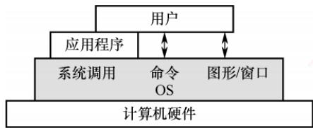
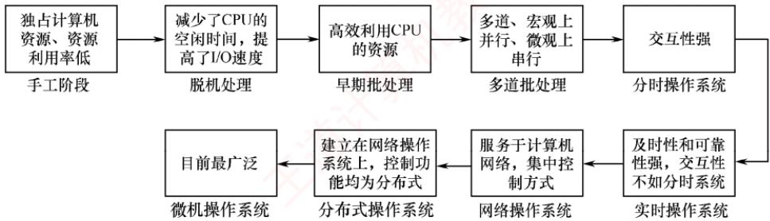
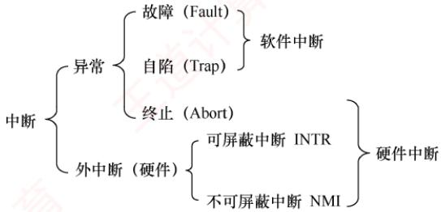
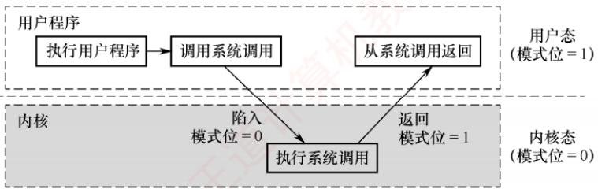
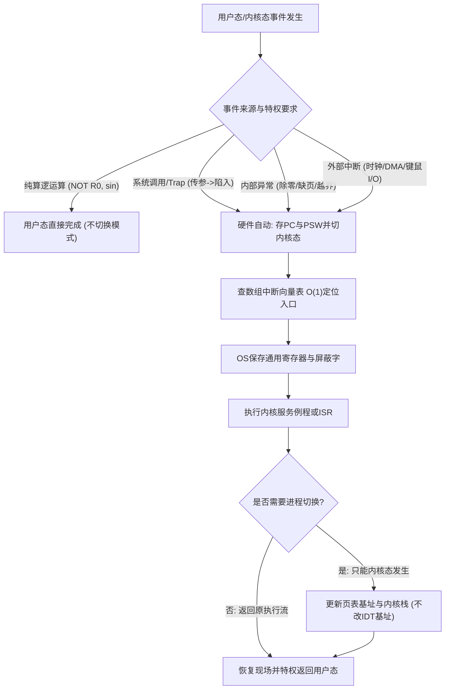
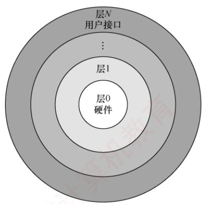
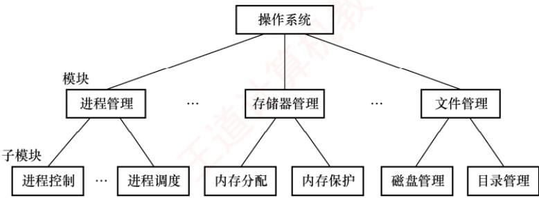
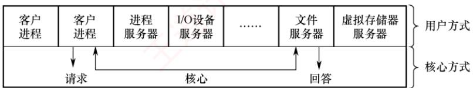
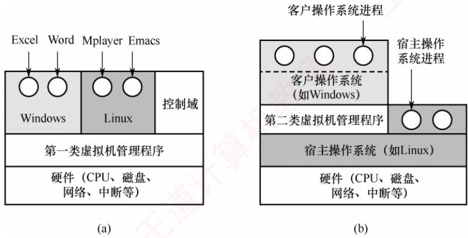

# 第1章 计算机系统概述

> [!abstract] 本章复盘目标
> 本章先回答“操作系统是什么、为什么需要它”，再沿历史发展理解并发产生的原因，随后进入最重要的运行机制：用户态/内核态、中断与异常、系统调用。最后比较操作系统结构、引导过程和两类虚拟机。复习时要把每个概念接到“谁触发、在哪里执行、由谁完成、为什么需要”这四个问题上。

> [!important] 近 18 年 408 操作系统真题雷达（2009—2026）
> - **考频统计**：本章 18 年共考查 **30 道单选 + 1 道综合大题（2021-T46）**，属于概念辨析第一高产章（年均 1–3 道选择）。
> - **核心落点**：1.3 运行环境占核心主力（模式切换、特权指令、中断/异常硬件与 OS 分工、系统调用 4 步、时钟中断），其次为 1.1 并发/并行与接口、1.4 OS 结构（微内核性能代价）、1.5 开机引导（2021-T46）及 1.6 虚拟机特权级（2025-T24）。
> - **个人失分边界**：混淆“发生在用户态（系统调用/外中断/缺页）”与“只能发生在内核态（进程切换）”；错判 `NOT R0`/`sin()` 不会切态、装入程序在内核态执行（2026-T23）、进程切换不改中断向量表基址（2025-T23）。
> - **总控入口**：[[00_408操作系统｜考前急救与真题落点总控|返回操作系统总控]]

## 考纲定位

- 操作系统的基本概念：定义、功能、目标、四个基本特征。
- 操作系统的发展历程：手工、批处理、分时、实时、网络/分布式和微机操作系统。
- 程序运行环境：内核、处理机模式、中断与异常、系统调用。
- 操作系统结构：分层、模块化、宏内核、微内核、外核。
- 操作系统引导与虚拟机。
- 原材料的考纲还列出了“程序的链接与装入、程序运行时内存映像与地址空间”，但本章正文没有展开；本笔记不凭空补写，后续需结合相应章节另行补齐。

> [!tip] 命题特点
> 本章以选择题为主，重点不是背长定义，而是辨认概念的适用条件。高频设错方式包括：把并发偷换成并行、把库函数偷换成系统调用、把“事件发生时的状态”偷换成“处理程序执行时的状态”、把硬件动作偷换成操作系统动作。

## 章节知识脉络

1. **1.1 基本概念**：操作系统管什么、给谁服务、具有哪些特征。
2. **1.2 发展历程**：围绕 CPU 利用率、吞吐量、交互性、实时性逐步演进。
3. **1.3 运行环境**：靠双重模式实施保护，靠中断/异常进内核，靠系统调用受控地请求服务。
4. **1.4～1.6 系统实现**：结构决定性能与可靠性的权衡；引导把内核装入内存；虚拟化在硬件之上建立隔离环境。
5. **1.7 疑难点**：集中澄清最容易被题目偷换的概念。

---

# 1.1 操作系统的基本概念【🔥⚡ 必背+避坑｜停下来默背 1 遍 + 精读 1 分钟】

## 1.1.1 操作系统的概念【📌 扫一眼｜确认“我还会”就过】

### 这一节要解决什么问题

1. 操作系统位于计算机系统的哪一层？
2. 操作系统管理什么，又向谁提供什么？

### 核心定义

从人机交互视角看，计算机系统自下而上为：**硬件 → 操作系统 → 应用程序 → 用户**。

操作系统是控制和管理计算机系统软、硬件资源，合理组织任务、调度工作和分配资源，并为用户及其他软件提供统一接口与运行环境的最基本系统软件。

拆开定义可得到三个角色：

| 角色 | 关键问题 | 含义 |
|---|---|---|
| 资源管理者 | 管什么 | 处理机、存储器、文件、设备等软硬件资源 |
| 接口提供者 | 给谁用 | 向终端用户提供命令/图形接口，向应用程序提供系统调用 |
| 扩充机器 | 带来什么 | 屏蔽裸机细节，向上层呈现更方便、更强的逻辑机器 |

> [!warning] 高频陷阱
> 操作系统管理的是***<u>“计算机资源”</u>***，不只是硬件。文件属于***<u>软件资源</u>***，也由操作系统管理；但操作系统管理源程序文件的存储、目录和权限，***<u>不理解其代码语义</u>***。

### 一分钟回顾

- OS 是最基本的系统软件，位于硬件与应用/用户之间。
- 核心任务是管理资源、***<u>提供接口</u>***、扩充裸机。
- ***<u>编译器、编辑器等应用或支撑软件不是操作系统必须提供的功能</u>***；OS 也不是用来编程的程序。

## 1.1.2 操作系统的功能和目标【🔥 必背｜停下来默背 1 遍】

### 一、作为资源管理者

| 管理对象 | 典型功能 | 后续章节 |
|---|---|---|
| 处理机 | 进程控制、同步、通信、死锁处理、处理机调度 | 进程管理 |
| 存储器 | 分配与回收、地址映射、保护与共享、内存扩充 | 内存管理 |
| 文件 | 存储空间、目录、读写、访问保护 | 文件系统 |
| 设备 | 缓冲、设备分配、驱动处理、虚拟设备 | I/O 管理 |

> [!important] 必须记住
> 多道程序环境下，处理机分配和运行通常以进程或线程为基本单位，因此处理机管理的核心是进程管理。

### 二、作为用户与硬件之间的接口



| 接口 | 使用者 | 使用方式 | 典型场景 |
|---|---|---|---|
| 联机用户接口（命令行） | 交互式用户 | 输入一条，解释执行一条 | Shell、终端 |
| 脱机用户接口（作业控制语言） | 批处理用户 | 预先提交作业说明书 | 批处理作业 |
| 图形用户接口（GUI） | 终端用户 | 图标、菜单、窗口 | 桌面系统 |
| 程序接口（***<u>系统调用</u>***） | ***<u>应用程序/程序员</u>*** | 程序运行时***<u>请求内核服务</u>*** | 文件 I/O、创建进程 |

GUI 的底层仍会通过系统调用与内核交互。应用程序访问系统资源的合法接口是***<u>系统调用</u>***，不是中断、原语或库函数；用户程序只能通过系统调用***<u>间接使用资源</u>***，<mark>不能直接操作硬件资源</mark>。 `[真题·2010-T23]`

#### 库函数与系统调用

- 库函数***<u>属于用户程序层</u>***，是对可复用代码的封装。
- 有些库函数会封装系统调用，如输出、文件访问；<mark>有些只做用户态计算</mark>，如字符串处理、数学运算。 `[真题·2010-T23 / 2013-T28]`
- 所以***<u>“所有库函数都依赖系统调用”是错误的</u>***；`sin()`、`strlen()`、随机数等纯计算函数***<u>完全不陷入内核</u>***。 `[真题·2013-T28 / 2021-T32]`
- ***<u>不同操作系统的系统调用接口通常不同</u>***；<mark>库函数提供可移植封装</mark>。 `[真题·2019-T25]`
- 可替换性/可调试性：库函数通常方便替换、方便调试（用户态）；***<u>系统调用通常不可替换、调试麻烦</u>***（内核态）。

### 三、扩充机器

裸机只提供原始硬件能力。操作系统通过抽象、资源管理和服务接口，把裸机扩展成用户更容易使用的逻辑机器，即**扩充机器**。

### 常考题型与解题方法

#### 题型：判断某对象是不是操作系统提供的接口

> [!abstract] 💡 解题核心思考模型：先立分类轴，再对号入座
> 操作系统接口**只按服务对象分两类**，先问"给谁用"，答案就出来了：
> - **终端用户** → 用户接口（联机命令 / 脱机作业控制语言 / GUI）
> - **应用程序 / 程序员** → 程序接口 = ***<u>系统调用</u>***（程序运行时请求内核服务的唯一合法途径）

- **识别特征**：题干出现"提供给应用程序 / 编程人员 / 程序员"，或问"程序如何完成某操作（读文件、创建进程）"。
- **解题步骤**：
  1. 先定位服务对象：是"人"还是"程序"；
  2. 是程序 → 直接锁定系统调用；
  3. 是终端用户 → 再区分命令接口或 GUI；
  4. 问"操作用什么完成"（读文件、创建进程）→ 系统调用。
- **干扰项排除**：每个干扰项都有确定的死因——

| 干扰项 | 排除依据 |
|---|---|
| 库函数 | <mark>属于用户程序层非系统调用</mark>；部分库函数封装系统调用，纯计算类（sin、strlen）可在用户态完成 `[真题·2010-T23 / 2013-T28]` |
| 高级语言 | 编程工具，连编译器都不是 OS 必须提供的功能 |
| 子程序 | 程序内部同特权级的控制转移，与内核服务无关 |
| 原语 | 内核内部不可中断的原子操作，不是给应用程序的接口 `[真题·2010-T23]` |
| 中断 | 事件通知机制（被动发生），不是应用程序主动请求服务的接口 `[真题·2010-T23]` |

- **检查动作**：问自己"这是应用程序向内核请求服务的入口吗？"
- **一句话方法**：**用户用命令/GUI，程序用系统调用。**

## 1.1.3 操作系统的特征【⚡ 避坑｜最值钱，必须精读 1 分钟】

### 一、并发（Concurrency）

- 并发：多个事件在***<u>同一时间间隔</u>***内发生。
- 并行：多个事件在***<u>同一时刻</u>***真正同时发生。
- <mark>单核仅能进程宏观并发</mark>、微观串行；***<u>多核或多处理机（多处理器系统）才可能实现进程级并行</u>***。 `[真题·2009-T23 / 2018-T23]`
- 即使只有一个 CPU，<mark>CPU与设备及设备间可并行</mark>，即 CPU 与 I/O 设备、通道与设备、多个 I/O 设备之间仍可硬件并行。 `[真题·2009-T23]`

### 二、共享（Sharing）

共享是系统资源可供多个并发进程共同使用，<mark>并发访问共享资源需保护</mark>。 `[真题·2018-T23 / 2022-T23]`

| 共享方式 | 条件 | 典型资源 | 本质 |
|---|---|---|---|
| 互斥共享 | 一段时间内只允许一个进程访问 | 打印机、临界变量 | 其他请求必须等待 |
| 同时访问 | 允许多个进程在宏观上同时访问 | 只读文件、可重入代码 | 可能仍是微观分时交替 |

并发与共享互为存在条件：有并发才产生共享和竞争问题；有正确的共享机制，并发程序才可以安全推进。因此二者是操作系统***<u>最基本的两个特征</u>***。

### 三、虚拟（Virtual）

虚拟把一个物理实体映射为多个逻辑对应物：

- **时分复用**：一个 CPU 分时形成多个逻辑处理机。
- **空分复用**：物理存储空间经抽象形成更大的逻辑地址空间。
- **虚拟设备**：如 SPOOLing 将独占打印机转化为可供多个用户并发使用的逻辑设备。

### 四、异步（Asynchronism）

并发进程以不可预知的速度断续推进，称为异步性。异步不等于结果必然错误；只要同步机制正确，执行结果仍应正确且可再现。

### 概念辨析

| 概念 | 时间含义 | 是否要求多个处理器 |
|---|---|---|
| 并发 | 同一时间间隔内交替推进 | 否 |
| 并行 | 同一时刻真正同时执行 | 进程级并行通常需要 |
| 异步 | 推进速度和时序不可预知 | 否 |

> [!warning] 高频陷阱
> “多任务系统具有并发性”不等于“必须运行在多 CPU 上”——***<u>单 CPU 通过调度即可实现多任务并发</u>***；<mark>进程越多未必利用率越高</mark>，竞争、切换乃至死锁可能反而降低 CPU 利用率。 `[真题·2018-T23 / 2022-T23]`

### 1.1 小节自测

1. 为什么 OS 管理源程序文件，却不管理源程序的语义？
2. `read()`、`sin()`、命令行和 GUI 分别属于哪一层接口或操作？
3. 单核系统能否并发？能否出现硬件并行？
4. 为什么并发和共享互为存在条件？

---

# 1.2 操作系统发展历程【📌 扫一眼｜确认“我还会”就过】

## 1.2.1 手工操作阶段（未配置操作系统）【💤 可跳过｜冲刺期直接跳过不看】

### 一、人工操作方式

- 用户独占全机，程序装入、启动、输出均靠人工。
- 两个主要矛盾：**人机速度矛盾**和 **CPU 与 I/O 设备速度矛盾**。
- 结果：CPU 长时间等待，资源利用率很低。

### 二、脱机 I/O 方式

外围机在主机 CPU 不参与的情况下预先完成输入/输出准备：输入先转存到磁带，输出也先写磁带再由外围机送往外设。

- “脱机”是脱离**主机 CPU 的直接控制**，不是没有设备或没有电。
- 优点：减少 CPU 等待人工和低速设备的时间，提高 I/O 效率。

## 1.2.2 批处理阶段（操作系统开始出现）【⚡ 避坑｜最值钱，必须精读 1 分钟】

### 一、单道批处理系统

监督程序自动、顺序地执行一批作业，但内存中始终只有一道用户程序。 `[真题·2016-T23]`

- 自动性：作业连续执行，无须人工逐个干预。
- 顺序性：按装入顺序执行。
- 单道性：前一作业结束后才装入下一作业。
- 缺点：当前作业等待 I/O 时，CPU 仍空闲。

### 二、多道批处理系统

内存中同时驻留多道程序。一道程序因 I/O 阻塞时，CPU 切换到另一道就绪程序，<mark>借中断实现I/O与CPU并行</mark>，其基础是***<u>多道程序设计和中断机制</u>***。 `[真题·2016-T23 / 2022-T23]`

- 多道：多道独立程序同时驻留内存。
- 宏观上并行：多道程序都在推进。
- 微观上串行：单 CPU 上轮流执行。
- 优点：<mark>CPU与I/O利用率高且吞吐大</mark>。 `[真题·2017-T28]`
- 缺点：***<u>缺乏交互能力</u>***、响应时间较长、<mark>组织与切换管理开销增大</mark>。 `[真题·2016-T23 / 2017-T28]`

> [!warning] 多道程序改变了程序的执行特征
> 引入多道后，程序执行***<u>失去封闭性和顺序性</u>***：因共享资源与相互协同产生竞争、相互制约（制约性）；为保证竞争公平，执行断续（间断性）。因此“顺序性”不是多道程序设计的特征。多道程序设计技术的前提之一是系统具有***<u>中断功能</u>***（实现 I/O 与 CPU 并行、进程切换的基础），代价是额外的作业组织与切换开销——所以“系统开销小”不是多道系统的优点。 `[真题·2017-T28]`

> [!important] 必须记住
> 多道程序设计提高单机资源利用率，<mark>但并不要求必须支持虚拟存储</mark>，也不保证“程序越多，利用率越高”（进程多则竞争激烈，甚至可能死锁）。它必须解决处理机分配、内存分配与保护、I/O 分配、文件组织与安全等问题。批处理系统最主要的缺点是***<u>缺乏交互能力</u>***。 `[真题·2016-T23 / 2022-T23]`

## 1.2.3 分时操作系统【📌 扫一眼｜确认“我还会”就过】

处理器时间被划分为短时间片，轮流分给各用户程序，使用户获得近似独占计算机的交互体验。分时系统出现的重要原因与追求的主要目标是***<u>快速响应用户</u>***。

- 同时性（多路性）
- 交互性
- 独立性
- 及时性

若有 $N$ 个就绪用户/进程，每个时间片为 $Q$，粗略响应时间可估为：

$$T \approx NQ$$

题目给最大响应时间 $T_{max}$ 时，时间片上限通常按 $Q \le T_{max}/N$ 估算。

> [!warning] 影响响应时间的因素
> 响应时间的长短不只由时间片决定：***<u>加大时间片会延迟响应</u>***；用户数越多，人均分得的时间片越少、响应越长。改善响应时间的手段是调度算法层面的改进，如***<u>优先级 + 非抢占式调度</u>***（该结论是原题给定选项组合下的判别口径：高优先级任务尽快获得响应；注意非抢占式调度本身并不普遍保证响应更好，也不天然防止低优先级任务饥饿）；“静态页式管理”“代码可重入”等与响应时间无关。通用操作系统采用时间片轮转调度，用户运行程序***<u>不需要预订运行时间</u>***。

## 1.2.4 实时操作系统【📌 扫一眼｜确认“我还会”就过】

实时系统必须在被控制对象规定的时间内完成处理，核心目标是***<u>及时性与可靠性</u>***，而不是资源利用率最大化（为保证高优先级任务快速处理，允许“浪费”资源）。

| 类型 | 截止时间要求 | 例子 |
|---|---|---|
| 硬实时 | 必须满足，错过可能造成灾难 | 飞控、导弹制导、关键工业控制、***<u>机床控制</u>*** |
| 软实时 | 偶尔错过可容忍，不造成永久损害 | 部分票务、信息服务、***<u>航空订票、股票交易</u>*** |

> [!warning] 识别实时场景
> 不要只看“处理得快”，要看是否存在外部事件及明确时限。响应快但没有截止约束，不足以判定为实时系统。典型实时应用：***<u>航空订票、机床控制、股票交易</u>***；而办公自动化、AutoCAD、工资管理系统不是实时应用。

## 1.2.5 网络操作系统和分布式系统【💤 可跳过｜冲刺期直接跳过不看】

| 对比项 | 网络操作系统 | 分布式操作系统 |
|---|---|---|
| 节点 | 各计算机保持独立 | 多节点协同组成整体 |
| 资源访问 | 用户常需显式指定远程位置 | 资源对用户透明 |
| 任务执行 | 主要是通信与资源共享 | 可拆分任务并在节点间协作 |
| 用户视角 | 多台联网机器 | 单一系统映像 |

分布式系统的关键词是：**分布性、并行性、透明性**，其中透明性最有辨识度。

## 1.2.6 微机操作系统【📌 扫一眼｜确认“我还会”就过】

| 类型 | 用户数 | 同时任务数 | 例子 |
|---|---:|---:|---|
| 单用户单任务 | 1 | 1 | 早期 MS-DOS |
| 单用户多任务 | 1 | 多个 | 现代桌面系统 |
| 多用户多任务 | 多个 | 多个 | UNIX/Linux 服务器、Windows Server |

> [!tip] 细节补充
> 单用户多任务通过***<u>时间片轮转</u>***实现任务切换，是分时机制的微机应用；多用户多任务允许多个用户经***<u>终端/网络同时登录</u>***、各自并发执行任务、互不干扰。



这张图用于记忆“每一步解决什么主要矛盾”：

**人工低效 → 脱机减少 CPU 空闲 → 批处理自动连续 → 多道提高资源利用率 → 分时强化交互 → 实时保证时限 → 网络/分布式扩展到多机。**

## 1.2.7～1.2.8 习题提炼：时序图与利用率【🔥 必背｜停下来默背 1 遍】

> [!tip] 操作系统基本类型与技术关系
> 操作系统的基本类型主要有：***<u>批处理操作系统、分时操作系统、实时操作系统</u>***（按交互方式/发展划分）。技术关系上，多道程序设计技术是并发的基础，***<u>虚拟技术、交换技术都以多道程序为前提</u>***；脱机技术则是减少 CPU 空闲的 I/O 优化手段，不依赖多道。

### 题型一：区分操作系统类型

- 看到“成批提交、用户不能干预” → 批处理。
- 看到“多终端、时间片、交互、响应时间” → 分时。
- 看到“外部事件、截止时间、可靠保证、***<u>过程控制</u>***” → 实时（过程控制是实时系统最典型的应用场景）。
- 看到“IBM-PC / 个人计算机” → 微机操作系统。
- 看到“远程资源要显式定位” → 网络 OS。
- 看到“单一系统映像、透明协同” → 分布式 OS。

### 题型二：CPU 与 I/O 时序、CPU 利用率

#### 固定步骤

1. 分别列出每个进程的 CPU 段和 I/O 段。
2. 建立 CPU、各独占设备的时间轴；同一资源同一时刻只能给一个进程。
3. 进程发起 I/O 后阻塞；若有就绪进程，CPU 立即切换。
4. 设备忙时，请求该设备的进程排队；不同设备可以并行。
5. 找出系统从开始到全部完成的总历时，以及 CPU 真正忙的区段。
6. 计算：

$$\text{CPU利用率}=\frac{\text{CPU忙碌总时间}}{\text{系统总历时}}\times100\%$$

#### 检查动作

- 同一时刻是否给两个进程画了 CPU？
- 同一独占设备是否重叠使用？
- 进程在 I/O 结束前是否被误画成就绪？
- “进程等待”是否与“CPU 空闲”等同？二者不是一回事。
- CPU 忙碌总时间通常等于所有 CPU 段之和，但总历时取决于重叠和排队。

> [!tip] 一句话方法
> **此类题必画甘特图：先管资源冲突，再算忙时/总时。**

### 1.2 小节自测

1. 多道批处理为什么离不开中断？
2. 分时系统与实时系统都强调“快”，判别它们的关键条件是什么？
3. 时间片固定时，用户数增加会怎样影响响应时间？
4. 为什么多道数增加不一定提高 CPU 利用率？

---

# 1.3 操作系统的运行环境【🔥⚡ 必背+避坑｜停下来默背 1 遍 + 精读 1 分钟】

## 1.3.1 操作系统内核【⚡ 避坑｜最值钱，必须精读 1 分钟】

内核把与硬件紧密相关、运行频率高、供多模块共用的核心功能放在靠近硬件的层次，并通常常驻内存。目的：保护核心模块并提高运行效率。

### 一、支撑功能

- **时钟管理**：计时、产生定时中断、***<u>更新时间片和 CPU 使用时间</u>***，支持调度。<mark>时钟中断更新系统时间与剩余片</mark>（内核时钟变量、当前进程占用 CPU 时间及时间片内剩余时间）。 `[真题·2018-T29]`
- **中断机制**：保存现场、转入处理程序、恢复现场，使 CPU 与 I/O 并行并支持并发。***<u>中断处理是操作系统必须提供的功能</u>***——各种错误需要中断处理，用户态/内核态切换也依赖中断。相反，***<u>GUI 不是必须提供的</u>***（命令行接口已可满足交互需求）；“为进程提供系统调用命令”的说法也不准确——系统调用是***<u>程序接口</u>***，不是命令接口中的“命令”。
- **原语**：由若干指令构成、不可被中断的原子操作；通常短小、频繁并在内核态执行。

### 二、系统资源管理功能

- 进程管理
- 存储器管理
- 设备管理

> [!tip] 通道技术是硬件技术
> I/O 通道本质上是一种***<u>特殊的处理器</u>***（硬件），具有执行 I/O 指令的能力，通过执行通道程序控制 I/O 操作——属于硬件技术，不是操作系统软件。通道、设备控制等硬件相关机制与设备驱动程序等软件机制要分清。

> [!warning] 边界意识
> 不同操作系统对“哪些功能属于内核”的划分可能不同。题目若问具体功能，优先依据题干给定的结构；不要把所有 OS 功能都机械判为内核功能。

## 1.3.2 处理机的双重工作模式【🔥⚡ 必背+避坑｜停下来默背 1 遍 + 精读 1 分钟】

硬件用模式位区分：

| 模式 | 又称 | 能执行的指令 | 地址/资源权限 |
|---|---|---|---|
| 用户态 | 目态 | ***<u>非特权指令</u>*** | 受限于用户空间 |
| 内核态 | 管态、系统态 | 特权指令和非特权指令 | 可访问系统核心资源 |

典型特权指令包括 <mark>I/O 指令、关中断</mark>、置时钟、开中断、设置中断屏蔽字、修改模式位等。普通算术、数据传送、<mark>跳转和压栈属于非特权指令</mark>。 `[真题·2014-T25 / 2021-T23]`

> [!important] 模式与指令权限核心结论
> <mark>用户态只能执行非特权指令</mark>；内核态可以执行特权和非特权指令。特权指令是按 CPU 当前状态限制，不是按“管理员用户”身份限制。因此“用户态时只能执行特权指令”“内核态只能执行特权指令”均为错误说法。 `[真题·2022-T27]`

> [!warning] 访管指令（Trap）的归属
> 访管指令是专供***<u>用户态</u>***使用的非特权指令，<mark>可在用户态执行并陷入内核</mark>；因此本教材在选择题中采用的特殊口径是：内核态下 CPU 可以执行的指令是***<u>除访管指令之外的全部指令</u>***（因为访管指令专用于用户态陷入）。注意：这只是本教材的口径，不是一般体系结构结论（一般结论是内核态可执行完整指令集）。执行态上的区分：“陷入指令”在用户态执行；“系统调用服务程序/指令”在内核态执行——注意区分“调用发生处”与“调用执行处”。 `[真题·2014-T25]`

用户程序若直接执行特权指令，硬件产生异常，由内核处理，而不是让该指令成功执行。

## 1.3.3 中断和异常的概念【🔥⚡ 必背+避坑｜停下来默背 1 遍 + 精读 1 分钟】

### 一、定义与入口作用

- **中断/外中断**：来自当前指令执行外部，如 I/O 完成、时钟到时。
- **异常/内中断**：来自当前指令执行内部，如除零、非法操作码、地址越界、缺页、Trap。

从用户态进入内核态的***<u>唯一合法途径</u>***是中断或异常；状态切换由硬件自动完成。中断/异常发生后，<mark>处理程序在内核态执行</mark>。 `[真题·2012-T23 / 2024-T23]`

> [!tip] 中断向量表
> 中断向量表存放各中断服务程序的入口地址，适合采用***<u>数组</u>***实现：<mark>按中断类型号O(1)随机访问</mark>入口地址，提高中断处理效率。<mark>它在OS初始化阶段建立</mark>，添加新类型设备时需***<u>注册相应的中断服务例程</u>***（即设备驱动程序）。 `[真题·2020-T25 / 2022-T24 / 2023-T24]`

> [!warning] “发生”与“执行”
> <mark>中断或异常可在任一态发生</mark>，但中断/异常处理程序开始执行时，CPU 一定处于内核态。不要把“发生时”与“处理时”偷换。被中断的程序可能是用户程序，但***<u>中断处理程序一定是 OS 程序</u>***（在内核态执行）。系统调用由用户程序主动发起；外中断和缺页既可能在执行用户程序时发生，也可能在 CPU 已处于内核态时发生。题目问“可能在用户态发生”时，系统调用、外中断、缺页均可选；问“不可能在用户态发生”时，应选***<u>进程切换</u>***，因为进程切换涉及 PCB、地址空间和调度现场的修改，<mark>进程切换只能在内核态发生</mark>。 `[真题易错·2012-T23 / 2024-T23]`

### 二、分类



| 大类 | 子类 | 典型例子 | 是否可屏蔽 |
|---|---|---|---|
| 外中断 | 可屏蔽中断 INTR | 普通 I/O 请求、***<u>时钟中断、DMA 传送结束</u>*** | 可由屏蔽字控制 |
| 外中断 | 不可屏蔽中断 NMI | 严重硬件故障、掉电 | 不可屏蔽 |
| 异常 | 故障 Fault | 缺页、除零、非法操作码、***<u>存储保护错</u>*** | 不可屏蔽 |
| 异常 | 自陷 Trap | 系统调用的陷入指令、***<u>访管中断</u>***、软中断 INTn | 不可屏蔽 |
| 异常 | 终止 Abort | 严重硬件错误、存储校验错 | 不可恢复为主 |

> [!warning] 快速分类
> 看事件来源：来自 CPU 指令执行**外部**（设备、时钟）→ 外中断；来自指令**内部** → 异常。***<u>缺页、访管、除零、存储保护错都是异常</u>***；“DMA 传送结束”“时钟中断”是外中断。<mark>NOT取反不触发异常也不切态</mark>；除法可能除零，访存可能缺页，软中断指令会主动陷入。**外部中断仍可能异步发生**，因此不能说执行普通指令期间绝不会被中断。 `[真题·2013-T28 / 2015-T24]`

### 三、处理过程

当 CPU 执行第 $i$ 条指令：

- 指令内部产生异常：立即转处理程序；若可恢复，可能返回第 $i$ 条重新执行，例如缺页。
- 指令结束后检测到外中断：处理后通常从第 $i+1$ 条继续。
- 致命且不可恢复：终止当前程序。

#### 硬件与操作系统的分工

| 动作 | 主要完成者 |
|---|---|
| 识别中断请求、<mark>硬件保存断点PC和PSW</mark>、切换模式、取得入口 | 硬件 `[真题·2012-T24 / 2015-T23 / 2020-T25]` |
| <mark>OS保存通用寄存器与屏蔽字</mark>、执行中断服务、初始化向量表 | 操作系统 `[真题·2015-T23 / 2020-T25]` |

具体体系结构可能有差异；408 题目通常按上述教材分工判断。

> [!abstract] 💡 中断响应与处理的边界
> ***<u>中断响应阶段（隐指令，硬件完成）</u>***：保存 PC/PSW、改模式位为内核态、查中断向量表取得入口。***<u>中断处理阶段（OS 完成）</u>***：保存通用寄存器与中断屏蔽字、执行中断服务程序、恢复现场。判断“谁完成”先问阶段：保存断点和 PSW、切换模式 → 硬件；保存通用寄存器、初始化向量表、执行服务程序 → 操作系统。外中断处理中 ***<u>TLB 和 Cache 的内容无须保存</u>***（是否需要失效取决于地址空间切换、硬件标识和一致性机制；不能从该题推出每次中断都要清空）——这与通用寄存器不同。 `[真题·2015-T23]`
> - `【⚡ 真题补丁｜2025-T23】` 进程上下文切换只修改当前进程的页表基址、内核栈指针和状态，不会修改所有进程共用的<mark>中断向量表基址</mark>。 `[真题易错·2025-T23]`

#### 中断处理与子程序调用

| 对比项 | 中断处理 | 子程序调用 |
|---|---|---|
| 触发 | 随机事件或异常，需要硬件支持 | CALL 等指令，程序预先安排 |
| 程序关系 | 处理程序与被中断程序相对独立 | 主程序与子程序有固定关系 |
| 入口 | 中断向量表 | 调用指令地址码 |
| 状态保存 | PC、PSW 等中断现场 | 至少保存返回地址 PC |
| 优先级裁决 | 可能需要 | 通常不需要 |

## 1.3.4 系统调用【🔥⚡ 必背+避坑｜停下来默背 1 遍 + 精读 1 分钟】

### 一、定义、功能和性质

系统调用是操作系统提供给应用程序请求内核服务的程序接口。<mark>创建新进程只能通过系统调用</mark>，凡涉及文件 I/O、设备控制、进程创建、内存分配，通常需经系统调用由内核代办。 `[真题·2019-T25 / 2021-T32]`

按功能可分为设备管理、文件管理、进程控制、进程通信、内存管理。

### 二、系统调用与普通过程调用

| 对比项 | 系统调用 | 普通过程调用 |
|---|---|---|
| 特权级 | ***<u>用户态发起，内核态执行服务</u>***（<mark>服务完成切回用户态</mark>） `[真题·2023-T26]` | 调用者与被调用者通常同特权级 |
| 进入方式 | Trap/陷入，引起状态切换 | 普通控制转移 |
| 开销 | 状态切换、现场保存，较大 | 通常较小 |
| 返回 | 可能伴随调度，不一定立即回原进程 | 通常返回调用点 |
| 状态保存 | ***<u>保存 PSW 和 PC</u>*** `[真题·2012-T24]` | 通常只需保存 PC（返回地址） |
| 嵌套限制 | 嵌套深度受***<u>内核栈空间</u>***限制 | 通常只受用户栈大小约束 |

> [!important] 访管指令
> Trap/访管指令由用户程序在用户态执行，所以它本身是非特权指令；执行它会主动触发异常，使 CPU 进入内核态。真正的系统调用服务例程在内核态执行。

### 三、系统调用的四阶段



1. 用户程序传递系统调用号和参数。
2. 执行 Trap 指令，硬件保存必要现场并切换到内核态。
3. 内核查系统调用表，执行相应服务例程。
4. 恢复现场，通过返回指令切回用户态。

记忆顺序：**传参 → 陷入 → 服务 → 返回**。

> [!abstract] 💡 系统调用的执行顺序与分工
> 完整顺序为：<mark>传参→执行陷入trap→服务→返回</mark>（传递参数 → 执行陷入指令由硬件切内核态 → 执行服务程序 → 返回用户态）。其中由***<u>操作系统</u>***完成的是***<u>保存通用寄存器内容、执行系统调用服务例程</u>***；由***<u>硬件</u>***完成的是***<u>保存断点和程序状态字、将 CPU 模式改为内核态</u>***。为什么本题将 PSW 作为区分点：普通子程序调用在编译器与调用约定控制下发生，不要求像异步中断那样保留被打断时的完整状态；中断可能在依赖条件标志的指令之间发生，因此需要保存和恢复被中断状态。具体寄存器保存规则仍以体系结构及调用约定为准。 `[真题·2017-T24 / 2022-T31]`

### 四、用户态转内核态的常见情形

1. 主动请求系统服务：系统调用/Trap。
2. 外中断：I/O 完成、时钟中断。
3. 程序异常：除零、缺页、越界。
4. 非法执行特权指令：触发异常。

### 常考题型与解题方法

#### 题型一：判断能否在用户态执行

1. 先问指令是否会直接改变全局硬件/系统状态。
2. 若是 I/O、置时钟、开关中断、修改关键寄存器，判为特权指令。
3. Trap 是刻意设计给用户进入内核的入口，能在用户态执行。
4. 注意“内核态能执行全部指令”与个别教材对访管指令语义的特殊表述；做题以选项的系统保护含义为准。

> [!tip] 指令执行态速查
> - 可在用户态执行：***<u>存数指令、寄存器清零、转移/跳转指令、压栈指令、数据传送、设置断点、Trap 指令</u>***。
> - 必须在内核态执行：***<u>I/O 指令、置时钟、开/关中断、设置中断屏蔽字、停机指令</u>***。
> - 中断屏蔽字寄存器属于***<u>中断控制器（属 I/O 接口）</u>***，设置它等价于设置 I/O 端口，属于 I/O 指令 → 必须内核态。
> - 必须在内核态执行的程序：***<u>磁盘调度程序、中断处理程序、设备驱动程序、操作系统初始化程序</u>***；***<u>命令解释程序（Shell）在用户态执行</u>***。 `[真题·2011-T24]`
> - `【⚡ 真题补丁｜2026-T23】` 编译、链接与命令解释在用户态执行，而涉及地址映射、建页表与权限初始化的<mark>装入程序在内核态执行</mark>。 `[真题·2026-T23]`

> [!tip] 程序执行的起点
> 在通用操作系统下运行程序***<u>不需要预订运行时间</u>***（时间片轮转调度，作业随时可被调度）；但程序执行时***<u>必须确定起始地址，并从该地址开始执行</u>***。

#### 题型二：判断某操作是否为系统调用

- 用户程序主动请求 OS 服务：<mark>创建新进程或读写文件</mark>、请求设备 → 系统调用。 `[真题·2013-T28 / 2019-T25 / 2021-T32]`
- OS 自主采取的内部动作：页置换、进程调度 → 不是用户发起的系统调用。
- 普通计算：正弦、字符串长度、普通随机数函数 → 通常不是系统调用。

#### 题型三：判断中断过程由谁完成

- “自动保存 PC/PSW、自动改模式位”优先判硬件。 `[真题·2012-T24 / 2020-T25 / 2022-T31]`
- “保存通用寄存器、执行服务程序、初始化向量表”优先判 OS。 `[真题·2015-T23 / 2020-T25 / 2022-T31]`
- 检查题干问的是中断**响应阶段**还是中断**处理阶段**。



### 1.3 小节自测

1. Trap 为什么可以在用户态执行，却能让 CPU 进入内核态？
2. 缺页、I/O 完成、除零、系统调用分别属于哪类中断或异常？
3. “中断发生时 CPU 一定处于内核态”为什么错？
4. 系统调用过程中，保存 PC/PSW、保存通用寄存器、执行服务例程分别由谁完成？

---

# 1.4 操作系统结构【⚡ 避坑｜最值钱，必须精读 1 分钟】

## 1. 分层法【📌 扫一眼｜确认“我还会”就过】



层 0 是硬件，顶层是用户接口；每层只依赖紧邻下层提供的服务，形成单向依赖。

- 优点：可自底向上调试验证，便于定位错误；接口不变时易扩充和维护。
- 缺点：层次边界难划分，依赖关系不灵活；高层请求穿越多层，效率较低。

## 2. 模块化【📌 扫一眼｜确认“我还会”就过】



操作系统按功能划分为模块及子模块，通过明确接口通信。

- 高内聚：模块内部组成联系紧密。
- 低耦合：模块之间依赖较少。
- 模块过小会导致交互过多；过大则内部复杂，需权衡粒度。
- 优点：可理解、可维护、可扩展，支持并行开发；***<u>很多模块化 OS 支持动态加载新模块到内核</u>***，适应性强。
- 模块间可相互调用，无须通过消息传递通信（效率高）——这与微内核的用户态服务器通信方式相反。
- 缺点：接口难以预先规定完整；模块并行设计，缺少分层式的逐层验证顺序，难调试难验证。
- 可靠性：各功能模块都在内核中相互调用、相互依赖，***<u>一个模块出错可能导致整个内核失效宕机，可靠性低</u>***（这点与宏内核相似，与微内核相反）。

> [!warning] 分层与模块化不要串台
> “每层只使用下层服务、自底向上验证”属于分层；“高内聚低耦合、模块间可相互调用”属于模块化。

## 3. 宏内核【📌 扫一眼｜确认“我还会”就过】

主要 OS 功能都集成在内核态、共享地址空间并直接调用。

- 优点：调用链短、上下文切换和消息传递少，性能高。
- 缺点：***<u>占用内存空间大</u>***、耦合紧，维护和扩展困难；某模块故障可能拖垮整个系统，可靠性较低。
- 对照：***<u>“内核切换太慢”是微内核的缺点</u>***（频繁跨越用户态/内核态），不是宏内核的缺点。

## 4. 微内核【🔥⚡ 必背+避坑｜停下来默背 1 遍 + 精读 1 分钟】

### （1）基本概念

微内核只保留最基本的机制和硬件相关功能；文件系统、设备服务等非核心功能作为用户态服务器运行，通过消息传递协作。



### （2）基本功能

- 进程/线程的低级管理与调度机制。
- 低级存储管理与地址转换机制。
- 进程间通信机制。
- 中断和陷入的捕获、响应与分发。
- ***<u>低级 I/O 处理</u>***（与硬件紧密相关）。

文件系统服务、具体页面置换策略等通常放在用户态服务器。

### （3）特点

- 优点：<mark>扩展灵活可靠且便于移植</mark>、适合分布式环境。 `[真题·2023-T23]`
- 缺点：服务请求可能多次跨越用户态/内核态并产生消息传递和数据复制，<mark>微内核性能通常不如宏内核</mark>。 `[真题·2023-T23]`

微内核的四个描述角度：***<u>内核足够小、客户/服务器模式、机制与策略分离、面向对象技术</u>***。

> [!important] 机制与策略
> 机制回答“系统能怎么做”，策略回答“这次选择怎样做”。微内核尽量把硬件相关的基础机制留在内核，把可替换的算法和政策放到用户态服务器。

## 5. 外核【📌 扫一眼｜确认“我还会”就过】

外核不强制提供传统的高级硬件抽象，而把未抽象的物理资源（如磁盘块、内存页、网络包缓冲区）安全地划分给用户级系统；上层库操作系统自行实现文件系统、调度、虚拟内存等功能。

- 外核负责：分配、隔离、保护物理资源。
- 库 OS 负责：具体资源管理策略和传统 OS 服务；用户级系统***<u>通过调用库操作系统（“库”）请求外核服务</u>***、管理分到的资源。
- 优点：减少映射、复制和通用抽象开销，允许应用定制策略。
- 易错点：***<u>外核不负责进程调度、文件系统等传统服务</u>***——外核只负责物理资源的分配、回收、保护与隔离；调度策略、文件系统等传统 OS 服务由外核之上的***<u>库操作系统（用户空间）</u>***自行实现。

## 结构总对比【🔥 必背｜停下来默背 1 遍】

| 结构 | 组织原则 | 主要优势 | 主要代价 |
|---|---|---|---|
| 分层 | 单向逐层依赖 | 易验证、易定位 | 层次难划分、穿层开销 |
| 模块化 | 功能模块 + 接口 | 灵活、并行开发 | 接口与依赖复杂 |
| 宏内核 | 大量服务在内核态 | 性能高 | 可靠性、维护性较弱 |
| 微内核 | 小内核 + 用户态服务器 | 可靠、安全、可扩展 | 切换与消息传递开销 |
| 外核 | 只保护并分配裸资源 | 灵活、抽象开销小 | 上层需自行实现策略 |

> [!tip] 真实系统对应
> 实际系统很少是纯单一结构：***<u>Windows 是宏内核与微内核的混合结构</u>***（"添加服务不改内核"与"效率高"不能同时兼得）；Linux 属于宏内核。题目把结构特点张冠李戴是最常见设错方式。

### 1.4 小节自测

1. 为什么模块化强调高内聚、低耦合？
2. 微内核的文件服务器故障为何通常不致整个内核失效？
3. 微内核性能损失来自哪些具体动作？
4. 外核与微内核都“小”，但它们各自保留的核心职责有何不同？

---

# 1.5 操作系统引导【🔥⚡ 必背+避坑｜停下来默背 1 遍 + 精读 1 分钟】

操作系统存放在外存，引导的目标是逐级找到并把***<u>内核映像装入 RAM</u>***，<mark>开机引导将OS加载进RAM</mark>，再让内核接管系统。 `[真题·2013-T29 / 2021-T46]`

## 引导链：五棒接力【🔥 必背｜停下来默背 1 遍】

**本质问题**：OS 存在磁盘上，而 CPU 通电后只能从固定地址（ROM 中的 BIOS）开始执行——CPU 自己不知道内核在哪。所以必须**一棒传一棒**：每棒只做一件事——**把下一棒请进内存**，直到内核进 RAM 接管系统。

```
BIOS(ROM) → MBR(磁盘首扇区) → PBR(活动分区首扇区) → 启动管理器(引导扇区) → 内核(RAM)
```

| 角色 | 所在位置 | 职责 | 下一棒 |
|---|---|---|---|
| BIOS（含自举程序） | ROM，通电即执行 | 初始化硬件、POST 自检、按 CMOS 启动顺序选设备 | 加载 MBR |
| MBR 主引导记录 | 磁盘首扇区（引导代码 + 分区表） | 解析分区表、定位活动分区 | 加载 PBR |
| PBR 分区引导记录 | 活动分区首扇区 | 加载启动管理器 | 加载启动管理器 |
| 启动管理器（GRUB / Bootmgr） | 磁盘活动分区引导扇区 | 多系统/内核版本选择（双系统时与用户交互） | 加载内核到 RAM |
| 操作系统内核 | RAM | 接管系统、初始化内存/调度/设备子系统、启动首个用户态进程 | — |

## 两组易混名词（必考：自举 ≠ 引导）【⚡ 避坑｜最值钱，必须精读 1 分钟】

教材口径"引导程序分**两种**"，不是同一个概念的两处存放：

- **自举程序**：BIOS 的组成部分，位于 **ROM** → 负责启动**设备**（找到硬盘、U 盘）。
- **引导程序（启动管理器）**：位于**磁盘活动分区的引导扇区** → 负责引导**操作系统**（把内核请进 RAM）。

**口诀：自举在 ROM 管"开机找设备"，引导在磁盘管"进系统请内核"；OS 本体跑在 RAM。**

## 高频陷阱【⚡ 避坑｜最值钱，必须精读 1 分钟】

> [!warning] 高频陷阱
> BIOS 不直接加载内核；***<u>常驻内存的只是操作系统内核</u>***，其他部分仅在需要时调入。ROM 存 BIOS/自举代码；操作系统最终运行在 RAM 中。操作系统的引导程序（启动管理器）位于***<u>磁盘活动分区的引导扇区</u>***；若安装了双系统，引导程序会与用户交互加载所选系统。 `[真题·2013-T29 / 2021-T46]`

### 常考题型与解题方法

- “谁解析分区表、找活动分区” → MBR（其引导代码检查分区表、确定活动分区，并加载该分区的引导扇区 PBR）。 `[真题·2021-T46]`
- “谁提供多系统/内核选择” → 启动管理器。 `[真题·2021-T46]`
- “OS 最终加载到哪里” → RAM。 `[真题·2013-T29]`
- “自举程序（BIOS 部分）存哪” → ROM；“操作系统的引导程序（启动管理器）在哪” → 磁盘活动分区的引导扇区。**做题先分清问的是哪个“引导”**。 `[真题·2021-T46]`
- “分区表、根目录、索引节点表何时产生” → <mark>物理格式化分区后逻辑格式化生成</mark>并持久保存在磁盘，不需每次启动都重建。 `[真题易错·2021-T46 / 2022-T24]`
- “中断向量表” → <mark>每次OS启动初始化在内存建立</mark>（由 OS 在初始化阶段构造）。 `[真题·2022-T24]`
- `【⚡ 真题补丁｜2021-T46】` 磁盘部署完整序：<mark>物理格式化→分区→逻辑格式化→装系统</mark>；开机接力序为 ROM(BIOS)→MBR→PBR→启动管理器→OS(RAM)。 `[真题·2021-T46]`

### 1.5 小节自测

1. BIOS、MBR、PBR、启动管理器分别做什么？
2. 为什么说“BIOS 直接加载操作系统内核”通常不准确？
3. 操作系统最终从何处被加载到何处？

---

# 1.6 虚拟机【⚡ 避坑｜最值钱，必须精读 1 分钟】

## 1.6.1 虚拟机的基本概念【🔥 必背｜停下来默背 1 遍】

虚拟化隐藏物理硬件细节，把一台物理机抽象为多台相互隔离的逻辑计算机。每台虚拟机可运行自己的客户操作系统。虚拟化功能***<u>既可由纯软件实现，也可由硬件支持实现</u>***（软件与硬件的分界面取决于系统结构设计者的任务划分）。



### 1. 第一类虚拟机管理程序（Type 1）

VMM/Hypervisor 直接运行在物理硬件之上，又称裸金属架构。

- 直接管理 CPU、内存、设备和虚拟机调度。
- 客户 OS 运行在“虚拟内核态”；敏感指令被 VMM 截获并代为执行或模拟。
- 层次更少，通常比 Type 2 效率高。

### 2. 第二类虚拟机管理程序（Type 2）

VMM 作为应用程序运行在宿主操作系统之上，又称寄居架构。

- 依赖宿主 OS 分配和调度资源。
- VMM 通常是宿主中的用户态进程。
- 虚拟磁盘往往只是宿主文件系统中的普通文件；一台虚拟机被封装为一组文件，***<u>集中存放在主机的某个文件夹（数据存储器）</u>***中。
- 典型例子：VMware Workstation。

### 两类 VMM 对比

| 对比项 | Type 1 | Type 2 |
|---|---|---|
| 直接下层 | 物理硬件 | 宿主操作系统 |
| VMM 身份 | 接近轻量级 OS，最高控制层 | 宿主上的应用程序 |
| 资源路径 | 短 | 经宿主 OS |
| 一般性能 | 较高 | 较低但使用方便 |

> [!warning] 高频陷阱
> 多台虚拟机在一台单核物理机上“同时运行”仍可能只是并发，不自动等于真正并行。虚拟化也可结合仿真或二进制翻译模拟不同指令集，但纯虚拟化与跨 ISA 仿真在实现开销上并不相同。

## 1.6.2～1.6.3 习题提炼【⚡ 避坑｜最值钱，必须精读 1 分钟】

- 第一类 VMM 直接位于硬件上；第二类位于宿主 OS 上。
- ***<u>VMM 的职责比完整通用操作系统更聚焦，代码量通常小于完整 OS</u>***。 `[真题·2025-T24]`
- 特权级要分两个视角，不矛盾：相对***<u>客户 OS</u>***，<mark>VMM特权级高于客户OS</mark>（拦截其敏感指令、维持虚拟机间隔离），二者特权级不同；相对***<u>宿主 OS</u>***，第二类 VMM 与普通应用程序地位相同、运行在用户态，不比宿主 OS 特权级高。第一类 VMM 运行在最高特权级（内核态）。 `[真题易错·2025-T24]`
- 虚拟化平台可创建***<u>多台虚拟机</u>***，<mark>各VM可安装不同客户OS</mark>；单台虚拟机也可配置多系统启动，但同一时刻通常只运行一个客户 OS。 `[真题·2025-T24]`
- 客户 OS 不能直接控制真实敏感硬件操作，必须由 VMM 截获和协调。
- 云服务器的隔离和灵活部署是虚拟化的典型应用。

### 1.6 小节自测

1. 第一类与第二类 VMM 的最直接判别标准是什么？
2. Type 2 的虚拟磁盘在宿主机上通常是什么？
3. 为什么客户 OS 自认为处于内核态，却仍不能任意控制真实硬件？

---

# 1.7 本章疑难点【⚡ 避坑｜最值钱，必须精读 1 分钟】

## 1. 并行性与并发性的区别和联系【📌 扫一眼｜确认“我还会”就过】

- 并发看时间间隔，并行看同一时刻。
- 单处理机支持多进程并发，但进程级真正并行通常需要多个处理单元。
- 并行是并发的一种可能实现；并发强调任务组织和推进，不保证物理同时。

## 2. 特权指令与非特权指令【🔥 必背｜停下来默背 1 遍】

- 特权指令会直接影响系统全局状态或关键资源，只能在内核态执行。
- 内核态可执行完整指令集；用户态只能执行非特权指令。
- 特殊口径：本教材个别选择题采用“内核态可执行***<u>除访管指令之外的全部指令</u>***”（因访管指令专用于用户态陷入）——这是教材取舍，与“内核态可执行完整指令集”的一般结论不冲突，做题以选项的系统保护含义为准。
- 用户程序非法执行特权指令时，结果是触发异常，而非获得权限。

## 3. 访管指令与访管中断【🔥 必背｜停下来默背 1 遍】

- 访管/Trap 指令本身是用户态可执行的非特权指令。
- 执行它会主动引发自陷/访管中断，硬件切换至内核态。
- 系统调用借此建立受控入口，让内核代为完成 I/O、进程创建等特权操作。

一句话链条：**用户态执行 Trap → 发生访管中断/自陷 → 硬件切内核态 → 内核执行系统调用服务。**

## 4. 定义微内核结构 OS 的四个方面【📌 扫一眼｜确认“我还会”就过】

1. 内核足够小。
2. 基于客户/服务器模式。
3. 机制与策略分离。
4. 采用面向对象等方法控制复杂性。

---

# 本章高频题型总表

| 题干特征 | 优先方法/起手式 | 真题印证与避坑 |
|---|---|---|
| OS 功能/接口（给程序员 vs 给用户） | 先定位使用者是人还是程序：程序唯用系统调用，库函数属用户层 | `[真题·2010-T23 / 2019-T25]` `sin()`/`strlen()`纯计算不切态；不同 OS 系统调用不统一 |
| 并发与并行（单核/多道程序） | 单核 CPU 仅进程宏观并发，但 CPU 与通道/I/O 设备间可并行 | `[真题·2009-T23 / 2018-T23]` 进程越多未必 CPU 利用率越高（`2022-T23`） |
| 批处理/分时/实时 + CPU 利用率甘特图 | 先判批处理无交互、分时时间片轮转，再画单 CPU 与 I/O 设备冲突时间轴 | `[真题·2016-T23 / 2017-T28]` 多道以中断为前提，不要求必须支持虚存且管理开销增大 |
| 用户态/内核态与指令权限 | 先看是否直接控制全局硬件（I/O/开关中断/屏蔽字）或内核映射（装入程序） | `[真题·2014-T25 / 2021-T23 / 2026-T23]` `trap`/跳转/压栈/`NOT R0`在用户态；`2022-T27`内核态两类指令皆可 |
| 中断/异常分类及硬件与 OS 分工 | 外部设备/时钟=外中断，指令内部除零/缺页/Trap=异常；硬件存 PC/PSW，OS 存通用寄存器 | `[真题·2012-T23 / 2015-T23 / 2024-T23]` 进程切换只能在内核态发生；切上下文不改中断向量表基址（`2025-T23`） |
| 系统调用 4 步与返回转换 | 固定序“传参→陷入→内核服务→特权返回用户态”；`fork()` 唯系统调用可建 | `[真题·2017-T24 / 2021-T32 / 2023-T26]` 硬件保存断点/PSW 并切态，OS 保存通用寄存器并服务（`2022-T31`） |
| OS 结构（宏内核/微内核/外核） | 分清性能 vs 可靠权衡：微内核高可靠/易扩展/可移植，但消息切态性能低于宏内核 | `[真题·2023-T23]` 外核只管分配与保护裸物理资源，不直接调度 |
| 操作系统引导与初始化表格 | 自举 ROM(BIOS)→MBR→PBR→启动管理器→OS(RAM)；向量表(数组)每次初始化建于内存 | `[真题·2013-T29 / 2021-T46 / 2022-T24]` 根目录/分区表/inode 在物理格式化→分区→逻辑格式化后长驻磁盘 |
| 虚拟机 VMM 架构与特权级 | Type1 裸金属 vs Type2 寄居宿主用户态；相对客户 OS，VMM 特权级必高于客户 OS | `[真题·2025-T24]` 一台物理机可多 VM 各自运行不同客户 OS，单核下仅并发 |

# 高频易混概念对比【⚡ 避坑｜最值钱，必须精读 1 分钟】

| 易混项 | 正确区别 |
|---|---|
| 并发 vs 并行 | 同一时间间隔 vs 同一时刻 |
| 互斥共享 vs 同时访问 | 任一时段只准一个访问 vs 宏观并发访问 |
| 用户接口 vs 程序接口 | 命令/GUI 给用户；系统调用给应用程序 |
| 库函数 vs 系统调用 | 用户层封装/计算代码 vs OS 内核服务入口 |
| 中断 vs 异常 | 当前指令外部事件 vs 当前指令内部事件 |
| Trap 指令 vs 特权指令 | Trap 可在用户态执行并触发进入内核；特权指令只能在内核态执行 |
| 中断发生 vs 中断处理 | 发生时可能原本在任一态；处理程序在内核态 |
| 命令解释程序 vs 内核程序 | 用户态执行 vs 内核态执行（缺页/调度/时钟中断处理都在内核态） |
| 外中断 vs 异常 | CPU 指令外部（设备、时钟）vs 指令内部（缺页、除零、访管） |
| 中断响应 vs 中断处理 | 硬件：保存 PC/PSW、改模式、查向量表 vs OS：保存通用寄存器/屏蔽字、执行服务 |
| VMM 特权级 | Type 1 最高特权级 vs Type 2 相对宿主为用户态，但高于客户 OS |
| 分层 vs 模块化 | 单向逐层依赖 vs 功能模块和接口 |
| 宏内核 vs 微内核 | 高性能大内核 vs 高可靠小内核+服务器 |
| 网络 OS vs 分布式 OS | 显式远程访问 vs 透明单一系统映像 |
| Type 1 vs Type 2 VMM | 直接在硬件上 vs 运行在宿主 OS 上 |

# 选择题快速判断结论【🔥⚡ 必背+避坑｜停下来默背 1 遍 + 精读 1 分钟】

- 操作系统管理软硬件资源，不只管理硬件。
- 操作系统给应用程序的接口是系统调用，不是库函数。
- 所有库函数都依赖系统调用：**错**。
- 并发要求多个 CPU：**错**；进程级并行通常才需要。
- 进程越多，CPU 利用率一定越高：**错**。
- 批处理系统主要追求交互性：**错**。
- 实时系统必须在被控制对象规定的时限内响应：**对**。
- 用户态只能执行非特权指令：**对**。
- 内核态只能执行特权指令：**错**，也能执行非特权指令。
- Trap 是特权指令：**错**，它必须能在用户态作为受控入口执行。
- 外中断来自 CPU 当前指令执行外部；缺页、除零属于异常。
- 中断发生时 CPU 一定已在内核态：**错**。
- 中断处理程序执行时 CPU 在内核态：**对**。
- PC/PSW 等中断点信息通常由硬件自动保存；通用寄存器通常由 OS 保存。
- 页置换和进程调度属于 OS 内部动作，不是用户发起的系统调用。
- 微内核通常提升可靠性、可扩展性，但不天然提升执行效率。
- BIOS 直接加载整个操作系统：**错**。
- 操作系统最终被加载到 RAM 中运行：**对**。
- 一台物理机上的多台虚拟机必然真正并行：**错**。
- 通用 OS 下运行程序需要预订运行时间：**错**（时间片轮转调度）。
- 批处理系统的主要缺点是无交互能力。
- 中断是操作系统必须提供的功能：**对**。
- 中断处理程序一定是操作系统程序（内核态执行）：**对**。
- 多道程序执行具有顺序性、封闭性：**错**（制约性、间断性、共享性才是其特点）。
- 多道系统开销小：**错**（作业组织与切换有额外开销）。
- 中断向量表适合用数组实现（按类型号 $O(1)$ 访问）。
- 中断/系统调用时，保存断点与 PSW、改模式由硬件完成；保存通用寄存器、执行服务程序由 OS 完成。
- 外中断处理时需把 TLB 和 Cache 作为进程现场压栈保存：**错**。它们通常不属于软件保存的进程现场；是否需要失效取决于具体体系结构、地址空间是否切换等条件，不能推广成“每次外中断都清空或置有效位为 0”。
- 不同操作系统为应用程序提供统一的系统调用接口：**错**。
- 外核负责完成进程调度：**错**。
- 常驻内存的是整个操作系统：**错**，只有内核常驻。
- 操作系统自举程序在 ROM：**对**；操作系统的引导程序在磁盘活动分区的引导扇区。
- VMM 代码量大于完整操作系统：**错**。
- 第二类 VMM 完全运行在最高特权级：**错**（与普通应用程序同级的用户态）。
- VMM 与**客户操作系统**的特权级相同：**错**（VMM 实际特权级更高，方能拦截其敏感指令）；但第二类 VMM 相对**宿主 OS** 只是用户态普通应用，不比宿主 OS 特权级高。
- 虚拟化平台可以创建多台 VM，各自安装不同的客户操作系统；单台 VM 也可配置多系统启动，但同一时刻通常只运行一个客户操作系统。因此题目说“虚拟机中只能安装一种操作系统”是错误的。

# 本章刷题顺序建议

1. 先做 1.1 与 1.2 的概念辨析题，建立术语边界。
2. 集中做 1.3 的状态、指令、中断分工与系统调用顺序题，这是本章最高频区。
3. 再做 OS 结构对比题，重点抓“优点对应的代价”。
4. 单独练 3～5 道 CPU/I/O 甘特图题，形成机械步骤。
5. 最后做引导与虚拟机题，反复画两条层次链。

# 小节自测清单

- [ ] 能用一句话定义操作系统，并列出三个角色。
- [ ] 能区分四项管理功能及程序/用户接口。
- [ ] 能解释并发、共享、虚拟、异步及其条件。
- [ ] 能按主要矛盾复述操作系统发展历程。
- [ ] 能独立画 CPU/I/O 甘特图并计算利用率。
- [ ] 能判断常见指令处于用户态还是内核态。
- [ ] 能分类中断、异常，并说出硬件与 OS 的分工。
- [ ] 能默写系统调用“传参→陷入→服务→返回”。
- [ ] 能比较五类 OS 结构的优缺点。
- [ ] 能默写 BIOS 到内核初始化的引导链。
- [ ] 能看层次图判断 Type 1/Type 2 VMM。

# 刷题后补充区

> [!todo] 错题回填
> 不抄完整题干，只保留可迁移的方法。

## 错题：一句话概括题型

- 错因：
- 漏掉的关键条件：
- 正确切入点：
- 可复用结论：
- 下次检查动作：

---

# 冲刺主动回忆卡（遮挡自测）

### 卡片 1｜用户态“发生”与“执行”及进程切换限制
请判断“系统调用、外部中断、缺页、进程切换”哪些可以在用户态发生？哪些只能在内核态发生？编译、链接、装入、命令解释程序谁运行在内核态？

> [!success]- 正确解释
> 1. **系统调用、外部中断、缺页**均可**发生**在用户态（陷入或异常后切换至内核态处理）；**进程切换**涉及修改 PCB、切换地址空间与核心调度队列，**只能在内核态发生**（`2012-T23`、`2024-T23`）。
> 2. 编译程序、链接程序与命令解释程序（Shell）均在**用户态**运行；**装入程序（加载器）**因涉及内核内存空间分配、地址映射与页表建立，运行在**内核态**（`2011-T24`、`2026-T23`）。

### 卡片 2｜中断/系统调用的硬件与 OS 精细分工
在中断响应与系统调用流程中，断点 PC、PSW、通用寄存器、中断屏蔽字、中断向量表初始化、模式切换分别由谁完成？TLB/Cache 与中断向量表基址需要每次中断或上下文切换时修改吗？

> [!success]- 正确解释
> 1. **硬件（隐指令）负责**：保存断点 `PC` 与 `PSW`、将 CPU 模式位改为内核态、根据中断号查询中断向量表取得服务程序入口。
> 2. **操作系统负责**：初始化中断向量表（采用数组实现 $O(1)$ 定位）、保存/恢复通用寄存器与中断屏蔽字、执行系统调用/中断服务例程（`2012-T24`、`2015-T23`、`2020-T25`、`2022-T31`、`2023-T24`）。
> 3. 外中断发生时 **TLB 与 Cache 无需由 OS 软件压栈保存**（`2015-T23`）；进程上下文切换会切换页表基址、内核栈与状态，但**不会修改全局共享的中断向量表基址**（`2025-T23`）。

### 卡片 3｜特权指令与纯计算指令快速辨析
为什么 `trap` 指令能在用户态执行而 `关中断` 不能？`NOT R0`、`sin()`、`DIV R0, R1`、`MOV R0, addr`、`fork()` 哪些可能切入内核态？

> [!success]- 正确解释
> 1. `trap`（访管指令）是专为普通程序受控进入内核设计的非特权入口指令，可以在用户态执行并触发异常陷入内核；`关中断` 直接改变系统全局中断响应能力，属于特权指令，只能在内核态执行（`2014-T25`）。
> 2. `DIV`（可能除零异常）、`MOV addr`（可能缺页异常）、`fork()`（只能经系统调用建 PCB）均可切入内核态；纯寄存器取反 `NOT R0` 与纯用户库计算 `sin()` 不触发异常也不涉及特权，**不切换内核态**（`2013-T28`、`2015-T24`、`2021-T32`）。

### 卡片 4｜系统开机引导链与磁盘/内存初始化分工
完整写出操作系统从通电开机到用户可用的加载链路，并辨析“分区表/根目录/inode 表”与“中断向量表”分别在何时何处创建。

> [!success]- 正确解释
> 1. **磁盘安装次序**：物理（低级）格式化（划分扇区、写校验码） → 磁盘分区（建立分区表） → 逻辑格式化（创建根目录与位图/空闲表结构） → 安装 OS（`2021-T46`）。
> 2. **开机引导接力**：`BIOS/自举程序(ROM)` → `MBR(磁盘首扇区，找活动分区)` → `PBR(活动分区首扇区)` → `启动管理器(引导扇区)` → `OS 内核映像装入 RAM`（`2013-T29`、`2021-T46`）。
> 3. 分区表、根目录与 inode 表在格式化阶段持久建立于**磁盘**；**中断向量表**是在操作系统每次启动初始化阶段于**内存**中创建（`2022-T24`）。

### 卡片 5｜微内核与虚拟机（VMM）高频概念误区
微内核相比宏内核的优势和性能短板是什么？如何反驳“VMM 与客户 OS 特权级相同”与“虚拟机必须多核才能运行多台 VM”？

> [!success]- 正确解释
> 1. **微内核**：将文件系统等非核心服务移至用户态服务器，具备**高可靠性、易扩展性与强可移植性**，但由于跨态切换和消息传递开销大，**性能通常低于宏内核**（`2023-T23`）。
> 2. **VMM 特权级**：无论 Type 1 还是 Type 2，相对**客户操作系统（Guest OS）**，VMM 必须运行在**更高特权级**以截获其敏感指令并保持隔离（`2025-T24`）；单核物理机亦可并发运行多个各自装有不同客户 OS 的虚拟机。
