# 第2章 进程与线程

> [!important] 近 18 年 408 操作系统真题雷达（2009—2026）
> - **考频统计**：本章是全科得分权重最高的一章，18 年累计 **60 道单选 + 15 道综合大题**（含特例题号 `2014-T47`、`2016-T46`、`2019-T43`），近 5 年连续包揽每年 1–2 道压轴大题。
> - **核心落点**：2.3 PV 同步互斥建模与原子锁改造（2022–2025 连续大题）、2.2 CPU 调度算法/抢占甘特图与时钟中断（2026-T45 大题）、2.1 进程/线程状态转换与私有栈、2.4 银行家与最坏防死锁数量公式。
> - **个人失分边界**：PV 乱设多余互斥信号量（独占单人使用的工具如 `2025-T45` 水桶不设互斥）；前驱图漏化简传递边（`2022-T46`）；先 `P(mutex)` 后 `P(empty)` 致死锁；时间片与时钟中断步长误判导致调度次数或首次运行时刻算错（`2026-T45`）；混淆死锁避免（需要 Max）与预防（限顺序）。
> - **总控入口**：[[00_408操作系统｜考前急救与真题落点总控|返回操作系统总控]]

## 考纲定位

本章教材列出的考纲包括：进程与线程的概念、状态与转换、实现和控制，进程间通信；CPU 调度、算法、多处理机调度及上下文切换；同步与互斥的软件和硬件方法、锁、信号量、条件变量及经典问题；死锁的预防、避免、检测与解除。

## 章节知识脉络

1. **2.1 进程与线程简介**：并发实体的建模方式。通过 PCB 描述进程，通过五状态模型描述运行推进，通过地址空间隔离保障安全，通过高级通信机制（IPC）实现数据交互，通过线程（TCB）降低调度与并发切换开销。
2. **2.2 CPU 调度**：多道程序下的 CPU 分配。分为高级、中级、低级三级调度；通过调度器与上下文切换器实现进程交接；依据周转、等待、响应等指标评价算法；涵盖批处理、分时、实时调度算法及多处理机亲和性与负载平衡。
3. **2.3 同步与互斥**：协调并发进程推进次序与临界资源访问。遵循“空闲让进、忙则等待、有限等待、让权等待”四准则；经历软件算法、硬件原语、互斥锁、信号量机制到管程的演进；解决生产者-消费者、读者-写者、哲学家进餐等经典同步模型。
4. **2.4 死锁**：资源竞争与推进顺序非法导致的僵局。掌握死锁的 4 个必要条件；区分预防（静态破坏条件）、避免（动态安全性检查/银行家算法）、检测与解除（资源分配图化简与剥夺/撤销/回退）。
5. **2.5 本章疑难点**：澄清进程与程序、银行家算法机制、同步与互斥的本质区别。

---

# 2.1 进程与线程简介【🔥⚡ 必背+避坑｜停下来默背 1 遍 + 精读 1 分钟】

## 2.1.1 进程的概念和特征【📌 扫一眼｜确认“我还会”就过】

### 一、进程的引入与定义

在早期单道批处理系统中，程序独占全机资源，执行具有封闭性（执行结果只取决于自身，不受外界干扰）和可再现性。引入多道程序技术后，程序的执行变为并发执行，具有间断性和异步推进特征；多个程序共享系统变量时，其执行结果与推进相对速度相关，失去了封闭性和可再现性。为了描述和控制程序的并发执行，实现资源分配与调度，操作系统引入了**进程（Process）**。

- **进程实体（进程映像）**：程序段、数据段和进程控制块（PCB）三部分构成的静态实体。
- **进程**：进程实体的一次运行过程，是系统进行资源分配和调度（传统操作系统中）的独立单位。创建进程的实质是创建 PCB；PCB 被撤销后，进程消亡。

### 二、进程与程序的区别与联系

| 对比维度 | 程序 | 进程 |
|---|---|---|
| **性质** | 静态的指令集合，保存在磁盘等外存介质上 | 动态的执行过程，具有生命周期 |
| **存在形态** | 永久存在，作为文件可长期保存 | 暂时存在，由创建而产生、由撤销而消亡 |
| **组成结构** | 仅包含有序的代码和静态数据 | 包含程序段、数据段和 PCB（PCB 是存在标志） |
| **数量关系** | 一个程序可对应多个进程（同一程序多次启动） | 一个进程在其生命期内可顺序执行多个程序（映像替换），但任一时刻只能执行一个程序 |
| **系统行为** | 无法被操作系统调度，不能创建其他实体 | 能被系统调度，能通过系统调用创建新进程 |

### 三、进程的特征

1. **动态性**：进程是程序的一次执行过程，具有由创建、就绪、运行、阻塞到终止的状态转换生命周期。**动态性是进程最基本的特征**。
2. **并发性**：多个进程实体同存于内存中，在一段时间内交替或并行执行。引入进程的根本目的正是为了支持并发。
3. **独立性**：进程是能够独立运行、独立获得系统资源并独立接受调度的基本单位。未建立 PCB 的程序不能作为一个独立单位参与运行。
4. **异步性**：各进程以各自独立的、不可预知的速度向前推进。由于进程相互制约，推进呈现“走走停停”的间断性，可能导致结果不可再现，因此操作系统必须提供进程同步机制来协调进程执行顺序。

**注意：**
- 并发进程的活动推进是不连续的（反复被打断、等待资源），但作为数据结构实体，其生命周期在消亡前是持续存在的。
- 封闭性是指进程的执行结果只取决于自身，不受外界影响；并发进程因共享变量、指令交错执行而失去封闭性，导致结果不可再现。

---

## 2.1.2 进程的组成【📌 扫一眼｜确认“我还会”就过】

进程由**程序段、数据段、进程控制块（PCB）**三部分组成，其中 **PCB 是进程存在的唯一标志**。

### 一、进程控制块（PCB）

PCB 记录了操作系统管理和控制进程所需的所有信息。PCB 常驻内存的系统内核空间，对用户进程完全透明，仅由操作系统内核负责维护和更新。

> [!NOTE] 操作系统用于管理资源和控制进程的四类核心数据结构
> 操作系统为各类实体分别设置了专用数据结构：**内存表**（记录物理与虚拟内存分配）、**设备表**（管理各类 I/O 设备状态）、**文件表**（记录打开文件与访问控制）和**进程表（PCB 集合）**。它们构成了操作系统感知并控制整个计算机系统的基石。

| PCB 信息类别 | 包含字段 | 作用与机制 |
|---|---|---|
| **进程标识信息** | **内部标识符（PID）**：系统赋予的唯一数字序号；<br>**外部标识符**：由创建者提供（字母/数字），方便用户与进程访问；父进程 ID（PPID）、用户 ID（UID） | 唯一标识进程身份，标明创建归属与用户权限。 |
| **处理机状态信息（CPU 上下文）** | 通用寄存器值、程序计数器（PC）、程序状态字（PSW）、用户栈指针/系统栈指针（SP） | 进程被切下 CPU 时保存现场；重新调度上 CPU 时恢复现场，使进程能从断点继续执行。 |
| **进程调度信息** | 进程当前状态、优先级、CPU 占用时间、已等待时间、阻塞原因（事件） | 提供调度决策依据，管理进程排队。 |
| **资源和控制信息** | 代码段/数据段/栈段指针、打开文件描述符列表、所占 I/O 设备清单、进程同步通信机制（消息队列指针、信号量） | 记录进程拥有的虚拟地址空间与系统资源分配情况。 |

### 二、PCB 的组织方式

系统中通常存在大量处于不同状态的 PCB，常用的组织方式有三种：
1. **线性方式**：将系统中所有 PCB 组织在一张连续的线性表中，将表的起始地址保存在内存专用单元中。
   - *特点*：实现简单、系统开销小；但每次查找必须线性扫描整张表，适合**进程数目不多**的小型系统。
2. **链接方式**：按进程状态将 PCB 分别链接成队列，如执行指针指向当前运行 PCB，就绪队列指针指向就绪队列，因不同事件（等待读盘、等待输入等）细分为多个阻塞子队列，以及空闲 PCB 队列。
3. **索引方式**：系统按进程状态建立多张索引表（就绪索引表、阻塞索引表等），各表项指向对应 PCB 的实际内存地址。

### 三、程序段与数据段

- **程序段**：进程中可被 CPU 执行的机器指令代码。代码通常是只读的，且允许多个进程共享同一代码副本（如多个文本编辑器进程共享同一代码段）。
- **数据段**：包含进程运行所需的全局变量、静态变量、常量及输入输出数据。数据段是各进程私有的，即使运行相同程序，各进程的数据段也彼此隔离。

**注意：**
- 系统中可并发存在的最大进程数量受**系统可用内存总量**（PCB 及进程所占物理内存）制约。
- PCB 存放在内核地址空间中，不在用户进程的虚拟地址空间内。

---

## 2.1.3 进程的内存映像【🔥 必背｜停下来默背 1 遍】

进程在运行期间的逻辑地址结构称为**进程的内存映像（Memory Image）**。在虚拟内存机制下，虚拟地址空间并不要求全部同时驻留物理内存，缺页时由操作系统按需调入。

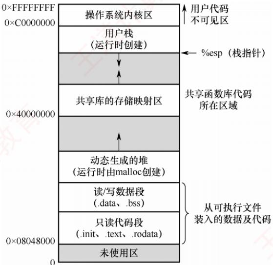

### 进程虚拟地址空间划分

| 区域 | 存放内容 | 读写属性与增长方向 |
|---|---|---|
| **代码段（Text Segment）** | 包含 `.init`（初始化代码）、`.text`（主程序与函数机器指令）、`.rodata`（只读数据，如字符串常量） | 只读，大小固定，可被多进程共享 |
| **数据段（Data Segment）** | 包含 `.data`（已显式初始化的全局变量和静态变量）、`.bss`（未初始化的全局变量和静态变量，装入时清零） | 可读写，装入时大小基本确定 |
| **堆（Heap）** | 存放程序动态分配的内存（如 C 语言的 `malloc()` / C++ 的 `new`） | 可读写，通常由低地址向高地址动态增长 |
| **内存映射区（Memory Mapping）** | 存放动态链接库、共享内存段等映射文件 | 可读写/只读，自高地址向低地址（或按需）增长 |
| **栈（Stack）** | 存放函数调用的局部变量、参数传递、返回地址及寄存器备份 | 可读写，由高地址向低地址动态增长，每个线程拥有私有栈 |

**注意：**
- 标准库函数（如 `printf()`、`scanf()`）在用户态执行，但实际执行 I/O 操作时必须通过**系统调用（Trap 指令）**陷入内核，由设备驱动程序完成；等待 I/O 时进程进入阻塞态。
- 变量存储位置速查：全局/静态变量 $\to$ 数据段（`.data` 或 `.bss`）；函数局部变量 $\to$ 用户栈；动态申请空间 $\to$ 堆；字符串常量 $\to$ 只读数据段 `.rodata`。

---

## 2.1.4 进程的状态与转换【🔥⚡ 必背+避坑｜停下来默背 1 遍 + 精读 1 分钟】

### 一、五状态模型


1. **运行态（Running）**：进程已获得 CPU，其程序正在处理机上执行。单 CPU 系统中任一时刻最多只有一个进程处于运行态。
2. **就绪态（Ready）**：进程已分配到除 CPU 以外的所有必要资源，只要获得 CPU 即可立即投入运行。
3. **阻塞态（Blocked，又称等待态）**：进程因等待某一外部事件（如 I/O 操作完成、申请临界资源、等待信号）而暂时无法运行。即使分配给它 CPU 也无法执行。
4. **创建态（New）**：操作系统正在为进程申请空白 PCB、填写控制信息并分配必要资源，尚未转入就绪队列。
5. **终止态（Terminated）**：进程已结束运行（正常 exit 或异常中止），正在等待系统回收其资源，PCB 暂未完全抹去。

**为什么将就绪态与阻塞态严格分开？**
分时系统中时间片较短（几毫秒到几十毫秒），运行态与就绪态之间的切换极为频繁；而 I/O 设备操作或事件等待往往耗费几十到几百毫秒，若混在一起，调度程序每次必须扫描所有未运行进程判断其能否执行，系统开销巨大。分离后，调度器只需直接从就绪队列取首进程执行。

### 二、状态转换条件与方向

- **就绪态 $\to$ 运行态**：进程被低级调度程序选中，分配到 CPU 时间片。
- **运行态 $\to$ 就绪态**：分时系统时间片用完；<mark>高优先级抢占或主动让出CPU</mark>（调用 `sched_yield()`），属于**被动/协同**行为。 `[真题·2015-T25 / 2023-T27]`
- **运行态 $\to$ 阻塞态**：当前运行进程主动发起系统调用请求资源或等待事件（如<mark>读文件、申请外设或执行wait(S)</mark>资源不足）。**必须由进程自身在运行态主动发起**。 `[真题·2018-T27 / 2022-T28]`
- **阻塞态 $\to$ 就绪态**：进程所等待的事件发生（如<mark>I/O中断完成或合作进程V操作释放资源</mark>），由中断处理程序或唤醒原语将其移入就绪队列。属于**被动**行为。 `[真题·2014-T26]`
- **创建态 $\to$ 就绪态**：操作系统完成 PCB 初始化与初始资源分配后，将进程插入就绪队列。
- **运行态 $\to$ 终止态**：进程执行完毕主动调用 `exit()`，或发生异常（缺页严重错误、非法指令、内存越界）被系统终止。

### 三、创建新进程的关键系统调用：`fork()` 与 `exec()`

现代类 Unix 系统中，创建并运行一个新进程通常分为两步：
1. **`fork()` 系统调用**：
   - 父进程调用 `fork()` 拷贝出一个子进程，<mark>子进程拥有独立的虚拟地址空间</mark>、寄存器上下文、程序计数器（PC）及打开文件描述符列表（不与父进程共享虚拟地址空间）。 `[真题·2020-T29]`
   - `fork()` 具有“调用一次、返回两次”的特征：在父进程中返回新创建子进程的 PID；在子进程中返回 0；创建失败返回负数。
2. **`exec()` 系列系统调用**：
   - 从可执行文件中重新加载代码段和静态数据，覆写当前进程的代码段、数据段、堆栈等内存空间，并重置 PC 指向新程序的入口地址。
   - 进程的 PID、父进程 ID（PPID）等标识信息保持不变。
3. **协作流程**：通常**先执行 `fork()` 创建子进程，再在子进程中调用 `exec()` 载入新程序**，从而实现执行一个完全不同的新任务。

---

### 四、挂起操作与七状态模型

在许多现代操作系统中，当内存资源紧张或根据外部管理需要，系统会将某些暂时不能运行的进程对换至外存，由此引入了**挂起操作（Suspend）**与**激活操作（Active）**。

#### 1. 引入挂起操作的目的
- **终端用户的需要**：用户在程序运行期间发现可疑问题，希望暂停程序运行，以便研究其执行情况或进行在线修改。
- **父进程的需要**：父进程希望挂起某个子进程，以便考察其运行状态，或协调各子进程之间的推进进度。
- **负荷调节的需要**：当系统（尤其是实时系统）工作负荷过重，可能影响紧急任务的控制时，系统主动将部分不重要的进程挂起，缓解内存与 CPU 压力以保证核心任务稳定运行。
- **操作系统的需要**：操作系统希望挂起某些进程，以便检查进程运行中的资源利用情况或进行性能记账（如记录 CPU 耗时、物理内存驻留量等）。

#### 2. 七状态模型的两种挂起态
引入外存对换后，增加了两个驻留在外存的静止状态：
- **静止就绪（Ready Suspend / 挂起就绪）**：进程已具备运行条件，但因内存空间不足被暂时对换至外存。只要调入内存即可立即投入就绪排队。
- **静止阻塞（Blocked Suspend / 挂起阻塞）**：进程因等待某事件发生而被调至外存。即使调入内存也暂时无法运行。

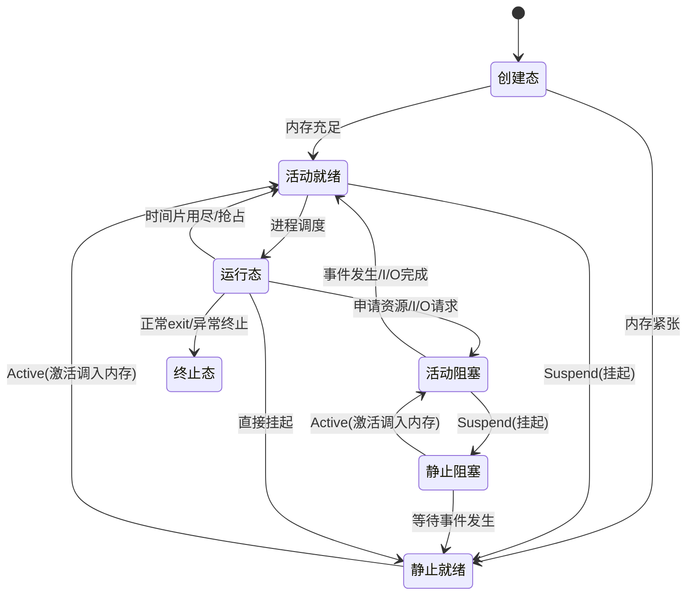

#### 3. 七状态模型的关键转换行为
- **活动就绪 $\to$ 静止就绪**：调用 `suspend` 原语挂起，进程被移出内存，不再参与 CPU 调度。
- **静止就绪 $\to$ 活动就绪**：调用 `active` 原语激活，中级调度将其从外存调入内存，重新参与 CPU 调度。
- **活动阻塞 $\to$ 静止阻塞**：调用 `suspend` 原语挂起，进程因等待事件被换出外存。
- **静止阻塞 $\to$ 活动阻塞**：调用 `active` 原语激活，进程调入内存但仍在等待某事件。
- **静止阻塞 $\to$ 静止就绪**：处于外存的静止阻塞进程，其**等待的外部事件发生**（如外设 I/O 完成），状态自动变为静止就绪，等待中级调度调回内存。

**注意：**
- **阻塞态必定不能直接转换为运行态**：事件满足后必须先放入就绪队列排队等待调度。
- **就绪态必定不能直接转换为阻塞态**：未在 CPU 上运行的进程无法发出系统调用或事件请求。
- **中断处理与进程状态**：中断发生时，CPU 切换到内核态执行中断处理程序，该处理程序在被打断进程的上下文中运行，**被打断进程的状态仍为运行态**。仅当中断处理中触发了调度条件（如时钟中断发现时间片用尽转就绪态，或唤醒了更高优先级进程被抢占），被中断进程才会发生状态转换。
- **队列容量极值（单 CPU，系统共 $n$ 个进程）**：就绪队列最多有 $n - 1$ 个进程（至少 1 个在 CPU 运行）；阻塞队列最多有 $n$ 个进程（全系统全部死锁或全部在等待外设 I/O）。
- **阻塞态 vs 挂起态的物理驻留区别**：阻塞态进程**驻留在主存**中等待事件；挂起态进程的进程映像（代码与数据）**被对换到外存对换区**，只在内存中保留用于系统感知的核心 PCB。

---

## 2.1.5 进程控制【⚡ 避坑｜最值钱，必须精读 1 分钟】

进程控制用于实现进程创建、终止及状态转换，由操作系统内核中的**原语（Primitive）**完成。原语采用关中断与开中断等底层机制实现，具有**原子性**（执行过程不可被中断，要么全做，要么全不做）。

### 一、进程的创建

- **引起创建的事件**：用户登录（分时系统）、作业调度（批处理系统从后备队列选作业）、操作系统提供服务（如打印后台进程）、用户程序发起请求（如调用 `fork()`）。
- **辨析设备分配**：操作系统可通过设备管理的数据结构为现有进程分配设备；<mark>分配设备本身不创建新进程</mark>。登录成功或启动程序则会触发创建进程。 `[真题·2010-T24]`
- **创建原语的执行流程**：
  1. 为新进程申请唯一的进程标识号（PID），从内核 PCB 池中<mark>申请空白PCB并初始化PCB</mark>（写入 PID、PC 等上下文），若 PCB 耗尽则创建失败。 `[真题·2021-T24]`
  2. 为进程分配运行所需资源（内存、堆栈空间、I/O 设备等），可由系统分配或继承父进程。
  3. 设置默认优先级，将初始状态置为**就绪态**（而非直接投入运行）。 `[真题·2021-T24]`
  4. 将 PCB 插入就绪队列，等待进程调度。
- **父子进程关系**：子进程创建时继承父进程的运行环境与资源，但拥有**独立的 PID、独立的 PCB 和独立的虚拟地址空间**；创建完成后父子进程独立并发推进。<mark>终止父进程不一定连带终止子进程</mark>：级联终止系统会撤销子进程；非级联系统（如 Linux）中子进程成为孤儿进程，由系统根进程（如 `systemd` / `init`）收养。 `[真题·2020-T29 / 2024-T24]`
- **创建时的推进与空间可能**：
  - *执行推进*：父进程与子进程并发推进；或父进程阻塞等待直到子进程运行结束（如调用 `wait()`）。
  - *地址空间*：子进程是父进程的完全镜像副本（传统 `fork()`）；或子进程通过 `exec()` 加载全新的独立程序。

### 二、进程的终止

- **引起终止的事件**：
  1. **正常结束**：进程执行完毕，执行最后一条指令（如 `exit()`）产生系统中断通知操作系统。
  2. **异常结束（8 大典型异常）**：
     - **越界错**：访问存储区超出该进程分配的内存边界；
     - **保护错**：试图访问不允许访问的受限资源/文件，或以非法写权限访问只读区；
     - **非法指令错**：试图执行不存在或未定义的机器指令（常因程序计数器 PC 错误跳入数据段/堆区）；
     - **特权指令错**：用户态进程试图执行内核特权指令；
     - **运行超时**：进程执行总时间超过系统允许的最大时间限额；
     - **等待超时**：进程等待某事件发生的时间超过系统规定阈值；
     - **算术运算错**：发生被禁止的算术操作（如整数除以 0、算术溢出）；
     - **I/O 故障**：在与外部设备交互过程中发生不可恢复的通信/硬件校验故障。
  3. **外界干预**：系统管理员通过 `kill` 命令强制干预；操作系统为解除死锁强制撤销；父进程主动请求撤销子进程；父进程终止时级联撤销。
- **终止原语的执行流程**：
  1. 根据被终止进程的 PID 检索出其 PCB，读取其当前状态。
  2. 若进程处于运行态，立即剥夺 CPU，并通知调度程序准备重新调度。
  3. 若该进程有子孙进程，按系统策略决定是否终止其子孙进程。
  4. 回收该进程占有的全部软硬件资源（释放内存、关闭文件、归还外设）。
  5. 将其 PCB 从所在队列中移出并回收。

**注意：**
- **用户进程死循环与异常隔离**：正常工作的抢占式系统可借助时钟中断夺回 CPU 控制权，并按调度策略运行其他进程；系统也可终止死循环进程。用户进程发生非法指令、非法访问或整数除零等异常时，硬件转入内核处理，系统通常终止无法恢复的出错进程，也可能按机制交给程序处理。隔离机制有助于保护内核，但不能据此断言内核绝不会宕机。


### 三、进程的阻塞与唤醒

- **阻塞原语（Block）**：
  1. 保存当前运行进程的 CPU 现场到其 PCB。
  2. 将 PCB 状态由运行态修改为阻塞态。
  3. 将 PCB 插入对应事件的等待队列中。
  4. 转入进程调度程序，将 CPU 分配给其他就绪进程。
  - **规则**：阻塞是进程自身的主动行为，仅当进程处于运行态时调用阻塞原语有效。
- **唤醒原语（Wakeup）**：
  1. 在相应事件的阻塞队列中找到等待该事件的进程 PCB。
  2. 将其从阻塞队列中移出，状态修改为就绪态。
  3. 将 PCB 插入就绪队列，等待调度（若为抢占式且优先级更高，可能立即触发调度）。
  - **规则**：<mark>I/O结束或退出临界区会唤醒阻塞进程</mark>，而当前进程时间片用完只进就绪态，不唤醒其他进程。**Block 与 Wakeup 必须成对配合使用**。 `[真题·2019-T24]`

### 四、进程的挂起与激活

当系统内存紧张需要对换，或外部管理干预时，调用挂起（Suspend）与激活（Active）原语实现内存与外存之间的进程流转：

- **挂起原语（Suspend）**：
  1. 检查被挂起进程的当前状态：
     - 若为**活动就绪**，将其状态改为**静止就绪**；
     - 若为**活动阻塞**，将其状态改为**静止阻塞**；
  2. 为了便于用户或父进程考察其运行状态，将该进程的 PCB 复制到指定的系统内存监控区域；
  3. 若被挂起的进程正处于**运行态**，立即剥夺其 CPU 并转向进程调度程序重新调度。
- **激活原语（Active）**：
  1. 中级调度程序首先将该进程的程序段与数据段从外存对换区调入内存；
  2. 检查其现行状态并进行映射恢复：
     - 若为**静止就绪**，修改为**活动就绪**并插入就绪队列；
     - 若为**静止阻塞**，修改为**活动阻塞**并插入对应事件阻塞队列；
  3. **调度判定**：静止就绪进程激活后进入就绪队列，何时运行取决于调度策略。在采用抢占式优先级调度、满足调度时机且该进程优先级更高时，它可以抢占当前进程；不能把“进入就绪队列”直接等同于“立即运行”。

---

## 2.1.6 进程的通信【⚡ 避坑｜最值钱，必须精读 1 分钟】

进程通信（IPC）是指进程之间的信息交换。由于各进程拥有独立的虚拟地址空间，进程不能直接访问对方的内存数据。IPC 分为低级通信（传递状态控制信息，如 PV 操作）与高级通信（高效传输大量数据）。

| 通信机制                      | 数据传输介质与路径                                                    | 同步与互斥责任                       | 主要特点与应用场景                                                                                                       |
| ------------------------- | ------------------------------------------------------------ | ----------------------------- | --------------------------------------------------------------------------------------------------------------- |
| **共享存储（Shared Memory）**   | 共享存储可按约定使用**共享数据结构**（通过约定的结构交换数据）或**共享存储区**（直接读写共享区中的数据）。内核建立共享内存并映射到各进程地址空间；具体接口还包括建立和解除映射。 | **用户程序自己负责**（需借助信号量等机制防止并发竞态） | 共享区建立后，进程可直接访问同一物理内存，通常避免经内核中转复制大量数据；建立映射等仍需要内核参与。同步与互斥需另行协调。                                                                       |
| **消息传递（Message Passing）** | 以格式化消息（Header + Body）为单位，通过内核提供的发送（`send`）与接收（`receive`）原语传输 | **内核负责**消息缓冲排队与同步             | 封装在内核中，实现规范；微内核系统、分布式系统及多机网络通信的主要方式。分为**直接通信**（直接发送给接收进程 PID）和**间接通信**（发送到中间实体“信箱”）。                            |
| **管道通信（Pipe）** | 内核中维护的固定大小（通常为内存一页而非受限于磁盘）环形内存缓冲区，遵循 FIFO 原则 | **内核自动实现**读写同步与互斥 | 本质是内存缓冲区而非磁盘文件；支持半双工单向通信（<mark>双向需建两条管道</mark>）；**一次性读取**；所有写端关闭且缓冲区已读空后，读端 `read()` 返回 0。 `[真题·2014-T31]` |
| **信号（Signal）**            | 软件层面的异步中断通知，通过在目标进程 PCB 中的位向量打标记传递事件                         | 内核在从内核态返回用户态时递送信号             | 携带信息量小（仅包含信号编号）；可执行系统默认操作（如终止）或用户自定义信号处理函数；PCB 中维护待处理信号向量与屏蔽信号向量。                                               |

### 管道通信的四大核心机制
1. **互斥性**：当一个进程正在对管道执行读/写操作时，其他进程必须互斥等待。
2. **同步性**：在阻塞方式且相应对端仍存在时，<mark>管道满时写阻塞、管道空时读阻塞</mark>。非阻塞方式和对端关闭时须依接口规则另行判断。 `[真题·2014-T31]`
3. **端点关闭检测**：所有写端均关闭且缓冲区已读空时，读操作返回 0，表示文件结束；若仍有缓冲数据，应先读出数据。对端关闭与普通的“空管道等待”要区分。
4. **字节流传输**：管道中的数据以先进先出（FIFO）的无格式字节流形式传输，读出即销毁。

> [!important] 管道的参与者与互斥
> <mark>一个管道可有多个读或写进程</mark>，不能由“读写须协调”推出“每端只能有一个进程”。共享管道的并发读写需要按系统接口与题设保证同步、互斥和数据边界；不要把教材的互斥示意推广成所有系统调用的完整实现细节。 `[真题·2014-T31]`

**注意：**
- 两个进程不能通过高级语言的“全局变量”进行进程间通信，因为各进程的全局变量位于各自独立私有的数据段中，互不相干。
- 普通管道仅提供半双工单向通信。若需实现双向全双工交互，必须创建两个独立的管道。

---

## 2.1.7 线程和多线程模型【🔥⚡ 必背+避坑｜停下来默背 1 遍 + 精读 1 分钟】

### 一、线程的基本概念

引入进程的目的是实现多道程序并发执行；引入**线程（Thread）**的目的是减少程序并发执行时的时空开销，提高系统的并发性能。
- 线程是**程序执行流的最小单元**，是 **CPU 调度和分派的基本单位**。
- 引入线程后：<mark>进程仍是资源分配的基本单位</mark>，**线程是 CPU 调度的基本单位**。 `[真题·2012-T31]`

### 二、线程与进程的对比

| 对比维度 | 进程 | 线程（同一进程内） |
|---|---|---|
| **调度地位** | 独立分配资源的基本单位，传统系统中的调度单位 | CPU 独立调度和分派的基本单位 |
| **拥有资源** | 拥有完整的虚拟地址空间、内存、打开文件等系统资源 | 不拥有独立系统资源，共享其所属进程的全部资源 |
| **私有现场** | 拥有完整的 PCB 与系统上下文 | 拥有私有的线程 ID、PC、通用寄存器、状态字、私有栈、TCB |
| **并发性** | 进程之间可以并发执行 | 进程之间、同一进程内的多个线程之间均可并发执行 |
| **系统开销** | 创建、撤销、切换时需重新分配或切换资源与页表，开销大 | 创建、撤销只需分配极少数据结构；同进程线程切换无需切换地址空间，开销极小 |
| **独立与保护** | 各进程地址空间完全隔离，一个进程异常终止不影响他人 | 同进程线程共享地址空间，一个线程非法越界可能导致所属进程异常终止 |
| **通信机制** | 需借助共享内存、消息传递、管道等 IPC 机制 | 可直接读写进程内的全局变量进行通信，但需同步机制保护 |

### 三、线程控制块（TCB）与私有资源

操作系统（或线程库）为每个线程维护一个 **TCB（Thread Control Block）**：
- **线程私有数据**：线程标识符（TID）、程序计数器（PC）、通用寄存器与状态寄存器集合、线程运行状态、调度优先级、<mark>各线程私有的用户栈与栈指针</mark>（以及内核系统栈指针）、线程局部存储区（TLS）、信号屏蔽字。 `[真题易错·2011-T25 / 2024-T28 / 2026-T25]`
- **线程共享数据**：进程代码段、数据段（全局变量）、<mark>进程堆空间和已打开文件fd</mark>、信号处理函数、环境变量等。 `[真题·2011-T25 / 2024-T28 / 2026-T25]`

#### 线程地址空间与栈保护特性
- **单线程 vs 多线程空间布局**：单线程进程的地址空间中只有一个用户栈；多线程进程在同一个用户空间中划分出多个独立的私有栈（栈1、栈2……），用于保存各自的局部变量和函数调用现场。
- **缺乏硬件级保护**：同一个进程内的各个线程**共享同一个虚拟地址空间**，硬件层面并未对线程之间的私有栈设置内存保护锁。因此，**一个线程的栈空间在理论上完全可以被同进程内的其他线程非法读写甚至冲刷**，一个线程发生内存越界严重错误常导致整个进程异常中止。

#### 线程的生命周期与资源分离机制
- **创建**：系统启动程序时默认只有一个主线程运行，主线程调用线程创建函数（如 `pthread_create()`）派生新线程。
- **终止与分离（Join / Detach）**：线程被终止后通常**不会立即自动释放其占用的全部资源**（如 TCB 和返回值），只有当所属进程中的其他线程对其执行了**分离或回收操作（如 `pthread_join()` 或 `pthread_detach()`）**后，被终止的线程才与资源完全解绑，防止残留“僵尸线程”；尚未释放资源的已终止线程仍可被同伴读取返回值。

### 四、用户级线程与内核级线程

下表中的用户级线程列以纯用户级实现（典型多对一）为前提；混合或多对多模型中，一个内核线程阻塞未必使进程内所有线程停止。

| 对比项 | 用户级线程（ULT, User-Level Thread） | 内核级线程（KLT, Kernel-Level Thread） |
|---|---|---|
| **管理主体** | 应用程序通过用户空间的**线程库**管理（<mark>创建不需OS参与</mark>） `[真题·2019-T23 / 2026-T25]` | 操作系统**内核**直接管理 `[真题·2019-T23]` |
| **内核感知度** | <mark>内核感知不到ULT也不建TCB</mark>，内核只看到进程 `[真题·2012-T31 / 2019-T23]` | 内核感知并为每个 KLT 维护独立的 TCB |
| **调度实体** | 内核以**进程**为单位调度和分配时间片 | 内核直接以**线程**为单位进行 CPU 调度 `[真题·2019-T23]` |
| **切换开销** | <mark>切换在用户态完成不切内核</mark>，效率高开销极小 `[真题·2019-T23]` | 切换必须陷入内核态，涉及模式切换，开销较大 |
| **阻塞影响** | 任一 ULT 执行阻塞型系统调用，**整个进程全部被阻塞** | 一个线程阻塞，内核可继续调度同进程的其他线程运行 |
| **多核利用** | 无法利用多核并行（整个进程只能被分配到一个 CPU 核心） | 内核可将同一进程的多个 KLT 分配到不同核心**并行执行** |
| **平台兼容性** | <mark>可在不支持内核线程的OS上实现</mark> `[真题·2019-T23]` | 需要操作系统内核本身提供线程机制支持 |

### 五、多线程模型

多线程模型定义了用户级线程（ULT）与内核级线程（KLT）之间的映射关系：

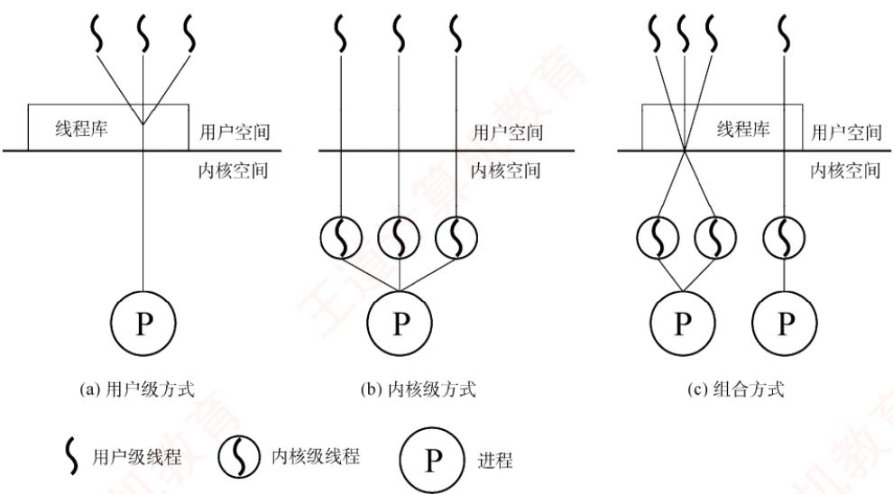

1. **多对一模型**：多个 ULT 映射到 1 个 KLT。
   - *优点*：线程管理在用户空间，切换高效。
   - *缺点*：一个线程发起系统调用阻塞则全进程阻塞；不能在多处理器上并行执行。不能把多个内核级线程映射到 1 个用户级线程。 `[真题·2026-T25]`
2. **一对一模型**：每个 ULT 映射到 1 个独立的 KLT。
   - *优点*：并发能力强，阻塞互不影响，能充分利用多核并行。
   - *缺点*：每创建一个用户线程需创建一个内核线程，内核开销大，限制了线程并发总数。
3. **多对多模型**：$n$ 个 ULT 映射到 $m$ 个 KLT（$n \ge m$）。
   - *特点*：结合两者优点，既有用户态切换的高效，又具备内核级阻塞隔离和多核并行能力。

**注意：**
- **同进程内线程切换 vs 跨进程线程切换**：同进程内的线程切换只需保存和恢复线程私有寄存器与栈指针，**不更换页表基址寄存器**；跨进程的线程切换涉及进程上下文和地址空间切换，通常需更新页表基址等地址空间相关状态；TLB 如何处理取决于处理器与系统实现，不能一概认为必须全部刷新。
- 在 ULT 系统中存在两层调度：内核层按全局算法调度进程（系统统一不可定制）；线程库层在进程内部调度各 ULT（各进程可自由定制）。

---

# 2.2 CPU 调度【🔥⚡ 必背+避坑｜停下来默背 1 遍 + 精读 1 分钟】

## 2.2.1 调度的概念【📌 扫一眼｜确认“我还会”就过】

在多道程序系统中，进程数量往往多于处理机核心数量，系统必须按照某种调度算法从就绪队列中动态选择进程并分配 CPU。

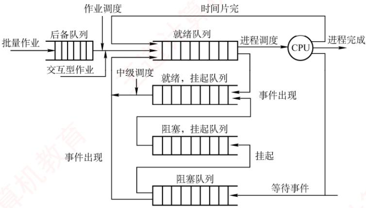

### 三级调度层次对比

| 调度层次 | 调度对象与方向 | 发生时机与频率 | 核心目标与状态转移 |
|---|---|---|---|
| **高级调度（作业调度 / 长程调度 Long-term Scheduling）** | 外存后备队列 $\to$ 内存 | 频率最低（几分钟/批次） | 分配内存、外设并创建进程；完成**创建态 $\to$ 就绪态**转换。批处理系统常用，分时系统通常无需高级调度。 |
| **中级调度（内存调度 / 中程调度 Medium-term Scheduling）** | 外存对换区 $\leftrightarrow$ 内存 | 频率中等 | **节省内存空间**，提高内存利用率与系统吞吐量。暂时不能运行的进程被对换到外存，形成**挂起态**（挂起就绪、挂起阻塞）。 |
| **低级调度（进程调度 / 处理机调度 / 短程调度 Short-term Scheduling）** | 内存就绪队列 $\to$ CPU | 频率最高（几十毫秒一次） | 选取就绪实体投入运行；完成**就绪态 $\to$ 运行态**转换。**任何多道操作系统都不可缺少**。 |

**注意：**
- 作业是用户任务视角（包含程序、数据和作业说明书）；进程是系统资源分配与执行视角。一个作业可由多个进程协作完成。
- 中级调度的主要目的是缓解内存紧张、节省内存，而非直接提高 CPU 运算速度。

---

## 2.2.2 进程调度【⚡ 避坑｜最值钱，必须精读 1 分钟】

### 一、调度程序（Scheduler）的组成

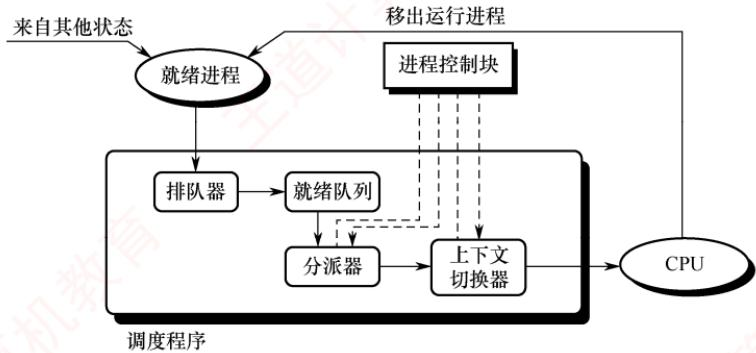

调度程序由三个核心功能模块组成：
1. **排队器（Queue Manager）**：将系统中所有处于就绪状态的进程按照特定策略（如优先级、到达时间）插入就绪队列。
2. **分派器（Dispatcher）**：从就绪队列中移出选中的进程，完成上下文准备并移交 CPU 控制权。
3. **上下文切换器（Context Switcher）**：执行具体的寄存器现场保存与新现场加载操作。

#### 进程调度的三大任务与“两对上下文切换”
- **调度的三大基本任务**：
  1. *保存现场*：保存当前进程的 CPU 现场（PC、PSW、通用寄存器等）到其 PCB；
  2. *决策选取*：根据调度算法从就绪队列中挑选下一个投入运行的进程，置为运行态；
  3. *分派执行*：由分派程序将选中进程的现场恢复到 CPU 各寄存器中，移交 CPU 控制权。
- **两对上下文切换操作**：
  在操作系统内核对处理机进行进程交接时，实际上发生**两对上下文切换**：
  - **第一对**：`当前进程上下文` $\to$ `分派程序上下文`。保存当前进程现场到其 PCB，加载分派程序的上下文，以便运行分派调度逻辑。
  - **第二对**：`分派程序上下文` $\to$ `新选进程上下文`。移出分派程序上下文，将新选进程的 PCB 现场装入 CPU 寄存器，启动新进程运行。

### 二、调度时机与限制

- **可以进行进程调度的时机**：
  - <mark>运行进程终止或不可恢复退出</mark>； `[真题·2021-T27]`
  - 运行进程主动调用系统调用（如 I/O 请求、`wait()`）进入阻塞态； `[真题·2021-T27]`
  - 分时系统中运行进程的时间片耗尽； `[真题·2021-T27]`
  - 抢占式系统中，更高优先级的进程进入就绪队列； `[真题·2021-T27]`
  - 中断处理结束（如时钟中断、I/O 中断唤醒了等待进程）从内核态返回时。
- **不能进行调度的时机**：
  - 处理中断的过程中（中断服务程序执行期间不应被剥夺）；
  - 进程处于操作系统**内核程序临界区**时（该临界区通常访问内核关键全局数据结构，如就绪队列锁，若强制切换会导致死锁或状态混乱）；
  - 执行需要屏蔽中断的原子操作过程时。

**注意：**
- <mark>进程处于普通用户临界区可调度</mark>（访问共享打印机、共享用户变量），因为用户临界区只是通过互斥机制防止其他进程进入该临界区，并不妨碍 CPU 切换去执行临界区外的其他就绪进程。 `[真题·2012-T30]`
- 新进程创建完成并插入就绪队列是**可以发生调度**的时机，但**不必然引发进程切换**（若为非抢占系统，原进程继续运行）。
- **系统调用返回时的重新调度**：在抢占式系统中，系统调用或中断处理执行完毕准备从内核态返回用户态前，内核会检查就绪队列；若在此期间唤醒了更高优先级进程，则**引发重新调度**（将原进程放回就绪队列，调度更高优先级进程），并非无条件返回原进程断点继续执行。

### 三、调度的两种方式

1. **非抢占方式（非剥夺方式）**：一旦把 CPU 分配给某个进程，该进程便一直运行，直到其执行完毕或因自身事件阻塞，才主动交出 CPU。实现简单、系统开销小，但无法保证紧急任务的及时响应，不适用于分时和实时系统。
2. **抢占方式（剥夺方式）**：当有更高优先级的进程就绪或当前进程时间片用完时，系统可暂停正在运行的进程，剥夺 CPU 并重新分配。能保证紧迫任务及时处理，是分时系统和现代操作系统的核心调度机制。
   - **三大抢占原则**：
     - **优先级原则**：新就绪进程的优先级高于当前运行进程时，立即剥夺当前进程 CPU 分配给新就绪者；
     - **短进程优先原则**：新就绪进程的预估运行时间明显短于当前进程的尚需运行时间时，强制剥夺；
     - **时间片原则**：运行进程的时间片用尽时，被时钟中断强制剥夺并重新排队。

### 四、闲逛进程（Idle Process）

当系统就绪队列为空时，系统调度**闲逛进程（PID 通常为 0）**运行。闲逛进程优先级最低，其主体是一段只包含低功耗等待指令（如 x86 的 `hlt`）的死循环；它在指令周期之间测试中断，**绝不因等待任何事件而阻塞**，一旦任何其他进程进入就绪态，闲逛进程立即让出 CPU。

---

## 2.2.3 调度的目标与性能指标【🔥 必背｜停下来默背 1 遍】

### 一、指标计算公式

1. **CPU 利用率**：
   $$\text{利用率} = \frac{\text{CPU 有效工作时间}}{\text{CPU 总运行时间}}$$
2. **系统吞吐量**：单位时间内系统完成的作业总数。
   $$\text{吞吐量} = \frac{\text{完成作业数}}{\text{总耗时}}$$
3. **周转时间（Turnaround Time）**：作业从提交到完成所经历的全部时间间隔。
   $$\text{周转时间} = \text{作业完成时刻} - \text{作业提交（到达）时刻}$$
   周转时间包含：外存后备等待时间 + 就绪队列等待时间 + CPU 执行时间 + I/O 操作时间。
   $$\text{平均周转时间 } T_{avg} = \frac{1}{n} \sum_{i=1}^n T_i$$
4. **带权周转时间（Weighted Turnaround Time）**：周转时间与作业实际运行时间之比，恒 $\ge 1$。
   $$W = \frac{\text{周转时间}}{\text{实际运行时间}}$$
   $$\text{平均带权周转时间 } W_{avg} = \frac{1}{n} \sum_{i=1}^n W_i$$
5. **等待时间（Waiting Time）**：进程在**就绪队列中等待 CPU 的总时间**（处于阻塞态的 I/O 时间不属于等待时间）。调度算法直接影响并追求最小化等待时间。
6. **响应时间（Response Time）**：从用户提交请求到系统**首次产生响应（首次上 CPU 运行）**的时间。交互式系统的核心指标。

---

## 2.2.4 进程切换【🔥⚡ 必背+避坑｜停下来默背 1 遍 + 精读 1 分钟】

### 一、模式切换 vs 上下文切换

- **调度**是做决策（选择分配给谁）；**切换**是执行交接（保存旧现场，加载新现场）。
- **模式切换（Mode Switch）**：CPU 在用户态与内核态之间切换（由系统调用或中断触发），**执行进程没有改变**。仅需在内核栈中保存被中断点的寄存器现场；开销很小。
- **上下文切换（Context Switch）**：CPU 从一个进程换到另一个进程执行，**必然在内核态完成**。必须保存旧进程的 PCB/通用寄存器/栈指针，切换内核栈，并<mark>更新PC与栈基址和页表基址</mark>（`PC`、`SP`、`CR3/PTBR`）；开销显著。 `[真题·2024-T25]`

**注意：**
- 上下文切换**不更新内核中断向量表基址寄存器**（全局共享，与进程无关）。
- 上下文切换只在内存中操作数据结构，**不涉及内存与外存之间的数据对换**。

### 二、上下文切换流程

1. 暂停当前运行进程，将其 CPU 寄存器上下文保存至该进程的 PCB 中；
2. 将该进程的 PCB 状态修改并移入相应队列（如就绪队列或阻塞队列）；
3. 调度算法从就绪队列中选出新进程，将其状态更新为运行态；
4. 从新进程的 PCB 中恢复其 CPU 上下文（加载 PC、PSW、通用寄存器及页表指针）；
5. CPU 跳转至新进程 PC 所指位置，开始执行新进程指令。

---

## 2.2.5 CPU 调度算法【🔥⚡ 必背+避坑｜停下来默背 1 遍 + 精读 1 分钟】

### 一、常用调度算法对比

| 算法名称 | 抢占性 | 调度依据 | 优点 | 主要缺陷 | 适用系统 |
|---|---|---|---|---|---|
| **先来先服务（FCFS）** | 非抢占 | 作业/进程到达先后顺序 | 简单公平，无饥饿 | **对长作业有利，对短作业不利**；出现“护航效应”（短作业排在长计算作业后严重推迟） | 批处理辅助 |
| **短作业优先（SJF）/ 最短剩余时间优先（SRTF）** | SJF 非抢占；SRTF 抢占 | 估计运行时间最短 / 剩余运行时间最短 | 所有作业同时到达、服务时间已知且单处理机连续执行、无 I/O 阻塞等题设下，SJF 的**平均等待时间和平均周转时间最小** | 需预先估计运行时间；<mark>长作业可能产生饥饿现象</mark> `[真题·2011-T23 / 2014-T23]` | 批处理系统 |
| **高响应比优先（HRRN）** | 非抢占 | 响应比最高者 | <mark>兼顾等待与运行且短优先不饥饿</mark> `[真题·2009-T24 / 2011-T23]` | 每次调度决策前需动态遍历计算各就绪作业的响应比，系统开销大 | 批处理系统 |
| **优先级调度算法** | 可抢占或非抢占 | 进程优先级大小 | 可优先安排紧迫任务；抢占式策略在允许调度时可抢占当前进程 | <mark>静态优先数可能致低优先饥饿</mark>（可用老化或动态调整解决） `[真题·2014-T23 / 2016-T46]` | 广泛应用，抢占式特别适合实时系统 |
| **时间片轮转（RR）** | 严格抢占 | 就绪队列 FIFO 轮流分配固定时间片 | <mark>公平轮转且不会产生饥饿现象</mark> `[真题·2014-T23 / 2024-T30]` | 时间片过小上下文切换开销剧增；时间片过大退化为 FCFS | 分时系统首选 |
| **多级队列调度** | 队列间固定，队列内可变 | 进程按类型划分入不同就绪队列 | 可对不同类型进程按队列定制不同策略 | 低优先级队列可能饥饿 | 通用系统 |
| **多级反馈队列（MLFQ）** | 抢占式 | 动态降级与时间片逐级递增 | 综合兼顾短作业（迅速完成）、交互进程（短响应时间）和长进程 | 参数多、系统开销大 | 通用现代操作系统 |

### 二、关键算法机制与公式

#### 1. 高响应比优先（HRRN）公式
$$R_p = \frac{\text{等待时间} + \text{要求服务时间}}{\text{要求服务时间}} = 1 + \frac{\text{等待时间}}{\text{要求服务时间}}$$
- 作业等待时间相同时，要求服务时间越短，响应比越高（等价于短作业优先）； `[真题·2009-T24 / 2011-T23]`
- 作业要求服务时间相同时，等待时间越长，响应比越高（等价于先来先服务）； `[真题·2009-T24]`
- 长作业等待越久响应比越高，因而可缓解短作业优先造成的长期等待；是否能严格保证无饥饿，还依赖作业到达和调度等条件。

#### 2. 优先级设置原则
- **系统进程 > 用户进程**；
- **交互型进程 > 非交互型/批处理进程**；
- **<mark>I/O繁忙型优先于CPU繁忙型</mark>**（让 I/O 设备尽早启动工作，提升 CPU 与外设的并行度及系统吞吐量）。 `[真题·2013-T31]`
- **动态优先级调整**：<mark>时间片用完降级而I/O完成与久等升级</mark>（长期等待可提高优先级老化，防止饥饿，如 $priority = nice + k_1 \cdot cpuTime - k_2 \cdot waitTime$）；刚进入就绪不应降优先级。 `[真题易错·2010-T26 / 2016-T46]`
- **就绪队列实现的代价**：若按优先级从高到低维护有序单链表，<mark>插入最坏O(n)而选出队首O(1)</mark>；若换成堆等结构，复杂度需按题设重新判断。 `[真题·2025-T25]`

#### 3. 多级反馈队列（MLFQ）运行机制

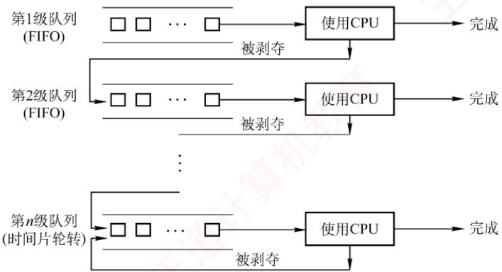

1. 设置多个就绪队列，优先级从第 1 级向后逐级降低；时间片从第 1 级向后逐级增大；教材举例为下一级约是上一级的两倍，具体倍数依算法设定。
2. 新就绪进程首先放入第 1 级队列队尾，按 FCFS 排队。若在其时间片内完成则退出；若未完成，降入第 2 级队列队尾。
3. 仅当高优先级队列全为空时，才调度低优先级队列中的进程运行。<mark>设计MLFQ需定队列数/优先级/算法/迁移</mark>（队列数量、各队优先级、各队内部调度算法和跨队迁移条件），这些规则以题设为准。 `[真题·2019-T27 / 2020-T26]`
4. 若低级队列进程正在执行时有新进程进入高级队列，高优先级新进程**立即抢占 CPU**，被抢占进程放回原队列队尾。

**MLFQ 对不同类型作业的典型效果：**
- **终端型作业（交互式任务）**：作业简短且以键盘/网络交互为主，在第 1 级队列的时间片内即可完成，获得极佳的响应时间。
- **短批处理作业**：通常只需在第 1、第 2 或第 3 队列各运行一个时间片即可顺利结束，周转时间很短。
- **长批处理作业**：可能降至第 $n$ 级低优先级队列；该队列内部可按时间片轮转推进。但严格优先的高优先级队列若持续非空，低优先级进程仍可能饥饿，须另靠老化或优先级提升等机制缓解。

> [!TIP] 时间片轮转（RR）调度的大题临界排队准则
> 若**进程时间片用完**与**新进程到达就绪**恰好同时发生，先后入队顺序依题目或具体调度实现约定；题目没有明确约定时，应写明采用的规则。不同约定可能产生不同结果，不能把其中一种当作通用标准。 `[真题·2024-T30]`
>
> **轮转所需机制**：<mark>RR需要PCB、时钟ISR和就绪队列</mark>；时钟中断更新当前进程剩余时间片，用尽后通常使未完成进程<mark>从执行态变回就绪态而非阻塞态</mark>，且时间片越短切换开销越大，时间片大小需综合响应时间、开销与进程数权衡。 `[真题易错·2017-T27 / 2021-T25]`

> [!important] 真题计算：先画资源时间线，再计时间与次数
> - **已到达约束**：每次只从当前已经到达且就绪的作业中选；即便之后会到更短作业，也不能提前选择。明确优先级数字越大还是越小代表优先。 `[真题·2017-T23]`
> - **CPU 与 I/O 可重叠**：分别画 CPU、输入设备、输出设备时间线；同一设备一次只服务一个操作，同一作业内部仍按给定输入、计算、输出次序衔接。例如 2016 真题三作业各输入 2ms/计算 3ms/输出 4ms <mark>流水并行共需17ms</mark>，不能把三类时间直接相加（15ms 为错误陷阱）。 `[真题易错·2012-T29 / 2016-T24]`
> - **包含历史等待与调度开销**：题目从某时刻开始画图，若问周转时间必须加上该时刻之前已经等待的时间；切换耗时按题设额外计入。 `[真题·2018-T24 / 2023-T28]`
> - **调度次数与中断检测口径**：2022 真题把 0 ms 首次选择进程计为一次调度，后续抢占与完成选取计数共 6 次；<mark>仅周期性时钟中断到达才判定抢占或片耗尽</mark>，同优先级进程片完降级入队尾时排在已进入同级的先前进程之后。 `[真题易错·2022-T25 / 2026-T45]`

> [!example]- ⚡ 真题母题 2026-T45｜抢占优先级+时间片+时钟中断综合调度（独立验算纠偏版）
> - **题目要点**：从 $t=10\text{ ms}$ 开始调度（$P_1/P_2$ 于 $10\text{ ms}$ 到，优 3/4，需 95/20ms；$P_3$ 于 $12\text{ ms}$ 到，优 2，需 40ms；$P_4$ 于 $14\text{ ms}$ 到，优 5，需 60ms；越大越优先），时间片 $50\text{ ms}$，仅整 $10\text{ ms}$ 时钟中断检查抢占；片用完权值减 1，被抢占权值不变，同级先入队者优先。① 求时钟中断次数、调度次数与各进程首次运行时刻；② 时间片改 $100\text{ ms}$ 调度次数如何变？中断间隔缩至 $1\text{ ms}$ 系统开销如何变？
> - **为什么这么想**：核心在于**调度时机绑定在整 10ms 时钟中断点**（$12\text{ ms}$、$14\text{ ms}$ 新进程到达时刻不立即抢占，须等到 $20\text{ ms}$ 整点时钟中断），以及**同优先级队列 FIFO 先来先服务序**。
> - **独立验算标准解答**：
>   1. 调度轨迹：$10\text{ ms}$ 首次中断并第 1 次调度选 $P_2$（$10\text{–}20\text{ ms}$）；$20\text{ ms}$ 中断 $P_4$（优 5）抢占，第 2 次调度切 $P_4$（$P_2$ 保优 4 留在队列）；$20\text{–}70\text{ ms}$ $P_4$ 耗尽 50ms 时间片降为优 4 排在早先入队的 $P_2$ 之后，第 3 次调度切 $P_2$；$80\text{ ms}$ $P_2$ 完成，第 4 次调度选 $P_4$；$90\text{ ms}$ $P_4$ 完成，第 5 次调度切 $P_1$（优 3）；$90\text{–}140\text{ ms}$ $P_1$ 耗尽 50ms 降为优 2 排在 $12\text{ ms}$ 已入队的 $P_3$ 之后，第 6 次调度切 $P_3$；$180\text{ ms}$ $P_3$ 完，第 7 次调度切 $P_1$ 至 $225\text{ ms}$ 全完。总中断发生在 $10,20,\dots,220\text{ ms}$ 共 **22 次**（$225\text{ ms}$ 已结束，不到 $230\text{ ms}$），CPU 调度共 **7 次**。
>   2. 首次运行时刻：**$P_1=90\text{ ms}$、$P_2=10\text{ ms}$、$P_3=140\text{ ms}$、$P_4=20\text{ ms}$**。
>   3. 时间片改 $100\text{ ms}$ 时，全程不再发生时间片耗尽降级，调度序列为 $10\text{ ms}(P_2)\to 20\text{ ms}(P_4)\to 80\text{ ms}(P_2)\to 90\text{ ms}(P_1)\to 185\text{ ms}(P_3)$，调度次数**减少为 5 次**。
>   4. 时钟中断间隔变为 $1\text{ ms}$ 时，现场保存/恢复与中断处理频率暴增，**系统开销增大**。
> - **易错步骤与个人复盘提醒**：警惕外部解析将终止时间 $225\text{ ms}$ 误算至 $230\text{ ms}$ 得 **23 次中断**，以及把第(2)问错看成“中断间隔 100ms”得 6 次；同权值排队时务必记清 $P_2$ 在 $20\text{ ms}$ 已入同级队，$P_4$ 在 $70\text{ ms}$ 才降为 4 故排 $P_2$ 后。

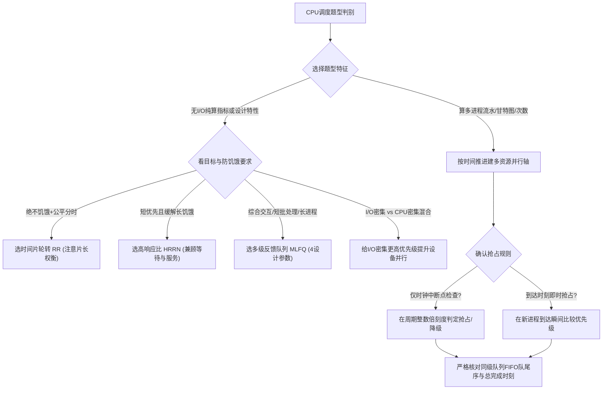

### 三、基于公平原则的调度算法

1. **保证调度算法（Guaranteed Scheduling）**：
   - 目标：向进程提供明确的 CPU 时间分配比例保证（如 $n$ 个并发进程，每个保证获得 $1/n$ 的 CPU 时间）。
   - 机制：跟踪每个进程自创建以来的实际 CPU 耗时；计算应得时间（自创建起时间 / $n$）；计算公平比率（实际时间 / 应得时间）；调度程序始终选取**当前比率最小的进程**投入运行，直到其比率超过次小者。
2. **公平分享调度算法（Fair-Share Scheduling）**：
   - 目标：从**用户（User）层面**而非进程层面实现 CPU 公平。防止某用户启动大量进程霸占系统资源。
   - 机制：按用户分配 CPU 份额。若用户 1 拥有进程 A、B、C、D，用户 2 仅有进程 E，两用户份额相等，则轮转调度序列为：`A E B E C E D E ...`；若用户 1 份额是用户 2 的 2 倍，则序列为 `A B E C D E ...`。

---

## 2.2.6 多处理机调度【💤 可跳过｜冲刺期直接跳过不看】

### 一、体系结构分类
- **非对称多处理机（AMP, 主从式）**：一个主 CPU 负责全局调度与资源管理，从 CPU 仅执行分配的任务。主 CPU 易成为性能瓶颈。
- **对称多处理机（SMP, 对等式）**：所有 CPU 地位对等，均可独立运行调度程序并从队列中选取进程。

### 二、核心矛盾：处理器亲和性 vs 负载平衡
- **处理器亲和性（Processor Affinity）**：由于进程在一个 CPU 上运行时会在其专用 Cache 中留下大量缓存数据，进程迁移至新 CPU 会导致旧 Cache 失效并重新装载，代价昂贵。因此系统倾向于让进程保持在同一个 CPU 上运行。
  - **软亲和**：调度程序尽力维持同一 CPU，但发生严重失衡时允许迁移。
  - **硬亲和**：进程通过系统调用显式绑定到特定 CPU 核心。
- **负载平衡（Load Balancing）**：确保 SMP 系统中所有 CPU 的负载均匀分配，避免部分 CPU 空闲而部分 CPU 超载。
  - **推迁移（Push Migration）**：系统周期性巡检，发现失衡时将超载 CPU 队列中的进程“推”向空闲 CPU。
  - **拉迁移（Pull Migration）**：空闲 CPU 主动从超载 CPU 队列中“拉”取等待进程。

### 三、就绪队列方案对比
1. **公共就绪队列**：所有 CPU 共享一个全局就绪队列。负载平衡天然良好，但各 CPU 互斥访问全局队列锁竞争剧烈，且处理器亲和性差。
2. **私有就绪队列**：每个 CPU 维护独立的私有就绪队列。无全局锁竞争、处理器亲和性好，但必须结合推/拉迁移机制维护负载平衡。

### 四、多处理机线程调度的四种常见方式
1. **自调度（Self-Scheduling）**：设置公共就绪队列，各 CPU 空闲时自行从队列中获取线程运行。实现简单，但存在全局队列锁竞争和 Cache 命中率低的问题。
2. **成组调度（Gang Scheduling）**：将一组相互协作、通信频繁的线程同时分配到多个不同的 CPU 上并行运行。能显著减少线程间的等待与上下文切换。
3. **专用处理机分配（Dedicated Processor Allocation）**：在作业执行期间，将一组处理机专门分配给该作业独占使用。完全避免进程切换开销，但处理机可能闲置；要求总线程数不超过处理机数。
4. **动态调度（Dynamic Scheduling）**：允许进程在执行期间动态改变线程数目。**操作系统负责分配处理机数量，应用程序自行负责将线程分派到处理机上，由 OS 与应用程序共同进行调度决策**。
   - **动态调度的四大原则**：
     - *空闲则分配*：作业提出处理机请求且系统有空闲时立即分配；
     - *新作业优先*：尚未获得处理机的新作业具有最高优先级，无空闲处理机时可从已占有多台处理机的作业中剥夺一台给新作业；
     - *保持等待*：系统无法满足分配需求时，作业保持等待状态；
     - *释放即分配*：处理机释放后优先满足新作业，其余按 FCFS 分配。

### 五、评价多处理机调度性能的指标
- **任务流时间**：单个任务从开始执行到结束的时间。
- **调度流时间**：系统中所有处理机上所有任务流时间的总和。
- **平均流时间**：$\text{平均流时间} = \frac{\text{调度流时间}}{\text{任务总数}}$，平均流时间越小，资源利用率越高。
- **加速比（Speedup）**：$\text{加速比} = \frac{\text{单处理机工作时间（各处理机忙时间之和）}}{\text{多处理机并行工作时间}}$。

### 六、多处理机环境下的死锁类型与检测
- **资源死锁**：因推进顺序非法、竞争可重复使用的系统软硬件资源而发生。
- **通信死锁**：在分布式网络或多机通信中，两端节点因发送和接收报文缓冲区竞争导致“既不能发也不能收”的僵局。
- **检测机制**：分为**集中式检测**（由中心处理机维护全局资源分配图检测环路）与**分布式检测**（各节点配置检测进程，在消息上附加逻辑时钟依次排队检测）。


---

# 2.3 同步与互斥【🔥⚡ 必背+避坑｜停下来默背 1 遍 + 精读 1 分钟】

## 2.3.1 同步与互斥的基本概念【⚡ 避坑｜最值钱，必须精读 1 分钟】

1. **临界资源（Critical Resource）**：一次仅允许一个进程使用的资源（如物理打印机、共享变量、共享缓冲区）。
2. **临界区（Critical Section）**：进程中**访问临界资源的那段代码程序**。相关临界区指不同并发进程中访问同一临界资源的代码段集合。
3. **同步（直接制约关系）**：并发进程为了协调推进步骤，因相互合作、具有前驱后继依赖而在关键点等待对方信号的约束关系。
4. **互斥（间接制约关系）**：多个并发进程因竞争同一临界资源而不能同时进入临界区的制约关系。

### 临界区访问的四项准则
1. **空闲让进**：临界区空闲时，应允许一个请求进入临界区的进程立即进入。 `[真题·2020-T32]`
2. **忙则等待**：已有进程处于临界区内时，其他试图进入的进程必须等待。 `[真题·2020-T32]`
3. **有限等待**：对请求进入的进程，应保证能在有限时间内进入，防止饥饿。 `[真题·2020-T32]`
4. **让权等待**：<mark>不能进入临界区时立即释放CPU</mark>；该准则非必须准则，如 Peterson、TSL 和 Swap 自旋锁均不满足让权等待。 `[真题·2016-T27 / 2018-T32 / 2020-T32]`

**注意：**
- **必须互斥的判定三要素**：① <mark>访问同一内存地址或共享资源</mark>；② 并发同时访问；③ <mark>至少一方在写</mark>（存在写-写或读-写冲突）。多线程并发只读同一变量无需互斥。 `[真题·2016-T30 / 2026-T27]`
- `【⚡ 真题补丁｜2026-T27】` Bernstein 并发不出错充要条件：<mark>R(Q)∩W(P)=空且W(P)∩W(Q)=空且R(P)∩W(Q)=空</mark>（读读交集 $R(P)\cap R(Q)$ 允许非空）。 `[真题·2026-T27]`
- **可重入代码（纯代码）**：允许多个进程同时调用的只读代码段（不含局部可变状态），不属于临界资源。

> [!important] 并发变量与指令交错
> - 先判断是否为**同一份数据**：同一进程的线程共享全局变量；不同线程各自栈上的自动局部变量是私有的，静态局部变量则不应仅凭“局部”二字判断为私有；不同进程中的同名全局变量通常属于各自地址空间，除非题设建立了共享映射。同一份数据的两个只读操作不构成读写冲突，读写或写写操作则需要按同步要求保护。 `[真题·2016-T30]`
> - `x++` 等读改写操作通常不是一条不可分割的动作。分析结果时应拆成**读入寄存器 → 修改寄存器 → 写回内存**，列举保持各线程内部顺序的交错，并由最后一次写回确定结果。例如共享变量 $x=1$，两个进程分别加 1、减 1，最终<mark>x可能取0、1或2</mark>；后一次写回可能覆盖先前结果。 `[真题·2011-T32]`
> - 两线程均从 $x=0$ 出发、各执行一次三指令加 1 时，若都在任何写回前读到 0，最终为 1；要得到 2，必须一个线程写回后另一个才读取。<mark>两线程各执行x++得2仅2种序列</mark>（先完成线程 1 或先完成线程 2）。 `[真题·2018-T25]`

---

## 2.3.2 实现临界区互斥的基本方法【⚡ 避坑｜最值钱，必须精读 1 分钟】

### 一、软件实现方法

#### 1. 单标志法
- **机制**：通过全局变量 `turn` 严格轮流放行。
  ```c
  // P0 进程                          // P1 进程
  while (turn != 0);                 while (turn != 1);
  critical_section();                critical_section();
  turn = 1;                          turn = 0;
  ```
- **问题**：强制两个进程交替运行。若 $P_0$ 退出后不再进入，`turn` 保持为 1，$P_1$ 执行一次后将永久阻塞。**违背“空闲让进”准则**。

#### 2. 双标志先检查法
- **机制**：各进程在进入临界区前先检查对方意愿标志 `flag`，若对方不想进，则置自己标志为 true 并进入。
  ```c
  // Pi 进程
  while (flag[j]);     // 检查对方
  flag[i] = true;      // 表达自己想进
  critical_section();
  flag[i] = false;
  ```
- **问题**：检查与置位操作分离，不是原子操作。若两进程并发检查时同时发现 `flag=false`，随后均置 `flag=true` 并同时进入临界区。**违背“忙则等待”准则**。

#### 3. 双标志后检查法
- **机制**：先置自己标志为 true，再检查对方标志。
  ```c
  // Pi 进程
  flag[i] = true;      // 先表达自己想进
  while (flag[j]);     // 再检查对方
  critical_section();
  flag[i] = false;
  ```
- **问题**：两进程并发执行时可能同时置自身 `flag=true`，随后检查对方标志均发现对方想进，导致双方同时陷入 while 循环死等。**违背“空闲让进”和“有限等待”准则（导致死锁）**。

#### 4. Peterson 算法
- **机制**：结合双标志与单标志，`flag` 表达意愿，`turn` 表达谦让。
  ```c
  // Pi 进程
  flag[i] = true;
  turn = j;                        // 主动把优先权让给对方
  while (flag[j] && turn == j);    // 对方想进且让步给对方时，自己等待
  critical_section();
  flag[i] = false;
  ```
- **结论**：在教材的原子读写及公平推进模型下，双方都提出请求且标志均为真时，后设置 `turn` 的一方让另一方先进入；若对方无进入意愿，则无需等待。<mark>Peterson保证互斥且不会产生饥饿</mark>，满足空闲让进、忙则等待、有限等待；但进程在 while 循环中自旋消耗 CPU，<mark>未遵循让权等待</mark>。 `[真题·2010-T27 / 2018-T32]`

### 二、硬件实现方法

1. **中断屏蔽方法**：
   - 机制：进临界区前执行关中断指令，出临界区后执行开中断指令。
   - 限制：<mark>中断屏蔽仅适单核且用户无权关中断</mark>（多核 CPU 无法屏蔽其他核心中断；关中断指令为特权指令，不可赋予用户程序使用，防止关中断后独占系统死机）。 `[真题·2021-T45]`
2. **硬件指令法：TestAndSet（TSL 指令）**：
   - 机制：由硬件总线锁保证原子性，单指令完成“读取旧值并写入 TRUE（上锁）”。
     ```c
     while (TestAndSet(&lock));   // 读出旧值为 true 则循环忙等；读出 false 则获得锁并置 true
     critical_section();
     lock = false;                // 释放锁
     ```
   - 特点：可用于多处理机系统；等待者获得 CPU 时反复执行指令忙等，不主动让出 CPU，**违背让权等待**；若被抢占，可暂时处于就绪态。<mark>exit置lock为FALSE而不唤醒任何队列进程</mark>；若在关中断下持续自旋且无人解锁则会导致死锁。 `[真题·2016-T27 / 2018-T32]`
3. **硬件指令法：Swap（XCHG 指令）**：
   - 机制：硬件原子交换两个变量的值。每个进程设局部变量 `key=true`，循环与全局共享锁 `lock` 交换，直到换得 `lock` 的旧值 `false`。与 TSL 特性相同，属于忙等硬件锁（可用于多核实现，但同样违背让权等待）。 `[真题·2018-T32 / 2021-T45 / 2023-T45]`

> [!example]- ⚡ 真题母题 2023-T45｜`swap`/`newSwap` 互斥锁改造与并发交错反例
> - **题目要点**：给定用信号量或 `while` 与原子 `swap` 实现互斥锁的场景：① 若直接改为 `newSwap`（把原本硬件原子交换拆分或改动后）能否保证互斥？请构造导致两个进程同时进入临界区的交错执行顺序；② 应如何修改原始实现以正确保证互斥与退出释放？
> - **为什么这么想**：凡题目拆开 `TestAndSet`/`Swap` 的原子读改写步骤（即构造软件版非原子 `newSwap`），或错把 `while` 写成 `if`，就会退化为**双标志先检查法竞态**：两进程均可并发读到旧值 `false`，同时写 `true` 并进入临界区。
> - **独立验算标准解答**：
>   1. 正确改造（基于标准 `swap`）：进入临界区应使用 `key = TRUE; while (key) swap(&lock, &key);`，退出临界区置 `lock = FALSE;`（若用原语阻塞则使用信号量）。
>   2. 若题目采用非原子的软件 `newSwap(&a, &b)`（拆为读 `temp=a`、写 `a=b`、写 `b=temp` 等 3 条指令）且多进程并发执行：构造交错序列让 $P_0$ 读取 `lock==FALSE` 后被切换，$P_1$ 随即也读取到 `lock==FALSE` 并写上锁进入，随后 $P_0$ 恢复并同样拿到 `temp==FALSE` 进入临界区，两进程**违背忙则等待同时进入临界区**（典型 6 步交错覆盖旧值）。
> - **易错步骤与个人复盘提醒**：考试遇到原子操作拆解/改写题时，**务必按指令行号标出两进程交叉顺序**，明确写出“在写回 `lock=TRUE` 前被切换，导致另一进程读到旧值 `FALSE`”，才能拿满反例步骤分。

---

## 2.3.3 互斥锁（自旋锁）【📌 扫一眼｜确认“我还会”就过】

互斥锁（Mutex Lock）可通过布尔变量 `available` 描述锁状态，提供原子操作。以下代码是**逻辑示意**：`acquire()` 中检查并置位必须由硬件原子指令等机制保证原子性，不能把普通的检查和赋值两条语句直接当成正确实现：
```c
void acquire() {
    while (!available);   // 忙等待
    available = false;    // 占用锁
}
void release() {
    available = true;     // 释放锁
}
```

### 自旋锁的性能权衡与适用边界
- **优点**：等待本身不主动阻塞或进行上下文切换；实际执行仍可能因中断或抢占产生切换开销。
- **缺点**：自旋忙等持续消耗 CPU 周期，违背让权等待。
- **适用场景**：**多处理机系统**，且**临界区执行时间极短**（锁持有时间明显小于两次上下文切换耗时）。
- **单处理机场景**：等待者自旋会浪费 CPU；若在单核关中断等不能调度持锁者的环境中持续自旋，持锁者无法运行解锁，可能陷入僵局。可抢占时自旋者也可能在时间片耗尽后让出 CPU，不能一概说单核自旋必然死锁。
- **所有权约束**：互斥锁只能由对其加锁成功的同一个进程/线程执行 `release()` 解锁。

---

## 2.3.4 信号量【🔥⚡ 必背+避坑｜停下来默背 1 遍 + 精读 1 分钟】

信号量（Semaphore）是由 Dijkstra 提出的强大同步工具，只能由两个不可中断的标准原语 $P$（wait）和 $V$（signal）访问。

### 一、整型信号量与记录型信号量

1. **整型信号量**：
   信号量 $S$ 为整型变量，表示可用资源数。$P$ 操作为 `while(S <= 0); S--;`，$V$ 操作为 `S++;`。<mark>整型信号量忙等不遵循让权等待</mark>；若用于同步需由关中断或硬件原子指令保护原子性，不能用于多核纯靠关中断或赋权用户进程。 `[真题·2021-T45]`
2. **记录型信号量**：
   引入进程阻塞等待队列，根本解决忙等问题：
   ```c
   typedef struct {
       int value;                 // 可用资源数
       struct process *list;      // 阻塞等待队列
   } semaphore;

   void wait(semaphore *S) {
       S->value--;
       if (S->value < 0) {
           block(S->list);        // 资源不足，调用进程主动自我阻塞并让出 CPU（遵循让权等待）
       }
   }

   void signal(semaphore *S) {
       S->value++;
       if (S->value <= 0) {
           wakeup(S->list);       // 唤醒队列中一个阻塞进程，使其转入就绪态（非直接运行）
       }
   }
   ```
   - `wait` 时当资源不足即调用 `block` 释放 CPU，<mark>记录型信号量是目前唯一满足让权等待的方法</mark>（对比 Peterson、TSL、Swap）。 `[真题·2018-T32]`

### 二、信号量数值的物理含义
- **$S.value > 0$**：表示系统中当前<mark>可用的临界资源实体数量</mark>（如初值为 3 现为 1 表示还剩 1 个可用且 0 个进程等待）。 `[真题·2010-T25]`
- **$S.value = 0$**：表示资源恰好分配完毕，且队列中**无等待该资源**的进程。
- **$S.value < 0$**：表示系统中临界资源已耗尽，<mark>正使用数看初值而绝对值等于阻塞数</mark>（如 8 进程竞争初值 5 的信号量，当 $S=-2$ 时有 5 个正在访问资源、2 个阻塞等待、1 个未申请）。 `[真题·2010-T25 / 2026-T26]`

### 三、信号量的三种基本应用范式

| 目标 | 信号量初值 | PV 操作结构与规则 |
|---|---|---|
| **互斥** | **1** | 紧夹临界区：进入区执行 $P(mutex)$，退出区执行 $V(mutex)$。 |
| **同步** | **0**（事件未完成）或正整数 | “前驱动作后 $V(S)$，后继动作前 $P(S)$”。 `[真题·2009-T45 / 2015-T45 / 2024-T46]` |
| **多资源计数** | 资源实例总数 $N$ | 使用资源前 $P(resource)$，归还资源后 $V(resource)$。 `[真题·2011-T45 / 2013-T45]` |

### 四、利用信号量实现前驱关系

对于有向无环图（DAG）描述的程序前驱后继关系，原则上对每条**不可由同线程顺序覆盖的跨进程直接依赖边** $S_1 \to S_2$ 设置初值为 0 的同步信号量 $a$：在起点 $S_1$ 完成后执行 $V(a)$，在终点 $S_2$ 执行前执行 $P(a)$（同一线程内部顺次执行已隐含前驱关系，跨线程可由传递关系推导的边<mark>无需重复设立多余信号量</mark>）。 `[真题易错·2020-T45 / 2022-T46]`

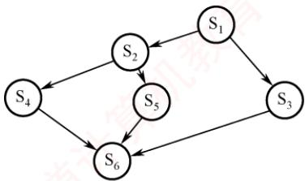

> [!example]- ⚡ 真题母题 2022-T46｜两线程 6 操作前驱图（极简最少信号量 2 个）
> - **题目要点**：线程 $T_1$ 依次执行操作 $A、E、F$，线程 $T_2$ 依次执行操作 $B、C、D$；要求前驱图中满足 $A\to C$、$B\to C$、$C\to E$、$C\to D$ 等先后顺序，试用最少的信号量实现同步（写出定义、初值与伪代码）。
> - **为什么这么想**：先画出两条进程内天然的顺序执行链：$T_1$ 内 $A\to E\to F$、$T_2$ 内 $B\to C\to D$，这四条**同线程顺序边自动成立**，零信号量即可保证；仅需保护真正跨线程的两条依赖弧：$A\to C$ 与 $C\to E$。
> - **独立验算标准解答**：
>   - 设置 2 个同步信号量：`semaphore doneA = 0;`（同步 $A\to C$）、`semaphore doneC = 0;`（同步 $C\to E$）。
>   - `T1`: `A; V(doneA); P(doneC); E; F;`
>   - `T2`: `B; P(doneA); C; V(doneC); D;`
> - **易错步骤与个人复盘提醒**：易错点是照搬“图中有几条边就设几个信号量”，误给 $B\to C$、$C\to D$、$E\to F$ 也各设一个（导致 5 个信号量扣分）；动手前务必先划掉“同线程上下行顺序边”和“已间接传递边”。 `[真题·2020-T45]`

**注意：**
- $n$ 个并发进程竞争 $r$ 个同类资源：信号量初值为 $r$；取值范围为 $[-(n - r), r]$。
- 两个进程竞争初值为 1 的互斥信号量：可能取值为 **1**（均未进入）、**0**（一个进入，无等待）、**-1**（一个进入，另一个阻塞等待）。
- **允许多个进程同时进入临界区**：若系统规定最多允许 $k$ 个进程（$k \ge 1$）同时进入临界区访问某共享资源，则互斥信号量初值应设为 $k$。当有 $n$ 个进程竞争时，信号量的取值范围为 $[k - n, k]$。若信号量当前值为负，其绝对值表示阻塞等待进入的进程数。

---

## 2.3.5 经典同步问题【🔥⚡ 必背+避坑｜停下来默背 1 遍 + 精读 1 分钟】

### 一、生产者—消费者问题

一组生产者向大小为 $n$ 的有界缓冲区写入产品，一组消费者从缓冲区取出产品。
- **关系分析**：缓冲区是互斥临界资源；满时生产者不能放（同步）；空时消费者不能取（同步）。
- **信号量定义**：`mutex = 1`（缓冲区互斥锁），`empty = n`（空闲槽位计数），`full = 0`（产品计数）。若缓冲区初始已有 $x$ 个产品（如双信箱题），则<mark>初值按full=x和empty=M-x设立</mark>；若需消费者连续取满 10 件，则再增设连取周期互斥锁保护连续 10 次 `P(full)` 期间不被其他消费者插队。 `[真题·2009-T45 / 2014-T47 / 2015-T45 / 2025-T45]`

```c
semaphore mutex = 1, empty = n, full = 0;

void producer() {
    while (1) {
        item = produce_item();
        P(empty);            // ① 先申请空槽位
        P(mutex);            // ② 再加互斥锁
        insert_item(item);   // 临界区：放入产品
        V(mutex);            // ③ 释放互斥锁
        V(full);             // ④ 增加满槽位
    }
}

void consumer() {
    while (1) {
        P(full);             // ① 先申请满槽位产品
        P(mutex);            // ② 再加互斥锁
        item = remove_item();// 临界区：取出产品
        V(mutex);            // ③ 释放互斥锁
        V(empty);            // ④ 增加空槽位
        consume_item(item);
    }
}
```

**关键机制与死锁陷阱：**
<mark>先申请资源同步信号量再申请mutex</mark>，P 操作的顺序不能颠倒。若先 $P(mutex)$ 再 $P(empty)$，当缓冲区已满时，生产者先拿到 `mutex`，随后因 `empty=0` 而阻塞；消费者试图进入缓冲区消费以释放 `empty` 时，因无法获得 `mutex` 而阻塞，形成**循环等待死锁**。$V$ 操作的顺序可互换，但通常先释放互斥锁以缩短临界区占用时间。 `[真题易错·2011-T45 / 2013-T45 / 2014-T47 / 2025-T45]`
- `【⚡ 真题补丁｜2014-T47 / 2015-T45】` 连续取 $k$ 件防死锁用双互斥锁：<mark>外层连取锁包裹内层缓冲区mutex</mark>（不可单锁连取 $k$ 次，否则不满 $k$ 件持锁死等）；非零初值信箱设 `full=x, empty=M-x`。 `[真题·2014-T47 / 2015-T45]`

> [!example]- ⚡ 真题母题 2025-T45｜甲乙丙种树最少信号量 4 个（独立核验“水桶仅丙用”无互斥）
> - **题目要点**：甲挖坑（需铁锹）、乙放苗填土（需铁锹，且用掉 1 个坑）、丙浇水（需水桶，等乙填完后浇），初始坑数为 0，铁锹 1 把、水桶 1 个、树坑上限 3（挖好待填与待浇总树坑数上限）。试定义最少信号量并写出甲乙丙伪代码。
> - **为什么这么想**：先盘点所有**跨角色争抢的物理工具**与**单角色独占工具**：铁锹由甲和乙共用，需要互斥 `mutex = 1`；**水桶全题仅由丙一人使用**，不存在并发写或抢占竞争，无需设置水桶互斥信号量。再看容量与同步限制：`sk = 3`（最多空坑上限 3，限甲挖坑不超出）、`empty = 0`（已挖待填坑数：甲 V 乙 P）、`water = 0`（已填待浇树数：乙 V 丙 P；注意丙浇完水才释放树坑上限 `V(sk)`，或乙填完是否占坑名额按题意同步释放 `sk`）。
> - **独立验算标准解答**：
>   - 仅需 **4 个信号量**：`semaphore mutex = 1; semaphore sk = 3; semaphore empty = 0; semaphore water = 0;`
>   - `甲`: `while(1){ P(sk); P(mutex); 挖坑; V(mutex); V(empty); }`
>   - `乙`: `while(1){ P(empty); P(mutex); 放树苗填土; V(mutex); V(water); }`
>   - `丙`: `while(1){ P(water); 用水桶浇水; V(sk); }`（注：若题设“坑上限仅指已挖未填之空坑”，则 `V(sk)` 可由乙填土释放；按“整棵待完成树坑容量为 3”通例，丙浇水后 `V(sk)`，先 `P(sk)` 后 `P(mutex)` 严防拿着铁锹堵坑死锁。）
> - **易错步骤与个人复盘提醒**：高频扣分点有两个：一是画蛇添足多设 `bucket = 1`（水桶仅丙使用无需互斥）；二是颠倒甲的 `P(sk)` 与 `P(mutex)`（若坑满 3 且甲先 `P(mutex)` 拿锹再卡在 `P(sk)`，则乙拿不到锹填坑导致系统死锁）。

### 多类产品的单缓冲区：区分“空位”和“产品种类”

教材还用一个盘子说明生产者—消费者的变式：盘子最多放一个水果，父亲只放苹果、母亲只放橘子，女儿只取苹果、儿子只取橘子。设 `plate=1` 表示空盘可用，`apple=0`、`orange=0` 分别表示相应水果可取；四个进程反复执行以下操作：

| 进程 | 每轮操作顺序 |
|---|---|
| 父亲 | `P(plate)` → 放入苹果 → `V(apple)` |
| 母亲 | `P(plate)` → 放入橘子 → `V(orange)` |
| 女儿 | `P(apple)` → 取出苹果 → `V(plate)` |
| 儿子 | `P(orange)` → 取出橘子 → `V(plate)` |

这里的互斥依赖**单个盘位和上述完整的 P/V 次序**：一个生产者取得 `plate` 后，另一个不能放入；生产者完成放置后才通知相应消费者；消费者完成取出后才释放 `plate`，允许下一次放置。不同水果的信号量只会唤醒对应消费者。因此在这一模型中，无需再为盘子额外设置互斥信号量；如果缓冲区容量或放取规则改变，应重新检查是否需要互斥信号量。

### 二、读者—写者问题

多个读者可同时读文件，写者写入时不允许任何其他读者或写者访问。<mark>一读一写或双写即需设互斥信号量</mark>，两个线程仅同时读取共享变量时则无需互斥。 `[真题·2017-T46 / 2024-T46]`

> [!example]- ⚡ 真题母题 2024-T46｜`C1/C2/C3` 互斥同步极简 PV（`S=0` / `mutex=1` 各仅 1 个信号量）
> - **题目要点**：并发进程 $P_1, P_2$ 共享容量为 1 的缓冲区 $B$，涉及写操作 $C_1$、协同操作 $C_2$（$P_1$ 写 $C_1$ 后 $P_2$ 才能做 $C_2$）与访问初始非空缓冲的操作 $C_3$。① 指出临界区判断依据；② 缓冲区 $B$ 初始为空时用尽可能少信号量实现 $C_1 \to C_2$；③ $B$ 初始非空时实现 $P_1, P_2$ 互斥执行 $C_3$。
> - **为什么这么想**：第(2)问中缓冲区容量为 1 且初始为空，只有 $P_1$ 先写完并 `signal(S)` 后 $P_2$ 才能执行 $C_2$，**天然先后错开，不会同时进入，因此单个同步信号量 `S = 0` 已同时完成互斥与同步**，无需画蛇添足增设 `mutex = 1`。
> - **独立验算标准解答**：
>   1. 实现 $C_1$ 的代码是临界区（对共享缓冲区 $B$ 执行写操作且需互斥执行）。
>   2. **$B$ 初始为空（仅设 1 个信号量 `semaphore S = 0;`）**：`P1` 执行 `C1; signal(S);`，`P2` 执行 `wait(S); C2;`。
>   3. **$B$ 初始非空（仅设 1 个信号量 `semaphore mutex = 1;`）**：`P1` 与 `P2` 均执行 `wait(mutex); C3; signal(mutex);`。
> - **易错步骤与个人复盘提醒**：遇到“尽可能定义少的信号量”且缓冲区容量为 1、初始为空时，记住**单个初值 0 的同步信号量兼任单槽互斥锁**，多余 `mutex = 1` 会被判定非极简解。 `[真题易错·2024-T46]`
- **读者优先算法**：利用计数器 `count` 记录读者数，第一个读者负责上锁，最后一个离开的读者负责开锁。

```c
semaphore rw = 1;        // 文件访问读写互斥锁
semaphore mutex = 1;     // 保护 count 变量的互斥锁
int count = 0;           // 当前正在读取的读者数量

void writer() {
    while (1) {
        P(rw);           // 申请文件访问权
        write_file();    // 写入
        V(rw);           // 释放
    }
}

void reader() {
    while (1) {
        P(mutex);        // 互斥保护 count
        if (count == 0)
            P(rw);       // 第一个读者负责阻断写者
        count++;
        V(mutex);

        read_file();     // 读取操作

        P(mutex);
        count--;
        if (count == 0)
            V(rw);       // 最后一个读者负责唤醒写者
        V(mutex);
    }
}
```

**注意：**
- 读者优先会导致写者长期饥饿（只要持续有新读者到达，`rw` 就始终不释放）。

#### 设置入口信号量的读写协调（相对写者优先）
通过增加一个互斥信号量 `w = 1`。写进程写之前先 `P(w)` 挂号排队；读者进程在进入临界区前也先执行 `P(w)` 和 `V(w)`。当写者取得 `w` 后，后续新读者会在 `w` 上等待，已有读者可读完并退出，写者随后取得 `rw`。这可防止已取得入口的写者被后续读者持续插队；仅凭这段代码不能保证严格到达顺序或无饥饿，还需公平排队、进程最终被调度和读写操作能结束等条件：

```c
semaphore mutex = 1;     // 保护 count 的互斥锁
semaphore rw = 1;        // 文件读写互斥锁
semaphore w = 1;         // 控制读者与写者进入的入口信号量
int count = 0;           // 当前正在读取的读者数量

void writer() {
    while (1) {
        P(w);            // 取得入口后阻止后续新读者进入
        P(rw);           // 申请文件写权限
        write_file();    // 写入
        V(rw);           // 释放文件写权限
        V(w);            // 释放排队锁
    }
}

void reader() {
    while (1) {
        P(w);            // 请求进入读写入口
        P(mutex);        // 互斥保护 count
        if (count == 0)
            P(rw);       // 第一个读者阻断写者
        count++;
        V(mutex);
        V(w);            // 释放排队锁，允许其他进程排队

        read_file();     // 读取操作

        P(mutex);
        count--;
        if (count == 0)
            V(rw);       // 最后一个读者唤醒写者
        V(mutex);
    }
}
```

### 三、哲学家进餐问题

5 位哲学家围坐圆桌，5 根筷子编号 0～4。哲学家必须同时拿到左右两根筷子才能进餐。

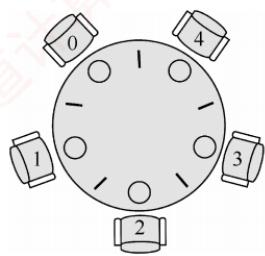

若所有哲学家同时拿左手筷子，再等待右手筷子，将引发闭环死锁。常用破局策略及完整代码实现：

#### 方案 1：限制并发进餐人数（最多允许 4 人同时拿筷）
破坏死锁发生条件，保证至少有一位哲学家能同时拿到两只筷子进餐，用毕释放后带动其他人（拓展为 $n$ 位哲学家共用 $m$ 只碗时，只需令碗信号量初值为<mark>min(m, n-1)</mark>即可同时防止死锁）。 `[真题·2019-T43]`
```c
semaphore count = 4;                     // 限制至多允许 4 位哲学家同时尝试取筷
semaphore chopsticks[5] = {1, 1, 1, 1, 1};

void philosopher(int i) {
    while (1) {
        think();
        P(count);                        // ① 申请进餐名额
        P(chopsticks[i]);                // ② 拿左边筷子
        P(chopsticks[(i + 1) % 5]);      // ③ 拿右边筷子
        eat();
        V(chopsticks[i]);                // 放下左边筷子
        V(chopsticks[(i + 1) % 5]);      // 放下右边筷子
        V(count);                        // 释放进餐名额
    }
}
```

#### 方案 2：串行取筷（教材方案）
用互斥信号量限制同一时刻只有一名哲学家执行取两根筷子的过程。已进餐的哲学家不持有该互斥信号量，仍能放下筷子；取筷者因而最终有机会拿齐。两个 $P$ 操作并不合成一个原子操作：它可能拿到一根后等待另一根，因此不能声称破坏了“请求并保持”条件。此方案避免环形等待，但无饥饿仍需公平性等额外条件：
```c
semaphore mutex = 1;                     // 互斥信号量：串行化取筷过程
semaphore chopsticks[5] = {1, 1, 1, 1, 1};

void philosopher(int i) {
    while (1) {
        think();
        P(mutex);                        // 进入取筷过程，其他哲学家暂不能取筷
        P(chopsticks[i]);                // 取左筷子
        P(chopsticks[(i + 1) % 5]);      // 取右筷子
        V(mutex);                        // 释放互斥锁
        eat();
        V(chopsticks[i]);                // 归还左筷子
        V(chopsticks[(i + 1) % 5]);      // 归还右筷子
    }
}
```

#### 方案 3：奇偶哲学家不对称取筷（破坏循环等待链）
规定奇数号哲学家先拿左筷后拿右筷，偶数号哲学家先拿右筷后拿左筷：
```c
semaphore chopsticks[5] = {1, 1, 1, 1, 1};

void philosopher(int i) {
    while (1) {
        think();
        if (i % 2 == 0) {
            P(chopsticks[(i + 1) % 5]);  // 偶数号哲学家先拿右边筷子
            P(chopsticks[i]);            // 再拿左边筷子
        } else {
            P(chopsticks[i]);            // 奇数号哲学家先拿左边筷子
            P(chopsticks[(i + 1) % 5]);  // 再拿右边筷子
        }
        eat();
        V(chopsticks[i]);                // 放下左筷
        V(chopsticks[(i + 1) % 5]);      // 放下右筷
    }
}
```

---

> [!tip] 深入练习
> 经典同步题的关系分析、信号量设置和防饥饿条件，可结合 [[408操作系统——PV专题二轮强化复盘]] 对照学习。

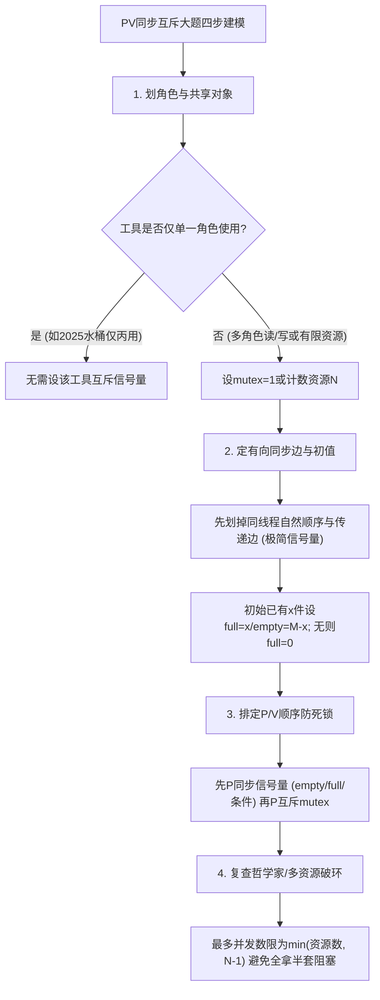

## 2.3.6 管程（Monitor）【🔥 必背｜停下来默背 1 遍】

### 一、管程的产生与定义
信号量机制的代码分散在各个进程中，容易因书写错误导致死锁。管程将共享资源及其操作封装为一个受保护的模块，**由编译器和运行系统自动保证管程内过程的互斥执行**，程序员无需手动编写互斥代码。<mark>管程可兼实现进程互斥与同步</mark>，共享数据只能通过管程内部定义的过程访问，且每次仅允许一个进程在管程内执行。 `[真题·2016-T32]`

**管程由四部分组成**：
1. 管程的名称；
2. 局部于管程内部的共享数据结构说明；
3. 对该数据结构进行操作的一组过程（函数）；
4. 对共享数据结构进行初始化的语句。

### 二、条件变量（Condition Variables）
当进程进入管程后发现所需条件不满足时，必须释放管程占用并挂起，否则其他进程无法进入管程改变状态。管程引入**条件变量**管理阻塞队列。
- `x.wait()`：当条件 $x$ 不满足时，<mark>进程阻塞并插入条件变量x阻塞队列</mark>，同时**自动释放管程互斥权**以便其他进程进入。 `[真题·2018-T28]`
- `x.signal()`：当条件 $x$ 改变时，唤醒一个因等待该条件而阻塞在 $x$ 队列上的进程。

### 三、条件变量 vs 信号量

| 机制 | 内部状态 | `wait` / $P$ 的动作 | `signal` / $V$ 的动作 |
|---|---|---|---|
| **信号量** | 维护一个**整型资源计数器** | 计数减 1；若小于 0 则阻塞 | 计数加 1；若小于等于 0 则唤醒阻塞进程 |
| **条件变量** | **无数值**，仅维护一个阻塞等待链表 | 立即阻塞调用者并释放管程 | 若有等待者则唤醒一个；**若无等待者，signal 没有任何效果（不保存信号）** |

---

# 2.4 死锁【🔥⚡ 必背+避坑｜停下来默背 1 遍 + 精读 1 分钟】

## 2.4.1 死锁的概念【📌 扫一眼｜确认“我还会”就过】

死锁是指多个进程因竞争不可剥夺资源而陷入相互等待状态，若无外力干预，这些进程都将永远无法向前推进。

### 一、死锁、饥饿与死循环对比

| 状态现象 | 产生原因 | 涉及进程数 | 进程状态 | 恢复可能性 |
|---|---|---|---|---|
| **死锁** | 循环资源等待闭环 | <mark>至少2个进程互相等待</mark> `[真题·2019-T30]` | <mark>均处于阻塞态</mark> `[真题·2019-T30]` | 必须依赖系统外力干预解除 |
| **饥饿** | 调度策略长期不公 | 可以仅有 1 个进程 | 就绪态或阻塞态 | 资源分配后可自行恢复推进 |
| **死循环** | 应用程序逻辑死循环 | 可以仅有 1 个进程 | 运行态 | 耗费 CPU 算力，需强制终止 |

### 二、死锁产生的 4 个必要条件

1. **互斥条件**：一段时间内某资源只能被一个进程独占使用。
2. **不可剥夺条件（非剥夺条件）**：进程所获得的资源在未使用完毕前不能被强制夺走，只能由其自身主动释放。
3. **请求并保持条件（占有并等待）**：进程已持有至少一个资源，在提出新的资源请求发生阻塞时，对已有资源保持不放。
4. **循环等待条件**：存在一个进程—资源的循环等待闭环链（$P_0$ 等 $P_1$ 持有的资源，$P_1$ 等 $P_2$……$P_n$ 等 $P_0$）。

### 三、死锁处理策略对比

| 处理策略 | 介入时机 | 核心思想 | 代价、限制与并发度比较 |
|---|---|---|---|
| **死锁预防（Prevention）** | 静态设计期 | <mark>静态破坏4个必要条件确保不死锁</mark>（如限制申请顺序） `[真题易错·2015-T26 / 2019-T30]` | 限制最严格，资源利用率与系统**并发度最低** |
| **死锁避免（Avoidance）** | 动态申请期 | 不破坏必要条件，每次分配前试探计算，防止进入不安全状态（**银行家算法**） | 需预先声明最大需求 Max，且<mark>不安全态绝不分配资源</mark> `[真题易错·2015-T26]` |
| **死锁检测与解除** | 运行后期 | 允许死锁发生，动态分配时<mark>不需Max、先分配再检测</mark>，通过**资源分配图化简**检测并通过剥夺/撤销解除 `[真题·2015-T26]` | **允许的并发程度最高**；但需维护图结构，解除死锁可能丢失已算结果 |
| **死锁忽略（鸵鸟算法）** | 不处理 | 发生概率极低时直接忽略，死锁后人工重启系统 | 系统开销最小，Unix/Windows 多数遵循此策略 |

---

## 2.4.2 死锁预防【⚡ 避坑｜最值钱，必须精读 1 分钟】

通过静态施加分配规则，在系统设计时破坏死锁的 4 个必要条件之一：

1. **破坏互斥条件**：将独占设备改造成共享设备（如引入 SPOOLing 技术将打印机改造成共享打印）。*局限*：多数物理设备性质决定其无法共享，出于安全性考虑很多资源必须强制互斥。
2. **破坏不可剥夺条件**：当已持有资源的进程请求新资源得不到满足时，系统强制剥夺其所有已占有资源；或剥夺他人资源分配给该进程。*代价*：实现极其复杂，抢占可能导致前阶段计算工作丢失失效，重复申请释放增加系统开销，极易引发进程饥饿。
3. **破坏请求并保持条件**（系统保证：当进程申请新资源时，不能持有不可剥夺资源）：
   - **第一种协议（静态一次性预分配法）**：规定进程在运行前必须一次性申请并分配其整个生命期所需的全部资源，若不能一次全额满足则一个都不分配，进程等待。
     - *优点*：简单、安全。
     - *缺点*：资源严重浪费（许多资源仅在后期使用却全程占用）；容易引发长进程饥饿。
   - **第二种协议（逐步释放再申请法）**：允许进程只申请获得运行初期所需的资源后便投入运行；在运行过程中，进程**必须先逐步释放已用毕的全部资源，然后才能提出新的资源申请**。
     - *优点*：显著提高了设备利用率，加快了任务推进，大大减少了饥饿概率。
4. **破坏循环等待条件：采用资源有序分配法**。给全系统所有资源赋予唯一全局整数编号，规定进程必须严格按资源编号递增的次序申请资源，同类资源一次申请完。若已持有高编号资源又想申请低编号资源，必须先释放所有不低于该编号的已有资源。*代价*：限制新设备添加，若实际使用顺序与编号不符会造成提前占用与闲置浪费。

---

## 2.4.3 死锁避免【🔥⚡ 必背+避坑｜停下来默背 1 遍 + 精读 1 分钟】

死锁避免在动态分配过程中不破坏必要条件，其核心是在分配前动态评估系统安全性。

### 一、安全状态与不安全状态


- **安全状态**：系统能按某种进程序列（$P_1, P_2, \dots, P_n$）依次为每个进程分配其尚需的最大资源，直至所有进程均能顺利执行完毕并释放资源。这个序列称为**安全序列**。安全序列可能不唯一。
- **状态包含关系**：
  $$\text{安全状态} \subset \text{非死锁状态}$$
  $$\text{系统处于安全状态} \implies \text{必定不会发生死锁}$$
  $$\text{系统处于不安全状态} \centernot\implies \text{当前已经死锁（只是未来可能死锁）}$$
  $$\text{系统陷入死锁} \implies \text{必定处于不安全状态}$$
  <mark>安全状态必定无死锁而不安全未必已死锁</mark>；因此银行家算法判定系统进入不安全状态，不能等价于系统当前已经发生死锁。 `[真题易错·2013-T32 / 2019-T30]`

### 二、银行家算法（Banker's Algorithm）

#### 1. 数据结构
- `Available[m]`：各类可用资源向量。
- `Max[n][m]`：各进程对各类资源的最大需求矩阵。
- `Allocation[n][m]`：各进程已分配的各类资源矩阵。
- `Need[n][m]`：各进程尚需的各类资源矩阵，满足：
  $$Need[i][j] = Max[i][j] - Allocation[i][j]$$

#### 2. 资源请求算法（进程 $P_i$ 提出请求向量 $Request_i$）
1. **最大需求合法性检查**：若 $Request_i \le Need_i$，转步骤 2；否则报错（请求量超过其声明的最大值）。
2. **当前可用性检查**：若 $Request_i \le Available$，转步骤 3；否则表示当前可用资源不足，$P_i$ 阻塞等待。
3. **试探性分配**：系统假定批准请求，修改数据结构：
   $$Available = Available - Request_i$$
   $$Allocation_i = Allocation_i + Request_i$$
   $$Need_i = Need_i - Request_i$$
4. **安全性检查**：调用安全性算法。若新状态安全，正式分配；若不安全，撤销试探性分配，恢复原状，$P_i$ 等待。

#### 3. 安全性算法
1. 设置工作向量 $Work = Available$；完成标记向量 $Finish[n] = [false, \dots, false]$。
2. 从进程中寻找满足 $Finish[i] == false$ 且 $Need_i \le Work$ 的进程 $P_i$：
   - 若找到：假设 $P_i$ 获得资源执行完毕，释放其全部已占资源：
     $$Work = Work + Allocation_i$$
     $$Finish[i] = true$$
   - 重复步骤 2；
3. 若所有进程最终均有 $Finish[i] == true$，则系统处于安全状态，得到的序列为安全序列；否则系统处于不安全状态。

> [!important] 真题中如何核验安全序列（2011、2012、2018、2020、2022）
> - 题目给出的是各类**资源总量**而非 `Available` 时，先逐类用“总量减去所有进程已分配量”求出初始可用向量；再算 $Need=Max-Allocation$。
> - 对候选进程逐类检查 $Need_i \le Work$。假设它完成后，更新 $Work=Work+Allocation_i$；因为临时借出的资源随后归还，**净增加的是原先已分配给它的资源**。例如原先未占有资源的进程完成后，$Work$ 不增加。
> - 找到一条完整序列只能说明**存在**安全序列，不能说明它唯一；题目要求序列个数时，要从每个可选进程分别分支，直到所有进程完成，再统计不同顺序。<mark>所有可行路径均阻塞即判定为不安全</mark>（如 2011/2018 真题）。 `[真题·2011-T27 / 2012-T27 / 2018-T26 / 2020-T27 / 2022-T26]`
> - **避免与检测分工不同**：银行家算法依据已声明的最大需求 $Max$ 判断试分配后是否安全；<mark>银行家不判断当前是否已死锁</mark>，死锁检测不需 $Max$ 仅依据当前分配与请求图化简判定。 `[真题易错·2015-T26 / 2019-T30]`

---

## 2.4.4 死锁检测与解除【🔥⚡ 必背+避坑｜停下来默背 1 遍 + 精读 1 分钟】

若系统既不预防也不避免死锁，则必须具备检测死锁并予以解除的能力。

### 一、死锁检测：资源分配图化简

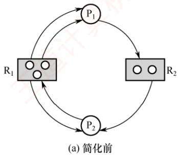

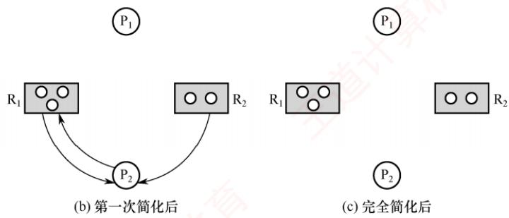

- **资源分配图定义**：
  - 圆圈表示进程节点 $P$，方框表示资源类别 $R$（框内圆点表示该类资源的实例数）。
  - **请求边**（$P_i \to R_j$）：进程申请一个单位的 $R_j$ 资源。
  - **分配边**（$R_j \to P_i$）：该类资源的一个实例已分配给进程 $P_i$。
- **化简步骤**：
  1. 找出当前请求边均能被系统中空闲资源满足的进程 $P_i$；
  2. 假定 $P_i$ 顺利运行完毕并释放所有资源，消去其所有的请求边和分配边，使其成为孤立节点；
  3. 释放后的资源用于满足其他阻塞进程，重复化简过程。
- **死锁定理**：系统处于死锁状态的充要条件是**该资源分配图不可完全化简**。化简后仍有边相连的进程集合即为**死锁进程**。

**注意：**
- **单实例资源图**中：存在环路 $\iff$ 系统发生死锁。
- **多实例资源图**中：存在环路是死锁的**必要不充分条件**，必须通过图化简或向量计算检测。

> [!tip] 真题：求最少有多少进程陷入死锁（2016）
> 先依据题目给出的资源需求画可能的等待关系，寻找能够闭合的最小环，再区分“死锁进程数量”和“题目中进程总数”。例如三个进程的需求分别是 $\{R_1,R_2\}$、$\{R_2,R_3\}$、$\{R_1,R_3\}$，各类资源均只有一个实例时，三者可以各占一个并循环等待，<mark>构成至少3个进程参与的最小死锁环</mark>；只需要 $R_2$ 的第四个进程不必参与该最小环。 `[真题·2016-T25]`

### 二、死锁解除方法

1. **<mark>资源剥夺法</mark>**：挂起部分死锁进程，抢占其持有的资源分配给其他死锁进程以打破闭环。需防止被挂起进程长期饥饿。 `[真题·2019-T30]`
2. **撤销进程法**：强制终止部分或全部死锁进程并回收资源。通常按撤销代价从低到高终止。
3. **进程回退法**：利用历史检查点（Checkpoint）将一个或多个死锁进程回退到足以规避死锁的状态，并自愿释放资源。

### 三、系统不死锁的同类资源临界数量公式

设有 $n$ 个并发进程共享同类不可剥夺资源；在教材模型中，各进程的最大需求不超过系统资源总数，获得全部所需资源后能够完成并归还资源。若每个进程对该资源的最大需求为 $k$：
- 系统**必然不会发生死锁**的充分条件（最坏倒霉蛋模型，每个进程都分得 $k-1$ 个还差 1 个）：
  $$m \ge n(k - 1) + 1$$
  （例如 <mark>n个进程各需2个资源无死锁至少n+1</mark> 个）。 `[真题·2021-T31]`
- 若各进程最大需求不同（分别为 $k_1, k_2, \dots, k_n$），在上述最坏分配模型下，保证不死锁的临界条件：
  $$m > \sum_{i=1}^n (k_i - 1) \iff \sum_{i=1}^n k_i < m + n$$
  （例如 <mark>3个进程需3/4/5台设备无死锁最小10台</mark>，即 $(3-1)+(4-1)+(5-1)+1=10$）。 `[真题·2014-T24]`

> [!tip] 真题反向求最少进程数（2009）
> 当每个进程最多需要 $k$ 个资源时，若所有参与死锁的进程各持有 $k-1$ 个、还差 1 个，$m \le n(k-1)$ 是构造这一最坏情况的资源数量条件。<mark>8台打印机每需3台最多K=4死锁</mark>（3 个进程最多各持 2 台不能占满 8 台；4 个进程可各持 2 台占满并循环等待，因此可能发生死锁的最少进程数为 4）。 `[真题·2009-T25]`

---

# 2.5 本章疑难点【⚡ 避坑｜最值钱，必须精读 1 分钟】

## 2.5.1 进程与程序的区别与联系【📌 扫一眼｜确认“我还会”就过】

程序是静态的代码与指令文件，可长期存放在外存中；进程是程序及其数据在 CPU 上的动态执行过程，具有生命周期与状态转换。脱离程序，进程失去运行实体；脱离进程，程序无法在多道系统中获得 CPU 调度与内存分配。一个程序可对应多个进程（同一程序多次启动）；一个进程在其生命周期中可顺序加载执行多个程序（如 `exec` 系统调用替换内存映像），但同一时刻只能执行一个程序。

## 2.5.2 银行家算法的工作原理【⚡ 避坑｜最值钱，必须精读 1 分钟】

银行家算法属于死锁避免策略，并非死锁预防或检测。它不靠预先规定固定资源申请顺序来预防死锁，而是在进程每次提出资源申请时先执行两道门槛检查（不超过自身最大需求、不超过系统当前可用量），随后假定分配并调用安全性算法寻找安全序列。仅当试探分配后系统**仍存在至少一个安全序列**时，才真正批准分配；否则令进程等待。判断是否存在安全序列时，可以依次选择当前可满足的进程并模拟其完成，不必机械地遍历所有排列；若题目要求统计所有安全序列，才需分支计数。

## 2.5.3 进程同步与互斥的区别和联系【📌 扫一眼｜确认“我还会”就过】

- **互斥**源于对临界资源的竞争，属于**间接制约关系**。解决的核心问题是“谁不能与谁同时进入临界区”，保障独占访问与数据一致性。
- **同步**源于相互协作的进程间的前驱依赖，属于**直接制约关系**。解决的核心问题是“谁必须等待谁完成特定事件”，保障并发推进的次序正确。
- 同一实际并发场景中常同时存在两种制约关系（如生产者-消费者问题中既有缓冲区互斥，又有空/满缓冲区的同步协调）。

---

# 本章易混点速查【⚡ 避坑｜最值钱，必须精读 1 分钟】

- **进程存在标志**：PCB 是进程存在的唯一标志且常驻内核内存，不在用户虚拟地址空间内。
- **状态转换方向**：阻塞态只能被动唤醒进就绪态，必定不能直达运行态；就绪态进程无法主动发起系统调用，必定不能直达阻塞态。
- **主动与被动**：运行态到阻塞态是进程主动发起系统调用的自陷行为；阻塞态到就绪态是被外部事件唤醒的被动行为。
- **中断与状态**：执行中断服务程序时 CPU 处于内核态，被中断进程的状态并未改变，仍为运行态。
- **调度层次与作用**：高级调度完成创建态到就绪态转换；中级调度负责内存与外存对换以节省内存；低级调度不可缺少，负责就绪态到运行态。
- **调度与切换区别**：调度是算法决策；切换是执行现场保存与恢复；模式切换不更换进程，上下文切换必然更换进程上下文。
- **上下文切换寄存器**：必须更新 PC、栈基址寄存器与页表基址寄存器，不更新全局共享的中断向量表基址寄存器。
- **调度时机限制**：处于操作系统内核程序临界区不能调度；处于普通用户临界区完全可以被正常调度。
- **ULT 与 KLT 调度单位**：用户级线程系统内核只感知进程，以进程为单位分派时间片；内核级线程系统内核直接以线程为调度单位。
- **多对一线程模型硬伤**：任一用户线程发起阻塞型系统调用，会导致所属整个进程被挂起，且无法利用多核并行。
- **自旋锁适用场景**：仅适用于多处理机且临界区极短的场景；单核处理器上不宜使用忙等自旋锁。
- **记录型信号量负值**：$S.value < 0$ 时，其绝对值 $|S.value|$ 严格等于挂在等待队列中的阻塞进程数。
- **管程与条件变量**：管程过程互斥由系统自动保证；条件变量本身无计数值，若无进程等待，`signal()` 唤醒操作无任何效果。
- **安全与死锁关系**：安全状态必定无死锁；不安全状态不等于当前已经死锁；死锁状态必定不安全。
- **资源分配图成环判据**：每类资源单实例时成环 $\iff$ 死锁；多实例时成环是有死锁的必要条件而非充分条件，必须依靠图化简定理判定。
- **阻塞态 vs 挂起态驻留**：阻塞态进程常驻主存等待事件；挂起态（静止就绪/静止阻塞）进程映像被移出外存对换区以节省内存。
- **同进程线程栈缺乏硬件隔离**：同一进程内的线程虽然拥有各自的私有栈，但共享地址空间且缺乏硬件地址保护，一个线程可非法读写同伴线程栈。
- **两对上下文切换操作**：调度交接时经历两对上下文切换（当前进程 $\leftrightarrow$ 分派程序，分派程序 $\leftrightarrow$ 新选进程）。
- **RR 临界到达排队规则**：进程时间片耗尽与新进程就绪到达同时发生时，先后入队顺序按题设或具体实现约定；未说明时写明采用的规则，不能无条件认定新进程优先。
- **破坏请求并保持的两种协议**：第一种协议是一次性全额静态预分配；第二种协议是先逐步释放已用毕资源再申请新资源。

---

# 本章高频题型总表

| 题干特征 | 优先方法/起手式 | 真题印证与避坑 |
|---|---|---|
| 进程状态转换、创建/唤醒与线程共享资源 | 画五/七状态转换箭头图；核对线程独享私有栈指针/PC，共享代码/堆/全局变量/`fd` | `[真题·2019-T23 / 2022-T28 / 2026-T25]` `fork()` 不共享虚拟地址空间（`2020-T29`）；设备分配不建新进程（`2010-T24`） |
| 调度算法特性与甘特图（含动态优先级与时间片） | 先按到达时刻+I/O 与 CPU 并行建轴；周期中断题目仅在时钟整点检查抢占/降级 | `[真题·2016-T24 / 2022-T25 / 2026-T45]` 3 作业流水为 17ms 非 15ms；2026-T45 为 22 次时钟中断、7 次调度、Q=100ms 降为 5 次 |
| 软件/硬件互斥锁（Peterson/TSL/Swap）与让权准则 | 核对“空闲让进/忙则等待/有限等待”三必选，区分“让权等待（仅记录型信号量满足）” | `[真题·2016-T27 / 2018-T32 / 2023-T45]` 软件拆解 `swap` 构造 `newSwap` 竞态 6 步交错导致同时进临界区 |
| PV 同步互斥建模（前驱图/生产者-消费者/哲学家） | 四步法：划角色工具→去同线程自然序边得最少信号量→先 P 同步后 P 互斥→复查死锁 | `[真题·2022-T46 / 2024-T46 / 2025-T45]` 仅单角色独占的工具（如水桶）不设互斥信号量；多类型或满容量前先申请同步计数 |
| 死锁避免（银行家）、检测与最坏资源数临界公式 | 算 `Available=总量-∑Allocation` 与 `Need=Max-Allocation`；最坏模型 $m \ge \sum(k_i-1)+1$ | `[真题·2014-T24 / 2015-T26 / 2021-T31]` 银行家只判安全态不直接判已死锁（`2019-T30`）；限制申请次序属预防非避免 |

---

# 冲刺主动回忆卡（遮挡自测）

### 卡片 1｜进程/线程资源边界与五状态转换禁区
同一进程的多个线程共享和独享哪些资源？父进程通过 `fork()` 创建或终止时对子进程虚拟地址空间和生命周期有何影响？“执行态→阻塞态”和“执行态→就绪态”的典型触发事件是什么？

> [!success]- 正确解释
> 1. **线程共享**：进程的代码段、数据段（全局变量）、**堆空间**及已打开文件描述符 `fd`；**线程私有**：各自线程控制块 TCB、程序计数器 PC、通用寄存器与**私有的栈及栈指针**（`2011-T25`、`2024-T28`、`2026-T25`）。
> 2. **父子进程**：`fork()` 为子进程建立**独立虚拟地址空间**、PID 与 PCB（`2020-T29`）；终止父进程不一定立即终止子进程，可由系统根进程收养（`2024-T24`）。
> 3. **状态转换**：`执行→阻塞` 为进程主动发起，包括读文件/等外设 I/O、申请临界资源或 `wait(S)` 不足（`2018-T27`、`2022-T28`）；`执行→就绪` 包括时间片用完、高优先级抢占或主动让出 CPU（`2015-T25`、`2023-T27`）；时间片用完**不会唤醒**阻塞进程（`2019-T24`）。

### 卡片 2｜PV 最小信号量设计原则与防死锁检查点
如何判定前驱图与生产消费变式中最少需要多少个信号量？为什么 `2025-T45` 水桶不设互斥而 `2014-T47` 连取 10 件要设双互斥锁？

> [!success]- 正确解释
> 1. **最小信号量**：同线程内天然顺序执行的边和可由已有边传递推导的边**不单设信号量**（如 `2022-T46` 6 个操作仅设 `doneA, doneC` 2 个信号量）；若工具/资源在全系统中**仅被单一角色使用**（如 `2025-T45` 水桶仅丙使用），无并发竞争，**无需设互斥信号量**。
> 2. **防死锁次序**：必须先 `P(同步条件/空位/产品)`，再 `P(mutex)`（`2025-T45` 甲先 `P(sk)` 再 `P(mutex)`）；若需连续独占取 $k$ 件后再释放（`2014-T47`），应在外层另设连取锁包裹内层单次操作 `mutex`，绝不可在持有单缓冲区 `mutex` 时再执行 $k$ 次 `P(full)`。

### 卡片 3｜抢占优先级 + 时间片 + 时钟中断综合排错
在“仅整周期时钟中断才允许检查抢占”的题干下（如 `2026-T45`），为什么新到达的高优先级进程不能在到达时刻立刻抢占？同优先级降权排队先后如何判定？

> [!success]- 正确解释
> 1. 若题干限定**仅发生时钟中断时才检查抢占**，则非整周期时刻（如 `12ms`、`14ms`）到达的新进程只能先插入就绪队列，直到下一个时钟中断刻点（`20ms`）才触发调度与抢占（`2026-T45`）。
> 2. 同优先级进程遵循 **FIFO 先来先入队原则**：被更高优先级抢占的 $P_2$（原优先级不变）自 `20ms` 起已在队列等待，而 $P_4$ 于 `70ms` 时间片耗尽降为同优先级再入队尾，因此 `70ms` 调度优先选取已在队首的 $P_2$；整程至 `225ms` 共经历 `10..220ms` 计 **22 次**时钟中断、**7 次** CPU 调度，时间片扩大至 `100ms` 后因途中不再降级降为 **5 次**调度。

### 卡片 4｜硬件原子锁、让权等待与条件变量核心对比
Peterson、TSL、Swap、整型信号量与记录型信号量各自是否满足“让权等待”？将原子 `swap` 改写为普通函数为什么破坏互斥？管程的 `x.wait()` 与 `signal()` 机制是什么？

> [!success]- 正确解释
> 1. **让权等待**：互斥准则中“空闲让进、忙则等待、有限等待”为必选，**让权等待非必选**（`2020-T32`）；在常见机制中，Peterson、TSL、Swap 自旋锁与整型信号量均为忙等，**仅记录型信号量**通过 `block()` 主动释放 CPU 满足让权等待（`2016-T27`、`2018-T32`、`2021-T45`）。
> 2. **原子性破坏**：非原子的 `newSwap` 允许两个进程在前一进程写回 `lock=TRUE` 前先后读出 `lock==FALSE`，双双进入临界区破坏“忙则等待”（`2023-T45`）。
> 3. **管程与条件变量**：管程兼能实现**互斥与同步**（`2016-T32`）；`x.wait()` 将调用者阻塞挂入条件变量 $x$ 的等待队列并**释放管程控制权**（`2018-T28`）；无等待进程时 `x.signal()` 不留存信号。

### 卡片 5｜死锁三大策略区分与最坏资源临界公式
如何一眼区分死锁预防、死锁避免（银行家）和死锁检测？为什么“不安全状态”不等于“已死锁”？反向求最多死锁进程数与最小不死锁资源数怎么列式？

> [!success]- 正确解释
> 1. **策略界限**：要求进程**预先声明最大需求 $Max$**、试分配后仅在安全状态才准许分配属于**死锁避免**（银行家算法）；限制资源申请递增顺序属于死锁预防（破坏循环等待）；不需 $Max$、先分配后通过资源分配图化简判定属于死锁检测（`2015-T26`、`2019-T30`）。
> 2. **安全态 vs 死锁**：银行家判定处于**不安全状态**只能说明系统存在未来发生死锁的可能，**不等于此刻已发生死锁**（若进程此时不再申请最大剩余需求即可顺利结束）；真正死锁时必有至少 2 个进程处于阻塞态（`2013-T32`、`2019-T30`）。
> 3. **临界资源式**：防死锁最小资源数为最坏各得 $k_i-1$ 再加 1：$m_{min}=\sum(k_i-1)+1$（`2014-T24`、`2021-T31`）；已知总数 $m$ 反求能构成死锁的最大进程数 $K$，令 $K(k-1)\ge m$ 取满足不溢出的最大可配凑解（`2009-T25` 8 台每需 3 得 $K=4$）。
