# 第3章 内存管理

> [!abstract] 本章复盘目标
> 本章围绕“如何为程序分配物理内存”与**“如何打破物理内存容量限制”**两条主线展开。前半部分沿着“单一连续 $\to$ 固定分区 $\to$ 动态分区 $\to$ 基本分页 $\to$ 基本分段 $\to$ 段页式”逐步解决内存碎片与分配灵活性问题；后半部分引入**局部性原理**与**请求分页虚存机制**，通过“页表机制 $+$ 缺页中断 $+$ 页面置换算法”在逻辑上大幅扩充内存。复习时务必掌握**虚实地址转换计算、多级页表索引拆分、置换算法模拟轨迹、数组遍历缺页机械化推导以及 TLB/Page Table/Cache 的三级联动流程**。

> [!important] 近 18 年 408 操作系统真题雷达（2009—2026）
> - **考频统计**：本章 18 年累计 **37 道单选 + 10 道 OS 综合大题**（另深度关联 4 道计组-OS 跨科虚存大题 `2014-T45`、`2016-T45`、`2021-T44`、`2023-T44`），是计算密度的最高点。
> - **核心落点**：多级页表地址拆分与目录自映射（`2024-T45`）、C 程序变量与虚存段及内核区协同流转（`2025-T46`）、改进型 CLOCK 四轮扫描与 LRU 逆向淘汰、TLB/EAT 有效访存计算、伙伴系统与最佳适应回收合并。
> - **个人失分边界**：连续 BestFit 回收漏掉上下相邻空闲区合并（`2017-T25`）；LRU 误数重复页或未排除“有空闲框时不淘汰”（`2015-T27`、`2022-T29`）；改进 CLOCK 第 2 轮漏清访问位 $u$；误以为页缓冲队列长度决定缺页率（`2022-T30`）或认为虚存容量受内存+外存之和限制（`2023-T31`）。
> - **总控入口**：[[00_408操作系统｜考前急救与真题落点总控|返回操作系统总控]]

## 考纲定位

- **内存管理概念**：程序装入与链接（编译、链接、装入；静态/动态重定位）、逻辑地址与物理地址空间、内存保护（上下限寄存器、基址与限长寄存器）、内存共享（可重入代码）、连续分配（单一连续、固定分区、动态分区及其分配算法、伙伴系统）、非连续分配（基本分页、基本分段、段页式系统及其地址变换机构、快表 TLB、两级与多级页表）。
- **虚拟内存管理**：虚拟内存基本概念与局部性原理、请求分页系统（页表项结构、缺页中断机构、地址变换全过程）、页框分配与驻留集策略、调入时机与来源、页面置换算法（OPT、FIFO 及 Belady 异常、LRU、简单 CLOCK、改进型 CLOCK）、抖动与工作集模型、页框回收与页面缓冲算法（PBA）、内存映射文件（mmap）、虚拟存储器性能分析与综合地址翻译。

> [!tip] 命题特点
> 本章是 408 统考中考查频率最高、计算量最大、软硬件综合度最深的章节之一。选择题重点考查“概念细节与成立条件”（如动态/静态重定位区别、内部/外部碎片归属、虚存三大特征、置换算法性能对比）；综合应用题常以**大题形式联合计组**考查“多级页表索引计算、虚实地址翻译过程、TLB 与 Cache 协同查找命中判断、缺页异常处理流程与数组遍历缺页分析”。

## 章节知识脉络

1. **3.1 内存管理概念**：建立从逻辑地址到物理地址的映射体系，解决物理内存的划分、分配、保护与离散化管理。
2. **3.2 虚拟内存管理**：基于局部性原理实现请求分页，依托页表状态位、缺页异常与页面置换，在逻辑上扩展内存。
3. **3.3 本章疑难点与深度辨析**：澄清分页与分段的本质区别、多级页表开销权衡、缺页异常特殊性及软硬件协同访存全流程。

---

# 3.1 内存管理概念【🔥⚡ 必背+避坑｜停下来默背 1 遍 + 精读 1 分钟】

## 3.1.1 内存管理的基本原理和要求【🔥 必背｜停下来默背 1 遍】

### 这一节要解决什么问题

在多道程序并发环境下，多个进程共享有限的物理内存。操作系统需要解决：
1. 程序员编写的高级语言源程序如何一步步变成物理内存中可执行的机器代码？
2. 进程使用的逻辑地址如何安全、透明地转换为物理地址？
3. 如何防止进程越界破坏内核或彼此干扰，并安全地共享公共代码？

### 一、程序的编译、链接与装入

将用户源程序转换为内存中可执行的进程映像，必须经过**编译、链接、装入**三个阶段：

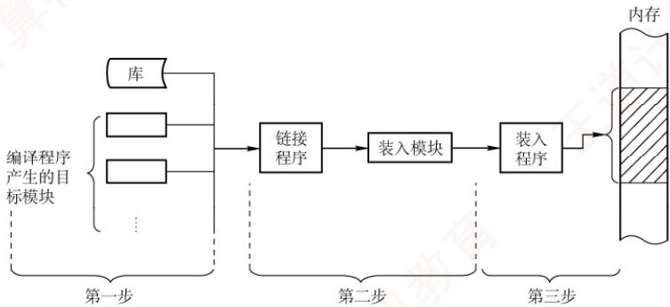

| 阶段 | 负责程序 | 核心输入 $\to$ 输出 | 主要工作内容 | 产生的地址形态 |
|---|---|---|---|---|
| **编译 (Compile)** | 编译器 | 源程序 $\to$ 若干**目标模块** | 预处理 $\to$ 编译 $\to$ 汇编，将源代码翻译为机器指令目标模块（.obj/.o） | 各模块通常从 **0 号单元独立相对编址** |
| **链接 (Link)** | 链接程序 | 目标模块 $+$ 库函数 $\to$ **装入模块** | 解决外部符号引用，将分散目标模块拼接为一个完整的可执行文件 | <mark>形成完整的逻辑地址空间</mark>（从 0 开始统一编址） `[真题·2011-T30]` |
| **装入 (Load)** | 装入程序 | 装入模块 $\to$ **物理内存** | 将装入模块载入内存并准备执行；静态重定位在装入时完成，动态重定位在执行访存时完成 | 最终访存所需的**绝对物理地址** |

#### 1. 程序的链接方式

根据链接发生的时间点，分为三种方式：

1. **静态链接**：在程序运行前，将各目标模块及所需库函数链接成一个完整的可执行文件（装入模块），以后不再拆开。
   - **两项核心操作**：① *地址调整*（将后续模块的内部相对地址加上前面模块的总长度偏移量 $L$）；② *外部符号解析*（将跨模块的调用指令中的符号替换为具体的相对地址）。
   - *缺点*：模块修改必须重新链接整个程序；无法跨进程共享目标模块副本。
2. **装入时动态链接**：源程序编译后的目标模块在装入内存时，采用**边装入边链接**的方式。
   - *优点*：便于目标模块的独立修改与更新；便于多进程共享同一目标模块。
3. **运行时动态链接**：在程序执行过程中，**仅当用到某个外部模块时**才由操作系统将其动态载入内存并完成链接。
   - *优点*：未用到的模块不装入内存，加快程序加载速度并节约物理内存；**有利于实现模块的动态共享与热更新**。

> [!warning] 链接方式与虚拟存储不是必然绑定
> 页式虚拟存储管理本身只规定页面按需调入、缺页处理和置换机制，**不必然要求运行时动态链接**。静态链接、装入时动态链接和运行时动态链接都可以与分页/虚拟存储结合；看到“页式虚拟存储管理中程序的链接方式必然是运行时动态链接”应判错，除非题干另行限定。

#### 2. 程序的装入方式与重定位

| 装入方式 | 适用环境 | 地址转换时机 | 重定位方式 | 移动与扩充特性 |
|---|---|---|---|---|
| **绝对装入** | 单道程序环境 | 编译/汇编时即确定绝对物理地址 | 无需重定位（逻辑地址直接等于物理地址） | 不能在内存中移动，无灵活性 |
| **可重定位装入** | 早期多道环境 | **装入内存时一次性完成** | **静态重定位** | 装入后***<u>不可在内存中移动</u>***，不能动态申请额外内存 |
| **动态运行时装入** | 现代多道系统 | **推迟到指令实际执行时** | **动态重定位**（借助重定位寄存器） | ***<u>可在内存中动态移动（支持紧凑）</u>***，便于动态扩充分配 |

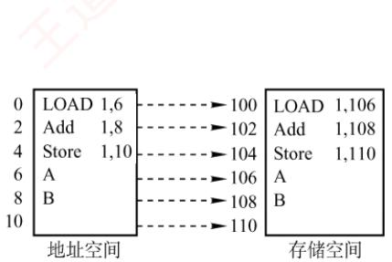
*(a) 静态重定位：装入时一次性将指令与数据的逻辑地址直接改写为物理地址*

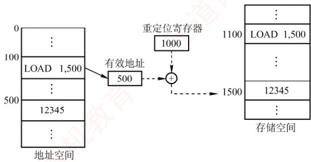
*(b) 动态重定位：装入内存时保留相对逻辑地址，指令执行访存时由硬件 MMU 动态加上重定位寄存器*

> [!abstract] 💡 解题核心思考模型：源程序到进程映像的三阶段形态与重定位分类
> - **第一步问生成物**：源程序 $\xrightarrow{\text{编译/汇编}}$ **目标模块**（相对地址） $\xrightarrow{\text{链接}}$ **装入模块/可执行文件**（统一逻辑地址） $\xrightarrow{\text{装入}}$ **内存映像**（物理地址）。C 语言编译步骤中，预处理 $\to$ 编译 $\to$ 汇编生成的可重定位二进制目标文件（.obj），此时指令中依然是相对逻辑地址。
> - **第二步问重定位时机与移动性（及硬件机构依赖）**：
>   - ***<u>静态重定位</u>***在**装入时**一次性由装入程序软件完成，装入后地址写死，**不可在内存中移动**（适用于单一连续分配、固定分区分配），***<u>不需要硬件地址变换机构</u>***；
>   - ***<u>动态重定位</u>***在**执行访存时**由硬件（MMU）动态完成，**可在内存中自由移动**（适用于动态分区、页式、段式、段页式、虚拟存储），***<u>必须依赖硬件地址变换机构</u>***。
> - **第三步问动态重定位的依赖要素**：动态重定位过程严格依赖 ***<u>① 可重定位装入程序（软件）</u>***、***<u>② 重定位寄存器（硬件）</u>***、***<u>③ 地址变换机构（硬件 MMU）</u>***。（注：目标程序是处理对象本身，非系统支撑依赖）。
> - **第四步问硬件支持**：在教材的单处理器简化模型中，处理器设一套重定位寄存器，而不是每个进程独占一套硬件寄存器；每次切换进程时，由操作系统在上下文切换中保存和恢复 PCB 中的基地址值，**不会为每个进程单独配备物理寄存器**。

### 二、逻辑地址与物理地址空间

- **逻辑地址空间（相对地址空间 / 虚拟地址空间）**：编译后一个目标程序所限定的地址单元集合，通常从 0 号单元编址。以 32 位系统为例，逻辑地址空间范围为 $0 \sim 2^{32}-1$（4GB）。程序员和低级语言程序所面对的都是逻辑地址，不同进程可以拥有相同的逻辑地址空间而互不干扰。
- **进程虚拟地址与权限**：每个进程有独立的虚拟地址空间；如 C 语言 `malloc()` 成功返回的是进程可使用的虚拟地址，不是物理地址。代码段、数据段可以设置不同的访问权限。
- **物理地址空间（绝对地址空间）**：物理内存中全部实际存储单元的物理硬件编号集合，是 CPU 访存总线寻址的最终目标。
- **内存管理单元 (MMU, 硬件部件)**：现代 CPU 中负责<mark>硬件级虚实地址动态转换</mark>的部件，对用户程序***<u>完全透明</u>***。 `[真题·2026-T24]`
- **分配单位 vs 访问单位（本质辨析）**：
  - 操作系统对内存的**分配**以分区、页框或段为基本单位（随存储管理方案不同而异）；
  - CPU 对物理主存的**访问**永远是以***<u>字节 (Byte) 或字 (Word) 为基本单位</u>***（硬件总线按字节寻址，***<u>不随操作系统存储管理方案的改变而改变</u>***）。

### 三、内存保护机制

为防止用户进程破坏操作系统内核以及实现***<u>多道程序在主存中彼此互不干扰地独立运行</u>***，CPU 设置硬件保护机构：

1. **上下限寄存器法**：CPU 设置下限寄存器与上限寄存器，分别存放该进程在内存中的起始物理地址和结束物理地址。每次访存时硬件自动判断是否满足：$\text{下限地址} \le \text{物理地址} \le \text{上限地址}$。
2. **重定位寄存器 $+$ 界地址寄存器法**：
   - **重定位寄存器（基址寄存器）**：存放进程在内存中的起始物理地址（用于**加**）。
   - **界地址寄存器（限长寄存器）**：存放进程逻辑地址空间的最大长度（用于**比**）。

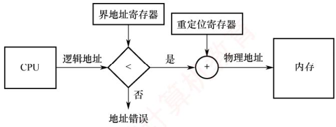

> [!abstract] 💡 解题核心思考模型：内存保护硬件越界检查次序
> - **步骤 1（比较越界）**：硬件必须<mark>先用逻辑地址与界地址比较</mark>检查。若 $\text{逻辑地址} \ge \text{界地址}$，则产生***<u>地址越界中断（内部异常/故障）</u>***，直接由硬件阻止非法访存。 `[真题·2009-T26]`
> - **步骤 2（地址相加）**：只有在**未越界**的前提下，硬件地址变换机构才将逻辑地址与重定位寄存器相加生成物理地址；
> - **步骤 3（特权级别判断）**：重定位寄存器与界地址寄存器的修改属于***<u>特权指令</u>***，只能由操作系统内核在管态（核心态）下执行，用户程序无法篡改。

### 四、内存共享与可重入代码

- **可重入代码（纯代码 / Pure Code）**：允许多个进程同时访问、但在运行期间***<u>从不被任何进程修改</u>***的代码（只读代码）。
- **共享实现机制**：
  - 多个进程共享同一份代码段物理副本；
  - 每个进程必须拥有自己***<u>独立的私有数据区（局部栈、数据段）</u>***，用于记录各自独立的执行现场与中间变量。
- **共享的效益**：
  - 极大地节省物理内存空间；
  - ***<u>减少了对程序段的调入/调出，降低了对换数量</u>***。
- **内存“复制”优化（写时复制 COW 原型）**：在支持共享的系统中，执行内存“复制”操作时，不需要将页面内容逐字节物理复制，而先让相关页表项指向同一物理页框并设置写保护；一方随后写入时触发异常，再复制出私有页面并更新映射，不能直接修改共享页。

---

## 3.1.2 连续分配管理方式【⚡ 避坑｜最值钱，必须精读 1 分钟】

### 这一节要解决什么问题

连续分配要求为一个用户程序分配一块**物理地址连续**的内存区域。本节讨论连续分配的三种演进形态及其空闲分区分配策略。

### 一、三种连续分配方式对比

| 分配方式 | 划分时机 | 分区大小 | 并发度 | 碎片特征 | 优缺点与适用场景 |
|---|---|---|---|---|---|
| **单一连续分配** | 系统启动时固定 | 内存划分为系统区（低地址）和用户区（高地址） | 单道（仅 1 个进程） | ***<u>有内部碎片，无外部碎片</u>*** | 实现最简单，无需内存保护；仅适用于单用户、单任务系统，利用率极低 |
| **固定分区分配** | 系统启动前预先划分 | 分区大小可相等或不等，运行期间固定不变 | 多道（每个分区一道作业） | ***<u>有内部碎片，无外部碎片</u>*** | 最简单的多道存储管理方案，特别适合嵌入式等微型系统；大作业装不下，小作业浪费多 |
| **动态分区分配** | 进程装入时动态划分 | 根据进程实际需要从大空闲区（自由空间）动态切出精确大小 | 多道 | ***<u>理想按需切分时无内部碎片，可能产生外部碎片</u>*** | 内存利用率高；产生大量无法利用的零散外部碎片，需依赖紧凑技术 |

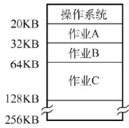
*(b) 固定分区分配情况：每个分区只放一个进程，分区内未用完的空间形成内部碎片*

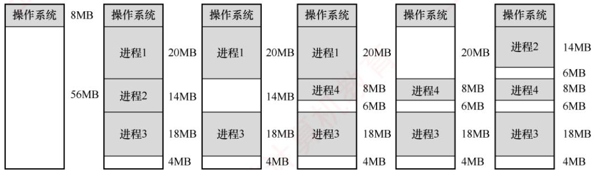
*(b) 动态分区分配：随着进程的动态调入调出，内存中出现零散的外部碎片*

> [!important] 碎片辨析与克服手段
> - ***<u>内部碎片</u>***：**已经分配给某个进程**，但进程本身没有用完的空闲空间（如固定分区内、分页系统的最后一页）。
> - ***<u>外部碎片</u>***：**尚未分配出去**，但由于太小太零散而无法满足任何新进程需求的空闲分区（如动态分区之间的狭缝）。
> - 动态分区通常按需切分；若余量小于系统规定的最小分区而将整块分配，未用部分也可能形成内部浪费。
> - 克服动态分区外部碎片的技术是***<u>紧凑（拼接 / Compaction）</u>***，必须依赖***<u>动态运行时装入（动态重定位）</u>***硬件支持。

### 二、基于顺序搜索的动态分区分配算法

当系统维护空闲分区链（或空闲分区表）时，采用不同顺序搜索算法寻找可用空闲块：

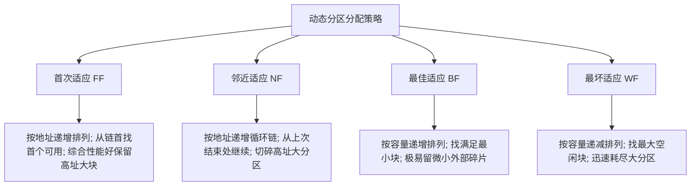

| 算法名称 | 空闲链排序方式 | 查找起点 | 优缺点与考点总结 |
|---|---|---|---|
| **首次适应 (FF)** | ***<u>空闲分区按始址递增</u>*** | 每次从**链首**开始 | ***<u>教材一般经验综合性能通常较好</u>***。保留了高地址空间的大空闲分区；缺点是低地址端产生小碎片。（注意这是平均经验结论，非极端分布下最优）。 |
| **邻近适应 (NF)** | ***<u>空闲分区按始址递增（循环链）</u>*** | 从**上次查找结束的位置**继续 | 分区分布均匀，查找开销小；但***<u>缺乏大分区（切碎高地址的大空闲分区）</u>***，导致后续大作业无法装入。 |
| **最佳适应 (BF)** | ***<u>空闲分区按容量递增</u>*** | 每次从链首找最小满足块 | <mark>最易产生大量微小外部碎片</mark>，因此 ***<u>最容易产生最多且难以利用的外部碎片</u>***，回收合并较慢。 `[真题易错·2010-T28 / 2017-T25 / 2019-T32]` |
| **最坏适应 (WF)** | ***<u>空闲分区按容量递减</u>*** | 每次取第一块（最大块） | 分割后剩余空闲块仍较大，对中小作业有利；但***<u>迅速耗尽大空闲分区</u>***，大作业到达时容易失败。 |

> [!abstract] 💡 解题核心思考模型：4 种动态分区分配算法的极简识别
> - **FF（首次适应）**：看地址由低到高，选**第一个能塞下的** $\to$ 高地址大块得以保留；
> - **NF（邻近适应）**：从**上次停下的指针往后找** $\to$ 像割草机一样扫过整个内存，高地址大块被切得粉碎；
> - **BF（最佳适应）**：挑**大小最贴近的最小块** $\to$ 削下来的“边角料”太碎，产生最多无用微碎片；
> - **WF（最坏适应）**：每次都**切最大的那一块** $\to$ 削下来的块还挺大，但很快没有整块大空间留给大作业。

### 三、基于索引搜索的分配算法与伙伴系统

1. **快速适应 (Quick Fit)**：按常用进程大小分类建立多个独立空闲链表，通过索引表快速定位。查找极快、无碎片，但回收合并困难。
2. **伙伴系统 (Buddy System)**（408 核心高频考点）：
   - **规则**：所有可用分区大小必须为 $2^k$ 字节（$k$ 为整数，如 4KB、8KB、16KB、$\cdots$）。
   - **分配过程**：当申请空间大小为 $n$ 且满足 $2^{i-1} < n \le 2^i$ 时，先查找 $2^i$ 空闲链；若无，则依次查找更大规格的空闲链。将找到的大块反复二分，每次保留一半继续拆分、另一半挂入相应大小的空闲链，直到得到 $2^i$ 大小的块后再分配。
   - **伙伴的定义**：两个块必须是**同一个更大块二分所得的两半**，才互为伙伴；大小相等且地址相邻只是必要条件，并不充分。若管理区起点为 0、块大小为 $2^i$，伙伴块起始地址可用当前块起始地址与 $2^i$ 按位异或得到。
   - **回收过程**：<mark>仅合并大小相等且互为伙伴的相邻块</mark>，则 ***<u>立即合并为一个 $2^{i+1}$ 的大分区，并继续向上尝试递归合并</u>***。 `[真题·2024-T27]`
3. **哈希算法**：以空闲分区的大小为关键字，借助哈希函数定位相应的空闲分区链，以减少查找开销。

> [!abstract] 💡 解题核心思考模型：伙伴系统二分与递归合并推导链条
> - **分配推导**：申请 $N \implies$ 向上找最小满足的 $2^k$。若当前只有 $2^{k+2}$ 块 $\to$ 二分为两个 $2^{k+1}$ $\to$ 再将其中一个二分为两个 $2^k$ $\to$ 分配一个 $2^k$，留下一个 $2^k$ 和一个 $2^{k+1}$。
> - **回收推导**：释放一个 $2^i$ 块 $\implies$ 检查其伙伴块（首地址满足伙伴对齐）。若伙伴也是空闲的，**必须合并**为 $2^{i+1}$；合并后继续检查新的 $2^{i+1}$ 伙伴是否空闲，若空闲继续向上合并，直到伙伴已被占用或达到系统最大块。

### 四、动态分区回收的四种情况

当某进程释放其占用分区时，系统检查其物理地址相邻区域：
1. **有上邻空闲区**：与上邻空闲区合并，修改上邻区的大小，始址保持不变；
2. **有下邻空闲区**：与下邻空闲区合并，修改当前释放区始址（或下邻区始址为释放区始址），大小为二者之和；
3. **同时有上、下邻空闲区**：将上邻区、释放区、下邻区三者合并为一个大空闲区，始址为上邻区始址，大小为三者之和，并在空闲表中删除下邻区表项；
4. **既无上邻又无下邻**：为释放区单独新建一个空闲分区表项，插入到空闲链的合适位置。
- *注意*：若采用 BF 最佳适应算法，回收合并导致分区大小发生变化后，**必须将合并后的分区在空闲区表中重新按大小排序**。

> [!abstract] 💡 解题核心思考模型：动态分区分配与回收模拟推导（真题高频）
> 1. **紧凑（拼接）技术的目的**：通过移动在用分区，把零散分布的外部碎片***<u>合并为一个连续的大空闲区</u>***，以便装入大作业；***<u>绝不能增加物理主存的实际容量</u>***。
> 2. **实现管理代价对比**：***<u>分区存储管理实现代价最小</u>***（只需简单的一维分区表或上下限/基址界限寄存器，无需维护庞大的多级页表/段表，也无需复杂的硬件 MMU 查表机构）。
> 3. **最佳适应 (Best Fit) 分配与回收追踪法则**：
>    - **分配时**：在所有满足 $\text{容量} \ge \text{申请量}$ 的空闲区中，挑选**容量最小的那一个**切块，剩下的部分更新大小。
>    - **回收时（两步走）**：
>      - **第一步（物理相邻合并）**：先看物理地址上是否有相邻空闲区（上邻始址 $+$ 上邻大小 $\stackrel{?}{=}$ 回收区始址；回收区始址 $+$ 回收区大小 $\stackrel{?}{=}$ 下邻始址）。若有相邻，必须<mark>物理合并后再按容量重排</mark>，如 2017 年真题回收 60K/140KB 同时与 20K/40KB、200K/200KB 合并成 380KB，剩余 3 区，链首为 500K/80KB。 `[真题易错·2017-T25]`
>      - **第二步（重新按容量排序）**：由于采用 Best Fit，合并后的新空闲区必须重新插入到空闲链中，**严格按容量从小到大排序**，链首永远是容量最小的空闲块。 `[真题·2010-T28 / 2017-T25]`

---

## 3.1.3 基本分页存储管理【🔥⚡ 必背+避坑｜停下来默背 1 遍 + 精读 1 分钟】

### 这一节要解决什么问题

连续分配必须为作业找到一块完整的连续物理空间，容易产生碎片。基本分页存储管理打破了物理连续性的限制，实现**离散分配**，完全消除外部碎片。 `[真题·2012-T25]`

### 一、基本分页的核心概念

- **页面（Page / 页）**：将进程的**逻辑地址空间**划分为若干大小相等的片段，编号从 0 开始（0号页、1号页、$\cdots$）。
- **页框（Page Frame / 页帧 / 物理块 / 物理页面）**：将物理内存空间划分为与页面大小**完全一致**的固定物理块，编号从 0 开始（0号页框、1号页框、$\cdots$）。（注：***<u>“页框”与“页帧”是完全相同的术语</u>***，英文均为 Page Frame）。
- **分配原则**：内存分配以**页框（页帧）**为基本单位，进程的各个页面可以分散地装入物理内存中互不相邻的任意空闲页框中。
- **碎片特征**：***<u>无外部碎片，只有页内碎片（内部碎片）</u>***。进程的最后一页通常装不满，每个进程平均产生**半个页面**的页内碎片。
- **透明度与硬件查表**：分页管理是在硬件和操作系统层面实现的，对***<u>用户、编译系统、低级语言程序员完全不可见（完全透明）</u>***；CPU 形成有效地址后的**查页表与地址拼接工作完全由硬件（MMU/地址变换机构）全自动完成**，无需操作系统软件干预。

> [!abstract] 💡 解题核心思考模型：页表项指向同一物理页帧（页表共享机制）
> 当操作系统允许多个进程的不同页表项指向物理内存中的**同一个页帧（物理块）**时，可直接实现三大核心机制：
> 1. ***<u>共享可重入代码（纯代码）</u>***：多进程共享同一份只读代码物理页帧；
> 2. ***<u>极速内存“复制”（写时复制 COW）</u>***：进程创建或复制数据时，只需复制页表项指针而无需物理拷贝整个数据页；
> 3. ***<u>进程间通信（共享内存 IPC）</u>***：多进程读写同一物理页帧实现高速通信。
> （*注意：页内偏移由硬件截断位数保护，并不会因此更容易发生越界访问*）。
- **页面大小的权衡**：
  - 页面太小 $\to$ 进程页数过多，页表过长占用大量内存，在访问模式和驻留集不变的前提下，***<u>页面过小可能增加页表项数量并增加调页与磁盘 I/O 开销</u>***；
  - 页面太大 $\to$ 页内碎片过大，降低内存利用率。页面大小通常由系统决定且为 $2$ 的整数次幂（如 4KB）。

> [!tip] 页面大小变化题的判定
> 页面大小增大一倍、程序按顺序连续访问且其他条件不变时，访问覆盖的页面数通常减少，缺页次数**不会增加**；若题干还给出“可容纳的最大页数不变”，则总虚拟地址空间扩大，顺序遍历的缺页次数通常减半（边界页和初始驻留状态仍以题干为准）。页面变小的直接代价是页表项增多、页表空间增大；页面变大则可能增加页内碎片。

### 二、分页系统的逻辑地址结构

32 位逻辑地址结构（以页面大小 $4\text{KB} = 2^{12}\text{B}$ 为例）：

| 31 $\cdots$ 12（共 20 位） | 11 $\cdots$ 0（共 12 位） |
| :---: | :---: |
| **页号 $P$**（最多 $2^{20}$ 个页） | **页内偏移量 $W$**（每页 $4\text{KB}$） |

设逻辑地址为 $A$，页面大小为 $L = 2^k$：
- 页号：$P = \lfloor A / L \rfloor = A \gg k$
- 页内偏移量：$W = A \pmod L = A \ \& \ (2^k - 1)$

> [!abstract] 💡 解题核心思考模型：十六进制地址秒切法
> - **第一步看页面大小确定末尾切分位数**：若页面大小为 $4\text{KB} = 2^{12}\text{B}$，二进制占 12 位 $\iff$ **十六进制占最后 3 位**（每位十六进制对应 4 位二进制）。
> - **第二步直接截断**：对于十六进制地址 `0x00008020H`：
>   - 末尾 3 位 `020H` 直接就是**页内偏移量 $W$**；
>   - 前面所有位 `00008H`（即十进制 8）直接就是**页号 $P$**。 `[真题·2013-T46]`
> - **第三步查表拼物理地址**：若页表给出 8 号页在 1 号页框，则物理基址 $= 1 \times 4\text{KB} = 1000\text{H}$，拼接偏移量得物理地址为 `0x00001020H`。

### 三、页表与页表项 (PTE)

为记录进程逻辑页到物理页框的映射关系，系统在程序装入内存时由操作系统为**每个进程维护一张页表**：

> [!important] 🔥 深度辨析：页表的“建立与维护者” vs “查询与转换者”（高频易混）
> - **谁来建立与维护页表？** $\implies$ ***<u>操作系统（软件）</u>***。在进程创建与装入时，操作系统在内存中为进程分配并初始化页表数据结构，修改页表项也由操作系统内核完成（非编译器决定，且页号可跨多页分配）。 `[真题·2017-T45 / 2026-T24]`
> - **谁来查询页表与地址转换？** $\implies$ ***<u>MMU / 地址变换机构（硬件）</u>***。当 CPU 执行访存指令形成有效地址时，由 CPU 内部的硬件自动查找页表并完成虚实地址翻译，无需操作系统软件介入。 `[真题·2026-T24]`

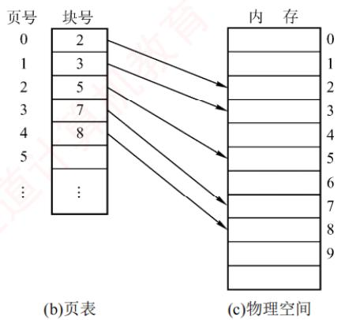

1. **页号是隐含的**：页表在内存中连续存放为一个数组，页号直接作为数组下标（索引），***<u>无需在页表项中专门开辟空间存储页号</u>***。
2. **页表项结构**：至少包含**物理页框号**以及有效/保护状态位。<mark>共享页虚页号可异但物理框号必同</mark>：多个进程共享同一物理页框时，各进程的虚拟页号 $p_1$、$p_2$ 可以不同，但指向同一个物理页框 $t_1=t_2$。 `[真题易错·2023-T29]`
3. **页表项大小的计算规则**：
   - 设物理内存容量为 $M$，页面大小为 $L$，则物理页框数为 $M/L$；
   - 页框号占用的二进制位数为 $\lceil \log_2(M/L) \rceil$ 位；
   - 页表项大小必须满足能放下该页框号，并通常***<u>向上对齐到整字节（如 2B、4B、8B）</u>***，以便于计算机按字节高效寻址和对齐。
4. **用户可用物理内存容量**：在只考虑页表或段表占用的题目简化模型中，可将总容量减去表所占内存；实际系统还须扣除内核、保留区等占用，不能无条件将上述差值当成可用容量。

### 四、基本地址变换机构

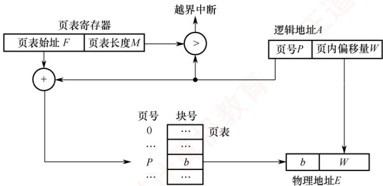

系统中设置***<u>一个专门的页表基址寄存器 (PTR / PTBR)</u>***，存放当前运行进程的**页表始址 $F$** 和**页表长度 $M$**（表项总数）。进程未运行时，这些信息保存在其 **PCB** 中；调度执行时由操作系统装入 PTR。

#### 地址变换的 4 个严格步骤：
1. **拆分地址**：根据逻辑地址 $A$ 计算出页号 $P$ 和页内偏移量 $W$。
2. **越界检查**：比较页号 $P$ 与页表长度 $M$。若 $P \ge M$，说明访问超出该进程范围，硬件立即触发**越界中断**。
3. **计算页表项物理地址并访存**：
   $$\text{页表项物理地址} = \text{页表始址 } F + P \times \text{页表项大小}$$
   读取该页表项，取出其中的物理页框号 $b$。
4. **拼接物理地址并访存**：
   $$\text{实际物理地址 } E = b \times L + W = (b \ll k) \mid W$$
   根据物理地址 $E$ 访问内存目标单元读取指令或数据。

> [!important] 访存次数（无 TLB、单级页表）
> 在无快表的基本单级分页系统中，CPU 访问一个逻辑地址需要***<u>2 次访存</u>***：
> ① 第一次访存：查内存中的页表，获取物理页框号；
> ② 第二次访存：根据计算出的物理地址，访问目标内存单元。

### 五、具有快表 (TLB) 的地址变换机构

为缓解多次访存带来的速度开销，现代 CPU 引入了**快表（TLB, Translation Lookaside Buffer / 旁路转换缓冲）**。

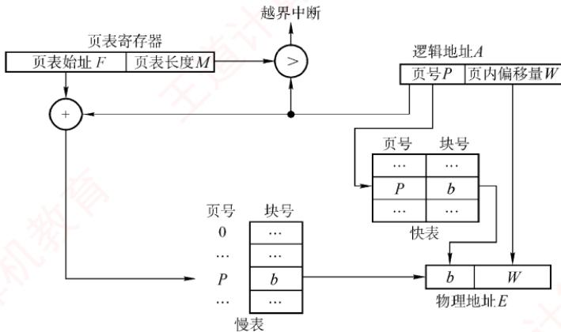

- **TLB 硬件本质**：集成在 CPU 芯片内部的高速***<u>相联存储器（Associative Memory）</u>***，支持按内容**并行查找**。
- **TLB 内容**：存放的是当前进程**页表项的子集（副本）**，包含 `[页号 P | 物理页框号 b | 访问/控制位]`。
- **地址变换过程**：
  1. CPU 给出逻辑地址，提取页号 $P$；
  2. **硬件送入 TLB 匹配**：
     - **TLB 命中 (Hit)**：直接输出物理页框号 $b$，与偏移量 $W$ 拼接为物理地址，直接访存（***<u>只需 1 次访存</u>***）。
     - **TLB 未命中 (Miss)**：硬件（或内核陷阱）访问主存 $N$ 级页表（共 $N$ 次访存），读取物理页框号 $b$，拼接物理地址访存（再加 1 次访存，***<u>共 $N+1$ 次访存</u>***），同时将该映射项**写回 TLB**（若 TLB 已满则按 FIFO/LRU 置换）。

#### 有效访问时间 (EAT) 参数化计算模型：
设页表级数为 $N$ 级（单级页表 $N=1$，二级页表 $N=2$），TLB 查找时间为 $t_{\text{tlb}}$，访问一次物理内存时间为 $t_{\text{mem}}$，TLB 命中率为 $\alpha$：
- **串行查找（Serial Lookup / 标准时序模型）**：
  - *硬件时序*：CPU 先发信号查 TLB（耗时 $t_{\text{tlb}}$）；
  - *TLB 命中时*：直接得到物理地址并访存取数据（耗时 $t_{\text{mem}}$），总时间 $= t_{\text{tlb}} + t_{\text{mem}}$（访存 1 次）；
  - *TLB 未命中时*：串行转入内存逐级查询 $N$ 级页表（耗时 $N \times t_{\text{mem}}$），最后访存取数据（耗时 $t_{\text{mem}}$），总时间 $= t_{\text{tlb}} + (N + 1)t_{\text{mem}}$（访存 $N+1$ 次）；
  - **总 EAT 公式**：
    $$\text{EAT} = \alpha \times (t_{\text{tlb}} + t_{\text{mem}}) + (1 - \alpha) \times [t_{\text{tlb}} + (N + 1)t_{\text{mem}}] = t_{\text{tlb}} + t_{\text{mem}} + (1 - \alpha) \times N \times t_{\text{mem}}$$
- **并行查找（Parallel Lookup / 硬件并发重叠模型）**：
  - *硬件时序*：CPU 在同一个时钟周期同时启动 TLB 查询与内存顶层页表访问。若 TLB 命中，立即丢弃内存查表结果直接取数据；若 TLB 未命中，由于内存页表已并发启动查找，无额外的 $t_{\text{tlb}}$ 惩罚延迟：
  $$\text{EAT} = \alpha \times (t_{\text{tlb}} + t_{\text{mem}}) + (1 - \alpha) \times (N + 1)t_{\text{mem}}$$

### 六、两级与多级页表

#### 1. 为什么需要多级页表？
以 32 位逻辑地址、4KB 页面为例：
- 逻辑页号占 20 位，页表包含 $2^{20} = 1\text{M}$ 个页表项；
- 若每个页表项占 4B，则单张页表需要 $4\text{MB}$ 连续物理内存（占 1024 个连续页框）； `[真题·2013-T46]`
- **问题所在**：① 进程即便很小，页表也必须全部驻留连续内存，违背离散分配初衷；② 绝大部分页表项可能永远用不到。

#### 2. 两级页表结构与划分原则

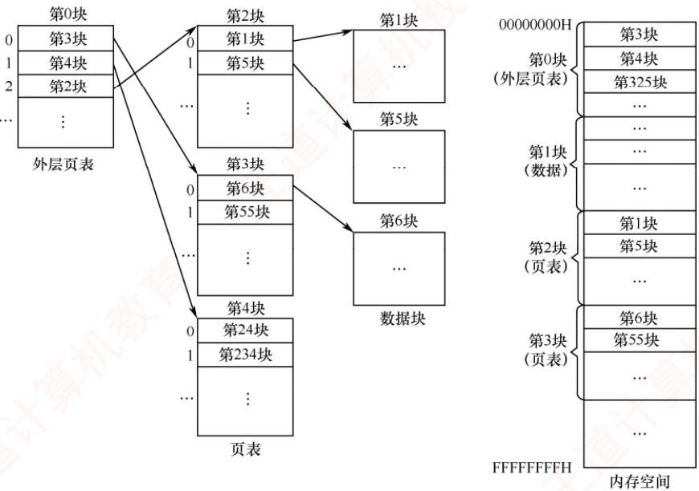

- **顶级页表（页目录 / Page Directory）**：在每张页表不得超过一个页面的教材模型中，顶级页表大小**至多一页**，是否恰好占满取决于题设。<mark>两地址页目录号相同则共用二级页表</mark>（如 64B 页/2B 项配 128 项页目录、或 $2^{20}$ 页二级共 1025 页表）。 `[真题·2010-T29 / 2015-T46 / 2018-T45 / 2019-T31]`
  - 页面大小 4KB，页目录项 4B $\to$ 顶级页表最多包含 $4\text{KB} / 4\text{B} = 1024 = 2^{10}$ 个页目录项，因此**顶级页目录号占 10 位**。
- **二级页表（Page Table）**：本例每张二级页表按一页、1024 个表项设计，因此**二级页表索引占 10 位**。
- **逻辑地址结构**：

| 31 $\cdots$ 22（10 位） | 21 $\cdots$ 12（10 位） | 11 $\cdots$ 0（12 位） |
| :---: | :---: | :---: |
| **一级页目录号 $P_1$** | **二级页号 $P_2$** | **页内偏移量 $W$** |

> [!abstract] 💡 解题核心思考模型：多级页表开销与设计的 4 大真题辨析
> 1. ***<u>多级页表不仅不会加快地址变换速度，反而减慢</u>***：在没有 TLB 时，$N$ 级页表完成一次访存需要 **$N+1$ 次访存**（$N$ 次查页表 $+ 1$ 次查数据）。 `[真题·2014-T32]`
> 2. ***<u>分级不会自动缩短每个页表项</u>***：满地址空间映射时，多级结构还有上级页表项开销；若地址空间稀疏，可不为未使用区域建立下级页表，实际分配的表项数和占用空间可以减少。 `[真题·2014-T32]`
> 3. ***<u>多级页表的核心价值在于“离散化存储与按需调入”</u>***：<mark>减少页表所占的连续内存空间</mark>，它使得各级子页表可以分散存放在不连续的页框中，且只需要将当前活跃的页表调入内存。 `[真题·2014-T32]`
> 4. ***<u>页表基址寄存器 (PTBR) 存放的是顶级页表（一级页目录）的起始物理地址</u>***。 `[真题·2021-T29]`
> 5. 将需要的页表保留在内存可避免查表时再从磁盘调入页表；这是减少缺页调入开销，不等于多级页表天然加快每次查表。
- `【⚡ 真题补丁｜2026-T28】` 三级分页 `25|9|9|9|12` 中，满映 36 位虚页空间含 $2^{27}$ 虚页，每页含 $2^9$ 项，故<mark>第三级页表共占2^18=256K页框</mark>。 `[真题·2026-T28]`

> [!example]- ⚡ 真题母题 2024-T45｜4MB 大页 `10|22` 与页目录自映射寻址
> - **题目要点**：32 位系统同时支持 4KB 页与 **4MB 大页**（页表项占 4B，页目录项标志 `PS=1` 时高 10 位直接作 4MB 页框号）。已知页目录表自身亦作为普通页映射到虚拟空间（自映射页目录基虚址为 `B8C0 0000H`，对应物理基址 `6540 0000H`）。① 访问 4MB 大页某虚址时，已知页目录号 `48H`，求该页目录项的虚拟地址、物理地址，及若大页映射物理地址 `BAB4 5678H` 时页目录项中的页框号；② 求页目录自身在进程页表中的“页目录自映射目录号”，以及其自映射表项的虚拟地址和其中记录的页框号。
> - **为什么这么想**：核心两招：**① 表项地址公式 = `基址 + (序号 << 2)`**（4B 项左移 2 位即乘 4）；**② 页目录自映射密码**：页目录表虚址 `B8C0 0000H` 右移 22 位得高 10 位即 `2E3H`，它恰好就是页目录表自己对应的**页目录项下标**。
> - **独立验算标准解答**：
>   1. 页目录项虚拟地址 = `B8C0 0000H + (48H << 2) = B8C0 0120H`；物理地址 = `6540 0000H + (48H << 2) = 6540 0120H`；4MB 大页低 22 位全为页内偏移，故页框号 = `BAB4 5678H >> 22 = 2EAH`。
>   2. 页目录本身所在高 10 位序号 = `B8C0 0000H >> 22 = 2E3H`；自映射表项虚拟地址 = `B8C0 0000H + (2E3H << 2) = B8C0 0B8CH`；该表项记录页目录本身物理页框号 = `6540 0000H >> 22 = 195H`。
> - **易错步骤与个人复盘提醒**：切忌忘记 `PS=1` 4MB 大页下“页内偏移占 22 位、物理页框号仅取高 10 位”（错向右移 12 位会丢分）；做十六进制左移 2 位最好先拆后两位二进制防进位出错。 `[真题易错·2024-T45]`

---

## 3.1.4 基本分段存储管理【🔥 必背｜停下来默背 1 遍】

### 这一节要解决什么问题

分页管理完全由系统从物理视角切分，割裂了程序的逻辑完整性，不利于程序员模块化编写、数据共享与分段保护。基本分段存储管理以**程序的逻辑段**为单位进行内存划分。

### 一、分段的概念与逻辑地址结构

- **分段原理**：作业的地址空间按照程序逻辑结构划分为若干个段（如主程序段 `main`、子程序段 `sub`、数据段 `data`、栈段 `stack` 等）。每个段都有段名，并在逻辑上从 0 开始独立编址。
- **段长不固定**：各段的长度由程序本身决定，各段大小各不相同。引入分段的主要目的是***<u>更好地满足用户需求，实现程序的模块化、动态链接、动态增长与按段保护</u>***（而非为了提高内存利用率）。
- **对程序员的可见性**：分段方式对***<u>低级语言程序员和编译器是可见的（不透明）</u>***，程序员可以根据逻辑划分段名，编译器对各个段独立生成相对地址。
- **逻辑地址结构**：由**段号 $S$** 和**段内偏移量 $W$** 组成。

| 段号 $S$（如 8 位，最多 $2^8 = 256$ 个段） | 段内偏移量 $W$（如 24 位，最大段长 $2^{24}\text{B} = 16\text{MB}$） |
| :---: | :---: |

> [!tip] 分段地址空间的二维性
> 分段系统的地址空间是***<u>二维</u>***的。程序员在引用指令或数据时，必须显式给出**段名（段号）**和**段内偏移量**（如汇编中的 `DS:[0100H]`）。<mark>最大段长由段内偏移位数决定</mark>（如 32 位系统段号占 8 位时最大段长为 $2^{24}\text{B}$）。 `[真题·2009-T27]`

### 二、段表与分段地址变换机构

系统为每个进程建立一张**段表**，记录每个段在物理内存中的分配情况：

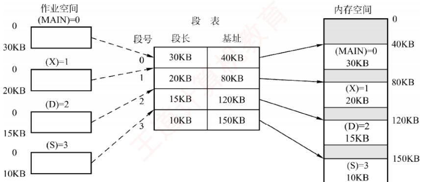

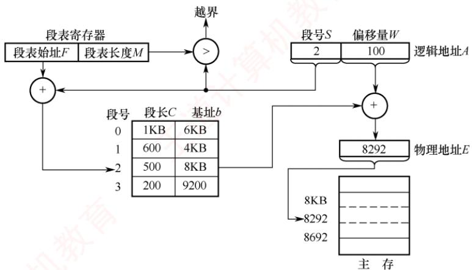

- **段表项结构**：`[段号(隐含) | 段长 C | 基址 b]`。
- **段表寄存器**：存放当前进程段表的**段表始址 $F$** 和**段表长度 $M$**。

#### 分段地址变换的严格步骤：
1. **提取逻辑地址**：分离出段号 $S$ 和段内偏移量 $W$。
2. **段号越界检查**：比较 $S$ 与段表长度 $M$。若 $S \ge M$，产生**段号越界中断**。
3. **查段表**：计算段表项地址 $\text{Addr} = F + S \times \text{段表项大小}$，读出该段的**段长 $C$** 和**基址 $b$**。
4. **段内偏移越界检查（双重检查）**：<mark>比较段内偏移W与该段段长C</mark>。若 $W \ge C$（如段长 300 访问偏移 400），立即产生**段内越界中断**。 `[真题·2016-T28]`
5. **计算物理地址**：$$\text{物理地址 } E = b + W$$
   - *注意*：段式物理地址必须通过**加法运算**计算得到，不可简单按位拼接。

> [!abstract] 💡 解题核心思考模型：分段系统双重越界检查机制
> - **分页系统只有 1 次越界检查**：检查页号 $P$ 是否超出页表长度 $M$。页内偏移 $W$ 由硬件位数固定限制，根本不可能超出页面大小，无需检查；
> - **分段系统有 2 次越界检查**：
>   - ① 检查段号 $S$ 是否 $\ge$ 段表长度 $M$（段号越界）；
>   - ② 检查段内偏移 $W$ 是否 $\ge$ ***<u>该段的实际段长 $C$</u>***（段内越界，因为每段长度各异）。
> - **取一次数据共需 2 次访存**（1次查段表 $+$ 1次取数据）。

### 三、分页与分段的深度对比

| 维度 | 基本分页存储管理 | 基本分段存储管理 |
|---|---|---|
| **基本单位性质** | **物理单位**（系统管理的需要，提高利用率） | **逻辑单位**（用户/程序逻辑完整性，满足编程保护） |
| **划分控制者** | **操作系统底层硬件实现**，对用户***<u>完全透明（不可见）</u>*** | 编译程序/程序员划分，对用户***<u>可见（不透明）</u>*** |
| **大小特征** | 大小**固定**且由系统决定（2 的幂） | 长度**不固定**，取决于源程序模块大小 |
| **地址空间维度** | ***<u>一维</u>***（单一线性地址） | ***<u>二维</u>***（段名/段号 $+$ 段内偏移） |
| **碎片类型** | ***<u>有内部碎片（页内），无外部碎片</u>*** | ***<u>无内部碎片，有外部碎片</u>*** |
| **共享与保护** | 不便（跨页代码共享需维护多个页表项） | ***<u>极方便</u>***（以逻辑段为单位，只需 1 个段表项） |

### 四、段的共享与保护

- **共享实现**：在分段系统中，由于程序模块以段为界限，实现共享只需在各进程的段表中***<u>设置一个段表项指向同一个物理段始址</u>***，<mark>物理内存中仅保存一份段内容</mark>。 `[真题·2019-T28]`
- **段号独立性**：该共享段对不同进程来说，其***<u>逻辑段号可以不同（在各自逻辑空间中的位置可不同），但其物理内存始址和内容完全相同</u>***。 `[真题易错·2019-T28]`
- **共享段表**：系统可用一个单独的全局共享段表来统一维护共享段的段号、段长、物理始址及共享计数 `count`，<mark>仅当所有进程不再使用计数归0才回收</mark>。 `[真题·2019-T28]`

---

## 3.1.5 段页式存储管理【📌 扫一眼｜确认“我还会”就过】

### 这一节要解决什么问题

结合分段（满足逻辑结构、方便共享保护）与分页（物理利用率高、消除外部碎片）的各自优点。

### 一、段页式系统原理与地址结构

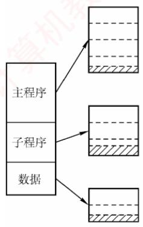
*(a) 程序的段页划分：先分逻辑段，再将每个段切分为固定大小的页*

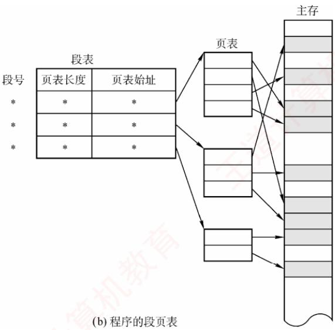
*(b) 段页式管理方式：段表指向页表，页表指向物理页框*

- **空间划分**：
  1. 用户程序按逻辑结构**分段**（用户视角可见，需指出段号所占位数）；
  2. 每个段内部再划分为若干大小相等的**页**（系统视角自动划分，用户无需指出页内偏移位数）；
  3. 物理内存被划分为与页大小相同的**页框**，以页框为单位进行离散分配。
- **逻辑地址结构**：

| 段号 $S$ | 段内页号 $P$ | 页内偏移量 $W$ |
| :---: | :---: | :---: |

> [!tip] 段页式的地址空间维度与碎片
> - 尽管地址结构分为三部分，但对用户而言看到的仍是段名和段内地址，页的划分对用户透明，因此**段页式系统的地址空间在概念上仍是二维的**。
> - 碎片类型：以页框为单位分配，因此***<u>无外部碎片，有内部碎片（页内碎片）</u>***。

### 二、段表、页表与地址变换

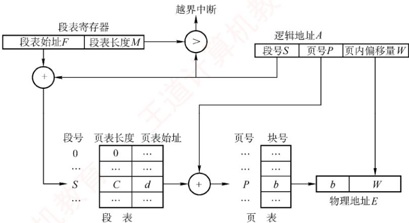

- **表结构数量关系**：在段页式系统中，***<u>每个进程只有 1 张段表，但每个段各自拥有 1 张页表（一个进程可以有多张页表）</u>***。
- **段表项内容**：`[段号(隐含) | 页表长度 | 页表始址]`。
- **页表项内容**：`[页号(隐含) | 物理页框号]`。

#### 地址变换的 3 次访存过程（无 TLB 时）：
1. **第一次访存**：根据段号 $S$ 查段表，取出对应段的**页表始址**与页表长度（需做段号越界和页号越界检查）；
2. **第二次访存**：根据页号 $P$ 查该段的页表，取出目标**物理页框号 $b$**；
3. **第三次访存**：将页框号 $b$ 与页内偏移 $W$ 拼接为物理地址，访问目标内存单元读取数据。
- *引入 TLB 后*：TLB 缓存 `[段号 S + 页号 P | 物理页框号 b]`，命中时仅需 **1 次访存**。

> [!abstract] 💡 解题核心思考模型：存储管理方式碎片类型判定通则
> - **内部碎片（内碎）**：分配单元大小固定时，未用满的分配单元可能产生内部碎片 $\implies$ ***<u>单一连续、固定分区、基本分页、段页式</u>***。
> - **外部碎片（外碎）**：作业大小不固定且需要**连续物理空间**时，反复分配回收可能产生外部碎片 $\implies$ ***<u>动态分区、基本分段</u>***。

---

## 3.1.6 习题与考点思维升华【📌 扫一眼｜确认“我还会”就过】

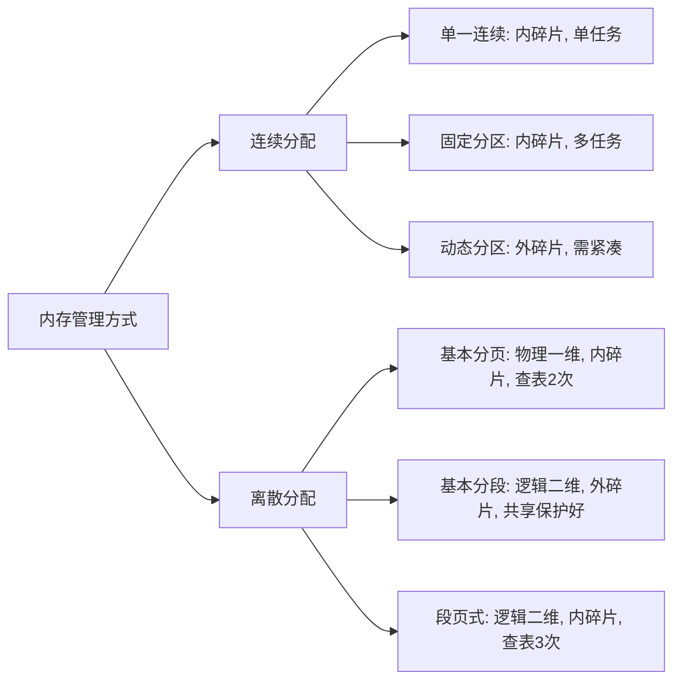

### 考点精炼图解

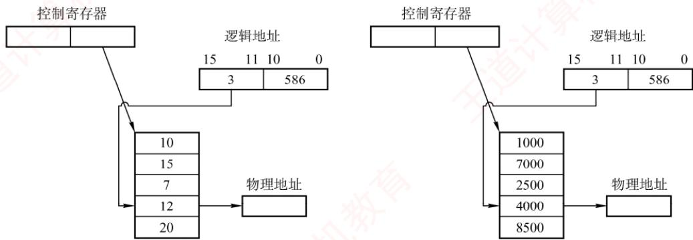
*(a) 页式变换（单次越界检查，页内偏移直接拼接）；(b) 段式变换（双重越界检查，段基址加偏移量）*

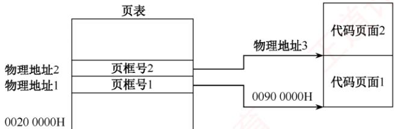
*两级页表结构：顶层页目录必须限制在单页以内，各级索引位严格对应单页容纳表项数*

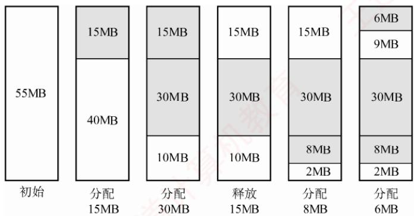
*动态分区 BF 算法分配轨迹：每次寻找最小可用空闲区，留下微小碎片*

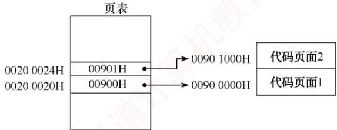
*页表项物理地址定位：$\text{页表始址} + \text{页号} \times \text{页表项大小}$*

---

# 3.2 虚拟内存管理【🔥⚡ 必背+避坑｜停下来默背 1 遍 + 精读 1 分钟】

## 3.2.1 虚拟内存的基本概念【🔥 必背｜停下来默背 1 遍】

### 这一节要解决什么问题

传统连续/基本离散存储管理具有两大固有特征：
1. **一次性**：作业必须全部装入内存后才能开始运行；
2. **驻留性**：作业装入内存后一直驻留，直到运行结束。

这导致大作业无法运行、多道程序并发度受限。虚拟内存技术旨在**打破物理内存容量限制**。

### 一、局部性原理 (Principle of Locality)

虚拟存储技术的理论基石是**局部性原理**（由 Denning 提出）：
1. **时间局部性**：程序中某条指令或数据一旦被执行/访问，不久之后极可能再次被执行/访问（原因：循环结构、频繁调用的子程序/变量）。
2. **空间局部性**：一旦访问了某个存储单元，不久之后其附近的存储单元也将被访问（原因：指令顺序执行、数组/向量等连续数据结构遍历）。

> [!abstract] 💡 解题核心思考模型：二维数组遍历缺页计算的条件化算法
> 
> #### 可直接套用下方捷径的前提条件：
> 1. 数组未预装入物理内存（初始时数据区页框全为空）；
> 2. 数组在虚拟内存中起始地址按页面边界对齐（从页首开始存放）；
> 3. 进程运行期间无外部代码/其他变量挤占数据页框；
> 4. 循环控制完整遍历整个二维数组；页面置换按题干给出的规则执行。
> 
> 若数组未按页边界对齐、行跨页、每页不能容纳整数行、已有页面预装入，或页框数足以保留部分工作集，下面的列优先捷径不成立，必须按“访问地址 -> 所属虚拟页 -> 驻留集/置换算法”逐次模拟。
> 
> #### 机械化 4 步推导法：
> 
> - **步骤 1：计算单页容量与单行跨度**
>   - 设元素大小为 $S_e$ 字节，页面大小为 $L$ 字节 $\implies$ **单页能容纳的元素个数** $E_{\text{page}} = L / S_e$。
>   - 设数组规模为 $M \times N$（$M$ 行 $N$ 列），**一行元素占用的内存大小** $S_{\text{row}} = N \times S_e$。
>   - **单行与单页的几何关系**：只有在数组页对齐且 $L$ 能整除 $S_{\text{row}}$ 或 $S_{\text{row}}$ 能整除 $L$ 时，才能把“每页几行/每行几页”当作整数直接使用；否则要按页边界逐项计算。
> 
> - **步骤 2：行优先遍历推导 (`for i=0..M-1 { for j=0..N-1 { A[i][j] } }`)**
>   - 内存地址连续递增访问，每遍历完 $E_{\text{page}}$ 个元素才跨越一次页面边界，<mark>按行访问更具空间局部性可减少缺页</mark>（如 2020 真题 4KB 页面正好放 `a[i]` 一行 1024 元素，`a[1][2]` 为 `10801008H`、`042H,001H`）。 `[真题·2020-T46]`
>   - 在“数组页对齐、初始数据页均不在内存、连续访问期间不被其他访问干扰”的前提下，行优先按地址递增，每个被触及的页面只首次缺页一次：
>     $$\text{缺页数}=\left\lfloor\frac{\delta+MNS_e-1}{L}\right\rfloor+1$$
>     其中 $\delta$ 是数组首地址在页面内的偏移；页对齐时 $\delta=0$，才可化为 $\left\lceil MNS_e/L\right\rceil$。不要把它继续等同于 $M/R_{\text{page}}$，除非整除条件已确认。
> 
> - **步骤 3：列优先遍历推导 (`for j=0..N-1 { for i=0..M-1 { A[i][j] } }`)**
>   - 每次内层循环 $i$ 步进 1，内存地址跳跃 $S_{\text{row}}$ 字节（跨越一整行）。
>   - **列优先不能默认套公式**：列优先的步长为 $S_{\text{row}}$，但是否每次跳到新页、同一列结束后页面是否仍驻留，取决于页对齐、行跨页、页框数、置换算法及指针状态。
>   - **教材型特例**：数组页对齐、每页恰好容纳 $R_{\text{page}}$ 个完整行，且数据页框数少于该列会访问的不同页面数；此时一列产生 $\lceil M/R_{\text{page}}\rceil$ 次缺页，若每列开始前上一列页面均已被换出，则总缺页数为 $N\lceil M/R_{\text{page}}\rceil$。当 $R_{\text{page}}=1$ 时退化为每次元素访问缺页，即 $MN$ 次。
>   - 若页框数能保留部分列访问页面，或页面跨列仍在内存中，必须逐列维护驻留集，不能使用上述乘法。
> 
> - **步骤 4：严格区分“缺页次数”与“页面置换次数”**
>   - 初始时分配给进程的 $F$ 个页框为空，**前 $F$ 次缺页直接装入空闲页框，不发生置换**；
>   - 只有在“初始分配的 $F$ 个页框全空，且每次后续缺页都必须换入一个新页”的条件下，才有：
>     $$\text{页面置换次数} = \text{总缺页次数} - F$$
>     若初始已有驻留页、存在其他空闲页框，或题目统计的是换出/写回次数，应按实际事件逐次计数。
> 
> #### 教材原题参数原汁原味复现验证：
> 
> - **【教材第 12 题原题】**：`int a[128][128];`（int 占 4B，每行 $128 \times 4\text{B} = 512\text{B}$），页框大小 512B（$R_{\text{page}} = 512/512 = 1$ 行/页），数据区仅分配 $F = 1$ 个页框。列优先遍历 `a[j][i]=0`：
>   - 一行刚好占 1 页，内层循环每访问一个元素跳一行（跳一页）；
>   - 只有 1 个页框导致每次访问都将上一页挤出，**每一次访问均发生缺页**；
>   - $\implies$ 总缺页次数 $= 128 \times 128 = 16384$ 次。
> 
> - **【教材第 13 题原题】**：`int X[64][64];`（1 整数占 1 字，每行 64 字），进程分配 4 个页框（0 号占代码，数据区分配 $F = 3$ 个页框），页框大小 128 个字（$R_{\text{page}} = 128 / 64 = 2$ 行/页，整个数组共 $64 / 2 = 32$ 页）。列优先遍历 `X[i][j]=0`：
>   - 访问第 0 列：访问 `X[0][j]` 调入包含第 0、1 行的第 0 页（第 1 次缺页）；访问 `X[1][j]` 在同页（命中）；访问 `X[2][j]` 调入第 2、3 行所在页（第 2 次缺页）... 遍历一列发生 $64 / 2 = 32$ 次缺页；
>   - 由于数据区仅 $F = 3$ 个页框（远小于 32 页），遍历完第 0 列后第 0 页面早已被置换出内存；
>   - 遍历第 1 列时全部 32 页重新缺页调入，共 64 列；
>   - $\implies$ 总缺页次数 $= 32 \times 64 = 2048$ 次。

### 二、虚拟存储器的定义与三大特征

- **定义**：基于局部性原理，程序运行时仅将当前急需的部分页面/段装入内存，其余留在外存；在执行过程中若发现所需内容不在内存，由操作系统动态将其调入（**请求调页**）；同时将内存中暂不使用的页面/段换出到外存（**页面置换**）。在逻辑上给用户呈现一个远大于实际物理容量的存储器。
- **三大特征（408 标准口径）**：

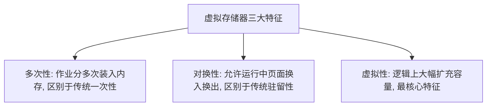

> [!important] 虚拟存储器特征辨析与实现基础
> - **三大特征**：***<u>多次性、对换性、虚拟性</u>***（408 考纲与教材标准定义）。
> - **离散性**：是虚拟存储器实现的***<u>物理基础与实现前提</u>***，而不是虚拟存储器独有的定义特征（因为基本分页、基本分段也是离散分配，但它们属于非虚拟存储系统）。遇到“以下哪项不属于虚拟存储器特征”考题时，选“离散性”或传统存储的“一次性/驻留性”。

> [!abstract] 💡 解题核心思考模型：虚拟内存容量界限与实现前提
> 1. ***<u>虚拟内存必须建立在离散分配（页式/段式/段页式）的基础上</u>***，无法仅靠常规连续分配实现。 `[真题·2012-T25]`
> 2. ***<u>虚拟地址空间的最大容量（理论上限）仅由 CPU 寻址范围（虚拟地址位数）决定</u>***，与物理内存和外存硬盘大小无关（<mark>虚存容量不受物理内存+外存之和限制</mark>，如 32 位按字节编址理论上限 $4\text{GB}$；虚物理地址长度也可以不相等）。 `[真题易错·2012-T25 / 2023-T31 / 2026-T24]`
> 3. 在只计内存与对换区承载页面、且题设不考虑其他限制的简化模型中，容量上界可按 $\min(\text{虚拟地址空间上限},\text{物理内存容量}+\text{外存对换区容量})$ 估算。实际系统还受可用后备存储、保留地址和策略等限制，不应将该式当成普遍精确容量。

---

## 3.2.2 请求分页管理方式【🔥⚡ 必背+避坑｜停下来默背 1 遍 + 精读 1 分钟】

### 这一节要解决什么问题

在基本分页系统的基础上，增加**页表状态位、缺页中断机构和地址变换换入换出机制**，实现请求调页与页面置换。

### 一、请求页表项结构

为支持虚拟存储，请求页表项增加了多个控制标志位：

| 字段 | 含义与作用 | 状态机变化 |
|---|---|---|
| **物理页框号** | 该逻辑页所映射的物理内存块号 | 调入内存后填入 |
| **状态位 $P$ (有效位/存在位)** | 该页是否已在物理内存中（1-在内存，0-不在内存；仍需区分合法页面与非法地址） | 发生缺页时触发中断，调入后置 1 |
| **访问字段 $A$ (引用位)** | 记录该页近期的访问次数或多长时间未被访问 | 供置换算法（如 CLOCK/LRU）决策参考 |
| **修改位 $M$ (脏位 Dirty Bit)** | 该页调入内存后**是否被修改过**（1-修改过，0-未修改） | 换出时若为 0 直接丢弃，为 1 则必须写回外存 |
| **外存地址** | 该页在磁盘/对换区上的存放物理位置 | 缺页调入时从此地址读取 |

### 二、缺页中断机构与特征

当 CPU 访问的合法页面状态位 $P = 0$ 时，MMU 硬件触发**缺页中断**；非法地址或权限不符应进入相应异常处理，并不一定能通过调页解决。

> [!abstract] 💡 解题核心思考模型：缺页中断与一般外部中断的 4 大本质区别
> 1. ***<u>性质归属（内部异常）</u>***：缺页中断是在 CPU 执行指令期间检测到的**内部异常（Fault / 故障）**，<mark>缺页及越界异常由OS处理</mark>，而非外部 I/O 引脚触发的硬件中断。 `[真题·2026-T24]`
> 2. ***<u>发生时机（指令执行中途）</u>***：一般中断在当前指令执行结束后的中断周期响应；缺页中断**在指令执行过程中立即产生并响应**。<mark>产生缺页已通过越界检查</mark>，不进行越界出错处理。 `[真题·2013-T30]`
> 3. ***<u>多次发生性</u>***：一条机器指令在执行期间可能引发**多次缺页中断**（例如一条双操作数指令，指令本身跨页、源操作数跨页、目的操作数跨页，最多可产生多次缺页）。
> 4. ***<u>返回重新执行原指令</u>***：缺页异常处理完成后，CPU 返回到***<u>发生缺页的那条原指令重新执行</u>***，而不是执行下一条指令。

### 三、请求分页的完整地址变换流程

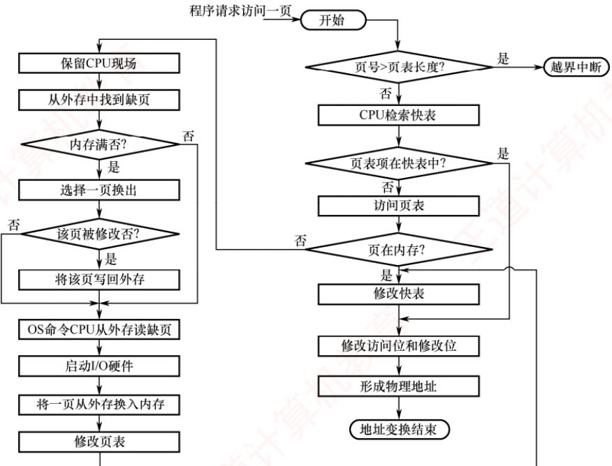

#### 请求分页地址变换 7 步走：
1. **查 TLB**：给出逻辑地址，提取页号 $P$，送入 TLB 并行查找。
   - 若 *TLB 命中*：直接获取页框号 $b$，修改 TLB 访问位/修改位，生成物理地址访存（结束）。
   - 若 *TLB 未命中*：转第 2 步。
2. **查主存页表**：根据页表始址与页号 $P$ 读取页表项。
3. **判断是否在内存（状态位 $P$）**：
   - 若 $P = 1$（在内存）：读取页框号 $b$，更新访问位（写操作则置修改位 $M=1$），将该项写入 TLB，生成物理地址访存。
   - 若 $P = 0$（不在内存）：转第 4 步。此时表项中遗留的页框号不能作为有效映射，必须先完成缺页处理，再用更新后的页框号。
4. **触发缺页异常**：CPU 硬件保存现场，陷入内核执行缺页中断处理程序。 `[真题·2026-T24]`
5. **判断物理内存是否有空闲页框**：
   - *有空闲页框*：***<u>直接分配一个空闲页框，无需淘汰任何页面</u>***（故<mark>缺页不一定淘汰内存中页面</mark>）； `[真题·2011-T28 / 2013-T30 / 2022-T29]`
   - *无空闲页框*：执行**页面置换算法**选出一页换出。检查该换出页的修改位 $M$：若 $M = 1$，启动磁盘 I/O 写回其后备存储；若 $M = 0$，**直接覆盖/丢弃**。 `[真题·2011-T28 / 2013-T30]`
6. **调入页面与更新页表**：调用设备驱动程序做磁盘 I/O 将所缺页面调入页框 $b$；<mark>修改页表建立页号与页框号及存在位</mark>，并将新映射写入 TLB。 `[真题·2011-T28 / 2022-T29]`
7. **重新执行原指令**：中断返回，重新执行引起缺页的那条指令。

---

## 3.2.3 页框分配与调入策略【⚡ 避坑｜最值钱，必须精读 1 分钟】

### 这一节要解决什么问题

操作系统如何确定分配给每个进程的物理块数量，何时调入页面以及从外存何处读取。

### 一、最小页框数与驻留集

- **最小页框数**：保证进程正常运行所需的最低物理块数量。***<u>取决于机器的指令体系结构（ISA）及寻址方式</u>***（<mark>单条指令可能访问的最大页面数</mark>），与代码段长度、虚拟地址空间大小或物理内存容量无关。 `[真题·2025-T27]`
- **驻留集**：请求分页系统中，当前驻留在物理内存中的该进程页面集合；驻留集大小通常用占用的页框数衡量。

### 二、内存分配与置换策略的三种组合

| 策略组合 | 驻留集大小 | 缺页时换出范围 | 优缺点与应用 |
|---|---|---|---|
| **固定分配局部置换** | 运行期间**固定不变** | 只能从**本进程**已分配页框中淘汰一页 | 实现简单，但很难预先确定最优页框数，易造成浪费或频繁缺页 |
| **可变分配全局置换** | 运行期间**动态变化** | 可从**系统任意进程/空闲队列**中夺取页框 | 最简单灵活；但容易使某些活跃进程驻留集不断膨胀，抢占其他进程 |
| **可变分配局部置换** | 运行期间**动态变化** | 只能从**本进程**内部淘汰，由内核根据缺页率动态微调驻留集 | ***<u>在进程隔离性与动态自适应之间取得良好平衡</u>***；缺页率高时追加页框，缺页率过低时回收页框，但内核跟踪开销相对较高 |

> [!important] 为什么不存在“固定分配全局置换”？
> 全局置换意味着进程可以从全局空闲队列或其他进程中抢占页框，<mark>必然改变页框总数与固定分配冲突</mark>，因此“固定分配 + 全局置换”无法组合使用。 `[真题·2015-T30]`

### 三、固定分配时的页框分配算法

- **平均分配**：将可分配页框平均分给各进程。
- **按比例分配**：按各进程的逻辑地址空间大小比例分配。
- **优先权分配**：重要或紧急的进程分得更多页框；可将一部分按比例分配，另一部分依据优先权分配。上述分配仍需满足各进程正常运行的最小页框数。

### 四、页面调入时机与来源

1. **调入时机**：
   - **预调页策略**：根据局部性原理，在进程启动时预先一次性装入若干相邻页（主要用于进程初次启动时，预测成功率较低 $\approx 50\%$）。
   - **请求调页策略**：运行中发生缺页时按需调入单页（现代 OS 虚存的主流机制，I/O 开销较大）。
2. **从何处调入页面**：
   - **对换区充足**：全部从***<u>对换区（连续分配，速度快）</u>***调入；进程运行前将文件从文件区复制到对换区。
   - **对换区不足**：未修改的页面从***<u>文件区（离散分配）</u>***读取且换出时不写回；修改过的页面换出到***<u>对换区</u>***，后续从对换区读取。
   - **教材所述 UNIX 方式**：未运行过的页面从**文件区**调入；已运行且已换出的页面从**对换区**调入。若共享页面已经在内存，其他进程可直接复用，无需重复调入。

> [!tip] 页面换进换出效率：选项判断
> 页面换进换出效率主要受**页面置换算法、是否需要把脏页写回、磁盘访问/传输速度与读写频率**影响。CPU 与内存之间的正常访存速度不属于页面在磁盘与内存之间换进换出的直接效率因素；不要把“CPU 主频高”误判为调页 I/O 更快。

---

## 3.2.4 页面置换算法【🔥⚡ 必背+避坑｜停下来默背 1 遍 + 精读 1 分钟】

### 这一节要解决什么问题

当物理内存满且发生缺页时，决定淘汰哪一个物理页框以腾出空间。

### 常用置换算法深度对比表

| 算法 | 决策依据 | 核心思想 | 硬件开销 | Belady 异常 | 实用性与性能 |
|---|---|---|---|---|---|
| **OPT (最佳置换)** | 向后看（未来） | 淘汰**未来最长时间内不再被访问**的页 | 无法预知未来 | **理论必无** `[真题·2014-T30]` | 理想基准，无法实现 |
| **FIFO (先进先出)** | 向前看（驻留时间） | 淘汰**最早进入内存**的页 `[真题·2010-T46]` | 只需维护入队队列 | ***<u>可能出现 Belady 异常</u>***（物理块增加，缺页率反而上升） `[真题·2014-T30]` | 实现最简单，性能较差 |
| **LRU (最近最久未使用)** | 向前看（访问历史） | 淘汰**过去最长时间未被访问**的页 | 需寄存器/硬件活动栈 | ***<u>一定无 Belady 异常（严格堆栈类算法）</u>*** `[真题·2014-T30]` | 性能极接近 OPT，开销大 |
| **简单 CLOCK (NRU)** | 循环检查访问位 $u$ | 访问位为 1 给机会清 0，为 0 淘汰 | 仅需 1 个访问位 | **按具体规则分析** | 折中首选，应用极广 |
| **改进型 CLOCK** | 综合考量 $(u, m)$ | 优先淘汰未访问未修改 $(0,0)$，减少 I/O | 访问位 $+$ 修改位 | **按具体规则分析** | 最多 4 轮扫描，倾向降低写回开销 |

> [!important] 408 考研关于 Belady 异常的精准结论
> 教材比较的 OPT、FIFO、LRU 中，<mark>FIFO可能发生Belady异常</mark>；OPT 与 LRU 属于堆栈型算法，不发生该异常。不要将这一组算法中的比较推广成“任何置换算法只有 FIFO 会发生异常”；CLOCK 及其变体应根据题目给出的规则分析。 `[真题·2014-T30]`

### 一、CLOCK 算法模拟流程

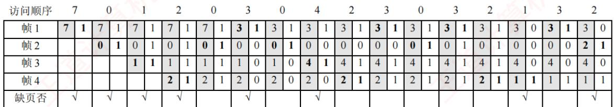

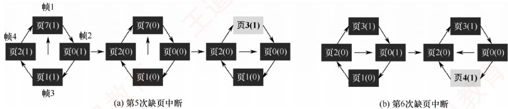

#### 1. 简单 CLOCK 算法执行步骤：
- 为每帧设置 1 位**访问位 $u$**。页面被访问时硬件置 $u = 1$。
- 所有页框连成循环队列，置换指针指向下一扫描位置。
- **缺页扫描**：若当前帧 $u = 0$，选择淘汰并调入新页，指针后移；若 $u = 1$，将其**置 $0$ 并暂不淘汰**，指针指向下一帧继续扫描。

#### 2. 改进型 CLOCK 算法的 4 轮扫描机制：
页面状态由 `(访问位 u, 修改位 m)` 构成，优先级别：$(0, 0) > (0, 1) > (1, 0) > (1, 1)$。
- **第 1 轮扫描**：<mark>先找(A=0,M=0)且不改任何位</mark>，命中则替换。 `[真题·2016-T26]`
- **第 2 轮扫描**：若第 1 轮失败，<mark>再找(A=0,M=1)并顺手置A=0</mark>，命中则替换（该页需写回磁盘）。 `[真题·2016-T26 / 2021-T28]`
- **第 3 轮扫描**：若第 2 轮失败，再次寻找 $(0, 0)$。过程中**不修改标志位**。命中则替换。 `[真题·2016-T26]`
- **第 4 轮扫描**：若第 3 轮失败，再次寻找 $(0, 1)$。此时必能找到满足条件的帧（如 2021 真题页 2 存在位 0 为无效旧表项 `20H`，淘汰页 3 页框 `60H` 得 `60A01H`）。 `[真题易错·2016-T26 / 2021-T28]`

> [!abstract] 💡 解题核心思考模型：LRU 逆向倒数秒杀法
> 当题目给出分配的页框数 $N$ 及长串页面访问序列，要求判断在某一时刻使用 LRU 会淘汰哪个页面时：
> - **秒杀动作**：<mark>从当前访问点往回数N个不同页号</mark>，依次收集； `[真题·2015-T27 / 2019-T29 / 2025-T26]`
> - **停止条件**：当收集满 $N$ 个不同的页号时，**第 $N$ 个不同的页号就是过去最久未使用的页面（即被淘汰的页）**（如 2015 真题前数 `{5,4,8,2}` 淘汰最远页 2）。 `[真题易错·2015-T27]`
> - **先核对初始状态和统计对象**：<mark>已预装页不算首次缺页且前F次装入不算置换</mark>（如 2025 真题 0,1,2 已在内存则后串仅 6 次缺页；2019 真题 4 框 12 页不计初始装入共置换 5 次）。 `[真题易错·2019-T29 / 2025-T26]`

---

## 3.2.5 抖动与工作集模型【🔥⚡ 必背+避坑｜停下来默背 1 遍 + 精读 1 分钟】

### 这一节要解决什么问题

当并发运行的进程过多，分配给进程的物理块无法满足其基本运行需求时，系统将陷入“刚换出就缺页，刚换入又换出”的恶性循环。

### 一、抖动（颠簸 / Thrashing）

- **定义**：页面在内存与外存之间频繁地调入调出，导致处理机把绝大部分时间都耗费在等待磁盘 I/O 上，**CPU 利用率急剧下降趋近于零**的现象。
- **诊断指标**：***<u>磁盘交换区利用率极高（如达 97%~99%），而 CPU 利用率极低（如仅 10%~20%）</u>*** $\implies$ 说明系统发生抖动，物理内存严重短缺。
- **消除抖动措施**：
  - ***<u>撤销/挂起部分进程（降低多道程序度）</u>***（<mark>撤销部分进程降低并发度消抖动</mark>）； `[真题·2011-T29]`
  - ***<u>增大物理内存容量</u>***；
  - *注意*：加快 CPU 运算速度、**增大磁盘交换区容量、提高用户优先级均无法消除抖动**。 `[真题·2011-T29]`

### 二、工作集模型 (Working Set Model)

- **工作集 $W(t, \Delta)$**：在某时刻 $t$，进程在过去时间窗口大小 $\Delta$（工作集窗口）内实际访问过的***<u>不同页面集合</u>***（如窗口 6 为 `6,0,3,2,3,2` 去重后<mark>工作集为{6,0,3,2}</mark>）。 `[真题·2016-T29]`
- **工作集大小 $|W(t, \Delta)|$**：该集合中不同页面的数量。

> [!important] 预防抖动的黄金准则
> 操作系统分配给进程的驻留集大小必须 **$\ge$ 该进程当前的工作集大小**。
> 若 $\sum |W_i| > \text{可用物理页框总数}$，系统必须**挂起/暂停部分进程**（腾出页框分配给其余进程），以避免系统整体发生抖动。

---

## 3.2.6 页框回收与页面缓冲算法 (PBA)【⚡ 避坑｜最值钱，必须精读 1 分钟】

**页框回收**：内存不足时，系统从可回收页面中收回页框以满足新的分配。用户进程的代码页、数据页及文件映射页等可能参与回收；内核使用的部分页框不可随意回收。干净页面可在保留后备内容的前提下回收；脏页面需先写回或按页面缓冲策略安排写回。页框回收与“从哪些页中选出牺牲页”的页面置换算法有关，但不是同一概念。

- **页面缓冲算法 (PBA, Page Buffering Algorithm)**：
  - 系统维护两条链表：**空闲页框链表** 与 **已修改页框链表**。
  - 当需要换出页面时，并不立即启动慢速磁盘 I/O：
    - 未修改的页挂入*空闲页框链表*尾部；
    - 已修改的页挂入*已修改页框链表*尾部。
  - **快速找回**：若该页在被覆盖前再次被访问，只需将其从链表移回驻留集，<mark>从空闲链表找回重新映射页框</mark>，即***<u>无需任何磁盘 I/O（零 I/O 调回）</u>***（如 2012 真题第 11 次扫描周期回收的页号 1 在空闲页框链中随后重映射回页框 32）。 `[真题·2012-T45]`
  - **成批写回**：当已修改页框链表达到一定阈值后，集中一次性写入磁盘，极大减少磁盘寻道与通信开销。

> [!important] 408 核心选项判据：页缓冲队列的作用
> ***<u>页缓冲队列的长度主要影响页面回收与调页的 I/O 效率（减少直接磁盘 I/O 阻塞），但不直接决定进程本身的缺页率</u>***（缺页率由工作集大小、驻留集大小以及页面置换算法本身决定）。 `[真题·2022-T30]`

---

## 3.2.7 内存映射文件 (mmap)【🔥 必背｜停下来默背 1 遍】

### 这一节要解决什么问题

传统文件 I/O 需要频繁调用 `read()` / `write()` 系统调用，并经历“磁盘 $\to$ 内核缓冲区 $\to$ 用户空间”的多重数据拷贝。内存映射文件将文件直接映射进进程虚拟地址空间。

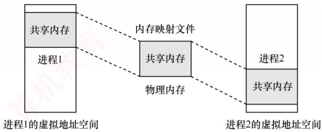

### 一、mmap 原理与优势
1. **统一访问模型**：<mark>mmap映射至进程虚拟地址空间</mark>（并非映射到内核公共物理空间）；页表等虚拟内存和文件系统机制协作完成到页框与外存位置的定位。文件被视为一块连续的虚拟内存区域，程序员可以用**指针直接读写文件内容**，由请求分页机制***<u>按需加载（非一次性加载整个文件）</u>***和脏页写回。 `[真题·2025-T30]`
2. **多进程共享与可见性语义**：
   - 使用 ***<u>`MAP_SHARED`（共享映射）</u>*** 标志时，多个进程将同一个磁盘文件映射到各自虚拟地址空间（即使虚拟地址 $W_1 \ne W_2$ 也可），操作系统通过页表让它们的虚拟页指向***<u>相同的物理页框</u>***（即<mark>不同虚地址映射相同物理地址</mark>），且写操作修改对同享进程可见； `[真题·2025-T30 / 2026-T30]`
   - *可见性说明*：写操作通过共享物理页传递，其在多进程间的可见时机与一致性由系统的页面映射、CPU 缓存一致性协议以及显式同步机制（如 `msync()`）共同保障；
   - 若使用 ***<u>`MAP_PRIVATE`（私有写时复制映射）</u>***，则写入时触发 COW，修改对其他进程不可见且不写回底层文件。

---

## 3.2.8 虚拟存储器性能分析与综合地址翻译【🔥⚡ 必背+避坑｜停下来默背 1 遍 + 精读 1 分钟】

### 一、影响虚存性能与 EAT 的核心因素与计算模型

1. **影响平均访存时间 (EAT) 的 5 大因素**：
   - TLB 命中率 $\alpha$；
   - 页表级数 $N$；
   - <mark>缺页率与缺页CPU处理时间和磁盘I/O和内存访问时间</mark>（即缺页率 $f$、缺页磁盘读写、内存访存时间 $t_{\text{mem}}$ 与缺页处理 CPU 时间均影响有效访存时间）。 `[真题·2009-T46 / 2010-T46 / 2020-T28]`
2. **综合 EAT 完整数学模型与 $t_{\text{fault}}$ 口径辨析**：
   - **口径 1（全包模型 / 408 统考主流口径）**：
     题干给出的“缺页服务时间 / 缺页处理时间 $t_{\text{fault}}$”**已经包含**中断处理、磁盘 I/O 调页、更新页表及最后**重新执行原指令访存**的全过程：
     $$\text{EAT} = (1 - f) \times \text{EAT}_{\text{mem}} + f \times t_{\text{fault}}$$
     其中无缺页时的内存访问时间 $\text{EAT}_{\text{mem}} = t_{\text{tlb}} + t_{\text{mem}} + (1 - \alpha) \times N \times t_{\text{mem}}$。
   - **口径 2（分离模型 / 纯 I/O 中断耗时）**：
     若题干的 $t_{\text{fault}}$ 仅指“缺页处理耗时”，调入后重新访问数据需另计时间：
     $$\text{EAT} = (1 - f) \times \text{EAT}_{\text{mem}} + f \times (t_{\text{fault}} + \text{EAT}_{\text{mem}})$$
   - *做题原则*：根据题设判断缺页处理时间是否包含重访时间；教材第 3 章综合题有“处理缺页中断后还需一次访存”的口径，不能仅凭“处理时间”名称就默认已包含重访。
3. **提高 TLB 命中率的两种途径**：
   - ***<u>增大 TLB 容量</u>***（缓存更多地址映射条目）；
   - ***<u>增大页面大小</u>***（用较少的页面覆盖更大的地址空间，减少页表项总数）。
   - *注意*：采用多级页表对 TLB 命中率**没有影响**。
4. **有效降低平均访存/加快虚实地址转换的途径**：
   - <mark>采用TLB、工作集、页表常驻内存和页缓冲队列</mark>可有效加速虚实转换与降低平均访存时间（增大 swap 交换区对虚实转换无加速；增加多级页表级数会增加查表耗时）。 `[真题·2014-T28 / 2026-T29]`
   - `【⚡ 真题补丁｜2014-T45 / 2016-T45 / 2021-T44 / 2023-T44】` 计组-OS跨科虚存联动规律：<mark>虚址高位先查TLB得实页框后拼偏移再进Cache索引</mark>，页号缺页时 Cache 必然缺失。 `[真题·2014-T45 / 2016-T45 / 2021-T44 / 2023-T44]`

### 二、TLB、Page Table 与 Cache 三级联动地址翻译示例

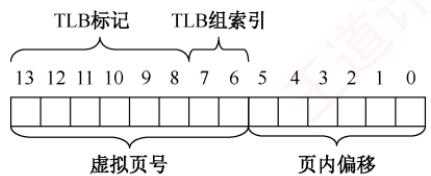
*(a) 虚拟地址结构：[TLB标记 | 组索引] 与 [虚拟页号 | 页内偏移]*

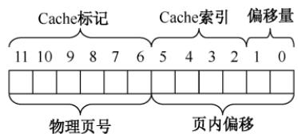
*(b) 物理地址结构：[Cache标记 | Cache组索引 | 块内偏移]*

#### 完整访存状态判断矩阵：

| TLB 状态 | 页表状态 (Page Table) | Cache 状态 | 说明 |
| :---: | :---: | :---: |---|
| **命中** | **必定命中** | 可能命中 / 可能未命中 | TLB 是页表的子集，TLB 命中则页面必在内存中 |
| **未命中** | **可能命中** | 可能命中 / 可能未命中 | TLB Miss 后查页表，若页表有效则可继续查 Cache |
| **未命中** | **未命中 (缺页)** | **必定未命中** | 页面根本不在物理内存中，Cache 中不可能有其数据 |

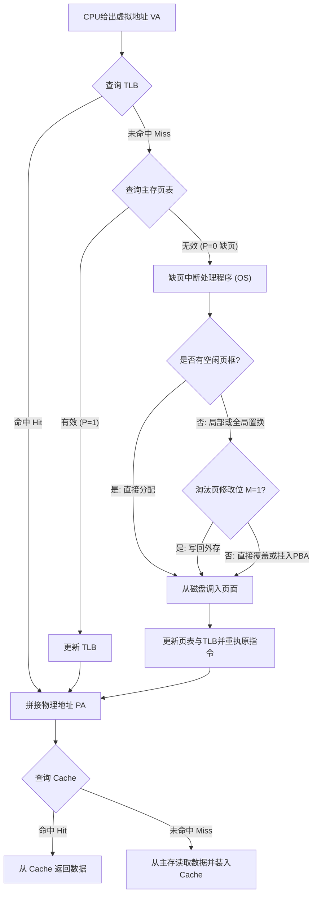

> [!example]- ⚡ 真题母题 2025-T46｜C 程序虚存空间分布与 I/O 全链路协同
> - **题目要点**：给定包含全局变量、常量、`main()` 函数、局部变量 `length` 及动态分配指针 `ptr = malloc(...)` 并调用 `scanf` / `printf` 的 C 程序。① 该进程的 PCB 与内核栈位于虚拟地址空间的内核区还是用户区？② 执行 `scanf` 等待键盘输入时处于什么状态？由哪个软件层级驱动完成读设备？③ 代码段、数据段、用户栈、堆分别存放上述哪些成分？
> - **为什么这么想**：将第 1/2/3/5 章打通在同一进程虚拟空间地图上：**内核态/内核地址空间**存放 PCB、页表与内核栈；**用户区**自低到高依次存放代码段（`.text` 机器指令与只读字面串 `.rodata`）、数据段（全局变量与静态变量 `.data`/`.bss`）、堆（`malloc` 申请区）以及自顶向下增长的用户栈（`length` 等局部变量）。
> - **独立验算标准解答**：
>   1. 进程控制块 PCB 与内核栈位于**内核区（系统内核虚拟地址空间）**，用户指令不可直接读写。
>   2. 调用 `scanf` 发起系统调用读键盘等待期间，进程由运行态进入**阻塞态**；底层实际与控制器交互读取键盘数据由内核中的**设备驱动程序与中断服务例程**完成。
>   3. `main` 函数指令位于**代码段**；全局变量 `ptr` 本身位于**数据段**，`ptr` 经 `malloc` 指向的动态内存位于**堆**，字符常量串位于只读数据段（通常归文本/代码段区域）；局部变量 `length` 位于**用户栈**。
> - **易错步骤与个人复盘提醒**：高频混淆点是把指针变量 `ptr`（全局变量，存于**数据段**）和 `ptr` 所指向的 `malloc` 返回区（位于**堆**）混为一谈；区分“指针变量本身在哪里”与“指针指向的内存块在哪里”即可避免失分。 `[真题易错·2025-T46]`

### 三、典型习题与真题图示解析

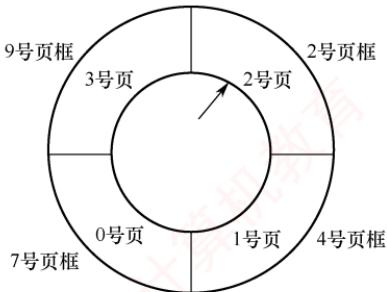
*Clock 算法指针顺时针循环扫描圆盘模型*

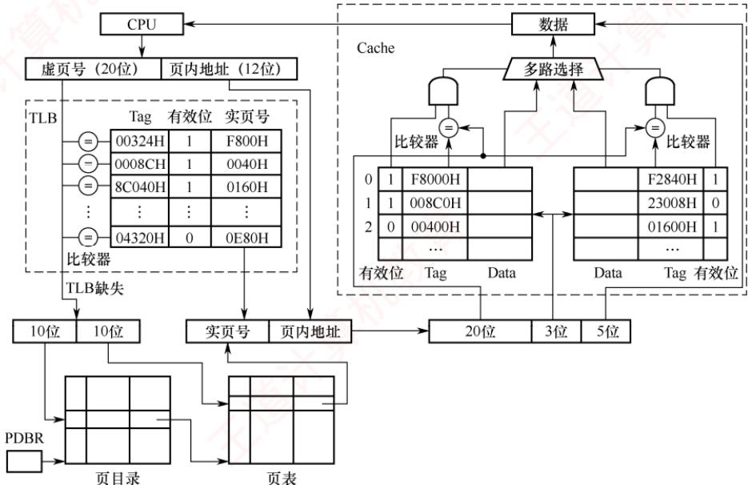
*请求分页页表项字段图示：有效位、访问位、修改位及物理页框号*

*64 位系统多级页表地址切分示例：对占满一页且表项数为 2 的幂的页表，索引位数可由每页容纳的表项数确定；顶级页表不足一页时，应按剩余虚拟页号位数确定。*

---

# 本章高频题型总表

| 题干特征 | 优先方法/起手式 | 真题印证与避坑 |
|---|---|---|
| 虚实地址转换、多级页表划分与目录自映射 | 按页面 $2^k$ 先定十六进制末尾页内偏移位数；页表项虚/实址=`基址+(下标<<2)` | `[真题·2019-T31 / 2024-T45 / 2026-T28]` 4MB 大页（10+22 位）仅右移 22 位；多级页表减连续空间但减慢访存（`2014-T32`） |
| 连续最佳适应 BestFit 回收与伙伴系统合并 | 回收先合并上/下相邻空闲区再重按容量从小到大排序；伙伴只合等大互伙伴块 | `[真题·2010-T28 / 2017-T25 / 2024-T27]` 最易产生微碎片是最佳适应（`2019-T32`）；切分半块再用异或判伙伴 |
| 数组遍历局部性与缺页/页面置换模拟 | LRU 从当前访问点倒数 $N$ 个不同页号；改进 CLOCK 4 轮顺序；区分缺页与置换 | `[真题·2015-T27 / 2016-T26 / 2025-T26]` 有空闲页框时不淘汰页（`2022-T29`）；仅 FIFO 可现 Belady 异常（`2014-T30`） |
| 有效访存 EAT、抖动工作集、PBA 与 `mmap` | 串联核查缺页率、磁盘 I/O 与页表时间；PBA 仅加速回收/调页且不改缺页率 | `[真题·2011-T29 / 2020-T28 / 2025-T30]` `mmap` 映射入进程虚拟空间非内核物理空间；共享文件映射物理框必相同（`2026-T30`） |
| C 语言进程虚存段与计组 TLB/Cache 联动 | PCB/内核栈在内核区，代码在 `.text`，全局在数据段，动态在堆，局部在栈 | `[真题·2023-T44 / 2025-T46]` `scanf` 等待输入进入阻塞态且经驱动程序读取；缺页时 Cache 必未命中 |

---

# 高频易混概念对比【⚡ 避坑｜最值钱，必须精读 1 分钟】

| 易混概念对 | 关键区别点 | 应试速记口诀 |
|---|---|---|
| **静态重定位 vs 动态重定位** | 静态在**装入时**改写代码地址，不可移动；动态在**执行访存时**由 MMU 加基址，可自由移动。 | 装入改死不可动，执行动态靠 MMU |
| **内部碎片 vs 外部碎片** | 内部碎片在**已分配分区内**（进程没用完）；外部碎片在**分区之间**（太小分不出去）。 | 内部在框内，外部在框外 |
| **分页 vs 分段** | 分页是**物理一维**（系统决定，消除外碎片）；分段是**逻辑二维**（用户决定，方便共享保护）。 | 页是物理一维定长，段是逻辑二维变长 |
| **简单 CLOCK vs 改进 CLOCK** | 简单 CLOCK 只看访问位 $(u)$；改进 CLOCK 综合考量访问位与修改位 $(u, m)$ 且最多扫 4 轮。 | 简单看引用，改进看脏位 |
| **缺页中断 vs 一般中断** | 缺页是**内部异常（Fault）**，在指令执行**中途**响应，返回时**重新执行该指令**。 | 缺页是内部故障，中途响应重执行 |
| **虚拟地址空间 vs 实际可用虚存** | 虚存空间理论上限仅由 **CPU 虚拟地址位数**决定；实际可用容量受限于 $\min(\text{寻址范围}, \text{物理内存}+\text{外存对换区})$。 | 理论看位数，实际看物外总和 |

---

# 选择题快速判断结论【🔥⚡ 必背+避坑｜停下来默背 1 遍 + 精读 1 分钟】

- 凡是提到“**消除外部碎片**”的离散存储管理 $\implies$ **分页存储管理**、**段页式管理**（分段管理依然存在外部碎片）。
- 凡是提到“**地址空间是二维的**” $\implies$ **分段存储管理**、**段页式存储管理**（分页是一维的）。
- 凡是提到“**虚拟存储器的特征**” $\implies$ **三大特征：多次性、对换性、虚拟性**（离散性是实现基础，非定义特征）。
- 凡是出现“**Belady 异常**” $\implies$ 408 常规题中重点考查 **FIFO 算法**会出现，OPT、LRU 一定不会出现；CLOCK 需按具体题目变体规则判定。
- 对“**多级页表是否减少页表占用**”，先看映射范围：满地址空间映射时，多级结构有上级表项开销；地址空间稀疏且未使用区域不建立下级页表时，实际分配的表项数和内存占用可以减少。它还支持**页表离散存放与按需调入**，不能一概判断为增大或减少。
- 凡是提到“**TLB 命中则页表必定命中**” $\implies$ **正确**；反之“页表命中则 TLB 必定命中” $\implies$ **错误**。
- 凡是提到“**发生缺页中断时，Cache 必定未命中**” $\implies$ **正确**（因为物理内存中根本没有该页数据）。
- 凡是提到“**页缓冲队列 (PBA) 长度直接决定缺页率**” $\implies$ **错误**（页缓冲队列优化的是 I/O 与换页效率，缺页率由工作集、驻留集大小及置换算法决定）。
- 凡是提到“**可变分配全局置换不会引起抖动**” $\implies$ **错误**（全局置换容易导致盲目抢占其他进程页框，更容易引发连锁抖动）。
- 凡是提到“**重定位寄存器与界地址寄存器由用户指令修改**” $\implies$ **错误**（必须由内核执行特权指令修改）。

---

# 本章刷题顺序建议

1. **第一阶段（基础概念）**：编译/链接/装入时机、重定位类型判断、动态分区分配 4 种算法模拟、伙伴系统二分与合并。
2. **第二阶段（经典计算）**：基本分页虚实地址转换、页表项大小确定、两级页表地址切分、参数化多级页表 TLB 有效访问时间 EAT 计算。
3. **第三阶段（虚拟内存与算法模拟）**：二维数组行列遍历缺页与置换次数机械计算、OPT / FIFO / LRU / 简单与改进 CLOCK 置换算法模拟、工作集窗口计算。
4. **第四阶段（408 综合大题攻坚）**：**操作系统与计组大贯通**——结合多级页表、TLB、Page Table、Cache、虚拟地址/物理地址拆分的大题综合推导与状态判断（历年 408 必考压轴点）。

---

# 小节自测清单

- [ ] 能否画出用户源程序变为内存进程映像的 3 步过程，并说出静态/动态链接与装入的区别？
- [ ] 能否说明重定位寄存器与界地址寄存器的使用时机与越界比较规则？
- [ ] 能否熟练推导动态分区分配 4 种算法（FF/NF/BF/WF）及伙伴系统的分配与回收过程？
- [ ] 能否根据逻辑地址位数、页面大小与页表项大小，准确切分两级及多级页表的各级索引位数？
- [ ] 能否写出包含 $N$ 级页表和 TLB 命中率的参数化 EAT 计算公式（明确串行/并行时序与 $t_{\text{fault}}$ 口径）？
- [ ] 能否按机械化步骤推导出教材第 12 题（16384 次）与第 13 题（2048 次）二维数组缺页次数？
- [ ] 能否清晰对比分页与分段的 6 大本质区别（物理/逻辑、一维/二维、透明/可见、碎片类型等）？
- [ ] 能否准确说出虚拟存储器的三大特征，并解释离散性的角色？
- [ ] 能否描述请求分页系统中发生缺页异常时的完整软硬件处理流程（含换出脏页写回）？
- [ ] 能否手动模拟简单 CLOCK 与改进型 CLOCK（4 轮扫描）的指针移动与标志位变化轨迹？
- [ ] 能否给出 TLB、Page Table、Cache 协同工作时的全部有效/无效状态组合？

---

# 刷题后补充区

> [!todo] 错题回填
> 刷题过程中遇到错题时，请在此记录核心错因与迁移结论。

## 错题模板示例
- **题型**：多级页表与 Cache 协同访存判断
- **错因**：误以为只要 TLB 未命中就一定会触发缺页中断。
- **关键条件**：TLB 只是页表的一小部分缓存，TLB Miss 只是说明需要访问主存页表，只要页表项有效位 $P=1$，就不会缺页。
- **可复用结论**：$\text{TLB Miss} \ne \text{Page Fault}$；只有 $\text{Page Table PTE.P} == 0$ 时才触发缺页异常。
- **下次检查动作**：做大题时先画出 `TLB -> Page Table -> Memory/Cache` 三级查找流向图，逐级判断状态。

---

# 冲刺主动回忆卡（遮挡自测）

### 卡片 1｜页目录自映射与 4MB 大页混合地址翻译
在支持 4KB 与 4MB 大页（`PS=1`）的 32 位系统中，已知页目录虚拟基址 `B8C0 0000H`、物理基址 `6540 0000H`，每表项 4B。如何一步算出页目录第 `48H` 项与页目录“自映射表项”的虚拟地址、物理地址及页框号？

> [!success]- 正确解释
> 1. **页表项地址通式**：`基址 + (表项下标 << 2)`。因此第 `48H` 项虚拟地址为 `B8C0 0000H + (48H << 2) = B8C0 0120H`，物理地址为 `6540 0120H`；4MB 大页低 22 位全为页内偏移，故大页框号取物理地址高 10 位（右移 22 位得 `2EAH`）（`2024-T45`）。
> 2. **自映射下标**：页目录自身虚拟基址右移 22 位（`B8C0 0000H >> 22 = 2E3H`）即为页目录对应自身页目录项下标，因此自映射表项虚拟地址 `B8C0 0B8CH`，页框号为 `6540 0000H >> 22 = 195H`。

### 卡片 2｜多级页表权衡与硬件/OS 职责划分
多级页表能提高访存速度、减少缺页或缩小每个页表项大小吗？地址转换与页表异常分别由谁完成？什么是 64 位三级分页第三级页表占用框数的速算法？

> [!success]- 正确解释
> 1. **多级页表优缺点**：它**既不加快地址转换速度（无 TLB 时需 $N+1$ 次访存）**，也不减少缺页次数或单个表项大小；核心价值在于将连续大页表拆分并**减少页表所占的连续内存空间**（`2014-T32`、`2026-T29`）。
> 2. **软硬分工**：MMU（硬件）完成地址转换，OS（软件）初始化/修改页表并处理缺页/越界异常（`2026-T24`）；二级分页下 PTBR 存一级页目录起始物理地址（`2021-T29`）。
> 3. **64 位三级页表数**：满映 `25|9|9|9|12` 中，总虚页 $2^{27}$，每个 4KB 末级页表含 $2^9$ 项，故第三级页表占用 $2^{27-9} = 2^{18} = 256\text{K}$ 个页框（`2026-T28`）。

### 卡片 3｜LRU 淘汰规则、改进 CLOCK 与缺页非淘汰条件
LRU、FIFO 与 OPT 谁出现 Belady 异常？缺页时一定淘汰内存中页面吗？改进型 CLOCK 4 轮扫描中哪两轮修改访问位 $A$（$u$）？页缓冲队列长度决定缺页率吗？

> [!success]- 正确解释
> 1. **Belady 异常**：三者中仅 **FIFO**（非堆栈型算法）可能出现 Belady 异常；LRU 可从当前缺页点逆向收集 $N$ 个不同页号，第 $N$ 个即为被淘汰页（`2014-T30`、`2015-T27`）。
> 2. **缺页不一定淘汰**：只要物理内存仍有空闲页框，直接分配空闲框即可，无需淘汰任何页面（`2022-T29`）。
> 3. **改进型 CLOCK 顺序**：1 轮找 `(0,0)` 不改位 → 2 轮找 `(0,1)` 并将跳过页置 `A=0` → 3 轮找 `(0,0)` → 4 轮找 `(0,1)`（`2016-T26`、`2021-T28`）。
> 4. **页缓冲队列**：PBA 通过空闲/已修改链表实现零 I/O 快速找回并降低淘汰写回耗时，但**不影响缺页率**（`2012-T45`、`2022-T30`）。

### 卡片 4｜最佳适应回收顺序、伙伴合并与虚拟内存界限
动态分区采用 BestFit 回收一块空闲区时步骤是什么？伙伴系统允许合并任意两个大小相同的相邻空闲块吗？虚拟内存容量受物理内存与外存之和限制吗？进程最少页框数由什么决定？

> [!success]- 正确解释
> 1. **BestFit 回收两步**：先检查物理上邻/下邻空闲区合并，**再按空闲分区容量从小到大重新排序链表**；BestFit 最易留微小外部碎片（`2010-T28`、`2017-T25`、`2019-T32`）。
> 2. **伙伴系统限制**：大小相等且地址相邻只是必要条件，**仅互为同一更大块二分所得的两半（互为伙伴）**才能向上递归合并（`2024-T27`）。
> 3. **虚存上限与最小页框**：虚拟地址空间理论上限仅由 CPU 虚拟地址位数决定（不受内存+外存之和限制，`2023-T31`）；最小页框数仅取决于**指令系统体系结构及寻址方式**（单指令最多访页数，`2025-T27`）。

### 卡片 5｜`mmap` 共享与 C 运行时进程虚存区域映射
多进程用 `mmap` 共享同一文件时，各自虚拟地址 $W_1$、$W_2$ 相同吗？映射到何处？C 程序的 PCB、`main`、全局变量 `ptr`、`malloc` 区、局部变量 `length` 与 `scanf` 分别对应什么虚存区域与内核动作？

> [!success]- 正确解释
> 1. **`mmap` 映射**：映射到**各自进程虚拟地址空间**（而非公共内核物理空间），各进程虚地址 $W_1,W_2$ 不必相同，但页表项均指向**相同的物理页框（物理地址相同）**，一处修改共享可见（`2025-T30`、`2026-T30`）。
> 2. **C 虚存与运行映射**：`PCB` 位于内核区；`main` 指令在代码段；全局变量 `ptr` 在数据段，`malloc()` 分配区在堆；局部变量 `length` 在用户栈；执行 `scanf()` 等待输入时进程进入**阻塞态**，由内核态**设备驱动程序**读取硬件数据（`2025-T46`）。
