# 第4章 文件管理

> [!abstract] 本章复盘目标
> 本章围绕**“用户如何逻辑操作数据”**与**“操作系统如何在外存上高效存储、组织、索引和保护数据”**两条主线展开。前半部分建立文件的逻辑结构、目录管理（FCB 与索引节点、树形与无环图结构）及外存分配方式（连续、链接、索引及 UNIX 混合索引）；后半部分深入剖析文件系统的磁盘与内存布局、空闲空间管理四大机制（位示图、成组链接法等）、虚拟文件系统（VFS 四大对象与系统调用穿透）以及文件系统挂载。复习时务必攻克**混合索引容量与访盘次数计算、FAT 与位示图计算、文件打开/读写/关闭全流程内核表联动以及硬/软链接特性对比**等统考高频核心考点。

> [!important] 近 18 年 408 操作系统真题雷达（2009—2026）
> - **考频统计**：本章 18 年累计 **31 道单选 + 7 道 OS 综合大题**（含特例题号 `2014-T46`、`2016-T47`），大题命中率极高（尤其 `2022-T45` 与 `2026-T46` 均为 inode/目录项综合压轴）。
> - **核心落点**：UNIX 混合索引偏移定位与文件/块上限公式（`min(地址项上限, 表容量)`）、两级打开文件表与 `open()/read()/close()` 生命周期、硬链接 vs 软链接计数与删目录链路（`2026-T46` 删除非空目录）、位示图与 FAT 管理。
> - **个人失分边界**：混合索引把字节偏移直接当成逻辑块号或忘扣直接块数；算总文件数漏对 `inode` 总数取交集或误用 $2^{32}$ 上限；混淆硬链跨分区限制及两进程分别 `open()` 的私有读写指针；位图漏加起始盘块偏移或把字节号算成位号（`2015-T31`）；新建文件误以为在目录项写访问控制权限（`2025-T29`）。
> - **总控入口**：[[00_408操作系统｜考前急救与真题落点总控|返回操作系统总控]]

## 考纲定位

- **文件系统基础**：文件概念、文件属性、文件分类、文件系统层次结构（I/O控制层、基本文件系统、文件组织模块、逻辑文件系统）、文件的逻辑结构（无结构文件/流式文件；有结构文件/记录式文件：定长/变长、顺序文件、索引文件、索引顺序文件、散列文件）。
- **目录与文件**：文件控制块（FCB）与索引节点（inode；磁盘 inode 与内存 inode；FCB 分解法计算）、目录结构（单级、两级 MFD/UFD、多级树形目录、无环图目录；绝对路径与相对路径、当前工作目录的作用）、目录操作与目录实现（线性列表、哈希表）、文件的物理结构（连续分配、链接分配【隐式链接、显式链接 FAT】、索引分配【单级索引、多级索引、混合索引 UNIX inode 结构与计算】）、文件操作（创建、删除、读、写；打开 open 与关闭 close 全流程；系统打开文件表与进程打开文件表；文件描述符 fd 与文件指针）、文件共享（基于 inode 的硬链接、基于符号链的软链接）、文件保护（访问类型、访问控制表 ACL、精简 ACL 权限矩阵、口令与加密）。
- **文件系统**：文件系统布局（磁盘结构：MBR、分区表、引导块、超级块、空闲空间管理、inode区、根目录、数据区；内存结构：挂载表、目录项缓存、系统打开表、进程打开表、缓冲区）、外存空闲空间管理（空闲表法、空闲链表法【空闲盘块链、空闲盘区链】、位示图法【字号/位号转换与分配回收】、成组链接法【UNIX 空闲盘块号栈、分配与回收算法】）、虚拟文件系统（VFS 原理与特点、四类对象：超级块对象、V节点对象 vnode、目录项对象 dentry、文件对象 file；系统调用分发机制）、文件系统挂载（挂载点概念、挂载与卸载过程）。

> [!tip] 命题特点
> 1. **计算题型高度集中且模板化**：UNIX 混合索引最大文件容量计算与特定逻辑偏移量访盘次数分析（2010、2013、2015、2018、2022）、FAT 长度与最大支持文件容量计算（2016、2019）、位示图字位号转换与占用空间计算（2010、2014、2015、2023）、FCB 分解法减少访盘次数计算。
> 2. **概念考查细致且陷阱密集**：文件打开 `open()` 与关闭 `close()` 期间系统表/进程表/inode/FCB 的变化及读写时不传文件名只传 fd（2012、2014、2017、2020、2023、2024）；硬链接 vs 软链接在引用计数、删除文件、指针悬空、跨文件系统上的核心差异（2009、2017、2021）；VFS 的纯内存抽象本质与四大对象职责（2022 新纲、2025 考点）。

## 章节知识脉络

1. **4.1 文件系统基础**：构建文件的基本概念、元数据属性与分层架构，理清无结构流式文件与记录式文件（顺序、索引、索引顺序）的逻辑组织与查找性能。
2. **4.2 目录与文件**：从 FCB/inode 目录检索到多级树形/无环图结构，全面攻克连续、链接（隐式/显式 FAT）、索引（单级/多级/混合）三大物理分配方式，贯通文件创建、打开、读写、共享与保护的全生命周期。
3. **4.3 文件系统**：从物理磁盘与内核内存双重视角剖析系统布局，掌握空闲空间管理（位示图与成组链接法），透视虚拟文件系统（VFS）的统一对象模型与文件系统挂载机制。
4. **4.4 本章疑难点与深度辨析**：全景对比各种文件物理结构特性，追踪系统调用到磁盘 I/O 的完整内核控制流。

---

# 4.1 文件系统基础【📌 扫一眼｜确认“我还会”就过】

## 4.1.1 文件的基本概念【📌 扫一眼｜确认“我还会”就过】

### 这一节要解决什么问题

在多道程序环境下，系统以进程为单位调度计算资源，而以**文件**为逻辑单位向用户提供持久化信息存储与 I/O 操作接口。本节需要明确：
1. 什么是文件？文件在逻辑数据组织中处于何种层次？
2. 操作系统通过哪些文件属性（元数据）来描述和管理文件？
3. 文件有哪些常见的分类视角？

### 一、文件的定义与数据层次

文件（File）是存储在持久性存储设备（如机械硬盘 HDD、固态硬盘 SSD）上的具有特定名称的一组相关信息的集合。文件系统通过对二级存储资源的抽象，屏蔽了底层物理介质特性与扇区分布细节。

从数据组织的角度，文件系统采用自底向上的数据层次结构：

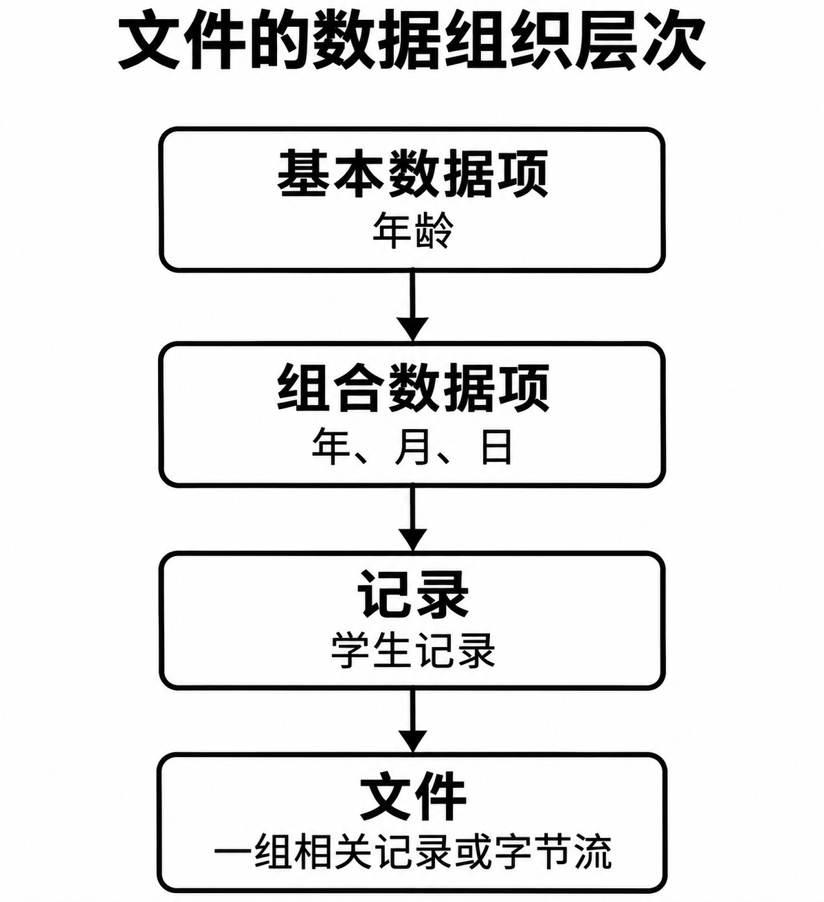

- **无结构文件（流式文件）**：由字符流/字节流组成，无显式记录边界（如文本文件、二进制可执行文件、C 语言源文件）。
- **有结构文件（记录式文件）**：由若干结构相同或相似的记录组成，每条记录包含固定或可变的数据项（如数据库表、班级成绩表）。

> [!important] 核心概念辨析：逻辑结构 vs 物理结构的设计初衷
> - ***<u>文件的逻辑结构是为了方便用户</u>***：是用户和应用程序视角观察到的数据组织方式（如流式、记录式、索引结构）；
> - ***<u>文件的物理结构是为了方便操作系统与存储介质</u>***：是文件在外存上的实际存储与块布局方式（如连续、隐式链接、显式链接 FAT、多级索引）。

### 二、文件的属性（元数据）

除文件包含的数据本身外，操作系统还会为文件维护一组描述性信息，称为**文件属性（元数据）**：

| 属性名称 | 核心含义与作用 | 存储位置 |
|---|---|---|
| **文件名 (Name)** | 文件的符号标识符，在同一目录下必须唯一，供人类用户识别。 | FCB 或目录项 |
| **标识符 (Identifier)** | 文件在系统内部的唯一数字编号（如 UNIX 的 inode 号），不可读，系统核心检索依据。 | 目录项 / inode |
| **类型 (Type)** | 指明文件的格式与种类（如可执行文件、目录、设备文件），供系统选择处理程序。 | FCB / inode |
| **位置 (Location)** | 指向文件在外存物理存储位置的指针（起始块号、索引块地址等）。 | FCB / inode |
| **大小 (Size)** | 文件当前所占存储空间的大小（字节数、字数或占用的块数）。 | FCB / inode |
| **保护 (Protection)** | 对文件的访问控制策略（读、写、执行权限位），实现安全性隔离。 | FCB / inode |
| **时间戳与所有者** | 创建时间、最后修改时间、最后访问时间及创建者/所有者 ID，用于审计与缓存。 | FCB / inode |

### 三、文件的分类

1. **按性质和用途**：系统文件（内核代码与配置文件，高保护）、用户文件（普通用户数据）、库文件（供调用的公共子程序）。
2. **按数据形式**：源文件（ASCII/UTF-8 字符源码）、目标文件（编译中间产物 `.obj/.o`）、可执行文件（机器指令 `.exe/ELF`）。
3. **按存取控制属性**：只读文件、读写文件、可执行文件。
4. **按组织形式与处理方式**：
   - **普通文件**：文本文件或二进制数据文件；
   - **目录文件**：管理文件系统目录结构的文件；
   - **特殊文件**：***<u>UNIX 将 I/O 设备（字符设备与块设备，如 `/dev/tty`, `/dev/sda`）统一视为特殊文件</u>***，使得控制和访问外部设备与访问普通文件完全一致（“一切皆文件”理念）。

---

## 4.1.2 文件系统层次结构【📌 扫一眼｜确认“我还会”就过】

### 这一节要解决什么问题

文件系统如何将用户发出的高层文件抽象操作（如 `read(file, offset, len)`）一步步翻译并落盘为物理磁盘扇区的读写？

### 一、文件系统的四层分层模型

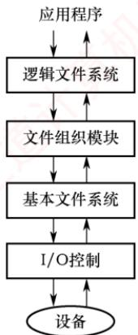

现代操作系统通常将文件系统划分为清晰的层次结构，从上至下依次为：

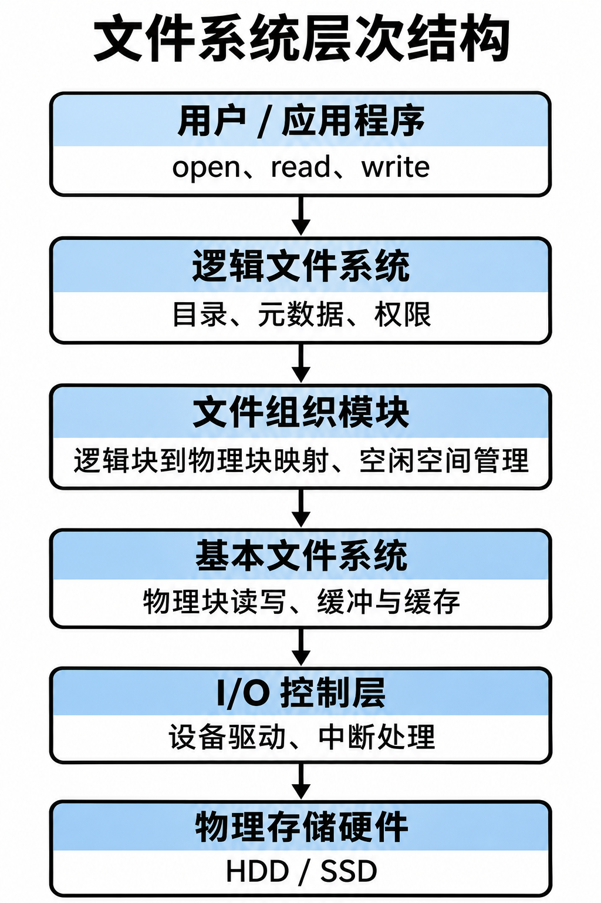

### 二、各层核心职责与考点辨析

| 层次名称 | 核心输入 $\to$ 核心输出 | 维护的关键数据结构 | 核心考点与职责 |
|---|---|---|---|
| **逻辑文件系统** | 文件名 / 路径名 $\to$ 文件元数据 (FCB/inode) | 目录结构、FCB/inode 表、访问控制列表 ACL | 负责***<u>按名存取</u>***、目录管理、权限验证与文件保护；不包含实际文件数据。 |
| **文件组织模块** | 逻辑块号 (0..N) $\to$ 物理块号 (Sector/Block ID) | 文件分配表 (FAT)、索引表、空闲块管理结构 | 负责***<u>逻辑块到物理块的地址转换</u>***；实现外存空闲空间分配与回收。 |
| **基本文件系统** | 物理块号 $\to$ 缓冲区读写请求 | 内存 I/O 缓冲区、磁盘缓存池 | 负责***<u>向驱动程序发送通用块读写命令</u>***，维护内存缓冲区以优化吞吐量。 |
| **I/O 控制层** | 通用块 I/O 命令 $\to$ 硬件控制器指令 | 设备寄存器映像、中断向量表 | 包含***<u>设备驱动程序与中断处理程序</u>***，直接驱动硬件执行电气/指令交互。 |

> [!important] 考点核心记忆法
> - **“找谁存”**（文件名 $\to$ inode/FCB、权限检查）：**逻辑文件系统**。
> - **“存哪块”**（逻辑块号 $\to$ 物理块号、空闲空间分配）：**文件组织模块**。
> - **“发块命令+管缓存”**（发送通用物理块读写指令）：**基本文件系统**。
> - **“驱动硬件交互”**（驱动程序、中断处理、控制器寄存器操作）：**I/O 控制层**。

---

## 4.1.3 文件的逻辑结构【📌 扫一眼｜确认“我还会”就过】

### 这一节要解决什么问题

文件的逻辑结构是从**用户和应用程序视角**观察到的文件组织形式，完全独立于物理外存的存储介质与布局。
1. 流式文件与记录式文件有何区别？
2. 顺序文件、索引文件、索引顺序文件和散列文件各自的检索效率、存储开销与适用场景如何？
3. 索引顺序文件的平均查找次数如何计算？如何求取最优分组规模？

### 一、无结构文件（流式文件）

- **定义**：文件内部由连续的字符/字节序列组成，无显式记录划分。
- **定位方式**：使用系统维护的**读/写指针（偏移量 Offset）**逐字节定位。
- **优点**：通用性强，极其灵活；操作系统只需将其视为纯字节流处理。
- **缺点**：若要查找特定业务内容，只能从头到尾进行穷举顺序扫描。
- **典型应用**：代码源文件（`.c`, `.py`）、可执行二进制文件（`.exe`, ELF）、文本文件（`.txt`）。

### 二、有结构文件（记录式文件）

由若干逻辑记录组成。记录是文件内包含特定业务含义的最小访问单元。

1. **定长记录**：所有记录长度相同（均为 $L$ 字节）。若记录按 $0, 1, 2, \dots, i$ 编号，则第 $i$ 条记录的相对逻辑地址可直接通过公式计算：
   $$A_i = i \times L$$
   天然支持极高效的**随机存取（直接访问）**。
2. **变长记录**：各记录长度 $L_i$ 不一致。若要访问第 $i$ 条记录，必须依次顺序累加前 $i-1$ 条记录的长度：
   $$A_i = \sum_{k=0}^{i-1} L_k$$
   无法直接根据下标计算偏移，仅支持**顺序存取**。

### 三、有结构文件的四种组织形式

#### 1. 顺序文件 (Sequential File)

文件中的记录按线性顺序依次排列。

- **按排序属性划分**：
  - **串结构 (Pile)**：记录按生成时间的先后存入，与记录中的关键字（Key）无关。检索时必须从首记录开始逐条顺序扫描，效率极低。
  - **顺序结构 (Sequential)**：所有记录按指定的关键字有序排列。
- **性能与适用性**：
  - **定长且按关键字排序的顺序文件**：支持基于折半查找（二分查找）的高效检索，也能通过 $i \times L$ 快速直接定位。
  - **批量处理之王**：在对大量记录进行连续顺序处理时（如生成月度账单、批量报表），顺序文件的 I/O 局部性最好，吞吐率最高。
  - ***<u>磁带介质的唯一选择</u>***：对于磁带这类顺序存取设备，顺序文件是唯一能够有效工作的组织形式。
  - **缺陷**：单条记录的增、删、改开销极大（需要大量平移后续记录）。

#### 2. 索引文件 (Indexed File)

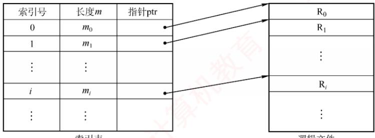

- **核心思想**：为了解决变长记录无法随机存取的问题，建立一张由**定长索引项**构成的**索引表**。每个记录在索引表中占据一项，包含：`<关键字, 记录长度 L, 记录起始逻辑地址指针 P>`。
- **检索过程**：***<u>对索引文件存取时必须先查找索引表</u>***。由于索引表本身是由定长记录组成的顺序文件，可直接通过二分查找或直接计算在索引表中快速定位，再根据指针直接读取目标记录。
- **优缺点**：将变长记录的顺序查找转化为定长索引表的随机查找，显著提升检索效率；但***<u>每个记录都需要一个索引表项，增加了存储空间开销（索引项存的是指针与长度，不包含实际数据内容）</u>***。

#### 3. 索引顺序文件 (Indexed Sequential File)

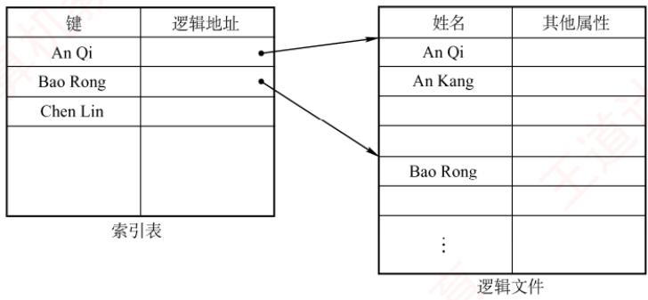

- **核心思想**：将顺序文件与索引文件相结合。先将变长记录按关键字分组（组内可无序，组间必须按关键字递增有序）；为**每组的第一条记录（首记录）**在索引表中建立一个索引项（关键字为该组最大或最小关键字，指针指向该组起始地址）。
- **检索过程（分块查找）**：
  1. 第一步：在索引表中查找目标关键字所在的“组”（可顺序查或二分查）；
  2. 第二步：进入对应组内，在主文件中进行顺序扫描。

#### 4. 索引顺序文件平均查找次数推导与最优分组

设一个文件包含 $N$ 条记录，将其平均分为 $m$ 组，则每组包含记录数 $s = \frac{N}{m}$。

- 若索引表和组内均采用**顺序查找**：
  - 索引表平均查找次数为 $\frac{m}{2}$；
  - 组内平均查找次数为 $\frac{s}{2} = \frac{N/m}{2}$；
  - 总平均查找次数为：
    $$ASL = \frac{m}{2} + \frac{N}{2m}$$
- 根据均值不等式，当 $\frac{m}{2} = \frac{N}{2m}$，即 ***<u>$m = \sqrt{N}$</u>*** 时，$ASL$ 取得最小值：
  $$ASL_{\min} = \sqrt{N}$$

> [!abstract] 💡 解题核心思考模型：记录式逻辑结构选型与计算
> 1. **选型判断视角**：
>    - 题目要求“按关键字快速随机点查，且各记录长度不等” $\to$ **索引文件**；
>    - 题目要求“海量数据查找，同时尽量控制索引表空间开销” $\to$ **索引顺序文件**；
>    - 题目要求“批量连续处理或存储在磁带介质上” $\to$ **顺序文件**。
> 2. **计算视角（平均查找次数）**：
>    - 对于 $N = 10000$ 条记录的顺序文件，平均查 $N/2 = 5000$ 次；
>    - 改为一级索引顺序文件，最优分组 $m = \sqrt{10000} = 100$ 组（每组 $s = 100$ 条），平均查找次数为 $\frac{100}{2} + \frac{100}{2} = 100$ 次（若按严格公式 $\frac{100+1}{2} + \frac{100+1}{2} = 101$ 次，考题中若选项只有 100 则选 100）。

#### 5. 直接文件 / 散列文件 (Hash File)

- **核心机制**：通过散列函数 $H(\text{Key})$ 直接将记录的关键字映射为记录的逻辑地址/物理地址。
- **优缺点**：存取速度极快（接近 $O(1)$），但存在**散列冲突（Hash Collision）**，需要设计溢出处理区与冲突解决算法。

---

### 概念对比：文件逻辑结构的全面比较

| 逻辑结构类型 | 记录长度要求 | 是否支持随机存取 | 检索效率 (ASL) | 空间开销 (索引表) | 适用场景 |
|---|---|---|---|---|---|
| **无结构流式文件** | 无记录概念（字节流） | 支持（通过 offset 寻址） | 针对特定内容需 $O(N)$ 扫描 | 无额外开销 | 源程序、二进制可执行文件、文本 |
| **顺序文件 (顺序结构)** | 定长支持随机，变长不支持 | 定长：支持；变长：不支持 | 定长二分 $O(\log_2 N)$，变长 $O(N)$ | 无额外开销 | 批量连续处理、磁带介质存储 |
| **索引文件** | 定长 / 变长皆可 | **完全支持** | $O(\log_2 N)$ | **大**（每条记录一个索引项） | 变长记录且需高频随机存取的场景 |
| **索引顺序文件** | 组间定长/变长皆可 | 支持（分块检索） | 一级索引最优 $O(\sqrt{N})$ | **中等**（每组一个索引项） | 大规模记录的高效组织与分块查找 |
| **直接/散列文件** | 通常定长 | **完全支持** | 接近 $O(1)$（取决于冲突率） | 需预留散列桶与冲突空间 | 关键字直接寻址、字典表、极速点查 |

---

# 4.2 目录与文件【🔥⚡ 必背+避坑｜停下来默背 1 遍 + 精读 1 分钟】

## 4.2.1 目录的基本概念【📌 扫一眼｜确认“我还会”就过】

### 目录管理的核心目标

文件目录本身也是一种数据结构，系统通常将其作为**目录文件**存储在外存上。目录管理必须满足四大要求：
1. ***<u>按名存取</u>***：用户仅需给出文件名即可读写文件，屏蔽物理外存地址与分配细节（最基础、最核心的功能，靠查找文件目录实现）。
2. **提高检索速度**：合理组织目录层次与索引结构，减少磁盘 I/O 检索次数。
3. **支持文件共享**：允许多个用户/进程安全访问同一物理文件副本。
4. **允许文件重名**：不同用户或不同目录下可以使用相同的名字命名各自的文件（***<u>不允许重名严格限定在“同一个磁盘的同一个目录下”</u>***）。

---

## 4.2.2 文件控制块（FCB）与索引节点（inode）【🔥⚡ 必背+避坑｜停下来默背 1 遍 + 精读 1 分钟】

### 这一节要解决什么问题

1. 什么是 FCB？它包含哪些内容？
2. 为什么传统 FCB 目录检索速度慢？UNIX 的**索引节点（inode）**机制（FCB 分解法）是如何成倍减少磁盘 I/O 次数的？
3. 磁盘索引节点与内存索引节点有何本质区别？

### 一、文件控制块 (File Control Block, FCB)

FCB 是操作系统用于描述和控制文件的核心数据结构，**每个文件对应唯一的 FCB**。**FCB 的集合即构成文件目录（目录文件）**。

FCB 包含三大类信息：
1. **基本信息**：文件名、物理位置（起始块号、索引块指针）、逻辑结构、物理结构。
2. **存取控制信息**：<mark>访问控制权限信息存放在FCB或inode中</mark>（文件主、核准用户、一般用户的读/写/执行权限）。 `[真题·2009-T30]`
3. **使用信息**：文件建立时间、最后修改时间、最后访问时间。

> [!tip] 区分控制信息的归属
> **FCB 或 inode** 保存文件访问控制信息；**FAT** 记录块链接及分配状态。用户口令表用于身份认证，系统注册表用于配置管理，二者不是记录某个文件访问权限的 FCB。 `[真题·2009-T30]`

> [!important] 核心考点：目录文件存放什么？
> 目录文件存放的是***<u>该目录下所有子目录和数据文件的目录项（每个目录项对应一个 FCB 或 ⟨文件名, inode号⟩）</u>***，并不存放数据文件的具体数据内容。

### 二、索引节点 (inode) 机制与 FCB 分解法

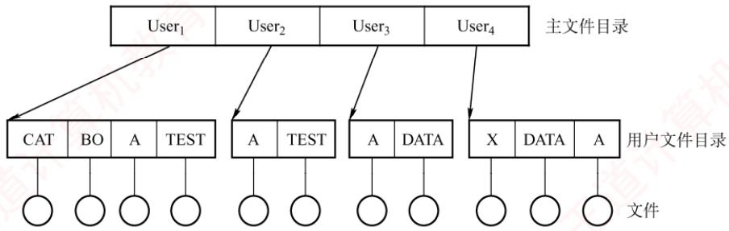

#### 1. 传统 FCB 目录的性能痛点
在传统的 FCB 结构中，每个目录项就是一个完整的 FCB（通常占 64B～128B）。目录检索性能主要由***<u>目录项数量、目录项大小以及目标在目录中的位置</u>***决定，***<u>与文件本身大小完全无关</u>***。在按名查找文件时，系统需将目录文件逐块读入内存比对文件名。**在找到目标前，FCB 中除文件名外的所有属性信息被无意义载入内存，严重浪费磁盘 I/O 带宽**。

#### 2. UNIX 的设计创新：FCB 分解（文件名与描述信息分离）
UNIX 将文件的元数据剥离为独立的**索引节点（inode）**，而目录项中仅保留：
$$\text{目录项 (Directory Entry)} = \langle \text{文件名 (FileName)}, \text{索引节点号 (inode number)} \rangle$$

- 目录项大幅瘦身（通常仅占 16B：14B 文件名 + 2B inode 号）。
- 一个磁盘块（如 1KB）能容纳的目录项数量从 16 个猛增到 64 个。
- 目录文件占用的磁盘块数压缩至原来的 $\frac{1}{4}$，检索时所需的***<u>平均磁盘 I/O 启动次数大幅减少</u>***。 `[真题·2011-T46 / 2018-T31]`
- ***<u>创建新文件时，文件系统不会在目录项中写入访问权限等属性信息</u>***（即<mark>新建文件不在目录项写权限</mark>，所有属性统一记录在独立的 inode 中）。 `[真题易错·2025-T29]`

> [!warning] 易错点：系统最多能创建的文件总数由什么决定？
> - 在采用 inode 机制的文件系统中，不同目录下文件名可以重复；<mark>最大文件数量受限于inode号位数或表总容量</mark>（目录项中 inode 号占 $N$ 字节则索引编号上限为 $2^{8N}$，实际还取 $\min(\text{inode号可表示上限}, \text{磁盘inode表实际总项数})$）。 `[真题·2018-T46 / 2020-T31 / 2026-T46]`
> - 例如：目录项中 inode 号占 4 字节（32 位），若不计表大小和其他限制，该文件系统最多可表示 $2^{32}$ 个索引节点，即独立文件数量的理论上界为 $2^{32}$。 `[真题·2020-T31]`

---

### 三、磁盘索引节点 vs 内存索引节点

| 维度 | 磁盘索引节点 (Disk inode) | 内存索引节点 (In-memory inode) |
|---|---|---|
| **存放位置** | 磁盘上的专门 inode 区（永久保存） | 内存活跃 inode 表中（动态创建与释放） |
| **创建时机** | 创建新文件时在磁盘分配并初始化 | **首次 open() 打开文件时**从磁盘载入内存 |
| **销毁时机** | 链接计数归零且没有剩余打开引用时可回收 | 打开引用和其他内存引用均不再需要时可回收，缓存策略可能延迟释放 |
| **包含内容（基本元数据）** | 1. 文件主 ID / 组 ID<br>2. 文件类型与权限<br>3. 物理地址（13个地址项指针）<br>4. 文件长度（字节数）<br>5. 链接计数 count（硬链接数）<br>6. 时间戳 | 包含磁盘 inode 的全部内容 |
| **包含内容（内存特有运行态）** | 无 | 1. ***<u>内存索引节点的访问计数（与目录硬链接计数、打开文件表计数应按所在结构分别判断）</u>***<br>2. ***<u>状态标志 (i_flag: 是否上锁、是否被修改 dirty)</u>***<br>3. ***<u>逻辑设备号 (所属文件系统设备号)</u>*** |
| **内存链表与编号** | 无 | 4. ***<u>链接指针 (指向空闲链表与散列队列)</u>***<br>5. ***<u>索引节点编号 (inode ID)</u>*** |

> [!important] 核心考点：磁盘 inode 与内存 inode 的计数器区分
> - **磁盘 inode 中的 `count`（硬链接计数）**：表示**有多少个目录项指向该 inode**（仅在创建/删除硬链接时增减）。
> - **内存 inode 中的 `i_count`（访问/打开计数）**：表示**当前有多少个进程正在打开引用该内存 inode**（每次 `open()` 加 1，`close()` 减 1）。

---

### 经典计算：FCB 分解法减少磁盘 I/O 次数模型

> [!abstract] 💡 解题核心思考模型：FCB 分解与目录项访盘计算
> **【标准解题步骤】**：
> 1. **求分解前（传统 FCB）的访盘次数**：
>    - 每块容纳 FCB 数 $K_1 = \lfloor \text{Block\_Size} / \text{FCB\_Size} \rfloor$；
>    - 目录占用总块数 $N_1 = \lceil \text{Total\_Files} / K_1 \rceil$；
>    - 查找目标目录项的平均访盘次数 $= \frac{N_1 + 1}{2}$。
> 2. **求分解后（inode 机制）的访盘次数**：
>    - 每块容纳瘦身目录项数 $K_2 = \lfloor \text{Block\_Size} / \text{DirEntry\_Size} \rfloor$；
>    - 目录占用总块数 $N_2 = \lceil \text{Total\_Files} / K_2 \rceil$；
>    - 找到目录项的平均访盘次数 $= \frac{N_2 + 1}{2}$；
>    - ***<u>千万别漏掉：找到目录项后，必须额外访问 1 次磁盘将对应的 inode 读入内存。</u>***
>    - 分解后总平均访盘次数 $= \frac{N_2 + 1}{2} + 1$。
> 
> **【实例验算】**：盘块 1KB，目录有 3200 个目录项。
> - 传统 FCB（占 64B）：每块放 16 个，占 200 块，平均访盘 $= \frac{200+1}{2} \approx 100$ 次；
> - 瘦身目录项（占 16B: 8B名 + 8B号）：每块放 64 个，占 50 块，平均查目录 $= \frac{50+1}{2} = 25.5 \approx 25$ 次，读 inode 额外 $+1$ 次，总共 **26 次**。

---

## 4.2.3 目录结构【🔥 必背｜停下来默背 1 遍】

### 这一节要解决什么问题

文件系统如何组织目录之间的层级关系？不同目录结构在重名、共享、检索效率上有何优劣？

### 一、单级目录结构

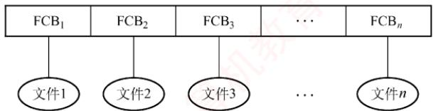

- **结构**：整个系统只有一张全局目录表，所有文件集中在此表中。
- **缺点**：查找速度极慢（线性扫描）；***<u>严格不允许文件重名</u>***；无法实现灵活的文件分类与共享；仅适用于早期单用户单任务系统。

### 二、两级目录结构


- **结构**：将目录分为两级：**主文件目录（MFD, Master File Directory）** $+$ **用户文件目录（UFD, User File Directory）**。
- **特点**：MFD 中记录每个用户名及其 UFD 存储位置；UFD 中存放该用户所有文件的 FCB。
- **优点**：***<u>完全解决了不同用户之间的文件重名问题</u>***；实现了不同用户命名空间的隔离。
- **缺点**：每个用户的 UFD 仍是扁平结构，用户无法对自身文件进行多级层次化分类。

### 三、树形目录结构（多级目录结构）

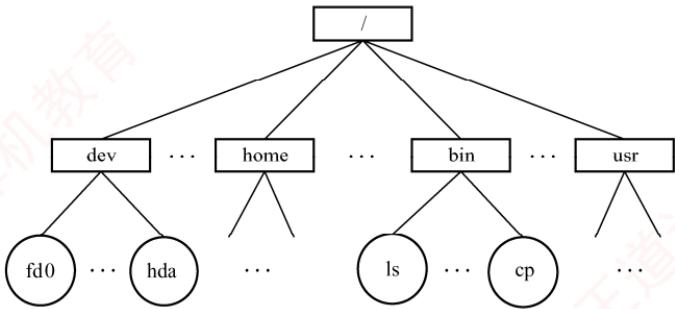

- **结构**：以根目录（Root `/`）为根节点，中间节点为**目录文件（子目录）**，叶子节点为**普通数据文件**。
- **路径名机制**：
  - **绝对路径 (Absolute Path)**：从根目录 `/` 开始的完整路径（如 `/user/bin/vi`）。每个文件拥有唯一的绝对路径。
  - **相对路径 (Relative Path)**：从进程的***<u>当前工作目录 (Current Working Directory)</u>*** 出发的相对路径（如 `./vi` 或 `../include/stdio.h`）。
- **当前工作目录的作用（2010 统考真题）**：
  - 进程对文件的访问大多集中在某个特定子目录下。设置当前工作目录后，用户只需提供相对路径，从而<mark>相对工作目录检索加快文件检索</mark>。
  - ***<u>缩短了路径名长度，大幅减少目录检索时的磁盘 I/O 启动次数，加快了文件检索速度</u>***（文件读写传输速度仍取决于磁盘）。 `[真题·2010-T31]`
- **检索与操作规则**：
  - ***<u>在利用顺序检索法查找树形目录时，只要路径名中的某一个分量名未找到，就应立即停止查找并报错</u>***；
  - 树形目录的缺点是：***<u>逐级遍历各级子目录增加了磁盘访问次数</u>***，且难以支持跨目录文件共享。

### 四、无环图目录结构 (Acyclic-Graph Directory)

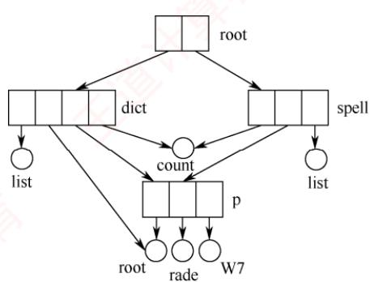

- **结构**：在树形目录结构的基础上引入指向同一节点的有向边，使目录图演变为**有向无环图 (DAG)**，支持不同目录共享子目录或文件。
- **共享实现与删除机制**：
  - 为每个被共享的节点（文件或目录）设置一个**共享计数器（引用计数器 count）**。
  - 当新增一个共享链接时，`count` 加 1；
  - 当某用户请求删除该共享文件时，系统**仅删除该用户目录下的目录项，并将 `count` 减 1**；
  - ***<u>只有当 `count == 0` 时，系统才真正回收该文件占用的物理磁盘块和 inode 结构</u>***。若 `count > 0`，绝不能真正释放物理空间，否则会导致其他共享用户的指针悬空（Dangling Pointer）。

---

## 4.2.4 目录的操作与 4.2.5 目录实现【⚡ 避坑｜最值钱，必须精读 1 分钟】

### 一、核心目录操作

1. **搜索 (Search)**：按路径名匹配目录项。
2. **创建文件 (Create)**：在目标目录下新增目录项，初始化元数据。
3. **删除文件 (Delete)**：<mark>删文件仅删目录项不删所在目录</mark>，即 ***<u>删除文件时不得删除该文件所在的目录（目录下可能还有其他文件）</u>***，移除目录中对应的目录项与相关内存缓存；只有不再有硬链接和打开引用时，才回收 inode 和数据块。 `[真题·2013-T23]`
4. **创建目录 (Mkdir)**：新建子目录文件，自动初始化 `.`（当前目录）和 `..`（父目录）两个默认目录项。
5. **删除目录 (Rmdir)**：要求目录必须为空，若非空需先递归删除其内部全部子文件或子目录。 `[真题易错·2026-T46]`
6. **移动 (Move/Rename)**：将目录项从原父目录转移到新父目录下，**物理数据块位置完全不移动，仅修改目录项路径映射**。

### 二、目录实现机制

- **线性列表 (Linear List)**：目录项以数组或链表形式线性排列。实现极简单，但检索时间复杂度为 $O(N)$。
- **哈希表 (Hash Table)**：根据文件名哈希值直接定位目录项。***<u>检索效率最高 ($O(1)$)</u>***，但需处理哈希冲突并在目录扩容时重新散列。
- **目录缓存 (Dentry Cache / Directory Cache)**：<mark>提前读、目录项与inode分离、延迟写和目录高速缓存</mark>四类手段均可有效提高文件访问速度。 `[真题·2018-T31]`

> [!tip] 易混概念辨析：提升文件系统性能的技术手段
> - 属于**文件系统自身存储结构与检索优化**：***<u>目录项分解 (inode机制)</u>***、***<u>文件高速缓存 (Page Cache)</u>***、***<u>磁盘调度算法 (减少寻道时间)</u>***；
> - 属于**进程 I/O 并发与异步处理机制**：**异步 I/O (Async I/O)**（用于实现计算与 I/O 重叠，非文件系统存储组织机制）。

---

## 4.2.6 文件的物理结构（外存分配方式）【🔥⚡ 必背+避坑｜停下来默背 1 遍 + 精读 1 分钟】

### 这一节要解决什么问题

文件组织模块如何为文件分配物理磁盘块？连续分配、链接分配与索引分配三大方式的寻址机制、容量上限、访盘次数与优缺点为何？

> [!important] 核心概念辨析：磁盘扇区 vs 簇 / 块（物理 I/O 与空间分配的边界）
> - `【硬件物理层】` ***<u>磁盘扇区 (Sector) 是物理硬件层面限制的读/写一次的基本单位</u>***（如 512B 或 4KB，由磁盘控制器和物理介质决定，硬件不支持小于扇区的独立物理读写）；
> - `【操作系统逻辑层】` ***<u>簇 / 块 (Cluster / Block) 是操作系统限制的存储空间分配与文件系统管理的基本单位</u>***（通常由 $2^k$ 个连续扇区组合而成，如 1KB、4KB）。
> - **空间分配判定法则**：文件系统为文件分配外存空间时，***<u>一律以“簇（或块）”为最小粒度整体分配，绝不按扇区零散拆分</u>***。只要文件大小超过 $k$ 个簇（哪怕只超 1 个字节），系统也必须为其分配第 $k+1$ 个完整的簇，未填满的剩余空间即为***<u>簇内内部碎片</u>***。

---

### 一、连续分配 (Contiguous Allocation)

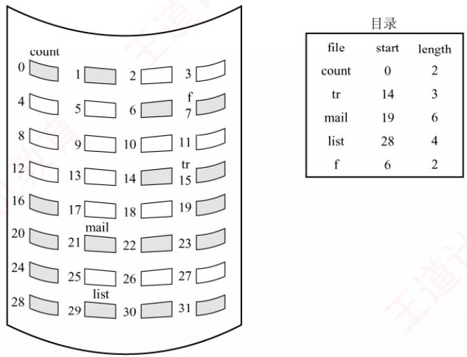

- **原理**：每个文件在磁盘上占用一组**物理位置连续的磁盘块**。
- **目录项记录**：只需记录 `<起始块号 start_block, 占用总块数 length>`。
- **寻址计算**：若文件起始块号为 $b$，要访问文件的第 $i$ 个逻辑块（从 0 编号），物理块号直接为：
  $$\text{Physical Block} = b + i$$
- **优点**：
  1. **支持高效的随机存取（直接访问）**，任意块寻址仅需 1 次计算；
  2. ***<u>寻道时间最短、速度极快，在点歌系统随机播放、连续视频播放或批量处理中表现最优</u>***（<mark>CD-ROM视频快随机与一次性写最优为连续</mark>）。 `[真题·2011-T46 / 2013-T24]`
- **缺点**：
  1. ***<u>产生大量的外部碎片</u>***（类似内存动态分区），磁盘空间利用率低；
  2. ***<u>极不利于文件动态增长</u>***（如 200 条记录插第 30 条需前移 29 条读写各 29 次再写新块共<mark>访盘59次并改起始块号与长度</mark>）。 `[真题易错·2014-T46]`

---

### 二、链接分配 (Linked Allocation)

采用**离散分配**方式，完全消除外部碎片，便于文件动态增长。

#### 1. 隐式链接 (Implicit Linking)

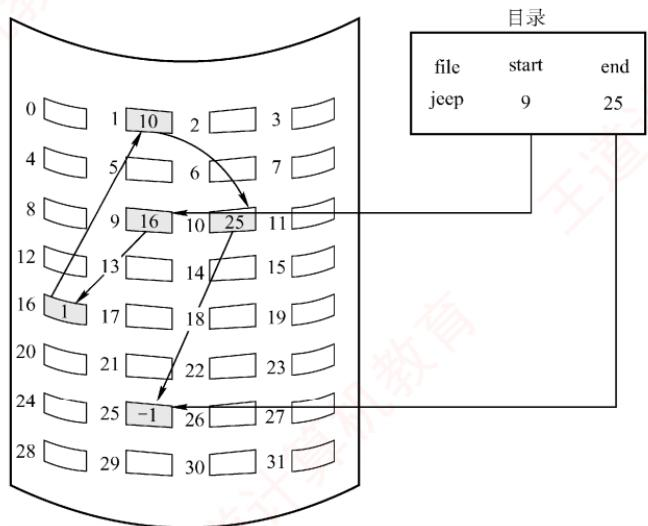

- **原理**：每个盘块中预留少量字节作为指针，存放**指向下一个物理盘块的指针**。目录项中只需记录文件的 `<起始块号, 结束块号>`。
- **优点**：完全消除外部碎片，动态扩充方便（<mark>链式插第30条读29块改链写新块共31次</mark>，4B指针1KB块数据1020B上限 4080GB）。 `[真题易错·2014-T46]`
- **主要缺点**：
  1. ***<u>只支持顺序访问，不支持高效随机访问：若要访问文件的第 $n$ 个逻辑块，必须从首块开始顺序读盘 $n$ 次。</u>***
  2. **可靠性极差**：任一盘块指针损坏，整条链后续数据全部丢失；
  3. **指针开销**：每个物理块都被蚕食少量字节存放指针，导致数据区非 $2^k$ 整数倍。
- **簇优化**：将若干连续盘块组合为**簇 (Cluster)**，以簇为单位进行分配与链接。
  - 减少了指针数量，提高了传输吞吐量；
  - 产生的代价是：***<u>带来簇内内部碎片（当文件大小不是簇大小整数倍时，最后一个簇的剩余空间被浪费）</u>***。<mark>按簇分配越界1字节即新分整簇</mark>（如 1KB 簇、512B 扇区存 1026B 文件需分 2 簇即 2048B）。 `[真题·2017-T26]`

> [!tip] 随机访问与链式结构题的口径
> 没有特别说明时，教材比较“链式分配不支持高效随机访问”通常指**隐式链接**：要找到后继块需沿数据块指针查找。若题目明确给出 FAT 已在内存，则可沿内存 FAT 链得到目标块号，不必读取中间数据块，但查链仍不等同于按逻辑块号直接下标索引。

#### 2. 显式链接与文件分配表 (File Allocation Table, FAT)

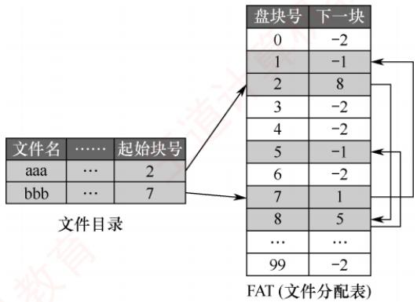

- **原理**：将用于链接各物理块的指针从数据块中抽离出来，集中存放在内存的一张全局表格中——**文件分配表（FAT）**。
- **FAT 的结构**：FAT 的表项与磁盘物理块**一一对应**。表项中记录该盘块的**下一块块号**。特殊值表示：
  - `下一块号`：正常的后继块号；
  - `-1`（或 `EOF`）：文件结束标志；
  - ***<u>`-2`（或 `FREE`）：空闲盘块标志（FAT 兼做外存空闲空间管理表）</u>***（即<mark>FAT既记文件链接又标盘块占用或空闲</mark>）。 `[真题·2025-T31]`
- **目录项记录**：目录项仅需记录文件的 `<起始块号>`。
- **优点**：
  1. ***<u>既支持顺序访问，又支持高效的直接/随机访问：若题设 FAT 已完整驻留内存，查找后续块号沿内存 FAT 链进行，不需为查找链指针读取中间数据块；目标数据块仍需在未缓存时读盘。</u>***
  2. **兼做空闲空间管理**：遍历 FAT 中标记为空闲（-2）的表项即可分配空闲块。
- **缺点**：FAT 表必须常驻内存，大容量磁盘下 FAT 表自身占用内存较大。

> [!abstract] 💡 解题核心思考模型：FAT 表项位数与最大容量推导
> 以下为忽略保留簇号、文件长度字段及其他限制的题目简化上界；实际可用容量以题设或具体文件系统限制为准。
> 1. **FAT 表项位数决定最大簇数**：
>    - 若 FAT 表项占 $N$ 位（如 16 位），则最多允许 $2^N$（65536）个表项，即最多寻址 $2^N$ 个簇； `[真题·2016-T47]`
> 2. **FAT 表最大长度** $= 2^N \times (N/8)\text{ 字节}$（16 位时 $65536\times 2\text{B}=128\text{KB}$）； `[真题·2016-T47]`
> 3. **该系统支持的最大文件长度** $= 2^N \times \text{簇大小}$（簇 4KB 时 $256\text{MB}$；目录项记首簇号，如 `dir1=48, file1=100` 且按 FAT 链追查 `file2` 的簇号 106）； `[真题·2016-T47]`
> 4. **磁盘总容量求 FAT 大小**：
>    - 磁盘容量 540MB，盘块 1KB $\to$ 共有 $540\text{K}$ 块；
>    - $540\text{K} < 2^{20}$，每个表项占 20 位（2.5 字节）；
>    - FAT 大小 $= 540\text{K} \times 2.5\text{B} = 1350\text{KB}$。

---

### 三、索引分配 (Indexed Allocation)

为每个文件分配一个专用的**索引块（Index Block / 索引表）**，其中集中记录该文件所占用的所有物理块号。***<u>索引分配天然具备“支持随机存取”且“支持可变文件长度（易动态增删）”的双重特性</u>***（<mark>支持长度可变与随机访问选索引分配</mark>）。 `[真题·2009-T28 / 2020-T24]`

#### 1. 单级索引分配

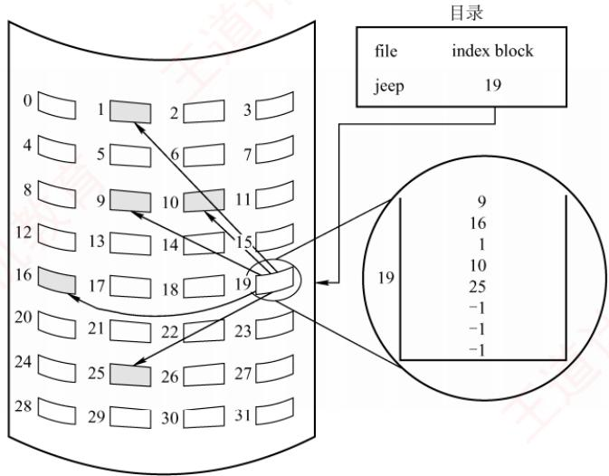

- **原理**：目录项记录索引块的块号。索引块内部依次存放文件的第 $0, 1, \dots, n$ 个逻辑块对应的物理块号。
- **优点**：支持随机存取；无外部碎片；文件动态扩充容易。
- **缺点**：小文件也要占用一整块索引块（空间浪费）；受单个索引块大小限制，无法支持大文件。
- **容量计算**：若盘块大小为 4KB，每个物理块地址占 4B，则一个索引块可容纳 $4\text{KB}/4\text{B} = 1024$ 个地址项。单级索引最大支持文件大小 $= 1024 \times 4\text{KB} = 4\text{MB}$。

#### 2. 多级索引分配

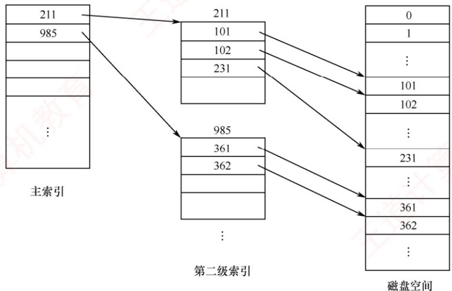

- **原理**：当文件很大时，索引块自身也需要分页，为索引块建立顶级主索引（二级、三级索引）。
- **访盘次数规律**：***<u>若采用 $m$ 级索引分配，访问一个数据盘块需要访问磁盘 $m + 1$ 次（$m$ 次读各级索引块 $+ 1$ 次读数据块，假设索引块未预先缓存）</u>***。
- **缺点**：小文件访问也有多次访盘开销。

---

#### 3. UNIX 混合索引分配方式（408 高频王牌考点）

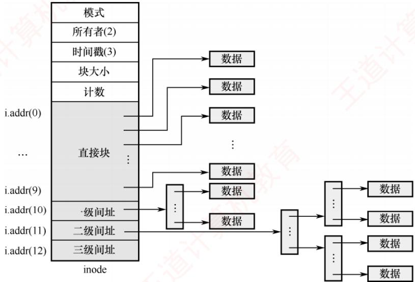

UNIX 在其索引节点（inode）中设置 **13 个地址项（`i_addr[0] ~ i_addr[12]`）**，将小、中、大、特大文件的分配机制融为一体：

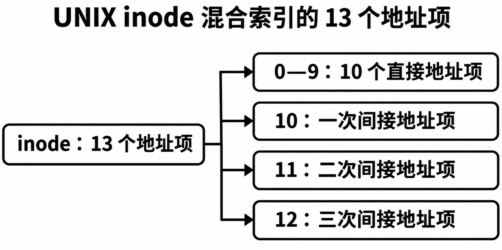

假设**磁盘块大小为 4KB，每个盘块地址占 4B**（每个索引块可容纳 $4\text{KB} / 4\text{B} = 1024$ 个盘块号）：

| 地址项类型 | 包含索引项数 | 可寻址的数据块数 | 可表示的容量区间 | 访问区间数据总访盘次数(设inode在内存) |
|---|---|---|---|---|
| **10 个直接地址** | 10 | 10 块 | $0 \sim 40\text{KB}$ | **1 次** (直接读数据块) |
| **1 个一次间接地址** | 1 个索引块 | 1024 块 | $40\text{KB} \sim 4\text{MB} + 40\text{KB}$ | **2 次** (1次索引块 + 1次数据块) |
| **1 个二次间接地址** | 1 个主索引块 $\to$ 1024 个二级索引块 | $1024 \times 1024 = 2^{20}$ 块 | $4.04\text{MB} \sim 4\text{GB} + 4.04\text{MB}$ | **3 次** (1次顶级索引 + 1次二级索引 + 1次数据块) |
| **1 个三次间接地址** | 1 主 $\to$ 1024 二级 $\to$ $1024^2$ 三级 | $1024^3 = 2^{30}$ 块 | $4\text{GB} \dots \sim 4\text{TB} + \dots$ | **4 次** (3次索引块 + 1次数据块) |

> [!warning] 易错辨析：单个文件的最大长度与哪些因素有关？
> - ***<u>单个文件的最大长度取决于：间接地址级数、地址项数、磁盘数据块大小</u>***； `[真题·2012-T46 / 2013-T26 / 2018-T46]`
> - ***<u>在题目给定单文件索引结构时，inode 总数不决定该文件的索引寻址上限</u>***（即<mark>inode总数不决定单文件最大长</mark>，可用 inode 数与簇数量取交集 $\min(64\text{M}, 256\text{M})$ 限制系统文件数上限，硬链接本身不新增目标 inode）。 `[真题·2013-T26 / 2018-T46]`

> [!abstract] 💡 解题核心思考模型：混合索引偏移量定位与访盘次数计算
> **【解题三步法】**：
> 1. **第一步：求单块指针容纳数 $K$ 与各级门限值**：
>    $$K = \frac{\text{Block\_Size}}{\text{Pointer\_Size}}$$
>    - 若直接、一级、二级、三级间接地址项分别有 $D,a_1,a_2,a_3$ 项，则可寻址的**数据块数上限**为 $D+a_1K+a_2K^2+a_3K^3$；再乘以每个数据块的字节数，才得到文件长度的寻址上限（<mark>多同级地址项须乘系数累加</mark>，如 2010 年 256B 块配 4 直+2 一+1 二得 1057KB）。 `[真题·2010-T30 / 2012-T46 / 2018-T46]`
>    - 直接块范围：$0 \sim D - 1$；
>    - 一次间接范围：$D \sim D + K - 1$；
>    - 二次间接范围：$D + K \sim D + K + K^2 - 1$；
>    - 三次间接范围：$D + K + K^2 \sim D + K + K^2 + K^3 - 1$。
> 2. **第二步：将字节偏移量转换为逻辑块号**：
>    $$\text{LBN} = \lfloor \text{Offset} / \text{Block\_Size} \rfloor$$
> 3. **第三步：查表得出访盘次数**：
>    - 审题确认“inode 是否已在内存”：
>      - 若 <mark>inode已在内存则直1次一间2次二间3次</mark>（如 2015 偏移 1234 需 1 次、307400 需 3 次；2026 偏移 21460 落在 5 号块需 2 次）； `[真题·2015-T29 / 2022-T45 / 2026-T46]`
>      - 若 inode 未在内存（目录已读入时先 $+1$ 读 inode 块，如 2022 真题共读 2 块）：上述结果统一 **$+ 1$**。 `[真题·2022-T45]`

> [!example]- ⚡ 真题母题 2022-T45｜`stu/course/doc` 目录项、硬链接与混合索引（6MB 落区）
> - **题目要点**：盘块 $4\text{KB}$，地址项 $4\text{B}$，inode 含 10 直接 + 1 一级 + 1 二级 + 1 三级间接。目录 `stu` 下有子目录 `course` 与文件 `doc`，`course` 下有 `course1` 和 `course2`；表中 `course1` 与 `doc` 同为 inode 10（`course1` 占 30 号块）。① 写出 `stu` 目录项内容；② `doc` 占用的磁盘块号 $x$；③ 若 `course` 已在内存，打开并读 `course1` 需读几个磁盘块？④ 若大小增至 $6\text{MB}$，需使用哪几级间接地址项？
> - **为什么这么想**：目录项仅含 `<文件名, inode号>`；两个不同目录项若 inode 号同为 10 即为**硬链接**，指向完全相同的数据盘块 `30`；已读入父目录则已知 inode 号，读文件必先读 `inode` 块再读数据块共 2 块。
> - **独立验算标准解答**：
>   1. `stu` 目录文件中包含两项：`<course, 2>`、`<doc, 10>`。
>   2. 因 `doc` 与 `course1` 共享 `inode 10`，故 `doc` 占用的盘块号 $x = 30$。
>   3. 需读 **2 个**磁盘块（第 1 块读 `inode 10` 所在磁盘块；第 2 块据此索引读 30 号数据块）。
>   4. 每块含指针 $K = 4\text{KB}/4\text{B} = 1024$ 个；$6\text{MB}$ 共占 $6\text{MB}/4\text{KB} = 1536$ 块。因 $10 + 1024 = 1034 < 1536 < 10 + 1024 + 1024^2$，故存取需使用**一级间接地址项和二级间接地址项**。
> - **易错步骤与个人复盘提醒**：第(3)问切忌漏算 `inode` 本身的 1 次读盘（目录已在内存 ≠ `inode` 已在内存）；第(4)问算 $6\text{MB}$ 块数时别与 $1024+10$ 相比较粗心看错。

> [!example]- ⚡ 真题母题 2026-T46｜inode 表布局定位、偏移读块与删除非空目录 `dir1`
> - **题目要点**：盘块 $4\text{KB}$，盘号 $4\text{B}$，inode 占 $128\text{B}$（5 直接 + 一/二/三级间接各 1），inode 表从 0 开始编号并连续存放在从 100 号开始的 4096 个盘块中；系统设磁盘位示图与 inode 位示图。`dir1`（`inode 201`）下有 30KB 文件 `file`（`inode 1000`）。① 求 `file` 的 inode 所在盘块号；若该 inode 已在内存，访问偏移 `21460` 的 1 字节最多需读多少盘块？空间充足下系统最多可存多少文件？② 要删除非空目录 `dir1`，需对元数据执行哪些操作？
> - **为什么这么想**：每块容纳 inode 数 = $4\text{KB}/128\text{B} = 32$ 个；按 0 起编址公式：**块号 = `起始块号 + floor(N / 32)`**；删除**非空目录**核心坑点在于**先清空子文件元数据及位图，再删目录自身元数据及位图并更新父目录**。
> - **独立验算标准解答**：
>   1. ① `file`（`inode 1000`）所在盘块号 = `100 + floor(1000 / 32) = 100 + 31 = 131` 号块；② 逻辑块号 = `floor(21460 / 4096) = 5`（前 5 块下标 `0..4` 为直接块，故块 `5` 落在**一级间接**区），因 inode 已在内存，共需读 **2 个**盘块（1 次读一级间接索引块 + 1 次读目标数据块）；③ 系统最多文件数 = inode 表总项数 = `4096 * (4096 / 128) = 4096 * 32 = 131072` 个。
>   2. 删除非空目录 `dir1` 的元数据操作步骤：① 在父目录 `dir` 中查找到 `dir1`（`inode 201`）读入目录文件；② 先处理 `dir1` 下非空文件 `file`（`inode 1000`）：释放 `file` 占用的 $30\text{KB}\implies 8$ 个数据块对应磁盘块位示图（置 0）、释放 `inode 1000` 对应 inode 位示图（置 0）、从 `dir1` 中删除 `file` 目录项；③ 再释放空目录 `dir1` 自身：释放 `dir1` 数据块在磁盘位示图（置 0）、释放 `inode 201` 在 inode 位示图（置 0）；④ 在父目录 `dir` 中删除 `dir1` 目录项并更新 `dir` 的长度/修改时间戳后回写磁盘。
> - **易错步骤与个人复盘提醒**：三大易错点：① 块号偏移忘记从 `100` 开始加或错按从 `1` 编号；② 逻辑块号 `5` 误算进 5 个直接块（下标 `0..4` 才是直接块，块 `5` 刚好进入一级间接）；③ 删除 `dir1` 忘先清理子文件 `file` 的 8 个数据块位图与 `inode 1000` 位图。 `[真题易错·2026-T46]`

---

## 4.2.7 文件的操作与打开/关闭全生命周期【🔥⚡ 必背+避坑｜停下来默背 1 遍 + 精读 1 分钟】

### 这一节要解决什么问题

1. 文件的基本操作（创建、删除、读、写）在内核中经历哪些具体步骤？
2. 为什么文件操作前必须先 `open()`？`open()` 和 `close()` 究竟在内存中做了什么？
3. **系统打开文件表**与**进程打开文件表**有何分工与联系？
4. 为什么打开文件后，后续的读写操作**完全不再需要文件名，只传文件描述符（fd）**？

### 一、文件创建与删除的内核全流程

#### 1. 创建文件 `create(path, mode)` 的内核步骤（2025 考点）
1. **合法性与权限校验**：检查父目录下是否已存在同名文件，验证当前进程对父目录是否具有**写权限**；
2. **分配 inode**：从外存空闲 inode 池中分配一个空闲 inode，初始化文件属性（所有者、权限、类型、时间戳）；
3. **建立目录项**：在所属父目录文件中写入新的目录项 `⟨文件名, inode号⟩`（***<u>注意：目录项中不写权限</u>***）； `[真题·2025-T29]`
4. **更新元数据**：同步更新父目录修改时间与磁盘空闲管理结构。

#### 2. 删除文件 `unlink(path)` 的内核步骤（2013、2021 考点）
1. **路径解析**：检索目录找到目标文件的目录项，获取 inode 号，验证对父目录的写权限；
2. **检查硬链接计数**：读取 inode，将 `count` 减 1；
3. **从目录中移除目录项**：从父目录文件中擦除该文件的目录项；
4. **判定物理释放**：
   - 若 `count == 0` 且**无任何进程正在打开该文件**：完全释放其占用的所有物理数据块和磁盘 inode；
   - 若 `count > 0` 或文件仍处于打开状态：**仅删除目录项，保留 inode 与物理数据块**，延迟物理释放。

---

### 二、文件的打开与关闭：两级打开文件表架构

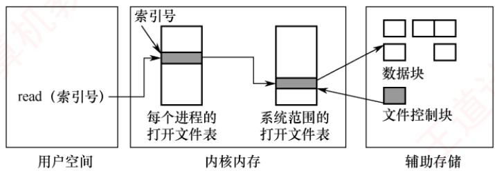

为了避免每次读写文件都重复进行高耗时的目录树磁盘检索，系统要求访问文件前必须先执行 `open()`。

教材和 408 常用的简化模型在内存中维护**两级打开文件表**：

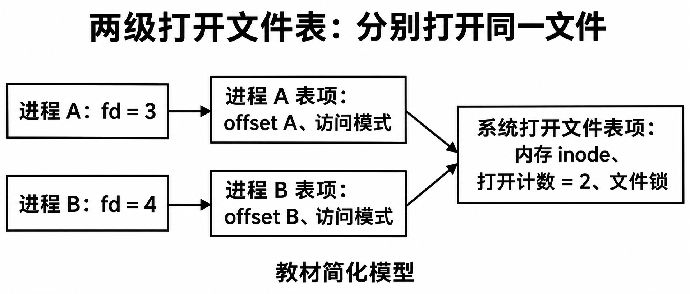

#### 1. 系统打开文件表 vs 进程独立打开文件表深度对比

| 维度 | 系统全局打开文件表 (System-wide) | 进程独立打开文件表 (Per-process) |
|---|---|---|
| **存在范围** | ***<u>整个操作系统内核仅设一张，全局共享</u>***（<mark>同文件在系统表仅占1个表项</mark>） `[真题·2020-T23]` | ***<u>每个进程各自拥有一张，私有独立</u>*** |
| **存储内容** | 1. 磁盘位置与大小 2. 内存 inode 副本 3. ***<u>系统级打开计数器 (Open Count)</u>*** 4. 文件锁与状态 `[真题·2017-T31]` | 1. ***<u>当前文件的读/写指针 (Offset)</u>*** 2. ***<u>访问权限模式</u>*** 3. 指向系统表对应表项指针 `[真题·2017-T31 / 2020-T23]` |
| **索引凭据** | 系统内部指针 | ***<u>文件描述符 fd (Linux) / 文件句柄 Handle (Windows)</u>*** |

> [!warning] 易错点：多进程并发打开同一文件时的特征
> 1. **读写指针**：按教材模型，不同进程分别打开同一文件（或分别打开硬链接）时，<mark>共享内存inode而各自维护独立读写指针</mark>；若涉及继承或复制描述符，还须根据共享打开对象判断。 `[真题易错·2017-T31 / 2020-T23]`
> 2. **文件描述符**：不同进程获得的文件描述符 `fd` 是各自独立的数字（彼此无关）；
> 3. **写操作互斥**：操作系统允许多进程同时以读写方式打开文件，***<u>操作系统并不自动保证写操作的互斥性</u>***（需应用程序通过系统调用加文件锁实现互斥）。

---

### 三、文件打开 `open()` 与关闭 `close()` 全过程追踪

#### 1. `open("path/file", flags)` 执行全过程（2014、2017、2020 统考真题）
1. **目录树遍历检索**：<mark>open()按路径名查目录检索文件</mark>，在目标目录下匹配文件名，获取对应的 `inode` 号； `[真题·2024-T29]`
2. **权限检查**：比对进程身份与 inode 中的访问权限，验证本次打开模式是否合法；
3. **更新系统打开文件表**：
   - 检查该文件是否已被其他进程打开：
     - 若**已在系统打开表**中：直接将该系统表项的 `Open Count` 加 1；
     - 若**未在系统打开表**中：从磁盘读入该文件的 inode/FCB 到内存活跃 inode 表，创建新的系统打开表项，置 `Open Count = 1`；
4. **分配进程打开文件表项**：在当前进程的打开文件表中分配一个空闲表项，填入私有读写指针（初始通常为 0）和访问模式，并建立指向系统表项的指针；
5. **返回文件描述符**：将该表项在进程打开文件表中的下标作为**文件描述符 `fd`** 返回给用户程序。

> [!important] 为什么后续读写不用文件名，只传 fd？
> - 因为 `fd` 是进程打开文件表的数组下标。通过 `fd`，操作系统可以在 $O(1)$ 时间直接定位到内存中的读写指针、访问权限以及系统表中的物理位置信息，完全跳过昂贵的磁盘目录树检索。
> - ***<u>打开文件操作绝不会将文件数据内容读入主存（只将 FCB/inode 调入内存）</u>***（即<mark>首次open将FCB或inode读内存而非数据</mark>）。 `[真题·2014-T29]`
> - ***<u>文件名不是打开文件表的组成部分</u>***，打开完成后文件名已完成使命。

#### 2. 读文件 `read(fd, buf, n)` 考点三要素（2014 统考真题）
1. **产生缺页/I/O阻塞**：<mark>读盘数据未就绪则阻塞并切换内核态</mark>，当所读数据块不在内存缓冲区时产生 I/O 请求，进程进入阻塞态； `[真题·2012-T28]`
2. **陷入内核态**：`read()` 是系统调用，通过***<u>陷入指令 (Trap / 访管中断)</u>*** 从用户态切换到核心态； `[真题·2012-T28]`
3. **参数传递**：输入参数为 ***<u>文件描述符 fd、缓冲区首址 buf、传送字节数 n</u>***，***<u>绝不使用文件名作为参数</u>***。 `[真题·2012-T28]`
4. **执行次序**：
   $$\text{按 fd 查进程表} \to \text{存取控制合法性检查} \to \text{逻辑块号转物理块号} \to \text{向驱动发 I/O 请求完成交换}$$

#### 3. `close(fd)` 执行全过程（2023 统考真题）
1. 进程调用 `close(fd)`；
2. 系统释放当前进程打开文件表中索引为 `fd` 的表项；
3. 顺着指针找到系统全局打开文件表对应表项，将其 `Open Count` 减 1；
4. **判定系统表项释放**：
   - 若 `Open Count > 0`：表明仍有其他进程打开该文件，系统表项保留； `[真题·2020-T23]`
   - 若 `Open Count == 0`：<mark>唯一打开者close后删除内存inode与系统表项</mark>（关闭不删除磁盘 inode，也不改变硬链接计数）。 `[真题·2023-T30]`
   - ***<u>注意：关闭文件并不意味着将文件数据写回磁盘（数据写入由 write 或缓存刷盘完成）</u>***。

---

## 4.2.8 文件共享（硬链接 vs 软链接）【🔥⚡ 必背+避坑｜停下来默背 1 遍 + 精读 1 分钟】

### 这一节要解决什么问题

操作系统如何允许多个用户/目录共享同一份物理文件？基于索引节点的**硬链接**与基于符号链的**软链接**有何本质区别？

---

### 一、硬链接 (Hard Link) —— 基于索引节点的共享

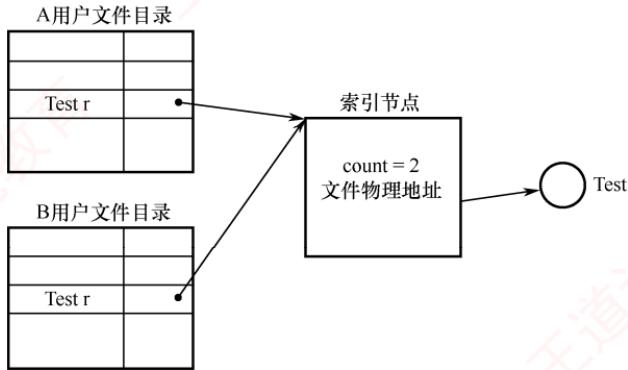
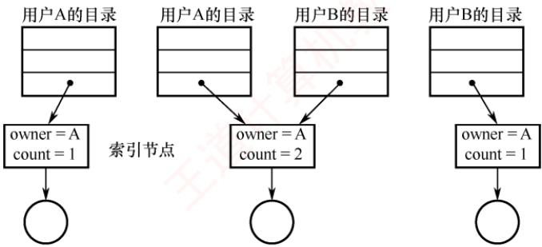

- **核心机制**：在不同用户的目录下新建目录项，这些目录项可以同名也可以不同名，但都**指向同一个 inode（共享文件元数据与数据块）**。
- **链接计数器 `count`**：
  - 建立硬链接时，inode 中的 `count` 加 1；
  - 用户删除文件时，仅删除自身目录项，并将 inode 中的 `count` 减 1；
  - ***<u>当链接 `count == 0` 且没有剩余打开引用时</u>***，系统才可回收 inode 和物理数据块；若 `count > 0`，其他硬链接仍指向该文件，是否可访问还取决于权限。
- **优点**：访问速度极快（与普通文件一致，直接通过 inode 访问数据）；文件内容修改实时对所有用户同步。
- **限制**：***<u>不可跨文件系统（跨分区）创建硬链接</u>***；出于防止目录环路的考虑，大多数系统**不允许普通用户对目录创建硬链接**。

---

### 二、软链接 / 符号链接 (Symbolic Link / Soft Link)

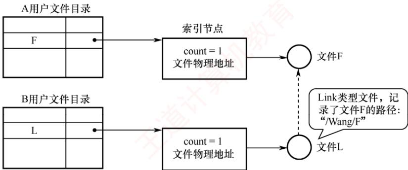

- **核心机制**：系统创建一个***<u>类型为 LINK 的全新独立文件（快捷方式）</u>***。该文件拥有自己***<u>独立的 inode</u>***，并保存***<u>目标路径名字符串</u>***；路径如何存储取决于文件系统实现。
- **访问流程**：用户访问软链接文件时，操作系统识别其为 LINK 类型，读取其中的路径名，重新启动一次目录检索，定位源文件并打开。
- **源文件删除后的表现**：
  - 若保存的目标路径被删除且无法再解析，<mark>删除原文件不自动删除软链接</mark>，软链接仍存在成为***<u>死链接 / 悬空链接</u>***，且删除软链也不影响源文件。 `[真题·2021-T30]`
  - 软链接的创建与删除***<u>完全不影响源文件的 `count` 硬链接计数值</u>***（<mark>建立软链接计数不变而硬链接计数加1</mark>，例如 `F1=1` 建软链 `F2` 再建硬链 `F3` 后删 `F1` 得 `F2=1, F3=1`）。 `[真题·2009-T31]`
- **优点**：***<u>完全支持跨文件系统、跨磁盘分区乃至跨网络（NFS）共享</u>***；可以为目录创建软链接。
- **缺点**：访问时需要解析保存的路径，可能增加查找和磁盘 I/O；缓存命中时不一定产生额外磁盘 I/O。软链接本身需要 inode 和路径存储空间。

---

### 概念超级对比表：硬链接 vs 软链接（408 高频命题点）

| 对比维度 | 硬链接 (Hard Link) | 软链接 / 符号链接 (Soft Link) |
|---|---|---|
| **本质** | **同一个文件的另一个别名** (指向同一 inode) | **一个包含路径字符串的全新独立文件** |
| **inode 与数据块** | **共享源文件的 inode 和数据块**，但新增目录项仍占空间 | **拥有独立的 inode**，记录目标路径并占用相应存储 |
| **引用计数 `count`** | 创建时源文件 `count + 1`，删除时 `count - 1` | **不影响目标文件的 `count` 值**；软链接自身的链接计数可随其硬链接数变化 |
| **源文件删除后的影响** | 只要 `count > 0`，其他硬链接仍可在权限允许时访问 | 所记录的目标路径无法解析到目标时成为**悬空链接** |
| **访问速度与 I/O 开销** | **极快**（直接通过 inode 访问，0 额外开销） | **较慢**（需根据路径重新解析目录，增加磁盘 I/O） |
| **跨文件系统能力** | **不支持**（inode 仅在单分区内唯一） | **完全支持**（支持跨分区、跨网络 NFS） |
| **对目录的支持** | 通常不允许对目录建立硬链接（防成环） | **允许对目录建立软链接** |

> [!abstract] 💡 解题核心思考模型：硬链接 vs 软链接引用计数与删除推演
> - **初始状态**：创建文件 F1 $\to$ F1.count = 1。
> - **建立硬链接 F2** $\to$ F1 和 F2 指向同 inode，F1.count = 2, F2.count = 2。
> - **建立软链接 F3** $\to$ F3 是新文件，F3.count = 1，F1.count **仍为 2**。
> - **删除硬链接 F2** $\to$ 仅删除 F2 目录项，F1.count 变为 $2 - 1 = 1$，F3.count 仍为 1。
> - **删除源文件 F1** $\to$ F1.count 变为 0，物理数据释放；F3 文件依然存在，但内容失效变为死链。

---

## 4.2.9 文件保护机制【📌 扫一眼｜确认“我还会”就过】

### 这一节要解决什么问题

如何在多用户环境下保护文件免受未授权破坏与窃取？口令保护、加密保护与访问控制表 ACL 有何区别？

### 一、访问控制列表 (Access Control List, ACL) 与精简 ACL

#### 1. 访问类型
操作系统底层控制的基本访问类型包括：读 (Read, r)、写 (Write, w)、执行 (Execute, x)、追加 (Append, a)、删除 (Delete, d) 和列表 (List)。

#### 2. 精简 ACL（UNIX 三类用户权限矩阵，2017 统考真题）
完整的 ACL 会记录系统中每个用户的权限，开销过大。UNIX 采用精简 ACL，将访问者划分为三类：
1. **文件主 / 拥有者 (Owner / User, u)**：创建文件的用户；
2. **同组用户 (Group, g)**：与拥有者同属一个工作组的用户；
3. **其他用户 (Other, o)**：系统中的其余所有用户。

权限用二进制位矩阵表示（例如经典 `rwx` 三位，共 $3 \times 3 = 9$ 位）：

```
文件权限示例: - rwx r-x r--
├── Owner (u) : rwx (111) -> 7 (可读、可写、可执行)
├── Group (g) : r-x (101) -> 5 (可读、不可写、可执行)
└── Other (o) : r-- (100) -> 4 (只读)
```

> [!abstract] 💡 解题核心思考模型：多用户类别权限矩阵计算
> - **原理**：二进制位串表示的权限是**文件所持有的**，用于描述所有类别用户的权限集合。
> - **公式**：若有 $M$ 类用户，系统支持 $N$ 种受控访问权限，则需要 $M \times N$ 位二进制位串构建矩阵。
> - **实例**：<mark>4类用户5种权限至少需要20位</mark>（安全管理员、文件主、伙伴、其他用户共 4 类，5 种权限各 1 位）。 `[真题·2017-T30]`

### 二、口令保护 vs 加密保护 vs 访问控制深度辨析

| 保护机制 | 核心原理 | 优点 | 缺点 / 局限 |
|---|---|---|---|
| **口令保护** | 用户在 FCB 中预设口令，访问时输入口令校验。 | 时空开销极小，校验极快。 | 口令存放在系统内，安全性低；***<u>无法区分读/写/执行等精细权限</u>***。 |
| **加密保护** | 使用密钥（如 AES）对文件内容进行算法编码。 | 保密性极高，即使介质被盗也无法解密。 | 编码/解码计算开销大；***<u>同样无法区分不同用户的读写操作控制</u>***。 |
| **访问控制 (ACL)** | 由操作系统内核依据用户身份矩阵严格拦截非法系统调用。 | ***<u>权限控制精细，支持读/写/执行差异化授权</u>***。 | 需内核维护用户身份与权限矩阵元数据。 |

> [!warning] 易错点：概念辨析
> 1. **用户访问权限 vs 用户优先级**：
>    - ***<u>访问权限</u>***：用户是否有权对该文件执行读/写/执行；
>    - ***<u>用户优先级</u>***：在多个用户同时竞争访问该文件时，系统先调度满足谁的请求。
> 2. **存取控制矩阵 vs 文件备份**：
>    - ***<u>存取控制矩阵用于多用户之间的权限隔离与安全保护</u>***；
>    - ***<u>文件备份用于防止硬件故障、物理介质损坏或意外灾难导致的数据丢失</u>***。

---

# 4.3 文件系统【🔥⚡ 必背+避坑｜停下来默背 1 遍 + 精读 1 分钟】

## 4.3.1 文件系统布局（磁盘布局 vs 内存布局）【⚡ 避坑｜最值钱，必须精读 1 分钟】

### 这一节要解决什么问题

文件系统在物理磁盘扇区上是如何分区分块布局的？系统启动时各区域按什么顺序加载？内存中又维系着哪些动态结构？

### 一、文件系统在磁盘中的物理布局

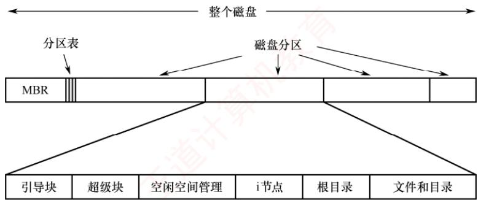

物理磁盘分区后，典型的文件系统磁盘布局自底向上依次为：

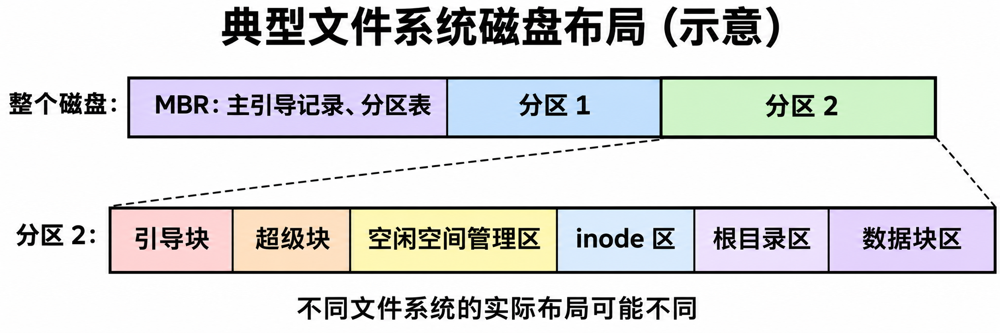

1. ***<u>主引导记录 (MBR, 0号扇区)</u>***：包含**主引导程序（引导计算机）**、**分区表（记录各分区起止并标记活动分区）**和**有效结束标志（AA55H）**。
2. ***<u>引导块 (Boot Block)</u>***：***<u>每个分区都必须以引导块开头（即使未装 OS 也保留该区域）</u>***。负责加载该分区内的操作系统内核。
3. ***<u>超级块 (Superblock)</u>***：整个文件系统的“大脑”，包含块大小、总块数、空闲盘块指针与数量、空闲 inode 指针与数量。**挂载时必须最先载入内存**。
4. ***<u>文件区 (Data Area)</u>***：占磁盘空间的绝大部分，因为文件长期驻留外存，访问频率相对较低，所以***<u>文件区管理的主要目标是提高存储空间的利用率</u>***。
- `【⚡ 真题补丁｜2017-T29】` 物理格式化划分扇区与校验码，随后分区；<mark>逻辑格式化建立根目录并初始化空闲管理结构</mark>。 `[真题·2017-T29]`

---

### 二、文件系统在内存中的动态结构

| 内存数据结构 | 驻留位置与生存期 | 核心功能与职责 |
|---|---|---|
| **内存挂载表 (Mount Table)** | 系统启动/挂载时建立，卸载时释放 | 记录所有已挂载文件系统的信息（设备名、挂载点、文件系统类型、超级块指针）。 |
| **目录项缓存 (Dentry Cache)** | 内存中动态缓存，随访问建立 | 缓存近期解析过的目录项对象，极大加速路径解析，减少磁盘目录读操作。 |
| **系统全局打开文件表** | 系统内核维护，全局唯一 | 缓存已打开文件的 inode 副本、系统级 `Open Count`、物理位置信息。 |
| **进程打开文件表** | 位于各进程 PCB 内部 | 维护进程打开的 `fd` 映射、**私有读写指针 offset** 和访问模式。 |
| **文件系统缓冲区池** | 内存 I/O 缓冲池 | 暂存读写磁盘的数据块与元数据块，<mark>磁盘缓冲区主要为了减少磁盘I/O次数</mark>。 `[真题·2015-T28]` |

---

## 4.3.2 外存空闲空间管理【🔥⚡ 必背+避坑｜停下来默背 1 遍 + 精读 1 分钟】

### 这一节要解决什么问题

文件系统如何跟踪、分配和回收磁盘上的未分配空闲块？位示图与成组链接法两大核心算法的计算与流转机制是什么？

---

### 一、空闲空间管理四大方法特性对比

| 管理方法 | 适用分配方式 | 获取连续空间的难易度 | 核心特点与管理开销 |
|---|---|---|---|
| **空闲表法** | 连续分配 | 容易 | 记录空闲区 `<起始块号, 块数>`，回收需合并相邻区，适合小文件系统。 |
| **空闲盘块链** | 离散分配 | ***<u>最难获得连续空间</u>*** | 以单块为节点链接，分配多块需遍历长链，效率最低。 |
| **空闲盘区链** | 连续 / 离散分配 | 较容易 | 以连续块区为节点链接，记录盘区大小，分配回收需处理分割与合并。 |
| **位示图法** | 连续 / 离散分配 | **容易** | 结构紧凑常驻内存，位操作极快；空间只取决于总容量。 |
| **成组链接法** | 连续 / 离散分配 | **容易** | UNIX 核心机制，将“分组+索引+栈”结合，解决超大磁盘管理表膨胀问题。 |

> [!important] 易错辨析：谁不属于空闲空间管理工具？
> - 属于空闲空间管理：空闲表、<mark>空闲磁盘块链、位图和FAT</mark>（FAT 表 `-2` 表示空闲块）、成组链接法； `[真题·2019-T26]`
> - ***<u>索引节点 (inode) 从不用于管理空闲空间</u>***（inode 仅用于记录单个已分配文件的元数据属性）。 `[真题·2019-T26]`

---

### 二、位示图法 (Bitmap)（408 高频计算大题考点）

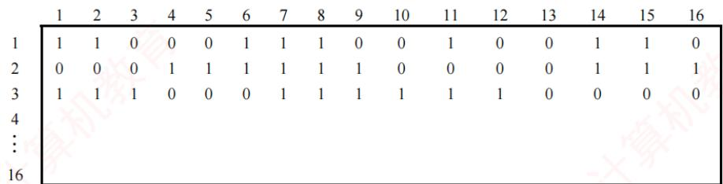

- **原理**：用位图中每一个二进制位（bit）对应磁盘上的一个物理盘块；同一方法也可用于表示内存页框是否空闲。
  - `0` 表示盘块**空闲**；
  - `1` 表示盘块**已分配（已占用）**。

#### 1. 字号、位号与盘块号的通用转换公式（设定每字包含 $n$ 位）

> [!warning] 必看陷阱：严格看清编号是从 0 开始还是从 1 开始

| 编号基准 | 给定 (字号 $i$, 位号 $j$) 求【盘块号 $b$】 | 给定【盘块号 $b$】求 (字号 $i$, 位号 $j$) |
|---|---|---|
| **从 0 开始编号**<br>(字号 $0 \dots$, 位号 $0 \dots n-1$, 块号 $0 \dots$) | $$b = i \times n + j$$ | $$i = \lfloor b / n \rfloor, \quad j = b \bmod n$$ |
| **从 1 开始编号**<br>(字号 $1 \dots$, 位号 $1 \dots n$, 块号 $1 \dots$) | $$b = (i - 1) \times n + j$$ | $$i = \lfloor (b - 1) / n \rfloor + 1, \quad j = (b - 1) \bmod n + 1$$ |

#### 2. 位示图大小计算规律

> [!important] 核心考点：位示图大小决定因素
> ***<u>位示图所占空间大小只取决于外存总容量与盘块大小（总块数）</u>***，<mark>占用空间与空闲盘块数量无关</mark>（如 16GB/4KB 磁盘位图固定占 512KB，10GB/4KB 占 80 簇）。 `[真题·2014-T27 / 2023-T25 / 2024-T26]`

> [!abstract] 💡 解题核心思考模型：位示图全套计算模板
> **【模型 1：求位示图自身占用的磁盘空间】**
> - 磁盘容量 10GB，盘块（簇）大小 4KB：
>   1. 总簇数 $= 10\text{GB} / 4\text{KB} = 2.5\text{M} = 2.5 \times 2^{20}$ 簇；
>   2. 位示图比特数 $= 2.5\text{M bits}$；
>   3. 位示图字节数 $= 2.5\text{M} / 8 = 320\text{KB}$；
>   4. 占用磁盘簇数 $= 320\text{KB} / 4\text{KB} = 80$ 簇。 `[真题·2014-T27]`
> 
> **【模型 2：位示图定位在磁盘中的物理块与块内字节】**
> - 盘块号 409612，每盘块 1024B（$8192\text{ bits}$），位示图从磁盘第 32 号块开始存储：
>   1. 所在位示图磁盘块号 $= 32 + \lfloor 409612 / 8192 \rfloor = 32 + 50 = 82$ 号块； `[真题易错·2015-T31]`
>   2. <mark>块内字节号须在余数基础上除以8</mark>，即 $= \lfloor (409612 \bmod 8192) / 8 \rfloor = \lfloor 12 / 8 \rfloor = 1$ 号字节。 `[真题易错·2015-T31]`

---

### 三、成组链接法 (Grouped Free-Block Linking)（UNIX 核心机制）【📌 扫一眼｜确认“我还会”就过】

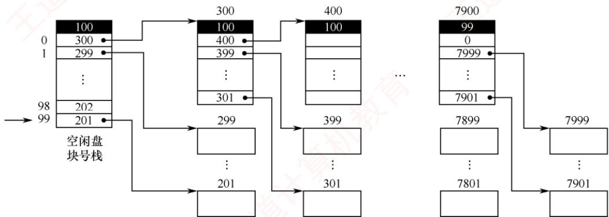

- **设计动机**：空闲表法与空闲链表法在超大磁盘下表格/链表过长，位示图在内存中占用过大。UNIX 创造性地采用**成组链接法**，将“分组”、“索引”与“链表”结合。

#### 1. 数据结构组织规则
1. 将全部分区空闲盘块划分为若干组（如**每组 100 块**）；
2. **除最后一组外，每组的第一个盘块（如第 100 块）兼做索引块**，存放下一组所有空闲块的块号以及下一组的空闲块总数；
3. 最后一组的索引块中，第一个盘块号填入 **`0` 作为整条链的终结标志**；
4. ***<u>第一组的空闲块总数与全部块号常驻内存，存放在超级块中的空闲盘块号栈中</u>***。

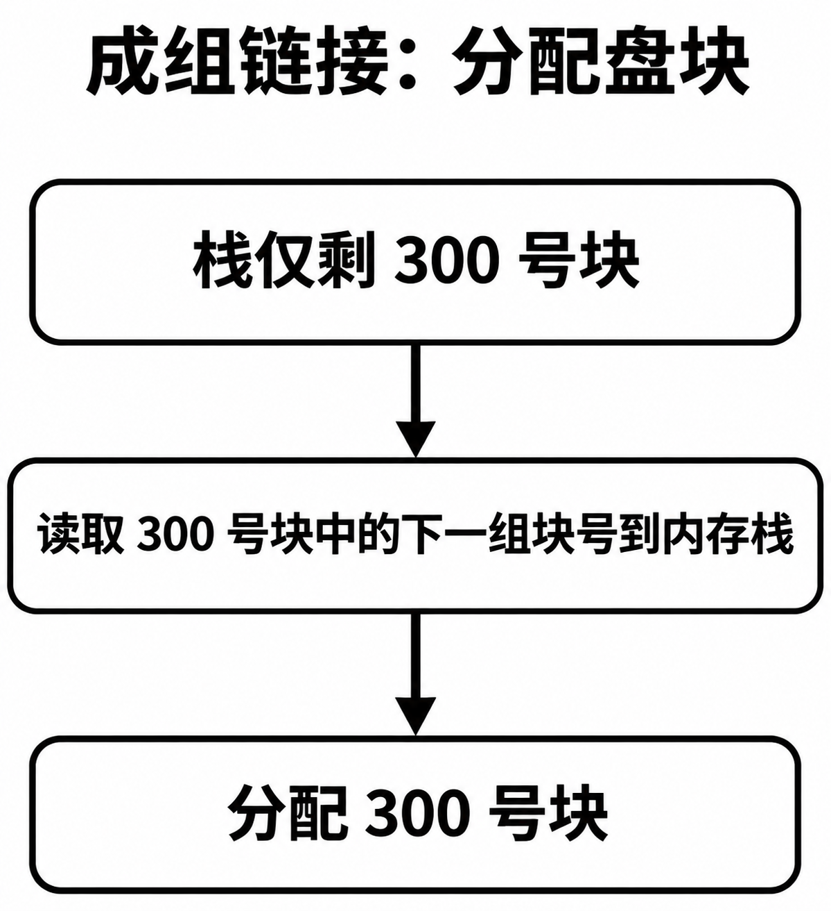

#### 2. 分配与回收流转过程

- **分配盘块**：
  1. 正常情况下，从内存栈顶弹出一个盘块号分配给用户，`top` 减 1；
  2. **当 `top` 降到栈底（仅剩最后一个盘块号 300）时**：先将 300 号物理块中保存的下一组块号列表**整体读入内存空闲盘块号栈**（刷新栈），然后将 300 号盘块本身分配出去。
- **回收盘块**：
  1. 正常情况下，将释放的盘块号压入内存栈顶，`top` 加 1；
  2. **当内存栈已满（达到 100 块）时**：将当前内存栈中的全部 100 个盘块号**整体写入新释放的这个盘块中**（使其成为新的磁盘索引块），随后清空内存栈，将该新盘块号填入栈底，置 `top = 1`。

---

## 4.3.3 虚拟文件系统 (VFS)【🔥 必背｜停下来默背 1 遍】

### 这一节要解决什么问题

现代 OS 同时支持 ext4、NTFS、FAT32、NFS 等多种文件系统。操作系统如何向上层用户提供完全统一透明的系统调用接口？

### 一、VFS 的核心定位与特点（2025 考点）

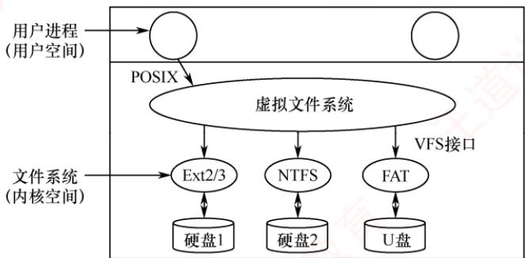

- **本质**：虚拟文件系统（VFS）是操作系统内核中的一个***<u>纯内存软件抽象层</u>***，位于应用程序与具体文件系统实现之间。
- **核心功能**：
  1. **向上**为用户程序<mark>定义并提供了统一的系统调用接口</mark>（`open, read, write, close`）； `[真题·2025-T28]`
  2. **向下**定义通用对象模型与函数指针规范，将通用请求分发给底层具体文件系统执行。
- **四大核心特征**：
  - ***<u>纯内存抽象：VFS 仅存在于内存中，在磁盘上没有任何存储结构，不占用任何外存空间</u>***；
  - **屏蔽差异**：屏蔽底层本地磁盘文件系统（ext4, NTFS）与网络文件系统（NFS）的格式与操作差异；
  - ***<u>不提升 I/O 速度：VFS 只是统一转发层，实际读写性能完全取决于具体文件系统和物理硬件</u>***；
  - **统一系统调用**：用户代码无需针对不同文件系统分别编写特定调用。

---

### 二、VFS 的四类核心对象（面向对象思想的内核实现）

| VFS 对象类型 | 概念与映射关系 | 核心数据成员 | 核心操作方法表 (函数指针) |
|---|---|---|---|
| **超级块对象 (Superblock)** | 代表一个**已挂载的具体文件系统**；对应磁盘超级块。 | 块大小、最大文件大小、文件系统类型、脏标志 | `alloc_inode()`, `destroy_inode()`, `write_super()`, `sync_fs()` |
| **V 节点对象 (Vnode / Inode)** | 代表内存中一个**具体的文件或目录**；统一封装不同系统的元数据。 | 文件大小、权限、UID/GID、时间戳、底层私有 inode 指针 | `create()`, `lookup()`, `mkdir()`, `rename()`, `setattr()` |
| **目录项对象 (Dentry)** | 代表**路径中的一个分量**（如 `/usr/bin` 中的 `bin`）；***<u>纯内存缓存</u>***。 | 目录项名称、父 dentry 指针、子 dentry 链表、**指向关联 vnode 的指针** | `d_compare()`, `d_delete()`, `d_release()`, `d_iput()` |
| **文件对象 (File)** | 代表**一次打开文件的实例**；进程调用 `open()` 时创建，复制或继承的描述符可引用同一打开实例。 | ***<u>当前读写位置指针 `f_pos`</u>***、打开标志 `f_flags`、引用计数、**指向关联 dentry 的指针** | `read()`, `write()`, `open()`, `release()`, `llseek()` |

> [!important] 辨析点：V 节点 (vnode) 与 磁盘 inode 的关系
> - **磁盘 inode** 是具体文件系统（如 ext4）在外存上的持久化元数据结构。
> - **V 节点 (vnode)** 是 VFS 为统一管理各类文件在内存中动态创建的抽象对象。V 节点内部包含指向具体文件系统私有 inode 的指针，以及一组标准化的函数指针表。不存在“进程对象”作为 VFS 核心对象类型。

---

### 三、系统调用穿透流程：以 `write(fd, buf, n)` 为例

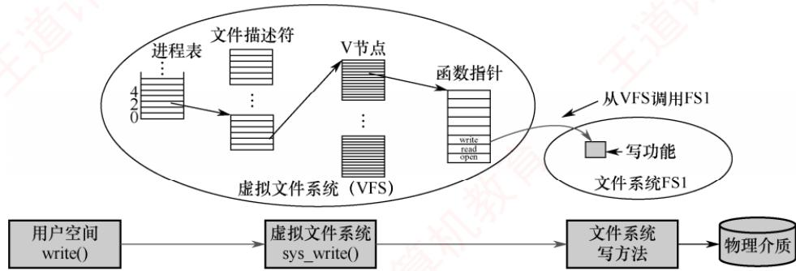

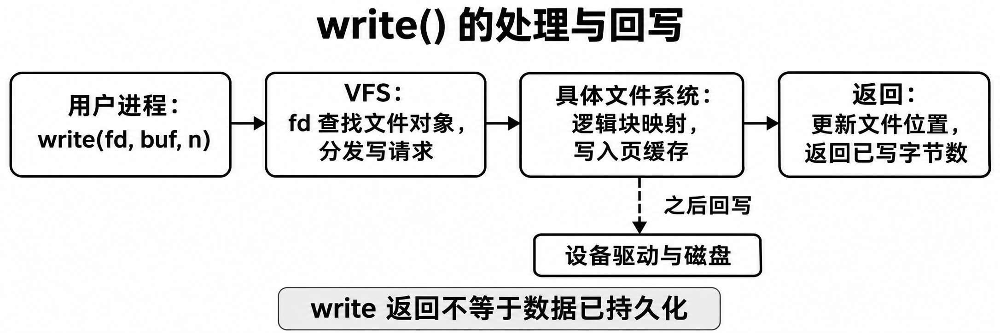

---

## 4.3.4 文件系统挂载 (Mounting)【📌 扫一眼｜确认“我还会”就过】

### 一、挂载机制与概念

- **挂载（装载 Mounting）**：指将某个物理存储设备（或磁盘分区）上的独立文件系统，连接并嵌入到操作系统现有的**全局目录树中的某个指定目录**的过程。
- **挂载点 (Mount Point)**：用于挂载新文件系统的目录节点（如 Linux 中的 `/mnt`, `/media/cdrom`）。

### 二、挂载规则与两大操作系统对比

1. **UNIX / Linux 体系（单一树状结构）**：
   - 整个系统以单一的**根文件系统（Root File System `/`）**为基准，系统启动时由内核最先自动挂载；
   - 其余所有设备分区必须作为子树挂载到根目录下的某个**挂载点**；
   - **挂载行为特点**：一旦将新文件系统挂载到某目录，该目录下原本存在的文件将被暂时**隐匿（不可见）**，直到该文件系统被卸载 (`umount`)；
   - ***<u>同一个设备可以被挂载到多个不同的挂载点；但同一个挂载点在同一时刻只能挂载一个设备</u>***。
2. **Windows 体系（多驱动器树状结构）**：
   - 传统采用**驱动器盘符（Drive Letters, 如 `C:`, `D:`）**分别维护各自独立的目录树；
   - 现代 Windows 也支持将卷直接挂载为 NTFS 文件夹装入点（行为与 Unix 挂载点类似）。

---

# 4.4 本章疑难点与深度辨析【⚡ 避坑｜最值钱，必须精读 1 分钟】

## 1. 文件的物理分配方式全维度大对比【📌 扫一眼｜确认“我还会”就过】

| 特性维度 | 连续分配 | 隐式链接分配 | 显式链接 (FAT) | 单级索引分配 | 多级索引分配 | UNIX 混合索引分配 |
|---|---|---|---|---|---|---|
| **支持随机存取** | 支持 ($O(1)$) | 不支持 ($O(N)$) | 支持 (内存遍历) | 支持 ($O(1)$) | 支持 ($O(\text{级数})$) | 支持 ($O(1) \sim O(4)$) |
| **顺序读写性能** | 极快 (寻道极少) | 较慢 (磁头频繁寻道) | 较快 (FAT在内存) | 较快 | 较快 | 小文件极快，大文件良好 |
| **外存碎片问题** | 严重外部碎片 | 无外部碎片 | 无外部碎片 | 无外部碎片 | 无外部碎片 | 无外部碎片 (仅有末块内部碎片) |
| **动态扩展能力** | 极差 (需大平移) | 极好 (动态连块) | 极好 | 良好 (受限单块) | 极好 | 极好 (支持TB级特大文件) |
| **额外空间开销** | **0** (仅存起始和长度)| 需块内指针开销 | FAT 常驻内存开销 | 需单独索引块 (小文件浪费) | 需多级索引块开销 | **最优权衡** (小文件直接指针零浪费) |
| **典型代表场景** | 光盘/只读介质、磁带 | 传统链式文件 | MS-DOS, FAT32 | 简单嵌入式系统 | 大文件系统 | **Linux ext2/ext3/ext4, UNIX UFS** |

---

## 2. 从 `open()` 到 `read()`/`write()` 再到 `close()` 全链路数据结构联动【🔥⚡ 必背+避坑｜停下来默背 1 遍 + 精读 1 分钟】

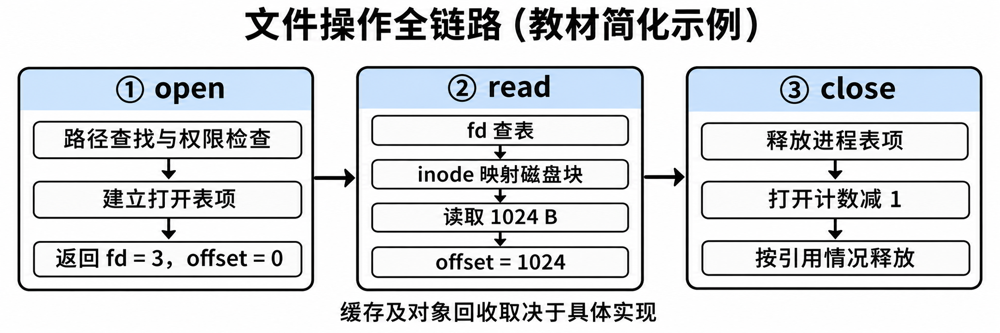

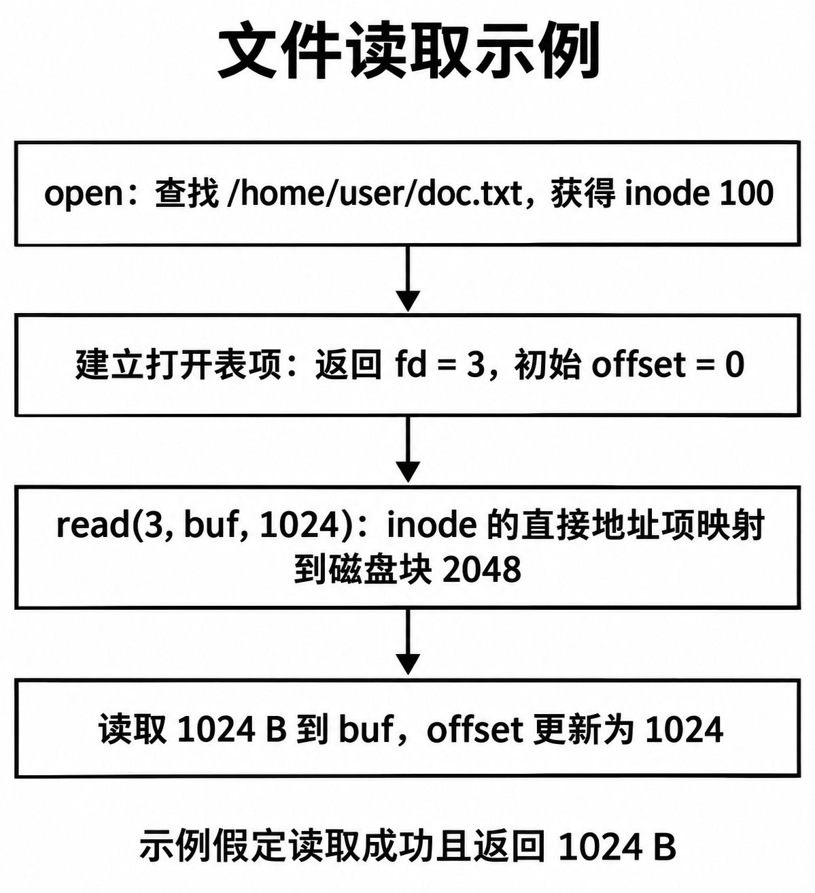

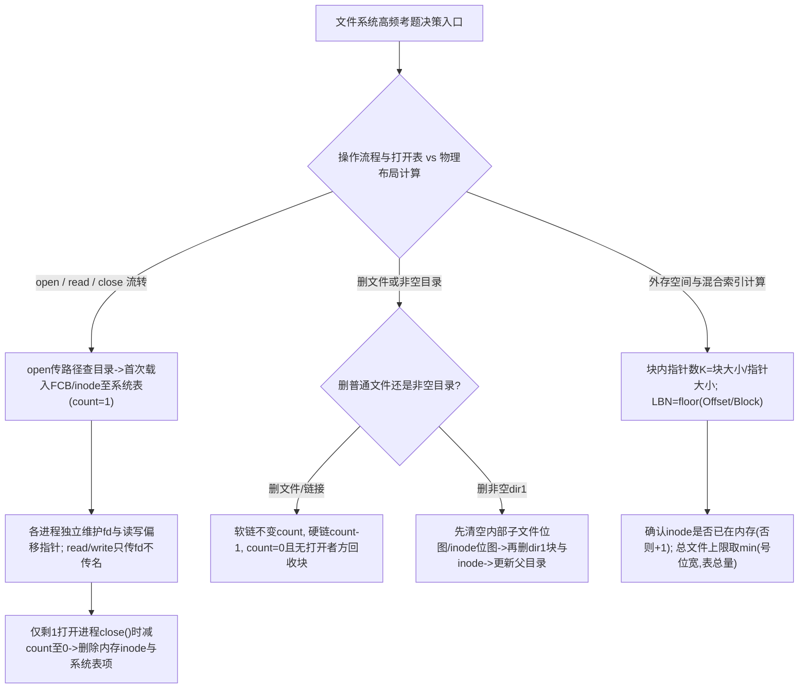

---

## 3. 操作系统各种“表”与“结构”的驻留位置与归属全景总结【🔥 必背｜停下来默背 1 遍】

| 数据结构名称 | 所处介质 | 归属范围 | 核心职责 |
|---|---|---|---|
| **磁盘 inode / FCB** | 物理磁盘 (外存) | 全局分区唯一 | 文件的永久静态档案（物理位置、权限、大小、硬链接数）。 |
| **内存 inode (Active inode)** | 物理内存 | 全局内核共享 | 被打开文件的动态元数据（附加锁、脏位、内存引用计数）。 |
| **V 节点 (vnode)** | 物理内存 | 全局内核共享 | VFS 的通用文件抽象对象，包含底层文件系统函数操作指针。 |
| **系统全局打开文件表** | 物理内存 | 全局内核共享 | 维护全系统所有进程打开的文件清单，记录全局 `Open Count`。 |
| **进程独立打开文件表** | 物理内存 (PCB内) | 各进程私有 | 维护进程打开的 `fd` 映射、**私有读写指针 offset** 和访问模式。 |
| **文件分配表 (FAT)** | 磁盘存储，**启动载入内存** | 全局分区唯一 | 记录文件的物理块显式链表关系，兼管空闲盘块。 |
| **位示图 (Bitmap)** | 磁盘存储，**挂载载入内存** | 全局分区唯一 | 用 bit 位精确管理全部分区盘块的分配与空闲状态。 |
| **成组链接空闲栈** | 超级块中，**挂载载入内存** | 全局分区唯一 | 以栈的形式高效分配和回收空闲盘块。 |

---

# 本章高频题型总表

| 题干特征 | 优先方法/起手式 | 真题印证与避坑 |
|---|---|---|
| 混合索引容量、上限与偏移访盘次数 | 先算每块指针数 $K$ 与逻辑块号 `LBN = floor(Offset/Block)`；再看 inode 是否已在内存 | `[真题·2015-T29 / 2022-T45 / 2026-T46]` 总文件数受限于 $\min(\text{inode号位宽}, \text{inode表总项数})$（`2018-T46`）；`inode` 总数无关单文件最大长（`2013-T26`） |
| 连续/链接分配插入记录与 FAT 容量 | 连续移动读写各 1 次/块；FAT 簇数由表项位宽 $2^N$ 决定且兼标空闲块 | `[真题·2014-T46 / 2016-T47 / 2025-T31]` 簇按整簇分配，超 1B 即多给 1 整簇（`2017-T26`）；链表插第 30 条 29 读+2 写=31 次 |
| 位示图占用空间与物理块/字节定位 | 空间=`总块数/8`（与空闲数无关）；块号=`起始块+LBN/(块长*8)`，字节号=`余数/8` | `[真题·2014-T27 / 2015-T31 / 2023-T25]` 漏加位图起始块号或把位号当字节号是常见错误（`2024-T26`） |
| 目录结构、`open/read/close` 与两级打开表 | `open` 查路径载 FCB/inode 到系统表（1 项）；`read` 仅传 `fd`；各进程独立偏移 | `[真题·2012-T28 / 2017-T31 / 2020-T23 / 2023-T30]` 唯一打开者 `close()` 删除内存 inode（非磁盘 inode）；新建文件不在目录项存权限细节（`2025-T29`） |
| 硬/软链接计数变化与非空目录删除 | 硬链接共享 inode 改 `count`；软链接独立 inode 不改原计数且删原不自删 | `[真题·2009-T31 / 2021-T30 / 2026-T46]` 删除非空目录必先释放其内部子文件数据位图与 inode 位图，再删目录本身与更新父目录 |

---

# 高频易混概念对比【⚡ 避坑｜最值钱，必须精读 1 分钟】

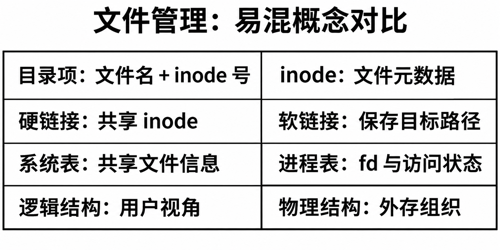

---

# 选择题快速判断结论【🔥⚡ 必背+避坑｜停下来默背 1 遍 + 精读 1 分钟】

1. **极限表述检查**：
   - “打开文件会将文件数据全部读入内存” $\to$ **完全错误**（只读入元数据 FCB/inode 到打开文件表，读写时才按需调块）。
   - “只要执行 close() 就会把文件数据写回磁盘” $\to$ **错误**（关闭与数据持久化并不等价；回写时机取决于缓存及具体实现）。
   - “硬链接可以跨越不同的文件系统/分区” $\to$ **完全错误**（inode 仅在当前分区内唯一，只有软链接能跨分区/跨网络）。
   - “删除软链接会导致源文件被删除” $\to$ **完全错误**（软链接删除不影响目标文件；保存的目标路径无法解析时软链接变成悬空链接）。
   - “VFS 是一种运行在虚拟内存中的新型文件系统” $\to$ **完全错误**（VFS 是纯软件抽象层，本身不是真实文件系统，不存数据）。
2. **读写指针归属**：
   - 按教材模型，两个进程分别打开同一文件，通常有各自的读写指针；若通过继承或复制共享打开对象，应以题设为准。
3. **打开计数与释放条件**：
   - 教材模型中，打开计数为 0 后可以释放相应打开状态；inode 是否回收还要考虑其他引用及缓存，硬链接计数是另一种计数。
4. **位示图大小决定因素**：
   - 位示图占用空间大小**只取决于外存总容量与盘块大小**，与当前有多少块空闲毫无关系。
5. **重名允许范围**：
   - 严格禁止重名的唯一范围是“同一个磁盘的同一个目录下”；不同磁盘或不同目录下均允许同名。

---

# 本章刷题顺序建议

1. **第一阶段（基础概念过关）**：
   - 掌握文件系统 4 层层次结构与各自职责（逻辑文件系统 vs 文件组织模块）；
   - 清晰区分无结构流式文件与记录式文件（顺序、索引、索引顺序分块查找）；
   - 牢记树形目录中当前工作目录的作用与相对路径优势。
2. **第二阶段（经典计算专题攻坚）**：
   - **混合索引专题**：刷透 UNIX inode 13 地址项容量计算与多级访盘次数题（2010、2015、2018、2022 真题）；
   - **FAT 与位示图专题**：熟练掌握字位号换算、FAT 表项位数与最大支持容量计算（2014、2016、2023 真题）；
   - **FCB 分解法专题**：深刻理解目录项精简对磁盘 I/O 次数的倍减效应。
3. **第三阶段（内核机制与流程串联）**：
   - 闭卷画出 `open()` $\to$ `read()/write()` $\to$ `close()` 期间系统打开表、进程打开表、inode 与 fd 的流转图；
   - 深度对比硬链接与软链接在创建、删除、计数器、跨分区等维度的全场景表现；
   - 掌握 VFS 四大对象（超级块、vnode、dentry、file）与成组链接法分配回收栈机制。
4. **第四阶段（真题综合大题回填）**：
   - 精做 2016（FAT 目录树）、2018（混合索引）、2022（inode 与目录项综合题）、2026（删除非空目录与 inode 表定位）考点题，将错题与解题心得回填至下方错题区。

---

# 小节自测清单

- [ ] 能否准确画出 UNIX 13 个地址项的混合索引结构，并独立计算各区间的容量与访盘次数？
- [ ] 能否推导索引顺序文件在 $m = \sqrt{N}$ 时的最优平均查找次数？
- [ ] 能否清晰解释为什么 FCB 分解（inode 机制）能显著减少目录查找的磁盘 I/O 次数？
- [ ] 能否完整复述 `open()` 系统调用的 5 个内核步骤，并说明为什么后续读写只传 `fd` 不传文件名？
- [ ] 能否准确说出系统打开文件表与进程打开文件表的字段差异与私有/共享关系？
- [ ] 能否列举硬链接与软链接的 5 大核心区别，并分析删除源文件后两者的不同表现？
- [ ] 能否熟练运用位示图字位号转换公式（准确区分从 0 还是从 1 开始编号）？
- [ ] 能否用一句话概括 UNIX 成组链接法在分配与回收时的“栈顶/栈底”核心流转动作？
- [ ] 能否准确说出 VFS 虚拟文件系统的四大对象（superblock, vnode, dentry, file）及其纯内存抽象本质？

---

# 刷题后补充区

> [!todo] 错题回填
> 刷题遇到错题时，不抄冗长题干，只提炼：错因、关键隐藏条件、正确切入点、可复用结论与下次检查动作。

## 错题模板示例：混合索引特定偏移量访盘次数

- **错因**：误将字节偏移量直接当成了逻辑块号去比对地址项，导致区间判断错误；或者漏看了“inode 已在内存”的前提。
- **关键条件**：磁盘块大小 4KB，地址项占 4B，题目指明“inode 已读入内存”。
- **正确切入点**：先用 $\lfloor \text{Offset} / 4\text{KB} \rfloor$ 计算逻辑块号，再判断落在哪个间址区间。
- **可复用结论**：直接区访盘 1 次，一次间址访盘 2 次，二次间址访盘 3 次，三次间址访盘 4 次（若 inode 未在内存，每项结果额外 $+1$）。
- **下次检查动作**：做题第一步：圈出“inode 是否在内存”和“数据块大小”。

---

# 冲刺主动回忆卡（遮挡自测）

### 卡片 1｜两级打开文件表与 `open()/read()/close()` 核心边界
多个进程分别打开同一文件或其硬链接 `f1/f2` 时，各自文件描述符、读写指针、系统打开表项与内存 inode 是共享还是独立？只有唯一进程打开文件后调用 `close()` 会删除磁盘 inode 吗？

> [!success]- 正确解释
> 1. **系统表 vs 进程表**：系统中所有打开者对同一文件在系统全局打开文件表仅占 1 项（含系统级 `Open Count` 和共享的内存 inode 副本）；但各进程拥有各自的**进程打开文件表**，获得独立的 `fd` 并维护**各自私有的读写位置指针**（`2017-T31`、`2020-T23`）。
> 2. **系统调用分工**：`open()` 传路径名查目录并首次将 **FCB/inode** 载入内存（不读内容、`create` 也不在目录项写访问控制权限细节）（`2014-T29`、`2024-T29`、`2025-T29`）；`read()` 传 `fd`、不传文件名（`2012-T28`）；仅单一进程打开时 `close()` 减引用计数至 0，会删除**内存 inode 与系统打开表项**，**绝不删除磁盘 inode**（`2023-T30`）。

### 卡片 2｜混合索引逻辑块号换算与最大文件/数量上限
为什么 inode 总数不影响单文件最大长度？当磁盘块 4KB、指针 4B、5 个直接块时，访问字节偏移 `21460`（设 inode 已在内存）需读几块盘？系统可创建的最大文件数取决于什么？

> [!success]- 正确解释
> 1. **单文件长度 vs 文件总数**：单文件最大长度仅由**块大小、地址项数与间接级数**决定，与 `inode` 总数无关（`2013-T26`）；而系统可创建最多文件数受制于 **`min(目录项inode号位宽上限 2^(8N), 磁盘inode表容量总项数)`**（`2018-T46`、`2020-T31`、`2026-T46`）。
> 2. **偏移换算陷阱**：逻辑块号从 0 编号，`LBN = floor(21460 / 4096) = 5`；前 5 个直接块对应下标 `0..4`，故 `LBN=5` 刚好跨入**一级间接**，共需读 **2 块**（1 次读一级间接索引块 + 1 次读数据块，若 inode 未在内存则再 $+1$）（`2015-T29`、`2022-T45`、`2026-T46`）。

### 卡片 3｜位示图定位、FAT 空闲管理与连续/链接增删差异
计算位图占用磁盘块数与空闲块数有关吗？在起始盘块 32、每块 1KB 的位图中定位第 409612 号块的块内“字节号”怎么做？删除非空目录 `dir1` 时的标准动作顺序是什么？

> [!success]- 正确解释
> 1. **位图公式**：位图大小仅由**外存总块数**决定，与当前剩余空闲块数无关（`2024-T26`）；定位块号 = `起始块号 + floor(块号 / (块字节 * 8))` = `32 + floor(409612 / 8192) = 82`，**块内字节号 = `floor(余数 / 8)` = `floor(12 / 8) = 1`**（注意别把余数位号当字节号，`2015-T31`）。
> 2. **空闲管理家族**：位图、空闲盘块链与 **FAT**（既串显式链又标空闲/已用）均可管理外存空闲空间；**inode 仅描述已分配文件，不管理空闲块**（`2019-T26`、`2025-T31`）。
> 3. **删除非空目录 `dir1`**：必须先清空其内子文件 `file`（释放 `file` 数据块位图 + `file` 的 inode 位图 + 删目录项），再释放 `dir1` 自身数据块位图与 inode 位图，最后从父目录删 `dir1` 目录项并更新父目录属性（`2026-T46`）。

### 卡片 4｜硬链接 vs 软链接计数与删文件/悬空规则
文件 `F1`（`count=1`）先后建立软链接 `F2` 和硬链接 `F3`，然后删除源文件 `F1`，此时 `F2` 还在吗？`F3` 的计数和访问状态如何？能跨分区建硬链接吗？

> [!success]- 正确解释
> 1. **计数与删除推演**：建软链 `F2` 不影响 `F1.count`（仍为 1，`F2` 为独立 LINK 文件计数为 1）；建硬链 `F3` 使共同指向同一 inode 的计数升至 2；删 `F1` 后仅删 `F1` 目录项、`count` 减 1 变 `1`，**物理数据不释放**，`F3` 可继续访问（`2009-T31`）。
> 2. **软链接表现**：删除源文件后系统**不自动删除软链接**（仅路径解析失败成悬空死链），反之删除软链接也不删除源文件（`2021-T30`）。硬链接不可跨分区建立且一般禁止目录硬链接；软链接支持跨分区/跨网络且可链目录。

### 卡片 5｜连续/链式记录插入访盘数、逻辑格式化与 VFS
向 200 条记录的第 30 条前插入 1 条新记录，在连续分配与隐式链接下分别最少访盘多少次（每次读/写算 1 次）？逻辑格式化与 VFS 的核心定位是什么？

> [!success]- 正确解释
> 1. **连续 vs 链接插入**：连续分配需前移前 29 条（读 29 + 写 29 = 58 次）再写入第 30 条（+1 次）= **59 次**，同时更新 FCB 起始块号与长度；隐式链接只需顺着读前 29 块定位第 29 块、写新第 30 块并写回改指针的第 29 块 = **31 次**（`2014-T46`）。
> 2. **格式化 vs VFS**：低级（物理）格式化建扇区与校验码；**逻辑格式化**建立根目录并初始化空闲块管理数据结构（`2017-T29`）。**VFS** 是仅存在内存中的软件抽象层，为各类异构文件系统提供**统一系统调用接口**（`2025-T28`）。
