# 第5章 输入/输出（I/O）管理

> [!important] 近 18 年 408 操作系统真题雷达（2009—2026）
> [[00_408操作系统｜考前急救与真题落点总控|返回操作系统总控]]
> - **考频定位**：第 5 章共命中 **22 道单选题** 与 **3 道操作系统综合大题**（`2010-T45` 磁盘位图+C-SCAN+Flash 选型、`2019-T44`[特例] 磁盘物理参数+SSTF+逻辑号转 CHS、`2023-T46` 键盘输入全链路与态切换），另有 **2 道计组-OS 跨科硬件协同大题**（`2019-T46`、`2022-T44`）。
> - **高频靶区**：① I/O 控制方式与 DMA 流程/跨科耗时（`2017-T32`、`2019-T46`、`2022-T44`）；② I/O 软件四层职责与键盘/鼠标 ISR 去向（`2010-T32`、`2011-T26`、`2012-T26`、`2013-T25`、`2022-T32`、`2024-T31`、`2026-T31`、`2026-T32`、`2023-T46`）；③ 设备独立性、SPOOLing 与单/双缓冲计算（`2009-T32`、`2011-T31`、`2013-T27`、`2016-T31`、`2020-T30`、`2023-T32`）；④ 机械磁盘调度与 SSD 共性（`2009-T29`、`2010-T45`、`2012-T32`、`2015-T32`、`2018-T30`、`2019-T44`、`2021-T26`、`2024-T32`、`2025-T32`）。

> [!abstract] 本章复盘目标
> 本章围绕**“操作系统如何高效管理种类繁多、速度悬殊的外部设备”**这一核心主线展开。主要包括三个层次：
> 1. **底层硬件与控制抽象**：I/O 接口（控制器）、端口编址（独立编址 vs 统一编址）以及四大 I/O 控制方式（程序直接控制、中断驱动、DMA、通道）的演进与权衡；
> 2. **软件分层与核心机制**：I/O 软件五层架构、单缓冲/双缓冲/循环缓冲/缓冲池工作时间计算模型、设备分配四叉树结构（DCT-COCT-CHCT-SDT）以及 SPOOLing 假脱机技术的“独占转共享”改造；
> 3. **外存介质管理与调度**：机械磁盘的物理结构与编址、三部分存取时间构成与八大磁盘调度算法（FCFS、SSTF、SCAN、C-SCAN、LOOK、C-LOOK、N-Step-SCAN、FSCAN）、扇区交替编号与错位命名优化，以及固态硬盘（SSD）的闪存特性、FTL 翻译层与动态/静态磨损均衡机制。
> 
> 复习时务必攻克**单/双缓冲时间计算、DMA 工作流程与中断触发时机、SPOOLing 组成与打印机死锁防范、磁盘存取与调度移动距离计算、扇区交替读取延迟分析以及 SSD 读写/擦除单位与磨损均衡**等统考核心必考点。

## 考纲定位

- **I/O 管理概述**：
  - I/O 设备概念、分类（按使用特性、信息交换单位【块/字符】、传输速率、共享属性【独占/共享/虚拟】）。
  - I/O 接口（设备控制器）：功能（控制、缓冲、状态、地址识别、电平转换）、组成（与CPU接口、I/O逻辑、与设备接口）。
  - I/O 端口与编址：独立编址（I/O 映射）与统一编址（内存映射 I/O）原理、指令与优缺点。
  - I/O 控制方式：程序直接控制（轮询）、中断驱动（工作过程、请求进程状态）、DMA 方式（DMA 控制器结构、传输单位、CPU 干预时机、传输流程）、通道控制方式（通道指令与程序、分流 CPU、三类通道类型）。
  - I/O 软件层次结构：用户层软件、设备独立性软件、设备驱动程序、中断处理程序、硬件；跨层系统调用与中断流转全流程。
  - 应用程序 I/O 接口：字符设备接口、块设备接口、网络设备接口；阻塞 I/O 与非阻塞 I/O。
- **设备独立性软件**：
  - 设备独立性概念与主要职能（逻辑/物理设备映射、设备保护、差错处理、设备分配与回收）。
  - 高速缓存与缓冲区：磁盘高速缓存（Disk Cache） vs 缓冲区（Buffer）；单缓冲、双缓冲（时间计算公式推导与流水线吞吐率）、循环缓冲、缓冲池（三大队列与四种工作缓冲区角色）。
  - 设备分配与回收：数据结构（DCT、COCT、CHCT、SDT）、分配考虑因素（固有属性、分配算法、安全性：安全分配 vs 不安全分配）、四步分配流程、逻辑设备表 LUT。
  - SPOOLing 技术（假脱机）：核心原理、组成（输入井/输出井、输入/输出缓冲区、输入/输出进程、井管理程序）、共享打印机实例与特点。
- **磁盘和固态硬盘**：
  - 机械磁盘：盘片、磁道、扇区、柱面、磁头；物理地址结构 `⟨柱面号, 盘面号, 扇区号⟩` 的排列依据；容量计算。
  - 磁盘管理：初始化（低级/物理格式化 vs 分区 vs 逻辑/高级格式化）、引导块与引导过程（ROM BIOS → MBR → 活动分区 PBR → OS 内核）、坏块管理（扇区重定位备用）。
  - 磁盘调度算法：存取时间构成（$T_a = T_s + T_r + T_t$）；FCFS、SSTF、SCAN、C-SCAN、LOOK、C-LOOK、N-Step-SCAN、FSCAN 原理、磁道序列与寻道距离计算；减少旋转延迟方法（扇区交替编号、错位命名）；提高 I/O 速度方法（Cache、预读、滞后写、RAM 盘）。
  - 固态硬盘（SSD）：NAND 闪存、读写以页（Page）为单位、擦除以块（Block）为单位、目标物理页须处于已擦除状态（异地更新）、闪存翻译层 FTL、磨损均衡（动态 vs 静态）。

> [!tip] 命题特点
> 1. **计算题型高度集中且模型固定**：
>    - 缓冲区流水线处理时间计算（单缓冲 $\max(T, C) + M$、双缓冲 $\max(T, C+M)$，2011、2013 统考）；
>    - 磁盘存取时间与寻道距离计算（各调度算法磁道遍历序列与平均移动距离，2010、2014、2018、2020 统考）；
>    - 磁盘扇区交替编号与错位命名的连续读盘延迟时间分析（综合大题常考模型）；
>    - 磁盘容量与簇号到物理地址的转换（2019 统考）。
> 2. **概念辨析考查细致且陷阱密集**：
>    - 中断处理程序执行时**发起 I/O 请求的进程处于阻塞态**，而非运行态或就绪态（2017、2023 统考）；
>    - DMA 控制器传输的数据单位是**连续的数据块**，CPU 仅在**传输开始前（初始化）和结束后（中断）**干预，传输过程中由 DMAC 控制总线（2017 统考）；
>    - 设备独立性软件实现“逻辑设备名到物理设备名的映射”，而具体读写控制指令由**设备驱动程序**生成（2009、2020、2025 统考）；
>    - 物理格式化（低级格式化）由硬件厂商完成并划分物理扇区，逻辑格式化创建文件系统元数据（2017、2021 统考）；
>    - SSD 固态硬盘支持随机读写、无机械寻道与旋转延迟，但存在**擦写寿命限制**与**目标物理页写入前须已擦除**特性（2025 新统考考点）。

## 章节知识脉络

1. **5.1 I/O 管理概述**：建立 I/O 系统的硬件基石与软件层次，理清设备控制器结构、端口独立/统一编址、四种 I/O 控制方式（轮询、中断、DMA、通道）的演进脉络，剖析应用程序到设备驱动的完整调用路径。
2. **5.2 设备独立性软件**：深入操作系统设备管理核心，全面攻克单/双缓冲与缓冲池时间计算，掌握 DCT-COCT-CHCT-SDT 四叉树分配机制与死锁安全策略，透视 SPOOLing 假脱机技术将独占设备虚拟改造为共享设备的精妙设计。
3. **5.3 磁盘和固态硬盘**：从传统机械介质走向现代闪存芯片，掌握磁盘地址排列机理与低级/高级格式化差异，熟练运用八大磁盘调度算法与扇区交替优化计算，攻克 SSD 闪存页/块不对称读写、FTL 映射与磨损均衡机制。
4. **5.4 本章疑难点与深度辨析**：透视设备多通路冗余分配策略，打通用户缓冲区、内核缓冲区与零拷贝（Zero-Copy）机制的数据流转全链路。

---

# 5.1 I/O 管理概述【🔥⚡ 必背+避坑｜停下来默背 1 遍 + 精读 1 分钟】

## 5.1.1 I/O 设备【🔥 必背｜停下来默背 1 遍】

### 这一节要解决什么问题

计算机外部设备种类繁多、物理特性与传输速率差异巨大（从低速键盘到高速磁盘）。操作系统如何对这些物理设备进行分类抽象？设备控制器（I/O 接口）如何充当 CPU 与外部设备之间的桥梁？CPU 又通过何种方式对控制器内部的寄存器进行编址与访问？

### 一、I/O 设备的分类

操作系统从四个维度对 I/O 设备进行多视角抽象分类：

| 分类维度 | 类别划分 | 核心特征与典型设备 | 对操作系统的管理要求 |
|---|---|---|---|
| **按使用特性** | **人机交互设备** | 传输速率低，以字节为单位，交互性强（如键盘、鼠标、显示器）。 | 响应及时，注重中断处理与字符流转换。 |
| | **存储设备** | 传输速率高，容量大，以数据块为单位（如机械硬盘、SSD、光盘）。 | 注重吞吐率、并发调度、寻道与旋转优化。 |
| | **网络通信设备** | 远程数据交换，速率跨度大（如网卡、调制解调器）。 | 结合网络协议栈，注重缓冲区与套接字管理。 |
| **按信息交换单位** | **块设备 (Block Device)** | 1. 传输以数据块（Block，如 512B~4KB）为单位；<br>2. ***<u>可寻址</u>***，支持***<u>随机存取</u>***；<br>3. 传输速率高，通常采用 DMA 方式控制。<br>典型设备：机械硬盘、固态硬盘 SSD、U 盘。<br><mark>块设备以数据块为单位支持随机存取</mark> `[真题·2026-T31]` | 需要支持块缓存、坏块管理及多级文件索引。 |
| | 字符设备 (Character Device) | 1. 传输以**字符/字节**为单位；<br>2. ***<u>不可寻址</u>***，只能***<u>顺序存取</u>***；<br>3. 传输速率低，通常采用中断驱动方式控制。<br>典型设备：键盘、鼠标、串口打印机。<br><mark>字符设备按字节流顺序访问且与块设备IO方式不同</mark> `[真题·2026-T31]` | 需要采用字符缓冲区队列与行规程管理。 |
| **按传输速率** | **低速设备** | 传输速率每秒几字节至数百字节（键盘、鼠标）。 | 采用简单的中断或轮询控制。 |
| | **中速设备** | 传输速率每秒数千字节至数百千字节（行打印机、激光打印机）。 | 结合缓冲区平衡速率差异。 |
| | **高速设备** | 传输速率每秒数百千字节至数百兆字节（磁盘、光盘、千兆网卡）。 | 常采用 DMA 等方式降低 CPU 干预频率。 |
| **按共享属性** | **独占设备** | 一段时间内***<u>仅允许一个进程访问</u>***的物理设备（如打印机、磁带机）。 | 分配策略***<u>可能引起进程死锁</u>***；利用 SPOOLing 改造成虚拟设备。 |
| | **共享设备** | 一段时间内***<u>允许多个进程并发交叉访问</u>***的设备（如磁盘）。<br>系统协调多个进程的访问顺序。 | 磁盘等共享设备可用调度算法优化访问次序；系统仍须正确管理其他互斥资源。 |
| | **虚拟设备** | 通过 **SPOOLing 假脱机技术**将***<u>一个物理设备变换成多个对应的逻辑设备</u>***，使多进程逻辑上共享独占设备。 | 由后台输入/输出守护进程统一管理作业流。 |

> [!important] 核心辨析：块设备 vs 字符设备 vs 共享设备（408 极高频选择题考点）
> - **块设备**的核心特征是***<u>可寻址、可随机存取、以块为单位</u>***；
> - **字符设备**（流设备）的核心特征是***<u>不可寻址、仅顺序存取、以字符为单位</u>***（绝不能寻址到特定字节）；
> - **共享设备**的核心特征是***<u>逻辑上供多个进程并发使用，物理访问由系统协调</u>***；教材第 5.1 节习题 1 的解题模型把可寻址、随机访问作为共享设备的条件，并认为共享设备本身的分配不引起死锁；同时要区分系统中其他互斥资源可能引起的等待。
> - **特别注意**：光盘（CD/DVD）虽然旋转读取，但属于***<u>块设备（可寻址）</u>***；磁带机虽然属于存储设备，但由于磁带物理结构只能从头拉带扫描，属于***<u>顺序存取设备</u>***。

---

### 二、I/O 接口（设备控制器）的结构与功能

CPU 无法直接驱动机械或电气特性的外设硬件，必须通过位于 CPU 与外设之间的硬件中介——**I/O 接口（又称设备控制器、适配器）**进行转换与控制。设备控制器通常向上层软件提供***<u>控制寄存器、状态寄存器和控制命令</u>***。

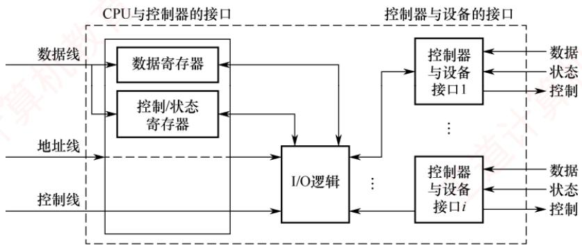

#### 1. 设备控制器的核心功能
1. **接收和识别 CPU 命令**：控制器内置***<u>控制寄存器</u>***与命令译码器，接收 CPU 发送的读、写、寻道等命令字；
2. **数据交换与缓冲**：控制器内置***<u>数据寄存器 / 缓冲区</u>***，在主机总线（高速）与外设（低速）之间暂存数据，消除速度失配；
3. **标识和报告设备状态**：控制器内置***<u>状态寄存器</u>***，记录设备的当前工作状态（忙 Busy、就绪 Ready、错误 Error 等），供 CPU 查询或通过中断汇报；
4. **地址识别**：识别 CPU 发出的控制器地址与内部寄存器端口地址；
5. **信号电平转换与格式适配**：将 CPU 的数字逻辑电平转换为驱动外设马达或传感器的特定电信号，并完成串/并格式转换。

#### 2. 设备控制器的三大组成模块
- **与 CPU 的接口**：连接系统总线，包含数据线、地址线、控制线。内含三类关键寄存器：
  - **数据寄存器 (Data Register)**：暂存 CPU 与设备之间传输的输入/输出数据；
  - **控制寄存器 (Control Register)**：***<u>由 CPU 写入</u>***，用于启动设备操作或设置工作模式；
  - **状态寄存器 (Status Register)**：***<u>由设备控制器写入，CPU 读取</u>***，指示设备当前是否就绪、忙碌或发生故障。
- **I/O 逻辑**：***<u>在设备控制器中用于实现设备控制功能的核心部件</u>***。负责对 CPU 发来的 I/O 命令进行译码、依据目标地址识别设备、向外设发出具体的物理驱动控制信号；
- **与设备的接口**：一个控制器可连接一个或多个物理设备。每个接口包含数据信号线、控制信号线与状态反馈线。

---

### 三、I/O 接口的分类

- **按数据传送方式**：并行接口同时传送一组数据位；串行接口逐位有序传送，接口可完成串并格式转换。
- **按主机控制方式**：可分为程序查询接口、中断接口和 DMA 接口。
- **按功能灵活性**：可编程接口可通过编程改变功能；另有不可编程接口。
- **按连接设备类型**：可分为字符设备接口、块设备接口和网络设备接口。

---

### 四、I/O 端口与编址方式

**I/O 端口（Port）**是指设备控制器中可以直接被 CPU 寻址并访问的寄存器（数据端口、控制端口、状态端口）。操作系统通过对这些端口的读写来实现对硬件的控制。

针对 I/O 端口的编址，体系结构中存在两种截然不同的设计哲学：

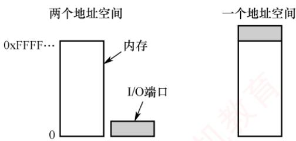

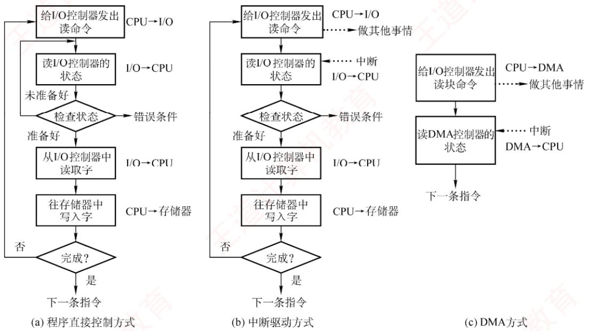

| 编址方式 | **独立编址 (Isolated I/O / I/O 映射)** | **统一编址 (Memory-Mapped I/O / 内存映射 I/O)** |
|---|---|---|
| **地址空间关系** | I/O 端口地址空间与主存物理地址空间***<u>完全独立、互不重叠</u>***。<br>（例如：I/O 端口地址 `0x0000~0xFFFF` 与内存 `0x0000~0xFFFF` 是两个完全不同的物理空间） | I/O 端口与主存单元***<u>统一规划在同一个物理地址空间</u>***中。<br>从主存空间中划出一固定地址段（如高端物理地址）分配给 I/O 端口。 |
| **访问指令** | 必须使用***<u>专门的 I/O 指令</u>***（如 x86 架构的 `IN AL, 21H`, `OUT 21H, AL`）。<br>属于***<u>特权指令</u>***。 | 使用***<u>所有通用的访存指令</u>***（如 ARM / RISC 架构的 `MOV`, `LOAD`, `STORE`）。<br>不需要专门的 I/O 指令。 |
| **优点** | 1. I/O 端口***<u>不占用主存物理地址空间</u>***；<br>2. 专用指令使程序意图清晰，易于硬件保护与访问控制；<br>3. I/O 地址译码器位数少（如 16 位），硬件译码速度快。 | 1. ***<u>无需专门的 I/O 指令</u>***，简化 CPU 指令集架构；<br>2. 可利用所有丰富的内存寻址方式（基址、变址、间址等）；<br>3. 保护机制直接复用内存管理单元（MMU）的页表权限控制。 |
| **缺点** | 1. 专用的 I/O 指令种类极少，寻址方式单调；<br>2. 控制逻辑相对独立复杂。 | 1. ***<u>占用了主存物理地址空间</u>***，减少了可用内存上限；<br>2. 通用访存指令执行周期通常长于专用 I/O 指令；<br>3. 需占用更多位的地址线进行全译码。 |
| **典型代表** | Intel x86 架构（兼具独立编址端口与内存映射能力）。 | ARM、MIPS、RISC-V、PowerPC 架构。 |

> [!abstract] 💡 解题核心思考模型：I/O 端口编址选项秒杀法则
> 1. **抓指令特征**：
>    - 题目出现“专用的 `IN`/`OUT` 指令”、“专用 I/O 寻址” $\implies$ **独立编址**；
>    - 题目出现“使用 `MOV`/`LOAD`/`STORE` 指令”、“CPU 像访问内存一样访问外设端口” $\implies$ **统一编址**；
> 2. **抓地址空间占用**：
>    - 题目问“哪种编址方式导致系统可用最大物理内存容量减小？” $\implies$ **统一编址**（占用主存高端地址）；
>    - 题目问“内存地址 `0x1000` 与 I/O 端口地址 `0x1000` 是否冲突？” $\implies$ 在独立编址下**不冲突**（由 CPU 控制总线信号 $\text{MEMR}/\text{IOR}$ 区分），在统一编址下**不允许重名**。

---

## 5.1.2 I/O 控制方式【🔥⚡ 必背+避坑｜停下来默背 1 遍 + 精读 1 分钟】

### 这一节要解决什么问题

CPU 与外设之间如何协同传输数据？随着计算机硬件的发展，I/O 控制方式经历了从“CPU 全程死等”到“硬件自主接管传输”的演进。这四种控制方式的工作原理、CPU 干预时机、数据传送单位有何本质差异？

### 一、四种 I/O 控制方式演进全景


#### 1. 程序直接控制方式（轮询方式 / Polling）
- **工作机制**：CPU 向设备控制器发出 I/O 读写指令，然后 CPU 进入忙等待循环（Busy-Waiting），不断读取状态寄存器的 `busy` 位，直到设备准备就绪，CPU 再从数据寄存器读入一个字到 CPU 寄存器，最后转存至内存。
- **数据传送单位**：***<u>字（Word）或字节（Byte）</u>***。
- **CPU 干预**：***<u>全程持续干预</u>***。在 I/O 准备期间，CPU 无法执行其他任务。
- **优缺点**：硬件设计极其简单；但 CPU 利用率极低，CPU 与外设严格串行，严重浪费算力。

#### 2. 中断驱动方式（Interrupt-Driven I/O）
- **工作机制**：
  1. 进程发起 I/O 请求，CPU 向控制器发出 I/O 命令后，***<u>立即将该进程置为阻塞态（Blocked）</u>***，CPU 调度切换执行其他就绪进程；
  2. 设备控制器独立执行具体 I/O 操作；
  3. <mark>设备把输入数据存入控制器数据寄存器后触发中断</mark>（由设备控制器硬件写入数据寄存器并向 CPU 发送***<u>中断请求信号（INTR）</u>***，非 ISR 完成此步） `[真题·2026-T32]`；
  4. CPU 在当前指令周期的末尾检测到中断，保存被中断进程的上下文，转入执行***<u>中断处理程序</u>***；
  5. 中断处理程序从控制器数据寄存器读取一个字存入内存，并***<u>唤醒原请求 I/O 的阻塞进程（将其转入就绪态）</u>***；
  6. 中断返回，CPU 恢复执行被中断进程或重新调度。
- **数据传送单位**：***<u>字（Word）或字节（Byte）</u>***。
- **CPU 干预**：***<u>每个字/字节传输完成后中断干预一次</u>***。
- **优缺点**：实现了 CPU 与 I/O 设备的并行工作，显著提高了 CPU 利用率；但对于高速设备（如磁盘、网卡），每传输一个字就发生一次中断，频繁的保存/恢复上下文开销将使系统不堪重负（发生“中断风暴”）。

> [!important] 考点追踪（2017、2023 统考真题核心考点）
> 在教材讨论的阻塞式 I/O 模型下，外部设备发出中断请求，CPU 尚未唤醒该请求进程时，**发起该 I/O 请求的进程处于什么状态？**
> $\to$ **处于阻塞态（Waiting / Blocked）。**
> 因为请求 I/O 的进程在发起系统调用后即被阻塞并让出 CPU；中断发生时 CPU 执行的是内核中断服务例程（处于中断上下文），直到中断处理程序将数据搬运完毕并调用唤醒原语，该进程才被转移至就绪队列（变为就绪态）。

---

#### 3. DMA 方式（直接内存存取 / Direct Memory Access）

为解决中断驱动方式在高速块设备下频繁中断的缺陷，引入了 **DMA 方式**。

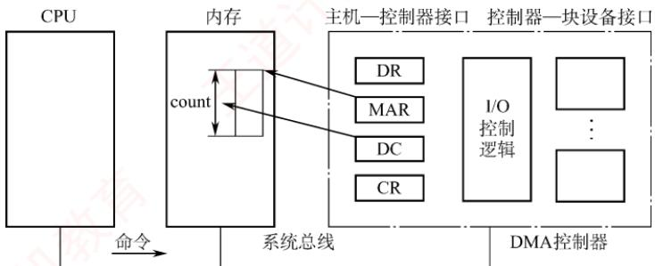

- **核心机制**：在设备控制器与主存之间开辟一条***<u>直接数据通路</u>***，由专门的硬件——**DMA 控制器（DMAC）**直接控制总线，实现数据在设备与主存之间的成批高速传输，***<u>完全不经过 CPU 寄存器中转</u>***。
- **DMA 控制器的四大内部寄存器**：
  1. **主存地址寄存器 (MAR / Memory Address Register)**：存放数据在内存中的起始物理地址；每次传送一字后自动自增；
  2. **传送长度计数器 (DC / Count Register / 数据计数器)**：记录本次需要传输的数据总字节数或字数；每次传送一字后计数器减 1，减至 0 时触发中断；
  3. **数据缓冲寄存器 (DR / Data Buffer)**：暂存从设备读入或即将输出到设备的数据字；
  4. **控制/状态寄存器 (CR / SR)**：接收 CPU 写入的传输方向（读/写）、块大小等命令，并记录 DMA 控制器的当前状态。
  > [!important] 必记：DMAC 寄存器组成排除项
  > DMA 控制器仅负责内存与外设间的直接数据搬运，不执行函数调用或递归，***<u>从不包含堆栈指针寄存器（SP）</u>***。

- **DMA 传送工作三阶段**：
  1. **预处理（CPU 干预）**：请求 I/O 的进程在**内核态**执行驱动程序，向 DMAC 写入起始地址（MAR）、长度（DC）及启动控制命令（CR）。设置完毕后，***<u>该请求进程主动将其自身置为阻塞态（让出 CPU）</u>***，CPU 调度其他就绪进程运行；
  2. **数据传输（DMAC 自主接管）**：DMAC 申请占用系统总线（通过***<u>周期挪用/周期窃取</u>***方式），以***<u>数据块</u>***为基本单位，逐字直接将数据从设备写入内存（或从内存写入设备），<mark>整块传输期间完全不经过CPU寄存器</mark> `[真题·2017-T32]`；
  3. **后处理（CPU 干预）**：当 DC 计数器减至 0（整块数据全部传输完毕），DMAC 向 CPU 发送一个中断请求信号。CPU 响应中断，执行中断服务例程处理善后工作（**此时请求 I/O 的进程仍处于阻塞态**，直到中断例程读取状态并调用唤醒原语将其转入就绪态）。

> [!abstract] 💡 解题核心思考模型：DMA 数据读取标准执行时序（2017 统考真题）
> <mark>DMA流程依次为初始化传块发中断与ISR善后</mark> `[真题·2017-T32]`：
> $$\text{② 初始化 DMA 控制器并启动外设} \longrightarrow \text{③ DMA 控制总线传输整块数据} \longrightarrow \text{① DMA 发出中断请求} \longrightarrow \text{④ CPU 执行中断服务程序善后}$$

> [!warning] 易错点：DMA 传输期间 CPU 是否能访问内存？
> - **DMA 周期挪用（周期窃取）本质**：当外设准备好一个字时，DMAC 申请占用**一个总线存取周期**，将字写入内存；
> - 在这一个周期内，CPU 暂停访问内存（若 CPU 正在执行无需访存的内部指令或指令已命中指令 Cache，CPU **完全无需停顿，继续执行**）；
> - 在周期挪用模型中，每传送一个单位后让出总线。DMA 还可采用其他总线占用方式，应以题设为准。
> - **总线仲裁**：CPU 与 DMA 同时请求总线时如何仲裁取决于具体系统，不能不加条件地断言固定优先级。
> - `【⚡ 真题补丁｜2019-T46 / 2022-T44】` 计组跨科考磁盘 DMA 周期挪用：先按转速与每道容量算出单字或单块制备间隔，再统计传送请求总周期数与冲突停顿时间；DMAC 准备期仅不阻塞 CPU 访存。

---

#### 4. 通道控制方式（I/O Channel Control）

- **本质**：通道（Channel）是一种***<u>硬件功能弱化、专用于 I/O 操作的专用协处理器（硬件机制）</u>***。它拥有独立的通道指令集，能够执行存放在主存中的***<u>通道程序</u>***。
- **层级从属关系**：CPU $\xrightarrow{发出启动指令}$ 通道 $\xrightarrow{执行通道程序}$ 设备控制器 $\xrightarrow{发出电气信号}$ 设备。***<u>通道控制设备控制器，设备控制器控制设备工作</u>***（对于同一组命令三者严格串行控制）。
- **工作机制**：
  1. 用户进程发起复杂 I/O 请求（可能涉及多个分散的数据块、多个控制器与设备）；
  2. CPU 仅需在内存中编制好通道程序，向通道发出 `START I/O` 启动指令，并指明通道程序在内存的首地址；
  3. 通道硬件独立从内存中取出通道指令并逐条执行，自主控制设备完成一组极其复杂的连续或离散块 I/O 操作；
  4. 当整组 I/O 操作全部完成后，通道向 CPU 发出中断信号，汇报执行结果。
- **数据传送单位**：***<u>一组数据块（或跨多个设备的批处理块序列）</u>***。
- **CPU 干预**：***<u>极低（仅在启动通道程序与整批通道任务结束时干预）</u>***。
- **通道的三种硬件类型（选择题考点）**：
  1. **字节多路通道 (Byte Multiplexor Channel)**：包含多个子通道，以字节为单位交叉轮流服务大量低中速字符设备（如打印机、终端）；
  2. **数组多路通道 (Block Multiplexor Channel)**：以数据块为单位，分时交叉服务多个高速设备（如磁盘组）；
  3. **选择通道 (Selector Channel)**：在一段时间内由某一台高速设备独占通道，传输完一整批数据后再切换给另一台设备。

---

### 二、中断处理机制的软硬件分工与 CPU 开销模型

#### 1. 中断处理过程的软硬件分工（高频必考）

- **【硬件完成（中断隐指令）】**：
  1. 关中断（屏蔽更低优先级中断）；
  2. 保存断点（硬件自动将当前 `PC` 和 `PSW` 压入中断栈）；
  3. 识别中断类型并引出中断向量（跳转到对应 ISR 入口）；
  4. CPU 模式切换（特权级从用户态切换为内核态）。
- **【软件完成（中断服务程序 ISR）】**：
  1. 保存通用寄存器上下文；
  2. ***<u>执行具体的数据输入/输出操作（从控制器数据寄存器读取数据写入内存，即“主机获取设备输入”必须由软件执行指令完成）</u>***：<mark>由ISR把数据从数据寄存器读到内核缓冲区</mark> `[真题·2024-T31 / 2026-T32]`；
  3. 检查设备状态并清除控制器中断标志位；
  4. 唤醒等待该 I/O 的阻塞进程；
  5. 恢复通用寄存器、开中断；
  6. 执行 `IRET` 指令返回（**若存在高优先级进程抢占或多重中断嵌套，中断结束后不一定会立即返回原被中断进程**）。

#### 2. 中断 CPU 系统开销占比计算通用模型

$$\text{每秒中断次数 } N = \frac{\text{设备每秒产生/打印的数据量}}{\text{每次中断传输的数据量}}$$
$$\text{CPU 中断开销占比} = \frac{N \times \text{单次中断处理时间 } T_{\text{isr}}}{1\text{ 秒} (1000\text{ms} / 10^6\mu\text{s})} \times 100\%$$

---

### 三、四大 I/O 控制方式全景深度对比表

| 特性对比 | **程序直接控制 (轮询)** | **中断驱动方式** | **DMA 方式** | **通道控制方式** |
|---|---|---|---|---|
| **数据传送基本单位** | 字 / 字节 | 字 / 字节 | ***<u>连续的数据块 (Block)</u>*** | ***<u>一组数据块 (批数据)</u>*** |
| CPU 干预频度 | ***<u>全程持续干预</u>*** (CPU 死循环等待) | ***<u>每个字干预一次</u>*** (字传输完发中断) | ***<u>仅在整块传输起止干预</u>*** (开始初始化+结束中断) | ***<u>仅在整批操作起止干预</u>*** (启动通道+整批结束中断) |
| **数据流转路径** | 外设 $\leftrightarrow$ CPU 寄存器 $\leftrightarrow$ 内存 | 外设 $\leftrightarrow$ CPU 寄存器 $\leftrightarrow$ 内存 | ***<u>外设 $\leftrightarrow$ DMAC 缓冲 $\leftrightarrow$ 内存</u>*** (绕过 CPU) | ***<u>外设 $\leftrightarrow$ 控制器 $\leftrightarrow$ 内存</u>*** (通道全程调度) |
| **CPU 与外设并行度** | 完全串行 (0 并行) | 准备时并行，传输时串行 | ***<u>极高并行</u>*** (总线周期挪用) | ***<u>最大化并行</u>*** (独立协处理器) |
| 发起 I/O 进程状态 | ***<u>保持运行态</u>*** (占用 CPU 循环测试) | ***<u>进入阻塞态</u>*** (让出 CPU) | ***<u>进入阻塞态</u>*** (让出 CPU) | ***<u>进入阻塞态</u>*** (让出 CPU) |
| **本质属性** | 软件循环测试 | 硬件中断控制器 + 软件 ISR | **专属硬件控制器 (DMAC)** | **硬件专用协处理器** (执行通道程序) |

---

## 5.1.3 I/O 软件层次结构【🔥⚡ 必背+避坑｜停下来默背 1 遍 + 精读 1 分钟】

### 这一节要解决什么问题

现代操作系统采用高度结构化的分层模型来设计 I/O 软件系统。当用户在程序中调用 `write(fd, buf, len)` 时，请求如何自顶向下穿透每一层软件？各软件层分别负责屏蔽什么细节、提供什么服务？

### 一、I/O 软件的五层分层模型

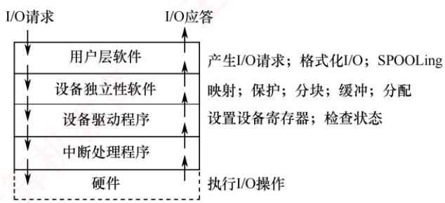

操作系统将 I/O 软件划分为自顶向下的清晰层次：<mark>请求依次经过用户层、系统调用独立层、驱动层与ISR</mark> `[真题·2011-T26 / 2012-T26]`：

```
[ 用户层 I/O 软件 ]          ← 库函数 (printf/scanf/fread)、SPOOLing 假脱机系统
       ↓ 发起系统调用 (write, read)
[ 设备独立性软件 ]          ← 逻辑设备名映射 (LUT)、设备保护、缓冲管理、设备分配与回收
       ↓ 调用底层驱动标准接口
[ 设备驱动程序 ]            ← 厂商编写、设置控制器寄存器、转换抽象命令为硬件动作
       ↓ 硬件启动并完成 I/O
[ 中断处理程序 ]            ← 响应硬件中断、读取状态、唤醒阻塞进程
       ↓ 电气控制信号
[ 硬件 (控制器 + 设备) ]     ← 物理执行机械/电子动作
```

| 层次划分 | 所处运行状态 | 核心职能与服务 | 屏蔽的底层细节 |
|---|---|---|---|
| **① 用户层 I/O 软件** | **用户态 (User Mode)** | 1. 向应用程序提供封装好的标准 I/O 库函数（如 C 库中的 `printf()`, `scanf()`, `cin`, `cout`）；<br>2. 实现格式化 I/O 转换（如将二进制浮点数转换为 ASCII 字符串）；<br>3. 包含 SPOOLing 系统的守护进程（用户态假脱机打印服务）。<br>（字符坐标语义解析与送应用区属于上层软件而非 ISR 职责） | 屏蔽内核系统调用号及复杂的参数传递格式。 |
| **② 设备独立性软件**<br>*(设备无关软件)* | 内核态 (Kernel Mode) | 1. 提供统一的系统调用接口（如 `open`, `read`, `write`, `close`）；<br>2. ***<u>将系统调用参数翻译成设备操作命令</u>***（根据设备类型选择调用对应驱动）；<br>3. ***<u>逻辑设备名到物理设备名的映射</u>***（通过逻辑设备表 LUT 实现设备独立性）； | ***<u>屏蔽了具体硬件设备的型号差异与物理特性</u>***。<br>应用程序使用逻辑设备名即可操作任何同类设备。 |
| ② 设备独立性软件（续） | 内核态 (Kernel Mode) | 4. ***<u>设备保护与访问控制</u>***（检查当前用户是否有权限访问该设备）；<br>5. ***<u>设备分配与回收</u>***（维护 DCT/COCT/CHCT/SDT，防止死锁）；<br>6. ***<u>缓冲区管理</u>***（管理单缓冲、双缓冲、缓冲池，平滑速率差异）；<br>7. ***<u>差错控制</u>***（向上层提供通用错误码）。 | 设备独立性层以逻辑块号向下提交，不直接生成物理 CHS 参数。 |
| **③ 设备驱动程序** | 内核态 (Kernel Mode) | 1. ***<u>每类设备配置一个专用驱动程序</u>***（同类多台物理设备共用同一个驱动，作为硬件与 OS 接口按硬件定制并供统一接口）；<br>2. 接收来自设备独立性软件发来的设备操作命令（<mark>将逻辑块号转换为柱面磁头扇区等物理参数</mark> `[真题·2013-T25]`）；<br>3. ***<u>向设备控制器的寄存器写入控制命令</u>***（将抽象命令转换为特定控制器序列）；<br>4. 设置 DMA 寄存器或通道程序并启动传输。<br><mark>驱动按设备类型定制且向上层提供统一访问接口</mark> `[真题·2026-T31]` | ***<u>屏蔽了设备控制器的具体电气寄存器规范、命令格式与硬件物理细节</u>***。 |
| **④ 中断处理程序** | **内核态 (Kernel Mode)** | 1. 处于操作系统最底层，直接响应硬件发出的中断请求；<br>2. 保存被中断程序的 CPU 上下文（寄存器、PC、PSW）；<br>3. 执行中断服务例程（ISR），从控制器读取传输状态与错误标志；<br>4. ***<u>将等待该 I/O 的阻塞进程唤醒（移入就绪队列）</u>***；<br>5. 恢复现场并执行中断返回指令（`IRET`）。 | 屏蔽了硬件中断信号的捕获、响应与中断向量表分发机制。 |
| **⑤ 硬件设备** | **硬件物理层** | 设备控制器（I/O 接口）与机械/电子外设本体执行实际的物理数据存取。 | / |

> [!abstract] 💡 解题核心思考模型：I/O 软件各层职责快速归类法则
> - 看到“**库函数格式化**”、“**SPOOLing 守护进程**” $\implies$ **用户层 I/O 软件**；
> - 看到“将系统调用参数翻译成设备操作命令”、“逻辑设备名转物理设备名 (LUT)”、“设备保护/访问权限”、“设备分配回收 (DCT)”、“缓冲区管理”、“通用差错报告” $\implies$ **设备独立性软件**；
> - 看到“按设备类型配置驱动（$N$ 类设备对应 $N$ 个驱动）”、“向设备寄存器写入控制命令”、“设置扇区号/磁道号”、“启动硬件马达”、“厂商针对具体型号编写”、“设置 DMA 寄存器” $\implies$ **设备驱动程序**；
> - 看到“响应硬件引脚信号”、“保存/恢复 CPU 现场”、“执行 ISR”、“唤醒阻塞进程” $\implies$ **中断处理程序**。

---

### 二、跨层系统调用执行与态转换追踪

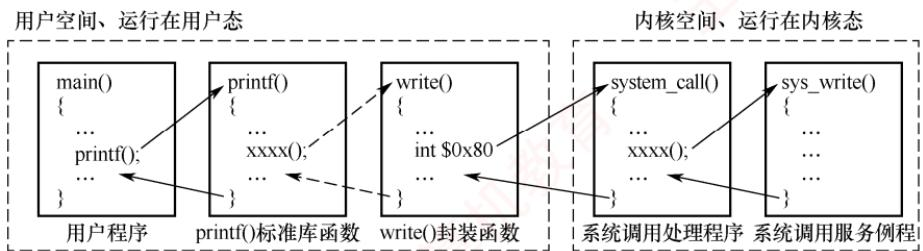

以教材的阻塞式写入模型为例，追踪 `write()` 向磁盘写入数据时的内核流转；实际系统可能先写入缓存后返回，是否等待设备完成取决于接口和配置：

1. **用户层**：应用程序调用标准库函数 `write(fd, buffer, n)`，库函数将系统调用号及参数装入寄存器，执行一条***<u>陷阱指令（Trap / Syscall / Int 0x80）</u>***；
2. **态转换（用户态 $\to$ 内核态）**：CPU 捕获软中断，硬件自动保存当前 PC 和 PSW，特权级从用户态切换为内核态，跳转至系统调用分发总入口；
3. **设备独立性层**：内核通过 `fd` 查找到对应的文件/设备对象，执行权限检查，分配内核缓冲区，将用户空间的数据拷贝至内核缓冲区；通过 LUT 定位到该设备对应的驱动程序入口；
4. **设备驱动层**：驱动程序将本次写入请求转换为磁盘控制器的具体指令（指定目标柱面、磁头、扇区），初始化磁盘控制器及 DMA 控制器，发出启动写入信号；
5. **进程阻塞与调度**：由于磁盘 I/O 相对 CPU 极其缓慢，驱动程序将发起请求的进程置为***<u>阻塞态</u>***，触发进程调度器 `scheduler()` 切换执行其他就绪进程；
6. **硬件执行与中断**：磁盘控制器与 DMA 独立将数据写入盘片扇区。写入完成后，磁盘控制器向 CPU 引脚发送硬件中断请求；
7. **中断处理层**：CPU 在指令周期结束时响应中断，执行磁盘中断处理程序，读取磁盘状态确认写入成功，***<u>将此前阻塞的进程唤醒（置为就绪态）</u>***；
8. **态转换（内核态 $\to$ 用户态）**：系统调用全部完成，执行中断/陷阱返回指令，CPU 特权级恢复为用户态，用户程序从 `write()` 处继续向下执行。

> [!important] 键盘输入 I/O 全流程（2010、2024、2026 统考高频考点）
> 先限定教材模型：用户态输入缓冲区无可用字符，发起阻塞式读取，内核也暂无可交付数据；设备采用中断方式。此时：
> 1. 用户层 `scanf()` 通过库函数发起 `read()` 系统调用，进程进入内核；无数据可交付时进入阻塞态。
> 2. 用户按键，键盘控制器向 CPU 发出中断；在教材的键盘中断模型中，<mark>首先获得键盘输入信息的是中断处理程序</mark>（而非用户程序、设备驱动或设备文件管理） `[真题易错·2010-T32]`。
> 3. <mark>ISR读取数据寄存器字符并放入内核缓冲区</mark>（而非直接送到应用程序区或仅留寄存器） `[真题·2024-T31 / 2026-T32]`；数据满足读取条件时唤醒等待进程，令其进入就绪态。
> 4. 进程重新获得 CPU 后，内核将数据复制到用户缓冲区，系统调用返回，`scanf()` 再解析并赋给变量。
>
> **条件辨析**：如果 C 库用户缓冲区已有可用数据，`scanf()` 可以直接读取，无须为本次读取再发起系统调用。终端规范模式通常按行向读取者交付数据；非规范模式的交付条件由配置决定，不能断言任何按键都要等回车或都立即唤醒。非阻塞读取数据未就绪时会返回，而不是进入上述等待流程。
---

## 5.1.4 应用程序 I/O 接口【📌 扫一眼｜确认“我还会”就过】

### 这一节要解决什么问题

操作系统向上层应用提供了哪些标准化的 I/O 接口？阻塞 I/O 与非阻塞 I/O 在进程调度与行为上有何差异？

### 一、三类标准化 I/O 接口

1. **字符设备接口（Character Device Interface）**：
   - 采用**流式访问模型**，提供 `get()`, `put()`, `read()`, `write()` 等按字节操作的系统调用；
   - 字符设备***<u>不可寻址</u>***，不支持随机跳转定位；通常采用字符缓冲队列（如终端行规程）。
2. **块设备接口（Block Device Interface）**：
   - 适用于***<u>数据传输速率高、以数据块为单位、可寻址且支持随机存取</u>***的设备（如磁盘、SSD）；
   - 采用**固定大小块模型**，提供 `read()`, `write()`, `seek()` 等系统调用（`seek` 用于指定并直接定位下一个传输数据块）；
   - 隐藏磁盘物理二维结构（柱面/盘面/扇区），向上层提供统一的线性逻辑块地址空间；
   - 支持通过内存映射文件（`mmap`）将块设备直接映射至进程虚拟地址空间。
3. **网络设备接口（Network Device Interface / Socket）**：
   - 采用 **套接字（Socket）接口标准**，提供 `socket()`, `bind()`, `listen()`, `connect()`, `send()`, `recv()` 等网络调用；
   - 结合多路复用机制（`select()`, `poll()`, `epoll()`）实现高并发网络 I/O。

---

### 二、阻塞 I/O vs 非阻塞 I/O

| 特性对比 | **阻塞 I/O (Blocking I/O)** | **非阻塞 I/O (Non-blocking I/O)** |
|---|---|---|
| **调用行为** | 当应用程序发起 I/O 调用后，若数据尚未就绪，***<u>进程立即被操作系统挂起（进入阻塞态）</u>***。 | 当应用程序发起 I/O 调用后，无论数据是否就绪，***<u>系统调用立即返回</u>***。 |
| **进程状态** | ***<u>运行态 $\to$ 阻塞态</u>***（让出 CPU，等待 I/O 完成唤醒）。 | ***<u>保持运行态 / 就绪态</u>***（不阻塞，继续占用 CPU 执行）。 |
| **数据就绪通知** | I/O 完成后，硬件中断处理程序负责将进程***<u>唤醒（置为就绪态）</u>***。 | 若数据未就绪，返回错误码（如 `EWOULDBLOCK` / `EAGAIN`）；进程通常采用**轮询循环**或**I/O 多路复用**检查状态。 |
| **适用场景** | 传统简单多线程编程、顺序读写文件。 | 高并发网络服务器（如 Nginx、Netty）、异步事件驱动架构。 |

---

## 5.1.5 一分钟回顾与小节自测【📌 扫一眼｜确认“我还会”就过】

### 一分钟核心回顾
- 块设备与字符设备的核心区别在于***<u>是否可寻址与是否支持随机访问</u>***；
- 统一编址（内存映射）占用主存空间但指令通用，独立编址需要专门的 I/O 指令；
- 四大 I/O 控制方式演进方向：***<u>CPU 干预越来越少，传送单位由字向块、批块递增</u>***；
- 中断处理程序执行时，***<u>发起 I/O 请求的进程处于阻塞态</u>***；
- 设备独立性软件负责***<u>逻辑设备名到物理设备名的映射（LUT）</u>***，驱动程序负责生成具体控制器指令。

### 小节自测清单
- [ ] 能否准确说出独立编址与统一编址在地址空间、CPU 指令及优缺点上的 3 大区别？
- [ ] DMA 控制器内部 4 大寄存器（MAR, DC, DR, CR）分别起什么作用？整块数据传输过程中 CPU 在做什么？
- [ ] I/O 软件五层结构从上到下的精确顺序是什么？“逻辑设备名到物理设备名的转换”发生在哪一层？“中断处理程序唤醒进程”使其进入什么状态？

---

# 5.2 设备独立性软件【🔥⚡ 必背+避坑｜停下来默背 1 遍 + 精读 1 分钟】

## 5.2.1 设备独立性软件的核心职能【🔥 必背｜停下来默背 1 遍】

### 这一节要解决什么问题

**设备独立性（Device Independence，又称设备无关性）**是指：***<u>用户编程时使用的设备与实际使用的物理设备无关</u>***，应用程序中所使用的设备并不局限于某一台特定的物理设备，而是使用**逻辑设备名**。***<u>当更换物理设备时，只需修改 LUT 表项或重新绑定驱动，绝无须修改应用程序代码</u>***：<mark>更换同类物理设备无需修改应用程序</mark> `[真题·2009-T32 / 2020-T30]`。

### 一、核心职能总览

设备独立性软件是 I/O 系统的核心调度中枢，主要承担以下六大职能：
1. **逻辑设备名到物理设备名的映射**：通过***<u>逻辑设备表（LUT）</u>***将用户程序中的逻辑设备名转换为系统当前可用的具体物理设备名；
2. **设备分配与回收**：管理系统的设备资源，防止并发死锁（维护 DCT、COCT、CHCT、SDT 四叉树）；
3. **缓冲区管理**：组织并管理单缓冲、双缓冲、循环缓冲和缓冲池，协调 CPU 与外设之间的速度差异；
4. **设备保护**：基于用户权限检查对设备的访问合法性；
5. **差错控制**：处理设备传输中的常见差错（暂时性错误由驱动重试，持久性错误由独立性软件记录坏块表）；
6. **提供统一的块/字符设备抽象接口**。

---

## 5.2.2 高速缓存与缓冲区【🔥⚡ 必背+避坑｜停下来默背 1 遍 + 精读 1 分钟】

### 这一节要解决什么问题

CPU 的运算速度以纳秒（ns）计，而外设 I/O 速度以毫秒（ms）计，两者存在几个数量级的巨大差距。操作系统如何利用内存空间设立**高速缓存（Disk Cache）**与**缓冲区（Buffer）**来平滑速率差异？如何精确计算单缓冲、双缓冲的数据处理时间？

### 一、磁盘高速缓存 (Disk Cache) vs 缓冲区 (Buffer)

- **磁盘高速缓存（Disk Cache）**：
  - **概念**：利用主存中的一部分存储空间，暂存从磁盘读出或写入的热点数据块；
  - **本质**：***<u>逻辑上属于外存，物理上位于主存</u>***；
  - **核心目的（2015 统考真题）**：利用局部性原理，通过***<u>提高缓存命中率，减少物理磁盘 I/O 访问次数</u>***。
- **缓冲区（Buffer）**：
  - **概念**：在主存中开辟的临时存储区域，用于暂存 I/O 设备与 CPU 之间正在传输的数据；
  - **四大核心目的**：
    1. ***<u>缓和 CPU 与 I/O 设备之间速度不匹配的矛盾</u>***；
    2. ***<u>减少 CPU 的中断频率</u>***，放宽对 CPU 中断响应时间的限制；
    3. ***<u>解决基本数据单元大小（数据粒度）不匹配的问题</u>***；
    4. ***<u>提高 CPU 与 I/O 设备之间的并行性</u>***。
  - **缓冲区管理者的核心关键问题**：***<u>实现并发进程访问缓冲区的同步与互斥</u>***（防止空缓冲区被读取、满缓冲区被覆写）。
  - **系统计算限制时的缓冲有效性**：若 I/O 所花时间远小于 CPU 处理时间（$T \ll C$，系统受 CPU 计算限制），此时 CPU 一直处于满负荷，***<u>缓冲区对提高系统吞吐率几乎无效</u>***。

---

> [!important] 教材中的差错控制
> 设备差错可分为暂时性差错和持久性差错：暂时性差错通常由驱动程序重试处理；设备独立性软件处理驱动程序无法解决的情况。持久性差错如磁盘划痕，可将坏块记录下来，使后续 I/O 避开。

### 二、单缓冲 (Single Buffer) 工作模型与计算

在单缓冲机制下，操作系统在内存中为进程分配**唯一的一个缓冲区**（大小通常等于一个数据块）。

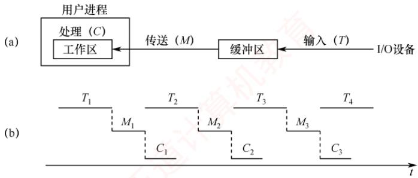

#### 1. 参数定义
- **$T$**：设备将一个数据块输入到缓冲区的时间；
- **$M$**：操作系统将缓冲区中的数据块传送到用户进程工作区的时间；
- **$C$**：CPU 在用户工作区对该数据块进行计算处理的时间。

#### 2. 工作过程与流水线分析
- 初始状态：缓冲区为空。
- 阶段 1：设备耗费时间 $T$ 将第一块数据装满缓冲区；
- 阶段 2：缓冲区向用户区传送数据耗时 $M$（此时设备不能向缓冲区写入，因为缓冲区被占用）；
- 阶段 3：数据到达用户区后，CPU 开始耗时 $C$ 计算该数据块。**与此同时，由于缓冲区已空，设备可以并行地耗时 $T$ 向缓冲区输入下一个数据块。**
- 流水线瓶颈：由于设备输入（$T$）与 CPU 计算（$C$）并行进行，两者中较慢者决定了新数据块的供给节奏；无论谁慢，将缓冲区数据传送到用户区的 $M$ 都是**无法并行的串行开销**。

#### 3. 单缓冲核心计算公式

$$\text{单缓冲处理单块数据的平均时间} = \max(T, C) + M$$

$$\text{处理 } n \text{ 个连续数据块的精确总时间} = T + M + (n - 1) \times (\max(T, C) + M) + C$$

$$\text{当 } n \text{ 较大时的近似总时间} \approx n \times (\max(T, C) + M)$$

- **真题校验**：<mark>单缓冲平均周期等于T与C较大者再加串行M</mark> `[真题·2011-T31 / 2013-T27]`（2013 题 2 块共 $100+5+(100+5)+90=300$；2011 题 10 块共 $100+50+9\times 150+50=1550\mu\text{s}$）。

> [!important] 必须记住：单缓冲公式的本质
> 因为只有一个缓冲区，***<u>缓冲区传送到用户区的动作 $M$ 绝不可能与设备输入 $T$ 并行</u>***（冲入和冲出不能同时发生在同一块内存中）。所以 $M$ 必须单列相加：$\max(T, C) + M$。

---

### 三、双缓冲 (Double Buffer) 工作模型与计算

为了消除 $M$ 带来的串行等待，操作系统为进程分配**两个大小相等的缓冲区（Buffer 1 与 Buffer 2）**，又称**缓冲对换机制**。

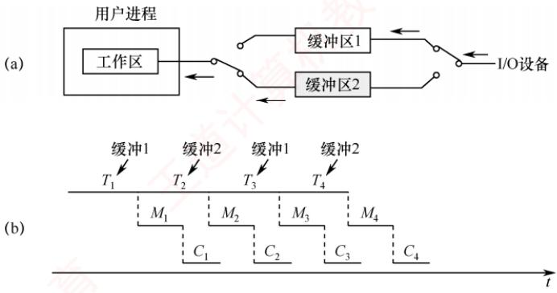

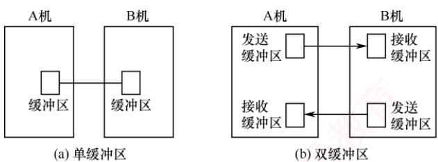

#### 1. 工作过程与流水线分析
- 初始状态：Buffer 1 与 Buffer 2 均为空。
- 阶段 1：设备耗费时间 $T$ 将第一块数据装满 Buffer 1；
- 阶段 2：
  - **分支 A（输入设备）**：设备立即转向耗费时间 $T$ 将第二块数据写入 Buffer 2；
  - **分支 B（CPU 与内存）**：系统同时将 Buffer 1 中的数据传送至用户区（耗时 $M$），紧接着 CPU 对其进行计算（耗时 $C$），总耗时为 $M + C$。
- 流水线并行度：***<u>设备向一个缓冲区灌入数据（$T$），与系统清空另一个缓冲区并由 CPU 计算（$M + C$）实现了完全的重叠并行。</u>***

> [!note] 公式适用条件
> 下式和单缓冲公式描述教材的固定流水线模型：各块的输入、传送、处理时间分别固定为 $T$、$M$、$C$，且按图示资源约束重叠。平均周期不等于首块从开始输入到处理结束的总时间；其他并行条件需画时序图。

#### 2. 双缓冲核心计算公式

$$\text{双缓冲处理单块数据的平均时间} = \max(T, C + M)$$

$$\text{处理 } n \text{ 个连续数据块的精确总时间} = T + (n - 1) \times \max(T, C + M) + M + C$$

$$\text{当 } n \text{ 较大时的近似总时间} \approx n \times \max(T, C + M)$$

- **真题校验**：<mark>双缓冲将M并入C并与下一块输入T并行</mark> `[真题·2011-T31]`（2011 题 10 块共 $100+9\times\max(100, 50+50)+50+50=1100\mu\text{s}$）。

#### 3. 单机通信 vs 双机通信中的缓冲区配置
- **单机系统**：双缓冲实现设备输入与 CPU 计算的流水线并行；
- **双机全双工通信（图 5.9）**：若要实现两台主机 A 和 B 之间的同时双向全双工数据传输，***<u>教材图示中每台机器配置 2 个缓冲区（1 个发送 + 1 个接收），两台机器共计 4 个</u>***；实际实现的缓冲组织应以题设为准。

> [!abstract] 💡 解题核心思考模型：单/双缓冲时间计算秒杀模板
> 1. **单缓冲题型**：直接套公式 $\text{Time}_{\text{单块}} = \max(T, C) + M$；
>    - 若求 $n$ 块连续总耗时：$T + M + (n-1) \times (\max(T,C)+M) + C$；
> 2. **双缓冲题型**：直接套公式 $\text{Time}_{\text{单块}} = \max(T, C + M)$；
>    - 若求 $n$ 块连续总耗时：$T + (n-1) \times \max(T, C+M) + M + C$；
> 3. **极值审题陷阱**：
>    - 题目问“系统吞吐率” $\implies$ 吞吐率 $= \frac{1}{\text{单块平均处理时间}}$；
>    - 对教材图示的模型，双机全双工共需 4 个缓冲区；其他缓冲模型按题设分析。

---

### 四、循环缓冲与缓冲池

#### 1. 循环缓冲 (Circular Buffer)
当输入与输出速率极度不平衡时，双缓冲仍可能产生等待。为此设置多个缓冲区并链接成环形队列。

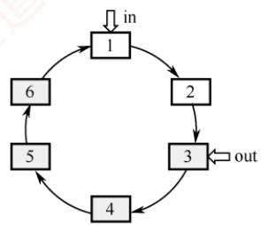

- 包含两个队列：空缓冲区队列（由指针 `NextEmpty` 指向）与满缓冲区队列（由指针 `NextFull` 指向）；
- 输入进程不断填充 `NextEmpty` 指向的缓冲区并挂入满队列；计算进程不断从 `NextFull` 取走数据并挂回空队列。

#### 2. 缓冲池 (Buffer Pool)
循环缓冲区通常由某个特定进程独占，为提高内存利用率，现代操作系统引入由系统统一管理的**公共缓冲池（Buffer Pool）**。

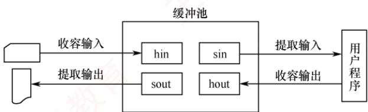

- **三大队列**：
  1. **空缓冲队列 (emq / Empty Queue)**：由空闲缓冲区链接而成；
  2. **输入队列 (inq / Input Queue)**：由装满输入数据的缓冲区链接而成；
  3. **输出队列 (outq / Output Queue)**：由装满输出数据的缓冲区链接而成。
- **四大工作缓冲区角色（408 重点辨析）**：
  1. **hin (收容输入缓冲区)**：从 `emq` 队首取出一个空缓冲区，用于***<u>接收设备输入的数据</u>***，装满后挂入 `inq` 队尾；
  2. **sin (提取输入缓冲区)**：从 `inq` 队首取出一个满缓冲区，用于***<u>向用户进程工作区传送数据</u>***，提取完毕后挂回 `emq` 队尾；
  3. **hout (收容输出缓冲区)**：从 `emq` 队首取出一个空缓冲区，用于***<u>接收用户进程要输出的数据</u>***，装满后挂入 `outq` 队尾；
  4. **sout (提取输出缓冲区)**：从 `outq` 队首取出一个满缓冲区，用于***<u>向输出设备传送数据</u>***，输出完毕后挂回 `emq` 队尾。

---

### 五、高速缓存 vs 缓冲区深度对比

| 对比维度 | **磁盘高速缓存 (Disk Cache)** | **缓冲区 (Buffer)** |
|---|---|---|
| **存放介质** | 物理内存中的特定区域。 | 物理内存中的特定区域。 |
| **逻辑归属** | ***<u>逻辑上属于外存</u>***（是磁盘数据在内存中的镜像副本）。 | ***<u>逻辑上属于内存</u>***（是暂存 I/O 传输流的临时管道）。 |
| **核心目的** | 利用局部性原理，***<u>提高数据命中率，减少访盘次数</u>***。 | ***<u>缓和 CPU 与外设速度不匹配，减少中断频率</u>***。 |
| **数据特性** | 数据保留时间长，可能被多次重复读取命中。 | 数据通常为一次性流动消费，用完即释放。 |

---

## 5.2.3 设备分配与回收【🔥 必背｜停下来默背 1 遍】

### 这一节要解决什么问题

系统中有大量的物理设备、控制器和通道。当进程申请设备时，操作系统依据什么数据结构进行检索？设备分配应考虑哪些安全性原则以防死锁？设备分配的完整四步流程是什么？

### 一、设备分配的数据结构（四叉树模型）

为了记录系统中所有设备、控制器和通道的配置与状态，操作系统维护了四张核心控制表，构成**自顶向下的四叉树形层级结构**：

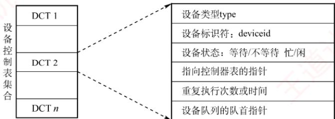

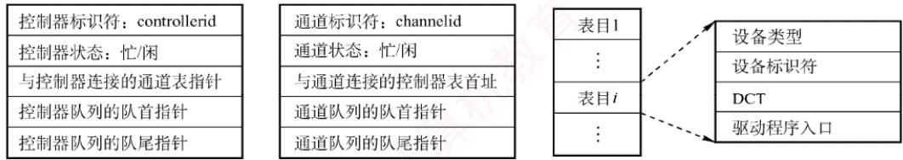

```
[ 系统设备表 SDT ] (整个操作系统仅此一张，记录系统全部物理设备)
       ↓ 指向各个物理设备的 DCT 指针
[ 设备控制表 DCT ] (每个物理设备对应一张，记录设备状态、队首指针、COCT 指针)
       ↓ 指向连接该设备的控制器 COCT
[ 控制器控制表 COCT ] (每个控制器对应一张，记录控制器状态、CHCT 指针)
       ↓ 指向连接该控制器的通道 CHCT
[ 通道控制表 CHCT ] (每个通道对应一张，记录通道状态、管辖控制器列表)
```

1. **SDT (System Device Table / 系统设备表)**：
   - **全局唯一**。记录系统中全部物理设备的总览信息；
   - 每个表项包含：设备类型、物理设备标识符、指向该设备 `DCT` 的指针等。
2. **DCT (Device Control Table / 设备控制表)**：
   - **每个物理设备一张**。记录设备类型、设备标识符、设备状态（忙/闲）、***<u>指向所连接控制器 COCT 的指针</u>***、重复执行次数、***<u>等待该设备的 PCB 阻塞队列队首指针</u>***。
3. **COCT (Controller Control Table / 控制器控制表)**：
   - **每个控制器一张**。记录控制器标识符、控制器状态（忙/闲）、***<u>指向所连接通道 CHCT 的指针</u>***、***<u>等待该控制器的 PCB 阻塞队列指针</u>***。
4. **CHCT (Channel Control Table / 通道控制表)**：
   - **每个通道一张**。记录通道标识符、通道状态（忙/闲）、通道所管辖的控制器列表、***<u>等待该通道的 PCB 阻塞队列指针</u>***。

---

### 二、设备分配考虑的因素与安全性

#### 1. 设备的固有属性
- **独占设备**：采用静态或动态独占分配（必须防死锁）；
- **共享设备**：可同时分配给多个进程，通过分时或交替寻道共享；
- **虚拟设备**：通过 SPOOLing 假脱机技术将独占设备改造为虚拟共享设备。

#### 2. 设备分配需要考虑的四大核心原则（408 高频考点）
- <mark>设备分配需兼顾固有属性算法独立性与安全性</mark>（I、II、III、IV 四项全选） `[真题·2023-T32]`：
- **I. 设备的固有属性**（独占、共享还是虚拟，决定基本分配策略）；
- **II. 设备分配算法**（先来先服务 FCFS、优先级高者优先等排队策略）；
- **III. 设备独立性（设备无关性）**（应用程序使用逻辑设备名，系统动态映射物理设备，极大提高分配灵活性）；
- **IV. 设备安全性（防范死锁）**（通过安全分配或死锁检测避免进程发生死锁）。

> [!warning] 教材习题中的设备分配因素
> 教材第 5.1 节习题 12 以设备固有属性、设备独立性和安全性为考查因素，答案将“及时性”列为不属于该题所列考虑因素。FCFS、优先级等策略仍会影响实际等待时间，不宜推广为任何系统都不考虑响应。

#### 3. 设备分配中的安全性机制（高频选择题考点）

| 安全策略 | **安全分配方式** | **不安全分配方式** |
|---|---|---|
| **分配行为** | 进程发出 I/O 请求后，***<u>立即进入阻塞态</u>***，直到本次 I/O 全部完成并释放设备后，才被唤醒继续运行。 | 进程发出 I/O 请求后***<u>继续运行</u>***，在 I/O 尚未完成前，仍可继续申请第二台、第三台设备。 |
| **死锁防范** | 在教材的设备分配模型中，进程等待期间不再请求其他资源，可避免该模型中的循环等待。 | ***<u>可能发生死锁</u>***（必须配合银行家算法或死锁检测）。 |
| **并发性能** | CPU 与当前进程无法并行，进程推进速度慢。 | 进程与 I/O 充分重叠并行，系统资源利用率高。 |

---

### 三、设备分配的完整四步流程

当进程请求使用某个逻辑设备时，系统必须***<u>自下而上依次成功分配设备、控制器与通道</u>***：

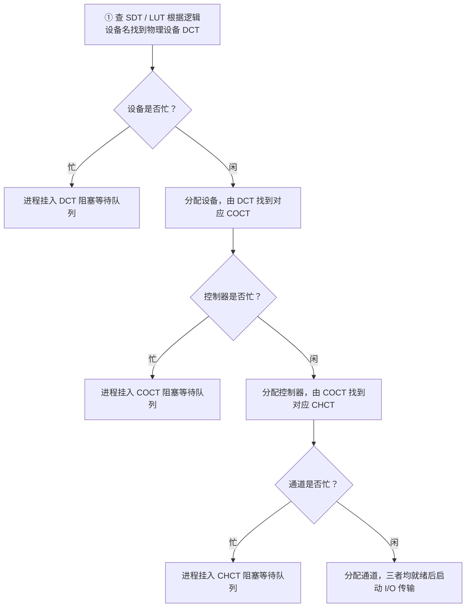

1. **第一步：分配设备**。查 SDT/LUT 找到对应 DCT，若设备忙则挂入 DCT 等待队列；若空闲则分配给该进程；
2. **第二步：分配控制器**。由 DCT 找到其连接的 COCT，若控制器忙则挂入 COCT 等待队列；若空闲则分配；
3. **第三步：分配通道**。由 COCT 找到其连接的 CHCT，若通道忙则挂入 CHCT 等待队列；若空闲则分配；
4. **第四步：启动传输**。只有当***<u>设备、控制器、通道三者均成功分配</u>***后，本次 I/O 操作才能真正开始。

---

### 四、逻辑设备名到物理设备名的映射（LUT）

为了实现设备独立性，系统必须区分设备的物理标识与逻辑标识：
- **设备的绝对号（物理设备号）**：系统按统一原则为系统中每台设备分配的***<u>全局唯一硬件编号，作为区分硬件和识别设备的唯一代号</u>***；
- **设备的相对号（逻辑设备号）**：用户在应用程序中编制的设备代号（如某类设备中的序号）。

> [!tip] 逻辑名与设备文件（2009、2020 真题）
> <mark>open请求通过逻辑设备名由LUT映射物理设备</mark> `[真题·2009-T32 / 2020-T30]`；在 Unix 类把设备抽象为特殊文件的系统中，也可以通过设备文件名访问。逻辑名经设备无关层映射到物理设备，替换同类物理设备时仅调整映射或驱动而无需改应用；题目中的主设备号、从设备号或通道号由底层使用，不应与这里的逻辑设备名混同。

操作系统内部维护**逻辑设备表（LUT / Logical Unit Table）**实现从“逻辑设备名（相对号）”到“物理设备名（绝对号）”的转换：

| 逻辑设备名 (Logical Name) | 物理设备名 (Physical Name) | 驱动程序入口地址 (Driver Entry) |
|---|---|---|
| `/dev/printer` | `lp0` (激光打印机 1 号) | `0x8048A00` |
| `/dev/tty` | `ttyS0` (物理串口终端 0) | `0x8048C20` |

- **LUT 的两种配置方式**：
  - **全局单张 LUT**：整个系统维护一张 LUT。缺点是***<u>不允许不同用户使用相同的逻辑设备名</u>***；
  - **用户独立 LUT**：为每个用户（每个进程）维护一张独立的 LUT。***<u>允许不同用户使用相同的逻辑设备名映射到不同物理设备</u>***（如用户 A 和用户 B 都请求 `/dev/printer`，分别映射到 `lp0` 和 `lp1`），灵活性极佳。

---

## 5.2.4 SPOOLing 技术（假脱机技术）【🔥 必背｜停下来默背 1 遍】

### 这一节要解决什么问题

打印机等独占设备如果直接分配给进程，可能出现设备利用率低；不当的资源分配也可能引发死锁。SPOOLing 技术如何利用高速磁盘存储空间与多道程序并发，将一台物理独占设备神奇地改造为多台虚拟共享设备？

### 一、SPOOLing 系统的四大组成要素

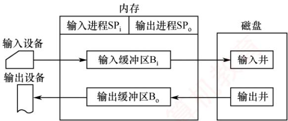

**SPOOLing（Simultaneous Peripheral Operations On-Line，同时的外围设备联机操作）**在多道程序环境下，利用输入进程和输出进程模拟早期脱机输入/输出的外围机：<mark>SPOOLing依托多道技术与磁盘井将独占改共享</mark> `[真题易错·2016-T31]`：

1. **输入井和输出井（位于高速外存/磁盘上）**：
   - **输入井**：开辟在磁盘上的专用大容量区域，用于暂存由输入设备送来的用户数据；
   - **输出井**：开辟在磁盘上的专用大容量区域，用于暂存用户进程发出且等待输出的数据。
2. **输入缓冲区和输出缓冲区（位于内存中）**：
   - 暂存内存与磁盘输入/输出井之间正在搬运的数据块。
3. **输入进程和输出进程（预输入与缓输出）**：
   - **输入进程（预输入）**：在低速输入设备工作时，由后台输入进程提前将数据从输入设备读入内存缓冲区，再写入磁盘**输入井**；
   - **输出进程（缓输出）**：当用户进程发出打印输出请求时，输出进程迅速将待打印数据写入磁盘**输出井**并挂入打印请求队列，随后向用户进程返回“输出完成”；待物理打印机真正空闲时，输出进程再从输出井依次取出数据送入打印机打印。
4. **井管理程序**：管理输入井与输出井中作业的排队与释放。

---

### 二、SPOOLing 技术的四大核心特征

1. **提高了 I/O 传输速度**：用户进程的输出操作变成了***<u>直接写入高速磁盘输出井</u>***的内存/磁盘操作，无需等待低速物理打印机逐行打印，用户程序可快速继续运行；
2. **将独占设备改造为共享设备**：物理上只有一台独占打印机，但由于输出井支持多进程并发写入，宏观上所有进程都感觉自己随时可以使用打印机；用户进程实际分配到的是***<u>外存区（虚拟设备）</u>***；
3. **实现了虚拟设备功能**：每个用户进程都以为自己拥有一台专属的逻辑打印机；
4. **无需外围控制计算机（0 台外围机）**：通过多道程序软件在主机直接控制下完成，***<u>外设与输入/输出井之间的数据传送完全由系统后台守护进程控制，绝非用户作业自行控制</u>*** `[真题易错·2016-T31]`；
5. **加速了作业周转，提高了系统吞吐量**。

> [!warning] 高频陷阱：SPOOLing 共享打印机死锁防范
> 若多个进程并发执行打印任务，且每个进程仅向输出井写入了一部分数据就去等待其他事件，输出井可能被填满而导致死锁。
> **防范思路**：输出井空间有限时，应结合空间预留、作业准入或可逐步消费的机制防止循环等待。仅要求文件全部写完才排队并不足以保证安全：若井空间被未完成的作业占满，反而可能无法继续提交和释放。

---

## 5.2.5 & 5.2.6 设备驱动程序接口与 I/O 完整流程【🔥⚡ 必背+避坑｜停下来默背 1 遍 + 精读 1 分钟】

### 1. 设备驱动程序的核心特性与五步执行流程

- **驱动程序的五步标准化处理流程**：
  $$\text{④ 将抽象要求转化为具体物理参数 (盘块号 } \to \text{ 柱面/磁头/扇区)} \longrightarrow \text{① 对服务请求进行合法性校验} \longrightarrow \text{⑤ 检查设备当前状态} \longrightarrow \text{② 向控制器寄存器传送参数} \longrightarrow \text{③ 发出命令启动 I/O 设备}$$
- **驱动程序的核心属性**：
  - **按类配置**：同一类多台设备共用 1 个驱动；负责将逻辑请求转换为 CHS 物理参数 `[真题·2013-T25 / 2019-T44]`；
  - <mark>驱动程序强依赖设备特性与IO控制方式</mark>（中断、DMA 与查询实现截然不同；进程在驱动路径等 I/O 时可进入阻塞态，初始化与读写均由其控制） `[真题易错·2022-T32 / 2026-T31]`；
  - **代码必须可重入**，支持多进程并发调用；
  - **仅负责底层硬件控制**，不负责上层数据的综合分析与业务缓冲。

### 2. 单处理机系统中的并行性判定（2009 统考真题）

在单处理机（单 CPU）系统中：
- **进程与进程**：在单 CPU 上同一时刻只能运行一个进程，**只能并发，绝不能并行**；
- **处理机与设备**：CPU 执行计算的同时，外设自主进行 I/O，**完全可以并行**；
- **处理机与通道**：CPU 与通道作为两个独立的硬件处理器，**完全可以并行**；
- **设备与设备**：多台不同的外设（如显示器与打印机、多个磁盘控制器）**完全可以并行工作**。

### 3. 键盘输入 I/O 全链路与状态变迁模型（2023、2024 统考真题）


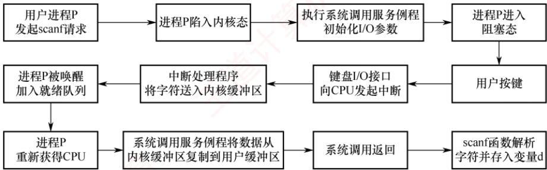

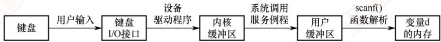

在教材 2023 年题目所设的阻塞式输入模型下，假定用户缓冲区与内核缓冲区尚无可交付数据，`scanf("%c", &d)` 读取字符的 6 步时序：<mark>键盘读取序为入阻塞按键ISR读入唤醒返回</mark> `[真题·2023-T46]`：
1. **用户程序发起系统调用**：执行陷阱指令（`Trap`）陷入内核态，由于键盘缓冲区无数据，***<u>② 将进程 P 插入阻塞队列</u>***，CPU 调度切换执行其他进程；
2. **用户按键**：***<u>⑥ 用户在键盘上输入字符</u>***，键盘控制器生成扫描码并向 CPU 发送硬件中断；
3. **响应中断**：CPU 在指令周期末响应，***<u>④ 启动键盘中断处理程序</u>***（CPU 运行在内核态，此时进程 P 仍处于阻塞态）；
4. **内核读入数据**：中断服务程序（驱动层代码）***<u>③ 将字符从键盘控制器数据寄存器读入内核系统缓冲区</u>***；
5. **唤醒进程**：中断例程调用唤醒原语，***<u>① 将进程 P 插入就绪队列</u>***（<mark>ISR结束时字符暂存于内核缓冲区等待P复制</mark> `[真题·2024-T31 / 2026-T32]`）；
6. **拷贝并返回**：进程 P 被调度程序选中执行，系统调用服务例程将字符从内核缓冲区复制到用户缓冲区，***<u>⑤ 进程 P 从系统调用返回用户态</u>***，变量 `d` 成功赋值。

> [!example]- ⚡ 真题母题 2023-T46｜键盘读取字符全链路（②⑥④③①⑤ 与驱动/调度/阻塞态转换）
> - **题目要点**：阻塞等待进程 `P` 通过中断方式从键盘读取输入字符，给出 6 个动作（`①` `P` 入就绪队列、`②` `P` 入阻塞队列、`③` 字符由键盘控制器读入系统缓冲区、`④` 启动键盘 ISR、`⑤` `P` 从系统调用返回、`⑥` 用户按键输入字符），问：（1）完整执行顺序；（2）哪个操作后 CPU 一定离开 `P`，哪个操作后调度程序才可能选中 `P`；（3）哪步代码属于键盘驱动程序；（4）键盘中断处理程序执行时 `P` 的进程状态与 CPU 工作状态。
> - **为什么这么想**：用“事件—数据—条件”因果链排先后：初始无数据可读只能先 `②` 入阻塞等待 → 没有 `⑥` 按键就不会触发 `④` 启动 ISR → 只有进入 ISR 才能执行 `③` 读控制器寄存器进内核缓冲 → 数据就位后才可执行 `①` 唤醒 `P` 入就绪队列 → 获得 CPU 并拷贝到用户区后才轮到 `⑤` 系统调用返回。
> - **标准解答**：
>   1. 正确时序：**`② → ⑥ → ④ → ③ → ① → ⑤`**；
>   2. `②` 之后 `P` 转为阻塞态，CPU 必须让给其他就绪进程；`①` 将 `P` 放入就绪队列之后，调度器才可能选中 `P`；
>   3. `③`（读取键盘控制器数据寄存器）代码属于**键盘驱动程序**（由驱动注册并由中断例程执行）；
>   4. 在尚未调用 `①` 唤醒前，进程 `P` 处于**阻塞态**；因为正在执行内核中断服务例程，CPU 处于**内核态**（一旦执行 `①` 后 `P` 即转入就绪态，答题时需注明状态切换节点）。
> - **易错步骤与个人复盘提醒**：切忌把“字符到达就绪队列 `①`”与“立即被调度运行 `⑤`”混为一谈，也不要因分层图把驱动与 ISR 画成上下两框而否定 `③` 同属键盘驱动注册代码。

---

## 5.2.7 一分钟回顾与小节自测【📌 扫一眼｜确认“我还会”就过】

### 一分钟核心回顾
- 单缓冲处理单块平均时间为 $\max(T, C) + M$，双缓冲处理单块平均时间为 $\max(T, C+M)$；
- 缓冲池包含 3 大队列（emq, inq, outq）与 4 种工作缓冲区（hin, sin, hout, sout）；
- 设备分配四步法自下而上：***<u>查 SDT 分配 DCT $\to$ 查 DCT 分配 COCT $\to$ 查 COCT 分配 CHCT $\to$ 启动 I/O</u>***；
- 教材的安全分配模型中，进程发出 I/O 请求后阻塞，等待期间不再请求其他资源，避免该模型中的循环等待；
- SPOOLing 技术核心是***<u>利用磁盘的输入井/输出井，将物理独占设备改造为逻辑共享设备</u>***。

### 小节自测清单
- [ ] 若 $T=100\mu s, M=20\mu s, C=80\mu s$，分别计算单缓冲与双缓冲处理 100 块数据的总耗时？
- [ ] 缓冲池中 `hin` 和 `sout` 分别扮演什么角色？分别从哪个队列取、挂入哪个队列？
- [ ] SPOOLing 系统的输入井与输出井开辟在内存中还是外存中？为什么说它实现了“独占转共享”？

---

# 5.3 磁盘和固态硬盘【🔥⚡ 必背+避坑｜停下来默背 1 遍 + 精读 1 分钟】

## 5.3.1 磁盘的物理结构与编址【🔥 必背｜停下来默背 1 遍】

### 这一节要解决什么问题

机械磁盘（HDD）内部由哪些机械部件构成？磁盘的物理地址为什么严格按照 `⟨柱面号, 盘面号, 扇区号⟩` 的顺序组织？如何计算磁盘的总容量？

### 一、机械磁盘的物理结构

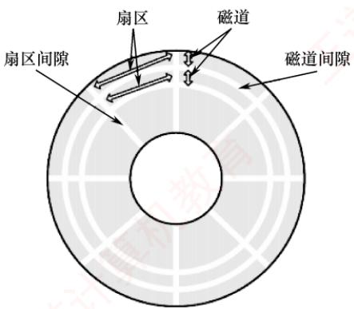

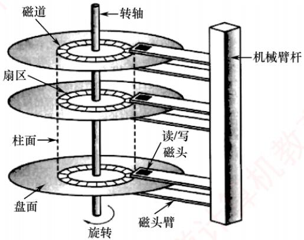

1. **盘片（Platter）与盘面（Surface）**：一个硬盘由多个垂直堆叠安装在主轴上的双面金属/玻璃盘片组成，每个盘面涂有磁性介质；
2. **磁道（Track）**：每个盘面被划分为成千上万个同心圆环，称为磁道；
3. **扇区（Sector / 盘块 Block）**：每个磁道被等角度划分为若干弧段，称为扇区。***<u>扇区是磁盘可寻址和读写的最小物理单位</u>***（通常为 512B 或 4KB）；
4. **柱面（Cylinder）**：***<u>所有盘面上半径相同、处于同一垂直圆柱面上的所有磁道的集合</u>***。柱面数在数值上等于单个盘面的磁道数；
5. **磁头（Head）**：每个盘面对应一个读写磁头。所有磁头固定安装在同一个***<u>磁头臂（Actuator Arm）</u>***上，由音圈马达驱动***<u>同步沿径向往复移动</u>***（即所有磁头在任意时刻必然位于同一个柱面上）。

---

### 二、磁盘物理地址结构及其设计哲学

磁盘物理地址在逻辑上表示为一个三元组：

$$\text{磁盘物理地址} = \langle \text{柱面号 (Cylinder)}, \text{盘面号/磁头号 (Head)}, \text{扇区号 (Sector)} \rangle$$

> [!important] 深度原理：为什么柱面号在最高位、盘面号在中间、扇区号在最低位？（408 核心考点）
> - **原因**：为了***<u>最大化减少机械寻道时间</u>***。
> - **寻道分析**：
>   - 在连续读写大文件时，若地址按 `⟨柱面号, 盘面号, 扇区号⟩` 编址，数据将按以下顺序连续写入：
>     $$\text{柱面 0 盘面 0 扇区 0..N} \to \text{柱面 0 盘面 1 扇区 0..N} \to \dots \to \text{柱面 0 盘面 } K \text{ 扇区 0..N} \to \text{柱面 1 盘面 0 扇区 0..N}$$
>   - 在写满同一个柱面的所有盘面之前，**磁头臂完全无需做任何机械移动**，只需要由控制器通过电子开关切换激活不同的磁头（电子切换耗时仅微秒级，几乎为 0）；
>   - 只有当整根柱面全部写满后，才需要移动磁头臂到相邻柱面（机械寻道耗时数毫秒）。
> - **反证**：若将盘面号放在最高位（`⟨盘面号, 柱面号, 扇区号⟩`），则读完一个盘面的磁道后，磁头臂必须在柱面间频繁往复移动寻道，I/O 性能将断崖式下跌。

---

### 三、磁盘容量计算模型

$$\text{磁盘总容量} = \text{柱面数 (磁道数)} \times \text{盘面数 (磁头数)} \times \text{每磁道扇区数} \times \text{单扇区容量}$$

> **容量计算示例**：某磁盘有 8 个盘片（16 个盘面），每盘面有 1024 个磁道，每磁道划分为 64 个扇区，每扇区 512 字节。
> 则该磁盘总容量为：
> $$\text{Capacity} = 16 \times 1024 \times 64 \times 512\text{ B} = 2^4 \times 2^{10} \times 2^6 \times 2^9\text{ B} = 2^{29}\text{ B} = 512\text{ MB}$$
> 对应的物理地址位宽：柱面号需 $\log_2(1024) = 10$ 位，盘面号需 $\log_2(16) = 4$ 位，扇区号需 $\log_2(64) = 6$ 位，总地址位宽为 $10 + 4 + 6 = 20$ 位：<mark>物理地址位宽等于柱面盘面扇区各自对数相加</mark> `[真题·2022-T44]`。

---

> [!tip] 簇号转物理位置：先确认块与扇区的比例（2019-T44 真题特例）
> 在题设每柱面 10 条磁道、每磁道 200 个扇区、每簇 2 个扇区且从 0 编号的模型中，先算每柱面 $10 \times 200 / 2 = 1000$ 簇、每磁道 $200 / 2 = 100$ 簇。簇号 100530 对应柱面 100，柱面内余 530 簇，对应磁头 5，磁道内余 30 簇，因此起始扇区号为 $30 \times 2 = 60$。**不能把簇号直接当作扇区号**；<mark>簇号转CHS需三级整除并由设备驱动程序完成</mark> `[真题·2019-T44]`。

---

## 5.3.2 磁盘的管理【📌 扫一眼｜确认“我还会”就过】

### 这一节要解决什么问题

一块全新的物理磁盘在使用前需要经历哪些初始化步骤？操作系统的引导程序（MBR、PBR）如何在磁盘上布局并启动？磁盘出现物理坏块后硬件如何透明修复？

### 一、磁盘初始化的三大步骤

| 阶段 | **① 低级格式化 (物理格式化)** | **② 磁盘分区 (Partitioning)** | **③ 逻辑格式化 (高级格式化)** |
|---|---|---|---|
| **执行主体** | 通常由***<u>磁盘制造厂商</u>***出厂前完成（或低级工具）。 | 操作系统安装程序或分区工具（Fdisk / Diskpart）。 | 操作系统格式化工具（`mkfs.ext4`, `format`）。 |
| **核心内容** | 1. 为每个磁道划分物理扇区；<br>2. 为每个物理扇区写入***<u>扇区头（包含扇区标识符/扇区号、同步字）、纠错码（ECC/CRC）及扇区尾</u>***；<br>3. 标记出厂物理坏块。 | 将物理磁盘的连续柱面划分为若干逻辑分区（如 C 盘、D 盘；主分区、扩展分区）。 | 1. ***<u>创建特定文件系统的数据结构</u>***；<br>2. 在分区上写入超级块、inode 节点表区、根目录文件；<br>3. 初始化外存空闲空间管理表（如***<u>位示图</u>***或空闲块链表）；<br>4. 创建分区引导扇区（PBR）。 |
| **与文件系统关系** | ***<u>与文件系统完全无关</u>***。 | 划分不同文件系统的容器边界。 | ***<u>深度绑定具体文件系统</u>***（如 NTFS, ext4, FAT32）。 |

> [!important] 考点追踪（2017、2021 统考核心考点）
> 问：在磁盘上建立文件系统的过程是属于什么格式化？扇区头尾的控制器使用信息在何时生成？
> 答：建立文件系统属于***<u>逻辑格式化（高级格式化）</u>***，扇区头尾与 ECC 校验码生成于***<u>低级格式化（物理格式化）</u>***阶段。

---

### 二、引导块与系统启动过程

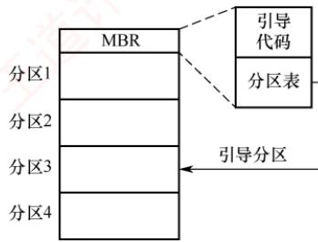

教材例子采用传统 BIOS 和 MBR 的引导模型，不能直接套用于 UEFI/GPT。其启动链条为：
1. **传统 BIOS / MBR 模型：ROM BIOS 阶段**：CPU 加电后，硬件自动从主板 ROM 中读取并执行固化的小型自举程序（BIOS），执行开机自检（POST），初始化基本硬件；
2. **主引导记录 MBR 阶段**：BIOS 读取启动磁盘的**第 0 柱面 0 磁头 1 扇区（即磁盘绝对 0 号扇区，MBR / Master Boot Record）**到内存。MBR 包含主引导代码与**磁盘分区表（DPT）**；
3. **活动分区引导记录 PBR 阶段**：MBR 代码扫描分区表，找到被标记为***<u>活动分区（Active Partition / 引导分区）</u>***的起始扇区，读取该分区的首扇区——***<u>分区引导记录（PBR / Boot Sector）</u>***；
4. **操作系统内核加载阶段**：PBR 中的引导程序读取存放在该分区中的操作系统引导管理器（如 GRUB / Windows Boot Manager），由其将操作系统内核映像（Kernel Image）加载到物理内存并初始化，完成开机。

---

### 三、坏块管理 (Bad Block Management)

1. **简单磁盘（软件层管理）**：操作系统在逻辑格式化时扫描全盘，若发现坏块，在文件分配表（FAT）中将其标记为特定坏块值（如 `0xFFF7`），文件系统不再为其分配；
2. **复杂现代磁盘（硬件固件管理）**：
   - 磁盘控制器内部维护一张**坏块表（Defect List）**；
   - 磁盘出厂时预留一部分**备用柱面/备用扇区**；
   - 采用***<u>扇区重定位 / 扇区备用（Sector Sparing / Sector Slipping）</u>***：当控制器检测到某个扇区损坏时，固件自动将该逻辑扇区号透明地重定向映射到备用扇区，**对操作系统完全透明**。

---

## 5.3.3 磁盘调度算法与存取时间优化【🔥⚡ 必背+避坑｜停下来默背 1 遍 + 精读 1 分钟】

### 这一节要解决什么问题

磁盘读取一个扇区的总时间由哪些部分构成？在多进程并发请求访问不同磁道时，如何设计调度算法来最小化寻道时间？如何利用扇区交替编号与错位命名消除旋转延迟？

### 一、磁盘存取时间构成公式

磁盘读取或写入一个扇区数据的总存取时间 $T_a$ 由三部分构成：

$$T_a = T_s + T_r + T_t$$

| 时间组成 | 物理含义与计算公式 | 数量级与性质 |
|---|---|---|
| **① 寻道时间 $T_s$<br>(Seek Time)** | 将磁头臂从当前磁道机械移动到目标磁道所需的时间：<br>$T_s = m \times \Delta n + s$<br>（$m$ 为跨道时间常数，$\Delta n$ 为跨越的磁道数，$s$ 为磁臂启动时间常数） | **约 $3 \sim 15\text{ ms}$**<br>*(最大的机械耗时项，磁盘调度的核心优化目标)* |
| **② 旋转延迟时间 $T_r$<br>(Rotational Latency)** | 磁头到达目标磁道后，等待目标扇区旋转到磁头下方的时间。<br>设磁盘转速为 $R$（转/秒）或 $\text{rpm}$（转/分），平均旋转延迟为**转半圈的时间**：<br>$T_r = \frac{1}{2R} = \frac{60}{2 \times \text{rpm}}\text{ 秒} = \frac{30000}{\text{rpm}}\text{ ms}$ | **约 $2 \sim 8\text{ ms}$**<br>*(例如 7200 rpm 硬盘 $T_r \approx 4.17\text{ ms}$；3000 rpm 硬盘 $T_r = 10\text{ ms}$)* |
| **③ 传输时间 $T_t$<br>(Transfer Time)** | 磁头扫过目标扇区，数据从扇区读出或写入的时间。<br>设每次读写字节数为 $b$，每个磁道总字节数为 $N$，转速为 $R$（转/秒）：<br>$T_t = \frac{b}{R \times N}$ | **约 $0.01 \sim 0.1\text{ ms}$**<br>*(极小，完全取决于转速与扇区密度)* |

> [!abstract] 💡 解题核心思考模型：磁带记录密度与利用率计算
> - **磁带逻辑记录长度**：$\text{Len} = \frac{\text{每条记录字符数}}{\text{记录密度}}$；
> - **磁带总利用率**：$\text{利用率} = \frac{\text{逻辑记录有效长度}}{\text{逻辑记录有效长度} + \text{块间隙长度}} = \frac{\text{Len}}{\text{Len} + \text{Gap}}$
> - 例如记录密度 400 字符/英寸，每条记录 80 字符，块间隙 0.4 英寸：$\text{Len} = 80/400 = 0.2\text{ 英寸}$，$\text{利用率} = \frac{0.2}{0.2+0.4} = 33.3\%$。

---

### 二、八大磁盘调度算法全景对比

当多个进程同时发出磁道访问请求时，操作系统的调度策略将直接决定平均寻道时间：

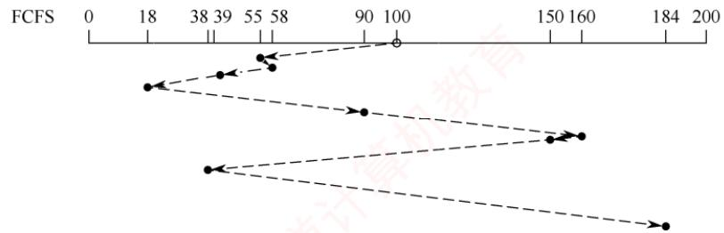

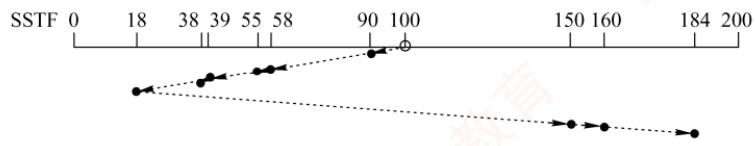

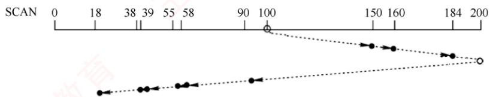

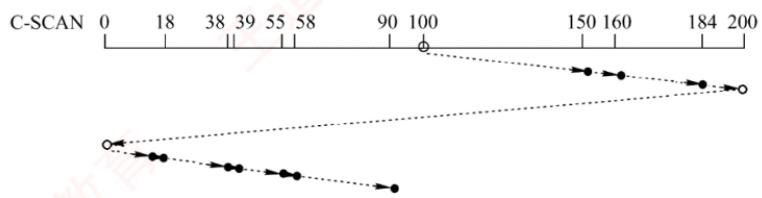

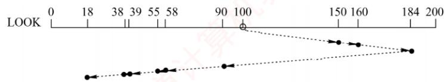

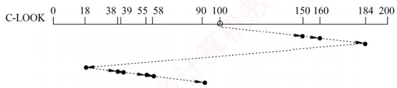

| 调度算法 | 调度策略与寻道行为 | 优点 | 缺点与局限 |
|---|---|---|---|
| **1. FCFS<br>(先来先服务)** | 按请求到达的先后次序依次移动磁头服务。<mark>FCFS按到达顺序服务不会产生磁臂黏着</mark> `[真题·2018-T30]` | 1. 按请求先后公平调度；<br>2. 算法简单，绝无饥饿。 | 平均寻道距离大，性能极差，磁头频繁往复震荡。 |
| **2. SSTF<br>(最短寻道时间优先)** | 每次总是优先选择***<u>与当前磁头所在磁道距离最近</u>***的请求进行服务。<mark>SSTF按距当前磁头最近的柱面号选择下一请求</mark> `[真题·2021-T26 / 2019-T44]` | 局部最优，平均寻道时间显著短于 FCFS。 | ***<u>会导致“饥饿”（Starvation）现象</u>***，且存在同柱面持续请求时的磁臂黏着。 |
| **3. SCAN<br>(扫描算法 / 电梯算法)** | 磁头沿单一方向移动，沿途服务所有请求；***<u>必须到达磁盘物理最边缘（如 0 道或最外道）后才折返</u>***向相反方向扫描。<mark>SCAN沿给定初向扫描到底再反向服务</mark> `[真题·2009-T29 / 2015-T32]` | 寻道性能较好，改善 SSTF 对远端请求的长期等待。 | 对两端磁道不公平，极端高频重复请求同一磁道时仍可黏着。 |
| **4. C-SCAN<br>(循环扫描算法)** | 磁头***<u>仅沿单向移动服务请求</u>***；到达物理最外端后，***<u>立即快速直接返回到物理最内端（返回途中不服务任何请求）</u>***，再次单向扫描。<mark>CSCAN按规定初向扫到底并计入回跳总道数</mark> `[真题易错·2024-T32]` | 使各磁道请求的***<u>平均等待时间更加均匀</u>***。 | 磁头必须机械地跑满整个物理行程（如 0 到 199 道，同道重复请求也可黏着）。 |
| **5. LOOK 调度** | SCAN 算法的实用改进版：磁头移动方向上***<u>只需到达最远的一个请求磁道即可提前折返</u>***，无需机械跑到物理边界。 | 避免了磁头在无请求区域的空跑，性能更优。 | 双向扫描响应时间仍有轻微波动。 |
| **6. C-LOOK 调度** | C-SCAN 算法的实用改进版：磁头单向移动到***<u>最远的一个请求磁道后，立即直接快速复位到另一端最小的请求磁道</u>***，无需跑到物理边界。 | 结合了 C-SCAN 的等待均匀性与 LOOK 的无空跑特性，可减少无请求区间的空跑。 | 算法逻辑略复杂。 |
| **7. N-Step-SCAN** | 将磁盘请求队列按到达次序固定划分为若干个***<u>长度为 $N$ 的子队列</u>***，按 FCFS 依次处理每个子队列；每个子队列内部使用 SCAN 算法调度。 | ***<u>有效避免“磁头臂黏着 / 磁头粘着”（Arm Stickiness）</u>***（防止某个进程持续申请同一磁道导致其他进程饿死）。 | $N$ 很大时退化为 SCAN，$N=1$ 时退化为 FCFS。 |
| **8. FSCAN 调度** | N-Step-SCAN 的双队列简化版：将请求分为***<u>当前服务队列</u>***与***<u>扫描期间新到达队列</u>***。扫描期间所有新请求一律放入新队列，等当前队列处理完再统一扫描新队列。 | 有效避免磁头粘着，实现简单高效。 | 实时性略逊于纯 LOOK。 |

> [!warning] 扫描算法的边界与题设
> 教材正文将到物理边界后折返的规则称为 SCAN/C-SCAN，将到最远请求即折返的改进称为 LOOK/C-LOOK，并指出实际系统中名称有时混用。综合题解析中也出现以最远请求为折返点的“C-SCAN”示例；计算时应先看题目对边界和回程的约定，回程实际移动距离一般需计入总移动距离。新请求持续到达时，SCAN/C-SCAN 在特定条件下仍可能出现磁臂黏着，不能无条件说从根本上消除饥饿 `[真题·2018-T30]`。

> [!important] 经典计算题型对比示例
> 假定磁道请求队列为：$55, 58, 39, 18, 90, 160, 150, 38, 184$，当前磁头位于 **$100$ 号磁道**，磁头正向磁道号增大方向移动。
> 1. **SSTF 序列**：$100 \to 90 \to 58 \to 55 \to 39 \to 38 \to 18 \to 150 \to 160 \to 184$（总寻道距离 $= (100-18) + (184-18) = 82 + 166 = 248$）；
> 2. **SCAN 序列（设磁盘最大为 199）**：$100 \to 150 \to 160 \to 184 \to \mathbf{199} \to 90 \to 58 \to 55 \to 39 \to 38 \to 18$（总寻道距离 $= (199-100) + (199-18) = 99 + 181 = 280$）；
> 3. **LOOK 序列**：$100 \to 150 \to 160 \to 184 \to 90 \to 58 \to 55 \to 39 \to 38 \to 18$（总寻道距离 $= (184-100) + (184-18) = 84 + 166 = 250$）；
> 4. **C-SCAN 序列（设磁盘为 0~199）**：$100 \to 150 \to 160 \to 184 \to \mathbf{199} \to \mathbf{0} \to 18 \to 38 \to 39 \to 55 \to 58 \to 90$（总移动距离 $= (199-100) + (199-0) + (90-0) = 99 + 199 + 90 = 388$）；
> 5. **C-LOOK 序列**：$100 \to 150 \to 160 \to 184 \to \mathbf{18} \to 38 \to 39 \to 55 \to 58 \to 90$（总移动距离 $= (184-100) + (184-18) + (90-18) = 84 + 166 + 72 = 322$）。

---

> [!tip] 位示图与访问时间综合（2010-T45 真题的教材解法）
> 16384 个磁盘块各用 1 位表示，共需 16384 位，即 2048 字节（2 KiB）。题设从 100 号磁道开始，教材按请求边界回转的口径得到访问顺序 120、30、50、90，磁头总移动 170 道；每道 1 ms 时寻道共 170 ms。转速 6000 转/分时平均每次旋转延迟 5 ms，4 次合计 20 ms；每磁道 100 扇区时传输 4 个扇区合计 0.4 ms，总计 **190.4 ms**。<mark>位示图按块设位而无寻道的Flash宜用FCFS</mark> `[真题·2010-T45]`。

---

### 三、减少旋转延迟时间的方法（统考极高频计算考点）

寻道时间通过调度算法优化后，旋转延迟成为新的瓶颈。操作系统与硬件通过**几何布局优化**消除旋转延迟：

#### 1. 扇区交替编号 (Sector Interleaving)


- **物理背景**：当磁头读取完一个扇区后，控制器需要一定时间将数据校验并送往内存（即 CPU 处理时间），在此处理期间，磁盘盘片保持高速持续旋转；
- **连续编号的缺陷（图 5.28a）**：若物理扇区按 $0, 1, 2, 3, 4, 5, 6, 7$ 连续紧邻排列，当读完 0 号扇区并处理完时，1 号扇区早已随盘片旋转掠过了磁头，磁头必须***<u>再等盘片旋转几乎整整一圈</u>***才能重新读到 1 号扇区。读完 8 个扇区需要转 8 圈。
- **扇区交替编号解决方案（图 5.28b）**：逻辑上相邻的扇区在物理圆周上***<u>间隔一个或多个物理扇区排列</u>***（如 $0, 4, 1, 5, 2, 6, 3, 7$）。当处理完 0 号扇区时，盘片刚好转过间隔扇区，1 号扇区恰好到达磁头下方，***<u>只需转 2 圈即可读完所有 8 个扇区。</u>***

#### 2. 错位命名 (Track Skewing / Cylinder Skewing)


- **物理背景**：多盘面同一柱面内的数据连续存放（盘面 0 扇区 0..7，紧接着盘面 1 扇区 0..7）。读完盘面 0 的最后一个扇区后，控制器切换磁头到盘面 1 仍需微小处理延迟；
- **普通命名的缺陷**：若所有盘面的 0 号扇区在几何垂直位置上完全对齐，当切换到盘面 1 时，盘面 1 的 0 号扇区已经转过磁头，同样需要多等一整圈；
- **错位命名解决方案**：***<u>让相邻盘面（或相邻柱面）的 0 号扇区在物理角度上错开固定角度</u>***。切换磁头后，下一个盘面的 0 号扇区恰好迎面转到磁头下方，无缝连贯读取。

#### 3. 提高磁盘 I/O 速度的其他优化技术（2012、2018 统考真题）
- **提前读 (Read-Ahead)**：读取当前盘块时，预先将后续相邻盘块一并调入缓冲区（以及重排请求调度次序）；
- **延迟写 / 滞后写 (Delayed Write)**：写数据先落入缓冲区并置脏位，延后集中批量刷盘；
- **磁盘高速缓存 (Disk Cache)**：在内存中暂存磁盘热点块；
- **优化文件物理块分布**：分配连续簇（减少寻道）；
- **RAM 盘**：将内存模拟为极速虚拟磁盘；
- **负优化注意**：<mark>在物理磁盘上划分多分区不提高磁盘IO性能</mark> `[真题·2012-T32]`；***<u>单纯在一个物理磁盘上划分多个分区不是直接改善 I/O 性能的方法</u>***；具体实际性能还取决于数据布局与访问负载。

---

## 5.3.4 固态硬盘 (SSD)【🔥 必背｜停下来默背 1 遍】

### 这一节要解决什么问题

现代固态硬盘（SSD）已广泛替代机械硬盘。SSD 内部基于什么介质？为什么 SSD 的读写以“页”为单位而擦除必须以“块”为单位？闪存翻译层（FTL）如何实现地址重映射与动态/静态磨损均衡？

### 一、SSD 的结构与核心读写特性

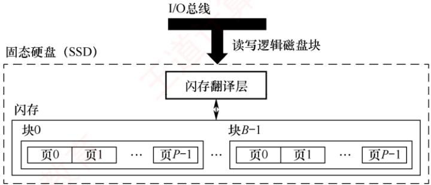

1. **基本组成**：
   - **闪存芯片（NAND Flash）**：替代了传统机械盘片与磁头，存储数据；
   - **闪存翻译层（FTL / Flash Translation Layer）**：SSD 的“内核大脑”，相当于极其智能的硬件控制器，负责地址映射、垃圾回收与磨损均衡。
2. **闪存的层级组织结构**：
   - 一个 SSD 包含多个闪存芯片；
   - 每个芯片包含数千个**块（Block，如 128~512 个页，容量 $2\text{ MB} \sim 8\text{ MB}$）**；
   - 每个块划分为数百个**页（Page，通常 $4\text{ KB} \sim 16\text{ KB}$）**。

#### 3. SSD 的四大核心读写物理特性（2025 统考新增高频考点）

```
[ 读数据 / 写空闲页 ] → 以【页 (Page)】为基本单位 (极快，数微秒)
[ 擦除旧数据 ]       → 必须以【块 (Block)】为基本单位 (较慢，数毫秒)
[ 数据修改更新 ]     → 写入已擦除的空闲页，旧页失效；旧块稍后回收擦除
```

1. **读写单位与擦除单位的不对称性**：
   - ***<u>读/写操作的基本单位是【页 (Page)】</u>***；
   - ***<u>擦除（Erase）操作的基本单位是【块 (Block)】</u>***。
2. **写前必须先擦除（Erase-before-Write / 异地更新 Out-of-place Update）**：
   - 闪存物理特性决定了：**数据只能将位从 `1` 写入为 `0`，而不能将 `0` 直接改写为 `1`**；要将 `0` 变为 `1`，必须对整个块执行高压擦除操作（将整块所有位恢复为 `1`）；
   - 因此，当需要修改一个已写入数据的物理页时，SSD ***<u>绝不能在原物理页上直接原位覆盖（In-place Overwrite）</u>***；
   - **更新流程**：FTL 将新数据写入另一个全新的空闲物理页中，修改页映射表将逻辑页指向新物理页，并将原旧物理页标记为***<u>无效状态（Invalid）</u>***。
3. **垃圾回收 (Garbage Collection, GC)**：
   - 当空闲块不足时，FTL 选择一个含有较多无效页的脏块；
   - 将该块中的所有**有效页（Valid Page）**复制迁移到另一个空闲块中；
   - 然后对原脏块执行整块擦除，使其重新变为全空闲块。
4. **有限的擦写寿命与磨损**：
   - 每个闪存块的擦写次数是有限的（SLC 约 10 万次，MLC 约 3000~5000 次，TLC 约 1000 次，QLC 约数百次）。超过擦写寿命后，该块将永久损坏。

---

### 二、磨损均衡机制 (Wear Leveling)

为了防止某个频繁写入的热点物理块过早被“写死”导致整个 SSD 报废，FTL 引入了**磨损均衡技术**，确保所有闪存块的擦写次数大致相同：

| 磨损均衡策略 | **动态磨损均衡 (Dynamic Wear Leveling)** | **静态磨损均衡 (Static Wear Leveling)** |
|---|---|---|
| **核心机制** | 当有新数据需要写入时，FTL 自动从空闲块池中***<u>挑选擦写次数较少的空闲块</u>***优先进行写入。 | FTL 定期主动扫描全盘，将***<u>长期不修改的静态冷数据（如操作系统内核文件、只读软件库）从低擦写次数的块中搬移到高擦写次数的块中</u>***，从而腾出擦写次数极少的高寿命块供频繁写入的热数据使用。 |
| **均衡深度** | 只能在“当前正在频繁写入的数据”之间进行磨损分摊；无法利用存放只读冷数据的物理块。 | ***<u>全局磨损均衡</u>***：让所有物理块（包括存放冷数据的块）都能参与到写入磨损中，***<u>寿命延长效果最好</u>***。 |
| **开销** | 算法简单，运行时开销小。 | 需要后台扫描并搬迁只读数据，存在一定的后台数据迁移开销。 |

---

> [!warning] 教材静态磨损均衡表述的前后差异
> 教材印刷第 347 页正文将迁移方向写为“高磨损块到低磨损块”，但第 355 页第 25 题解析又写为将长期未更新的冷数据迁移到高磨损块；两处方向不一致。按后者理解：将低磨损块上的冷数据迁往较高磨损块，使释放出的低磨损块参与后续写入，以平衡擦写次数。可参看 [Macronix NAND 闪存磨损均衡技术说明](https://www.macronix.com/Lists/ApplicationNote/Attachments/1913/AN0289V1-Wear%20Leveling%20in%20NAND%20Flash%20Memory.pdf)。

---

### 三、机械硬盘 (HDD) vs 固态硬盘 (SSD) 全方位深度对比表

| 对比维度 | **机械硬盘 (HDD / 温彻斯特磁盘)** | **固态硬盘 (SSD / 闪存存储)** |
|---|---|---|
| **存储介质** | 磁性旋转金属/玻璃盘片。 | 半导体 NAND Flash 闪存芯片。 |
| **机械部件** | 有（主轴电机、磁头臂、旋转盘片）。 | ***<u>无任何机械运动部件</u>***（纯芯片电子电路）。 |
| **读写单位** | **扇区 (Sector，通常 512B 或 4KB)**。 | ***<u>读写以页 (Page) 为单位，擦除以块 (Block) 为单位</u>***。 |
| **寻道与旋转延迟** | ***<u>存在显著的机械寻道与旋转延迟</u>***（毫秒级）。 | ***<u>完全无寻道时间与旋转延迟</u>***（微秒级，随机读极快）。 |
| **数据覆盖更新** | ***<u>支持原位覆盖写入 (In-place Update)</u>***。 | ***<u>不支持原位覆盖，必须写前先擦 (Out-of-place)</u>***。 |
| **擦写寿命限制** | 理论上无电气擦写次数上限（受机械磨损影响）。 | ***<u>存在严格的物理擦写寿命上限 (P/E Cycle)</u>***。 |
| **特有控制机制** | 磁盘调度算法（SCAN/C-LOOK）、扇区交替与错位命名。 | ***<u>闪存翻译层 (FTL)、垃圾回收 (GC)、磨损均衡 (Wear Leveling)</u>***。 |
| **抗震与功耗** | 抗震性差（剧烈晃动易划伤盘片），功耗与噪音大。 | ***<u>极佳抗震防摔</u>***，低功耗，零噪音，体积小巧轻便。 |
| **两者共同支持** | ***<u>文件系统均以固定大小的逻辑盘块为单位组织数据（确定盘块大小）</u>***。<mark>HDD与SSD初始化均需确定逻辑盘块大小</mark> `[真题·2025-T32]` | ***<u>文件系统均以固定大小的逻辑盘块为单位组织数据（确定盘块大小）</u>***（SSD 无磁道与扇区交替问题）。 |

---

## 5.3.5 一分钟回顾与小节自测【📌 扫一眼｜确认“我还会”就过】

### 一分钟核心回顾
- 磁盘物理地址格式为 `⟨柱面号, 盘面号, 扇区号⟩`，柱面在最高位是为了***<u>减少机械寻道</u>***；
- 物理格式化划分扇区与校验码，***<u>逻辑格式化建立文件系统数据结构（位示图/inode）</u>***；
- 存取时间 $T_a = T_s + T_r + T_t$，寻道时间 $T_s$ 占主要比重；
- ***<u>LOOK 与 C-LOOK 是 SCAN 和 C-SCAN 的提前折返优化版</u>***；
- 扇区交替编号与错位命名是为了***<u>消除 CPU 处理数据期间盘片旋转造成的整圈延迟</u>***；
- SSD ***<u>读写以页为单位，擦除以块为单位</u>***，写前先擦，靠 ***<u>FTL 磨损均衡</u>***延长寿命。

### 小节自测清单
- [ ] 为什么磁盘的编址顺序不能是 `⟨盘面号, 柱面号, 扇区号⟩`？
- [ ] 解释 SCAN、C-SCAN、LOOK、C-LOOK 四种调度算法在折返点与返回途中服务行为上的核心区别？
- [ ] 为什么 SSD 不能直接在原物理页上执行覆盖写？动态磨损均衡与静态磨损均衡的核心差异是什么？

---

# 5.4 本章疑难点与深度辨析【📌 扫一眼｜确认“我还会”就过】

## 1. 如何改进设备分配策略，以提高其灵活性和成功率？【📌 扫一眼｜确认“我还会”就过】

传统的单通路设备分配策略（`设备 → 唯一控制器 → 唯一通道`）存在单点瓶颈：只要该通路上的控制器或通道被其他设备占用，即使设备本身空闲也无法分配成功。
- **改进方案 1：引入多通路冗余结构（交叉连接）**：
  - 一个物理设备连接到多个控制器，一个控制器连接到多个通道；
  - 分配时，若主控制器忙，系统自动尝试从备用控制器和通道建立通信链路，大幅提升分配成功率与系统容错能力。
- **改进方案 2：强化设备独立性与动态分配**：
  - 用户程序一律使用逻辑设备名；系统在分配时从可用物理设备池中动态选择空闲设备，打破对特定物理设备的死板绑定。
- **改进方案 3：推广虚拟设备技术（SPOOLing）**：
  - 对适合假脱机的独占设备采用 SPOOLing，让用户作业先提交至输出井；设备队列及井空间不足时仍可能等待。

---

## 2. 用户缓冲区、内核缓冲区与零拷贝（Zero-Copy）机制辨析【💤 可跳过｜冲刺期直接跳过不看】

在传统 Linux/UNIX 的标准 I/O 中，执行一次文件网络发送（如 `read()` 从磁盘读文件再 `write()` 到网络 Socket）需要经历 **4 次上下文切换与 4 次数据拷贝**：

```
[磁盘] --(DMA 拷贝 1)--> [内核读缓冲区] --(CPU 拷贝 2)--> [用户进程工作区]
                                                                ↓
[网卡] <--(DMA 拷贝 4)-- [内核 Socket 缓冲区] <--(CPU 拷贝 3)-- [用户进程工作区]
```

- **传统流转瓶颈**：数据在内核缓冲区与用户缓冲区之间来回倒手 2 次（拷贝 2 和 3），CPU 耗费大量算力在无意义的内存搬运上。
- **零拷贝优化技术（如 Linux `sendfile()` / `splice()` 系统调用）**：
  - 允许数据***<u>直接在内核空间内部从文件读取缓冲区流转至 Socket 发送缓冲区</u>***（甚至利用 DMA Scatter-Gather 直接由网卡从文件缓冲区读取），***<u>完全绕过用户空间缓冲区</u>***；
  - 实现 ***<u>0 次 CPU 内存拷贝，仅需 2 次上下文切换</u>***，极大地释放了 CPU 算力，使现代 Web 服务器（如 Kafka、Nginx）性能提升数倍。

---

### I/O 控制方式、四层软件流转与磁盘调度选型决策树

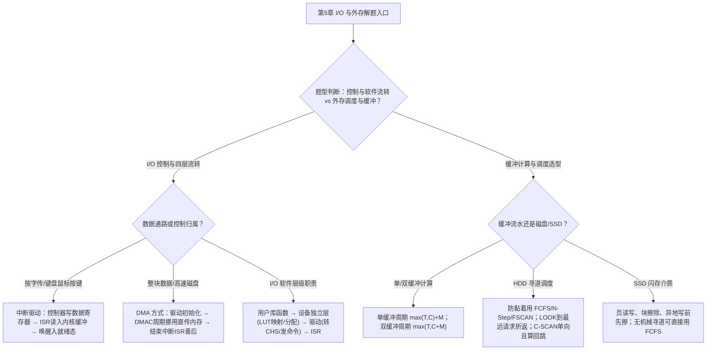

---

# 本章高频题型总表

| 题干特征 | 优先方法/起手式 | 真题印证与避坑 |
|---|---|---|
| **单/双缓冲流水线时间计算**：给出 $T$、$M$、$C$ 求单块或 $n$ 块总耗时 | 单缓冲周期 $\max(T, C)+M$，总耗时 $T+M+(n-1)(\max(T,C)+M)+C$；双缓冲周期 $\max(T, C+M)$ | `2011-T31`、`2013-T27`；切勿把单缓冲的 $M$ 并入 $\max$ 内部，教材双机全双工模型需配 4 个缓冲区 |
| **键盘/鼠标/DMA 全链路排序与状态判别**：含阻塞、中断、内核缓冲与驱动职责 | 按事件-数据因果排先后：阻塞等待 $\to$ 控制器写寄存器发中断 $\to$ ISR 读入内核缓冲 $\to$ 唤醒入就绪 $\to$ 拷贝返回 | `2010-T32`、`2017-T32`、`2022-T32`、`2024-T31`、`2026-T31`、`2026-T32`、`2023-T46`；ISR 读寄存器可属驱动注册代码，结束时数据在内核缓冲 |
| **I/O 软件层次与设备分配/SPOOLing 辨析**：含 LUT、CHS 参数与假脱机井 | 独立层管逻辑名 LUT 映射与设备保护；驱动层转物理 CHS 参数并强依赖控制方式；SPOOLing 靠磁盘井与系统守护进程 | `2009-T32`、`2011-T26`、`2012-T26`、`2013-T25`、`2016-T31`、`2020-T30`、`2023-T32`；更换物理设备不改应用 |
| **磁盘调度算法与存取时间计算**：求寻道序列、总道数及 $T_a$ | 标数轴找最近(SSTF)、看清初向与物理边界(SCAN/C-SCAN)或最远请求(LOOK)；C-SCAN 回跳距离计入总移道数 | `2009-T29`、`2015-T32`、`2018-T30`、`2021-T26`、`2024-T32`、`2010-T45`、`2019-T44`；防磁臂黏着选 FCFS/FSCAN |
| **磁盘 CHS/位图与 SSD 特性对比**：算柱面磁头扇区、多分区及页/块单位 | 簇号先除每柱面簇数再除每道簇数得 CHS；HDD 与 SSD 均需确定逻辑盘块大小；SSD 页读写块擦除且异地更新 | `2012-T32`、`2019-T44`、`2022-T44`、`2025-T32`；单纯分多区不提速，SSD 无机械寻道选 FCFS |

---

# 高频易混概念对比【🔥 必背｜停下来默背 1 遍】

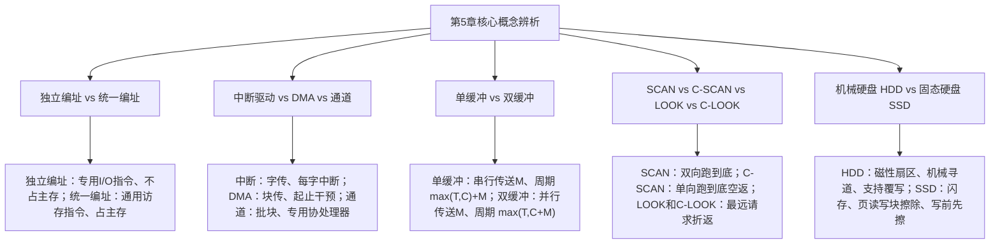

---

# 选择题快速判断结论（考前绝杀口诀）【⚡ 避坑｜最值钱，必须精读 1 分钟】

1. **全称限定与高频陷阱检查**：
   - “教材阻塞式 I/O 模型中，中断服务例程唤醒请求进程之前，该进程处于运行态” $\to$ **错误**（此时请求进程处于阻塞态）。非阻塞 I/O 不能套用此结论。
   - “DMA 方式传送数据期间，CPU 完全不能使用系统总线” $\to$ **错误**（DMAC 通常采用“周期挪用/窃取”方式，仅在有总线访存冲突时占用一个总线存取周期，CPU 仍可执行内部指令或命中 Cache 的指令）。
   - “设备独立性软件负责向设备控制器发送具体的读写电气指令” $\to$ **错误**（这是***<u>设备驱动程序</u>***的专属职责；设备独立性软件负责逻辑设备名映射 LUT、缓冲管理与设备分配）。
   - “驱动程序与 I/O 控制方式无关” $\to$ **错误**（驱动程序直接适配具体的控制方式与硬件寄存器）。
   - “低级格式化（物理格式化）会创建文件系统的根目录与空闲管理表” $\to$ **错误**（低级格式化由硬件厂商划分物理扇区和写入 ECC 校验码；创建文件系统元数据是***<u>逻辑格式化（高级格式化）</u>***的工作）。
   - “固态硬盘 SSD 修改数据时可以直接原位覆盖旧数据” $\to$ **错误**（闪存必须***<u>写前先擦</u>***，可异地写入已擦除的空闲页，旧页标记为无效，旧块可在回收时擦除）。
2. **端口与编址判断**：
   - 只要题目提到“采用专用的 `IN`/`OUT` 指令”、“I/O 端口地址不占用内存地址”，必定是***<u>独立编址（I/O 映射）</u>***；
   - 只要题目提到“采用 `MOV`/`LOAD` 通用访存指令”、“I/O 端口与内存统一编址”，必定是***<u>统一编址（内存映射 I/O）</u>***。
3. **数据单位与干预时机判断**：
   - 中断方式数据传送单位是***<u>字/字节</u>***，每字中断一次；DMA 方式数据传送单位是***<u>连续数据块</u>***，开始由 CPU 初始化，整块传输完成后发出中断；通道方式数据传送单位是***<u>一组/批数据块</u>***。
4. **双机通信全双工缓冲区数量**：
   - 实现两台机器之间的全双工通信，总共必须设置 ***<u>4 个缓冲区</u>***（每台主机 1 发送 + 1 接收；按教材所示模型）。
5. **SSD 读写与擦除单位**：
   - SSD 读写以***<u>页（Page）</u>***为单位，擦除以***<u>块（Block）</u>***为单位。
6. **磁头臂黏着防范**：
   - 能够有效防止磁头臂黏着的算法是 ***<u>N-Step-SCAN 和 FSCAN</u>***（FCFS 也不会黏着）。

---

# 本章刷题顺序建议

1. **第一阶段（基础概念与硬件架构过关）**：
   - 熟记 I/O 接口组成与独立/统一编址的 3 大核心差异；
   - 理清四种 I/O 控制方式的演进脉络，深刻理解 DMA 控制器内部四大寄存器（MAR, DC, DR, CR）的功能；
   - 牢记 I/O 软件五层架构及各自职责（重点区分设备独立性软件 vs 设备驱动程序）。
2. **第二阶段（核心计算专题攻坚）**：
   - **单/双缓冲专题**：熟练推导并计算单缓冲 $\max(T,C)+M$ 与双缓冲 $\max(T, C+M)$ 的单块处理时间与多块流水线总时间（精做 2011、2013 统考真题）；
   - **磁盘存取时间与调度专题**：掌握存取时间三大组成计算（$T_a = T_s + T_r + T_t$），熟练在数轴上画出 SSTF、SCAN、C-SCAN、LOOK、C-LOOK 的寻道轨迹并计算移动总距离（精做 2010、2014、2018 统考真题）；
   - **扇区交替编号与错位命名专题**：掌握盘片旋转与扇区处理时序推演，计算多扇区连续读盘的旋转延迟时间。
3. **第三阶段（高级机制与固态硬盘攻关）**：
   - 梳理设备分配四叉树结构（DCT-COCT-CHCT-SDT）与安全/不安全分配策略；
   - 掌握 SPOOLing 系统的四大组成要素及其将独占打印机改造为虚拟共享设备的原理；
   - 重点掌握固态硬盘（SSD）的页读写/块擦除不对称性、FTL 映射、垃圾回收与动态/静态磨损均衡（重点把握 2025 考纲新动向）。
4. **第四阶段（真题综合大题回填）**：
   - 刷透 2010（C-SCAN 结合位示图大题）、2017（DMA 工作流程与中断进程状态）、2019（磁盘容量、调度与簇地址转换）、2023（键盘 I/O 控制流）等真题，将错题心得提炼回填至下方错题区。

---

# 小节自测清单

- [ ] 能否准确画出设备控制器内部结构，并说出控制寄存器、数据寄存器、状态寄存器的用途？
- [ ] 能否清晰对比独立编址与统一编址在指令集、地址空间占用及译码硬件上的优缺点？
- [ ] 能否复述 DMA 方式的工作三阶段，并指出在整块数据传输期间 CPU 处于什么状态？
- [ ] 能否写出 I/O 软件五层架构自顶向下的完整顺序，并说明各层分别向上屏蔽了什么细节？
- [ ] 能否独立推导单缓冲与双缓冲处理单块数据的平均时间公式？
- [ ] 能否准确说出 DCT、COCT、CHCT、SDT 四张表之间的自顶向下层级指针关系？
- [ ] 能否阐明 SPOOLing 技术实现“独占转共享”的本质原理（输入井与输出井的作用）？
- [ ] 能否解释为什么磁盘物理地址必须按照 `⟨柱面号, 盘面号, 扇区号⟩` 的次序编址？
- [ ] 能否在草稿纸上分别画出 FCFS、SSTF、SCAN、C-SCAN、LOOK、C-LOOK 的磁道遍历轨迹？
- [ ] 能否准确说明为什么扇区交替编号和错位命名能够大幅降低旋转延迟？
- [ ] 能否详细说明 SSD 固态硬盘“读写以页为单位、擦除以块为单位、写前先擦”的物理原因，并对比动态与静态磨损均衡？

---

# 刷题后补充区

> [!todo] 错题回填
> 刷题遇到错题时，不抄冗长题干，只提炼：错因、关键隐藏条件、正确切入点、可复用结论与下次检查动作。

## 错题模板示例 1：单缓冲与双缓冲处理时间混淆

- **错因**：在计算单缓冲时间时，误将 $M$（传送时间）并入了 $\max(T, C)$ 内部，算成了 $\max(T, C, M)$。
- **关键条件**：系统只提供 1 个缓冲区，设备输入与向用户区传送必须串行。
- **正确切入点**：单缓冲下缓冲区冲入与冲出无法重叠，故 $M$ 必须单列相加：$\text{Time} = \max(T, C) + M$；双缓冲下两缓冲区轮替，输入与传送+计算完全重叠：$\text{Time} = \max(T, C + M)$。
- **可复用结论**：单缓冲加在 $\max$ 外面，双缓冲加在 $\max$ 里面的 $C$ 旁边。
- **下次检查动作**：审题第一步：圈出是“单缓冲”还是“双缓冲”。

## 错题模板示例 2：SCAN 调度与 LOOK 调度的边界空跑混淆

- **错因**：在计算 LOOK 调度时，误将磁头移动到了磁盘的物理边界（如 0 道或 199 道），导致总寻道距离算大。
- **关键条件**：题目明确指定算法为 **LOOK**（而非传统的 SCAN）。
- **正确切入点**：按教材正文的严格定义，SCAN 到物理极值点后折返，LOOK 到当前方向最远请求点折返；同名算法的具体边界应按题设。
- **可复用结论**：按 LOOK/C-LOOK 的定义，折返点由待服务的最远请求决定；该请求恰在物理边界时，磁头也会到达边界。
- **下次检查动作**：在数轴上标出请求点后，核对折返点是否是请求点本身。

## 错题模板示例 3：SSD 覆盖写与擦除特性混淆

- **错因**：误以为 SSD 在修改文件时可以直接覆盖原位置的闪存页。
- **关键条件**：SSD 闪存的电气特性（只能从 1 写成 0，无法直接从 0 改写为 1）。
- **正确切入点**：更新数据必须写入新的空闲页，原页作废标记为 Invalid，整块通过 GC 擦除后才能重用。
- **可复用结论**：SSD 读写以页为单位，擦除以块为单位，不支持原地覆盖写。
- **下次检查动作**：遇到 SSD 考题，重点核对“页写”、“块擦”、“写前先擦”、“磨损均衡”四大关键词。

---

# 冲刺主动回忆卡（遮挡自测）

### 卡片 1｜键盘/鼠标中断读取与 ISR 缓冲区归属（2010-T32 / 2024-T31 / 2026-T32）
用户按下键盘或移动鼠标后，首先获得输入数据的是哪一层软件？ISR 执行完毕后输入字符停留在哪里？为什么常误选用户程序或用户缓冲区？

> [!success]- 正确解释
> 1. 控制器硬件先将字符或坐标写入**控制器数据寄存器**并发送中断；随后**中断处理程序（ISR）**是首先从控制器数据寄存器读入数据的软件；
> 2. ISR 结束时输入字符停留在**内核缓冲区**（尚未 `copy_to_user` 到应用缓冲区）；
> 3. 个人历史错因是把“用户调用 `read()` 发起请求”混为“按键后数据到达软件层”的数据路径。

### 卡片 2｜设备驱动程序依赖边界与可注册 ISR（2022-T32 / 2026-T31）
设备驱动程序到底和哪些因素强相关？为什么同属“ISR 读键盘寄存器”代码却可以说属于键盘驱动程序？

> [!success]- 正确解释
> 1. 设备驱动程序**强依赖具体设备类型与 I/O 控制方式**（查询/中断/DMA 写法完全不同），同时为 OS 提供统一上层接口（字符设备与块设备 I/O 方式不同）；
> 2. 分层图按职责拆分逻辑模块，实际编写时设备驱动可注册自己的中断处理函数（如 `2023-T46` 操作 ③ 读控制器寄存器），因此“由 ISR 执行”与“代码属于驱动”并不矛盾；注意在内核驱动路径等待时进程可阻塞，但不能说任意中断可随意睡眠。

### 卡片 3｜单缓冲 vs 双缓冲精确计算防混（2011-T31 / 2013-T27）
某系统读入 2 块数据，每块输入时间 $T=100$，传送至用户区时间 $M=5$，CPU 处理时间 $C=90$。分别求单缓冲与双缓冲耗时，并说明两公式最容易混在哪里？

> [!success]- 正确解释
> 1. 单缓冲精确总耗时 $= T+M+(n-1)(\max(T,C)+M)+C = 100+5+(100+5)+90 = 300$；
> 2. 双缓冲精确总耗时 $= T+(n-1)\max(T,C+M)+M+C = 100+\max(100,95)+95 = 295$；
> 3. 极易误将单缓冲周期算成 $\max(T,C,M)$：单缓冲只有 1 块缓冲内存，冲入 $T$ 与冲出 $M$ 不能并行，必须单列 $+M$。

### 卡片 4｜C-SCAN 初始方向/边界回跳与 Flash 调度选型（2010-T45 / 2018-T30 / 2024-T32）
给定 `0~399` 磁道且刚访问 `200` 号磁道、正向**磁道号减小方向**移动，请求为 `300,120,110,0,160,210,399`，用 C-SCAN 求总移动道数；若未给物理边界的 `2010-T45` 又怎么处理？改用 Flash 后该选哪种调度？

> [!success]- 正确解释
> 1. 盯清初始方向（减小）且给了物理端点 `0~399`：$200 \to 160 \to 120 \to 110 \to 0 \to 399 \to 300 \to 210$，空返 `0->399` 必计入距离：$(200-0)+(399-0)+(399-210)=788$ 道；
> 2. `2010-T45` 题干未给总磁道范围，按官方口径在请求边界 `120->30` 回跳（共 `170` 道、`190.4 ms`）；防磁臂黏着用 **FCFS / N-Step-SCAN / FSCAN**，Flash 无机械寻道选 **FCFS**。

### 卡片 5｜簇号 SSTF/CHS 转换与 HDD/SSD 逻辑共性（2019-T44 / 2025-T32）
给出柱面/磁道/扇区和簇号，怎样不出错地用 SSTF 排序和换算 CHS？HDD 与 SSD 在格式化阶段共有什么决策？

> [!success]- 正确解释
> 1. SSTF 比的是**柱面号距离**而非原始簇号之差：先算每柱面簇数与每磁道簇数，三级整除求柱面号后再按距离排序，最终答案再写回原簇号；CHS 转换由**设备驱动程序**完成；
> 2. HDD 与 SSD 在文件系统逻辑格式化阶段均须**确定逻辑盘块（簇）大小**，而低级划磁道与扇区交替仅属 HDD 机械盘管理。
